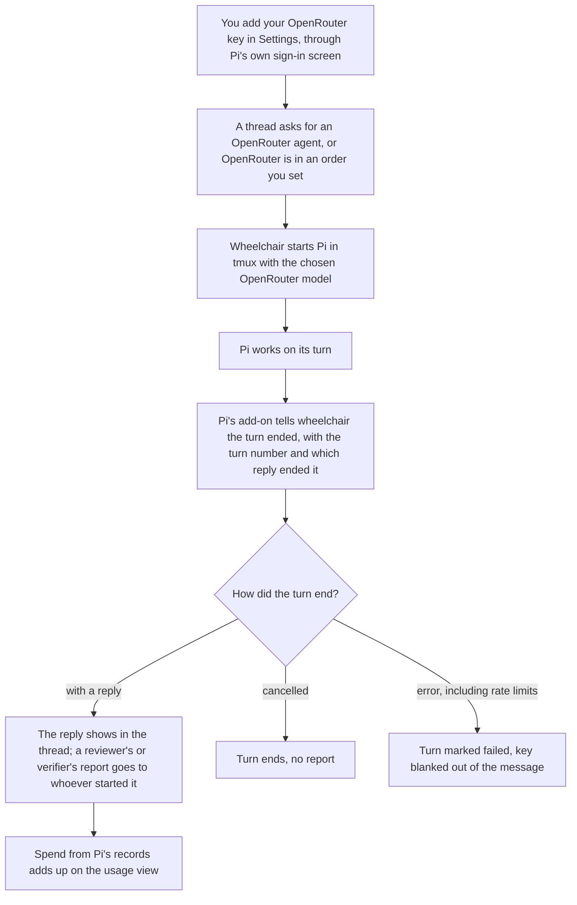

# OpenRouter models as wheelchair agents

**Idea:** `IDEA.md` — read it first. **Map:** `MAP.md`.

## Open Questions

_None._

## Watch List

| # | Noticed | What needs looking into | Raised to user? | Outcome |
|---|---------|-------------------------|-----------------|---------|
| 1 | Pi runs tools with no approval prompt | How other harnesses are launched | no | Settled: Decision 3 |
| 2 | Kimi limits model ids to one slash | OpenRouter id format | no | Settled: Decision 5 |
| 3 | Roles | Which roles may use the provider | no | Settled: Decision 4 |
| 4 | Key handling | Where the key lives and how it is checked | yes | Promoted to Q2 |
| 5 | Review families | OpenRouter can serve Claude or GPT models; cross-family review counts providers | no | Settled: Decision 6 |

## Decision Log

Append-only. A reversal is a new entry superseding the old, never an edit.

| # | Decision | Rationale | Source |
|---|----------|-----------|--------|
| 1 | Plan mode two-part | User's choice: build for day-to-day use first, harden in a follow-up | user |
| 2 | Build on Pi (`earendil-works/pi`, `@earendil-works/pi-coding-agent`), not OpenCode | Documented turn-end event, JSONL transcript chosen by `--session-id`, per-message usage, plain auth file; OpenCode's v2 transcript and turn-end are undocumented | user |
| 3 | Pi agents run without approval prompts, like Claude `auto`, Kimi and Antigravity today (`machine/adapters/claude.js:74`, `kimi.js:128`, `agy.js:67`). Always pass `--approve`. Reviewers get Pi's read-only tool set if Pi offers one (checked in the dry run); if not, same as Kimi, which ignores role | Matches existing providers; Codex's sandbox is the only stricter one | defaulted |
| 4 | The new provider may fill every role Kimi can (lead, sub-lead, mapper, worker, reviewer, verifier), governed by the same Settings orders | Consistency with Kimi (`viewer/app/balancer.js:29-50`) | defaulted |
| 5 | Model ids accept OpenRouter's `vendor/model` form with an optional `:variant` suffix (e.g. `:free`), up to 64 characters, in the hub, Settings page and `codex/model.sh` | That is OpenRouter's id format | defaulted |
| 6 | The provider is named `openrouter` and counts as its own family for cross-family review, whatever model it serves | Simplest; a mismatch only matters when it serves the same family as the other reviewer | defaulted |
| 7 | The key is entered in the app: Settings offers sign-in for OpenRouter like other providers, opening Pi's own login (`/login openrouter`) in the login pane; status reads only whether `auth.json` has an `openrouter` entry or `OPENROUTER_API_KEY` is set, never the key itself | User's choice; matches the other providers | user |
| 8 | Show OpenRouter spend in this first part, on the usage view | User's choice | user |
| 9 | Turn ends come through the existing hook path (`machine/hook.sh`), fired by a per-session Pi extension on `agent_settled`, not a log poller like Kimi's | Pi documents the event; the hook path is the simpler, proven route | defaulted |
| 10 | Default model for every slot is `openrouter/auto` (OpenRouter's own router); the user changes pins in Settings | Never goes stale; works with any key | defaulted |
| 11 | No effort/thinking setting and no side conversations (asides) on OpenRouter sessions in this part | Same as Kimi; hardening for the follow-up | defaulted |
| 12 | Spend is summed from the `cost` Pi records on each reply in its session logs, offline; no call to OpenRouter's API | No key handling beyond Pi's own; the dry run confirms the cost is recorded | defaulted |
| 13 | OpenRouter is not auto-added to the placement orders; the user adds it in Settings | Avoids silent pay-per-use spend | review-round-1 |
| 14 | Sign-in status reads only Pi's `auth.json`; the `OPENROUTER_API_KEY` env route is dropped | Keeps the key out of every pane's environment | review-round-1 |
| 15 | Supersedes 5: OpenRouter model ids follow one grammar, `^[a-z0-9][a-z0-9._-]*/[a-z0-9][a-z0-9._-]*(:[a-z0-9][a-z0-9._-]*)?$`, at most 128 characters in total | One rule, testable at the edges | review-round-1 |
| 16 | Code submission for every provider deletes its tmux buffer after pasting (`paste-buffer -d`, `delete-buffer` on failure) | A deliberate exception to IDEA's "not changing the existing providers": it only removes leftover pasted secrets and changes nothing users see | review-round-2 |
| 17 | An explicit provider request places on that provider even when it is outside the placement orders | Makes Decision 13 workable: OpenRouter is used only when asked or added to an order | review-round-2 |
| 18 | OpenRouter rate-limit and credit errors are turn failures, never `limit-hit` | No usage windows to cool down against; the account stays usable | review-round-2 |
| 19 | Extends 16: every provider's code submission targets its login pane exactly; only Pi refuses a submission once its key prompt is gone | Exact targeting is invisible; the visible refusal is limited to the new provider | review-round-3 |
| 20 | After three unclean rounds, keep the plan as is and run another review round | User's choice over simplifying sign-in or building now | user |
| 21 | If Pi needs `extended-keys`, set the tmux server option to `on` | tmux has no per-session scope for it; `on` only affects programs that request it | review-round-4 |
| 22 | Extends 21: set only when the current value is `off`, accepting that it also applies to the user's own tmux sessions on the default server | Harmless with `on`; a user's own setting is kept | review-round-5 |
| 23 | After rounds 4–6 without a clean pass, approve the plan as it stands; round 6's fixes are not re-reviewed | User's choice: remaining findings were narrow edge cases that verification checks against the built code | user |
| 24 | Supersedes 21, 22 and the Spec's tmux start order: no `extended-keys` check-and-set and no shell-then-`respawn-pane` start; Pi panes start like Kimi's | Dry run: plain Enter and bracketed multi-line paste submit with `extended-keys off` | lead |
| 25 | Supersedes Decision 7's `/login openrouter`: the login pane runs `pi auth login openrouter --api-key` (honouring `PI_CODING_AGENT_DIR`); `wantsCode` while `Enter OpenRouter API key:` shows; done on `Saved API key for OpenRouter` or exit 0, failed otherwise; no URL path. Exact target, buffer deletion, Pi-only stale-prompt refusal and pane redaction stay. Settings' paste field reads "Paste your OpenRouter key" | Dry run: the TUI login has an OAuth-first menu, swallows the first Enter and echoes the key; the one-shot command hides it and exits | lead |
| 26 | Spend sums `message.usage.cost.total` on assistant entries whose `message.provider` is `openrouter` | Dry run: that is where Pi records cost | lead |
| 27 | Reviewers run with `--tools read,grep,find,ls`; the role prompt goes in with `--append-system-prompt <file>` and `typesRoleMessage: false` | Dry run confirmed both flags | lead |

## Spec

### Flow



The flow above repeats the sections below: sign-in (Machine adapter), placement (Identity),
turn ends and reports (Machine adapter, Hub) and spend (Hub).

### Harness

The new provider runs the Pi coding agent (`pi`, from `earendil-works/pi`) with Pi's built-in
`openrouter` provider. Facts from Pi's docs (2026-11-19, unverified by a run; the first
build task confirms them with a dry run and records any difference in the Log):

- Launch: `pi [message]` in the session's working directory; `--provider`, `--model`,
  `--session-id <uuid>`, `--approve` (skips the project-trust prompt).
- Turn end: an extension (global `~/.pi/agent/extensions/`, or `-e <file>`) can listen for
  `agent_settled`.
- Transcript: `~/.pi/agent/sessions/--<cwd>--/<timestamp>_<uuid>.jsonl`; header line
  `type: session`, then `type: message` lines; assistant messages carry `usage` and `cost`.
- Credentials: `~/.pi/agent/auth.json` keyed by provider, or `OPENROUTER_API_KEY`.
- tmux needs `extended-keys` on for Pi's Enter handling.

### Identity

- Provider id `openrouter`, label `OpenRouter`, CLI id `pi`. Registry entry in
  `viewer/app/providers.js`: `effort: false, preflight: false, asideFork: false,
  singleAccount: false`, `typesRoleMessage` per the dry run (true unless Pi takes a system
  prompt file at launch).
- Add `openrouter` / `pi` everywhere providers are enumerated: `codex/model.sh` (PROVIDERS,
  DEFAULTS, usage text, pin parsing), `viewer/app/providers.js`, `viewer/app/settings.js`
  (PLANS `{ unknown: 1 }`, review-family values), `viewer/app/routes.js`,
  `viewer/pages/settings.js`, `viewer/pages/threads.js`, `viewer/pages/thread.js`,
  `viewer/app/chat.js`, `viewer/app/usage.js`, `machine/adapters/index.js`,
  `machine/service.js` (CLI name checks), `install.sh` (detect `pi` on PATH, add its directory
  to the service PATH; never install Pi), `viewer/app/API.md`, `machine/API.md`,
  `viewer/AGENTS.md`, `machine/AGENTS.md`, `README.md`, and the provider enums in
  `protocol/app/lead.md` and `protocol/app/sub-lead.md`.
- OpenRouter is pay per use, so it is **not** added to `lead_order` or `worker_order`
  automatically: settings normalization marks it seen without appending it, and the user adds
  it in Settings. Defaults keep it out of both orders.
- An explicit `--provider openrouter` request (worker, reviewer, verifier) places on
  OpenRouter even when it is not in `worker_order`: in `viewer/app/balancer.js`, when the
  requested provider is `openrouter` and absent from `order`, it is evaluated for availability for that request
  only (the loop at `balancer.js:55-60`), so `available[provider]` is set and the existing
  pick at `:66` applies. Placement without a provider request is unchanged, and a request
  for any other provider removed from the order behaves exactly as today. When `review_families` is not `both`, its existing
  override (`balancer.js:38-47`) still wins over a reviewer's or verifier's requested provider.
- Roles: every role Kimi can fill (Decision 4). Counts as its own family (Decision 6).

### Model ids

`openrouter` pins match `^[a-z0-9][a-z0-9._-]*/[a-z0-9][a-z0-9._-]*(:[a-z0-9][a-z0-9._-]*)?$`
and are at most 128 characters in total (OpenRouter's `vendor/model[:variant]`); the `none`
sentinel ("Not used", `viewer/app/routes.js:266`, `codex/model.sh:94,371,442`) stays valid in
both the writer and the pin-file parser. Enforced
identically in `codex/model.sh`, `viewer/app/routes.js` and `viewer/pages/settings.js`, each
tested with: 128 accepted, 129 refused, no slash refused, two slashes refused, `a/b:` and
`a/b::c` refused, `a/b:free` accepted, `none` saved and reloaded. Other providers'
rules are unchanged. Defaults: `openrouter/auto` for light, standard, heavy, critical and
lead.

### Dry run (first build task)

Pi installed on the machine and an OpenRouter key saved in Pi (the user runs `pi` then
`/login openrouter` once by hand) are prerequisites for building. If either is missing, the
sub-lead stops and asks the lead, who asks the user; nothing is built from guesses. Install
nothing. Run Pi once in a scratch directory under tmux and record in the plan's Log: the exact
launch flags for provider and model (does `--model openrouter/auto` with `--provider
openrouter` work), the ready-screen text, whether `--approve` removes the trust prompt,
whether `extended-keys` is needed, the extension API shape for `agent_settled` and tool events,
the transcript path and the assistant `usage`/`cost` fields for an OpenRouter reply, whether
Pi has a read-only tool set flag, whether it takes a system-prompt file, and what `/login
openrouter` shows (URL, key prompt, or both) and what it shows once signed in. To see the
login screens on a machine already signed in, use a scratch `PI_CODING_AGENT_DIR`. Save a
sample transcript (with a completed turn, an aborted turn and a failed turn if one can be
produced, e.g. with an invalid model id) under `docs/plans/openrouter-harness/samples/`, with
nothing secret in it. Any fact that differs from this Spec is reported to the lead before building on it.

### Machine adapter `machine/adapters/pi.js`

Same contract as the others (`machine/adapters/index.js:2-4`):

- `command`: writes a per-session extension file under the machine state dir (like Claude's
  per-session settings file) and returns argv `pi --provider openrouter --model <pin>
  --session-id <cli_session_id> --approve -e <extension>` plus the role prompt per the dry run.
  Reviewers get Pi's read-only tool set when one exists. Account dirs use
  `PI_CODING_AGENT_DIR=<account dir>`; the default account uses `~/.pi/agent`.
- `machine/hook.sh` gets a `pi)` case (session name in `$2`, payload on stdin) dispatching
  to the `pi` adapter through `machine/lib/hook-post.js`.
- The extension, on `agent_settled`, runs `machine/hook.sh pi <session name>` with a JSON
  payload holding:
  - `turn`: the number of user-message entries in the session so far (1 for the first turn).
    It only grows, survives a Pi restart on the same session file, and is the event's
    `turn_id`, which the hub uses as an increasing watermark (`viewer/app/sessions.js:567`).
  - `entry_id`: the id of the last assistant entry **after the last user entry**, or null if
    this turn wrote none (aborted or failed before any reply).
  - `aborted` (from the event), and the `stopReason` and error text of that entry if any.
  The payload carries no transcript path.
- `hookEvent` maps it like Kimi's turn ends (`machine/service.js:936-945`): completed →
  `{ type: 'turn-ended', turn_id, entry_id }`; aborted → the same with `interrupted: true`;
  an error stop, or `entry_id` null without `aborted` → `turn-failed` with the error text (or
  "Pi ended the turn without a reply"). OpenRouter never emits `limit-hit`: rate limits and
  exhausted credits arrive as `turn-failed` with OpenRouter's message, so no cooldown is
  recorded and the account stays eligible.
- Error text is redacted in `hookEvent`, before anything is spooled or forwarded: every match
  of `sk-or-[A-Za-z0-9_-]+` becomes `[redacted key]`.
- The transcript is bound only by `findTranscript` (the account's `sessions/` tree, file name
  ending `_<cli_session_id>.jsonl`), never from a path in a hook payload, and the bound path is
  what `copyTranscript` reads. A missing transcript does not hold up the event: it is
  forwarded and the hub ends the turn without a report. If Pi's API offers tool start/end events, map them to
  `step` events as Claude does; otherwise send none.
- tmux: if the dry run shows Pi needs `extended-keys`, the machine, when it starts a Pi
  session, sets the server option `extended-keys on` (not `always`) only if its current value
  is `off`; a value the user already set is left alone. Wheelchair uses the user's default
  tmux server (`machine/service.js:828-834`), so this also reaches the user's own tmux
  sessions; with `on`, tmux sends extended key sequences only to programs that ask for them,
  so other programs see no change. The same check-and-set runs before Settings opens a Pi
  sign-in pane, since sign-in can be the first Pi pane on a fresh tmux server. Order, for
  both: create the tmux session running a plain shell (`new-session -d`, which also starts
  the server if none is running), then check and set the option, then start Pi in that pane
  with `respawn-pane -k` and the Pi argv, so Pi never starts before the option is set. The existing machine readiness tests for the
  other CLIs must still pass with the option set.
- `readyText`/`answerPrompts`: from the dry run's screens. There are no per-tool approval
  prompts.
- `findTranscript`: the `*_<cli_session_id>.jsonl` file under the account's
  `sessions/` tree.
- `loginStatus(dir)`: signed in when the account's `auth.json` has an `openrouter` entry.
  `OPENROUTER_API_KEY` in the environment is ignored for status and never set by wheelchair. It reads `auth.json` only to test
  for the key's presence and returns booleans and fixed problem strings, never the key.
- `loginCommand`/`parseLogin`/`loginPrompt`/`loginDone`: open Pi and drive `/login
  openrouter` in the existing login pane flow, exposing whatever Pi presents: a URL to open
  and/or a prompt to paste a key (`wantsCode`). `loginDone(pane)` recognises Pi's signed-in
  text, since Pi stays open after login (`machine/service.js:1508`).
- Settings (`viewer/pages/settings.js` login view) shows the paste field whenever
  `wantsCode` is true, with or without a URL; with no URL it reads "Paste your OpenRouter
  key".
- Code submission (`machine/service.js` `/code`, used by every provider) pastes with
  `paste-buffer -d` and runs `delete-buffer` on any failure, so no pasted text stays in tmux.
  It targets the login pane exactly (`=wc-login-<account>:`, as Kimi's paths do) for every
  provider. For Pi only (an adapter flag, `codeNeedsPrompt: true`, set only in `pi.js`), it
  also refuses with 409 "the sign-in screen has moved on; start again" unless the adapter's
  `parseLogin` on a fresh capture of that pane still reports `wantsCode`. Other providers'
  submissions behave as today apart from the buffer deletion and exact target.
- Pi's whole login lifecycle (kill of an old pane, create, capture, prompt keys, completion)
  uses the exact target `=wc-login-<account>:`, as Kimi's does.
- The Settings sign-in view treats a `waiting` state with `wantsCode` and no URL exactly like
  one with a URL: the 30-second startup timeout (`viewer/pages/settings.js:976`) stops once
  `waiting` is seen, and polling continues for the normal sign-in window.
- Machine restart: Pi sessions in the saved registry carry on with hook-delivered turn ends
  (the hook command and its token are per session and persisted). A Pi pane found without a
  registry entry is recognised (`machine/service.js:488`) and ended with "Lost track of this
  Pi session after a machine restart; restart it", as Kimi's are.
- `usageFrom` returns null (no rate windows).

### Hub

- `viewer/app/chat.js`: a Pi transcript parser showing user and assistant text and tool calls
  like the other parsers, and a report selector (like `kimiReport`, `chat.js:244,314`) that
  returns the text of the assistant entry named by the event's `entry_id`, never a later
  one; with `entry_id` null there is no report. `viewer/app/sessions.js` (`:430`, where it
  calls the report selector with `turn_id`) also passes the event's `entry_id` through.
- Spend: a machine endpoint (documented in `machine/API.md`) returns, per OpenRouter account on that machine,
  the sum of `cost.total` over assistant messages whose `provider` is `openrouter` in that account's Pi session files for today
  (machine local time), the last 7 days and the last 30 days, in US dollars, read offline.
  The hub's usage view shows these three figures on the OpenRouter provider card in place of
  the percentage bars, e.g. "$0.42 today · $3.10 last 7 days · $11.80 last 30 days", with
  "no spend yet" when zero. The figures are the sum over every OpenRouter account on every
  reachable machine. If any machine the hub knows is unreachable, or its spend request fails,
  the line adds "· total may be incomplete" and never shows "no spend yet". Nothing is kept
  between hub restarts. Missing or unparseable cost
  fields count as zero. OpenRouter accounts never count as out of room.
- Settings shows one line under OpenRouter: "Counts as its own family for cross-checked
  reviews, even when it runs a Claude or GPT model."

### Keeping the key secret

The key never appears in machine or hub logs, state files, thread files, cards, chat items or
API responses. Text pasted into the login pane is sent to tmux only. Pane captures returned
for the login screen redact anything matching `sk-or-[A-Za-z0-9_-]+`. The kept copy of a Pi
transcript (`copyTranscript`, `machine/service.js:1246-1254`) applies the same redaction to
every line before it is written, so the saved and served transcript never holds the key.
Pane text the machine returns for a Pi agent session (the Agents terminal,
`machine/service.js:524,1973`) is redacted the same way. Pi pane captures (agent and sign-in)
are taken with `capture-pane -J`, so a key wrapped across rows is joined before redaction.

### Not in this part

Asides, effort/thinking, Pi version checks, OpenRouter's own usage API, an installer for Pi,
and everything in Deferred.

### Validation

```bash
bash machine/test/run.sh            # includes new machine/test/pi*.test.js
node --test viewer/test/*.test.js   # includes new viewer/test/app-openrouter-*.test.js
bash codex/test/run.sh              # openrouter pins, defaults, id rule
bash install/test/run.sh            # pi detection fixtures
node test-support/smoke/pi-live.js  # live, only with pi and a key; costs a few cents
```

Tests must cover: adapter argv and extension file; hook payload to turn-ended; transcript
binding by session id; chat parsing and report selection from a sample Pi transcript (saved
under `docs/plans/openrouter-harness/samples/`); login status present/absent without the key
in any output; login pane redaction; model id rule in all three places; spend sums over a
sample transcript set including missing cost fields; Settings showing OpenRouter; and a fake
Pi CLI driving a full start → ready → turn-ended cycle in the machine tests, with the
fake's extension calling the real `machine/hook.sh`; and a hub test (like
`viewer/test/app-kimi-hub.test.js`) taking a Pi turn-ended event with the sample transcript
through to the result delivered to the starting session, for a completed, an aborted (no
report) and a failed turn; a first turn aborted then a second turn completed, with the second turn's report delivered;
two completed turns in a row advancing `last_turn_id` to 2; a replayed
earlier event ignored; an aborted turn with no assistant entry after a successful turn (no
report, the earlier reply is not reused, and the machine-side test asserts the emitted event
itself has `entry_id: null`); and an OpenRouter rate-limit failure leaving the
account eligible; a failed turn whose error text contains a synthetic `sk-or-` key arrives
redacted in the spool and in what the starter receives; Pi login for account `work` leaves a
live `work-2` login pane untouched; and with `review_families` fixed to one family, a
reviewer requesting `openrouter` is placed on that family. Code submission tests also cover a stale submission refused once the key
prompt is gone. A hook payload carrying a `transcript_path` is ignored. A sample transcript line holding a
synthetic `sk-or-` key is redacted in the kept copy and in the chat API response, and a
synthetic key wrapped across two pane rows is redacted in both pane responses. Code submission tests assert no tmux buffer remains.
The live smoke, set up like `test-support/smoke/kimi-live.js` on an isolated hub, starts a
thread whose lead runs on Pi, checks the lead's reply shows in the thread chat, has that lead
start a Pi reviewer with a one-line brief, checks the reviewer's report reaches the lead as
its result, and checks spend. Its OpenRouter account uses its own temporary
`PI_CODING_AGENT_DIR` (inside the test run folder, `test-support/run-dir.js`) holding only a
copy of the user's `auth.json`, and a paid model pin rather than `:free`, so the account's
unrounded spend must be greater than zero and comes only from this run.

## Deferred

| # | Item | Why it can wait | Source | Notes for the follow-up |
|---|------|-----------------|--------|-------------------------|
| 1 | Side conversations on OpenRouter-led threads | Asides are optional; the app already says they aren't available | planning | `viewer/app/asides.js:40`; Pi has `--fork`-style session options to check |
| 2 | Thinking/effort levels for OpenRouter agents | Agents run fine at the model's default | planning | Pi `--thinking`; `providers.js` `effort` flag |
| 3 | Pi version check and a clear message when Pi changes its screens or log format | Needed only when Pi updates break something | planning | Kimi's `checkKimiVersion` in `machine/service.js` is the model |
| 4 | Spend on the Agents screen per thread and per agent | The usage view total covers day-to-day needs | planning | Sum per session file by `cli_session_id` |
| 5 | Recovering a report when reading the agent's log briefly fails (affects every provider) | Pre-existing for every provider, not new here; rare in day-to-day use | review-round-3 | `viewer/app/chat.js:278-304` turns a failed read into an empty transcript; `sessions.js:430-435,567-569,607-615` then ends the turn and saves the watermark. Distinguish a retryable read failure from an absent transcript |

## Accepted Risks

| Risk | Why accepted | Round |
|------|--------------|-------|
| A key shown on a Pi screen with colour codes inside it may escape pane redaction | Needs the key on screen and styled mid-string; OpenRouter does not echo keys | review-round-6 |
| A caller holding a session's hook token can post unredacted Pi errors or an inline report directly to the machine's hook route | Needs a local agent forging hook calls | review-round-6 |
| A Pi pane left running after its registry entry is lost can't be reattached; it is ended with a restart reason | Needs a restart plus lost state; matches Kimi | review-round-1 |

## Review Rounds

### Round 1 — 2026-11-19

**Lanes:** intent — claude / claude-opus-5-5; mechanics — gpt / gpt-6.2-sol; cross-family: yes.

**Changed since Round 0:** n/a (first round — whole Spec in scope)

| Lane | Reported | Finding | Lead verdict | Resolution |
|------|----------|---------|--------------|------------|
| intent | minor | Auto-appending OpenRouter to placement orders moves work onto pay-per-use silently | upheld | Spec Identity: not auto-added; Decision 13 |
| intent | minor | Spend sums non-OpenRouter Pi sessions in `~/.pi/agent` | upheld | Spec Spend: only messages with provider `openrouter` |
| intent | minor | `OPENROUTER_API_KEY` env branch exposes the key to every pane | upheld | Spec loginStatus: auth.json only; Decision 14 |
| intent | minor | `openrouter/auto` defaults make "cross-family" reviews possibly same-family without notice | upheld | Spec Hub: Settings note on OpenRouter |
| mechanics | blocking | `hook.sh pi` exits 64 before dispatch | upheld | Spec adapter: `pi` case in `machine/hook.sh`; lifecycle test calls the real bridge |
| mechanics | blocking | Turn-end payload doesn't identify the completed turn; replay can deliver a later reply | downgraded (major): same exposure Claude has today, but cheap to close | Spec: payload carries the last assistant entry id; report selector stops at it |
| mechanics | blocking | Abort/failure mapping undefined; hub needs `interrupted: true` | upheld | Spec: aborted → `interrupted: true`; error stop → `turn-failed`/`limit-hit` as Kimi |
| mechanics | blocking | Key-only paste field not shown without a URL; no completion while Pi stays open | upheld | Spec: Settings shows paste field when `wantsCode` without URL; adapter `loginDone` |
| mechanics | blocking | Pasted key left in a tmux paste buffer | upheld | Spec: `paste-buffer -d`, `delete-buffer` on failure, for every provider |
| mechanics | blocking | Env-var key may not reach Pi's tmux pane | upheld | Already fixed by Decision 14 (env route dropped) |
| mechanics | major | Rare path: orphaned Pi pane missing from the registry can't recover hook completion | accepted-risk | Accepted Risks; Spec says such panes end with a restart reason, like Kimi |
| mechanics | major | Model id limits contradict (64/128/129) and allow repeated colons | upheld | Spec Model ids: one grammar; Decision 15 supersedes 5 |
| mechanics | major | Spend aggregation across machines/accounts undefined | upheld | Spec Spend: sum of reachable machines, partial marker |
| mechanics | major | Dry-run fallback lacks evidence for ready screen and login | upheld | Spec Dry run: Pi + key are prerequisites; lead asks the user if missing |
| mechanics | major | Report delivery tested only at machine level | upheld | Spec Validation: hub test for the Pi report path |

### Round 2 — 2026-11-19

**Lanes:** intent — claude / claude-opus-5-5; mechanics — gpt / gpt-6.2-sol; cross-family: yes.

**Changed since Round 1:**
- OpenRouter not auto-added to placement orders (Decision 13).
- Sign-in status reads only `auth.json`; env-var route dropped (Decision 14).
- Spend counts only `provider: openrouter` replies; summed across reachable machines with a not-reachable marker.
- Settings note on cross-family reviews.
- `hook.sh` `pi` case; turn-end payload carries the last assistant entry id, stop reason and error; aborted/failed/limit mappings; report selector by entry id.
- Login: paste field without URL, `loginDone`, `paste-buffer -d` and `delete-buffer` for every provider.
- Machine restart handling for Pi panes; orphaned panes accepted risk.
- One model-id grammar (Decision 15) with boundary tests.
- Dry run: Pi and a saved key are prerequisites; samples saved.
- Validation: hub report-path test, real `hook.sh` in the fake lifecycle, buffer test.

| Lane | Reported | Finding | Lead verdict | Resolution |
|------|----------|---------|--------------|------------|
| intent | major | Explicit `--provider openrouter` can't place: balancer only considers `worker_order` | upheld | Spec Identity: requested provider evaluated outside the order; Decision 17 |
| intent | minor | `/code` buffer change touches existing providers without a recorded exception | upheld | Decision 16 |
| intent | minor | Spend/room rules sat in the Settings-note bullet | upheld | Moved into the Spend bullet |
| mechanics | blocking | Explicit `--provider openrouter` can't place outside `worker_order` | upheld | Same as the intent finding; Decision 17 |
| mechanics | blocking | Entry id used as `turn_id` watermark has no ordering | upheld | Spec: `turn` = user-message count; `entry_id` separate |
| mechanics | blocking | Abort/error before any reply reuses the previous turn's entry; missing transcript blocks dispatch | upheld | Spec: entry after last user entry or null; event forwarded without transcript |
| mechanics | major | `limit-hit` conflicts with "never out of room" | upheld | Decision 18 |
| mechanics | blocking | Hook-supplied transcript path copied before validation | downgraded (major): needs a forged hook call with the session token, but cheap to close | Spec: bind only via `findTranscript`; payload path ignored |
| mechanics | blocking | `/code` prefix-matched target can paste a key into another login | downgraded (major): needs two sign-ins at once and a stale card | Spec: exact target, refuse when key prompt gone |
| mechanics | major | Key-only login hits the 30-second startup timeout | upheld | Spec: `waiting` without URL ends the startup timeout |
| mechanics | major | Unreachable machines' account membership is lost | upheld | Spec: conservative "total may be incomplete" |
| mechanics | major | Grammar rejects the `none` sentinel | upheld | Spec Model ids: `none` kept |

### Round 3 — 2026-11-19

**Lanes:** intent — claude / claude-opus-5-5; mechanics — gpt / gpt-6.2-sol; cross-family: yes.

**Changed since Round 2:**
- Explicit provider requests place outside the orders (`balancer.js`; Decision 17).
- Buffer deletion for every provider recorded as an exception (Decision 16); spend/room rules moved into the Spend bullet.
- Turn-end payload: `turn` (user-message count) as `turn_id`, `entry_id` for the reply after the last user entry or null; no transcript path; transcript bound only by `findTranscript`; missing transcript forwards the event.
- No `limit-hit` for OpenRouter (Decision 18).
- `/code`: exact login target, refuse once the key prompt is gone; key-only login ends the startup timeout.
- Spend: "total may be incomplete" rule.
- Model ids: `none` sentinel kept.
- Validation additions for all of the above.

| Lane | Reported | Finding | Lead verdict | Resolution |
|------|----------|---------|--------------|------------|
| intent | minor | Stale-prompt refusal reaches Claude and Antigravity sign-ins, outside Decision 16 | upheld | Pi-only flag; Decision 19 |
| intent | minor | `review_families` override vs explicit request unstated | upheld | Spec Identity: override still wins |
| intent | minor | Spend labels say week/month, figures are 7/30 days | upheld | Labels now "last 7 days · last 30 days" |
| mechanics | major | Explicit OpenRouter request vs fixed review family precedence | upheld | Spec says the family override wins (fixed with the intent finding); test added |
| mechanics | blocking | Transient transcript read failure drops a report permanently | upheld, deferred | Deferred row 5: pre-existing for every provider |
| mechanics | blocking | Pi error text could carry the key into spool and cards | upheld | Spec: redact in `hookEvent`; test with a synthetic key |
| mechanics | major | Pi login lifecycle still prefix-matches tmux targets | upheld | Spec: exact target for the whole Pi login lifecycle |

### Round 4 — 2026-11-19

**Lanes:** intent — claude / claude-opus-5-5; mechanics — gpt / gpt-6.2-sol; cross-family: yes.

**Changed since Round 3:**
- Stale-prompt refusal on code submission limited to Pi; exact login target for every provider (Decision 19).
- `review_families` override still wins over an explicit reviewer/verifier provider request.
- Spend labels "last 7 days · last 30 days".
- Error text redacted in `hookEvent` before spooling.
- Pi's whole login lifecycle uses exact tmux targets.
- Deferred row 5 (transient transcript read failures, all providers).
- Validation additions for the above.

| Lane | Reported | Finding | Lead verdict | Resolution |
|------|----------|---------|--------------|------------|
| intent | minor | Outside-order placement would also change removed existing providers | upheld | Spec Identity: limited to `openrouter` |
| mechanics | blocking | Key in an error line stays in the kept transcript | upheld | Spec: redact every line in Pi's kept copy; fixture test |
| mechanics | blocking | Live smoke can't prove chat and report with one session | upheld | Spec: Pi lead plus Pi reviewer in the smoke |
| mechanics | major | Two-turn test ambiguous because the first report sets `finished` | upheld | Spec: aborted-then-completed, plus watermark test |
| mechanics | major | `extended-keys` is server-scoped | upheld | Decision 21 |

### Round 5 — 2026-11-19

**Lanes:** intent — claude / claude-opus-5-5; mechanics — gpt / gpt-6.2-sol; cross-family: yes.

**Changed since Round 4:**
- Outside-order placement limited to `openrouter`.
- Pi's kept transcript redacts the key on every line.
- Live smoke: Pi lead plus Pi reviewer.
- Two-turn tests made specific (aborted-then-completed; watermark).
- `extended-keys on` at server scope if Pi needs it (Decision 21).

| Lane | Reported | Finding | Lead verdict | Resolution |
|------|----------|---------|--------------|------------|
| intent | minor | `extended-keys` also reaches the user's own tmux sessions on the shared server | upheld | Spec: set only when `off`; shared server named; Decision 21 consequence recorded |
| mechanics | blocking | Pi agent pane text not redacted | upheld | Spec: redact Pi agent pane responses |
| mechanics | major | `extended-keys` not set before a first Pi sign-in pane | upheld | Spec: same check-and-set before sign-in |
| mechanics | minor | `entry_id` not passed to report selection | upheld | Spec: `sessions.js:430` passes it |
| mechanics | minor | Aborted-after-success test can pass on reuse | upheld | Spec: assert emitted `entry_id: null` |
| mechanics | minor | Live spend check can pass on older replies | upheld | Spec: assert spend rose during the run |

### Round 6 — 2026-11-19

**Lanes:** intent — claude / claude-opus-5-5; mechanics — gpt / gpt-6.2-sol; cross-family: yes.

**Changed since Round 5:**
- `extended-keys` set only when `off`, named as the shared default server (Decision 22); also before a Pi sign-in pane.
- Pi agent pane text redacted.
- `entry_id` passed through `sessions.js` to report selection.
- Tests: emitted `entry_id: null` assertion; live spend must rise during the run.

| Lane | Reported | Finding | Lead verdict | Resolution |
|------|----------|---------|--------------|------------|
| intent | — | No findings | — | — |
| mechanics | blocking | `extended-keys` can't be set before Pi on a cold tmux server | upheld | Spec: shell first, set option, `respawn-pane -k` into Pi |
| mechanics | blocking | Key wrapped across pane rows escapes the regex | downgraded (major): a key on screen at all is unlikely, but the fix is cheap | Spec: `capture-pane -J`; wrapped-key test. A key split by escape codes mid-string is a rare path (Accepted Risks) |
| mechanics | blocking | Rare path: the authenticated hook route lets a caller with the session token send unredacted errors or inline reports | accepted-risk | Needs a local agent forging hook calls; Accepted Risks |
| mechanics | major | Live spend increase could come from unrelated Pi use | upheld | Spec: dedicated Pi dir with only the key, paid pin, spend > 0 |

## Implementation Tasks

| # | Objective | Ownership boundary | Lane | Session id | Validation | Status |
|---|-----------|--------------------|------|-----------|------------|--------|
| T1 | Dry run of Pi with OpenRouter; record facts; save samples | `docs/plans/openrouter-harness/samples/`, Log | sub-lead (claude-opus-5-5) | wc-0679c9caaa67-sub-lead | facts in Log; no key in samples | done |
| T2 | Provider identity, model-id rule, defaults, placement (not auto-added; explicit request outside order), docs/enums | `codex/model.sh`, `codex/test/`, `viewer/app/{providers,settings,routes,balancer}.js`, `viewer/pages/{settings,threads,thread}.js` (not login view), `viewer/app/API.md`, `viewer/AGENTS.md`, `README.md`, `protocol/app/{lead,sub-lead}.md`, `viewer/test/app-openrouter-settings.test.js`, `viewer/test/app-balancer.test.js` | standard (gpt-6.1-terra) | wc-0679c9caaa67-worker | `bash codex/test/run.sh`; `node --test viewer/test/*.test.js` | done |
| T3 | Installer detects `pi` on PATH, adds its dir to the service PATH; fixtures | `install.sh`, `install/test/` | standard (gpt-6.1-terra) | wc-0679c9caaa67-worker-3 | `bash install/test/run.sh` | done |
| T4 | Machine adapter `pi.js`, `hook.sh pi`, extension, turn events, transcript binding + redacted copy, pane redaction (`-J`), restart handling, fake Pi lifecycle tests (tricky) | `machine/adapters/{pi,index}.js`, `machine/hook.sh`, `machine/lib/hook-post.js`, `machine/service.js` (agent paths), `machine/test/pi*.test.js`, fake Pi fixtures (no extended-keys: Decision 24) | standard (gpt-6.1-terra); attempt 2 same tier, rewritten brief (attempt 1 came back incomplete: no service lifecycle test, missing edge tests) | wc-0679c9caaa67-worker-5 (was worker-2) | `bash machine/test/run.sh` | running (attempt 2) |
| T5 | Pi sign-in (login pane, status, `/code` buffer deletion + exact target + stale refusal, redaction), Settings sign-in view; spend endpoint | `machine/service.js` (login, `/code`, spend), `machine/adapters/pi.js` (login part), `machine/API.md`, `machine/AGENTS.md`, `viewer/pages/settings.js` (login view), tests | standard | | `bash machine/test/run.sh`; `node --test viewer/test/*.test.js` | after T4 |
| T6 | Hub: Pi transcript parser, report selector by `entry_id`, `sessions.js` passes `entry_id`; hub turn tests | `viewer/app/chat.js`, `viewer/app/sessions.js`, `viewer/test/app-openrouter-hub.test.js` | standard (gpt-6.1-terra) | wc-0679c9caaa67-worker-4 | `node --test viewer/test/*.test.js` | done |
| T7 | Usage view spend line from the machine spend endpoint | `viewer/app/usage.js`, usage page code, `viewer/test/app-openrouter-usage.test.js` | standard | | `node --test viewer/test/*.test.js` | after T5, T6 |
| T8 | Live smoke `test-support/smoke/pi-live.js` | `test-support/smoke/pi-live.js` | standard | | `node test-support/smoke/pi-live.js` | last |

## Log
- 2026-11-20 Ready check: hub and machine service answer; Codex preflight passes; Pi not installed and no OpenRouter key saved in Pi (`~/.pi/agent/auth.json` absent). Not ready.
- Build accepted: approval 45a125d7-5ca6-4324-bb5f-b7778fe4cba8
- 2026-11-20 — T1 dry run (sub-lead, Pi 1.5.2 at `/home/collin/.local/bin/pi`, tmux 3.5a, private tmux sockets; samples in `samples/`, see its README):
  - Launch: `pi --provider openrouter --model openrouter/auto --session-id <uuid> --approve -e <ext.js>` works; footer shows `openrouter/auto • medium`. Unknown ids (incl. `:free` ones) start with the warning `Model "<id>" not found for provider "openrouter". Using custom model id.` and fail at the first turn.
  - Ready screen: banner line `escape interrupt · ctrl+c/ctrl+d clear/exit · / commands`, then the input box and a footer ending in `<model> • <thinking>`. Busy: the input box's top border reads `── ⠏ Working ──`.
  - `--approve` removes the `Trust project folder?` menu (it appears only when the project has `.pi/` resources). No other startup prompt.
  - **Differs from Spec Harness:** `extended-keys` is not needed. With it `off`, plain Enter and a bracketed multi-line `paste-buffer -p` both submit; Pi only prints a warning line. With it `on` (xterm format) Pi prints a csi-u warning instead.
  - Extension: a plain ESM `.js` file loaded by `-e`: `export default function (pi) { pi.on('agent_settled', (event, ctx) => …) }`. `event` = `{ type, aborted }`. `ctx.sessionManager.getEntries()` / `getSessionFile()` / `getSessionId()` work there. Tool events: `tool_execution_start` `{ toolCallId, toolName, args }`, `tool_execution_end` `{ toolCallId, toolName, result, isError, durationMs }`.
  - Transcript: `<agent dir>/sessions/--<cwd, leading / dropped, / → ->--/<ISO time>_<session id>.jsonl`, created at startup (header, `model_change`, `thinking_level_change`), then a `system` message, then user/assistant/toolResult `message` entries. `--session-id` is honoured as the file's id.
  - **Differs from Spec Hub (field path):** cost is `message.usage.cost.total` (with `totalFromProvider: true`), not a top-level `cost`; `message.provider` is `openrouter`; `responseModel` names the model the router picked.
  - Stop reasons: `stop`, `toolUse`, `aborted` (`errorMessage: "Operation aborted"`, partial text kept), `error` (`errorMessage` = OpenRouter's `400: {…}`). An abort 0.3 s after sending still writes an `aborted` assistant entry, so `entry_id` is null on abort only in rare timing; `agent_settled` has `aborted: true` for both aborts and `false` for the error.
  - Read-only tool set: `--tools read,grep,find,ls` (confirmed: the model listed exactly those).
  - System prompt file: `--append-system-prompt <path>` loads the file's contents (confirmed) → `typesRoleMessage: false`, role prompt passed like Claude's.
  - **Differs from Spec login:** TUI `/login openrouter` first shows a method menu (`→ Sign in with OpenRouter` (OAuth, default) / `Sign in with an API key`); slash autocomplete swallows the first Enter; the key prompt echoes the key on screen. Pi also has a one-shot `pi auth login openrouter --api-key`: prompt `Enter OpenRouter API key:`, input **not echoed**, then `Saved API key for OpenRouter. Credentials saved to <path>` and exit 0. `PI_CODING_AGENT_DIR` is honoured by both. `pi auth check --provider openrouter` prints `ready`/`not_ready`.
- 2026-11-20 — Baseline on 3eb1b124: codex, machine and viewer (702/702) suites pass; `install/test/run.sh` 197 passed, 1 failed: "real wheelchair directory is byte-identical after suite" (the live hub and sessions write the real state dir while the suite runs; environmental, not from this build).
- 2026-11-20 — Live model for real Pi runs (user, via lead; $10 credit limit): `deepseek/deepseek-v4.1-flash-1017` ("DeepSeek V4.1 Flash 1017", $0.15/M input, $0.60/M output, from the public https://openrouter.ai/api/v1/models list). Confirmed with one `pi -p` turn ("OK"). The dry run before this instruction used `openrouter/auto` (about $0.003 in total, all short turns). The live smoke pins this model; code defaults stay `openrouter/auto`.
- 2026-11-20 — T2 accepted (band: bigger-scout): codex 147/147, viewer 705/705 re-run by the sub-lead; every brief test case present. Worker reported "none" for choices; the scout listed 10 and they are logged below.
- 2026-11-20 — Choice: T2, `codex/model.sh:95`: pin-line capture loosened to `[a-z0-9][a-z0-9._/:-]*` for every provider; per-provider `value_ok` still enforces each rule.
- 2026-11-20 — Choice: T2, model.sh/routes.js: error text "OpenRouter has no effort setting".
- 2026-11-20 — Choice: T2, routes.js: provider and review_families 400 messages list `openrouter`; three existing tests updated to match.
- 2026-11-20 — Choice: T2, `viewer/pages/settings.js:215`: inline id error "Use vendor/model with an optional :variant, up to 128 lowercase letters, digits, dots, dashes and underscores."
- 2026-11-20 — Choice: T2, Settings page: CLI labelled `Pi`; plan option `openrouter: 'Not sure'`.
- 2026-11-20 — Choice: T2, Settings page: the family note is a `hint` span in the OpenRouter row header.
- 2026-11-20 — Choice: T2, settings.js: `worker_order_seen` now includes `openrouter` (existing test expectations updated).
- 2026-11-20 — Choice: T2, balancer.js:58: the requested `openrouter` is added to the evaluation loop inline.
- 2026-11-20 — Choice: T2, `protocol/app/sub-lead.md`: `openrouter` appended to the verifier family order (`claude`, `gpt`, `gemini`, `kimi`, `openrouter`).
- 2026-11-20 — Choice: T2, tests: one combined balancer test; the page id rule tested by extracting the regex with `vm`.
- 2026-11-20 — T4 attempt 1 (worker-2) came back incomplete by its own report: adapter, extension, hook case and focused tests committed (`eb83b33e`), but no full service lifecycle test, several edge tests missing, and the full suite failing on `service.test.js:981` (default account list). Restarted on the same branch as worker-5 with a rewritten brief listing the missing pieces and allowing that one test expectation change.
- 2026-11-20 — T3 accepted (band: scout): `install/test/run.sh` re-run by the sub-lead: 205 passed, 1 failed (the known live-state baseline). Gaps noted, not required by the Spec: no test that a Pi-only install writes the openrouter pins; the mixed case uses a `WHEELCHAIR_PRESENT` override.
- 2026-11-20 — Choice: T3, `install/test/run.sh`: fallback fixture is a symlink, to check the service PATH uses the link's directory.
- 2026-11-20 — Choice: T3, `install/test/run.sh`: mixed-provider fixture restricts PATH so the machine's real Pi cannot win over the fixture.
- 2026-11-20 — Choice: T3, `install/test/run.sh`: the no-Pi case adds a `codex` shim and checks the absence of the fallback directory string.
- 2026-11-20 — Choice: T3, `install.sh`: Pi is last in the service-PATH loop, so its directory (`~/.local/bin` here) leads the service PATH.
- 2026-11-20 — T6 accepted (band: scout): viewer suite re-run by the sub-lead on the branch, 713/713. Every brief case has a test; weaker spots noted: consecutive-turn watermark test uses a worker (no second report), rate-limit eligibility asserts only no `limited_until`. End-to-end `entry_id` depends on T4's `hookEvent`, which emits it.
- 2026-11-20 — Choice: T6, `viewer/app/sessions.js:433`: inline `last-assistant-message` text is ignored for Pi; the report always comes from the named entry.
- 2026-11-20 — Choice: T6, `viewer/test/app-openrouter-hub.test.js`: consecutive completed-turn watermark tested with a worker, since reviewers finish after their first report.
- 2026-11-20 — Choice: T6, `viewer/app/chat.js`: `parsePi` redacts `sk-or-` keys over the whole transcript text, user text included (not in the report; scout).
- 2026-11-20 — Choice: T6, `viewer/app/chat.js`: `parsePi` shows an aborted reply's partial text as a normal reply and shows nothing for an error entry with no content (not in the report; scout).
