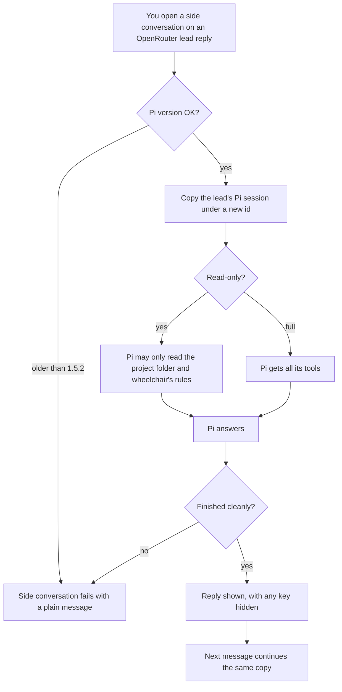
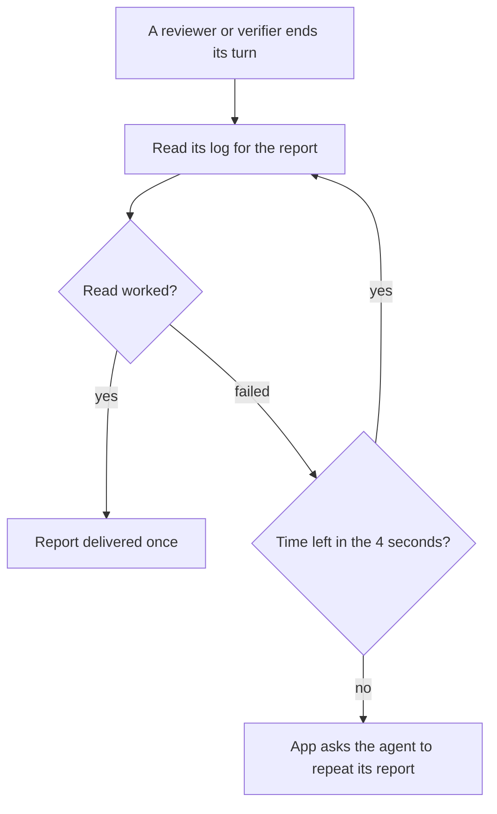

# Make OpenRouter agents solid

**Idea:** `IDEA.md` — what this is for and why, in plain language. Read it first. Map: `MAP.md`
and `docs/maps/openrouter-hardening.md`. Prior plan: `docs/plans/openrouter-harness/PLAN.md`.

## Open Questions

(none)

## Watch List

| # | Noticed | What needs looking into | Raised to user? | Outcome |
|---|---------|-------------------------|-----------------|---------|

## Decision Log

Append-only. A reversal is a new entry superseding the old, never an edit.

| # | Decision | Rationale | Source |
|---|----------|-----------|--------|
| 1 | Plan mode is proof-of-concept | User's pick | user |
| 2 | Spend per thread and per agent is out of scope | User removed it from the idea | user |
| 3 | Spend line on the usage view is in scope | User reported it as a bug (screenshot) | user |
| 4 | OpenRouter thinking levels map 1:1 to Pi's `--thinking` for the app's existing low, medium, high, xhigh, max; Pi's off and minimal are not offered | Keeps one set of levels across providers | defaulted |
| 5 | OpenRouter asides use Pi's `--fork` for the first turn and `--session` to resume, in non-interactive JSON mode, with read-only asides limited to Pi's read tools as reviewers are today | Mirrors Claude/Codex aside flow; reuses the existing reviewer tool allowlist | defaulted |
| 6 | A failed transcript read when a turn ends is retried and never treated as an empty report; only a transcript that is truly absent or has no reply counts as empty | Losing a report in normal use is always fixed | defaulted |
| 7 | Pi older than 1.5.2 is refused; newer versions run, Settings marks them untested, and a Pi start or turn failure on an untested version names the version as the likely cause | User picked run-with-warning over blocking | user |
| 8 | Keep side conversations in this plan and review again after round 3 | User's pick when the review budget stopped | user |

## Spec

Four OpenRouter (Pi) items plus one all-provider report fix.




 Evidence: `MAP.md`,
`docs/maps/openrouter-hardening.md`. Installed Pi is 1.5.2; its docs are in
`$(npm root -g)/@earendil-works/pi-coding-agent/docs/` (`json.md`, `cli.md`, `session-format.md`).

### S1. Spend line on the usage view

- `viewer/pages/settings.js:1391-1395` renders OpenRouter spend inside `.usage-left`, a fixed
  76px column (`viewer/pages/settings.css:190`), so it wraps a word or two per line.
- Give the spend text its own class rule: it takes the remaining width of the row
  (`flex: 1 1 auto; min-width: 0; text-align: left`), so the whole line
  ("<$0.01 today · <$0.01 last 7 days · <$0.01 last 30 days") sits on one line when the row is
  wide enough, and wraps only at phone widths. The name column must not squeeze "OpenRouter".
- Limit bars stay unchanged for other providers. OpenRouter never shows a limit bar or
  "no reading yet" when spend is present.
- Test: a browser test (in the suite run by `npm --prefix viewer run test:browser`)
  or a page test asserting the spend element does not have the 76px column rule and, at a
  1200px-wide viewport, renders on one line (its height equals one line box).

### S2. Thinking levels for OpenRouter agents

The app's levels low, medium, high, xhigh, max map 1:1 to Pi's `--thinking <level>`. Pi's
`off` and `minimal` are not offered. A blank setting passes no `--thinking` flag and leaves the
level to Pi (its saved session level on resume or fork, its configured default, or a model
suffix). Pi clamps an explicit level the model cannot do; wheelchair does not check capability.

Change every gate that drops effort for OpenRouter:
- `viewer/app/providers.js:3`: openrouter `effort: true` (drives `routes.js:263`,
  `sessions.js:107-108,206,350`; fix the stale comment at `sessions.js:349`).
- `viewer/app/routes.js:265`: validate openrouter effort like claude/gemini.
- `codex/model.sh:104` and `:441-442`: stop treating openrouter effort as malformed or
  rejected; kimi keeps its rule.
- `machine/service.js:780`: only kimi clears effort.
- `machine/adapters/pi.js` `command()`: append `--thinking <effort>` when the session has one.
- `viewer/pages/settings.js:16`: OpenRouter gets the effort select with the five levels.
- Tests: Settings round-trip of an OpenRouter effort pin (pattern of
  `viewer/test/app-kimi-settings.test.js`), `codex/test/run.sh` accepts it, a machine test that
  Pi argv carries `--thinking high` for effort high and none when unset.

### S3. Side conversations on OpenRouter-led threads

Same behaviour as Claude/GPT asides (`viewer/app/asides.js`, `machine/lib/aside-turns.js`):
first turn forks the lead's Pi session, later turns resume the fork.

- Hub: `providers.js` openrouter `asideFork: true`; `asides.js:41` parent map gives openrouter
  the lead's `cli_session_id` (the Pi session id the machine created, `machine/adapters/pi.js:59`).
- Machine validation (`aside-turns.js:58-71`): accept provider `openrouter`; for it accept the
  OpenRouter model grammar (`vendor/model[:variant]`, as `viewer/pages/settings.js:19`).
  Replace the claude/gpt fallback at `aside-turns.js:95` with an explicit provider→adapter map
  (claude→claude, gpt→codex, openrouter→pi), so no provider silently runs another CLI.
- `machine/adapters/pi.js` gets `asideArgv(i, { prompt })`:
  `pi --provider openrouter --model <model> --mode json -p`, then `--fork <from> --session-id <new_id>` for mode fork
  (the hub supplies `new_id` for OpenRouter forks, as it does for Claude, `aside-turns.js:64`) or
  `--session <from>` for mode resume, `--append-system-prompt <prompt>`, `--no-extensions`
  (no wheelchair hook bridge or MCP in an aside; explicit `-e` paths still load), `--thinking <effort>` when set, and an explicit `--tools` on every
  turn, fork and resume alike, because Pi restores a session's saved tool selection when `--tools`
  is omitted: `read-only` (the default) → `--tools read,grep,find,ls`; `full` → `--tools
  read,bash,edit,write,grep,find,ls`. Switching access between turns therefore takes effect on the
  next turn.
- Read-only boundary: Settings promises read-only asides read only the worktree
  (`viewer/pages/settings.js:538-541`), and Pi's read tools accept any path. A read-only aside also
  loads a small static wheelchair Pi extension (`-e`, one file under `machine/adapters/`,
  checking against the handler's `ctx.cwd`, which is the worktree since the aside is spawned with
  `cwd: i.cwd`) whose `tool_call` handler blocks (`{ block: true, reason }`) any
  read/grep/find/ls call whose path argument resolves (see Resolving) to a file or directory that falls outside both the worktree and wheelchair's own
  `protocol/` directory (the aside prompt tells it to read `protocol/app/aside.md`,
  `machine/lib/aside-turns.js:98`). A call with no path uses the worktree.
  Resolving: the handler resolves the path once with Pi's `resolveToCwd` rules (`~` expansion,
  leading `@` stripped, unicode spaces normalized, relative to `ctx.cwd`; Pi
  `dist/core/tools/path-utils.js:42`, copied into the extension since Pi does not export it),
  blocks it if it does not exist, otherwise takes its `realpath`, checks that, and writes the
  checked real path back into the call's input (`event.input.path`; `tool_call` may mutate input,
  Pi `docs/extensions.md:364`). Pi normalizes the string again
  (`dist/utils/paths.js:100-127`), so the handler also applies the same normalization to the
  checked real path and blocks the call unless the result is unchanged (a real path containing
  characters Pi would rewrite, such as a narrow no-break space, is refused). Pi then opens exactly
  the checked path, so its alternate-name lookups never apply. Full access loads no such extension. The
  message is passed on stdin or as the final argument, whichever Pi's `-p` supports
  (`cli.md`). Login env comes from `adapter.loginEnv(dir)` as for other providers.
- Output parsing (Pi JSON mode, `json.md`): the first record is the session header
  `{"type":"session","id":...}`; `conversation_id` is `new_id` for fork and `from` for resume, as
  for Claude (`aside-turns.js:125`); a missing header, or a header id that differs
  (fork: must equal `new_id` and differ from `from`; resume: must equal `from`), is a failure, so a
  bad id is never saved as the aside's `cli_id` (`viewer/app/asides.js:138`). Success is judged from the settled outcome only: Pi retries
  rate limits and network errors itself (`json.md:38-48`), so an earlier errored assistant
  message followed by a successful retry is a success. The reply is the text of the last
  assistant `message_end`. Failure: non-zero exit, no assistant text after settling, or the
  last assistant message has `stopReason` `"error"` or `"aborted"` (a partial reply from an
  aborted run is never accepted, even with exit 0) → `state: failed` with Pi's error message,
  else stderr's last line. `limit` is true only when the run ends failed and that final error
  is an HTTP 402/429 or "credit" / "rate limit" text.
- Redaction: `reply`, `error` and any stderr text are passed through `adapters/pi.js`
  `redact` before the aside result is stored or returned, so an OpenRouter key never reaches
  hub state.
- Version gate: an OpenRouter aside on a machine whose Pi is refused by S4 (older than 1.5.2,
  or not installed) finishes at once as `state: failed` with S4's problem text. It is checked
  inside the runner, not at request validation, so the hub gets a terminal result and does not
  retry the dispatch.
- Spend from forks (the usage view's OpenRouter totals, `machine/adapters/pi.js` `spend()`): Pi copies the lead's entries, cost records included, into a
  forked session file (`dist/core/session-manager.js:1409-1425`). The spend scan
  (`machine/adapters/pi.js:24-46`) counts each assistant entry once per account, keyed by entry
  `id` plus `timestamp`, so aside forks add only their own new turns.
- Asides fork and resume in the lead's worktree (`i.cwd`), the same directory as the lead's
  session, so Pi finds the session by id.
- Tests: machine tests with a fake `pi` on PATH emitting JSON-mode records for fork, resume,
  error, an error followed by a successful retry (success), a key in reply and stderr (redacted),
  an old Pi (terminal failure, no dispatch retry), read-only argv, and a spend scan over a lead
  file plus its fork counting copied entries once, a read-only aside whose read of a path outside
  the worktree (including the account's `auth.json`) is blocked. The guard's handler is unit-tested
  in the standard machine suite with fake `tool_call` events (no Pi needed, so macOS CI on Node 20
  still runs it), with harmless fixtures: `../` escapes, `~/...`, an `@`-prefixed path, a symlink inside the
  worktree pointing outside, a missing path (blocked), a real path containing a narrow
  no-break space (blocked), and a read of `protocol/app/aside.md` that is allowed, and resume argv carrying
  `--tools` for both access settings (pattern of existing aside tests); hub test that an OpenRouter lead
  allows an aside (update `viewer/test/app-asides.test.js` where it pins the refusal).
- Real-Pi guard check: a separate offline script (e.g. `test-support/smoke/pi-guard.js`, not
  part of `machine/test/run.sh`) loads the real extension into the installed Pi with tools only, no
  model call, and confirms the path Pi actually opens for the fixtures above. It exits 0 with
  "skipped: Pi not installed" when `pi` is absent. Run it on this machine (Pi 1.5.2) as part of
  validation.
- Live check (costs money; keep it to one fork turn and one resume turn, model
  `deepseek/deepseek-v4.1-flash-1017`): extend `test-support/smoke/pi-live.js` or add a sibling,
  confirming fork produces a new id, resume keeps it, and the reply text comes back.

### S4. Pi version check

- Tested version: `1.5.2`. Older than 1.5.2 is refused; 1.5.2 up to any 1.5.x patch is
  tested; anything newer is untested but allowed (Decision 7).
- Machine: probe `pi --version` cached by executable and mtime, exactly as
  `checkKimiVersion` (`machine/service.js:1601-1619`), warmed at startup. A failed or
  unparseable probe counts as unknown (warning), not refused.
- `cliStatus('pi')` (`service.js:1636`) returns `version`, plus `problem`
  ("Pi 1.5.2 or newer is needed (found X)") when older, or `warning`
  ("Pi X is newer than the version wheelchair was tested with (1.5.2). If OpenRouter agents fail,
  this may be why.") when untested, or ("Pi's version couldn't be read. If OpenRouter agents
  fail, this may be why.") when unknown. A problem blocks OpenRouter starts like Kimi's
  (`service.js:772`) and marks OpenRouter accounts signed out; a warning blocks nothing.
- Hub: `viewer/app/usage.js` `machineAccounts` passes the Pi problem the same way as Kimi's
  (`usage.js:59-72,126`) and the warning as its own non-blocking field; `viewer/app/ready.js`
  must not block on the warning.
- Settings shows the problem or warning in plain words on each OpenRouter account's machine
  line (where `settings.js:1232` shows Kimi's problem); the warning is styled as a note,
  not an error.
- Version tie: the machine records the Pi version a session launched with (from the
  S4 probe at launch) and S4's failure notes use that recorded version, not the current one.
- On an untested or unknown version, these messages end with a note: " Pi X is newer than the
  version wheelchair was tested with (1.5.2); that may be the cause." (unknown: " Pi's version
  couldn't be read; that may be the cause."):
  - a Pi session's `turn-failed` error;
  - a Pi session that never reaches its ready screen: the `stuck` event after 30s
    (`machine/service.js:1053-1057`) carries the note, and when Pi's pane is gone before ready,
    the machine ends the session with `end_reason` "Pi exited before it was ready" plus the note.
    The reason is set wherever the machine first finds a not-yet-ready Pi session's pane gone
    (the readiness check and the session list/status path alike) and persisted before any
    response reports the session as not running, so the hub never sees it ended without the reason;
    which the hub already shows in its "Session ended" card and to the starter
    (`viewer/app/sessions.js:773-789`). This exit reason applies on every Pi version; only the
    note depends on the version.
  - The hub's "Session stuck at startup" card (`viewer/app/sessions.js:618-621`) is built from a
    fixed string today; it appends the `stuck` event's `note` field when present. Hub test
    asserts the card text includes the note.
- Tests in `machine/test/pi.test.js` with a fake `pi --version` (pattern of
  `machine/test/kimi.test.js:175-235`): old → problem and start refused; 1.5.2 and 1.5.9 → clean;
  1.6.0 → warning, start allowed; a session launched on 1.5.2 whose fake
  executable then reports 1.6.0, with the service restarted while the session stays registered,
  still gets no note (the launch version is persisted); probe failure → unknown-version warning; Pi pane gone before
  ready → session ended with "Pi exited before it was ready"; turn-failed text carries the untested note on an untested launch version,
  the unknown note on an unknown launch version, and no note on a tested one. Hub test that the warning reaches `/usage` and does not block Ready.

### S5. A report survives a brief failure reading the agent's log (every provider)

Today a failed transcript read becomes `''` (`viewer/app/chat.js:330-334`), `deliverReport`
returns without a report (`viewer/app/sessions.js:435`), and the turn and delivery ids are
already saved (`sessions.js:567-569,642-645`), so the report is never recovered.

- `chat.sessionTranscript` gets a strict mode for report readers: the first machine call may use up to
  3 seconds and each retry call up to 1 second, and a wall-clock deadline of 4 seconds from the first read is checked before every
  call and every gap; no call or gap starts after the deadline and a call never runs past it (its
  timeout is min(its cap, time left)). The bound covers transcript recovery only, not the rest of
  the event's handling (lock wait, saving state, queue delivery), which is unchanged. Its requests use the strict HTTP path
  (`viewer/app/machine-client.js:33`), so a connection dropped after headers rejects instead of
  hanging. A failed, timed-out or dropped call throws; a transcript the machine reports
  absent (no data, or 404) falls back to the session's local `transcript_path` when the hub record
  has one, as today (`viewer/app/chat.js:333-334`); a failed read of that local file throws too;
  with no local path it returns `''`.
- `deliverReport`: when the read throws, or when the CLI is `pi`, the event carries an
  `entry_id`, and the read (empty or absent included) does not contain that entry (the machine's copy can lag or fail, `machine/service.js:1403-1407`),
  retry the read inline: up to 3 more attempts, 500ms apart (a gap is skipped, and
  retrying stops, when less than 750ms remains before the deadline: a 500ms gap plus a
  250ms minimum call), within the same event handling and
  the 4-second budget.
  A text found inline in the hook payload (non-Pi) is used at once, as today.
- If every attempt fails, behave as today for a missing report: no result, and `quiet.arm`
  reminds the agent to repeat its report (`viewer/app/quiet.js:8-9`). That reminder is the
  recovery path; nothing is persisted and no timer is added.
- For non-Pi sessions, a genuinely absent or empty transcript behaves as today (no retries).
  For Pi with an `entry_id`, the entry rule above wins: an empty first read is retried. A delivered report is
  never delivered twice (`target.finished` guard stays).
- Tests in `viewer/test/` (pattern of `app-chat.test.js:362-375`): a reviewer whose first
  transcript read fails and second succeeds gets exactly one result delivered; a Pi verifier
  whose first read is empty and whose entry appears on a later read gets its report; an absent transcript makes one read only,
  produces no report and arms the quiet check; all attempts failing arms the quiet check; a first read that times out
  followed by a successful one delivers once; a connection dropped after headers fails that
  attempt and is retried; the recovery itself never exceeds 4 seconds and no
  gap starts when it cannot be followed by a retry before the deadline (fake-clock tests at
  749ms and 750ms left: no retry, then one retry) (measured around
  the report read with a fake clock or a slow fake machine).

### Non-goals

Spend per thread/agent; any limit display for OpenRouter; supporting older Pi; Pi's off/minimal
thinking levels; aside support for Kimi or Antigravity.

### Validation

```bash
bash codex/test/run.sh
bash machine/test/run.sh
node --test viewer/test/*.test.js
npm --prefix viewer run test:browser
bash install/test/run.sh
```
Plus `node test-support/smoke/pi-guard.js` (offline, real Pi 1.5.2) and the live aside check in S3 (one fork, one resume, deepseek/deepseek-v4.1-flash-1017).

## Deferred

| # | Item | Why it can wait | Source | Notes for the follow-up |
|---|------|-----------------|--------|-------------------------|

## Accepted Risks

| Risk | Why accepted | Round |
|------|--------------|-------|
| A custom OpenRouter model pin ending in a Pi thinking-level suffix (e.g. `:high`) combined with a thinking level in Settings may send a different model id than with the setting blank | Rare path: OpenRouter's own variants (`:free`, `:nitro`, ...) are not thinking-level names, so it needs a deliberately odd pin plus a level | review-round-2 |
| The machine's session list can report a Pi session that exits before ready as not running without its end reason, when the pane disappears between two tmux snapshots or a concurrent poll lands while the reason's save is pending | Rare path: needs the exit to land inside a sub-second window between two actors; the next poll shows the reason | verification-1 |

## Check Once Built

| # | What to check | Round |
|---|---------------|-------|
| 1 | S5's per-call caps hold against a response that keeps sending small chunks past the cap (the strict client's timeout is a socket inactivity timeout, `viewer/app/machine-client.js:15-46`), not just a silent one | review-round-4 |

## Review Rounds

### Round 1 — 2026-11-20

**Lanes:** intent (claude); mechanics (other family); cross-family: yes.

**Changed since Round 0:** n/a (first round — whole Spec in scope)

| Lane | Reported | Finding | Lead verdict | Resolution |
|------|----------|---------|--------------|------------|
| intent | minor | S5 over-built: the quiet reminder already recovers the report; persisted pending + 2-minute timer not needed | upheld | S5 now retries inline (3 attempts, 1s apart) then falls to the quiet reminder; IDEA's "never recovered" overstates: today recovery costs an extra agent turn (noted in Log) |
| intent | minor | Pi missing-entry rule would delay the quiet reminder ~2 minutes | upheld | Resolved by the same change: at most ~3s delay |
| mechanics | blocking | Aside forks copy cost records; spend counts them twice | upheld | S4 spend scan dedupes by entry id + timestamp |
| mechanics | blocking | Pi auto-retry: an early error would fail a reply that later succeeded | upheld (major: worker would have to ask) | S3 judges the settled outcome; fixture added |
| mechanics | blocking | Aside reply and stderr not redacted | upheld | S3 redacts reply, error, stderr |
| mechanics | blocking | Aside bypasses the old-Pi gate; refused dispatch retried forever | upheld (major) | S3 version gate inside runner, terminal failed result |
| mechanics | major | No visible path for Pi exiting before ready | upheld | S4: stuck event and "Pi exited before it was ready" end_reason carry the note |
| mechanics | minor | Unknown version worded as "newer" | upheld | S4 separate unknown wording |
| mechanics | blocking | S5 pending record vs queued input | declined | Reviewed a superseded S5: after the intent finding S5 retries inline (~3s) with no pending record, so no later turn can interleave |
| mechanics | major | Pi empty first read: absent vs missing entry conflict | upheld | S5: for Pi with entry_id the entry rule wins; test added |
| mechanics | minor | Blank thinking is not "model default" | upheld | S2 wording: left to Pi |

### Round 2 — 2026-11-20

**Lanes:** intent (claude); mechanics (other family); cross-family: yes.

**Changed since Round 1:**
- S2: blank thinking leaves the level to Pi.
- S3: success judged from the settled outcome; redaction of reply/error/stderr; version gate inside the aside runner as a terminal failure.
- S4: spend scan dedupes forked entries; unknown-version wording; stuck event and "Pi exited before it was ready" end reason carry the version note.
- S5: inline retries (3 attempts, 1s apart) then the existing quiet reminder; no persisted pending state; for Pi with an entry_id, an empty read is retried.

| Lane | Reported | Finding | Lead verdict | Resolution |
|------|----------|---------|--------------|------------|
| intent | minor | Use hub-supplied new_id with --fork/--session-id like Claude | upheld | S3 adopts it |
| intent | minor | Strict read timeouts could hold the lock ~40s | upheld | S5 strict reads use a 2s timeout |
| intent | minor | Fork spend dedupe sits under S4 | upheld | Moved to S3, source named |
| mechanics | blocking | Thinking suffix on a custom model id changes the model when --thinking is set | accepted-risk | Rare path (see Accepted Risks) |
| mechanics | blocking | Aborted partial reply or missing/bad fork id accepted | upheld | S3 rejects aborted and checks header ids |
| mechanics | blocking | Stuck card ignores the version note | upheld (major) | S4 hub appends the note; test |
| mechanics | major | Exit reason may land after the hub sees the session ended | upheld | S4 sets and persists reason wherever first detected |
| mechanics | blocking | Strict reads could hang on a dropped connection | upheld (major) | S5 uses the strict HTTP path; test |
| mechanics | major | Retry budget can exceed the machine's 5s event deadline | upheld | S5 shared 4s budget, 500ms gaps; test |

### Round 3 — 2026-11-20

**Lanes:** intent (claude); mechanics (other family); cross-family: yes.

**Changed since Round 2:**
- S3: hub-supplied `new_id` with `--fork --session-id`; header id checks; aborted replies rejected; fork spend dedupe moved here from S4.
- S4: stuck card shows the version note; "Pi exited before it was ready" reason set and persisted wherever first detected.
- S5: strict reads on the strict HTTP path, one 4-second budget, 500ms gaps.
- Accepted Risks: thinking-suffix model pin.

| Lane | Reported | Finding | Lead verdict | Resolution |
|------|----------|---------|--------------|------------|
| mechanics | blocking | Read-only Pi asides can read outside the worktree (account files) | upheld | S3 path-boundary extension blocks out-of-worktree reads; test |
| mechanics | blocking | Full access not restored on resume | upheld | S3 passes explicit --tools every turn |
| mechanics | blocking | First request can eat the whole budget | upheld (major) | S5 1s per call, 4s wall-clock deadline |
| mechanics | major | What the 5s bound covers | upheld (minor) | S5 bounds recovery only; rest unchanged |
| mechanics | minor | Version note should use the launch version | upheld | S3/S4 record launch version |

### Round 4 — 2026-11-20

**Lanes:** intent (claude); mechanics (other family); cross-family: yes.

**Changed since Round 3:**
- S3: explicit `--tools` on every aside turn; read-only path-boundary extension blocking reads outside the worktree; launch-version tie for notes.
- S5: 1s per call, 4s wall-clock deadline on recovery only.

| Lane | Reported | Finding | Lead verdict | Resolution |
|------|----------|---------|--------------|------------|
| intent | blocking | Boundary blocks the aside's own rules file | upheld | S3 allows wheelchair's protocol/ directory too |
| intent | minor | 1s cap can fail a large transcript that works today | upheld | S5 first call up to 3s, retries 1s |
| intent | minor | Aside launch version is unused | upheld | Version tie for sessions only |
| intent | minor | Boundary extension needn't be written per turn | upheld | One static file using ctx.cwd |
| mechanics | blocking | Guard must check the file Pi will actually open | upheld | S3 resolves like Pi (resolveToCwd + read variants), realpath each; fixture tests |
| mechanics | major | Pi auto-loads out-of-worktree context files | declined | The aside forks the lead's session, which already holds whatever context Pi loaded for the lead; nothing new is exposed, and those files are instructions, not secrets |
| mechanics | major | Guard blocks the aside rules / graph schema | upheld | Already resolved by the intent fix: wheelchair's protocol/ is allowed (covers aside.md and graphs.md) |
| mechanics | major | Where the aside's launch-version note appears | declined | Superseded: the version tie now covers sessions only; aside failures show Pi's error or S4's problem text |
| mechanics | minor | Chunked slow response vs per-call cap | check-once-built | Check Once Built #1 |

### Round 5 — 2026-11-20

**Lanes:** intent (claude); mechanics (other family); cross-family: yes.

**Changed since Round 4:**
- S3: boundary allows wheelchair's `protocol/`; one static extension using `ctx.cwd`; resolves paths the way Pi does (resolveToCwd + read variants) and realpaths each candidate; fixture tests.
- S3/S4: launch-version tie for sessions only.
- S5: first call up to 3s, retries up to 1s, 4s deadline.
- New Check Once Built row 1.

| Lane | Reported | Finding | Lead verdict | Resolution |
|------|----------|---------|--------------|------------|
| intent | minor | Rewrite the checked real path into the tool input instead of mirroring Pi's resolver | upheld | S3 adopts it |
| intent | minor | Version tie bullet belongs in S4 | upheld | Moved to S4 |
| mechanics | blocking | Pi re-normalizes the rewritten real path | upheld (major) | S3 blocks unless normalization leaves the checked path unchanged; fixture test |
| mechanics | major | Turn-failure note tests cover untested only | upheld (minor) | S4 tests: untested note, unknown note, none when tested |
| mechanics | minor | Gap can overrun the deadline | upheld | S5 skips a gap with no time left for a retry |

### Round 6 — 2026-11-20

**Lanes:** intent (claude); mechanics (other family); cross-family: yes.

**Changed since Round 5:**
- S3: read-only guard rewrites the checked real path into the tool input and refuses a path Pi would re-normalize; no resolver mirroring of alternate names.
- S4: version-tie bullet moved here; failure-note tests for untested, unknown and tested launch versions.
- S5: retry gap skipped near the deadline.

| Lane | Reported | Finding | Lead verdict | Resolution |
|------|----------|---------|--------------|------------|
| mechanics | major | Real-Pi resolver test vs isolated suite and macOS CI without Pi | downgraded (minor) | A skip-if-missing check is the obvious way to build it, so a worker would not have to stop and ask. S3 now unit-tests the handler with fake events in the standard suite and adds a separate offline real-Pi check that skips without Pi |
| mechanics | minor | Launch-version test can pass while using the current probe | upheld | S4 test changes the version after launch and restarts |
| mechanics | minor | Strict read drops the local transcript_path fallback | upheld | S5 keeps it; local read failure throws |
| mechanics | minor | "Minimal call" undefined | upheld | S5: 750ms cutoff, tests at both sides |

## Implementation Tasks

| # | Objective | Ownership boundary | Lane | Session id | Validation | Status |
|---|-----------|--------------------|------|-----------|------------|--------|
| T1 | S1 spend line + S2 thinking levels | settings.js/.css, providers.js, routes.js, codex/model.sh + tests, service.js effort line, pi.js command(), pi.test.js, openrouter settings tests | standard (claude, claude-sonnet-5-5) | wc-32fed9258dca-worker | codex, machine, viewer node, browser | done |
| T2 | S5 report survives a failed log read — tricky | chat.js, sessions.js deliverReport, machine-client.js, report tests | standard (gpt-6.1-terra) | wc-32fed9258dca-worker-2 | viewer node | done |
| T3 | S3 read-only aside path guard extension — tricky | machine/adapters/pi-guard.js, machine/test/pi-guard.test.js, test-support/smoke/pi-guard.js | standard (gpt-6.1-terra) | wc-32fed9258dca-worker-3 | machine, pi-guard smoke | done |
| T4 | S4 Pi version check (after T1, T2) | service.js version probe/cliStatus/launch version/exit reason, usage.js, ready.js, settings.js machine line, sessions.js stuck card, pi tests | standard (gpt-6.1-terra) | wc-32fed9258dca-worker-4 | machine, viewer node | done |
| T5 | S3 aside wiring, spend dedupe, live check (after T3, T4) — tricky | providers.js, asides.js, aside-turns.js, pi.js asideArgv/spend, aside tests, pi-live smoke | standard (gpt-6.1-terra) | wc-32fed9258dca-worker-5 | machine, viewer node, live aside | done |
| R1a | Remediation 1 gap 1: spend spec retrying assertions | viewer/test/app-openrouter-spend.spec.js | standard (claude, claude-sonnet-5-5) | wc-32fed9258dca-worker-6 | spend spec x20 | done |
| R1b | Remediation 1 gaps 2-3: aside UTF-8 decoding, pre-header Pi errors | machine/lib/aside-turns.js, machine/test/aside-turns.test.js | standard (gpt-6.1-terra) | wc-32fed9258dca-worker-7 | machine | in progress |

## Log

- Round 1: IDEA's Why says a report lost to a brief read failure is never recovered; in fact the quiet reminder asks the agent to repeat it. S5 still saves that extra turn and misleading nudge.
- Ready check 2026-11-21: hub and machine service answer; pi 1.5.2 installed; Codex preflight passes.
- Build accepted: approval 257ab768-b85c-4bb5-8d55-31ee5a3c1231
- 2026-11-21 — Choice: T3, pi-guard.test.js: imports the ESM extension as a data URL so Node 20 can load it from the CommonJS repo.
- 2026-11-21 — Choice: T3, test-support/smoke/pi-guard.js: drives Pi's own extension loader/runner and real read/ls tools, no model call.
- 2026-11-21 — Choice: T3, guard fixtures: the narrow-space case is a symlink to a real path containing U+202F, so refusal is tested after realpath.
- 2026-11-21 — T3 accepted (band: self): guard re-tested (unit 1/1 pass, real-Pi offline check passed); grep/find/ls/read all use `path`.
- 2026-11-21 — Choice: T2, viewer/app/chat.js: a Pi entry counts as present when its assistant row exists, even with empty text (no further retries then).
- 2026-11-21 — Choice: T2, viewer/app/machine-client.js: the hard wall-clock cap applies to every strict pass-through (also project-tools, 120s), and a pending credential lookup is cancelled before a late request starts.
- 2026-11-21 — Choice: T2, viewer/app/sessions.js: clock and sleep injectable via hub.reportNow / hub.reportSleep.
- 2026-11-21 — T2 accepted (band: self): retry/report/chat/openrouter-hub tests re-run, 41 pass. Sub-lead integration fix: a strict 404 is treated as empty only when its body is not JSON, so project-tools 404 error text still reaches the caller.
- 2026-11-21 — Choice: T1, viewer/pages/settings.css: `.usage-name-spend { flex: 0 0 auto }` keeps "OpenRouter" from being squeezed on spend rows only.
- 2026-11-21 — Choice: T1, viewer/pages/settings.js: spend element is a new `usage-spend-text` class (drops `usage-left`), 13px font kept.
- 2026-11-21 — Choice: T1, app-openrouter-spend.spec.js: stubs `/api/usage` with `page.route`; one-line check is height <= 1.5 line boxes.
- 2026-11-21 — Choice: T1, codex/test/run.sh: also asserts Kimi still rejects effort.
- 2026-11-21 — Choice: T1, machine/adapters/pi.js: `--thinking` sits after `--approve`, before `-e` (unreported; found by scout).
- 2026-11-21 — Choice: T1, app-openrouter-settings.test.js: round-trip added to the existing file on the heavy slot (unreported; found by scout).
- 2026-11-21 — T1 accepted (band: scout): codex 159/0, pi.test 12/0, settings/routes 41/0, new spec 2/2 (chromium, firefox) re-run by sub-lead; full browser suite deferred to final validation. sessions.js:349 comment already says Kimi only, nothing to fix.
- 2026-11-21 — Choice: T4, machine/service.js: only bare `X.Y.Z` (optional `v`) stdout counts as a version; prerelease or other output is unknown (real Pi 1.5.2 prints `1.5.2`).
- 2026-11-21 — Choice: T4, viewer/app/usage.js: the Pi warning also shows on signed-out OpenRouter lines; machine line value becomes `{state, warning}`; `cliProblems` includes pi.
- 2026-11-21 — Choice: T4, machine/service.js: the pane-gone reason is reconciled at GET /v1/status and GET /v1/sessions, in checkReady and checkPrompt, only for starting/stuck sessions; set directly (not via fatalKimi), and stopped by the existing pollKimiTurns sweep.
- 2026-11-21 — Choice: T4, machine/service.js: a second Pi gate in startIn, after worktree creation (unreported; found by scout).
- 2026-11-21 — Choice: T4, machine/service.js: a session with no recorded pi_version (launched before this change) gets the unknown note (unreported; found by scout).
- 2026-11-21 — Choice: T4, viewer/pages/settings.js: warning shown as `mstate note`; `states[stateName(st)]` lookup; option name `piVersionTimeoutMs` (unreported; found by scout).
- 2026-11-21 — T4 accepted (band: scout): pi.test 15/0, hub/usage/settings tests 158/0, browser send-now/settings/accounts specs 184/184 re-run by sub-lead. Residual: no machine-level test of the stuck note, of the /v1/status reconcile path, or of accounts signed out on a Pi problem (behaviour present in the code).
- 2026-11-21 — Choice: T5, machine/adapters/pi.js spend(): rows without an entry id are each counted (no dedupe key).
- 2026-11-21 — Choice: T5, test-support/smoke/pi-aside-live.js: isolated temp account and worktree with a copy of auth.json, so the real Pi session store is untouched. Sub-lead fix: the temp folder now comes from test-support/run-dir.js (removed at exit) so the key copy is not left in /tmp.
- 2026-11-21 — Choice: T5, machine/lib/aside-turns.js: Pi's message goes on stdin (Pi prepends piped stdin to the prompt); the version check is injected as a `piProblem` constructor option; header check uses the first JSON record (unreported; seen in diff).
- 2026-11-21 — T5 accepted (band: self): diff read against S3; live aside check run by sub-lead on deepseek/deepseek-v4.1-flash-1017 (fork | PASS | new id and reply; resume | PASS | same id and reply).
- 2026-11-21 — Verification 1: Claude verifier PASS; GPT verifier FAIL with 4 gaps; 1 judged rare (Accepted Risks), 3 remain (spend spec flake, UTF-8 chunk split in aside output, pre-header Pi failure loses error/limit).
- 2026-11-21 — worker didn't report its choices beyond 'none'; I listed 0 (the boolean expect.poll height check was dictated by the brief).
- 2026-11-21 — R1a accepted (band: scout): spend spec re-run x10 per browser by sub-lead, 20/20 pass.
