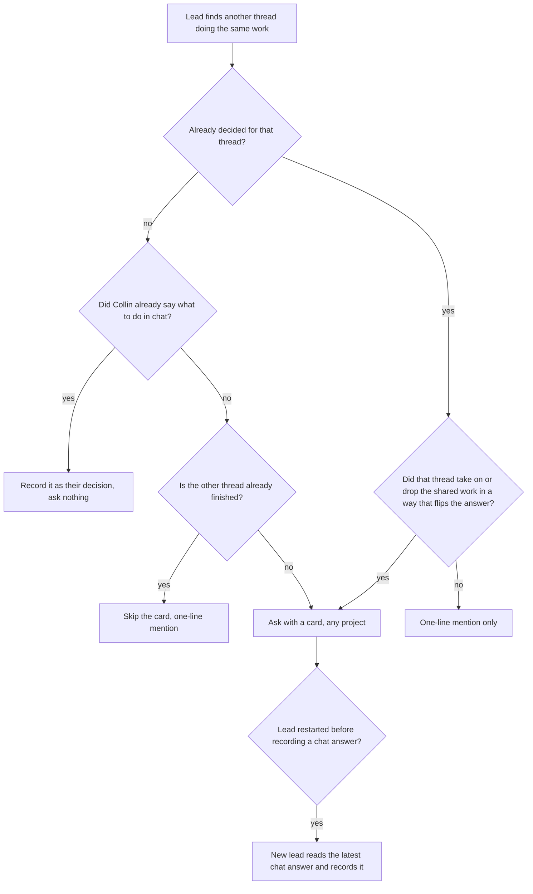

# Make overlap questions solid

**Idea:** `IDEA.md` — what this is for and why, in plain language. Read it first; it is
the north star this plan serves. Goal and Constraints live there, not here.

Follow-up to `docs/plans/overlap-questions/PLAN.md` (PR #148, merged), rows D1–D5 of its
Deferred table. Map: `MAP.md`.

## Open Questions

None.

## Watch List

| # | Noticed | What needs looking into | Raised to user? | Outcome |
|---|---------|-------------------------|-----------------|---------|

## Decision Log

Append-only. A reversal is a new entry superseding the old, never an edit.

| # | Decision | Rationale | Source |
|---|----------|-----------|--------|
| 1 | Mode is thorough | Chosen on the mode card | user |
| 2 | Keep all five deferred cases (D1–D5) | IDEA.md confirmed with all five | user |
| 3 | D1: overlap cards apply to threads in any project; how cross-project threads are found does not change (linked threads in the default list, a peer lead's message, or a thread the user names) | IDEA.md "Not doing": discovery unchanged | defaulted |
| 4 | D1: a listed thread with no `stage` (unlinked cross-project entry) counts as not finished | Listing cannot prove it finished; worst case is one extra card | defaulted |
| 5 | D2: at the first look after PLAN.md, a clear decision the user typed earlier about a thread now identified is logged as that thread's overlap Decision (source `user`, no card suffix) instead of asked; "clear" uses "Settling an answer" | Reuses the existing test of a clear answer | defaulted |
| 6 | D3: on restart, an open overlap card with a later user chat message in `recent_messages` that answers it is resolved with a note of that answer and acted on by "Settling an answer" | Same handling as a live chat answer | defaulted |
| 7 | D4: before posting a waiting overlap card, run `session leads`; if the thread is listed and finished (per "Overlap"), do not post: remove its Open Question with a `defaulted` overlap Decision (moot) and give a one-line mention. A thread not listed, or with no stage, gets its card. A follow-up card for a vague answer is always posted | Skips only provable cases; an extra card is minor | defaulted |
| 8 | Messages older than the restart context's last 20 are not recovered (D2, D3) | Needs a restart plus 20 later messages | defaulted |
| 9 | D5: re-ask an answered overlap only when that thread now takes on, or drops, the shared work the answer was about; other news gets a one-line mention | Picked on the re-ask question | user |

## Spec

All changes are to `protocol/app/lead.md`, sections
"Other leads on this machine" (line ~740), "Overlap questions" (~753) and "Restarting what
died" (~816), plus protocol tests in `viewer/test/protocol-rules.test.js`. No app code
changes: the hub already stores `about_thread` for any 12-hex thread id without a project
check (`viewer/app/cards.js:69`, `:168`).

1. **Any project (D1).** Replace "This project only" so overlap cards and `Overlap with`
   Open Questions apply to a thread in any project. Discovery rules ("Another project":
   `--all-projects` only when the user names a thread or project; messaging an unlinked
   project's lead needs a `reach` card first) are unchanged. A listed entry without
   `stage` counts as not finished. Also change "Leads inform; your user decides" so only a
   late overlap is decided in chat, not another project's thread.
2. **Earlier chat decision (D2).** Whenever a look inside the card window (status
   `planning`) identifies a new overlap (no overlap Decision yet for that thread), if an earlier user message (before or after PLAN.md was created) clearly
   settles it (by "Settling
   an answer"), log it as that thread's overlap Decision, no card suffix, and ask nothing.
   It is then handled like a card answer: the same Spec change in the same commit, source
   `user`, or `idea-change` when it removes something IDEA.md promises. The "Before PLAN.md" rule keeps forbidding asking or recording before
   PLAN.md exists.
3. **Restart chat answer (D3).** In the restart overlap bullets: an open overlap card with
   no actionable answer, where user messages in `recent_messages` after the card's post
   answer it, is resolved from the latest such message with a one-line note of that answer, then handled by "Settling
   an answer" (Done marker etc.).
4. **Finished before posting (D4).** In "One question at a time": before posting a waiting
   overlap card (original, not a follow-up), run `session leads --all-projects`, using its output only for this finished check
   (never to find new overlaps). Listed and finished per "Overlap": post nothing; log a
   `defaulted` overlap Decision ("moot: finished") in the commit that removes its Open
   Question, and mention it in one line of the next visible reply. Otherwise post it. On a small fix, skip the card and mention it; nothing is recorded.
   Change "New information about the other thread never cancels a question" to allow this
   one exception.
5. **Re-ask (D5).** Replace "Re-asks are not done" with this rule. An overlap Decision that
   records the user's answer (from a card or chat; not a cancel, not a `defaulted` moot
   one) names the shared work it was about; an older Decision that names none is not
   checked. At every look, and on news from a peer lead, check each thread whose latest
   overlap Decision is such an answer, whether or not that thread still counts as an
   overlap, and ask again only in these two cases: the answer left the shared work to that
   thread and it no longer does it; or the answer kept the shared work in this plan and
   that thread has newly taken it on. Other news gets a one-line mention, as today.
   Inside the card window (feature only, status `planning`) this re-opens an `Overlap with`
   Open Question and posts a new overlap card with the same `about_thread`, waiting its
   turn like any overlap card; its answer is a new overlap Decision with its own Done
   marker, and the latest Decision wins. On restart, an `Overlap with` Open Question counts
   as not yet asked when no overlap card for that thread was posted after the thread's
   latest overlap Decision. Outside the window it is a late-overlap line, so IDEA.md's "one new card" holds inside
   the card window only. Never re-ask
   while an overlap card for that thread is open ("New information while a card is open"
   stands), and never on a small fix.
   When a peer lead's overlap question carries such news, check this before the "already
   settled" path, and still answer the peer at once.
6. **Non-goals.** No change to how overlaps are first found, how leads message each
   other, or any app screen or code. Existing overlap Decisions, Done markers and cards
   keep their meaning.
7. **Tests.** Extend `viewer/test/protocol-rules.test.js` with checks that "Overlap
   questions" no longer contains "This project only" and contains a stable phrase for each
   of items 1, 2, 4 and 5, and that "Restarting what died" contains one for item 3
   (phrases chosen by the implementer and asserted by the test). Validation: `node --test viewer/test/protocol-rules.test.js` and
   `npm test` from `viewer/` pass.

## Accepted Risks

| Risk | Why accepted | Round |
|------|--------------|-------|
| A pre-PLAN chat decision or unrecorded chat answer older than the restart context's last 20 messages is lost; the user is asked again | Needs a restart plus 20 later messages; worst case one extra card | planning |

## Review Rounds

### Round 1 — 2026-11-21

**Lanes:** intent: claude / claude-opus-5-5; mechanics: gpt / gpt-6.2-sol; cross-family: yes.

**Changed since Round 0:** n/a (first round — whole Spec in scope)

| Lane | Reported | Finding | Lead verdict | Resolution |
|------|----------|---------|--------------|------------|
| intent | minor | D2 only covered decisions typed before PLAN.md | upheld (minor) | Item 2 applies at any look |
| intent | minor | "Leads inform" still sends another project's thread to chat | upheld (minor) | Item 1 names that line |
| intent | minor | D4 contradicts "New information never cancels a question" | upheld (minor) | Item 4 names the exception |
| intent | minor | D4 recheck scope unknowable after restart | upheld (minor) | Always `--all-projects` |
| intent | minor | D5 could re-ask a cancelled or moot question | upheld (minor) | Item 5 limits to the user's answer |
| mechanics | blocking | D5 "drops the shared work" unreachable: a peer that dropped it no longer counts as an overlap | downgraded (major): the rule is buildable, but would silently miss the drop case | Item 5 checks every thread with an answer Decision, overlap or not |
| mechanics | major | D2 decision logged without changing the Spec | downgraded (minor): "handled like any planning answer" already implies it | Item 2 says so |
| mechanics | major | Waiting re-ask looks already asked after restart | downgraded (minor): the Open Question stays in PLAN.md, so the lead still sees it | Item 5 defines "not yet asked" |
| mechanics | major | D3 two chat answers to one card | downgraded (minor): needs two answers plus a restart before resolve | Item 3 uses the latest |
| mechanics | minor | D5 old news mistaken for new | upheld (minor) | Decision names the shared work; re-ask on a change from it |
| mechanics | minor | D4 has no record path for small fixes | upheld (minor) | Item 4 small-fix line |
| mechanics | minor | "Leads inform" still sends other projects to chat | declined: duplicate of the intent finding, already fixed | — |
| mechanics | minor | D3 test phrase in wrong section | upheld (minor) | Item 7 checks "Restarting what died" |

### Round 2 — 2026-11-21

**Lanes:** intent: claude / claude-opus-5-5; mechanics: gpt / gpt-6.2-sol; cross-family: yes. Clean.

**Changed since Round 1:** item 1 (the "Leads inform" line); item 2 (any look; handled like a card answer); item 3 (latest message wins); item 4 (always `--all-projects`; small-fix path; names the exception); item 5 rewritten (answer Decisions only; checked whether or not still an overlap; restart "not yet asked"); item 7 (D3 phrase checked in "Restarting what died").

| Lane | Reported | Finding | Lead verdict | Resolution |
|------|----------|---------|--------------|------------|
| intent | minor | IDEA's "one new card" vs late-overlap line after the window | upheld (minor) | Item 5 says the card holds inside the window |
| intent | minor | Any take-on/drop re-asks even when the answer's effect is unchanged | upheld (minor) | Item 5 names the two cases that change an answer |
| intent | minor | PR #148 Decisions do not name the shared work | upheld (minor) | Those are not checked |
| intent | minor | `--all-projects` recheck could widen discovery | upheld (minor) | Output used only for the finished check |
| mechanics | major | D2 could commit during implementation | downgraded (minor): D2 replaces a card, and cards exist only in the card window | Item 2 limited to the card window |
| mechanics | major | An old chat answer could override a later card answer | downgraded (minor): D2 replaces asking a new overlap; a settled thread is not asked | Item 2 limited to new overlaps |
| mechanics | minor | Peer question path skips the D5 check | upheld (minor) | Item 5 checks first |

## Implementation Tasks

| # | Objective | Ownership boundary | Lane | Session id | Validation | Status |
|---|-----------|--------------------|------|-----------|------------|--------|
| T1 | tricky: Spec items 1-7, lead.md overlap wording and protocol tests | protocol/app/lead.md (3 sections), viewer/test/protocol-rules.test.js, reports/T1.md | standard / claude-sonnet-5-5 | wc-213e51e374d6-worker | node --test viewer/test/protocol-rules.test.js; npm test in viewer/ | done |
| R1-1 | Remediation 1: re-ask compares against the state the answer was given in | protocol/app/lead.md (New overlap bullet), viewer/test/protocol-rules.test.js, reports/R1-1.md | light / claude-haiku-5-5 | wc-213e51e374d6-worker-2 | same | done |

## Log
- 2026-11-21 — Choice: T1, Spec item 2: placed as the last sentence of the "Feature, while planning" bullet rather than a new bullet.
- 2026-11-21 — Choice: T1, Spec item 5 peer path: written as a lead-in sentence of "Passing a peer's overlap question on", not a new path.
- 2026-11-21 — Choice: T1, tests: stable phrases "apply to a thread in any project", "earlier user message (before or after PLAN.md was created)", "using its output only for this finished check", "whether or not it still counts as an overlap", "resolved from the latest such message".
- 2026-11-21 — T1 accepted (band: self): diff read in full against Spec 1-7; sub-lead added "(answer the peer at once either way)" to the peer lead-in so the re-ask path keeps Spec item 5's "still answer the peer at once".
- 2026-11-21 — Verification 1 (gpt-6.2-sol): FAIL, 1 gap (Spec 5 re-ask repeats on news the answer already knew); judged normal use, sent to REMEDIATION-1.md.
- 2026-11-21 — Choice: R1-1, test: new phrase appended last in the phrase list (scout-noted; report said none).
- 2026-11-21 — R1-1 accepted (band: scout): both replacements match the brief exactly; protocol-rules 38/38 and npm test 833/833 re-run by the sub-lead on the worker branch.
