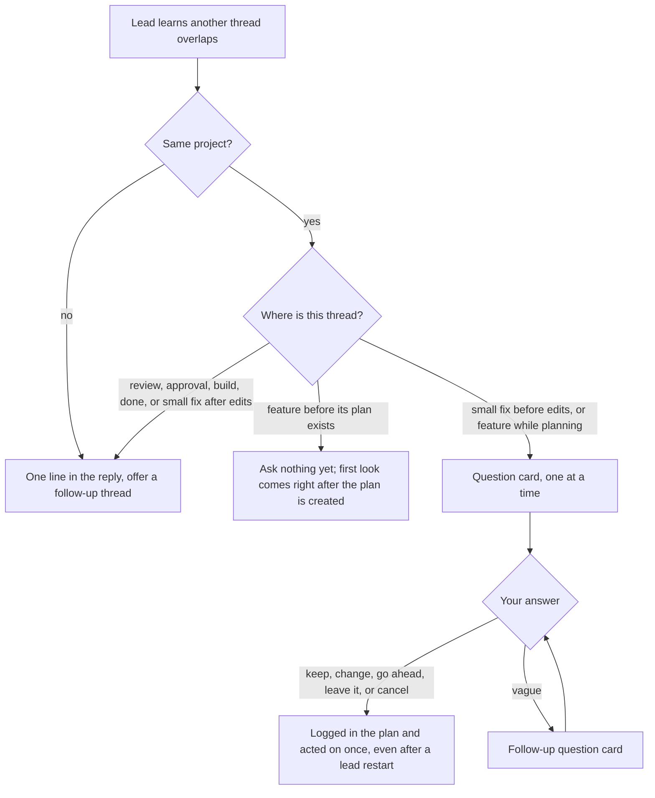

# Asking about overlapping threads

**Idea:** `IDEA.md` — what this is for and why, in plain language. Read it first; it is
the north star this plan serves. Goal and Constraints live there, not here, so they don't
get buried as this file grows.

Background: split from lead-chat (`docs/plans/lead-chat/PLAN.md` on main, Decisions 19-24,
Review Rounds 4-6). Map: `MAP.md`, `docs/maps/overlap-decision-flow.md`. The map predates
Decision 28: its review, approval and build overlap paths are out of scope.

## Open Questions

## Watch List

| # | Noticed | What needs looking into | Raised to user? | Outcome |
|---|---------|-------------------------|-----------------|---------|

## Decision Log

Append-only. A reversal is a new entry superseding the old, never an edit.

| # | Decision | Rationale | Source |
|---|----------|-----------|--------|
| 1 | Mode: thorough | User's pick | user |
| 2 | Every new overlap becomes a `question` card; the one-line mention in a reply is no longer the way to raise it | IDEA.md "What good looks like" bullet 1 | defaulted |
| 3 | An overlap learned before IDEA.md is confirmed is held and asked as the first question after confirmation; a restarted lead finds it again by looking at other leads once on restart | IDEA.md bullet 2; no plan file exists yet to hold it | defaulted |
| 4 | A change answered during a running review is logged at once as `Pending change: <card id>`, applied after triage, marked `Applied change: <card id>`, and listed in the next round's "Changed since"; a round with a pending change is not clean and counts it as one found item | Mirrors the existing `Pending pull-back:` rule; gives a zero-finding round a `fixing` state | defaulted |
| 5 | During a build, the answer acts at once without writing to the worktree (a follow-up `stub` card, or nothing); the running build never changes | The sub-lead owns the worktree; a stub card is itself durable, so nothing is pending | defaulted |
| 6 | The machine's delivery id becomes the card's id, so `card.js` can print the id even when the card is queued while the app is offline | The machine already gives every card a random UUID delivery id before queuing (`machine/service.js:1323`, `:2055`); no second round trip | defaulted |
| 7 | `card.js` prints `{"id","kind"}` (plus `"queued":true` when queued) for kinds that make a stored card, and `{"ok":true}` for `title`, `resolve`, `retract`; never card text | Settled in lead-chat round 4-5 | defaulted |
| 8 | During a build the overlap card offers no way to stop it: "Let it finish" or "Let it finish, then start a follow-up thread"; to stop, the user archives the thread | User's pick (card 84bc0114); archiving already stops every session with a confirmation | user |
| 9 | Supersedes 4: an overlap card during review is that round's `user-decision`; its stored answer (not a Log line) holds it until triage folds it in | Simpler; reuses the user-decision rules and gives zero-finding rounds a `fixing` state | review-round-1 |
| 10 | Overlap identity is the other thread's id, in a hidden `about_thread` field on the question card; each action leaves a Done marker naming the card id | Titles are not unique; a restart must not act twice | review-round-1 |
| 11 | At Start building, open overlap cards are retracted and reposted with build options; late pre-build answers map to build answers | A pressed "Change it" must still mean something | review-round-1 |
| 12 | A retract is relayed like `done`, never queued; supersedes the fallback in 6: the delivery id is always the card id | A queued retract could fail silently after Start building; a fallback id broke receipts | review-round-1 |
| 13 | A retract of an approval that Start building already answered is refused with its own reason; a change with no open approval just returns the plan to review | The lead must know whether Start won | review-round-2 |
| 14 | Before acting on any overlap answer, the lead checks its Done marker; restart also recovers chat answers from recent messages and finishes an interrupted Start building replacement | Replayed presses and restarts must not act twice or leave the user waiting | review-round-2 |
| 15 | An overlap card belongs to the round it is posted in, or moves to the next round if that starts first; a small fix after its first push uses the Done options on purpose | Names the owning round; the user can close a pushed pull request | review-round-2 |
| 16 | Threads at stage `done` are not overlaps for a card; answers are read against their own card's options; a follow-up card completes the original; the Drop revert is one marked commit | Round 3 findings | review-round-3 |
| 17 | Restart: an untriaged round restarts under the same number; a sub-lead is restarted only while the build is unfinished; retracted cards without a successor are reposted | Round 3 findings | review-round-3 |
| 18 | Supersedes 5, 8, 11 and the build/done/small-fix-after-edits parts of 15-17: overlap cards are asked only before building (before a small fix's edits, planning, review, approval). Once a build has started or a small fix's edits are made, the lead mentions the overlap in one line and offers a follow-up thread. IDEA.md "What good looks like" bullet 2 changed to match | Review rounds 1-3 kept finding corners in the build, Start building hand-off and undo cases, where the answer cannot change the work; the user picked "Only before building" (card 73943c05) | idea-change |
| 19 | Also supersedes Decision 2 for late overlaps and done threads (a one-line mention). An overlap card after approval first withdraws the approval, so no overlap card is ever open at Start building; the Start building retract step is removed | Closes the Start-building race by ordering, with no hub lock | review-round-4 |
| 20 | Restart review recovery is gated on `ready-for-review` and a pinned `checking` progress card; a retracted card gets its own refusal `card was already withdrawn` | Round 4 findings | review-round-4 |
| 21 | In `approved`, an overlap is written to the Watch List and the approval withdrawn as soon as it is learned; no approval card is posted (also on restart) while one is open; a change's Decision, Spec and status are one commit | Round 5 findings | review-round-5 |
| 22 | A pushed small fix (`no plan` with a `pr_url`) counts as finished; overlap cards need one to three change options; restart review recovery also checks live reviewers | Round 5 findings | review-round-5 |
| 23 | Overlap Watch List items stay until their Decision is logged; a bare general "Change it" gets a follow-up card; the approval retract is skipped when none was posted | Round 6 findings | review-round-6 |
| 24 | After the review budget was reached again (rounds 4-6), run another review round with the plan as it is | User's pick (card 4bcb64a3) | user |
| 25 | No general "Change it" button: overlap cards offer "Keep the plan as it is" plus one to three concrete changes, and the box takes any other; a concrete typed answer settles in approved too; a round restarted by recovery counts the answer applied in it | Round 7 findings | review-round-7 |
| 26 | Approved-stage withdrawal applies to every overlap card, re-asks included; one fallback change option always exists; a split offer goes before waiting overlap cards but after an open one; a typed change follows its stage's change rules | Round 8 findings | review-round-8 |
| 27 | Several overlaps on a small fix are all settled before edits; an answer that removes promised scope is an `idea-change` (its own Done marker); chat answers are resolved at once; a split settles waiting overlaps it made moot; the fallback option is always one of the change options and points to a follow-up | Round 9 findings | review-round-9 |
| 28 | Supersedes the review, approved, Start building and restart-round parts of Decisions 4, 9, 11, 13-15, 17, 19-23, 25-27: overlap cards are asked only in the card window (before a small fix's edits; a feature while `planning`). From `ready-for-review` on, an overlap is a late overlap: one line and an offered follow-up thread. IDEA.md What we're building, What good looks like and Not doing changed to match. The card-id and retract changes (§3) stay | After rounds 7-9 again found new corners where overlap cards meet review, approval and splits, the user picked "Cards only while planning" (card 8d02e56a) | idea-change |
| 29 | Pre-confirmation overlaps are held, not late; withdrawn overlap cards clear their Open Question; a Spec change asked in chat during a running round waits for triage and the next round; on a small fix the latest instruction wins and committed edits close its cards; a talk-instead retract refused by Start building leaves the build running | Round 10 findings | review-round-10 |
| 30 | A Spec change asked in chat during a running round uses the pending pull-back pattern (`Pending change:` / `Applied change:` Log lines; not clean; counts as one found item; replayed on restart) | Round 11 findings | review-round-11 |
| 31 | A chat Spec change logs `idea-change` when it drops promised scope; restart with live reviewers applies a pending change before restarting the same pass; a chat change to an approved plan retracts the approval first; re-asking an open card retracts and reposts it | Round 12 findings | review-round-12 |
| 32 | Split off: how a Spec change the user asks for in chat during a running review or after approval is saved, counted, survives a restart and withdraws the approval moves to its own thread (stub). Supersedes Decisions 30 and the chat-change parts of 31; a late overlap here gets only the one-line mention and a follow-up offer | Rounds 10-12 kept finding gaps there, and they are gaps in the existing review rules, not about overlaps; the user picked "Split it off" (card 72ce279f) | user |
| 33 | Overlap questions from a peer follow the card window; (b)'s own overlap sentence is replaced; a re-ask posts its replacement only after the retract is confirmed | Round 13 findings | review-round-13 |
| 34 | Peer overlap questions get four explicit paths (settled, held, in window, late) and the answer goes back to the peer, recorded on the Open Question for restarts; every retract 503 is retried after a minute | Round 14 findings | review-round-14 |
| 35 | Peer replies are best effort and never hold the plan: the Decision carries who asked and the reply follows its commit; a small fix does not reply after a restart; only a re-ask and the talk-instead approval retract wait for a retract to succeed | Round 15 findings | review-round-15 |
| 36 | Supersedes the reply-back parts of Decisions 34-35: a peer's overlap question is answered at once from what the lead knows (saying it is asking its user when held or carded); the user's decision is not sent back later. Unrelated peer questions keep today's "send the answer back" rule | After rounds 13-15, the last two drew findings only about the reply-back; the user picked "No, answer it right away" (card fd19b88f) | user |
| 37 | A retract 503 is retried within the same turn, anything depending on the withdrawal waits, and after 10 minutes a `needs` card offers Keep going; a peer's "settled" means settled under "Settling an answer" | Round 16 findings | review-round-16 |
| 38 | Supersedes the retry part of 37: a retract 503 gets one retry after a minute, then a `needs` card and the turn ends (lead.md's existing pattern); a terminal refusal ends retrying and the waiting step is rechecked; a re-ask writes its new information to the Open Question first; an open re-ask takes precedence over an older decision when a peer asks | Round 17 findings | review-round-17 |
| 39 | Retract retries: the sudo "try again" refusal is retryable; one `needs` card covers all failed retracts that something waits on; Talk about it posts no new question while the card is open; an answered refusal is handled from the press that follows | Round 18 findings | review-round-18 |
| 40 | Supersedes Decisions 12 (retract part), 13, 20 (refusal), 34-35 and 37-39 (retract retries): retracts stay queued as today; no new refusals; no retry or `needs` rules. A re-ask retracts and reposts in queue order. Knowing whether Start building won when an approval is withdrawn belongs to the split-off thread (Decision 32) | Rounds 16-18 drew findings only on the synchronous retract; the user picked "Keep them queued" (card 291fb31d) | user |
| 41 | An open overlap card is never retracted to re-ask it: new information waits for its answer and then gets a follow-up card; restart rediscovery uses the held/in-window/late paths; lead.md wording avoids the words the protocol-rules test forbids; Accepted Risks rows made moot by Decision 40 removed | Round 19 findings | review-round-19 |
| 42 | New information about an open card is told in the reply and saved to its Open Question at once; an answer is checked against it before acting; a waiting card is rechecked against a finished peer before posting; a withdrawn card's Open Question is removed before the retract; moot Accepted Risks removed | Round 20 findings | review-round-20 |
| 43 | An answer given after the new-information line is acted on as it is; only an earlier answer is checked; a posted card stays valid if the peer finishes; moot Accepted Risks removed | Round 21 findings | review-round-21 |
| 44 | Supersedes the checking parts of Decisions 41-43: new information while an overlap card is open is only mentioned in one line beside it; the answer is acted on as given, with no re-check or follow-up card | The last recurring findings came from the re-check; the user picked "Just mention it" (card d9a87c36) | user |
| 45 | A re-ask needs information learned after the answer was acted on; a card is withdrawn only by this thread's decision or the user's instruction, never by news about the other thread; a follow-up card for an unsettled answer inherits the original's validity | Round 22 findings | review-round-22 |
| 46 | A small fix never re-asks (news before edits is mentioned; the user's chat wins); a peer question joining an open card is a one-line mention; only the first follow-up inherits validity; a recorded drop (Log line) keeps an overlap from being asked again, also for waiting ones and on restart | Round 23 findings | review-round-23 |
| 47 | A dropped overlap answers peers without a card; finished-peer removals use the named drop line; every follow-up for an unsettled answer inherits validity (supersedes the first-only limit in 46); small-fix drops record nothing; restart uses Terms "New overlap" | Round 24 findings | review-round-24 |
| 48 | Supersedes the drop records in 46-47: cancelling an overlap question (or its becoming moot by this thread's decision) counts as the answer "Keep the plan as it is", logged as a Decision with the Done marker; a finished peer before posting is also logged as a Decision. No separate drop records | The last rounds drew findings on the separate drop record; the user picked "As 'keep the plan'" (card 09b79ae6) | user |
| 49 | A cancel is settled: on a feature a Decision by thread id (card suffix only if a card was posted; `defaulted` when moot), on a small fix "Go ahead" unless chat says otherwise; a finished peer on a small fix is only mentioned | Round 25 findings | review-round-25 |
| 50 | Done marker matched by its card suffix (sources `user`, `idea-change`, `defaulted`); a no-card Decision also allows a later re-ask; a held overlap cancelled before IDEA.md confirmation is not asked and is logged when PLAN.md is created | Round 26 findings | review-round-26 |
| 51 | A cancelled held overlap stays unasked also when a peer asks; a cancel's card suffix names only a card posted for that question; a peer missing from `session leads` counts as finished; restart honours recent cancels before PLAN.md exists | Round 27 findings | review-round-27 |
| 52 | Supersedes the "held" rules (Decisions 3, 50-51 parts): a feature's first overlap look moves to right after IDEA.md confirmation, so nothing is held before it; a peer asking earlier gets an answer from what the lead knows | Rounds 25-27 kept finding gaps in the held state; the user picked "Look after confirming" (card 8a2638cf) | user |
| 53 | Feature looks (including user-requested and restart ones) wait for PLAN.md; look (a) repeats when the map arrives; a confirmed IDEA without PLAN.md gets PLAN.md first on restart; a failed `session leads` is retried; a pre-confirmation chat decision is logged when PLAN.md is created | Round 28 findings | review-round-28 |
| 54 | The first feature look runs right after PLAN.md is created (after the map and confirmation, as lead.md step 4 already orders); a failed `session leads` follows the existing "hub unavailable" rule; Terms "Card window" mentions logged chat decisions | Round 29 findings | review-round-29 |
| 55 | "Before PLAN.md" is its own branch ahead of the card-window and late rules (peers included); pre-PLAN chat decisions are logged during the first look, once the thread is identified; the pre-post recheck uses the scope that found the thread | Round 30 findings | review-round-30 |
| 56 | Mode: two-part. D1-D5 move to Deferred (other-project cards, pre-PLAN chat decisions, restart recovery of chat answers, finished-peer recheck, re-asks); the Spec keeps the core | After rounds 28-30 the core was stable and the remaining findings were hardening; the user picked "Switch to two-part" (card 93e7d90b) | user |
| 57 | Overlap cards need a matching `project` (linked threads elsewhere get the mention); the peer settled path is just a Decision entry; waiting Open Questions store the title; small fixes store nothing for waiting overlaps; Accepted Risks and D4 notes tidied | Round 31 findings | review-round-31 |
| 58 | The same-project gate also covers Open Questions; another project's thread gets the late-overlap line once, in any window; waiting Open Questions count as already known; the peer settled path uses the latest Decision | Round 32 findings | review-round-32 |
| 59 | Overlap Decisions start `Overlap with <thread id>:` and only they settle a thread; new information from any source updates a waiting Open Question; only an incoming peer question gets an immediate reply | Round 33 findings | review-round-33 |
| 60 | After the review budget was reached again (rounds 31-33), run one more round with the plan as it is | User's pick (card 4dbee8da) | user |
| 61 | Round 34 minor fixes: a clear chat answer to a waiting question settles it; the restart look updates waiting entries; `queued` follows `spooled: true`; overlap Decision wording | Round 34 findings, triaged with the stricter bar (worst outcome an extra card or stale wording = minor) | review-round-34 |

## Spec

The picture shows only the routing; the prose below is complete without it.

### Terms

- **Overlap:** another thread (from `wc.js session leads`, a peer lead's message, or the user)
  whose work touches the same files or behaviour as this thread's, whose `stage` is not
  `done`, and which is not a small fix whose `done` card is posted (`stage` `no plan` with a
  `pr_url`, which the peer list takes from that card). A finished thread's overlap is
  mentioned in one line of the reply, not asked. Its identity is the other thread's id
  (`thread` in `session leads`), never its title.
- **This project only:** an overlap card is posted, and an `Overlap with` Open Question created
  or updated, only when the other thread's `project` equals this thread's, whether the overlap
  came from a look or a peer's question (a peer is matched to the list by its thread id). A thread in
  another project (a linked one in the default `session leads` list, or one the user names) gets
  the late-overlap line (with the follow-up offer) in the next
  visible reply, whatever the window; a given thread is mentioned once, not on every look
  (cards for them are Deferred, D1). When the overlap came as a peer's question, the lead also
  replies to that peer at once.
- **Overlap card:** a `question` card carrying the new optional field `about_thread` (§3), the
  other thread's id. The app stores it and never shows it.
- **Card window:** when overlap cards are asked: a small fix before its edits, and a feature
  while PLAN.md's `status:` is `planning`.
- **Before PLAN.md:** a feature asks nothing and records nothing about overlaps before PLAN.md is
  created, whatever it learns (a peer's message or question, the user's words); its first look
  comes right after PLAN.md is created (§1). This comes before the card-window and late rules.
- **New overlap:** one whose thread id is not the `about_thread` of any overlap card in this
  thread, not in a waiting `Overlap with` Open Question (rediscovery reuses that entry, and new
  information from any source updates it), and not settled by an overlap Decision (Terms
  "Overlap Decision"). An overlap already asked is not asked again:
  news about it gets the one-line mention, and the user's latest instruction in chat wins
  (re-asks are Deferred, D5).
- **Late overlap:** a new overlap learned after the card window has closed (status `ready-for-review` or
  later, or once a small fix's edits are made). It never gets a card: the lead says in one line
  of its next visible reply which thread overlaps, what it is doing, and that a follow-up thread
  can be started; if the user asks for one, the lead posts a `stub` (`depends_on_parent` by the
  Stubs rule). If the user instead asks in chat to change this thread's plan or work, that is
  handled like any other change they ask for at that step (this plan adds no rule for that; a separate thread covers chat changes during review and after approval, Decision 32). Repeating the line after a restart
  is harmless.
- **Actionable answer** of an overlap card, in this order: `answered_value` when
  `answered_action` is `picked` or `answered` (a press or the card's own box); else
  `resolved_note` when the lead resolved it from a chat answer (recovering a chat answer from
  `recent_messages` on restart is Deferred, D3). A card with `retracted_at` has no answer. A chat answer is resolved on the card
  as soon as it arrives; if that resolve is refused because the card was already answered, the
  stored card answer wins.
- **Settling an answer:** an answer that clearly picks one option, cancels the question (§1
  "Cancelled or moot question"), or (for a feature) states a concrete change of its own, is
  acted on. Anything else (an objection, a condition, a vague
  answer) gets a follow-up overlap card for the same thread, with no Done marker until that one
  is settled; the original card counts as handled once a later overlap card with the same
  `about_thread` exists.
- **Overlap Decision:** a Decision Log entry whose text starts `Overlap with <thread id>:`; every
  Decision that settles an overlap (an answer, including a clear chat answer to a waiting question; a cancel or moot) is written this
  way, and only these count as settling that thread. The latest one for a thread is its
  settlement.
- **Done marker:** an overlap Decision ending
  `(overlap card <id>)`; it is matched by that suffix, not by source. Source `user`; `idea-change`
  when the answer removes something IDEA.md's What or What good looks like promises (the answer
  is the user's agreement: the item moves to Not doing); `defaulted` for a question made moot by
  this thread (§1). It is committed in the same commit as the Spec change it causes.
  Small-fix answers need no marker. On a small fix, the latest instruction wins: a later chat
  message from the user about that overlap overrides the card's answer, and once the fix's
  edits are committed every answered small-fix overlap card is handled. Before acting on any overlap
  answer (a press, a typed or chat answer, or a restart), the lead checks for its Done marker
  and does nothing if it exists.

### 1. Asking (protocol/app/lead.md, "Other leads on this machine")

"When to look" (a) moves from "after the mapper's `result` arrives" to "right after PLAN.md is
created" (lead.md step 4 already creates PLAN.md only after the map's `result` and IDEA.md
confirmation, so MAP.md exists then); an overlap the
lead learned earlier (for example from a peer's message) is simply part of that look. Every
feature look, including (c) when the user asks and the restart look, waits for PLAN.md: before
it exists the lead may say what it finds, but asks and records nothing. A restarted lead whose
IDEA.md is confirmed but has no PLAN.md creates it first (lead.md step 4), then looks. If
`session leads` fails, the lead follows the existing "hub unavailable" rule (cards.md) and
decides nothing from it until it answers; the step that needed it waits. (Logging chat decisions given before PLAN.md, instead of asking, is Deferred, D2.) Otherwise discovery and peer messaging stay as they are:
the other "When to look" times and the small fix's look before edits, the "Overlap" message to a peer lead, "Replies", "Never wait",
"Another project", "Passing a question on" and "Only leads talk". Every instruction there to
tell the user about an overlap "in one line" (in "When to look", in "Overlap" for a thread with
`lead: null`, in "Leads inform", and the late answer in "Never wait") is replaced by: a new
overlap inside the card window becomes an overlap card; outside it, it is a late overlap
(Terms). "Leads inform; your user decides" keeps its first three sentences (information, never
instructions; never change on your own; never negotiate) and ends with "Your user decides
through an overlap card, or in chat for a late overlap or another project's thread (see
below)". In "When to look" (b),
the sentence that turns a new overlap into an Open Question with "keep the plan as it is, or
change it" options is replaced by a pointer to this section; (b) keeps only its timing. In
"Passing a question on", a peer's question about an overlap with this thread takes one of these
paths:
- the overlap is already settled (the latest overlap Decision for that thread; or on
  a small fix the latest instruction
  that settles it under "Settling an answer"; a vague or conditional answer awaiting a follow-up
  is not settled, so the in-window path applies): answer
  the peer from that decision, with no new card;
- before PLAN.md is created: the lead answers the peer from what it knows and asks its user
  nothing yet; the first look covers it;
- inside the card window: it becomes the overlap card for that thread, or joins one: for an open
  card, the one-line mention beside it (§1 "New information while a card is open"); for a waiting
  one on a feature, its `Overlap with` Open Question is updated before posting (a small fix
  stores nothing);
- after the card window: the late-overlap mention, and the lead answers the peer from what it
  knows, saying its user was not asked.
On every path the lead answers the peer at once, from what it knows; when the question is
carded it adds that it is asking its user. The user's later decision is not sent back to the
peer (Decision 36), so nothing records who asked. Unrelated peer questions pass on as today.

- **Clear chat answer to a waiting question:** if the user clearly answers a waiting overlap in
  chat while another card is open, the lead logs it as that thread's overlap Decision and removes
  its Open Question in one commit; the other card stays open.
- **One question at a time:** an overlap card waits behind any open `question` card of yours
  and is asked next. For a feature, a waiting or asked overlap is in PLAN.md's Open Questions
  (`Overlap with <thread id> (<title>): <what>`), so status stays `planning` until it is settled. The commit that logs
  its Decision removes it. A waiting card is posted as it is when its turn comes
  (rechecking whether the other thread finished meanwhile is Deferred, D4).
- **Card text:** `fits` names the other thread by its title; each option's `consequence` says
  what the answer does to this thread. At most four options.
- **Small fix, before edits:** post the card and edit nothing until it is answered. Options:
  "Go ahead with the fix" and "Leave it to <other thread>" (no edits; say so in the reply; the
  thread stays open). With several overlaps, every card is settled (one at a time) before any
  edit; one "Leave it" stops the fix unless the user later says otherwise. When it stops, the
  reply says the thread can be archived, or picked up again if they ask.
- **Feature, while planning:** an Open Question asked as an overlap card. Options: "Keep the
  plan as it is" and one to three concrete "Change it: <what>"; one of them is always "Change
  it: leave <shared area> out of this plan (it can come back later as a follow-up)", used when
  no other concrete change fits. Any other change the user types in the box or in chat. The
  answer is handled like any planning answer, with the Done marker.
- **Feature, before PLAN.md is created:** nothing is asked or recorded; the look right after
  PLAN.md is created finds the overlap and makes it an Open Question.
- **Everything later** (status `ready-for-review` or after, a small fix after edits): late
  overlap (Terms). No card.
- **New information while a card is open:** the open card is never retracted to re-ask it, and
  its answer is never re-checked. The
  lead says the new information in one line of its next visible reply, beside the open card, and
  acts on the answer as the user gives it. A card stays valid even if the other thread finishes
  meanwhile.
- **Cancelled or moot question:** when the user cancels an overlap question (in chat, or by
  typing it in the card's box), or this thread's own decision makes it moot, it is settled
  (Decision 48):
  - On a feature it counts as "Keep the plan as it is", logged as an overlap Decision (Terms) naming the other
    thread's id, in the commit that removes its Open Question: source `user` for a cancel,
    `defaulted` for moot. If a card was posted for this question (the original card, when its
    follow-up is still waiting), the entry ends `(overlap card <id>)` with that card's id; if
    none was, it has no card suffix. Either way Terms "New overlap" excludes the thread.
  - On a small fix it counts as "Go ahead with the fix" unless the user's chat says otherwise,
    and nothing is recorded.
  - An open card is then resolved with that note (a user cancel) or retracted (moot); a waiting
    one is not posted.
  New information about the other thread never cancels a question (it is only mentioned).

### 2. Restart (protocol/app/lead.md, "Restarting what died")

On `[wc:context restart]`, after rereading the plan and cards:
- For each overlap card with an actionable answer, no Done marker and no later overlap card for
  the same thread: act on it now. If status
  is no longer in the card window (rare: the answer would have to cross the move to review),
  treat it as a late overlap.
- An open overlap card stays open and is not asked again. Facts the restart look finds about a
  waiting `Overlap with` Open Question update that entry before it is posted.
- Run `wc.js session leads` once and treat any new overlap (Terms "New overlap") using the same paths as live discovery: for a feature, nothing before PLAN.md exists (a small fix uses its own before-edits window) (§1: if IDEA.md is
  confirmed, create it first, then look), a card inside the window, else a late overlap. A planned thread
  also asks any `Overlap with` Open Question not yet asked.

### 3. Card ids (machine, hub, card.js)

- `viewer/app/cards.js` `acceptCard`/`addCard`: a stored card's `id` is the payload's
  `delivery_id` when present (the machine always sets one: `crypto.randomUUID()` or the spool
  file's UUID, `machine/service.js:1323`, `:1330`, `:2055`); otherwise `crypto.randomUUID()`
  as today (app-made cards). A delivery whose id is already in `delivered_ids` or is already a
  card id in this thread returns `{ ok: true, duplicate: true, id: <delivery_id> }`. So the id
  printed when a card is queued is the id it gets.
- `machine/service.js` card post: unchanged spooling, `retract` included (it stays queued as
  today). The 202 spooled response becomes `{ ok: true, spooled: true, id: <delivery_id> }`.
- `question` cards accept an optional `about_thread`: a string of 12 lowercase hex characters.
  Stored on the card, never rendered.
- `viewer/app/card.js` on success prints exactly one JSON line: `{"id":"<id>","kind":"<kind>"}`
  for kinds that create a stored card, with `"queued":true` added when the machine's response body has `spooled: true` (not by HTTP
  status: a delivered post can also return 202);
  `{"ok":true}` for `title`, `resolve`, `retract` (plus `"queued":true` when spooled). Never any
  other field of the card.
- `protocol/app/lead.md`: where it says to retract a card it posted (approval on a mode change,
  pull-back or talk instead of building; offers; questions that no longer apply), the id is the
  one `card.js` printed for it, or from the restart context.
- Wording: lead.md's "Other leads on this machine" section must not contain `Decision Log`,
  `Decision ` or `lead-chat` (`viewer/test/protocol-rules.test.js:96`); the rules there say "the
  plan's logged decisions" instead, or point to a new section placed after it.
- Docs: `protocol/app/cards.md` "Posting a card" documents the output, and its rule that cards
  never carry a thread id names `question.about_thread` as an exception alongside `reach`.
  `cards-lead.md`: the `reach` field description no longer says it is the only card field
  holding a thread id; `question` table gains `about_thread`; `retract` says the id comes from
  `card.js`'s output or the restart context. `machine/API.md`: the card route's sentence on when
  a spooled 202 is returned is replaced to cover every case (no answer, HTTP 500/502/503/504, a
  backlog, no hub configured) and documents the queued `id`.

### Non-goals

No change to how leads list or message each other; no lead-to-lead negotiation; no automatic
merging of branches; no sub-lead or worker rule changes.

### Validation

- `node --test viewer/test/*.test.js` passes, with new tests: a card's id equals its
  `delivery_id`; a re-delivery returns the same id with `duplicate: true`; `about_thread` is
  accepted on `question` (12 hex) and refused otherwise or on other kinds; `card.js` prints
  `{id,kind}`, `{id,kind,queued}`, `{ok}` and `{ok,queued}`, and never a text field; a delivered
  202 receipt prints no `queued`.
- `bash machine/test/run.sh` passes, with a test that the spooled response carries `id` equal to
  the delivery id and the drained card's hub id equals it.
- `grep -n "overlap card" protocol/app/lead.md` shows the card-window, late-overlap and restart
  rules; `grep -n "Your user decides in chat\|tell your user in one line that it exists" protocol/app/lead.md`
  finds nothing.

## Deferred

| # | Item | Why it can wait | Source | Notes for the follow-up |
|---|------|-----------------|--------|-------------------------|
| D1 | Overlap cards for threads in other projects | Same-project overlaps are the common case; other projects get the one-line mention | planning | Recheck in the scope that found the thread (`--all-projects`); a thread listed without a stage counts as active (Round 30) |
| D2 | Log a clear chat decision the user gave before PLAN.md instead of asking about it | At worst the user is asked once about something they already said | planning | Log during the first look once the thread id is known (Rounds 28-30); restart loses it if the message left the last 20 |
| D3 | Recover an unresolved chat answer to an overlap card from `recent_messages` on restart | Needs a restart between the chat answer and its resolve; the lead resolves at once | planning | Handle it by "Settling an answer"; resolve the card with a note (Rounds 2-3) |
| D4 | Recheck whether the other thread finished before posting a waiting card | At worst one extra card the user answers "keep" | planning | Log a `defaulted` Decision and mention; every follow-up for a vague answer inherits validity (Rounds 20-27) |
| D5 | Re-ask an answered overlap when later information changes what the answer would do | The user can raise it in chat; news is mentioned | planning | Only after the answer was acted on; never from news beside an open card; small fixes never re-ask (Rounds 22-27) |

## Accepted Risks

| Risk | Why accepted | Round |
|------|--------------|-------|
| An overlap learned only from a peer's message before PLAN.md exists is forgotten if the lead restarts before the first look and `session leads` does not reveal it | Needs a restart inside a short window plus a peer summary that hides the overlap; the restart re-look covers the usual case | review-round-1 |
| On a small fix, a later chat instruction overriding a card answer can be missed if the lead dies before edits and the message has fallen out of the last 20 in the restart context | Needs a reversal, a restart and many messages in between, before a small fix's edits | review-round-11 |
| A chat answer resolved while the app is down is queued; if the user presses an option on the same card before the queue drains, the hub keeps the press and drops the resolve silently | Needs an app outage, a chat answer and a press on the same card inside the reconnect window | review-round-12 |
| A late-overlap mention learned in a hidden turn is lost if the lead dies before its next visible reply and the peer list does not reveal it | Needs a restart inside that window; the restart re-look covers the usual case | review-round-13 |
| A session that puts its own `delivery_id` in a card file can choose the card's id, or have its card dropped as a duplicate | Needs an agent tampering with its own card file; it only affects its own thread | review-round-17 |
| An answer given in the seconds while the lead withdraws an obsolete overlap card (or a restart between the drop commit and the retract) is acted on as a live answer | A race within seconds, or a restart in that gap | review-round-21 |
| During an upgrade, a card queued by an updated machine and drained by a hub still on the old version gets a fresh id, so a retract with the printed id finds nothing | Needs mixed versions mid-upgrade plus an app outage; the Ready check requires matching versions | review-round-22 |
| On a small fix, an overlap the user cancelled before it was asked is asked again if the lead restarts before the edits | Needs a cancel and a restart before a small fix's edits; nothing records it on a small fix | review-round-24 |
| If the user cancels in chat while also answering the card's box, the cancel can be committed before the stored answer is seen | Two conflicting answers by the user within seconds | review-round-26 |
| On a small fix, an overlap waiting behind another card is lost if the lead restarts and only a delivered peer message described it | Needs a small fix with two overlaps, one known only from a peer, and a restart before edits | review-round-31 |
| A replacement lead re-posts an overlap card or stub that the dead lead's post still has queued on the machine (the app was down), making a duplicate | Needs a lead death during an app outage right after posting; a duplicate card is visible and harmless | review-round-2 |

## Review Rounds

### Round 34 — 2026-11-21

**Lanes:** intent: claude / claude-opus-5-5; mechanics: gpt / gpt-6.2-sol; cross-family: yes.

**Changed since Round 33:** Decision 59: Terms new "Overlap Decision" (only `Overlap with <thread id>:` entries settle a thread), "New overlap" (new information updates a waiting entry), "This project only" (immediate reply only to an incoming peer question); §1 peer settled path uses overlap Decisions.

| Lane | Reported | Finding | Lead verdict | Resolution |
|------|----------|---------|--------------|------------|
| intent | minor | "Overlap Decision" lists a deferred finished-peer case; cancel wording lacks the prefix | upheld | Fixed |
| mechanics | major | Clear chat answer to a waiting question not settled | downgraded (minor) | Worst outcome: the question is asked once more; fixed anyway |
| mechanics | major | Restart look doesn't update a waiting entry | downgraded (minor) | Worst outcome: a slightly stale question the user answers in context; fixed anyway |
| mechanics | minor | `queued` ambiguous for delivered 202 | upheld | Defined by `spooled: true`; test added |

### Round 33 — 2026-11-21

**Lanes:** intent: claude / claude-opus-5-5; mechanics: gpt / gpt-6.2-sol; cross-family: yes.

**Changed since Round 32:** Decision 58: Terms "This project only" (Open Questions, matching by thread id, late-overlap line once) and "New overlap" (waiting Open Questions); §1 peer settled path (latest Decision); "Leads inform" ending.

| Lane | Reported | Finding | Lead verdict | Resolution |
|------|----------|---------|--------------|------------|
| mechanics | major | Any Decision naming the peer counts as a settlement | upheld | "Overlap Decision" term (Decision 59) |
| mechanics | major | Waiting question stale after a peer's reply | upheld | Any new information updates it (Decision 59) |
| mechanics | minor | Immediate reply where no peer asked | upheld | Only for an incoming question |

### Round 32 — 2026-11-21

**Lanes:** intent: claude / claude-opus-5-5; mechanics: gpt / gpt-6.2-sol; cross-family: yes.

**Changed since Round 31:** Decision 57: Terms "This project only" (matching `project`); §1 peer settled path, waiting-card updates, Open Question format with title; §2 features-only wording; Accepted Risks tidied, one added; D4 note.

| Lane | Reported | Finding | Lead verdict | Resolution |
|------|----------|---------|--------------|------------|
| intent | minor | "Not reopened" left undefined | upheld | Latest Decision for that thread |
| intent | minor | Other-project mention has no decision path | upheld | Late-overlap line, once (Decision 58) |
| mechanics | major | Linked peer question becomes an Open Question | upheld | Gate covers Open Questions (Decision 58) |
| mechanics | major | Waiting Open Question rediscovered as new | upheld | Counts as known (Decision 58) |

### Round 31 — 2026-11-21

**Lanes:** intent: claude / claude-opus-5-5; mechanics: gpt / gpt-6.2-sol; cross-family: yes.

**Changed since Round 30:** Round 30 fixes (Decision 55), then Decision 56: mode two-part; new `## Deferred` (D1-D5); Terms "This project only", "New overlap" (no re-asks), "Actionable answer" (no restart chat recovery); §1 no pre-PLAN chat logging, no finished-peer recheck, peer settled path without re-ask.

| Lane | Reported | Finding | Lead verdict | Resolution |
|------|----------|---------|--------------|------------|
| intent | minor | Linked threads in "This project only" | upheld | Matching `project` required (Decision 57) |
| intent | minor | Peer settled path hints at re-asks | upheld | Simplified |
| intent | minor | Moot or stale Accepted Risks rows | upheld | Removed or reworded |
| intent | minor | D4 note cites a superseded rule | upheld | "every follow-up" |
| intent | minor | §2 "before PLAN.md" reads as covering small fixes | upheld | Features only |
| mechanics | major | Linked threads carded vs mention | upheld | Matching `project` required (Decision 57) |
| mechanics | major | Waiting small-fix overlap lost on restart | accepted-risk | Rare path; Accepted Risks |
| mechanics | minor | Waiting Open Question lacks the title | upheld | Title stored |

### Round 30 — 2026-11-21

**Lanes:** intent: claude / claude-opus-5-5; mechanics: started without a provider preference after waiting for room; cross-family: likely.

**Changed since Round 29:** Decision 54: Terms "Card window"; §1 look (a) runs right after PLAN.md is created (no separate map repeat); `session leads` failure points to the existing rule; "Feature, before PLAN.md is created" bullet; one Accepted Risk.

| Lane | Reported | Finding | Lead verdict | Resolution |
|------|----------|---------|--------------|------------|
| intent | minor | §2 restart still gated on confirmation | upheld | Gated on PLAN.md (Decision 55) |
| intent | minor | Peer path still gated on confirmation | upheld | Gated on PLAN.md (Decision 55) |
| intent | minor | "Card window" names the old trigger | upheld | Reworded |
| mechanics | major | Chat decision logged before the thread id is known | upheld | Logged during the first look (Decision 55) |
| mechanics | major | Pre-PLAN information vs late rules | upheld | "Before PLAN.md" branch first (Decision 55) |
| mechanics | major | Cross-project thread rechecked in the wrong scope | upheld | Same scope; no stage counts as active (Decision 55) |

### Round 29 — 2026-11-21

**Lanes:** intent: claude / claude-opus-5-5; mechanics: gpt / gpt-6.2-sol; cross-family: yes.

**Changed since Round 28:** Decision 53: §1 opening paragraph (look timing, map repeat, PLAN.md gate for every feature look, restart order, `session leads` retry, pre-confirmation chat decisions); one Accepted Risk reworded.

| Lane | Reported | Finding | Lead verdict | Resolution |
|------|----------|---------|--------------|------------|
| intent | minor | Terms "Card window" contradicts chat-decision logging | upheld | Terms updated (Decision 54) |
| intent | minor | Overlap-specific copy of the hub-unavailable rule | upheld | Pointer to the existing rule |
| mechanics | major | First look before the map conflicts with the map gate | upheld | Look runs after PLAN.md, which follows the map (Decision 54) |
| mechanics | major | Pre-confirmation chat decision lost on restart | accepted-risk | Rare path; Accepted Risks |
| mechanics | major | `session leads` fails twice | upheld | Existing "hub unavailable" rule; the step waits (Decision 54) |

### Round 28 — 2026-11-21

**Lanes:** intent: claude / claude-opus-5-5; mechanics: gpt / gpt-6.2-sol; cross-family: yes.

**Changed since Round 27:** Round 27 fixes (Decision 51), then Decision 52: "When to look" (a) moves to right after IDEA.md confirmation; every "held" rule removed (Terms "Card window", §1 peer path, "One question at a time", feature-before-confirmation stage, cancel before confirmation, §2 restart bullet); one Accepted Risk removed.

| Lane | Reported | Finding | Lead verdict | Resolution |
|------|----------|---------|--------------|------------|
| intent | minor | First look may run before the map exists | upheld | Repeats when the map arrives (Decision 53) |
| intent | minor | Pre-confirmation chat dismissal asked again | upheld | Logged when PLAN.md is created (Decision 53) |
| intent | minor | Accepted Risk row still says "held" | upheld | Reworded |
| mechanics | major | User-requested and restart looks before confirmation | upheld | All feature looks wait for PLAN.md (Decision 53) |
| mechanics | major | Confirmed IDEA with no PLAN.md at restart | upheld | PLAN.md created first (Decision 53) |
| mechanics | major | Recheck fails while the app is down | downgraded (minor) | Retried like "hub unavailable" (Decision 53) |

### Round 27 — 2026-11-21

**Lanes:** intent: claude / claude-opus-5-5; mechanics: gpt / gpt-6.2-sol; cross-family: yes.

**Changed since Round 26:** Decision 50: Terms "New overlap" re-ask gate covers no-card Decisions; Terms "Done marker" matched by suffix with `defaulted` listed; §1 cancel before IDEA.md confirmation; two Accepted Risks.

| Lane | Reported | Finding | Lead verdict | Resolution |
|------|----------|---------|--------------|------------|
| intent | minor | Peer question re-holds a cancelled overlap | upheld | Stays unasked (Decision 51) |
| mechanics | major | Restart ignores a recent cancel before PLAN.md | upheld | Honoured from recent messages (Decision 51) |
| mechanics | major | Two Decisions share one Done marker | upheld | Suffix only for a card posted for that question (Decision 51) |
| mechanics | major | Peer absent from `session leads` at recheck | upheld | Counts as finished (Decision 51) |

### Round 26 — 2026-11-21

**Lanes:** intent: claude / claude-opus-5-5; mechanics: gpt / gpt-6.2-sol; cross-family: yes.

**Changed since Round 25:** Decision 49: Terms "Settling an answer" lists a cancel; §1 finished-peer recheck on a small fix; §1 "Cancelled or moot question" rewritten (feature and small-fix cases, Done marker without a card).

| Lane | Reported | Finding | Lead verdict | Resolution |
|------|----------|---------|--------------|------------|
| intent | minor | No-card cancel can never be re-asked | upheld | Its Decision counts for re-ask (Decision 50) |
| intent | minor | Done marker sources incomplete | upheld | Matched by suffix; `defaulted` listed (Decision 50) |
| mechanics | major | Chat cancel committed before a stored card answer | accepted-risk | Two conflicting answers within seconds; Accepted Risks |
| mechanics | major | Cancel of a held overlap before PLAN.md exists | upheld | Not asked; logged when PLAN.md is created (Decision 50) |

### Round 25 — 2026-11-21

**Lanes:** intent: claude / claude-opus-5-5; mechanics: gpt / gpt-6.2-sol; cross-family: yes.

**Changed since Round 24:** Round 24 fixes (Decision 47), then Decision 48: separate drop records removed; Terms "New overlap" and §1 peer paths no longer mention drops; §1 finished-peer recheck logs a Decision; §1 "Withdrawn card" replaced by "Cancelled or moot question"; one Accepted Risk removed.

| Lane | Reported | Finding | Lead verdict | Resolution |
|------|----------|---------|--------------|------------|
| intent | minor | Cancelled waiting question has no card id for the marker | upheld | Thread id only (Decision 49) |
| intent | minor | Moot logged as the user's decision | upheld | Source `defaulted` |
| intent | minor | Small-fix cancel vs its options | upheld | Counts as "Go ahead" unless chat says otherwise |
| intent | minor | Rare path: cancel note read as unsettled on restart | upheld | Cancel listed as settled (cheap) |
| mechanics | blocking | Done marker needs a card id that doesn't exist | downgraded (major) | Thread id only; last posted card when one exists (Decision 49) |
| mechanics | major | Finished-peer recheck on a small fix | upheld | Mention only, no record |
| mechanics | major | Small-fix cancel reopened by a peer question | upheld | Cancel is settled (Decision 49) |

### Round 24 — 2026-11-21

**Lanes:** intent: claude / claude-opus-5-5; mechanics: gpt / gpt-6.2-sol; cross-family: yes.

**Changed since Round 23:** Decision 46: Terms "New overlap" (drop Log lines; re-ask for features only; small-fix news mentioned); §1 peer "joins" defined; §1 only the first follow-up skips the recheck; §1 "Withdrawn card" covers waiting overlaps.

| Lane | Reported | Finding | Lead verdict | Resolution |
|------|----------|---------|--------------|------------|
| intent | major | Peer question about a dropped overlap has no path | upheld | Dropped path (Decision 47) |
| intent | minor | §2 restart omits the drop exclusion | upheld | Points to Terms |
| intent | minor | Small-fix drop has nowhere to record | upheld | Records nothing; chat covers it |
| intent | minor | Rare path: small-fix cancel lost on restart | accepted-risk | Accepted Risks |
| intent | minor | Rare path: drop is permanent | accepted-risk | Accepted Risks |
| intent | minor | Rare path: finished-peer line unnamed | upheld | Named `dropped: finished` (cheap) |
| mechanics | major | Peer question reopens a dropped overlap | upheld | Same as intent (Decision 47) |
| mechanics | major | Small-fix cancellation record | upheld | Records nothing; rare restart case accepted |
| mechanics | major | Second follow-up dropped leaves an unsettled answer | upheld | Every follow-up inherits validity (Decision 47) |

### Round 23 — 2026-11-21

**Lanes:** intent: claude / claude-opus-5-5; mechanics: gpt / gpt-6.2-sol; cross-family: yes.

**Changed since Round 22:** Decision 45: Terms "New overlap" re-ask limited to information after the answer was acted on; §1 peer settled path points to it; §1 follow-up cards skip the finished-peer recheck; §1 "New information" and "Withdrawn card" reconciled; one Accepted Risk.

| Lane | Reported | Finding | Lead verdict | Resolution |
|------|----------|---------|--------------|------------|
| intent | major | Small-fix re-ask is unreachable; cases before edits unruled | upheld | Small fixes never re-ask; mention instead (Decision 46) |
| intent | minor | "Joins" an open card undefined | upheld | Defined (Decision 46) |
| intent | minor | Follow-ups chain past a finished peer | upheld | Only the first inherits validity |
| mechanics | major | Small-fix re-ask unreachable | upheld | Same fix (Decision 46) |
| mechanics | major | Dropped waiting question asked again on restart | upheld | Drop Log line excludes it (Decision 46) |

### Round 22 — 2026-11-21

**Lanes:** intent: claude / claude-opus-5-5; mechanics: gpt / gpt-6.2-sol; cross-family: yes.

**Changed since Round 21:** Round 21 fixes (Decision 43), then Decision 44: §1 "New information while a card is open" is a one-line mention only; §2 restart acts on answers directly; one moot Accepted Risk removed.

| Lane | Reported | Finding | Lead verdict | Resolution |
|------|----------|---------|--------------|------------|
| intent | major | Re-ask rule conflicts with "just mention it" | upheld | Re-ask only after the answer was acted on (Decision 45) |
| intent | minor | No named trigger for withdrawing a card | upheld | Only this thread's decision or the user's instruction (Decision 45) |
| mechanics | major | "Never retracted" vs "Withdrawn card" | upheld | Same fix (Decision 45) |
| mechanics | major | Follow-up for a conditional answer after the peer finished | upheld | Follow-ups inherit validity (Decision 45) |
| mechanics | major | Queued id across a mixed-version upgrade | accepted-risk | Rare path; Accepted Risks |

### Round 21 — 2026-11-21

**Lanes:** intent: claude; mechanics: started without a provider preference while waiting for room; cross-family: see session list.

**Changed since Round 20:** Decision 42: §1 "One question at a time" rechecks a finished peer; "New information while a card is open" rewritten; "Withdrawn card" order; §2 checks new information before acting, withdrawn re-ask bullet removed; Accepted Risks pruned and one added.

| Lane | Reported | Finding | Lead verdict | Resolution |
|------|----------|---------|--------------|------------|
| intent | minor | Moot Accepted Risks rows | upheld | Removed |
| intent | minor | Lead may override an informed answer | upheld | Only an earlier answer is checked (Decision 43) |
| intent | minor | Rare path: withdrawn card answered after a restart | accepted-risk | Rare path; Accepted Risks |
| mechanics | blocking | Answer to an obsolete card during its retract | accepted-risk | Race within seconds; Accepted Risks |
| mechanics | major | Stale peer stage at the pre-post check | declined | At worst one unnecessary card the user answers "keep"; not a wrong build or lost work |
| mechanics | major | Peer finishes while its card is open | upheld | Posted cards stay valid (Decision 43) |

### Round 20 — 2026-11-21

**Lanes:** intent: claude / claude-opus-5-5; mechanics: gpt / gpt-6.2-sol; cross-family: yes.

**Changed since Round 19:** Decision 41: §1 "Re-asking an open card" replaced by "New information while a card is open" (no retract); §2 rediscovery uses held/in-window/late; §3 Wording bullet; three moot Accepted Risks removed.

| Lane | Reported | Finding | Lead verdict | Resolution |
|------|----------|---------|--------------|------------|
| intent | minor | Open card answered without the new information | upheld | One-line mention beside it (Decision 42) |
| intent | minor | Rare path: restart re-asks a withdrawn overlap | upheld | Removal committed first; bullet dropped (Decision 42) |
| intent | minor | Moot Accepted Risks rows | upheld | Removed |
| mechanics | major | Answer acted on before the new-information check | upheld | Check first, live and on restart (Decision 42) |
| mechanics | major | New information lost on restart | upheld (feature) / accepted-risk (small fix) | Saved to the Open Question at once; small-fix case rare |
| mechanics | major | Waiting card posted after the peer finished | upheld | Recheck before posting (Decision 42) |

### Round 19 — 2026-11-21

**Lanes:** intent: claude / claude-opus-5-5; mechanics: gpt / gpt-6.2-sol; cross-family: yes.

**Changed since Round 18:** Decision 40: §3 rewritten (retracts stay queued; synchronous relay, new refusals, retry and `needs` rules removed; `{ok,queued}` receipt); §1 "Re-asking an open card" simplified; Validation updated. Accepted Risks about retract replies and retries are moot.

| Lane | Reported | Finding | Lead verdict | Resolution |
|------|----------|---------|--------------|------------|
| intent | minor | Moot retract rows still in Accepted Risks | upheld | Removed (Decision 41) |
| intent | minor | Re-ask posts a new card after an on-the-spot refusal | upheld | Moot: open cards are no longer retracted to re-ask (Decision 41) |
| mechanics | blocking | Old and replacement cards both answered | downgraded (major) | No retract-and-repost; follow-up after the answer (Decision 41) |
| mechanics | major | Chat answer lost when the retract lands first | upheld | Same fix (Decision 41) |
| mechanics | major | Restart rediscovery skips the held path | upheld | Same paths as live discovery |
| mechanics | minor | Wording would fail the protocol-rules test | upheld | §3 Wording bullet |

### Round 18 — 2026-11-21

**Lanes:** intent: claude / claude-opus-5-5; mechanics: gpt / gpt-6.2-sol; cross-family: yes.

**Changed since Round 17:** Decision 38: §3 retract retry rewritten (one retry, `needs` card, turn ends, terminal refusals); §1 re-ask commits new information first and points to §3; §1 peer settled path yields to an open re-ask; Accepted Risks: one updated, one added.

| Lane | Reported | Finding | Lead verdict | Resolution |
|------|----------|---------|--------------|------------|
| intent | minor | A `needs` card per tidy-up retract | upheld | One card, only when a step waits (Decision 39) |
| mechanics | major | Answered refusal has no answer to read | upheld | Press arrives next; handled then (Decision 39) |
| mechanics | major | Sudo "try again" refusal treated as final | upheld | Retryable (Decision 39) |
| mechanics | major | Talk about it adds a second open question | upheld | No new question while the card is open (Decision 39) |

### Round 17 — 2026-11-21

**Lanes:** intent: claude / claude-opus-5-5; mechanics: gpt / gpt-6.2-sol; cross-family: yes.

**Changed since Round 16:** Decision 37: §3 retract retry (same turn, dependents wait, `needs` card after 10 minutes); §1 "Passing a question on" settled path defined by "Settling an answer".

| Lane | Reported | Finding | Lead verdict | Resolution |
|------|----------|---------|--------------|------------|
| intent | minor | Second retry pattern; reuse lead.md's | upheld | One retry then `needs` (Decision 38) |
| intent | minor | §1 re-ask retry doesn't match §3 | upheld | Points to §3 |
| intent | minor | Re-ask risk window longer than accepted | upheld | New information committed first; risk row updated |
| mechanics | blocking | Keep going can't arrive while the turn retries | downgraded (major) | Turn ends after the `needs` card (Decision 38) |
| mechanics | major | Terminal refusal leaves the dependent step waiting | upheld | Recheck after any refusal (Decision 38) |
| mechanics | major | Older decision cited over an open re-ask | upheld | Open re-ask takes precedence (Decision 38) |
| mechanics | major | Rare path: caller-supplied delivery id | accepted-risk | Rare path; Accepted Risks |

### Round 16 — 2026-11-21

**Lanes:** intent: claude / claude-opus-5-5; mechanics: gpt / gpt-6.2-sol; cross-family: yes.

**Changed since Round 15:** Round 15 fixes (Decision 35: retract retries hold only where needed), then Decision 36: a peer's overlap question is answered at once; the user's decision is not sent back (reply tracking removed from §1 "Passing a question on").

| Lane | Reported | Finding | Lead verdict | Resolution |
|------|----------|---------|--------------|------------|
| mechanics | major | Replacement offer or reach card posted before the retract succeeds | upheld | Anything depending on the withdrawal waits (Decision 37) |
| mechanics | major | Retry deferred to a turn that never comes | upheld | Same-turn retries, then a `needs` card (Decision 37) |
| mechanics | major | Vague small-fix answer reported to a peer as settled | upheld | "Settled" per "Settling an answer" (Decision 37) |

### Round 15 — 2026-11-21

**Lanes:** intent: claude / claude-opus-5-5; mechanics: gpt / gpt-6.2-sol; cross-family: yes.

**Changed since Round 14:** Decision 34: §1 "Passing a question on" paths and peer reply; §1 re-ask "for a feature"; §3 every retract retried on 503; Validation adds a retract after the hub returns.

| Lane | Reported | Finding | Lead verdict | Resolution |
|------|----------|---------|--------------|------------|
| intent | minor | Small-fix peer reply lost on restart | upheld | Stated: no reply after a restart (Decision 35) |
| intent | minor | Whether the lead waits on a retract retry | upheld | Holds only where it needs the result (Decision 35) |
| mechanics | major | Open Question held until the peer reply is delivered | upheld | Decoupled; reply best effort (Decision 35) |
| mechanics | major | Small-fix peer link not persisted | downgraded (minor) | Defined behavior: no reply after a restart; the peer never waits on it |
| mechanics | major | Re-ask lost during a 503 retry at restart | accepted-risk | Rare path; Accepted Risks |

### Round 14 — 2026-11-21

**Lanes:** intent: claude / claude-opus-5-5; mechanics: gpt / gpt-6.2-sol; cross-family: yes.

**Changed since Round 13:** Decision 33: §1 opening paragraph (replaced (b) sentence; peer overlap questions follow the card window); §1 "Re-asking an open card" waits for a confirmed retract; two Accepted Risks.

| Lane | Reported | Finding | Lead verdict | Resolution |
|------|----------|---------|--------------|------------|
| intent | minor | Peer never hears the user's answer; settled overlap | upheld | Answer sent back; settled path (Decision 34) |
| intent | minor | Re-ask Open Question assumes PLAN.md | upheld | "For a feature" |
| mechanics | major | Peer question before IDEA.md confirmation | upheld | Held path (Decision 34) |
| mechanics | major | Peer question about a settled overlap | upheld | Answered from the decision (Decision 34) |
| mechanics | major | Peer reply lost on restart | upheld | Recorded on the Open Question (Decision 34) |
| mechanics | major | Synchronous retract breaks other retract steps when the app is down | upheld | Every retract retried on 503 (Decision 34) |

### Round 13 — 2026-11-21

**Lanes:** intent: claude / claude-opus-5-5; mechanics: gpt / gpt-6.2-sol; cross-family: yes.

**Changed since Round 12:** Round 12 fixes (Decision 31), then Decision 32 (split): Terms "Late overlap" no longer defines how a chat Spec change during review or after approval is handled (pending lines, counting, restart replay and approval retract removed); those cases are out of scope here.

| Lane | Reported | Finding | Lead verdict | Resolution |
|------|----------|---------|--------------|------------|
| intent | minor | (b)'s own overlap sentence left in lead.md | upheld | Replaced by a pointer (Decision 33) |
| mechanics | major | Re-ask replacement posted before the retract is confirmed | upheld | Post only after a confirmed retract (Decision 33) |
| mechanics | major | Small-fix re-ask lost at restart | accepted-risk | Rare path; Accepted Risks |
| mechanics | major | Late notice lost if the lead dies in a hidden turn | accepted-risk | Rare path; Accepted Risks |
| mechanics | major | Passed-on peer overlap question bypasses the card window | upheld | Follows the card window (Decision 33) |

### Round 12 — 2026-11-21

**Lanes:** intent: claude / claude-opus-5-5; mechanics: gpt / gpt-6.2-sol; cross-family: yes.

**Changed since Round 11:** Decision 30: Terms "Late overlap" chat Spec change during a round (pending pattern); §2 successor guard on re-asking withdrawn cards; §3 build-stands line mentions archiving, machine/API.md in Docs; one Accepted Risk.

| Lane | Reported | Finding | Lead verdict | Resolution |
|------|----------|---------|--------------|------------|
| intent | minor | Chat change that drops scope logged as `user` | upheld | `idea-change` (Decision 31) |
| intent | minor | When a successor card exists is undefined | upheld | Re-asking an open card rule |
| intent | minor | "Archiving stops it" may read as a pause | upheld | Says it closes the thread |
| mechanics | major | Pending change with live reviewers at restart | upheld | Applied before restarting the same pass (Decision 31) |
| mechanics | blocking | Chat change to an approved plan leaves Start live | downgraded (major) | Retract the approval first (Decision 31) |
| mechanics | major | Queued chat resolve dropped after a press | accepted-risk | Rare path; Accepted Risks |
| mechanics | minor | machine/API.md spool sentence incomplete | upheld | §3 Docs |

### Round 11 — 2026-11-21

**Lanes:** intent: claude / claude-opus-5-5; mechanics: gpt / gpt-6.2-sol; cross-family: yes.

**Changed since Round 10:** Decision 29: Background map note; Terms "Late overlap" (chat Spec change during a round) and "Done marker" (small-fix latest instruction wins); §1 small-fix stop reply, held pre-confirmation stage, withdrawn-card rule; §2 re-ask of withdrawn cards; §3 talk-instead retract refusal.

| Lane | Reported | Finding | Lead verdict | Resolution |
|------|----------|---------|--------------|------------|
| mechanics | major | Chat Spec change lost on restart | upheld | `Pending change:` Log line (Decision 30) |
| mechanics | major | Round with a waiting chat change counted clean | upheld | Not clean, counts one found item (Decision 30) |
| mechanics | major | Small-fix override not durable | accepted-risk | Rare path; Accepted Risks |
| mechanics | minor | machine/API.md not in Docs | upheld | §3 Docs |
| intent | minor | Waiting chat change and clean rule | upheld | Same fix (Decision 30) |
| intent | minor | Withdrawn card re-asked despite a successor | upheld | Successor guard |
| intent | minor | Build-stands line should say how to stop | upheld | Mentions archiving |

### Round 10 — 2026-11-21

**Lanes:** intent: claude / claude-opus-5-5; mechanics: gpt / gpt-6.2-sol; cross-family: yes.

**Changed since Round 9:** Round 9 fixes (Decision 27), then Decision 28 (user, after the review budget): cards only in the card window. IDEA.md rewritten to match. Spec Terms rewritten (card window, late overlap now from `ready-for-review`, one Done marker form); §1 rewritten (no Review, Approved or Start building stages); §2 Restart reduced to planning; §3 unchanged except a lead.md bullet on where retract ids come from; Validation grep updated. Treat the whole Spec as changed.

| Lane | Reported | Finding | Lead verdict | Resolution |
|------|----------|---------|--------------|------------|
| intent | minor | Small-fix answers replayed after edits or after a later chat answer | upheld | Latest instruction wins; edits close them (Decision 29) |
| intent | minor | Talk-instead retract has no rule for the new refusal | upheld | §3 lead.md bullet |
| intent | minor | "Leave it" small fix has no closure hint | upheld | Reply mentions archiving |
| intent | minor | Map describes removed paths | upheld | Background note |
| mechanics | major | Pre-confirmation overlap read as late | upheld | Held stage restored in §1 |
| mechanics | major | Withdrawn overlap stuck in Open Questions | upheld | Withdrawn-card rule and restart re-ask |
| mechanics | major | Chat Spec change during a running review | upheld | Waits for triage, then next round (Terms) |
| mechanics | major | Restart reinstates a superseded small-fix answer | upheld | Latest instruction wins (Decision 29) |

### Round 9 — 2026-11-21

**Lanes:** intent: claude / claude-opus-5-5; mechanics: gpt / gpt-6.2-sol; cross-family: yes.

**Changed since Round 8:** Decision 26: Terms "Settling an answer" points a typed change at each stage's rules; §1 Planning fallback option; §1 Approved covers re-asks; §1 Review split-offer ordering; one Accepted Risk.

| Lane | Reported | Finding | Lead verdict | Resolution |
|------|----------|---------|--------------|------------|
| intent | minor | Fallback option wording reads as conditional or a fifth option | upheld | Always one of the change options (Decision 27) |
| intent | minor | Fallback "until checked" has no follow-through | upheld | Points to a follow-up instead |
| mechanics | major | Waiting overlaps after a split | upheld | Settled by the split (Decision 27) |
| mechanics | major | Overlap answer that changes scope | upheld | `idea-change` entry is the Done marker (Decision 27) |
| mechanics | major | When to resolve a chat answer during review | upheld | Resolved at once; stored answer wins on refusal |
| mechanics | major | Several overlaps on a small fix | upheld | All settled before edits; "Leave it" stops the fix |
| mechanics | minor | `reach` field text still says sole thread id | upheld | §3 Docs |

### Round 8 — 2026-11-21

**Lanes:** intent: claude / claude-opus-5-5; mechanics: gpt / gpt-6.2-sol; cross-family: yes.

**Changed since Round 7:** Decision 25: §1 Planning options (no general "Change it"); Terms "Settling an answer" (bare-pick rule removed; typed answers settle in approved too); §1 Review restarted-round counting; three Accepted Risks.

| Lane | Reported | Finding | Lead verdict | Resolution |
|------|----------|---------|--------------|------------|
| intent | minor | Typed change in approved left at `approved` | upheld | Terms point at each stage's change rules |
| intent | minor | No concrete option when scope is unclear | upheld | Fallback option (Decision 26) |
| mechanics | blocking | Re-asked overlap skips approval withdrawal | downgraded (major) | Applies to every overlap card (Decision 26) |
| mechanics | major | Keep-only card fails validation | upheld | Fallback option (Decision 26) |
| mechanics | major | Split offer vs open overlap card ordering | upheld | Ordering stated (Decision 26) |
| mechanics | minor | Round of a recovery-applied answer after a second death | accepted-risk | Rare path; Accepted Risks |

### Round 7 — 2026-11-21

**Lanes:** intent: claude / claude-opus-5-5; mechanics: gpt / gpt-6.2-sol; cross-family: yes.

**Changed since Round 6:** Decision 23: Terms "Overlap" cutoff is the peer's done card; "Settling an answer" treats a bare general "Change it" as unsettled; §1 General rules keep the Watch List item until its Decision; §1 Approved skips the retract when no approval was posted; §2 uses the approval's `answered_action` and marks the late-answer clause a safety net; one Accepted Risk.

| Lane | Reported | Finding | Lead verdict | Resolution |
|------|----------|---------|--------------|------------|
| intent | minor | General "Change it" button cannot work with the box | upheld | Dropped (Decision 25) |
| intent | minor | Rare path: `late` Watch List item never closes | accepted-risk | Rare path; Accepted Risks |
| mechanics | major | Bare "Change it" and typed answers in Approved | upheld | General button dropped; typed answers settle in approved (Decision 25) |
| mechanics | major | Re-asked overlap waiting at restart looks already asked | accepted-risk | Rare path (three things together); Accepted Risks |
| mechanics | major | Restarted round omits the decision applied during recovery | downgraded (minor) | Counts and rows only; §1 Review says it counts once in the restarted round |
| mechanics | blocking | Rare path: queued approval missed at restart | accepted-risk | Rare path; Accepted Risks |

### Round 6 — 2026-11-21

**Lanes:** intent: claude / claude-opus-5-5; mechanics: gpt / gpt-6.2-sol; cross-family: yes.

**Changed since Round 5:** Decisions 21-22: Terms "Overlap" excludes pushed small fixes; §1 Planning needs one to three change options; §1 Approved rewritten (Watch List and withdraw at once, no approval while open, one-commit change); §2 recovery also checks live reviewers, leftover repost rule removed, new approved-stage restart bullet.

| Lane | Reported | Finding | Lead verdict | Resolution |
|------|----------|---------|--------------|------------|
| intent | minor | "No Start building recorded" is ambiguous in thorough mode | upheld | Uses the approval's `answered_action` |
| intent | minor | Restart clause describes an impossible path | upheld | Marked as a safety net |
| mechanics | major | Pushed small fix before its done card still gets a card | declined | Until `done` the other fix is unfinished, so asking is fair; Terms now say the cutoff is its done card |
| mechanics | major | Approved with no approval card posted yet | downgraded (minor) | Retract skipped (Decision 23) |
| mechanics | major | Watch List item moved to Open Questions is missed on restart | upheld | Item stays until its Decision (Decision 23) |
| mechanics | major | Bare "Change it" press has nothing to apply | upheld | Follow-up card (Decision 23) |
| mechanics | minor | Round number source when dying mid-launch | accepted-risk | Rare path; Accepted Risks |

### Round 5 — 2026-11-21

**Lanes:** intent: claude / claude-opus-5-5; mechanics: gpt / gpt-6.2-sol; cross-family: yes.

**Changed since Round 4:** Decisions 19-20: §1 Approved now withdraws the approval before posting an overlap card and reposts it after "Keep"; §1 Start building unchanged (retract step and "Answers after Start building" removed); General rules leftover removed; §2 review recovery gated on status and pinned progress, sub-lead/Start building bullet removed, late-overlap repeat accepted; §3 new `card was already withdrawn` refusal; Validation grep rewritten; one Accepted Risk.

| Lane | Reported | Finding | Lead verdict | Resolution |
|------|----------|---------|--------------|------------|
| intent | major | Restart reposts approval while an overlap card is open | upheld | §2 posts no approval while one is open (Decision 21) |
| intent | minor | Leftover repost-retracted-card rule | upheld | Removed |
| intent | minor | Waiting overlap leaves the approval live | upheld | Approval withdrawn when the overlap is learned (Decision 21) |
| mechanics | blocking | Restart restores approval while an overlap question is open | downgraded (major) | Same fix as intent's (Decision 21) |
| mechanics | blocking | Done marker saved before the change | downgraded (major) | One commit (Decision 21) |
| mechanics | major | Lead dies during reviewer launch | upheld | Also checks live reviewers (Decision 22) |
| mechanics | major | Finished small fix shows `no plan` | downgraded (minor) | A stray card, not a wrong build; `no plan` + `pr_url` counts as finished |
| mechanics | minor | Zero change options fails validation | upheld | One to three change options |

### Round 4 — 2026-11-21

**Lanes:** intent: claude / claude-opus-5-5; mechanics: gpt / gpt-6.2-sol; cross-family: yes.

**Changed since Round 3:** Round 3 fixes (Decisions 16-17), then Decision 18 (user, after the review budget): cards only before building. IDEA.md bullet 2 changed. Terms: new "Late overlap", Done marker list shortened; §1 Small fix after edits is a late overlap, Approved's Start-won outcome, Start building now retracts open overlap cards, new "Answers after Start building", no Building/Done stage cards; §2 Restart retracts instead of replacing.

| Lane | Reported | Finding | Lead verdict | Resolution |
|------|----------|---------|--------------|------------|
| intent | major | Validation grep contradicts the late-overlap one-line rule | upheld | Grep targets the replaced wording |
| intent | minor | Simpler: withdraw approval when posting an overlap card | upheld | Adopted (Decision 19) |
| intent | minor | Late overlap line repeats after restarts | upheld | Accepted as harmless, stated in §2 |
| intent | minor | Decision 18 does not supersede 2 | upheld | Decision 19 |
| intent | minor | Leftover build-stage sentence | upheld | Removed |
| mechanics | blocking | Restart misreads a clean zero-finding round as interrupted | downgraded (major) | Gated on status and pinned `checking` progress (Decision 20) |
| mechanics | blocking | Start sequence order vs Build accepted | downgraded (major) | Start building step removed; existing sequence unchanged (Decision 19) |
| mechanics | blocking | Overlap card posted while Start press is queued | downgraded (major) | Approval retracted before the card; refusal means late overlap (Decision 19) |
| mechanics | major | Change before the first approval card | declined | No overlap card can be open then: the round could not be clean with one (§1 Review) |
| mechanics | major | Retract saved, reply lost | downgraded (minor) | Distinct `card was already withdrawn` refusal (Decision 20) |

### Round 3 — 2026-11-20

**Lanes:** intent: claude / claude-opus-5-5; mechanics: gpt / gpt-6.2-sol; cross-family: yes.

**Changed since Round 2:** Terms: "New overlap" re-ask rule, "Actionable answer" adds restart chat recovery, new "Settling an answer", Done marker names the thread id and is checked before every action; §1 Watch List limited to pre-build statuses, Small fix drop identifies fix commits and the after-push narrowing is stated, Review ownership of rounds rewritten, Approved retract outcomes, Start building order and replacement; §2 Restart rewritten (reviewers running, Start building resume); §3 new retract refusal and Docs bullet; Decisions 13-15; two Accepted Risks.

| Lane | Reported | Finding | Lead verdict | Resolution |
|------|----------|---------|--------------|------------|
| intent | minor | Card moving between rounds lands in the wrong "Changed since" | upheld | One ownership rule: the round whose triage folds it in |
| intent | minor | How the card is recorded in the table | upheld | Lane `lead`, verdict `user-decision` |
| intent | minor | Done threads would raise cards | upheld | Stage `done` excluded (Decision 16) |
| intent | minor | Done-stage stub forces `depends_on_parent` | upheld | Set by the Stubs rule |
| intent | minor | "As today" sub-lead restart is not explicit | upheld | Stated (Decision 17) |
| mechanics | blocking | Change pressed before Start, handled after | downgraded (major) | Always retract the last approval; any unmarked pre-build answer maps once Start won |
| mechanics | major | Card retracted at Start then lead dies | upheld | Reposted on restart (Decision 17) |
| mechanics | blocking | Restart starts a sub-lead after the build finished | downgraded (major) | Only while status is unfinished (Decision 17) |
| mechanics | major | Objection follow-up repeats on restart | upheld | Later card for the same thread completes it |
| mechanics | major | Chat-proposed option lost on restart | upheld | Recovered via "Settling an answer" |
| mechanics | major | Answer read against the wrong stage | upheld | Read against its own card's options |
| mechanics | major | Reports received but untriaged at restart | upheld | Round restarts under the same number |
| mechanics | major | Revert message lacks the marker | upheld | `--no-commit` reverts then one marked commit |

### Round 2 — 2026-11-20

**Lanes:** intent: claude / claude-opus-5-5; mechanics: gpt / gpt-6.2-sol; cross-family: yes.

**Changed since Round 1:** Terms rewritten (thread-id identity, `about_thread`, actionable answer, Done markers); §1 lists the replaced one-line instructions, adds Small fix after edits/after push, Review as user-decision with progress rules, Approved retract handling, new Start building rule; §2 Restart rewritten around Done markers; §3 delivery id always the card id, retract never queued, `about_thread`; Validation updated; Decisions 9-12; one Accepted Risk.

| Lane | Reported | Finding | Lead verdict | Resolution |
|------|----------|---------|--------------|------------|
| intent | major | Watch List write during a build | upheld | Watch List only while `planning`/`ready-for-review`/`approved` |
| intent | major | Restart "reviewers running" contradicts the pull-back restart rule | upheld | §2 reuses it: stop, apply, restart the round |
| intent | minor | Waiting between rounds stalls review | upheld | Next round may start; card moves to it (Decision 15) |
| intent | minor | Two retract refusals cannot be told apart | upheld | Own refusal for Start building (Decision 13) |
| intent | minor | Decision entry may lack the thread id | upheld | Done marker names the thread id |
| intent | minor | Re-asking an already-asked thread undefined | upheld | Re-asked only if it changes what the answer would do |
| intent | minor | Small fix after push cannot drop | declined | Intentional: the user can close the pull request; recorded in §1 |
| mechanics | blocking | Withdrawn vs started approval look the same | downgraded (major) | A worker would ask; Decision 13 |
| mechanics | major | Start building replacement not resumable | upheld | §1 order (sub-lead first) and §2 finishes it |
| mechanics | major | Spooled duplicate post after restart; replayed press | upheld (press) / accepted-risk (spool) | Done marker checked before every action; spool case is a rare path |
| mechanics | major | Chat answer lost if the lead dies before resolving | upheld | Recovered from recent messages (Terms) |
| mechanics | major | Multi-commit drop not resumable | upheld (identification) / accepted-risk (partial) | Fix commits = branch commits not on default; partial revert rare |
| mechanics | major | Between-rounds card's owning round unclear | upheld | Decision 15 |
| mechanics | major | Unsettled typed answers | upheld | "Settling an answer" in Terms |
| mechanics | minor | cards.md shared rules not updated | upheld | §3 Docs |

### Round 1 — 2026-11-20

**Lanes:** intent: claude / claude-opus-5-5; mechanics: gpt / gpt-6.2-sol; cross-family: yes.

**Changed since Round 0:** n/a (first round — whole Spec in scope)

| Lane | Reported | Finding | Lead verdict | Resolution |
|------|----------|---------|--------------|------------|
| intent | major | Pre-build overlap card answered after Start building has no meaning | upheld | Retract and repost at Start; late answers mapped (Decision 11) |
| intent | major | Restart test for "already acted" covers only review | upheld | Done markers per stage (Decision 10) |
| intent | minor | Pending-change Log lines duplicate user-decision rules | upheld | Review cards are user-decisions (Decision 9) |
| intent | minor | Up to five options | upheld | At most four in total |
| mechanics | blocking | Up to five options fails validation | downgraded (minor) | The lead sees the refusal and fixes the card; capped at four |
| mechanics | major | Old one-line overlap instructions remain | upheld | §1 names each one replaced |
| mechanics | blocking | Zero-finding round with an open overlap card has no progress | downgraded (major) | A worker would ask; counted as user-decision, `fixing` found 1 |
| mechanics | blocking | Small fix: uncommitted edits, push timing | downgraded (major) | Hold the push; commit then revert; after push use Done options |
| mechanics | blocking | Queued retract can fail silently | downgraded (major) | Retract never queued (Decision 12) |
| mechanics | major | Stale pre-build choices at Start; restart boundary | upheld | Decision 11; boundary is the approval's start-building answer |
| mechanics | major | Held overlap lost on restart | upheld | Watch List once PLAN.md exists; earlier window is an Accepted Risk |
| mechanics | major | Title prefix and stub name are not stable identities | upheld | `about_thread` and `From overlap card <id>` (Decision 10) |
| mechanics | major | Chat resolutions and retractions misread on restart | upheld | "Actionable answer" defined in Terms |
| mechanics | blocking | Fallback id breaks duplicate receipts | upheld | Delivery id always the card id (Decision 12) |

## Implementation Tasks

| # | Objective | Ownership boundary | Lane | Session id | Validation | Status |
|---|-----------|--------------------|------|-----------|------------|--------|
| T1 | Card id = delivery id; duplicate receipt id; `about_thread` on question; spooled 202 id; `card.js` receipt; tests (Spec §3 code) | viewer/app/cards.js, viewer/app/card.js, machine/service.js, viewer/test/, machine/test/ | standard / gpt-6.1-terra | wc-ebf1a18d38b1-worker | `node --test viewer/test/*.test.js`; `bash machine/test/run.sh` | done |
| T2 | Protocol text: lead.md overlap rules, restart, retract ids; cards.md; cards-lead.md; machine/API.md (Spec Terms, §1, §2, §3 docs) | protocol/app/lead.md, protocol/app/cards.md, protocol/app/cards-lead.md, machine/API.md | standard / claude-sonnet-5-5 | wc-ebf1a18d38b1-worker-2 | `node --test viewer/test/*.test.js`; Validation greps | done |
| R1 | Remediation 1: three text fixes (first look includes earlier overlaps; cancel marker names the original card; API.md `done` never spooled) | protocol/app/lead.md, machine/API.md | light / claude-haiku-5-5 | wc-ebf1a18d38b1-worker-3 | protocol-rules test; section grep | in progress |

## Log

- 2026-11-21 — Build accepted: approval 83a8a539-6f15-4f19-8c06-c881fa25635d
- 2026-11-21 — Choice: T2, lead.md: overlap Terms and asking rules live in a new `## Overlap questions` section after "Other leads on this machine", which keeps short pointers
- 2026-11-21 — Choice: T2, lead.md retract ids: one general sentence near the top (plus "keep the ids of cards you may withdraw"), with pointers only at the approval retracts
- 2026-11-21 — Choice: T2, cards-lead.md `reach`: row says "a thread id, like `about_thread` on a `question`"
- 2026-11-21 — Choice: T2, machine/API.md: "no hub configured" and "a backlog" worded as plain spool cases; retracts noted as queued like any card
- 2026-11-21 — Choice: T2, cards.md: added "Keep the id" sentence after the receipt description (scout-listed, not in the report)
- 2026-11-21 — Choice: T2, lead.md: subheadings "Passing a peer's overlap question on." and "Asking."; restart bullet drops the "(rare ...)" aside (scout-listed, not in the report)
- 2026-11-21 — T2 accepted (band: scout): all Spec Terms, §1, §2 and §3 docs items present; minor wording drift only (implicit "learned earlier is part of the look", no separate "Feature, before PLAN.md" bullet; both covered by Terms "Before PLAN.md")
- 2026-11-21 — T1: worker's report said "Choices: none"; the scout's list is logged instead (worker didn't report its choices; I listed 5)
- 2026-11-21 — Choice: T1, viewer/app/cards.js: delivery id reaches `addCard` as `meta.deliveryId`
- 2026-11-21 — Choice: T1, viewer/app/card.js: `about_thread` may be absent but not `null`
- 2026-11-21 — Choice: T1, viewer/app/card.js: receipt reads `id` from the 2xx body (stored card record, or `{ok,duplicate,id}`, or the spooled body); a non-JSON 2xx body makes card.js exit with an error
- 2026-11-21 — Choice: T1, tests: new `viewer/test/card-receipt.test.js`; machine spool test extended in `machine/test/service.test.js`
- 2026-11-21 — Choice: T1, machine/service.js: agent-supplied `delivery_id` still passed through (already an Accepted Risk, review-round-17)
- 2026-11-21 — T1 accepted (band: scout): Spec §3 code matches; viewer suite's one failure (`app-uploads-archive.test.js` stalled upload) passes alone twice, load flake; sub-lead adds a delivered-202 receipt test case the worker's test lacked
- 2026-11-21 — Verification 1: Claude PASS, GPT FAIL; 3 gaps to remediation (1 must-fix, 2 hardening fixed at lead's choice), 0 rare paths; full-viewer-suite load failures judged pre-existing (server.test.js:599 race fails 1 in 6 on base d5e5d1e7), not a gap
