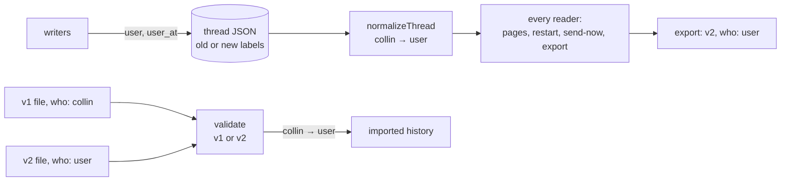

# Finish removing the owner name

**Idea:** `IDEA.md` — read it first. Map: `MAP.md`, `docs/maps/owner-name-state.md`,
`docs/maps/owner-name-identifiers-inventory.md`. Follows plan `remove-owner-name` (PR #123).

## Open Questions

(none)

## Watch List

| # | Noticed | What needs looking into | Raised to user? | Outcome |
|---|---------|-------------------------|-----------------|---------|

## Decision Log

| # | Decision | Rationale | Source |
|---|----------|-----------|--------|
| 1 | New stored names: thread field `user_at` (replaces `collin_at`); message/queue source `'user'`; card `resolved_by: 'user'`; imported history `who: 'user'` | Neutral, matches the restart context's existing `asUser` relabel | defaulted |
| 2 | Old saved threads are converted when read: one normaliser maps `collin_at`→`user_at` and every `'collin'` source, `resolved_by` and imported `who` to `'user'`, in thread JSON (both queue copies, `sent`, cards, `imported.history`) and in-memory session queues; the converted form is written at the next save | One conversion point instead of dual readers scattered across pages and app code | defaulted |
| 3 | `threads/<id>.sent.jsonl` overflow lines are left as written | Nothing reads them (`viewer/app/state.js:96` is the only reference; export and restart read `thread.sent`); rewriting an append-only archive adds risk for no reader | defaulted |
| 4 | Captured fixtures (`machine/test/fixtures/agy/`, `codex-steps/`) are left as recorded | Their only mentions are `/home/collin` paths and the Linux user name, which IDEA.md excludes | defaulted |
| 5 | Handoff export writes `version: 2` with `who: "user"`; import accepts v1 (`collin`) and v2 (`user`). A not-yet-updated install refuses new files with "unknown format or version" | Name gone everywhere; the error is clear and fixed by updating | user |

## Spec



Nothing changes on screen or in how threads behave. Only stored labels, the handoff file
format, comments and tests change. Line numbers are from `93da28f4` and may drift.

### S1. New stored names

| Old | New | Where written |
|---|---|---|
| thread field `collin_at` | `user_at` | `viewer/app/sessions.js:477`, `viewer/app/threads.js:327`, `:423` |
| message / queue / sent `source: 'collin'` | `source: 'user'` | `viewer/app/threads.js:79`, `viewer/app/routes.js:534`, `viewer/app/asides.js:62`, and the checks in `viewer/app/sessions.js` (`:477`, `:542`). `enqueue`'s default source stays `'app'` (`viewer/app/sessions.js:470`) |
| card `resolved_by: 'collin'` | `resolved_by: 'user'` | `viewer/app/threads.js:246`, `:331`, `:404`, `:422` (via `resolveCard`, `viewer/app/cards.js:37`) |
| imported history `who: 'collin'` | `who: 'user'` | handoff import (S3) |

Every reader switches to the new value: `viewer/app/sessions.js:542` (send-now),
`viewer/app/agents.js:63`, `viewer/pages/threads.js:38`, `:74`, `viewer/pages/agents.js:139`
(`user_at || created_at`), `viewer/pages/thread.js:231` (`who === 'user'` → "You"),
`:436`, `:504` (pending bubbles), `:580` (dismissed label), `viewer/app/threads.js:147`
(restart's recent messages filter: `'user'` or `'card'`). After S2 the restart context's
`asUser` relabel (`viewer/app/threads.js:138`) is redundant; remove it and keep the context's
output identical (`source`, `resolved_by` and `who` already read `'user'`). No code path may
write `'collin'` or `collin_at` after this change (grep check in Validation).

### S2. Old saved threads are converted on read

Add one exported function `normalizeThread(record)` in `viewer/app/state.js` that converts a
parsed thread record in place and returns it:

- `collin_at` present: set `user_at` to it unless `user_at` already exists and is later
  (compare as ISO strings), then delete `collin_at`.
- In `queues[*][]`, `sessions[*].queue[]`, `sent[]`: `source === 'collin'` → `'user'`.
- In `cards[]` and every value of `pinned`: `resolved_by === 'collin'` → `'user'`.
- In `imported.history[]`: `who === 'collin'` → `'user'`.
- In `handoff_op.carried.history[]` (a saved import interrupted before the upgrade; Retry copies it into `imported` at `viewer/app/handoff-ops.js:102`): `who === 'collin'` → `'user'`.
- Missing or non-array containers are skipped; any other value is left alone. Converting an
  already converted record changes nothing.

Call it on every read of a thread file, before the record is used or frozen:
`State.thread()` (`viewer/app/state.js:110`), the reader at `:129`, and `cachedThread()`
(`:139`, before `freeze`). The converted form reaches disk at the thread's next ordinary
save; no separate migration pass and no extra writes. `threads/<id>.sent.jsonl` overflow is
not touched (Decision 3). Any other place that parses a thread file directly must go through
the normaliser too; the implementer greps for `threadsDir` / `.json` reads to confirm.

### S3. Handoff file version 2

`viewer/app/handoff.js`:

- `buildHandoffFile` writes `version: 2`; human and card-press entries get `who: 'user'`
  (source filter `['user', 'card']`). Copied imported history is already `'user'` (S2).
  The omission entry stays `who: 'app'`.
- `validateHandoffFile` accepts `version` 1 or 2. Allowed `who`: v1 `collin|lead|app`,
  v2 `user|lead|app`. Any other version is still "unknown format or version". All other
  checks are unchanged and apply to both versions.
- On a valid v1 file, `who: 'collin'` entries become `'user'` in the returned `file`, so the
  importer (`viewer/app/handoff-import.js`) stores only `'user'`. A v1 file that contains
  `who: 'user'` is invalid history (as today).

### S4. Documentation

`viewer/app/API.md`: `resolved_by:"user"` (lines 22, 23, 62 or wherever it appears), the
user's own words instead of "Collin's", and the handoff section (if present) documents
version 2, `who: user`, and that v1 files still import. Update `docs/maps/owner-name-state.md`
only if its statements become false; do not touch other maps or older plans.

### S5. Comments and tests (D2, D3)

- Rewrite comments naming the owner to say "the user": `viewer/app/sessions.js:476`, `:536`,
  `viewer/app/chat.js:148`, `viewer/app/threads.js:326`, `:402`, `:425`,
  `viewer/pages/thread.js:433`, `:495`, `:593`, `:607`, `:797`, `viewer/server.js:499`,
  `viewer/index.html:318`, `test-support/smoke/live.js:44`, plus any other comment a
  `grep -rni collin` over `viewer/`, `machine/`, `test-support/`, `codex/`, `install/`,
  `sensitivity/`, `sudo-helper/` finds (excluding `node_modules`).
- Hand-written tests and helpers (`viewer/test/**`, `machine/test/*.sh|js` excluding
  `fixtures/`, `test-support/`) use the new values and neutral sample names. Tests that
  check backward compatibility deliberately keep `'collin'` / `collin_at` / v1 input.
- Captured fixtures under `machine/test/fixtures/` stay as recorded (Decision 4).
- `/home/collin` paths, the Linux user name, git authors and the repository owner are out of
  scope.

### S6. New tests

- `normalizeThread`: a record with every old field (both queue copies, sent, cards, pinned,
  imported history, `handoff_op.carried.history`, `collin_at`) comes out with only new values; idempotent; `user_at`
  later than `collin_at` is kept.
- A thread file on disk with old values: listing orders by its old timestamp, its old queued
  message shows as pending and can be sent now, its old resolved card shows "Dismissed",
  and a lead restart context contains only `'user'`.
- Handoff: export writes v2 with `who: 'user'`; a v1 file with `collin` imports and stores
  `'user'`; a v2 file imports; v2 with `collin`, v1 with `user`, and version 3 are refused
  with the existing 422 messages; a thread imported from v1 re-exports as v2 with `'user'`.
- A thread saved with an interrupted v1 import operation (`handoff_op` with `carried.history` holding `collin`) is retried, then exported: the export is v2 with only `'user'`.

### Non-goals

Converting downloaded handoff files on disk; rewriting `sent.jsonl`; any on-screen change;
agent rules and prompts; reading v2 files on older installs.

### Validation

```bash
node --test viewer/test/*.test.js
npm --prefix viewer run test:browser
bash machine/test/run.sh
node --test test-support/test/*.test.js
# no writer of the old names remains outside compatibility code and tests:
grep -rn "collin_at\|'collin'\|\"collin\"" viewer/app viewer/pages viewer/server.js viewer/index.html
#   expected hits: only normalizeThread in state.js and the v1 branch in handoff.js
grep -rni collin viewer machine test-support codex install sensitivity sudo-helper --exclude-dir=node_modules --exclude-dir=fixtures | grep -vi "/home/collin\|collinear"
#   expected hits: only backward-compatibility tests and the two compatibility spots above
```

## Accepted Risks

| Risk | Why accepted | Round |
|------|--------------|-------|
| Browser tabs open while the app updates keep running the old page script until refreshed: queued-message bubbles and Send now disappear, lists sort by creation time and imported history shows `user` instead of You. A freshly loaded list page may draw its cached old list for a moment before the first fetch | Fixed by a refresh, nothing saved is affected, and updates are occasional | review-round-1 |
| Rolling the app back to a version before this change after threads were converted: old code sees `user` values it doesn't know (sort falls back to creation time, old queued messages not shown as pending) | Rollback is not a normal path; nothing is lost, and updating again restores it | planning |

## Check Once Built

| # | What to check | Round |
|---|---------------|-------|

## Review Rounds

### Round 1 — 2026-11-19

**Lanes:** intent: claude / claude-opus-5-5; mechanics: gpt / gpt-6.2-sol; cross-family: yes.

**Changed since Round 0:** n/a (first round — whole Spec in scope)

| Lane | Reported | Finding | Lead verdict | Resolution |
|------|----------|---------|--------------|------------|
| mechanics | blocking | S2 misses `handoff_op.carried.history`; a v1 import interrupted before the upgrade, retried after, stores `collin` and breaks the next export | downgraded (minor) | Needs an import interrupted before an upgrade (realism: a crash at an exact moment). Cheap to cover: added to S2's containers and an S6 test |
| mechanics | blocking | Open browser tabs cross the upgrade with the old script; bubbles, Send now, sort and history labels misbehave until refresh; cached list drawn briefly | accepted-risk | Transient, fixed by refresh, no data affected; moved to Accepted Risks |
| mechanics | minor | Renaming "the default" in sessions.js would make sourceless enqueues count as user messages | upheld | S1 now says `enqueue`'s default stays `'app'` |
| intent | minor | S2's keep-later-`user_at` rule only serves the rollback path; simpler copy-if-missing suffices | declined | One comparison; after rollback-then-update it keeps the newer activity time so list order stays right, at no real cost |

## Implementation Tasks

| # | Objective | Ownership boundary | Lane | Session id | Validation | Status |
|---|-----------|--------------------|------|-----------|------------|--------|
| T1 | Implement S1–S6: normaliser, new writers/readers, handoff v2, API.md, comments, tests | viewer/app, viewer/pages, viewer/server.js, viewer/index.html, viewer/playwright.config.js, viewer/test, test-support/smoke/live.js, docs/maps/owner-name-state.md | standard / gpt-6.1-terra | wc-9b2a60752bc2-worker | Spec Validation block | done |
| R1-1 | Remediation 1: reword the `test-support/smoke/live.js:44-46` comment (owner pronouns) | test-support/smoke/live.js | light / gpt-6-luna | wc-9b2a60752bc2-worker-2 | `node --check` + read | done |

## Log

- 2026-11-19 — Decomposed into one task (T1): the code, comment and test changes share the same files, so splitting would only serialise them.
- 2026-11-19 — T1 came back "blocked": the viewer Node gate failed twice, the second time with `app-quiet.test.js` and `app-uploads-archive.test.js` failures while the worker ran the browser and machine suites at the same time. Re-run alone it passes: 698 pass, 0 fail. Browser 1044 passed and 34 skipped; machine exit 0; test-support 9 pass. Both greps hit only `state.js` normalizeThread, the `handoff.js` v1 branch and the compatibility tests.
- 2026-11-19 — T1 accepted (band: bigger-scout): the diff matches S1–S6. Sub-lead follow-ups after the merge: capitalised a sentence in the comment at `viewer/pages/thread.js:797`, and corrected two stale statements in `docs/maps/owner-name-state.md` ("v1 export" and the future-tense migration paragraph).
- 2026-11-19 — The worker reported one choice; the scout listed 7:
- 2026-11-19 — Choice: T1, tests: the old dismissed-card browser check sits in `viewer/test/app-merged.spec.js` beside the existing resolved-card tests.
- 2026-11-19 — Choice: T1, state.js: `normalizeThread` is also applied in `updateThread()`, a reader the Spec didn't list.
- 2026-11-19 — Choice: T1, handoff.js: v1 `collin` entries are converted in place on the parsed `file.history`.
- 2026-11-19 — Choice: T1, docs/maps/owner-name-state.md: the summary paragraph was rewritten as a whole rather than edited statement by statement.
- 2026-11-19 — Choice: T1, app-handoff-restart.test.js: the old "relabels owner tags without changing saved state" test was renamed, and now asserts that saved state is converted.
- 2026-11-19 — Choice: T1, tests: the normaliser unit tests are in a new file, `viewer/test/app-owner-normalize.test.js`.
- 2026-11-19 — Choice: T1, app-send-now.spec.js: the `open()` helper gained a `source` parameter.
- 2026-11-19 — Choice: T1, interrupted-import test: Retry is exercised by re-importing over a saved `create` handoff_op (the `handoff-import.js:26` path), not through the Retry route.
- 2026-11-19 — Verification attempt 1 (claude-opus-5-5): FAIL, one gap (S5 smoke comment still says "his"); no rare paths. REMEDIATION-1.md written; R1-1 dispatched at the light tier, to GPT as the original build provider.
- 2026-11-19 — R1-1 accepted (band: scout): the three comment lines match the brief exactly and nothing else changed; `node --check` passes. The worker reported its choices as "none", and the scout agreed.
- 2026-11-19 — Verification attempt 2 (claude-opus-5-5, `ab6bd6cc`): PASS, no gaps; 0 rare paths accepted. The verifier saw flakes in `viewer/test/server.test.js`, a file this branch does not change: one hang, and one race-order failure at `:579`. The final full run passed 698/698.
