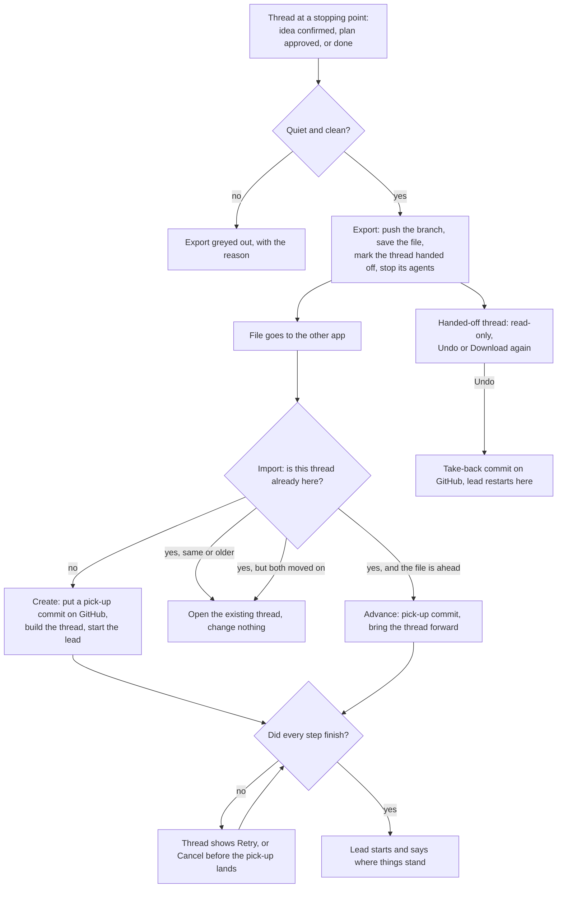

# Plan handoffs: export and import a thread

**Idea:** `IDEA.md` — what this is for and why, in plain language. Read it first; it is
the north star this plan serves. Goal and Constraints live there, not here, so they don't
get buried as this file grows.

## Open Questions

Ordered by leverage; discussed one at a time. A settled question moves to the Decision
Log and is deleted from here.

(none)

## Watch List

| # | Noticed | What needs looking into | Raised to user? | Outcome |
|---|---------|-------------------------|-----------------|---------|

## Decision Log

Append-only. A reversal is a new entry superseding the old, never an edit.

| # | Decision | Rationale | Source |
|---|----------|-----------|--------|
| 1 | Importing into an app that already has the thread points back to it, or advances it when the import is a later stage; never a duplicate | Collin's rule, folded into IDEA.md | idea-change |
| 2 | The export is one JSON file (`<title>.wheelchair.json`), not a zip | Code and plan documents travel on the branch, so what remains is small structured data | defaulted |
| 3 | Export pushes the thread's branch first; if the push fails, no file is produced | IDEA's constraint says work must be on GitHub; doing it for him removes a step he would otherwise forget | defaulted |
| 4 | The file carries thread identity (id, title), repository (GitHub remote URL), branch and head commit, plan slug, stage, the cards and the last messages (the same set a lead restart uses), and an export time. Not agent transcripts, not uploads | Mirrors the existing restart context (`viewer/app/threads.js:122-157`), which already lets a fresh lead carry on; plan documents are on the branch | defaulted |
| 5 | Import starts from the new-thread screen: pick machine and project, choose the file. The project's GitHub remote must match the file's repository, or import is refused with the reason | A file from another repository cannot resume against this code | defaulted |
| 6 | An imported thread's lead starts with a new `[wc:context import]` message, built like the restart context, and its reply is shown | Reuses the restart path the lead protocol already handles | defaulted |
| 7 | The file is validated (schema, size limit, known stage) before anything is created; its text is shown and used as data, never run | The file may come from elsewhere | defaulted |
| 8 | Export points are three: idea confirmed, plan approved, done | Collin picked the three major points over any quiet moment | user |
| 9 | The imported thread is the same thread: it keeps the original thread id, branch `wc/<id>` and pull request | Collin chose same thread; one piece of work stays one branch and one pull request, and duplicate detection is by id | user |
| 10 | After export the original thread is marked handed off: readable, takes no new work, undoable; a newer re-import revives it | Collin's pick; keeps two copies from moving on at once without discarding the original | user |
| 11 | Re-import advances the existing thread only when the file is strictly ahead; when the copies drifted apart it opens the existing thread and explains, changing nothing | Collin's pick; never loses work silently | user |
| 12 | Strictly ahead is decided by git ancestry of the heads alone, not by comparing stage names | Stage moves only with committed PLAN.md changes, so the heads already order it; one rule instead of two | defaulted |
| 13 | Archived threads cannot be exported; an archived thread found on import counts as existing and can be advanced | No worktree to push from; reviving fits the no-duplicates rule | defaulted |
| 14 | Carried cards that were still open are stored withdrawn; the new lead posts fresh ones | Avoids pressing a card whose asker no longer exists | defaulted |
| 15 | Whoever picks the work up pushes an empty "picked up" commit to the branch first; import refuses when the branch moved past the export, and undo hand-off refuses when the branch moved | Collin's proposal: makes a pick-up visible on GitHub so a second import or an undo can't start a second copy. Empty commit chosen so nothing lands in the files | user |
| 16 | Undo hand-off also claims the branch ("taken back") and is refused if the claim loses | Closes the undo-then-import race that decision 15 meant to prevent | review-round-1 |
| 17 | Claims are made without a worktree (`commit-tree` + non-forced push) before any local change | Atomic; a lost race changes nothing | review-round-1 |
| 18 | Export needs a clean worktree, reads stage from committed HEAD, and is blocked once the pull request is merged or the origin isn't GitHub | Only commits travel; a merged thread has nothing to hand off | review-round-1 |
| 19 | Carried cards replace the importing thread's cards, all open ones withdrawn; carried messages join the thread's sent history; the import context is stored for recovery | No stale presses; later restarts and exports keep the history; a failed lead start can recover | review-round-1 |
| 20 | File limit 10 MB on both sides, sent as raw bytes | Export and import check the same size | review-round-1 |
| 21 | The file carries a plain-text history instead of live cards and pins; supersedes the card parts of 14 and 19 | Carried cards could be pressed and needed a round-trip schema for every stored field; decisions already travel in PLAN.md | review-round-2 |
| 22 | Claims use `--force-with-lease` on the exact parent, a nonce, and a claim record saved before the push; an unfinished import has a Finish import button | Atomic, recognisable as ours after a crash, and always recoverable | review-round-2 |
| 23 | Done is exportable only while the pull request is open (checked live) and nothing is waiting to be pushed | Keeps an unverified after-done fix or a merged branch out of a handoff | review-round-2 |
| 24 | Leads commit IDEA/PLAN before ending a planning turn (lead.md step 4) | Makes every planning pause a committed state the export gate can see | review-round-2 |
| 25 | Create, Advance and Undo are operations of skip-if-done steps under one saved operation record; any interruption is finished by one Retry button (or by importing the file again). Supersedes the step-by-step recovery of 22 | Collin picked one Retry button: one rule covers every crash point | user |
| 26 | No lead runs during an operation; the lead starts afterwards through the ordinary restart path, whose context always carries the import block | Removes every lead-related recovery case from the operation | review-round-4 |
| 27 | Importing on a machine that already holds the thread for another wheelchair app is refused | Two hubs sharing one machine would share sessions, worktrees and archive state by thread id; rare, and a refusal is clear | review-round-5 |
| 28 | Restart (for every thread) queues its context before starting the session | A crash after start can no longer leave a lead without its context | review-round-5 |
| 29 | An operation keeps the validated carried state in its record instead of a copy of the file | Removes every missing-file case; the thread record holds that state after Apply anyway | review-round-8 |
| 30 | The machine keeps its archive records on disk | Makes the same-machine refusal (27) survive a machine restart | review-round-8 |
| 31 | The restart reorder (28) and partial-start handling apply to imported threads only; supersedes 28 | Changing start-up for every thread pulled pre-existing crash windows into this feature | review-round-12 |
| 32 | Cancel never waits on an in-flight push: it records the claim on a hub revoke list and abandons; a sweep takes a late-landing claim back off GitHub with a lease that only matches that exact commit. Supersedes the `claim-cancel`, pid and time-bound design | Collin chose to keep going on Cancel; this removes the need to know whether a push is still running | review-round-12 |
| 33 | Cancelled claims are never reused: an import or undo meeting its own cancelled claim waits for the revoke ("try again in a few minutes") | Adopting them (round 14) opened crash, cross-clone and late-revoke gaps; waiting a few minutes in a rare case is simpler | review-round-15 |
| 34 | Remaining rare crash-timing cases are accepted risks; one last consistency-only review pass, then approval | Collin chose accept and approve; findings had narrowed to crashes at exact moments | user |

## Spec



The diagram repeats the sections below: export points and quiet test, the file, claims,
operations with Retry and Cancel, and the import table. It leaves out the machine-side
checks and the revoke sweep.

Terms: the **source** thread is the one exported; the **file** is the export; the
**importing app** is the hub the file is imported into (it may be the same hub). The hub
runs `viewer/app/*`; the machine service runs `machine/service.js`. A **claim** is an empty
commit pushed to the thread's branch on GitHub to show who holds the work (see Claims).

Every handoff operation below (export, and the Create, Advance and Undo operations, including a Retry)
runs inside the hub's per-thread lock, `hub.withThread(id, ...)`
(`viewer/app/hub.js:90-100`), from its eligibility checks to its last save, so a message,
press or second import for the same thread id waits for it.

### Export points

A thread can be exported at exactly three points. At each, the thread must also be
**quiet**:

- not archived, not handed off, no unfinished operation (see Operations and Retry);
- no session other than the lead is `live`; the lead is either not live, or live with
  `turn_ended === true` (`viewer/app/sessions.js:515-543`); nothing is queued on a session
  that could still receive it: any live or `pending` session, or any lead session record
  (Restart moves ended leads' queues to the next lead). Queues left on ended non-lead
  sessions are never delivered and do not block export;
- no aside is open or has a turn running (`thread.asides`, `viewer/app/asides.js`);
- no `sudo` card is in state `waiting` or `running`;
- no upload to the thread is in flight (the hub counts uploads per thread from admission
  to completion, both under `hub.withThread`; `viewer/app/routes.js:69-90`);
- the worktree has no uncommitted changes (`git status --porcelain` empty, untracked
  files included), and it is on branch `wc/<id>` (`git symbolic-ref --short HEAD`), not
  detached.

The stage is read from the **committed** files at the worktree's `HEAD`
(`git show HEAD:docs/plans/<slug>/IDEA.md` and `PLAN.md`), never from the working files.

| Point (`stage` in the file) | Holds when | Import resumes at |
|---|---|---|
| `idea-confirmed` | IDEA.md `status: confirmed`; MAP.md committed at `HEAD` (mapping finished); PLAN.md absent or `status: planning`; no `question` card **answered by Collin** (a press, a typed answer, or a lead `resolve`; a retraction does not count) after the anchor: the last such answered question card whose `doc` is `IDEA.md`, or, when there is none and the thread was imported, `imported.at` | Planning (lead step 4): the lead reads IDEA, MAP and any PLAN.md on the branch and asks the open questions again |
| `approved` | PLAN.md `status: approved`; no `approval` card was answered with Start building | Approval (lead step 6): the lead posts a fresh approval card with a fresh Ready check |
| `done` | PLAN.md `status: done`; the thread's pull request is known: the `pr_url` of its latest non-replaced `done` card, else `imported.pr_url`; no `merged` card exists; the pull request's current state, read at export time with `gh pr view <pr_url> --json state` on the machine, is `OPEN`; and the worktree `HEAD` equals `origin/wc/<id>` after a fetch, so no after-done fix is waiting on its check or on Collin | After done (lead step 9) |

A retracted approval card does not block the `approved` point. The `idea-confirmed`
rule needs no new card field: the lead already gives IDEA confirmation cards
`doc: "IDEA.md"` (`protocol/app/lead.md:167-170`), and any later answered question is a
planning answer, in old threads too.

When the thread is not at an export point, the export control is shown disabled with one
line saying why. The hub computes it; first match wins:

| Reason | Shown |
|---|---|
| archived | "Archived threads can't be exported" |
| handed off | "Already handed off" |
| unfinished operation | "An import or undo didn't finish" |
| `merged` card exists, or the PR is not open at export | "The pull request is merged or closed; nothing left to hand off" |
| origin not on GitHub | "This project's origin isn't on GitHub" |
| another live session, or an aside open or running | "Agents are still working" |
| lead mid-turn, or something queued that could still be delivered (as the quiet test defines) | "The lead is busy" |
| sudo waiting or running | "A root command is waiting" |
| upload in flight | "A file is still uploading" |
| dirty worktree | "Some changes aren't committed yet" |
| `done` with HEAD not equal to the remote tip | "A fix is still being checked" |
| no point holds | "Not at a stopping point: export after the idea is confirmed, once the plan is approved, or when it's done" |

The disabled reason shown on the page is computed from hub state and the last `status`
read; the PR-state and remote-tip checks run only when Export is pressed.

### The file

One JSON object, UTF-8, at most **10 MB** as bytes on the wire, downloaded as
`<title-kebab>.wheelchair.json` (title lower-cased, non-alphanumerics collapsed to `-`,
cut to 60 characters, fallback `thread`). All fields required unless noted; an unknown
field at any level is refused on import:

| Field | Value |
|---|---|
| `format` | `"wheelchair-handoff"` |
| `version` | `1` |
| `exported_at` | ISO time |
| `thread` | `{id, title, slug}`; `id` matches `^[0-9a-f]{12}$`; `slug` matches `^[a-z0-9][a-z0-9-]*$`; `title` a string of at most 120 characters (card titles are cut to 80 plus an ellipsis, `viewer/app/card.js:49-54`) |
| `repository` | `github.com/<owner>/<repo>` (see Normalization) |
| `branch` | `wc/<id>` |
| `head` | 40-hex sha the export push left on `origin/wc/<id>` |
| `stage` | `idea-confirmed`, `approved` or `done` |
| `pr_url` | string; required when `stage` is `done`, absent otherwise |
| `history` | array of history entries, oldest first, at most 2000 |

A **history entry** is `{at, who, kind, text}`, all strings: `at` an ISO time; `who` one of
`collin`, `lead`, `app`; `kind` one of `message`, `press`, or a card kind from
`protocol/app/cards.md`; `text` at most 20,000 characters. It is a plain-text record of
what happened, never a live card. Export builds it from, in time order:

- the thread's own `imported.history`, if it was itself imported (so history accumulates
  across handoffs);
- each sent message from `collin` or `card` in `thread.sent` (for an imported thread,
  only those after `imported.at`) (`who` `collin`, `kind`
  `message` or `press`, `text` the message text);
- each non-replaced card shown to Collin (for an imported thread, only those created
  after `imported.at`; `who` `lead` or `app`), with `text` rendered by
  one function, `historyText(card)`, defined per kind: question → question, the options'
  labels, and the answer or "withdrawn"; idea → the bullets; approval → objections and
  outcome; done → title, can_do, left_as_is, pr_url; needs → title and body; offer →
  summary and answer; stub → title; diagram/image → title; sudo → command and outcome;
  progress cards are skipped. Never-shown kinds are skipped.

An entry whose text is over 20,000 characters is cut to 19,990 and ends with "… (cut)".
When the entries exceed 2000 or the file 10 MB, the oldest entries are dropped and one
entry `{at: <the first kept entry's at>, who: "app", kind: "message", text: "<n> earlier
entries were left out"}` is put first. Export validates the file it built with the
importer's validator before pushing (Export step 2).

Not in the file: cards as objects, pins, the machine, project path, CLI, provider,
sessions, transcripts, uploads, asides, queues. Plan decisions travel in PLAN.md's
Decision Log on the branch; the history is for reading.

### Claims

A claim is an empty commit on `wc/<id>` whose parent is an expected commit, pushed so it
lands only if the remote tip is **exactly** that parent:

1. `git commit-tree <parent>^{tree} -p <parent> -m "<message>"` in the project repository,
   where `<message>` is `handoff: picked up <ISO time> <nonce>` (import) or
   `handoff: taken back <ISO time> <nonce>` (undo), and `<nonce>` is 8 random hex
   characters, so no two claims are the same commit.
2. `git push --force-with-lease=refs/heads/wc/<id>:<parent> origin <claim>:refs/heads/wc/<id>`.
   The lease makes the push fail if the remote branch is missing, rewound, or anywhere
   other than `<parent>`; the update is a fast-forward because the claim's parent is
   `<parent>`.

The claim sha is saved on the operation record before the push, so a retry can tell an
own landed claim (remote tip equals it) from someone else's (see Operations and Retry).

Someone taking the branch by hand, without wheelchair, is asked (README) to push such a
commit too; wheelchair cannot enforce that.

### Export

`POST /threads/:id/export` (hub route, beside restart and archive in `viewer/app/routes.js`).

1. Re-check the export point and quiet test, including the machine `status` call; on
   failure 409 with the reason sentence.
2. Build the file with `head: <checked sha>`, trimming history as below, and validate it
   with the importer's validator; a failure is a 500 and nothing changes.
3. Ask the machine to push the exact commit the check read, `<checked sha>`, as
   `git push origin <checked sha>:refs/heads/wc/<id>` (`/v1/handoff` `push`, non-forced). It returns the pushed head and the
   normalized repository. On failure 409 "Couldn't push the branch to GitHub: <git's last
   line>"; nothing changes.
4. Write the file to `handoffs/<id>.json.new` in the hub state directory, then save
   `handed_off: {at, head, stage}` on the record and cancel asides as archive does
   (`viewer/app/threads.js:163-167`), then rename the file to `handoffs/<id>.json`
   (replacing any earlier one). If the save throws, re-read the record from disk: if
   `handed_off` is there, the save took effect, so carry on with the rename. Otherwise, or
   if the write failed: delete the `.new` file and respond 500 "The branch was pushed, but
   the export didn't finish; try again". The push is harmless: the thread is unchanged and
   can be exported again.
5. Stop every live session of the thread as `session stop` does. If a stop fails, carry
   on: the thread is already frozen, so nothing reaches that session.
6. Respond 200 with the file as `application/json` and
   `Content-Disposition: attachment; filename="<name>"`.

Thread page: an **Export** button in the head beside Archive (`viewer/pages/thread.js:147-166`).
Enabled only at an export point, otherwise disabled with the reason as a line under it
(the thread view payload carries `export: {ok, reason}`). Pressing it asks "Export and hand
off? This thread stops taking work here." with Confirm / Cancel; Confirm downloads the file.

### Frozen threads

A thread is **frozen** while it is handed off or has an unfinished operation (see
Operations and Retry). One hub-side check, `frozen(thread)`, guards every entry point; the
refusal is 409 with "handed off" or "Retry the unfinished import first":

- messages, uploads, card presses and dismissals, card posts from any session of the
  thread, session starts (including `restart`), aside creation and aside messages,
  terminal keys (`POST /sessions/:name/keys`, `viewer/app/routes.js:520`);
- `enqueue` (`viewer/app/sessions.js:408`) drops any message for a session of a frozen
  thread, whoever produces it (turn-failed notices, dead-session polls, starters), so
  nothing made during the freeze reaches a later lead. (No exception is needed: the lead
  is started only after the thread stops being frozen.)
- queue delivery: `canDeliver` (`viewer/app/sessions.js:428`) delivers nothing to a
  session of a frozen thread;
- nothing enqueues `Continue.` for one, from the rate-limit release
  (`viewer/app/sessions.js:761`) or the limit event itself (`viewer/app/sessions.js:517-523`);
- archive, only while an operation is unfinished (a handed-off thread can be archived).

The operations themselves bypass the check.

### The original thread after export

- A handed-off thread is **frozen** (see Frozen threads): readable, but it takes no new
  work. The composer, attach and card buttons are disabled, and the "Restart lead" panel
  (`viewer/pages/thread.js:268-278`) is not shown.
- The page shows a banner. When the page loads, it asks the hub
  `GET /threads/:id/handoff`, which runs `inspect` (cached for 60 seconds) and reports
  whether the remote tip is still `handed_off.head`:
  - unchanged: "Handed off <date>. Import a newer file to continue here, or undo." with an
    **Undo hand-off** button;
  - moved: "Picked up elsewhere on <date>. Import a newer file to continue here." and no
    Undo. When the tip is an own cancelled claim (Import step 4), the banner instead says "An
    earlier cancelled import or undo is still being taken back; try again in a few
    minutes" and Undo stays. Pressing it starts the Undo operation, whose Claim step then
    fails as in "Own cancelled claim at the tip"; from then on the saved-Undo rule below
    applies;
  - inspect failed: the first text, and Undo stays available (undo checks again).
- `POST /threads/:id/undo-handoff` runs the Undo operation (see Operations and Retry):
  claim on top of `handed_off.head`, stop any live session, fast-forward the worktree to
  the claim (or rebuild it when missing), clear `handed_off` and `archived`, then start a
  lead with the restart context. Undo is offered on archived handed-off threads too. If the claim step
  abandons, 409 "This was picked up elsewhere on <date>; import a newer file to continue
  here". If any step fails (including the own-cancelled-claim case), 409 with the step's
  `last_error`, and the operation stays saved for Retry. The same rule holds for the
  import route and `retry-handoff`.
- While handed off, the page offers **Download the file again**
  (`GET /threads/:id/handoff-file`, the saved `handoffs/<id>.json`), so a lost download
  never needs a second export. Download again runs inside `hub.withThread(id)`, so it never
  overlaps Export's own rename, and Export's rename succeeds when the destination already
  holds the same content. It serves the copy whose `head` equals `handed_off.head`: if `handoffs/<id>.json.new` matches, it is renamed over `.json` first
  (a crash between the save and the rename, or an old `.json` that was never deleted); the hub does the same for every
  handed-off thread when it starts. The saved file is deleted when the hand-off is undone or the
  thread is advanced by an import (Done step), not when it is archived.
- A handed-off thread can be archived like any thread; its Undo stays available.
- The threads list shows a "handed off" label on such threads.

### Import

New-thread screen (`viewer/pages/new.js`): a second action **Import a handoff** beside
Start. It uses the same machine and project pickers and a file chooser (`.json`). The
page sends `POST /threads/import?machine=<m>&project=<p>` with the file's raw bytes as the
body. The hub refuses a body over 10 MB (413) before parsing. The project path is validated
as in `createThread` (`viewer/app/threads.js:43-64`); the machine and project come from the
picker, never the file.

The hub then, inside `withThread(<file thread id>)`:

1. **Validates** the file: JSON, the fields and patterns above, `format`, `version`,
   `stage`, `branch === "wc/" + thread.id`, the `pr_url` presence rule, and each history
   entry's fields, types and limits. Failure: 422 "This isn't a handoff file wheelchair
   can read: <what>".
   Then, if a thread with the file's id exists here with a saved `handoff_op`: for a saved
   Create or Advance, the hub runs that operation again and stops (steps 2-4 are skipped,
   since the saved operation carries everything it needs); the response is that
   operation's outcome (`created` or `advanced`), with note "Finished the earlier import;
   import this file again if it's newer". For a saved Undo, nothing runs: `opened`, note
   "An undo of this thread didn't finish; press Retry on it, then import this file again".
   When the thread exists (with or without a saved operation), the picked machine and
   project are ignored: steps 2-4 and Advance use the thread's own machine and project,
   and the response note starts "This thread lives on <machine>, <project>" when they
   differ from the picker's.
2. **Matches the repository**: the machine reports the project's normalized origin.
   Mismatch: 422 "This file is for <file repo>, but that project is <project repo>".
3. **Inspects the branch** (`/v1/handoff` `inspect`): fetch; `origin/wc/<id>` must exist and
   contain `head`, otherwise 409 "The branch on GitHub doesn't have the exported work".
   At `head`, the committed IDEA.md and PLAN.md must satisfy the `stage`'s status
   conditions from the Export points table. Otherwise 422 "The file says <stage>, but the
   branch doesn't".
4. **Looks for the thread id** in this hub, archived or not, and picks the first row that
   matches:

| Case | Outcome |
|---|---|
| No such thread, but the machine holds sessions, a worktree or an archive record for this id (another wheelchair app on the same machine has or had it) | Refused 409 "This machine already has this thread from another wheelchair app; import it on another machine" |
| No such thread, and the picked project's local `wc/<id>` branch is checked out (in the project clone or any worktree) | Refused 409 "Branch wc/<id> is checked out in <path>; switch away from it, then import again" |
| No such thread, and the picked project has a local `wc/<id>` branch that is not an ancestor of `head` | Refused 409 "This project already has a branch wc/<id> that differs from the file; delete it if you don't need it, then import again". A local branch that is an ancestor of `head` and not checked out is fine: Create uses it |
| No such thread, and none of the three rows above matched | **Create** |
| Exists; its head equals `head`, or `head` is an ancestor of its head | **Open**, change nothing. Note: "You already have this thread here", plus " It's handed off: press Undo on it to carry on here." when it is handed off and the tip is unchanged, or " An earlier cancelled import or undo is still being taken back; try again in a few minutes." when the tip is an own cancelled claim; or "This file is older than the thread here" |
| Exists; its head is a strict ancestor of `head` | **Advance** |
| Exists; neither is an ancestor of the other | **Open**, change nothing; note "This thread and the file have each moved on separately, so nothing was changed. Bring the branches together yourself, then import again." |

   "Its head" is, in order: the `HEAD` of the thread's worktree if that directory exists
   and is a git worktree; else the local `wc/<id>` ref in the project (the Checkout step
   keeps it at the claim when there is no worktree); else `handed_off.head`. Ancestry uses `git merge-base --is-ancestor`.

   For Create and Advance, the remote tip must also **equal** `head`. A tip past `head`
   means someone already picked the work up: 409 "This was already picked up elsewhere on
   <committer date of the first commit after head>; export again from wherever it is now".
   Except when the tip is exactly a claim on this hub's revoke list for this thread (an
   **own cancelled claim**): then 409 "An earlier cancelled import or undo is still being
   taken back; try again in a few minutes", and the hub schedules that entry's revoke to
   run right after this request releases the thread lock (see Revoking).
   The Claim step's abandon check, the handed-off banner and the Open note use the same
   exception, so none of them calls an own cancelled claim "picked up elsewhere". Cancelled
   claims are never reused: the revoke list and operations never act on the same claim.

**Create** saves a new record (the file's `id`, `title`, `slug`, the picked machine and
project, `branch: wc/<id>`, no sessions) together with its `handoff_op`, then runs the
operation. **Advance** first refuses 409 "The thread here is busy" unless the existing
thread has no live session other than the lead, no aside open or running, the lead is idle
or not live, nothing is queued that could still be delivered (as the Export points quiet
test defines), no sudo card is waiting or running, and no upload is in
flight. Then it runs the pre-claim checks below, saves `handoff_op` and runs the
operation.

**Before any claim** (Create, Advance and Undo, checked again on every Retry while
`claim_landed` is false):
- when the thread has a recorded worktree that exists, it must be on `wc/<id>` (409 "The
  thread here isn't on its branch"), clean (409 "The thread here has uncommitted
  changes"), and its `HEAD` must be `parent` or an ancestor of it (409 "The thread here
  has commits that aren't in the file");
- otherwise, the project's local `wc/<id>` branch must not be checked out anywhere
  (`known` reports where): 409 "Branch wc/<id> is checked out in <path>; switch away from
  it, then try again"; and, when it exists, it must be `parent` or an ancestor of it (409
  "This project already has a branch wc/<id> that differs from the file; delete it if you
  don't need it, then try again").
Nothing is claimed when either fails.

Responses: `{outcome: "created"|"advanced"|"opened", id, note?}`. The page navigates to
the thread for `created` and `advanced`; for `opened` it shows the note and an "Open the
thread" link.

**Carried state**, applied by Create and Advance: `imported: {at, stage, exported_at,
history, pr_url}` from the file. On Advance the file's history replaces the old
`imported.history`, since the file's already contains everything before it. Wherever the
hub reads a thread's pull request from its `done` cards (`mergedPr`,
`viewer/app/threads.js:353-356`; `prOf`, `viewer/app/chat.js:256`; the `done` export point),
an imported thread considers only `done` cards created after `imported.at` and otherwise
uses `imported.pr_url`, so the merge watcher and the PR link work for an imported thread. The
thread page renders `imported.history` as a collapsed, read-only "Before the handoff"
section above the thread's own conversation: one line per entry (`at`, `who`, `text`), as
plain text, no buttons; the thread's own conversation is shown only from `imported.at`
on. On Advance, the thread's existing cards are all marked answered as retracted
(`retracted_by: "import"`, note "Replaced by an import") and every pin is cleared, so
nothing from before can be pressed; the lead posts fresh cards.


### Operations and Retry

Create, Advance and Undo are each an **operation**: a fixed list of steps where every step
first checks whether it is already done and skips it if so. An operation that stops
partway (crash, lost response, failed step) is finished by running it again from the top;
that is the only recovery mechanism. An operation touches only GitHub, git on the machine
and the hub record; **no lead runs during an operation**. The lead is started after the
operation is complete, by the ordinary restart path, so lead start-up never needs its own
recovery.

**The operation record.** Before its first step, an operation saves
`thread.handoff_op: {kind: "create"|"advance"|"undo", carried, parent, claim_sha,
last_error, claim_landed, applied, started_at}`; `started_at` is set once and becomes `imported.at` in Apply, so
a Retry never moves that cutoff on the thread record (for Create, in the same save that first
creates the record). `carried` is the validated carried state from the file,
`{stage, exported_at, history, pr_url}` (null for undo); Create's record already holds the
file's title and slug. No copy of the file is kept: Apply reads `carried`, so Retry never
needs the file. `parent` is the commit the
claim goes on (`head` for imports, `handed_off.head` for undo). The thread's existing
fields (`imported`, `handed_off`, cards, pins, `archived`) are not changed until the Apply
step, so a refused or abandoned operation leaves them as they were. A step that fails
saves its sentence in `last_error` and the operation stops there.

**Own cancelled claim at the tip.** When the Claim step's `claim-push` returns `moved`
and its `remote_tip` is exactly a claim on this hub's revoke list for this thread, the
operation is **not** abandoned: the step fails with `last_error` "An earlier cancelled
import or undo is still being taken back; try again in a few minutes", `handoff_op` is
kept (so the thread shows Retry), and the hub schedules that entry's revoke to run right
after the operation releases the thread lock. A later
Retry then finds the tip back on `parent` and claims normally. For an Undo, this is the
only place the case is met, since Undo has no Import step 4.

**Abandoning.** When the Claim step finds someone else moved the branch (`moved`, and the
tip is not an own cancelled claim), the operation is
abandoned: Create deletes the thread record; Advance and Undo clear `handoff_op`. The
response is "picked up elsewhere" 409; when the operation
was reached through a re-import (Import step 1), its text ends "import that file again"
instead of "export again from wherever it is now".

**Steps**, in order (Undo has no carried state):

1. **Claim.** Skipped when `claim_landed` is true. If `claim_sha` is null: `claim-commit` on `parent`, save `claim_sha`, then
   `claim-push`. If `claim_sha` is set: `claim-push` again. `claim-push` decides its
   result only from the remote tip it reads after its push attempt, never from the push's
   exit code: tip `claim_sha`, or a descendant of it → `landed`: save `claim_landed: true`, go on; tip `parent` → `unknown`; any other tip →
   `moved`, abandon (except an own cancelled claim, above); tip unreadable → `unknown`. `unknown` fails the step with "Couldn't
   update the branch on GitHub: <git's last line from the push or fetch>", keeping
   `claim_sha`, so Retry tries again.
2. **Stop.** Stop every live session of the thread (Advance and Undo); a stop the machine
   answers with HTTP 404 "unknown managed session" from its session DELETE route
   (`machine/service.js:388-391`, `:1235-1237`) (its record is gone, for example after an archive whose
   reply was lost) counts as stopped and the hub marks the session not live. Then ask the
   machine (`/v1/handoff` `running`) which tmux sessions named `wc-<id>-*` still exist,
   kill exactly those names (`/v1/handoff` `kill`), and ask again. Any left fails the step with
   "Couldn't stop the agent working here".
3. **Checkout.** If the thread's worktree directory exists and is a git worktree:
   `/v1/handoff` `fast-forward` to `claim_sha`. Otherwise clear `worktree` on the record and
   move the project's local `wc/<id>` ref to `claim_sha` (`/v1/handoff` `set-branch`); the
   lead start builds the worktree (step 6).
4. **Apply.** Skipped (with 2 and 3) when `applied` is true. First, call `/v1/handoff`
   `reopen` (idempotent) **always**, whatever the hub's `archived` flag says, since a
   machine may have finished an archive whose reply the hub never got; if it fails, the step fails before anything is saved. Then set the carried state
   (Create, Advance), retract cards and clear pins (Advance), clear `handed_off` and
   `archived`, set `checkout_sha: claim_sha` and `handoff_op.applied: true`, and save, all in
   one save. Every assignment is the same on a
   re-run.
5. **Done.** Clear `handoff_op` and save. Then delete `handoffs/<id>.json`. A crash
   between the save and the delete leaves only a stray file;
   when the hub starts, it deletes `handoffs/*.json` and `handoffs/*.json.new` files that
   belong to no handed-off thread and no saved operation (a `.json.new` of a handed-off
   thread is renamed instead, as above).
6. **Start the lead**, outside the operation: the restart path (`restartLead`,
   `viewer/app/threads.js:122-159`). Whenever a thread has `checkout_sha` and no recorded
   worktree that exists (any thread an operation touched, imported or not), every later
   restart starts the lead with `from_remote_branch: {sha: checkout_sha}`. Once the lead's worktree is recorded, the hub
   registers the plan directory (`hub.registerPlan`, as `findSlug` does at
   `viewer/app/views.js:105`), since an imported thread's slug is set before any worktree
   exists and `findSlug` would skip it. Registration is also repaired at hub start: every
   thread with a slug and a recorded worktree is registered. If the start fails, or the hub
   stops before it, the thread shows the dead-lead panel with Restart: the panel's
   condition (`viewer/pages/thread.js:270-277`) becomes "not archived, not frozen, no live
   lead, and either a lead was ever started or the thread was imported".

**Partial lead starts.** The hub marks a session live before the machine call that
launches it (`viewer/app/sessions.js:277-300`). When the hub starts, a **lead** session of
an **imported** thread (one with `imported`) marked live whose start result was never
saved is marked not live, so the dead-lead panel
offers Restart; Restart (below) kills anything that start left on the machine, refuses
while any survives, and moves its queued context to the new lead. The hub never takes over
a half-started session.
Other roles, and leads of threads that were never imported, are unchanged from today. An
thread with `checkout_sha` starts its lead with `from_remote_branch: {sha: checkout_sha}`
until a worktree is recorded, and that path reuses the checkout folder a lost start left
behind (`createWorktree`, Machine service changes).

**Restart order.** `restartLead` is changed for imported threads only: it first asks the machine
(`running`) for tmux sessions of the thread's lead names that the hub does not count as
live (starting or running), kills them (`kill`), and refuses with 409 "The previous agent
is still stopping; try again in a minute" if `kill` reports any left. It moves any queued
context from those names, **and from any lead session record the hub holds that is not
live and has a non-empty queue** (a crash after an earlier restart's save but before its
start), to the new one; then it picks the new lead's name (`newSessionName`), creates that
session's record (not live, status `pending`) with the context message in its queue, saves,
**then** starts the session, which turns the same record live. A stuck `pending` record's
queue blocks export (Export points) until the next Restart drains it. A crash after the start still leaves the context queued for the lead;
a crash before it leaves a thread with no live lead, which shows Restart.

**What the lead is told.** Restart's context JSON gains, for a thread with `imported`, an
`import: {stage, exported_at, pr_url, history}` block (history: last 50 entries), every
time. The marker is `[wc:context import]` when no lead session of the thread started after
`imported.at`, otherwise `[wc:context restart]`; the JSON is the same. The lead reads the
plan documents on the branch either way.

All of an operation runs inside `hub.withThread(id)`. The hub keeps an in-memory set of
operations currently running; an operation is **unfinished** when `handoff_op` is saved
and its thread id is not in that set.

**Retry.** An unfinished operation:
- freezes the thread (Frozen threads), which also refuses archive, and blocks export
  ("An import or undo didn't finish");
- shows, instead of the composer, a panel "The import didn't finish." (or "The undo didn't
  finish."), the saved `last_error` when there is one, and a **Retry** button:
  `POST /threads/:id/retry-handoff` runs the saved operation again from its record;
- offers **Cancel** next to Retry while `claim_landed` is false. Until the claim is known
  to have landed, Checkout has not run, so nothing local has changed and Cancel has
  nothing local to undo. Cancel never waits on or asks about a push that may still be under
  way. Instead, when `claim_sha` is set, it first adds `{thread_id, project, machine,
  branch, parent, sha: claim_sha, until: now + 24 hours}` to the hub's durable revoke list
  (`revoke.json` in the hub state directory, outside `handoffs/`, so the start-up sweep
  never touches it), then abandons the operation without the 409: Create deletes its
  record, Advance and Undo clear `handoff_op`. When `claim_sha` is null, it just abandons.
- **Revoking.** At hub start and every 10 minutes, the hub sweeps the whole revoke list.
  Separately, Import step 4 and the Claim step each schedule an immediate revoke of the one
  matching entry (the only two places that do; the banner and the Open note only
  display). Each entry, in a sweep or alone, runs inside `hub.withThread(thread_id)`. Every read-modify-write of `revoke.json`
  (Cancel, sweep, Dismiss) also holds one hub-wide `revoke` lock, taken after the
  thread lock, so writes for different threads never overwrite each other:
  - if a thread with that id still has a saved `handoff_op` whose `claim_sha` is the
    entry's `sha` (a crash between saving the entry and abandoning), the operation wins:
    the entry is removed and nothing is revoked; Collin can Cancel again;
  - otherwise it calls `claim-revoke`: `revoked` keeps the entry and moves `until` to 24
    hours from now (a second, overlapping push of the same claim could still land later,
    and is revoked the same way); `waiting` keeps it; `gone` removes it; `failed` keeps it and saves the error on the entry;
  - at `until` the entry is removed, except one whose last result was `failed`: that one
    stays, and the threads list shows a notice "Couldn't take back a cancelled pick-up on
    <repository> <branch>: <error>" with a Dismiss button that removes it.
  So a pick-up commit that lands after Cancel, from a push that was slow, retried or
  outlived a restart, is taken back off GitHub, and only if nothing was built on it.
- for a saved Create or Advance, is also reached by importing a file for that thread id
  (Import step 1), which runs the saved operation and ignores the new file; a saved Undo is
  only pointed to (Import step 1), never run by an import;
- for an Undo: whenever a saved Undo operation exists, the handed-off banner shows only
  "The undo didn't finish", its `last_error` and the Retry (and Cancel) panel, whatever the
  remote tip is; the Undo button is hidden, and `POST /threads/:id/undo-handoff` runs that
  saved operation (a Retry) instead of starting a second one. The tip-based banner states
  apply only when no Undo operation is saved.

### Machine service changes (`machine/service.js`)

- `createWorktree` (`machine/service.js:425-478`) gains `input.from_remote_branch: {sha}`.
  After the fetch, `sha` must be an ancestor of or equal to `origin/<branch>`. Then, in
  this order:
  1. If the destination directory (`stateDir/worktrees/<project>/<branch>`) exists: when it
     is a git worktree on `<branch>` whose `HEAD` is `sha` or an ancestor of it, reuse it
     (`git -C <dest> merge --ff-only <sha>`); in any other state fail with "the checkout
     folder for <branch> is in an unexpected state".
  2. Else, if no local `<branch>` exists: `git worktree add -b <branch> <dest> <sha>`.
  3. Else, if the local `<branch>` is an ancestor of `sha`: `git worktree add <dest>
     <branch>` then `git -C <dest> merge --ff-only <sha>`.
  4. Else fail with "a local branch <branch> already exists and differs".
  After 1, 2 or 3, always run `git -C <dest> config branch.<branch>.remote origin` and
  `git -C <dest> config branch.<branch>.merge refs/heads/<branch>`, so a plain push works
  even from a reused folder. The worktree
  counts as created by this start for archive ownership, as the default path does
  (`machine/service.js:531-540`). The default path is unchanged.
- New hub-only endpoint `POST /v1/handoff`, authorized like `/v1/archive`
  (`machine/service.js:1234`), with `action`:
  - `status` `{worktree, slug, pr_url?}` → fetch; `{dirty, branch, head, remote_tip,
    idea_status, plan_status, map_committed, repository, pr_state}` from `git status --porcelain`,
    `git show HEAD:...`, the origin, and `gh pr view <pr_url> --json state` when `pr_url`
    is given (`pr_state: null` and `pr_error` when gh fails, which blocks a `done` export
    with "Couldn't check the pull request").
  - `push` `{worktree, branch, sha}` → `git push origin <sha>:refs/heads/<branch>` (non-
    forced); returns `{head, repository}`.
  - Every action that fetches uses one helper,
    `git fetch origin +refs/heads/<branch>:refs/remotes/origin/<branch>`, so a
    single-branch clone still gets the thread's branch and a tracking ref. The helper
    first runs `git ls-remote origin refs/heads/<branch>` and looks for a line whose ref is
    exactly `refs/heads/<branch>` (ls-remote matches by suffix, so `backup/wc/<id>` must not
    count): when the branch does not exist on
    GitHub, it reports `remote_has_branch: false` with `remote_tip: null` and skips the
    fetch; that is not an error (a thread's first export runs `status` before the push
    that creates the branch). A network failure is still an error.
  - `inspect` `{project, branch, head, worktree?, slug}` → fetch; returns `{repository,
    remote_tip, remote_has_branch, remote_contains_head, picked_up_at, local_head,
    worktree_exists, relation, idea_status, plan_status, map_committed}` (`map_committed`:
    `docs/plans/<slug>/MAP.md` exists at `head`; the `idea-confirmed` stage requires it on
    import as on export). `local_head` follows the "its
    head" order above (the hub supplies `handed_off.head` as a fallback field).
    `relation` is `same`, `behind` (file older), `ahead` (file strictly ahead) or
    `diverged`. `picked_up_at` is the committer date of the first commit after `head` when
    the tip is past it. Statuses are read with `git show <head>:docs/plans/<slug>/...`
    (null when absent).
  - `claim-commit` `{project, parent, message}` → step 1 of Claims; returns `{sha}`.
  - `claim-state` `{project, branch, parent, sha}` → read-only:
    `git fetch origin +refs/heads/<branch>:refs/remotes/origin/<branch>` (bringing the tip's
    objects and a tracking ref into the clone, also in a single-branch clone), then
    compares `FETCH_HEAD`: equal to `sha` or a descendant of it (`git merge-base
    --is-ancestor <sha> FETCH_HEAD`) → `landed`; equal to `parent` → `parent`; anything
    else → `moved` with `picked_up_at`; fetch failure or a missing branch → `unknown` (a
    missing branch is not proof of anything). Every result except `unknown` includes
    `remote_tip`, the exact sha observed, which `claim-revoke` uses to tell the claim from
    a descendant.
  - `claim-push` `{project, branch, parent, sha}` → `claim-state`; if `parent`, run step 2
    of Claims and then `claim-state` again. The result comes only from the last
    `claim-state`, never from the push's exit code: `landed` → `landed`; `parent` or
    `unknown` → `unknown`; `moved` → `moved`. Every result except `unknown` includes the
    last `claim-state`'s `remote_tip`, which the hub needs for the own-cancelled-claim
    check.
  - `claim-revoke` `{project, branch, parent, sha}` → `claim-state`, then: tip exactly
    `sha` → `git push --force-with-lease=refs/heads/<branch>:<sha> origin
    <parent>:refs/heads/<branch>`, which puts the branch back on `parent` only if the tip
    is still exactly the cancelled claim, then `{result: "revoked"}` (a lease failure
    re-reads and reports as below); tip `parent` → `{result: "waiting"}`; any other tip,
    including a descendant of `sha` (someone built on it) → `{result: "gone"}`, nothing
    pushed; tip unreadable → `waiting`.
  - Every `/v1/handoff` outcome, including refusals, is a 200 with a JSON body (except 422
    for invalid input), so the hub's machine client (`viewer/app/machine-client.js:64-76`)
    never drops the body.
  - `reopen` `{thread_id}` → removes the id from the machine's `archivedThreads`
    (`machine/service.js:263-271`, `:783-790`), so uploads work again; Advance calls it
    when it revives an archived thread.
  - `fast-forward` `{worktree, branch, head}` → result `failed` with a sentence when the
    worktree is dirty, not on `branch`, or its `HEAD` is not `head` or an ancestor of it;
    else `git merge --ff-only <head>`, then verifies `HEAD` is exactly `head`, then
    the same two `git config` upstream settings, so a plain push works.
  - `set-branch` `{project, branch, sha}` → when `branch` is absent or an ancestor of `sha`,
    `git branch -f <branch> <sha>`; else `failed` "a local branch <branch> already exists
    and differs".
  - `running` `{thread_id}` → the names of sessions of that thread the machine is
    starting (a start request received, tmux not yet launched) or that exist in tmux
    (`tmux has-session`).
  - `known` `{thread_id, project, head}` → whether the machine holds any session record,
    worktree or archive record for the id; whether the project has a local `wc/<id>`
    branch, whether it is an ancestor of `head`, and where it is checked out
    (`git worktree list --porcelain`) (used by Create's refusal rows).
  - Durable ownership markers, in a file in the machine's state directory, saved on every
    change and loaded at start: `archiving` (ids whose archive has started) and
    `archived` (ids whose archive finished; the same set as `archivedThreads`,
    `machine/service.js:227`). Archive (`machine/service.js:740-792`) adds the id to
    `archiving` and saves **before** it stops sessions or removes anything. When archive
    finishes, the id moves to `archived`; when archive ends with the thread kept open (a
    kept rebase or failed upload removal, `machine/service.js:784-789`), the id is removed
    from `archiving` and not added to `archived`, so uploads keep working exactly as
    today. Upload refusal reads only `archived`; `known` reads both. `reopen` removes the
    id from both and saves.
  - `kill` `{thread_id, names}` → only the exact names given, each of which must start
    with `wc-<thread_id>-`; for each: a session still starting
    is marked cancelled, so its start stops before launching tmux and returns an error;
    a running one gets `tmux kill-session -t '=<name>'` (the `=` makes tmux match the name
    exactly, never as a prefix of `wc-<id>-lead-2`). Returns the names still starting or
    running.
  - Every `/v1/handoff` request carries `thread_id` (required, `^[0-9a-f]{12}$`), and every
    action that runs git also carries `project`. Each action first takes the machine's
    per-thread lock that archive holds, keyed by `thread_id` (`machine/service.js:725-741`),
    then the per-repository queue keyed by `project`. So a handoff action never runs while
    an archive of that thread is still in progress, even when the hub gave up waiting for
    the archive's reply. `running` needs only `thread_id` and lists tmux sessions by the
    `wc-<thread_id>-` prefix, whether or not the machine has a session record; `kill` takes
    exact names, so Restart kills only the orphan lead names it chose, never a live
    sub-lead or worker.
  - `claim-revoke` also returns `{result: "failed", error}` when its lease push is rejected
    and a re-read shows the tip is still exactly `sha` (for example, the repository refuses
    non-fast-forward updates).
  - Calls run in the machine's per-repository queue (the one `createWorktree` uses,
    `machine/service.js:461`), and the hub calls `/v1/handoff` with a 120-second timeout
    instead of the machine client's default (`viewer/app/machine-client.js:42`). A timeout
    fails the step with "The machine didn't answer in time"; every action is safe to run
    again.
  - Branch names must match `^wc/[0-9a-f]{12}$`, shas `^[0-9a-f]{40}$`, slugs the file's
    pattern; `worktree` must be a worktree the machine created; `project` must pass the
    same check the new-thread screen uses (`GET /v1/projects?check=`,
    `machine/service.js:1116-1141`), so a fresh clone qualifies before its first thread.
    Anything else 422.

### Normalization

One function, in the machine: `git@github.com:o/r.git`, `https://github.com/o/r`,
`https://github.com/o/r.git`, `ssh://git@github.com/o/r(.git)` → `github.com/o/r`,
lower-cased. Any other origin returns `null`, which blocks export ("origin isn't on
GitHub") and import (422 "That project's origin isn't on GitHub").

### Protocol

- `protocol/app/lead.md`:
  - new subsection under "Restarting what died": "Imported threads". On
    `[wc:context import]`, reply (shown) with a line saying the thread was imported and
    where it stands, run `session list`, then resume at the step the `stage` names (table
    above), reading the plan documents on the branch. The history is for context; post
    fresh cards for anything still needed.
  - step 4: commit IDEA.md and PLAN.md (`wc.js git commit`) before ending any turn that
    changed them, so a planning pause is always a committed, exportable state.
- `protocol/app/cards.md` marker table: add `[wc:context import]` (hidden; reply shown,
  with "Imported from a handoff" in its place). Mirror it wherever the app replaces the
  restart marker's bubble.
- README: one short section on export, import and claims.

### Non-goals

- No code, uncommitted files, uploads, transcripts or live cards in the file.
- No export or resume mid-step; no export of archived, merged or closed threads.
- No merging of diverged copies.
- No cross-repository import, and no non-GitHub origins.
- No encryption or signing of the file.

### Validation

New tests, then the suites:

- `viewer/test/app-handoff.test.js` (hub, with the existing fake machine):
  - export refused with each reason in the table, including a dead lead that is
    otherwise quiet being **allowed**; export at each point returns a valid file, marks
    handed off, cancels asides, stops sessions; push failure changes nothing; a save that
    throws before writing leaves the thread unchanged, removes the `.new` file and can be
    exported again; a save that throws after writing (record on disk) completes the export; a failed stop still hands off; history built and trimmed;
  - handed-off thread refuses each listed route, delivers nothing from its queue, and the
    rate-limit release enqueues nothing; banner states (unchanged, moved, inspect failed);
    undo claims and restarts; undo refused when the claim is refused;
  - import validation failures (bad JSON, bad id, wrong version, unknown field, bad
    history entry, stage not supported by the branch, repo mismatch, non-GitHub origin,
    missing branch, body over 10 MB);
  - create: claim sha saved before push, record and history saved, `[wc:context import]`
    queued; claim refused deletes the record; two concurrent imports of one id serialize;
  - operations: for Create, Advance and Undo, stop the operation after each step in turn
    (fake failures), then Retry: the end state equals an uninterrupted run, with exactly one
    claim commit; claim landed but response lost continues; `unknown` claim-push keeps
    `claim_sha` and saves `last_error`; abandon when the tip moved (re-import wording
    differs); crash between Done's save and the file deletes leaves files the start-up
    sweep removes; Advance refused leaves `imported`, cards and pins unchanged; Retry with
    no file kept between steps (Retry works from `handoff_op.carried`); archive refused while unfinished; the Retry panel
    shows `last_error`; unfinished undo banner shows Retry, not "picked up elsewhere";
    re-import with a saved Create or Advance validates the file, then runs the saved
    operation without inspecting the branch; re-import with a saved Undo returns `opened`
    with its note and leaves the operation untouched;
  - lead start after an operation: no lead runs during it; restart context includes
    `import`, with marker `[wc:context import]` only for the first lead after `imported.at`;
    a failed start shows the ordinary Restart; restart enqueues the context before starting; an imported thread with no
    sessions shows Restart; a lead with no recorded worktree starts from `checkout_sha`;
  - partial lead start at hub start: marked not live and Restart offered; Restart kills the
    leftover start and moves its queued context; ordinary threads' starts untouched;
    Cancel offered only before the claim is known to have landed; Cancel adds the claim to
    the revoke list (outside `handoffs/`, survives the start-up sweep) and abandons; a
    saved operation with the same claim wins over its revoke entry; a revoked entry keeps
    watching until 24 h and revokes a second landing; a rejected revoke is kept and shown
    on the threads list; an own cancelled claim at the tip gives "still being taken back" on
    import, banner and Open note, and at the Claim step fails the step (operation kept,
    Retry later) rather than abandoning; only Import step 4 and the Claim step schedule a
    revoke, after the thread lock is released (no deadlock); Advance busy ignores queues on
    ended non-leads; banner with a saved Undo hides Undo and shows the Retry panel (with Cancel while the
    claim isn't known to have landed); an idle open aside gives
    "Agents are still working"; claim-push returns
    `remote_tip`; the busy reason ignores queues on ended non-leads; re-import with a saved
    Undo does not run it; cancelled claims never reused; revoke list
    writes for two threads at once both survive; `revoked` renews `until`; `kill` with exact
    names leaves a live sub-lead alone;  idea point
    needs MAP.md committed; Download again serves the copy matching `handed_off.head`; a
    queued message on a dead lead blocks export, one on an ended worker does not; `kill` uses
    `=name`; Stop treats the machine's 404 as stopped; MAP.md checked at `head` on import;
    Download again and Export's rename never collide; Undo of a never-imported archived
    thread restarts from `checkout_sha` after a hub crash; restart moves queues from not-live lead records; ls-remote exact ref match;
    every handoff action takes the thread lock and the repository queue; `claim-revoke` (tip is the
    claim → branch back on `parent`; tip `parent` → waiting until 24 h; descendant or other
    tip → gone, nothing pushed; lease failure re-read); a claim that lands after Cancel is
    revoked by the sweep; inspect in a single-branch clone; first export with no remote
    branch; pre-claim check refuses a divergent worktree or local ref; handoff actions wait
    for a running archive of the thread; Apply calls `reopen` even when the hub thinks
    the thread is open; Advance and Undo refused before claiming when the branch is checked
    out elsewhere or the worktree is detached; re-import with a saved Undo opens with its
    note; existing thread on another machine inspected and advanced there; plans registered
    at hub start; Create refused when the local branch is checked out; archive records survive a
    machine restart;
  - frozen: every entry point in Frozen threads refused while handed off and while an
    operation is unfinished; Stop fails when a tmux session survives; Checkout refuses a
    HEAD past the claim; Apply's `reopen` failure saves nothing; `imported.at` unchanged by
    Retry; claim-push outcome by remote tip only; Create
    refused when the machine knows the id; an imported thread ignores pre-import `done`
    cards for its PR;
  - export builds and validates before pushing (a 120-character title passes); sudo
    running and upload in flight block export and Advance; undo on an archived handed-off
    thread rebuilds the worktree;
  - open (same, older, handed-off note, diverged, other machine, archived with retained
    worktree); advance (live, archived without worktree, archived with retained worktree;
    old cards retracted and pins cleared); advance refused when busy, queued, dirty, or
    the tip moved past `head`.
- `machine/test/service.test.js`: worktree from remote branch at a sha (new local,
  existing ancestor, existing diverged, sha not on the remote) and its archive ownership;
  `/v1/handoff` status (dirty, statuses at HEAD, pr_state and gh failure), push, inspect
  (each relation, statuses at head, picked_up_at, missing worktree), claim-commit
  (distinct shas), claim-push (lands, refused on moved tip, refused on deleted branch,
  refused on rewound branch), fast-forward; input validation; normalization table.
- Browser (`viewer/test/*.spec.js`): Export button disabled with reason, confirm and
  download; handed-off banner and Undo; Retry panel; "Before the handoff" section;
  new-thread Import flow for created and opened.

```bash
node --test viewer/test/*.test.js
bash machine/test/run.sh
npm --prefix viewer run test:browser
```

## Accepted Risks

| Risk | Why accepted | Round |
|------|--------------|-------|
| A crash, machine restart or lost reply at one exact moment inside Export, an operation, Cancel, the revoke sweep or Restart may still leave a thread needing a Retry, a second try, or a fix by hand (on GitHub or in the hub state), beyond the cases this Spec handles | Fifteen review rounds closed the cases found; the rest need precise crash timing. Collin chose to accept them (decision 34); build testing covers more | 15 |
| Two wheelchair apps, or several clones of one repository, on the same machine handling the same thread are only partly guarded (the machine's ownership markers and the checked-out-branch checks) | Rare setup; the guards cover the normal ways it happens | 15 |
| A machine's archive records never expire, so a hub that lost its own state can't import its old threads on that machine (it can on another machine, or after removing the id from the machine's archive file by hand) | A hub losing its state is a disaster case; expiry would reopen the same-machine sharing problem | 9 |
| Unsaved session starts after a hub crash behave as today for every thread except an imported thread's lead | Those crash windows predate this feature and are outside its scope | 9, 11, 12 |

## Review Rounds

### Round 1 — 2026-11-17

**Lanes:** intent: claude / claude-opus-5-5; mechanics: gpt / gpt-6.2-sol; cross-family: yes.

**Changed since Round N-1:** n/a (first round — whole Spec in scope)

| Lane | Reported | Finding | Lead verdict | Resolution |
|------|----------|---------|--------------|------------|
| intent | blocking | Undo doesn't claim the branch, so a later import of the same file starts a second copy | upheld | Undo now claims ("taken back"); refused if the claim loses |
| intent | major | Export reads working files and ignores uncommitted changes | upheld | Quiet test requires a clean worktree; stage read from committed HEAD |
| intent | minor | Export at done recreates a merged branch | upheld | `merged` card blocks export |
| intent | minor | Re-import into the source hub opens a locked thread without saying so | upheld | Open note mentions handed off and Undo |
| intent | minor | Retracted approval blocks the approved point | upheld | Approved point no longer needs a pinned card |
| mechanics | blocking | Undo checks but never claims; race with import | upheld | Same fix as the intent finding; claim is an atomic non-forced push |
| mechanics | blocking | Failed pick-up in Advance leaves a stopped lead and moved branch | upheld | Claims made without a worktree (`commit-tree` + push) before any local change |
| mechanics | blocking | Claim succeeds then lead start or save fails: no recovery | upheld | Record saved before the claim; `import_context` stored; Restart sends import context until delivered |
| mechanics | blocking | Dirty worktree lets the file claim a stage the branch lacks | upheld | Clean-worktree test; statuses from HEAD; import checks statuses at `head` |
| mechanics | blocking | Export stop/save order contradictory; failed stop leaves live lead | upheld | Save before stop; handed-off threads refuse every input route and card post |
| mechanics | blocking | Advance keeps stale cards; old approval still pressable | upheld | Carried cards replace the list; every open card retracted |
| mechanics | major | Pre-creating a worktree before claim breaks archive ownership | upheld | No pre-creation; worktree built by the lead start with `from_remote_branch`, owned as usual |
| mechanics | major | Archived handed-off thread's Undo restarts into a removed worktree | upheld | No Undo on archived threads; import revives them |
| mechanics | major | Asides unspecified in quiet test and handed-off state | upheld | Quiet test excludes running asides; export cancels asides; handed-off refuses aside routes |
| mechanics | major | Card validation too shallow | upheld | Each card checked with `validate()` plus stored-field types; pins must name carried cards |
| mechanics | major | Stage not checked against the branch on import | upheld | `inspect` reads statuses at `head`; done needs the matching done card |
| mechanics | major | Size limit lost through parsed JSON; export has no oversize path | upheld | Raw body, 10 MB on both sides; export refuses oversize |
| mechanics | major | Carried messages lost on the next restart or export | upheld | Appended to `thread.sent` |
| mechanics | major | Non-GitHub origins unspecified | upheld | Normalization returns null; export and import refuse |

### Round 2 — 2026-11-17

**Lanes:** intent: claude / claude-opus-5-5; mechanics: gpt / gpt-6.2-sol; cross-family: yes.

**Changed since Round 1:**
- New Claims section: empty commit via `commit-tree` + non-forced push; used by import and undo.
- Quiet test adds asides and a clean worktree; stage read from committed HEAD; reasons table; `merged` and non-GitHub blocks.
- Export order: push, size check, save, stop lead.
- Handed-off thread refuses all input routes, card posts, session starts and asides; undo claims; no Undo when archived.
- Import: raw-body 10 MB limit; deep card validation; stage checked at `head`; carried state replaces cards and joins `sent`; Create and Advance step orders; Recovery via stored `import_context`.
- Machine: `from_remote_branch` archive ownership; `/v1/handoff` gains `claim` and `status`; Normalization section.

| Lane | Reported | Finding | Lead verdict | Resolution |
|------|----------|---------|--------------|------------|
| intent | major | A thread whose lead died at a clean point can't be exported, with no fitting reason | upheld | Quiet test accepts a lead that is not live |
| intent | major | Retry after a claim with no local branch has no defined relation | upheld | Saved `claim` and `imported.pending` route a retry to Finish; "its head" falls back to `handed_off.head` |
| intent | minor | Banner keeps offering Undo after a pick-up elsewhere | upheld | Page asks `GET /threads/:id/handoff`; banner and Undo follow the remote tip |
| intent | minor | `doc: PLAN.md` tagging misses older threads | upheld | Idea point uses "no question answered after the last IDEA.md card"; no new tag needed |
| mechanics | blocking | Claim push doesn't enforce the exact remote tip; identical claims collide | upheld | `--force-with-lease=<ref>:<parent>` and a nonce in the message |
| mechanics | blocking | A landed claim can be stranded by a lost response or failed save | upheld | Claim sha saved before the push; tip == sha recognised as ours on retry |
| mechanics | blocking | Restart can't recover an import whose lead never started | upheld | Finish import panel and route, idempotent from saved fields |
| mechanics | blocking | Worktree follows the latest remote tip, not the claim | upheld | `from_remote_branch: {sha}` checks out the claim sha exactly |
| mechanics | blocking | No per-thread lock around handoff operations | upheld | All handoff operations run inside `hub.withThread` |
| mechanics | blocking | Advance ignores queued messages | upheld | Anything queued counts as busy |
| mechanics | blocking | Normal confirmation flow may not leave a committed pause | upheld | lead.md step 4 commits IDEA/PLAN before ending a turn that changed them |
| mechanics | blocking | Done point can export an unverified after-done fix | upheld | Done needs HEAD == remote tip after fetch |
| mechanics | blocking | Carried cards stay pressable (done card buttons) | upheld | Cards no longer carried; plain-text history instead; Advance retracts local cards and clears pins |
| mechanics | major | Other paths can still feed a handed-off lead | upheld | Guards on dismiss, terminal keys, queue delivery and rate-limit release; undo stops live sessions |
| mechanics | major | No round-trip contract for stored card shapes | upheld | Removed with card carrying; history entries have a fixed small schema |
| mechanics | major | Archived doesn't mean the worktree is gone | upheld | Inspect reports worktree existence; Advance reuses a retained worktree |
| mechanics | major | Merged gate is a cached signal | upheld | `gh pr view` state checked at export |

### Round 3 — 2026-11-17

**Lanes:** intent: claude / claude-opus-5-5; mechanics: gpt / gpt-6.2-sol; cross-family: yes.

**Changed since Round 2:**
- The file: `history` (plain-text entries, `historyText`) replaces `cards`, `pinned`, `recent_messages`; unknown fields refused at any level.
- Claims: `--force-with-lease` on the exact parent, nonce, claim record saved before the push, ours-detection on retry; machine `claim-commit` and `claim-push`.
- Per-thread lock for every handoff operation.
- Quiet test: dead lead allowed, any queue busy; idea point rule by last IDEA.md card; done point needs open PR (live `gh pr view`) and HEAD == remote tip; reasons table rows.
- Handed-off guards: dismiss, terminal keys, queue delivery, rate-limit release; banner from `GET /threads/:id/handoff`; undo stops live sessions.
- Import: "Finish" row; "its head" order; Create/Advance steps with `pending`, `claim_sha`; Advance retracts cards and clears pins; retained worktrees.
- New Recovery section (Finish import panel and route; restart sends import context until delivered; restart carries history).
- Machine: `from_remote_branch: {sha}`; `status` gains remote tip and PR state; `inspect` gains worktree existence.
- Protocol: lead.md step 4 commits before ending a turn.

| Lane | Reported | Finding | Lead verdict | Resolution |
|------|----------|---------|--------------|------------|
| intent | major | Imported thread can't be exported again at done; no PR known | upheld | `imported.pr_url` saved, used by the done point, merge watcher and PR link; idea anchor falls back to `imported.at` |
| intent | major | Advance duplicates history on every round trip | upheld | File history replaces `imported.history`; export and page use only own entries after `imported.at` |
| intent | minor | Import and restart context carry unbounded history | upheld | Last 50 entries in lead context |
| mechanics | blocking | Crash between saving the live lead and queuing the import context can't be finished | user-decision | Decision 25: Operations and Retry |
| mechanics | blocking | Crash before the claim is saved loses `head`; refused Advance leaves the refused stage saved | user-decision | Decision 25: Operations and Retry |
| mechanics | blocking | A landed undo claim with a lost response looks like an outside pick-up | user-decision | Decision 25: Operations and Retry |
| mechanics | blocking | Failed lead start can leave an unrecorded checkout | user-decision | Decision 25: Operations and Retry |
| mechanics | blocking | Imported done thread has no PR identity | upheld | Same fix as the intent finding |
| mechanics | blocking | Export reads HEAD but pushes the branch name; detached checkout mismatch | upheld | Requires branch `wc/<id>`; pushes the checked sha |
| mechanics | major | Revived archived thread still refuses uploads on the machine | upheld | `/v1/handoff` `reopen` |
| mechanics | major | "First turn ended" can't identify the import-context turn | user-decision | Decision 25: restarts always include the import context; no delivery tracking |
| mechanics | major | Limit event path still enqueues `Continue.` | upheld | Guard both paths |
| mechanics | major | Withdrawn questions count as answered in the idea rule | upheld | Only Collin's answers count |
| mechanics | major | Export can build history its importer rejects | upheld | Omission entry has `at`; long entries cut; export self-validates |
| mechanics | major | Lost export response leaves no file | upheld | Saved file, Download again while handed off |

### Round 4 — 2026-11-17

**Lanes:** intent: claude / claude-opus-5-5; mechanics: gpt / gpt-6.2-sol; cross-family: yes.

**Changed since Round 3:**
- New "Operations and Retry" section replaces Create/Advance step lists and Recovery: one operation record (`handoff_op`), skip-if-done steps, abandon rule, Retry panel and route, finish via re-import.
- Undo is an operation; banner shows Retry while an undo is unfinished.
- Claims: claim sha lives on the operation record.
- Carried state: `imported.pr_url`, history replaced on Advance, own conversation shown from `imported.at`; PR fallback in `mergedPr`/`prOf`.
- Restarts of imported threads always include `import` context (no delivery tracking).
- Export: branch must be `wc/<id>`, pushes the checked sha; saved file and Download again; history entry cut and omission entry `at`; export self-validates.
- Idea point: only Collin's answers count; anchor falls back to `imported.at`.
- Guards: limit event path; machine `reopen`; `from_remote_branch` adopts an existing checkout.

| Lane | Reported | Finding | Lead verdict | Resolution |
|------|----------|---------|--------------|------------|
| intent | major | Archived handed-off thread has no way back on its own hub | upheld | Undo allowed on archived handed-off threads; saved file kept on archive |
| intent | minor | Retry panel never says why the last run failed | upheld | `last_error` saved and shown |
| intent | minor | Abandon message after re-import says to export again | upheld | Wording says import that file again |
| mechanics | blocking | Done deletes the file before clearing the operation | upheld | Clear and save first, then delete; start-up sweep |
| mechanics | blocking | Lead step can adopt a phantom lead or start two | upheld | No lead during an operation; lead started afterwards by the ordinary restart path |
| mechanics | blocking | Another hub's stopped session name is reused | upheld | `reserved_names` from the machine; `newSessionName` skips them |
| mechanics | blocking | Context reaches the lead before Done; lead commit looks like outside pickup | upheld | Lead starts only after Done |
| mechanics | blocking | Lead dies after context saved, before Done | upheld | Removed with the context step; restart always carries `import` |
| mechanics | blocking | Archive allowed during an unfinished operation | upheld | Archive refused until Retry |
| mechanics | blocking | Re-import inspects before finding the saved operation | upheld | Saved-operation lookup right after validation |
| mechanics | blocking | Push endpoint pushes the branch name, not the checked sha | upheld | `push` takes `sha` |
| mechanics | blocking | Export pushes before validating; 81-character titles | upheld | Build and validate before push; title limit 120 |
| mechanics | blocking | Advance allows outstanding sudo requests | upheld | Sudo waiting or running counts as busy, for export too |
| mechanics | major | Claim-push can't report an ambiguous failure; client drops bodies | upheld | `landed`/`moved`/`unknown` results, all 200 |
| mechanics | major | Uploads not covered by the lock | upheld | In-flight upload counter under the lock; blocks export and Advance |

### Round 5 — 2026-11-17

**Lanes:** intent: claude / claude-opus-5-5; mechanics: gpt / gpt-6.2-sol; cross-family: yes.

**Changed since Round 4:**
- Operations: no lead during an operation; steps are Claim, Stop, Checkout, Apply, Done, then the lead starts via restart; `last_error`; abandon wording; Done order and start-up sweep; archive refused while unfinished; `reserved_names`.
- Restart context `import` block and marker rule; `checkout_sha` for a missing worktree.
- Claim-push results `landed`/`moved`/`unknown`; all `/v1/handoff` outcomes are 200 bodies; `push` takes `sha`.
- Export builds and validates before pushing; title limit 120.
- Quiet test and Advance: sudo running, uploads in flight.
- Undo allowed on archived handed-off threads; saved file kept on archive.
- Import: saved-operation lookup before repository and branch checks.

| Lane | Reported | Finding | Lead verdict | Resolution |
|------|----------|---------|--------------|------------|
| intent | major | Restart not blocked during an unfinished operation | upheld | One `frozen()` guard covers restart and session starts |
| intent | major | Created thread with a failed lead start has no Restart | upheld | Panel condition includes imported threads |
| intent | major | Validation still says no Undo when archived | upheld | Removed |
| intent | minor | Unclaimed Create stuck forever | upheld | Cancel while the claim hasn't landed |
| intent | minor | Finish row silently ignores a newer file | upheld | Note says import it again if newer |
| mechanics | blocking | Unfinished-operation guard misses keys, card posts, starts, delivery | upheld | Frozen threads section, one guard list |
| mechanics | blocking | Stop doesn't verify the session is gone | upheld | `running` check; step fails if any survive |
| mechanics | blocking | Two hubs on one machine share thread-id-scoped archive and sessions | upheld | Create refused when the machine already knows the id |
| mechanics | blocking | Restart can strand an imported thread (context not queued; panel hidden) | upheld | Restart enqueues before starting; panel shows for imported threads |
| mechanics | blocking | Deferred checkout loses the head for later imports | upheld | Checkout moves the local ref to the claim (`set-branch`) |
| mechanics | blocking | Fast-forward can land past the claim | upheld | Expected branch and exact HEAD verified |
| mechanics | major | Apply order around `reopen`; `imported.at` moves on Retry | upheld | `reopen` first, nothing saved on failure; `imported.at` = `started_at` |
| mechanics | major | Claim-push outcome ambiguous | upheld | Result decided from the reread tip only |
| mechanics | major | Machine client 5-second timeout | upheld | 120-second timeout; per-repo queue; timeouts fail the step |
| mechanics | major | Retracted pre-import done card still sets the PR | upheld | Imported threads read only done cards after `imported.at` |
| mechanics | major | Export save-failure contract contradicts its order | upheld | `.new` file, save, rename; 500 says pushed but not finished |
| mechanics | minor | Validation contradiction on archived Undo | upheld | Same fix as intent |

### Round 6 — 2026-11-17

**Lanes:** intent: claude / claude-opus-5-5; mechanics: gpt / gpt-6.2-sol; cross-family: yes.

**Changed since Round 5:**
- New Frozen threads section: one guard for handed-off and unfinished threads, used by every entry point.
- Export step 4: `.new` file, save, rename; save failure after push.
- Import: Create refused when the machine knows the id; Finish row note; "its head" via local ref.
- Operations: `started_at` fixed as `imported.at`; claim-push decided by the reread tip; Stop verifies with `running`; Checkout via exact `fast-forward` or `set-branch`; Apply calls `reopen` first; dead-lead panel condition; Cancel; Session names removed.
- Restart order: context queued before start (all threads).
- PR identity for imported threads ignores pre-import done cards.
- Machine: `fast-forward` contract, `set-branch`, `running`, `known`; 120-second timeout and per-repo queue.

| Lane | Reported | Finding | Lead verdict | Resolution |
|------|----------|---------|--------------|------------|
| intent | minor | Other-machine Open note lacks the Undo hint | upheld | Note adds it when handed off |
| intent | minor | `known` forgets archived ids after a machine restart | upheld | `known` also counts a local `wc/<id>` branch |
| mechanics | blocking | Crash before rename leaves only `.json.new` | upheld | Download again and hub start rename it |
| mechanics | blocking | Stop detects survivors but never kills them | upheld | `kill` by name, then recheck |
| mechanics | blocking | Detached checkout passes Advance's checks, then fails every Retry | upheld | Advance refuses a worktree not on `wc/<id>` before claiming |
| mechanics | blocking | Ambiguous restart start can launch a second lead | upheld | Restart kills orphan lead tmux sessions and moves their queued context first |
| mechanics | blocking | Retry after Apply treats a later tip as someone else's pickup | upheld | `claim_landed` and `applied` flags skip finished steps |
| mechanics | major | Machine and hub claim outcomes conflict | upheld | Machine contract now matches: result from the last tip read |
| mechanics | major | Create refusal not durable across machine restarts | upheld | Same fix as intent |
| mechanics | major | `set-branch` skips upstream setup | upheld | Both checkout paths set upstream |
| mechanics | major | System producers can queue work while frozen | upheld | `enqueue` drops messages for frozen threads |

### Round 7 — 2026-11-17

**Lanes:** intent: claude / claude-opus-5-5; mechanics: gpt / gpt-6.2-sol; cross-family: yes.

**Changed since Round 6:**
- Export: `.json.new` recovered by Download again and at hub start.
- Frozen threads: `enqueue` drops messages for frozen threads.
- Operations: `claim_landed` and `applied` flags; Stop kills surviving tmux sessions by name; Advance refuses a worktree not on its branch.
- Restart order: orphan lead sessions killed and their queued context moved first.
- Import: `known` includes a local `wc/<id>` branch; other-machine note.
- Machine: claim-push result from last tip read; `kill`; upstream set on both checkout paths.

| Lane | Reported | Finding | Lead verdict | Resolution |
|------|----------|---------|--------------|------------|
| intent | minor | `enqueue` exception can never apply | upheld | Exception removed |
| intent | minor | `.json.new` of a non-handed-off thread never cleaned | upheld | Start-up sweep covers `.json.new` |
| intent | minor | A hand-made local branch blocks Create with a wrong message | upheld | Local branch allowed when an ancestor of `head`; otherwise its own refusal naming the branch |
| mechanics | blocking | Missing saved file abandons a landed Create | upheld | File needed only by Apply; landed-but-unapplied waits for the same file via re-import |
| mechanics | blocking | Cancel can discard a landed or applied operation | upheld | Cancel only while neither flag is set, after a queued tip read |
| mechanics | blocking | Restart can't see a start still preparing | upheld | `running` includes starting sessions; `kill` cancels them; restart refuses while any remain |
| mechanics | blocking | Export deletes the only file when the save landed but threw | upheld | Re-read the record before deciding |
| mechanics | major | Tip descended from the claim treated as someone else's | upheld | Descendant of the claim counts as landed |
| mechanics | major | No row for a local-branch-only `known` | upheld | Separate rows for ancestor and differing local branches |
| mechanics | major | Fresh clone fails `/v1/handoff` path check | upheld | Projects validated with the new-thread check |
| mechanics | minor | Other-machine note promises a hidden Undo | upheld | Hint only while the tip is unchanged |

### Round 8 — 2026-11-17

**Lanes:** intent: claude / claude-opus-5-5; mechanics: gpt / gpt-6.2-sol; cross-family: yes.

**Changed since Round 7:**
- Export step 4: re-read the record when the save throws.
- Frozen threads: `enqueue` exception removed.
- Import table: local `wc/<id>` branch rows; other-machine Undo hint only while the tip is unchanged.
- Operations: descendant of the claim counts as landed; start-up sweep covers `.json.new`; missing saved file rules; Cancel only before landing/applying, after a queued tip read.
- Restart: `running` includes starting sessions; `kill` cancels starts; restart refuses while any remain.
- Machine: `known` with `head`; project paths validated with the new-thread check.

| Lane | Reported | Finding | Lead verdict | Resolution |
|------|----------|---------|--------------|------------|
| intent | major | The incoming-file copy causes contradictory missing-file rules | upheld | Carried state saved inside `handoff_op`; no file copy, no missing-file rules |
| intent | minor | Ancestor-branch exception reopens decision 27's gap after a machine restart | upheld | Machine archive records made durable |
| mechanics | blocking | Retry can abandon a landed import when the file copy is missing | upheld | Removed with the file copy |
| mechanics | blocking | Create claims, then can't move a checked-out local branch | upheld | Create refused before claiming when the branch is checked out |
| mechanics | blocking | Crash after tmux start but before the start is saved | upheld | Partial starts reconciled with the machine at hub start |
| mechanics | major | Cancel has no read-only claim check | upheld | `claim-state` action with four results; Cancel outcome for each |
| mechanics | major | `ls-remote` can't prove a descendant without the objects | upheld | `claim-state` fetches the branch first; failures are `unknown` |
| mechanics | major | Same-machine ownership gap after a service restart | upheld | Same fix as the intent finding |
| mechanics | major | Finish can replace the file with a different payload | upheld | Removed with the file copy |
| mechanics | minor | Export test misses the save-threw-after-write timing | upheld | Both timings tested |

### Round 9 — 2026-11-17

**Lanes:** intent: claude / claude-opus-5-5; mechanics: gpt / gpt-6.2-sol; cross-family: yes.

**Changed since Round 8:**
- Operation record carries `carried` state; no incoming file copy; Retry and Finish simplified; Done deletes only the export file.
- Machine `claim-state` (fetch, then compare) and `claim-push` built on it; Cancel outcomes.
- Partial starts reconciled at hub start.
- Create refused when the local branch is checked out; `known` reports occupancy.
- Machine archive records are durable.

| Lane | Reported | Finding | Lead verdict | Resolution |
|------|----------|---------|--------------|------------|
| intent | major | First-match order makes the checked-out refusal unreachable | upheld | Refusal rows first; Create is the last no-thread row |
| intent | minor | Partial-start adoption adds an unneeded path | upheld | No adoption; unsaved starts marked not live, Restart cleans up |
| intent | minor | Partial-start change touches every thread's start-up | accepted-risk | Now one small rule; existing start tests cover it |
| intent | minor | Durable archive records never expire | accepted-risk | Moved to Accepted Risks |
| mechanics | blocking | Checked-out ancestor branch reaches Create | upheld | Same fix as the first intent finding |
| mechanics | blocking | Cancel after a machine restart can race an in-flight push | upheld | Cancel waits 5 minutes after the last push attempt |
| mechanics | blocking | Partial-start recovery treats a preparing start as launched | upheld | No adoption |
| mechanics | blocking | Adoption strands context on a ready Claude lead | upheld | No adoption |
| mechanics | blocking | Archive marker saved after ownership evidence is removed | upheld | Saved before archive stops or removes anything |
| mechanics | major | Retained worktree has no upstream | upheld | `fast-forward` sets upstream |

### Round 10 — 2026-11-17

**Lanes:** intent: claude / claude-opus-5-5; mechanics: gpt / gpt-6.2-sol; cross-family: yes.

**Changed since Round 9:**
- Import table: refusal rows before Create; Create is the last no-thread row.
- Partial starts: no adoption; unsaved starts marked not live at hub start; Restart cleans up.
- Cancel waits 5 minutes after the last push attempt (`last_push_at`).
- Machine: archive record saved before archive cleanup; `fast-forward` sets upstream.
- Two Accepted Risks added.

| Lane | Reported | Finding | Lead verdict | Resolution |
|------|----------|---------|--------------|------------|
| intent | blocking | Saving the archive record before cleanup breaks uploads for threads whose archive is kept open | upheld | Separate durable `archiving` and `archived` markers; uploads read only `archived` |
| intent | major | Partial-starts rule covers all roles but cleanup only leads | upheld | Unsaved starts of any role are killed and reported dead through the usual notice |
| intent | minor | Cancel wait rests on an unverified claim | upheld | Bound moved into the push itself (60 s start window, `timeout` 120 s), reason stated against `KillMode=process` |
| intent | minor | Dead "Finish" row in the import table | upheld | Row removed; note moved to step 1 |
| mechanics | blocking | Cancel can race a push that survives a machine restart | upheld | Same fix as the Cancel intent finding |
| mechanics | blocking | Archive record saved before cleanup refuses uploads after a kept archive | upheld | Same fix as the archive intent finding |
| mechanics | blocking | Orphaned non-lead sessions keep running | upheld | Same fix as the partial-starts intent finding |
| mechanics | blocking | Advance and Undo can claim before finding the branch checked out elsewhere | upheld | Checked-out check runs before every claim |
| mechanics | major | Upstream step needs a tracking ref missing in single-branch clones | upheld | `claim-state` fetches into a tracking ref; upstream set with `git config` |
| mechanics | major | Imported thread's plan pages return 403 | upheld | Plan registered once the lead's worktree is recorded |

### Round 11 — 2026-11-17

**Lanes:** intent: claude / claude-opus-5-5; mechanics: gpt / gpt-6.2-sol; cross-family: yes.

**Changed since Round 10:**
- Machine: durable `archiving` and `archived` markers; claim push time bounds (60 s start window, `timeout -s KILL 120`); `claim-state` fetches into a tracking ref; upstream set with `git config`.
- Partial starts: any role, killed and reported dead through the usual notice.
- Checked-out-branch check before every claim (Create, Advance, Undo).
- Import step 1 owns the Finish behaviour and note; dead row removed.
- Plan directory registered once an imported thread's worktree is recorded.

| Lane | Reported | Finding | Lead verdict | Resolution |
|------|----------|---------|--------------|------------|
| intent | minor | A newer file can't advance a thread that lives on another machine or project | upheld | Existing threads use their own machine and project; the picker is ignored |
| intent | minor | Re-import with a saved Undo has no defined outcome | upheld | Step 1 runs only saved Create/Advance; saved Undo opens with a note |
| intent | minor | Advance/Undo checked-out refusal untested | upheld | Validation added |
| mechanics | blocking | GNU `timeout` missing on macOS | upheld | `perl -e 'alarm ...'` wrapper |
| mechanics | blocking | Cancel's wait measured from the hub, push window from the machine | upheld | `claim-cancel` records a durable cancel before checking; cancelled shas never push; running pushes tracked by pid |
| mechanics | blocking | Single-branch clone fails `inspect` | upheld | One fetch helper with an explicit refspec for every action |
| mechanics | blocking | Lost archive reply leaves the machine marker set | upheld | Apply always calls `reopen` |
| mechanics | blocking | Startup kills and notices for all roles can overlap a restarted sub-lead | upheld | Partial-start rule narrowed to leads; other roles unchanged |
| mechanics | blocking | Interrupted worker replacement lacks branch and worktree | upheld | Same: no change for non-lead roles |
| mechanics | blocking | Undo skips occupancy check when its worktree exists but is detached | upheld | Pre-claim checks for every operation cover detached and dirty worktrees |
| mechanics | major | Plan registration path useless for a hub on another host | declined | Ordinary threads register the same machine path (`viewer/app/views.js:61,105`); not new to imports |
| mechanics | major | Crash between worktree save and plan registration | upheld | Registration repaired at hub start |
| mechanics | major | Re-import finishing an Undo has no response mapping | upheld | Same fix as the intent finding |

### Round 12 — 2026-11-17

**Lanes:** intent: claude / claude-opus-5-5; mechanics: gpt / gpt-6.2-sol; cross-family: yes.

**Changed since Round 11:**
- Import step 1: saved Create/Advance only; saved Undo opens with a note; existing threads use their own machine and project (other-machine Open row removed).
- Pre-claim checks for every operation (worktree on branch and clean, or branch not checked out elsewhere).
- Cancel via machine `claim-cancel` (durable cancelled list, running-push pids); `last_push_at` removed.
- Claim push bounded by a perl alarm; one fetch helper with explicit refspec.
- Apply always calls `reopen`.
- Partial starts narrowed to leads.
- Plan registration repaired at hub start.

| Lane | Reported | Finding | Lead verdict | Resolution |
|------|----------|---------|--------------|------------|
| intent | minor | Claim failure hides git's reason | upheld | `last_error` carries git's last line |
| intent | minor | Advance repeats the pre-claim checks | upheld | Advance keeps only the busy check and points to the pre-claim checks |
| mechanics | blocking | Cancel and machine disagree on `parent` after a durable cancel | user-decision | Collin: keep going; Cancel redesigned as revoke-after (decision 32) |
| mechanics | blocking | Perl alarm doesn't bound transport helpers | user-decision | No time bound needed any more (decision 32) |
| mechanics | blocking | Crash between spawning the push and saving its pid | user-decision | No pid tracking any more (decision 32) |
| mechanics | blocking | Fetch helper fails when the branch isn't on GitHub yet (first export) | upheld | Missing remote branch reported, not an error |
| mechanics | blocking | Clean but divergent checkout or local ref passes pre-claim checks | upheld | Pre-claim checks require HEAD or local ref to be `parent` or its ancestor |
| mechanics | blocking | Handoff actions can race a running archive | upheld | Handoff actions hold the machine's per-thread archive lock |
| mechanics | blocking | Partial-start rule strands ordinary threads | upheld | Partial-start and restart changes limited to imported threads |

### Round 13 — 2026-11-17

**Lanes:** intent: claude / claude-opus-5-5; mechanics: gpt / gpt-6.2-sol; cross-family: yes.

**Changed since Round 12:**
- Cancel redesigned: revoke list in the hub, sweep at start and every 10 minutes for 24 hours, machine `claim-revoke` with a lease on the exact claim; `claim-cancel`, pid records and the perl time bound removed.
- Claim failure message carries git's last line.
- Pre-claim checks: HEAD or local ref must be `parent` or its ancestor; Advance points to them.
- Fetch helper: a branch missing on GitHub is reported, not an error.
- Handoff actions hold the machine's per-thread archive lock.
- Partial-start and restart changes limited to imported threads (decision 31).

| Lane | Reported | Finding | Lead verdict | Resolution |
|------|----------|---------|--------------|------------|
| intent | blocking | Cancel after Checkout leaves local state at the claim | upheld | Cancel only while `claim_landed` is false |
| intent | major | Start-up sweep deletes the revoke list | upheld | `revoke.json` moved out of `handoffs/` |
| intent | minor | Re-import during a pending revoke says "picked up elsewhere" | upheld | Own revoke-listed claim gets "still being undone" and an immediate revoke |
| mechanics | blocking | Crash between saving the revoke entry and abandoning | upheld | A saved operation with the same claim wins; entry removed |
| mechanics | blocking | Entry dropped after the first revoke; an overlapping push lands later | upheld | Entries kept until 24 h after any revoke |
| mechanics | blocking | Cancel after Checkout | upheld | Same fix as the intent finding |
| mechanics | major | No outcome for a rejected revoke push | upheld | `failed` result kept and shown on the threads list |
| mechanics | major | Lock keys missing from request schemas | upheld | `thread_id` on every request, `project` on git actions; lock then queue |
| mechanics | major | Restart context stranded on a never-started name | upheld | Restart creates a `pending` record with the queue; moves queues from not-live lead records |
| mechanics | minor | ls-remote suffix match | upheld | Exact ref match |

### Round 14 — 2026-11-17

**Lanes:** intent: claude / claude-opus-5-5; mechanics: gpt / gpt-6.2-sol; cross-family: yes.

**Changed since Round 13:**
- Cancel only while `claim_landed` is false.
- Revoke list moved to `revoke.json`; sweep rules (operation wins, keep after revoke, `failed` kept and shown, expiry).
- `claim-revoke` `failed` result.
- Import and Claim: own revoke-listed claim gets "still being undone".
- `/v1/handoff` requests carry `thread_id` (and `project`); lock then queue; `running`/`kill` by name prefix.
- Restart: `pending` session record holds the context before start; queues moved from not-live lead records.
- ls-remote exact ref match.

| Lane | Reported | Finding | Lead verdict | Resolution |
|------|----------|---------|--------------|------------|
| intent | major | Quiet-test exception lets an unsent message be dropped from the export | upheld | Exception removed; any queued message blocks export |
| intent | minor | "Still being undone" wait is needless | upheld | Operations adopt their own cancelled claim |
| intent | minor | Banner hides Undo for our own late-landing cancelled claim | upheld | Treated as unchanged; Undo adopts it |
| mechanics | blocking | Retry can finish while a stale revoke entry still rewinds it | upheld | Retry and adoption remove matching entries first, under the thread lock |
| mechanics | blocking | Concurrent `revoke.json` writes across threads | upheld | Hub-wide revoke lock |
| mechanics | blocking | `kill` by prefix can kill a live sub-lead | upheld | `kill` takes exact names |
| mechanics | blocking | Stop 404s after a lost archive reply | upheld | "No such session" counts as stopped |
| mechanics | blocking | Idea point exportable before mapping finished | upheld | MAP.md committed at HEAD required |
| mechanics | major | `claim-state` lacks the exact tip for `landed` | upheld | `remote_tip` on every result |
| mechanics | major | Revoke deadline not renewed | upheld | `revoked` moves `until` 24 h ahead |
| mechanics | major | Download again can serve a stale file | upheld | Serves the copy whose head matches `handed_off.head` |

### Round 15 — 2026-11-17

**Lanes:** intent: claude / claude-opus-5-5; mechanics: gpt / gpt-6.2-sol; cross-family: yes.

**Changed since Round 14:**
- Adopting an own cancelled claim (replaces "still being undone"); Retry removes matching revoke entries; banner exception.
- Hub-wide revoke lock; `revoked` renews `until`.
- `kill` takes exact names; Stop treats "no such session" as stopped.
- `claim-state` returns `remote_tip` on every result except `unknown`.
- Idea point requires MAP.md committed.
- Download again serves the copy matching `handed_off.head`.
- Quiet-test queue exception removed.

| Lane | Reported | Finding | Lead verdict | Resolution |
|------|----------|---------|--------------|------------|
| intent | major | Queues on ended non-leads block export forever | upheld | Only queues that could still be delivered block export |
| intent | major | Adoption ignores machine and project | upheld | Adoption removed (decision 33) |
| intent | minor | Adoption ignores operation kind | upheld | Adoption removed |
| intent | minor | Open note and banner disagree | upheld | One own-cancelled-claim exception used by import, Claim, banner and Open note |
| mechanics | blocking | Adoption crash window | upheld | Adoption removed |
| mechanics | blocking | Adopted claim missing from another clone | upheld | Adoption removed |
| mechanics | blocking | In-flight revoke rewinds an adopted claim | upheld | Adoption removed |
| mechanics | blocking | tmux `-t` prefix match | upheld | `-t '=<name>'` |
| mechanics | blocking | Stop matches the wrong missing-session text | upheld | Machine's 404 "unknown managed session" |
| mechanics | major | No MAP.md field in `status` or `inspect` | upheld | `map_committed` on both |
| mechanics | major | Download again races Export's rename | upheld | Download again under the thread lock; rename tolerates identical content |
| mechanics | blocking | Never-imported thread's Undo loses its checkout after a crash | upheld | `checkout_sha` used by every restart while no worktree exists |

### Round 16 — 2026-11-17

**Lanes:** intent: claude / claude-opus-5-5; mechanics: gpt / gpt-6.2-sol; cross-family: yes.

**Changed since Round 15:** scope set by Collin (decision 34): consistency of the latest fixes only.
- Adoption removed; own cancelled claim gets "still being taken back" everywhere.
- Quiet test: only deliverable queues block export.
- `kill` with `=name`; Stop treats the machine's 404 as stopped; `map_committed`; Download again under the thread lock; `checkout_sha` for every restart without a worktree.

| Lane | Reported | Finding | Lead verdict | Resolution |
|------|----------|---------|--------------|------------|
| intent | major | Claim step's handling of an own cancelled claim unspecified | upheld | Fails the step, keeps the operation, revokes at once |
| intent | minor | `claim-push` lacks `remote_tip` | upheld | Added |
| intent | minor | Validation uses removed wording | upheld | Updated |
| intent | minor | Open note sends to a failing Undo | upheld | Note says to wait |
| intent | minor | "Nothing is adopted" vs "adopts a checkout" | upheld | Reworded |
| mechanics | blocking | Claim and Undo abandon wording ignores the exception; `claim-push` lacks the tip | upheld | Same fixes as the first two intent findings |
| mechanics | major | Open note and banner wording | upheld | Note waits; banner names import or undo |
| mechanics | major | Reason table still says "anything queued" | upheld | Matches the quiet test |
| mechanics | major | Retry section says re-import runs a saved Undo | upheld | Saved Undo only pointed to |
| mechanics | minor | Stale "no such session" test wording | upheld | Removed |

### Round 17 — 2026-11-17

**Lanes:** intent: claude / claude-opus-5-5; mechanics: gpt / gpt-6.2-sol; cross-family: yes.

**Changed since Round 16:** consistency-only scope (decision 34).
- Claim step: own cancelled claim at the tip fails the step and revokes at once; `claim-push` returns `remote_tip`.
- Banner and Open note wording for an own cancelled claim; busy reason matches the quiet test; Retry section: a saved Undo is never run by an import.
- Wording: "reuses the checkout folder"; validation text updated.

| Lane | Reported | Finding | Lead verdict | Resolution |
|------|----------|---------|--------------|------------|
| intent | major | Immediate revoke inside the thread lock deadlocks | upheld | Scheduled after the lock is released |
| intent | major | Advance busy check still counts undeliverable queues | upheld | Same rule as the quiet test |
| intent | minor | Banner precedence with a saved Undo after an own cancelled claim | upheld | A saved Undo shows only Retry; Undo button runs it |
| intent | minor | "adopt" wording in `createWorktree` | upheld | "reuse" |
| mechanics | major | Banner precedence for a saved Undo | upheld | Same as the intent finding |
| mechanics | major | Which places trigger a revoke | upheld | Only Import step 4 and the Claim step; banner and Open note display only |
| mechanics | major | Idle open aside has no reason row | upheld | Row covers open or running asides |

### Round 18 — 2026-11-17

**Lanes:** intent: claude / claude-opus-5-5; mechanics: gpt / gpt-6.2-sol; cross-family: yes.

**Changed since Round 17:** consistency-only scope (decision 34).
- Revoke triggered only by Import step 4 and the Claim step, scheduled after the thread lock is released.
- Advance busy check uses the quiet test's queue rule; reason row covers idle open asides.
- A saved Undo operation: banner shows only Retry; the Undo route runs it.
- `createWorktree` wording.

| Lane | Reported | Finding | Lead verdict | Resolution |
|------|----------|---------|--------------|------------|
| mechanics | major | Revoke triggers vs whole-list sweep unclear | downgraded (minor) | Either reading is correct behaviour (sweeping the whole list is only extra work); a worker need not stop. Clarified anyway |
| mechanics | major | Validation's re-import line contradicts Import step 1 | downgraded (minor) | Import step 1 is explicit and governs; the Validation line was stale wording. Fixed |
| mechanics | minor | Saved-Undo banner test omits Cancel | upheld | Test wording fixed |
| intent | minor | Revoke trigger sentence contradicts itself | upheld | Rewritten |
| intent | minor | Reused checkout folder may lack upstream; order hard to follow | upheld | Ordered steps; upstream set after every path |
| intent | minor | Undo response when its Claim step fails unstated | upheld | 409 with `last_error`, operation kept |

## Prior Work

| Spec item | State | Evidence (file:line) | Confidence |
|-----------|-------|----------------------|------------|

## Implementation Tasks

| # | Objective | Ownership boundary | Lane | Session id | Validation | Status |
|---|-----------|--------------------|------|-----------|------------|--------|
| T1 | Machine: `/v1/handoff` actions, `createWorktree from_remote_branch`, durable archive markers, kill/running, normalization, machine tests | `machine/service.js`, `machine/test/` | standard (gpt / gpt-6.1-terra) | wc-80b0be8f90fe-worker | `bash machine/test/run.sh`; `node --test viewer/test/*.test.js` | running |
| T2 | Hub: file format and validator (`viewer/app/handoff.js`), export route, quiet test and reasons, frozen guard, handed-off state, banner data, Download again, handoffs/ sweep, fake machine `/v1/handoff` | `viewer/app/` (handoff.js new; hub, routes, sessions, cards, asides, threads, views, machine-client, state, API.md), `viewer/test/helpers/app-machine.js`, `viewer/test/app-handoff.test.js` | standard (gpt / gpt-6.1-terra) | wc-80b0be8f90fe-worker-2 | `node --test viewer/test/*.test.js` | running |
| T3 | Hub: operations engine (Create/Advance/Undo steps, pre-claim checks), Undo/Retry/Cancel routes, revoke list and sweep, restart changes for imported threads, import context and marker, PR lookups for imported threads (tricky) | `viewer/app/` (new handoff-ops module; threads, routes, sessions, chat, views, hub), `viewer/test/app-handoff-ops.test.js` | standard | | `node --test viewer/test/*.test.js` | not started (after T2) |
| T4 | Hub: `POST /threads/import` (validate, repository, inspect, the outcome table, Open notes, Advance busy check) on the T3 engine | `viewer/app/` (routes, handoff modules), `viewer/test/app-handoff-import.test.js` | standard | | `node --test viewer/test/*.test.js` | not started (after T3) |
| T5 | Pages: thread page Export/banner/Retry panel/Before the handoff, threads-list label and revoke notice, new-thread Import; browser tests | `viewer/pages/`, `viewer/test/*.spec.js` (new handoff spec) | standard, claude | | `npm --prefix viewer run test:browser`; `node --test viewer/test/*.test.js` | not started (after T4) |
| T6 | Protocol: lead.md imported-threads subsection and step 4 commit, cards.md marker row, README section | `protocol/app/lead.md`, `protocol/app/cards.md`, `README.md` | standard (gpt / gpt-6.1-terra) | wc-80b0be8f90fe-worker-3 | `node --test viewer/test/*.test.js` | done |

## Log

- 2026-11-17 — Build started; tasks T1-T6 laid out. T1, T2, T6 run in parallel (disjoint files); T3, T4, T5 follow in sequence because they share `viewer/app/threads.js`, `routes.js` and build on T2's interfaces. Hub tests split across `app-handoff.test.js` (T2), `app-handoff-ops.test.js` (T3) and `app-handoff-import.test.js` (T4) instead of the Spec's single file, so sequential tasks don't edit one file.
- 2026-11-17 — Choice: T6, protocol/app/lead.md: step numbers 4, 6, 9 matched the Spec as written.
- 2026-11-17 — Choice: T6, README.md: export section names the idea point as "idea confirmed and mapping finished" and describes Undo as offered only while nobody has picked the work up (both follow the Spec; reported by the scout, not by the worker).
- 2026-11-17 — T6 accepted (band: scout): lead.md Imported threads subsection and step 4 commit rule, cards.md marker row, README handoff section. The app-side hiding of `[wc:context import]` is T3's.
