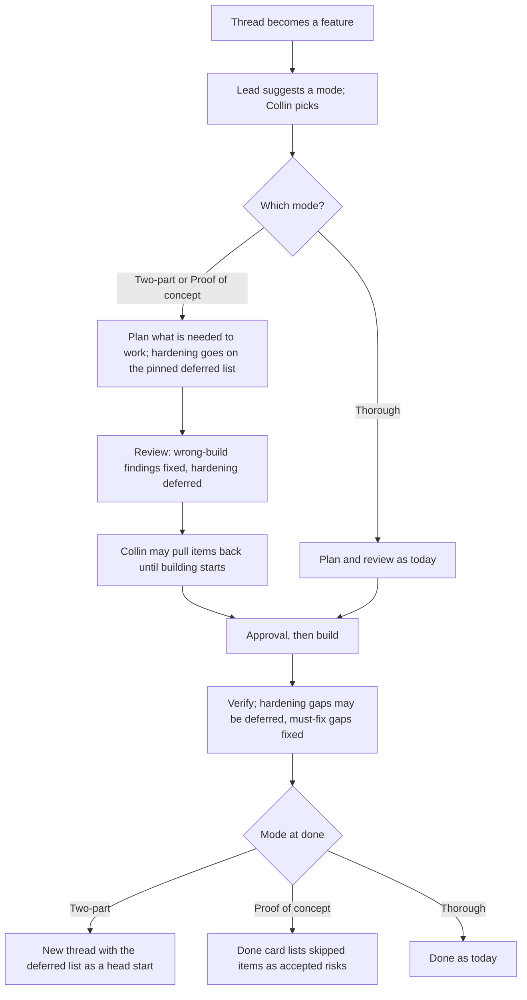

# Plan modes: thorough, two-part, proof of concept

**Idea:** `IDEA.md` — what this is for and why, in plain language. Read it first; it is
the north star this plan serves. Goal and Constraints live there, not here, so they don't
get buried as this file grows.

## Open Questions

None.

## Watch List

Things noticed that need looking into — not yet decisions for the user. Written down the
moment they're spotted so they can't be forgotten, surfaced to the user one line at a
time as they appear, and emptied before Stage 1 exits.

Each item ends up settled by the agent (noted in the Log), promoted to an Open Question,
promoted to a Constraint or Accepted Risk, or waved off by the user.

| # | Noticed | What needs looking into | Raised to user? | Outcome |
|---|---------|-------------------------|-----------------|---------|

## Decision Log

Append-only. A reversal is a new entry superseding the old, never an edit.

| # | Decision | Rationale | Source |
|---|----------|-----------|--------|
|   |          |           | user / defaulted / adopted / idea-change / review-round-N |
| D1 | The lead suggests a mode with a one-line reason when a thread becomes a feature; Collin accepts it or picks another | The lead has read the request and can tell a proof of concept from lasting work; Collin keeps the final say | user |
| D2 | In two-part and proof-of-concept, plan review still runs. Findings that would build the wrong thing or cannot be built must be fixed; findings that only make it sturdier are deferred to the follow-up plan (two-part) or accepted as risks (proof of concept) | Keeps the check that stops a wrong build, drops only the hardening Collin chose to postpone | user |
| D3 | Deferred items show on a pinned running list, like "Your idea so far", updated as items are added in planning or review. Removing one pulls it back into the first build | Collin sees deferrals as they happen and can reverse one with a press, without a card per item | user |
| D4 | The follow-up plan is a head start: this thread hands over the deferred items with notes, and the new thread plans them with its own questions and full review | Planning it fully here would slow the first build; it plans better against built code | user |
| D5 | The mode can change during planning when Collin asks. Moving to thorough pulls every deferred item back into the Spec; moving to a lighter mode lets the lead sort Spec items into deferred. Once building starts, the mode is fixed | Obvious behaviour; locking it only at build start keeps the build's scope stable | defaulted |
| D6 | The follow-up thread's lead suggests its mode like any feature (D1) | Same rule everywhere | defaulted |
| D7 | A gap found in verification that is not needed for the feature to work may be deferred by the lead (two-part: to the follow-up; proof of concept: to Accepted Risks) and added to the running list; a gap that stops it working is fixed as today | Matches IDEA.md: verification unchanged, big extras may land in the follow-up | defaulted |
| D8 | In proof of concept, the done card's "left as is" lists the accepted risks, each with the usual "Start a thread about it" | Collin can still pick one up later without a follow-up plan existing | defaulted |
| D9 | The mode suggestion is an ordinary `question` card posted right after the offer is accepted; no change to the offer card | Uses an existing card with no app change; settles watch item W1 | defaulted |
| D10 | The mode is recorded as `mode:` in IDEA.md's frontmatter. Changing it (D5) is not a scope change | IDEA.md exists from the start of planning, every role already reads it, and a restarted lead recovers it from the file with no app storage | defaulted |
| D11 | Deferred items live in one `## Deferred` section of PLAN.md in both lighter modes. In proof-of-concept that section is the record of accepted hardening risks (refines D2's "Accepted Risks"); Accepted Risks keeps its existing meaning | One place for the running list, the reviewers, the verifier and the handoff to read | defaulted |
| D12 | The two-part follow-up thread is an ordinary `stub` card posted at done, `depends_on_parent: true`, whose summary carries the Deferred items and links to this plan and pull request. No second plan directory | Avoids the app's one-new-plan-directory slug rule and document allowlist (MAP.md); a head start (D4) needs only the list | defaulted |
| D13 | The running list is a new lead-only card kind, `deferred`, pinned like `idea` | The idea card is already pinned for a different list; a second kind keeps both visible | defaulted |
| D14 | In a lighter mode, a review finding moved to Deferred does not keep a round from being clean | Otherwise each round's new hardening findings would keep review running as long as thorough, defeating "a working build sooner" | review-round-1 |
| D15 | IDEA.md reworded: the two-part follow-up thread starts with the deferred items and notes, ready to plan, not a written plan | Matches D4 | idea-change |
| D16 | Switching to thorough retracts the `deferred` card (made retractable); switching between lighter modes reposts it | An empty repost could not be told apart from a lighter mode with nothing deferred | review-round-1 |
| D17 | Mode change or pull-back after approval retracts the approval card first; a late start-building press is ignored with a reply | Otherwise Start building stays live on a plan back in review | review-round-1 |
| D18 | Verification gaps the lead defers are committed to Deferred by the sub-lead; remaining gaps go through remediation; if all are deferred a fresh verifier re-checks with no remediation, not counted as a fix attempt | Defines a path to PASS when gaps are deferred | review-round-1 |
| D19 | Mode change or pull-back during a running round stops it; the round restarts under the same number, untriaged and uncounted | Reviewers would otherwise report on a superseded plan | review-round-1 |
| D20 | Locked or stale `deferred` cards refuse `removed` presses at the hub; the lead ignores a late one; the card is locked before the sub-lead starts | Closes the window between Start building and the locked repost | review-round-1 |
| D21 | Deferred bullet ids and texts must be unique within the card | The press carries the text, so duplicates would be ambiguous | review-round-1 |
| D22 | Restart recovers the mode from cards before IDEA.md exists; no silent default | Avoids bypassing Collin's choice | review-round-1 |
| D23 | A restarted lead in a done two-part thread posts the follow-up stub only if none exists | Neither misses nor duplicates the handoff | review-round-1 |
| D24 | The empty `deferred` card is posted as soon as a lighter mode is chosen | Keeps the mode visible from the start (IDEA: "the mode in use is clear") | review-round-2 |
| D25 | (superseded by D35) Only the first all-deferred re-check in a build is free; later ones count toward the two-attempt rule | Keeps verification bounded as today | review-round-2 |
| D26 | All-deferred re-check verifies the post-deferral commit with the normal verifier selection; deferral triage waits for every verifier of the attempt | One snapshot; no lane skipped | review-round-2 |
| D27 | The lead acts on Start building only for its latest approval card while status is `approved`; a refused retract of an already-pressed approval is fine | A queued press can't be un-recorded at the hub | review-round-2 |
| D28 | `removed` on `deferred` does not mark it answered; stale pull-backs are ignored by the lead | Keeps the card retractable and pressable | review-round-2 |
| D29 | Lead reposts the deferred card only after the sub-lead reports the commit of the rows | The pin never claims an unsaved deferral | review-round-2 |
| D30 | After a restarted round, only reports from the restart's sessions are triaged | Stale reports can't approve a changed Spec | review-round-2 |
| D31 | The follow-up stub's summary starts with `Two-part follow-up for plan <slug>.`; a restarted lead finishes publishing before checking for it | Durable marker; the PR link exists first | review-round-2 |
| D32 | The mode is written only when one supported mode is named; otherwise a follow-up question | No silent fallback from free text | review-round-2 |
| D33 | Mode and Deferred list are fixed once the lead accepts Start building, not at `implementing` | Closes the window before the sub-lead writes its status | review-round-3 |
| D34 | A pulled-back item is never deferred again in the thread | Collin's explicit choice must stand | review-round-3 |
| D35 | (supersedes D25) A second all-deferred re-check goes to Collin as today's surviving-gap question with "defer" as an extra answer; failing validation commands are never deferrable | Bounded verification with a defined exit; deferral can't mask a failing check | review-round-3 |
| D36 | A mode change or pull-back during a running round waits for that round's triage (supersedes D19 and D30) | No half-triaged round to roll back | review-round-3 |
| D37 | The lead reconciles the deferred pin from PLAN.md before the done card; a retracted deferred card renders dimmed with no controls | Stale pin after a sub-lead death; clear chat history | review-round-3 |
| D38 | On a second all-deferred failure nothing is saved until Collin answers; "defer and finish" ends with a sub-lead `result` and no further verifier pass | Every answer reaches a defined end | review-round-4 |
| D39 | Pull-backs are checked on arrival, logged if a round is running, and applied by row before approval or the next brief | A valid pull-back isn't lost to a card repost | review-round-4 |
| D40 | Every deferral path, including a mode switch, honours `Pulled back:` Decision Log entries | Closes the mode-switch hole in D34 | review-round-4 |
| D41 | A restarted lead in an approved lighter-mode or changed plan trusts no earlier approval unless a sub-lead exists; it posts a fresh approval | Binds Start building to an approval of the current plan across restarts | review-round-4 |
| D42 | The all-deferred re-check is recorded in PLAN.md's Log; a restarted sub-lead in `verifying` starts a new attempt on the current commit | Recoverable verification deferral | review-round-4 |
| D43 | Lead restart carries a stub thread's summary text (no commits line) | The follow-up's deferred list survives a lead death before IDEA.md | review-round-4 |
| D44 | Collin chose "keep going" on the review budget: fix the restart-timing findings and continue reviewing | Collin's call | user |
| D45 | Accepting Start building commits `Build accepted: approval <id>` to PLAN.md's Log before the sub-lead starts; restart uses that line instead of the sub-lead's existence (refines D41) | A durable record of acceptance | review-round-5 |
| D46 | "Defer and finish" commits a Log line so a restarted sub-lead finishes without re-verifying; D42 is narrowed to reading Log lines on top of sub-lead.md's existing restart | Keeps Collin's terminal choice; adds no new reconciliation | review-round-5 |
| D47 | Every pull-back press that reaches the lead counts (the hub already refuses stale and locked cards) unless the build was accepted; pending ones are logged by item text and replayed on restart (refines D28, D39) | No accepted press is lost; simpler rule | review-round-5 |
| D48 | Sub-lead restart in `verifying` reads the Log before touching status, then finishes or re-verifies on the tip; the lead's brief carries any answer not yet in the Log | Fills a resume path sub-lead.md lacks; keeps Collin's choice | review-round-6 |
| D49 | Restarted lead also replays undelivered pull-backs from recent messages; items match by stable bullet text; repeats are ignored | No delivered press lost; stable mapping | review-round-6 |
| D50 | Hub accepts `removed` only on `idea`/`deferred` cards with a matching bullet text | The lead can rely on what reaches it | review-round-6 |
| D51 | Mode changes before PLAN.md exists are saved in IDEA.md and logged when PLAN.md is created | Persistence in the IDEA-confirmation window | review-round-6 |
| D52 | Collin chose "keep going" again: fix the two restart cases and continue | Collin's call | user |
| D53 | Restart context gains `card_kinds` (all card ids, replaced included) | A delivered pull-back stays identifiable after its card was replaced | review-round-7 |
| D54 | (superseded by D65) In an unchanged thorough thread, a restarted lead treats a recorded Start building on the latest approval as accepted | Durable lock with no new commit in thorough | review-round-7 |
| D55 | IDEA.md (draft) is committed as soon as the mode is answered | The mode always lives in a file, so restarts can't undo a change (supersedes the before-IDEA parts of D51) | review-round-8 |
| D56 | (superseded by D65) Thorough restart treats a press as accepted only if PLAN.md wasn't committed after the approval card | A press on an approval of an older plan is stale | review-round-8 |
| D57 | The sub-lead's deferral message lists every gap, marked hardening/must-fix/surviving | The lead can tell all-hardening from mixed failures | review-round-8 |
| D58 | One bullet text names one item for the life of the thread | No text collision between items | review-round-8 |
| D59 | With a surviving gap, Collin is asked about it alone; other must-fix gaps go to remediation after his answer | Defined order | review-round-8 |
| D60 | (superseded by D61) Restart replay of pull-backs waits for a running round's triage | Consistent with D36 | review-round-8 |
| D61 | A lead restart during a running round restarts that round (any mode); supersedes D60's waiting | The dead lead's reviewers report to nobody | review-round-9 |
| D62 | (superseded by D65) Step 6 posts the approval card before the `Approve plan` commit; a restart accepts a press only when PLAN.md's last commit is `Approve plan` (replaces D56's clock check) | No clock comparison; ties a press to the reviewed revision | review-round-9 |
| D63 | (superseded by D65) "Push as it is" on a surviving gap is logged `Accepted as is:` and kept out of later verifier scope | Remaining fixes can verify to a pass | review-round-9 |
| D65 | Unchanged thorough threads restart exactly as today (D54, D56, D62 withdrawn); a mode change after restart is fixed if a sub-lead exists, else goes through D17. A build's surviving gap is today's open question and nothing proceeds until Collin answers (D63 withdrawn) | Keeps IDEA's "thorough exactly as today" constraint; avoids inventing build-time push/drop | review-round-10 |
| D66 | After Collin answers a surviving-gap question, the sub-lead acts on it and remaining must-fix gaps go through remediation | Defined continuation | review-round-10 |
| D67 | A restarted round triages only its own sessions' reports and first applies pending pull-backs and unapplied mode changes from recent messages | No stale reports; no lost change | review-round-10 |
| D68 | A switch to thorough is one commit of IDEA.md and PLAN.md | No half-applied switch | review-round-10 |
| D69 | A mode answer recovered from chat must be a clear choice | A question about a mode isn't a pick | review-round-10 |
| D70 | From round 11, any new finding whose failure needs an agent (lead, sub-lead, reviewer) to die or a press to cross a save in a narrow window is accepted as a risk, not fixed. Everything else is still fixed | Ten rounds of narrowing crash-timing cases; today's flow has the same class; none affect how the modes behave | user |
| D64 | Restart reads a typed mode answer from recent messages; restart reconciles the pin with `mode:` | No re-asking; pin matches the mode | review-round-9 |

## Spec

The settled design, grown as decisions land. Bar: a fresh agent with no conversation
history can implement from this section alone — behavior, boundaries, edge cases,
non-goals, and concrete validation commands.

A Mermaid diagram of the flow belongs here, added by Stage 2 at approval — not while the
Spec is still churning. See `protocol/diagrams.md`.

The picture above says what the sections below say: the mode is chosen first, the two
lighter modes defer hardening onto a pinned list during planning, review and verification,
and at done two-part opens a follow-up thread while proof of concept lists what it skipped.

### Modes

Three modes, recorded as `mode:` in IDEA.md's frontmatter (D10):

| Mode | Plan | Hardening found in planning, review or verification | When done |
|---|---|---|---|
| `thorough` | As today, unchanged | Fixed in the Spec as today | As today |
| `two-part` | Covers what the feature needs to work | Moved to PLAN.md `## Deferred` | A stub thread holds the Deferred list as a head start |
| `proof-of-concept` | Same as two-part | Moved to PLAN.md `## Deferred`, which is the accepted-risk record | Done card lists the Deferred items under "left as is" |

A missing or unknown `mode:` means `thorough`. Small fixes have no plan and no mode.

"Hardening" means anything not needed for the feature to work for its normal use: edge
cases, unusual inputs, error handling beyond the obvious, polish, extra tests beyond the
Spec's validation commands. Anything that would build the wrong thing, or that the
feature cannot work without, is never deferred.

### Choosing the mode (lead.md step 2)

Right after the offer is accepted (or the thread becomes a feature by Collin talking on),
the lead posts a `question` card (D9): "How thorough should the plan be?", options
Thorough / Two-part / Proof of concept, each `consequence` in plain words, `leaning` set to
the lead's suggestion, `why` a one-line reason (D1). The lead does not post the IDEA.md
confirmation card until the mode is answered. As soon as the mode is answered it commits
IDEA.md (a draft if the rest is not written yet, `status: draft`) with `mode:` set, so
the mode lives in a file from then on. Only one of the three supported values is written. If the answer was typed into the
card's box and does not clearly choose one mode, or Collin carries on in chat without
choosing, the mode is `thorough` (IDEA: thorough is what happens if nothing else is
chosen); the lead resolves the card if still open, writes `thorough`, and says in its
reply that he can switch (D5).

Restart before IDEA.md is written (the mode question not yet answered, or answered
moments before the lead died): the restarted lead reads the cards it is given. If the
mode question was answered with a press, it uses that mode; if answered in its box or
resolved with a note, it uses the mode only if the text names exactly one, and otherwise
uses `thorough` as above. If it is open but the restart context's recent
messages hold a later message from Collin that clearly chooses exactly one mode (not a
question about it or an objection), it treats that as his answer (resolving the card);
if in doubt, it leaves the card open. Otherwise, if it is open, it leaves it open and waits. If it was never posted, it
posts it. `thorough` is assumed only when reading an IDEA.md with no `mode:` line (plans
from before this feature).

### Changing the mode (D5)

Until the lead accepts a Start building press (D27), Collin may ask in chat to change the
mode. Since IDEA.md is committed as soon as the mode is first answered, a change always
edits a file. Before PLAN.md exists, it edits and commits
`mode:` in IDEA.md, and records the change in PLAN.md's Decision Log when it creates
PLAN.md. From then on, as below. The `deferred` card rules below (retract on a switch
to thorough, repost with the new `mode` between lighter modes) apply from the moment the
card is first posted, whether or not IDEA.md or PLAN.md exist yet. The lead edits `mode:` in IDEA.md (not a scope change; no
Decision Log `idea-change` entry, a `user` entry instead) and:
- to `thorough`: moves every Deferred item back into the Spec, deletes the section, and
  edits `mode:`, all in one commit of IDEA.md and PLAN.md; then retracts the `deferred`
  card (see below);
- from `thorough` to a lighter mode: may move Spec items to Deferred, each announced in
  its reply and shown on the `deferred` card;
- between the two lighter modes: the Deferred section stays; only its meaning changes,
  and the `deferred` card is reposted with the new `mode`.

A mode change or a pull-back (below) after `approved` first retracts the open approval
card, then returns the plan to `ready-for-review` (step 5). If the retract is refused
because a Start building press was already recorded, the lead carries on. The lead acts
on a `[card <id>] start building` press only when `<id>` is the approval card it posted
last and PLAN.md `status:` is `approved`; any other such press (a late or stale one)
starts nothing, and the lead says in its reply that the plan changed and is back in
review. The rule applies only after a mode change or a pull-back; a thorough thread with
neither keeps today's step 7 unchanged (IDEA constraint).

A mode change or a pull-back asked for while a review round's reviewers are running is
applied after that round's triage is finished, never during it; the lead says so in its
reply. The round runs and is triaged as normal against the plan its reviewers were
briefed with; the change then goes into the next round's "Changed since" list.

In a lighter mode, or a thorough thread after a mode change or pull-back (thorough
otherwise keeps today's step 7 with no commit), the moment the lead accepts a Start
building press, it commits PLAN.md with the Log line
`Build accepted: approval <card id>` (it still owns the worktree), then locks the pin,
then starts the sub-lead. From that commit the mode and the Deferred list are fixed: a later request to change the mode, or a
pull-back, is answered with that and changes nothing. If starting the sub-lead then
fails, they stay fixed; the lead retries the start as lead.md already says.

Any lead restart before `Build accepted:` reconciles the pin with IDEA.md's `mode:`:
thorough means any open `deferred` card is retracted; a lighter mode means the
`deferred` card is reposted from PLAN.md's Deferred rows (empty if there are none or
PLAN.md does not exist yet).

Lead restart while PLAN.md says `approved`, in a lighter mode or after a mode change or
pull-back: if PLAN.md's Log has a `Build accepted:` line after the last plan change, the
build was accepted: mode and Deferred stay fixed, the lead locks the pin if it is not
locked, and starts the sub-lead if `session list` shows none (as step 7). Otherwise the restarted lead trusts no earlier approval: it
retracts any open approval card, ignores Start building presses for any approval card it
did not post itself, and posts a fresh approval card with a fresh Ready check. A thorough
thread with no mode change or pull-back restarts exactly as today. If Collin then asks
for a mode change while `session list` shows a sub-lead of this thread, the build has
started and the mode is fixed; with no sub-lead, the change goes through the retract-and-
review path above (D17), so no build can start on a plan he has not approved.

### PLAN.md `## Deferred` (D11)

A section placed after Spec and before Accepted Risks, present only in the lighter modes.
One row per item:

| # | Item | Why it can wait | Source | Notes for the follow-up |
|---|------|-----------------|--------|-------------------------|

`Source` is `planning`, `review-round-N` or `verification`. `Notes` are what the
follow-up's lead will need (file:line, the case that breaks, the reviewer's evidence).
Pulling an item back deletes its row and folds it into the Spec, with a Decision Log entry
(source `user`) whose Decision starts `Pulled back:` and names the item. Every deferral
path (planning, a mode switch, review triage, verification) checks those entries first:
an item Collin pulled back is never deferred again in this thread. Findings about it are
fixed, or come to Collin as a `question` card if fixing is not possible.

Which pull-backs count: the hub accepts a `removed` press only on the current,
unlocked `deferred` card, so every `removed:` press that reaches the lead counts, unless
PLAN.md's Log already has a `Build accepted:` line (then the lead says building has
started and changes nothing). If the item's row is already gone for any reason (a switch to
thorough, or triage restored it), the item is already in the Spec; the lead still logs
the `Pulled back:` entry with that bullet text.

If a pull-back arrives during a review round, the lead commits `Pending pull-back: <item
text>` to PLAN.md's Log at once and applies it after that round's triage, before posting
an approval card or briefing the next round. A restarted lead applies every `Pending
pull-back:` line, and every `removed:` press on a `deferred` card in the restart
context's recent messages, that has no matching `Pulled back:` Decision Log entry (unless
a `Build accepted:` line came first). If a review round's reviewers are still
running when a lead restarts (in any mode), the restarted lead stops them and restarts
that round with fresh reviewers under the same number, untriaged and not counted toward
the budget (their reports would go to the dead lead). It applies pending pull-backs,
and any mode change Collin asked for in the restart context's recent messages that
IDEA.md's `mode:` does not yet show, before briefing the restarted round. It triages
only reports from the sessions it started for the restarted round; reports from the
earlier round's reviewers (they can arrive in the transferred queue) are discarded. Either way, before posting
an approval card or briefing a round.

Matching is by bullet text. The lead keeps one item's bullet text identical across
reposts (same `id`, same `text`), and the `Pending pull-back:` and `Pulled back:` entries
quote that text exactly. A press whose text already has a `Pulled back:` entry is a
repeat and changes nothing. A bullet text names one item for the life of the thread: the same item
keeps its text whenever it is deferred again (say after a mode switch), and a different
item never takes a text an earlier item used.

### The `deferred` card (D3, D13)

New lead-only kind, pinned (one per thread, a new one replaces the old in the pin, like
`idea`).

| Field | Type | Required | Meaning |
|---|---|---|---|
| `mode` | `two-part` \| `proof-of-concept` | yes | Sets the heading |
| `bullets` | array of `{id, text}` | yes, may be empty | One per Deferred row; `id` stable (`d1`, `d2`), `text` short and in Collin's terms. Both `id` and `text` must be unique within the card, or the card is refused |
| `locked` | boolean | no | True once building starts: no remove buttons |

Shown heading: "Saved for the follow-up · N things" (two-part) or "Skipped for this proof
of concept · N things" (proof-of-concept); with zero bullets, the heading and "Nothing
deferred yet". Hint line under the heading: two-part "These go into a new thread when this
one is done."; proof-of-concept "These are accepted as risks; nothing will fix them
later.". Folding over three bullets, the remove button (`×`, aria-label "Pull back in"), and
its press form `[card <id>] removed: <bullet text>` work exactly as `idea`'s. With `locked`
true or the thread archived, no remove buttons. It stays pinned for the life of the thread
(unlike `idea`, it is not hidden once building starts), and is never shown in a thread
whose mode is thorough, because no lead posts one there.

A `removed` press on a `deferred` card does not set `answered` on it (in `press` in
`viewer/app/threads.js`, the block that sets `answered` skips `deferred`, as it already
skips an approval's `talk`), so the card stays retractable and can take further
pull-backs. `deferred` is added to the kinds `retract` accepts (cards-lead.md refusal 2
and `retractable` in `viewer/app/card.js`). Retracting it removes it from the pin, as for
any retracted pinned card. This is how a change to thorough clears it. A retracted `deferred`
card stays in the chat dimmed with "Withdrawn · <note>" like other retracted cards, and
renders with no remove buttons.

The hub refuses a `removed` press on a `deferred` card whose `locked` is true, or on one
that has been replaced or retracted, with the same refusal shape as other stale presses.

Lead behaviour: post it, empty, as soon as a lighter mode is chosen (so the mode is
visible from then on), and again whenever a row is added or removed. On a `removed:` press, fold that item back into the Spec, delete its row,
log it, repost the card. If the plan was `approved`, that Spec change returns it to
`ready-for-review`. On a `[card <id>] start building` press, the lead reposts it with `locked: true` before
starting the sub-lead. A `removed:` press that still reaches the lead after that (an
already-queued one) changes nothing: the lead says building has started and the item
stays deferred. On a change to thorough, retract it.

### Plan review in the lighter modes (D2)

Reviewer briefs in a lighter mode name the mode and include the Deferred table as
settled, like Accepted Risks. reviewer.md gains: in a lighter mode, do not raise a
Deferred item as missing; do raise a Deferred item that the feature cannot work without
(that is a finding against the deferral). If triage upholds that a Deferred item is
needed, the lead deletes its row, folds it into the Spec, logs it (source
`review-round-N`), and reposts the card, in the same save. Lead triage of other findings: a finding that is hardening is
moved to Deferred with source `review-round-N`; its verdict is `upheld` or `downgraded`
as usual and it counts as found, and as fixed once its Deferred row is saved. In a
lighter mode, a finding moved to Deferred does not count against the clean test: a round
is clean when triage upholds no blocking or major finding that stays in the Spec and no
`user-decision` is open. The budget rule is otherwise unchanged.

### Verification in the lighter modes (D7)

The verifier is briefed with the mode and the Deferred table; verifier.md gains: a
Deferred item is out of scope and is not a gap. Nothing else about how it checks changes. When an attempt's verification has failed in a lighter mode (after every verifier of the
attempt has reported, as in sub-lead.md step 4–5), before step 5:
1. Using all reports of the attempt, with duplicates merged, the sub-lead sends the lead
   one `message` (`asks: true`) listing every gap of the attempt, each marked `hardening`
   or `must-fix` as it judges, and any that already survived two fix attempts, with the
   verifier's evidence. The lead answers per gap: defer or fix.
2. The sub-lead writes the deferred gaps into PLAN.md Deferred (source `verification`),
   commits PLAN.md (the worktree is the sub-lead's), and sends the lead a `message`
   naming the commit and the rows saved. Only on that message does the lead repost the
   `deferred` card (still `locked`).
3. If gaps remain to fix, step 5 runs as today on the remaining gaps only: `found` counts
   only those, and REMEDIATION-N.md lists only those.
4. If every gap was deferred, there is no remediation: the sub-lead starts a new
   verification attempt on the commit from step 2 (the failed commit plus the Deferred
   rows), using the same verifier selection rules as sub-lead.md step 3.
   At most one such re-check per build. When every gap is deferred, step 2's commit also
   adds the line `All-deferred re-check used` to PLAN.md's Log, so a restarted sub-lead
   knows the allowance is spent.

Sub-lead restart while PLAN.md says `verifying` in a lighter mode (sub-lead.md gains this
case in "Starting, and resuming after a restart"): before touching `status:`, the new
sub-lead reads PLAN.md's Log. If it has `Deferred and finished at Collin's choice`, it
sends its `result` as in "Defer them and finish" below and does nothing else. Otherwise
it leaves `status: verifying` as is and starts a new verification attempt on the
current committed tip (sub-lead.md step 3), with `All-deferred re-check used` meaning the
allowance is spent. The lead's brief for the replacement names any verification answer
the lead already gave (a per-gap defer/fix answer or Collin's choice) that the Log does
not yet show, so the replacement applies it rather than asking again. If the brief
carries Collin's "Defer them and finish", the replacement starts no verification: it
does step 2 for those gaps with the `Deferred and finished at Collin's choice` line and
sends its `result` as below.
A deferred gap never counts toward the two-attempt rule. If the one all-deferred
re-check has already run in this build and another attempt fails, the lead answers step
1 as usual (defer the hardening gaps, fix the rest; remediation runs for the rest) in
every case but one: when every gap in that attempt is deferrable hardening, it does not
answer itself; nothing is saved to Deferred yet, and it asks Collin a `question`:
- "Fix them": the lead answers "fix" for every gap; step 5 runs as today.
- "Defer them and finish": the lead answers "defer" for every gap; the sub-lead does step
  2 (save, commit, message), with the Log line `Deferred and finished at Collin's choice`
  in that same commit, then sends its `result` (`task` `build`, `outcome` `done`,
  `commit` the step-2 commit, summary saying these gaps were deferred at Collin's
  choice) with no further verifier pass. The `done` card's `note` says so.

When a gap has survived two fix attempts, today's surviving-gap rule comes first
(sub-lead.md step 6: stop and message the lead; lead.md step 7: post a `question` card).
Hardening gaps in the same attempt are still answered "defer" and saved by step 2 before
the sub-lead stops. Nothing else proceeds until Collin answers that question. The lead
sends his answer to the sub-lead as a `message`; the sub-lead then acts on it for the
surviving gap, and any other must-fix gaps of that attempt go through step 5 as usual,
so the build ends, as always, on a passing verification or a further question.

Never deferrable in verification: a failing validation command from the Spec's
Validation section, and a gap in an item Collin pulled back. These go to remediation.

Gaps deferred during verification are decided by the lead, not Collin: building has
started and the card is locked. Before posting the `done` card, the lead reads PLAN.md's Deferred rows and reposts the
`deferred` card if it differs (covers a sub-lead that died before sending its commit
message). Collin sees them on the `deferred` card as they are added
and accepts them after the fact (two-part: the follow-up thread; proof-of-concept: the
done card's "left as is").

### Done (D4, D6, D8, D12)

- `two-part`: right after the `done` card, if Deferred has rows, the lead posts a `stub` card:
  title "Make <feature> solid", `depends_on_parent: true`, summary whose first line is
exactly `Two-part follow-up for plan <slug>.` (the handoff marker; no other stub uses
it), then: what was
  built and the pull request link, the plan path (`docs/plans/<slug>/PLAN.md` on branch
  `wc/<thread-id>`), every Deferred row with its notes, and the instruction that its lead
  plans these from step 1, suggesting a mode as for any feature (if the whole list turns
  out to be a small fix, step 1's small-fix path applies, verified as usual). With no rows, no stub,
  and the `done` card's `note` says nothing was deferred.
  Restart in a two-part thread whose PLAN.md is `done`: the lead first finishes step 8
  as today (push, open the pull request if `gh pr view` finds none, post the `done` card
  if none was posted after the `done` commit), then checks the cards it was given for a
  `stub` whose summary starts with the handoff marker. If none exists and Deferred has
  rows, it posts it; if one exists, it posts nothing.
- `proof-of-concept`: the `done` card's `left_as_is` lists every Deferred item (each gets
  the usual "Start a thread about it"). No stub unless Collin presses one.
- `thorough`: unchanged.

### Where the changes go

- `protocol/app/lead.md`: steps 2, 4, 5, 6, 7, 8 as above; restart reads `mode:`.
- `viewer/app/threads.js` `restartLead`: the thread state JSON gains `card_kinds`, a map
  from every card id in the thread (replaced ones included) to its kind, so a restarted
  lead can tell which card a delivered `[card <id>] removed:` press was for (a
  `deferred` press counts by D49; an `idea` press is handled as today).
- `viewer/app/threads.js` `restartLead`: when the thread has a stub `context`, the
  restart message also carries the summary text only (as a `stub_summary` field in the
  thread state JSON, without the `commits` line), so a stub lead that dies before writing
  IDEA.md does not lose it. lead.md's restart section says to use it as background for
  what the thread is about when present; it is not a fresh stub start, and it carries no
  instruction to cherry-pick anything.
- `protocol/app/reviewer.md`, `verifier.md`, `sub-lead.md`: the rules above.
- `protocol/app/cards.md` (kind table) and `cards-lead.md` (a `deferred` section).
- `protocol/templates/IDEA.md` (`mode:` frontmatter line with the three values and default)
  and `PLAN.md` (an optional `## Deferred` section with the table and a note that it
  exists only in the lighter modes).
- `viewer/app/threads.js` `press`: a `removed` press is accepted only on an `idea` or
  `deferred` card and only when its value equals one of that card's bullet texts;
  otherwise 400 with a reason.
- `viewer/app/card.js` (kind, `lead` only, fields with unique ids and texts, retractable),
  `viewer/app/cards.js` (singleton), `viewer/app/threads.js` (refuse `removed` on a
  locked `deferred` card; replaced and retracted cards are already refused for every kind
  at `threads.js:274-276`, so add only the `locked` check),
  `viewer/app/chat.js` `shownPins` (not hidden after build), the press path that routes
  `removed` for `idea` (accept it for `deferred` too), `viewer/pages/thread.js` (pinned
  kind and rendering).

### Not changing

The offer card, the approval card, the Ready check, the progress line, small fixes,
thorough mode, the stub mechanism (except the restart context's new `card_kinds` field, and D43's restart fix, which repairs an existing
gap for every stub, and D50's `removed` check, which also covers `idea` cards but
refuses only presses the app never sends; D55's early draft IDEA.md commit; and D61's restart of a running review
round, which repairs an existing gap for every mode), the app's slug and document rules.

### Validation

- `node --test viewer/test/*.test.js` passes, with new tests: a restart of a stub thread's
  lead carries `stub_summary` in its context; a restart's context carries `card_kinds`
  including a replaced `deferred` card; `deferred` accepted from a
  lead with both modes and an empty list, refused from a sub-lead, refused with an unknown
  mode or extra field; it is pinned and a second replaces the first; it stays in the pins
  after Start building; a `removed` press on it reaches the lead as
  `[card <id>] removed: <text>`; a card with a duplicate bullet id or text is refused; a
  `removed` press on a locked, replaced or retracted `deferred` card is refused; a
  `removed` press on another kind, or with text matching no bullet, is refused; a
  `retract` of a `deferred` card succeeds and removes it from the pins.
- `protocol-rules.test.js` passes with the new kind documented in cards.md/cards-lead.md.
- `npm --prefix viewer run test:browser` passes, with a test that renders a `deferred` card
  in both modes (heading, hint, bullets, remove button) and with `locked: true` (no remove
  button).
- Read-through: a fresh lead following lead.md in each mode reaches the right done step.

## Accepted Risks

Real issues consciously not fixed, each with the reason. Part of the spec, not review
scaffolding — an implementer should read these, and later review rounds must not
re-raise them.

| Risk | Why accepted | Round |
|------|--------------|-------|
| Crash-timing cases: an agent dying, or a press crossing a save, in a narrow window can lose or repeat a pull-back, a mode change, an approval or a deferral beyond the restart rules already in the Spec | Collin's decision (D70); rare, same class exists in today's flow | 11 |
| A replacement lead does not receive a live sub-lead's later `result`, which routes to the sub-lead's original `started_by` | Pre-existing for every build; not introduced by plan modes. Worth its own thread | 5 |
| A failed parent save after the child thread is saved could let a restarted lead post a second follow-up stub | Shared by every stub today; needs a disk write failure between two consecutive saves | 3 |

## Review Rounds

### Round 1 — 2026-11-17

**Lanes:** intent: claude / claude-opus-5-5; mechanics: gpt / gpt-6.2-sol; cross-family: yes.

Written for every round, including one where the table below stays empty. The table gets a row
per finding, so a clean round would otherwise leave no record of which gate ran — which is the
round where knowing it matters most.

<!-- Round 2+: list what changed since the previous round; that list scopes the reviewers. -->

**Changed since Round N-1:** n/a (first round — whole Spec in scope)

| Lane | Reported | Finding | Lead verdict | Resolution |
|------|----------|---------|--------------|------------|
| intent (claude) | major | Hardening findings moved to Deferred still block the clean test, so review may run as long as thorough | upheld | D14; Spec "Plan review in the lighter modes" |
| intent (claude) | minor | Verifier rule reading "What good looks like" as the working version loosens checks, against IDEA's non-goal | upheld | Rule removed from Spec "Verification in the lighter modes" |
| intent (claude) | minor | IDEA.md says the follow-up thread holds a written plan; D4/D12 make it a head start | user-decision | Collin agreed; IDEA.md reworded (D15) |
| mechanics (gpt) | blocking | Switching to thorough leaves a visible empty deferred card; lighter-mode switch needs a repost | downgraded (major) | Real, but a worker would ask, not build wrong; fixed by D16 |
| mechanics (gpt) | blocking | Approval card stays actionable after a change returns the plan to review | upheld | D17 |
| mechanics (gpt) | blocking | All verification gaps deferred leaves no path to PASS | upheld | D18 |
| mechanics (gpt) | major | Mode change during running review has no rule | upheld | D19 |
| mechanics (gpt) | major | Lock timing and stale removed presses unhandled | upheld | D20 |
| mechanics (gpt) | major | Pull-back press identifies a row by text; duplicates ambiguous | upheld | D21 |
| mechanics (gpt) | major | Mode recovery on restart before IDEA.md is written is undefined | upheld | D22 |
| mechanics (gpt) | major | Restart between done and follow-up stub can miss or duplicate it | upheld | D23 |
| intent (claude) | minor | IDEA says PoC skips are "recorded as accepted risk" but D11 uses Deferred | declined | Spec table and D11 already state Deferred is the accepted-risk record in proof-of-concept |

Reported severity is the reviewer's opinion; the lead verdict
(`upheld`/`downgraded`/`declined`/`accepted-risk`/`user-decision`) is what gates the
exit. Downgrades and declines cite evidence.

### Round 2 — 2026-11-17

**Lanes:** intent: claude; mechanics: other family; cross-family: yes.

**Changed since Round 1:**
- Clean test in lighter modes ignores findings moved to Deferred (D14).
- Verifier rule narrowed to "Deferred is out of scope" only.
- IDEA.md follow-up wording (D15).
- Deferred card retractable; switch handling (D16); approval retracted on change (D17).
- Verification deferral path to PASS (D18); mode change during review (D19).
- Lock and stale presses (D20); unique bullets (D21); restart recovery for mode (D22) and follow-up stub (D23).

| Lane | Reported | Finding | Lead verdict | Resolution |
|------|----------|---------|--------------|------------|
| intent (claude) | minor | Mode invisible in a lighter mode until something is deferred | upheld | D24 |
| intent (claude) | minor | All-deferred re-checks make verification unbounded | upheld | D25 |
| intent (claude) | minor | Verification-time deferrals in proof of concept are only seen after the fact; say so | upheld | Stated in Spec "Verification in the lighter modes" |
| intent (claude) | minor | Hub already refuses replaced/retracted presses; only the lock check is new | upheld | Spec "Where the changes go" clarified |
| mechanics (gpt) | blocking | All-deferred re-check: failed commit vs updated tip | upheld | D26 |
| mechanics (gpt) | blocking | Queued Start building makes the approval unretractable | downgraded (major) | Only the lead acts on the press, so a lead rule closes it; no wrong build follows from the card state. D27 |
| mechanics (gpt) | major | Queued pull-back marks the deferred card answered, blocking retract | upheld | Confirmed at threads.js `press` (sets answered for every non-talk press). D28 |
| mechanics (gpt) | major | Pin refreshed before rows are committed | upheld | D29 |
| mechanics (gpt) | major | Deferral triage on first FAIL; single re-check skips second lane | upheld | D26 |
| mechanics (gpt) | major | Stale reports from a cancelled round | upheld | D30 |
| mechanics (gpt) | major | Restart may post the stub before the PR exists | upheld | D31 |
| mechanics (gpt) | major | Title match can't identify the handoff stub | upheld | D31 |
| mechanics (gpt) | major | Free-text mode answer can fall back silently | upheld | D32 |

### Round 3 — 2026-11-17

**Lanes:** intent: claude; mechanics: other family; cross-family: yes.

**Changed since Round 2:**
- Empty deferred card posted when a lighter mode is chosen (D24); bounded re-checks (D25); after-the-fact acceptance of verification deferrals stated.
- Verification deferral: snapshot, all reports, selection rules (D26); commit-then-repost (D29).
- Start building only on the latest approval while approved (D27).
- `removed` doesn't mark `deferred` answered; stale pull-backs (D28).
- Restarted round uses only its own reports (D30).
- Handoff stub marker and restart order (D31); unambiguous mode answer (D32).

| Lane | Reported | Finding | Lead verdict | Resolution |
|------|----------|---------|--------------|------------|
| intent (claude) | minor | D27 written "for every mode" changes thorough, against IDEA's constraint | upheld | Rule limited to after a mode change or pull-back |
| mechanics (gpt) | blocking | Mode change can reopen review after the sub-lead was queued | upheld | D33 |
| mechanics (gpt) | blocking | A pulled-back item can be deferred again | upheld | D34 |
| mechanics (gpt) | major | No exit for successive all-deferred re-checks | upheld | D35 |
| mechanics (gpt) | major | A gap behind a failing validation command could be deferred | upheld | D35 |
| mechanics (gpt) | major | Sub-lead death before notifying leaves the pin stale | downgraded (minor) | Only the pin is stale; PLAN.md is right and the done step reads it. D37 |
| mechanics (gpt) | major | Partial hub save could duplicate the follow-up thread | accepted-risk | Same failure applies to every stub today (cards.js saves child then parent); needs a disk write failure between two saves |
| mechanics (gpt) | major | A cancelled round may already have changed the plan | upheld | D36 replaces cancellation with waiting |
| mechanics (gpt) | minor | Withdrawn deferred card's rendering unspecified | upheld | D37 |

### Round 4 — 2026-11-17

**Lanes:** intent: claude; mechanics: other family; cross-family: yes.

**Changed since Round 3:**
- D27 limited to after a mode change or pull-back (thorough unchanged).
- Mode and Deferred fixed once Start building is accepted (D33).
- Pulled-back items never re-deferred (D34).
- Second all-deferred re-check goes to Collin; failing validation never deferrable (D35).
- Mode change during a round waits for triage, replacing cancellation (D36; D19 and D30 superseded).
- Pin reconciled before done; withdrawn deferred card rendering (D37). New Accepted Risk on duplicate follow-up after a partial save.

| Lane | Reported | Finding | Lead verdict | Resolution |
|------|----------|---------|--------------|------------|
| intent (claude) | minor | D25 and D35 wording both remain and contradict | upheld | D25 wording removed and marked superseded |
| intent (claude) | minor | "Defer and finish" exit undefined against today's verification exit | upheld | Folded into today's surviving-gap question (D35) |
| mechanics (gpt) | blocking | Second all-deferred failure saves rows before asking; answers lack a terminal state | upheld | D38 |
| mechanics (gpt) | blocking | Lead dies after committing the revised plan as approved, before a new approval card; old pressed card passes the guards | upheld | Collin chose keep going (D44); D41 |
| mechanics (gpt) | major | Lead dies after accepting Start building, before `implementing` | upheld | D44; D41 |
| mechanics (gpt) | major | A pull-back waiting for triage can be lost to a card repost | upheld | D39 |
| mechanics (gpt) | major | Mode switch can re-defer a pulled-back item | upheld | D40 |
| mechanics (gpt) | major | Sub-lead dies mid verification deferral; re-check state unrecoverable | upheld | D44; D42 |
| mechanics (gpt) | major | Stub lead's restart loses the stub summary | upheld | D44; D43 |

### Round 5 — 2026-11-17

**Lanes:** intent: claude; mechanics: other family; cross-family: yes.

**Changed since Round 4:**
- D25 wording removed; second all-deferred failure goes to Collin with defined ends (D35, D38).
- Pull-backs checked on arrival, applied by row after triage (D39); honoured on every deferral path (D40).
- Restart rules: approval trust (D41), sub-lead in verifying (D42), stub summary carried on lead restart (D43, small app change).

| Lane | Reported | Finding | Lead verdict | Resolution |
|------|----------|---------|--------------|------------|
| intent (claude) | major | "Defer and finish" could push non-hardening or never-deferrable gaps | upheld | The question is asked only when every gap is deferrable hardening; otherwise all are fixed |
| intent (claude) | minor | D43 conflicts with "Not changing: the stub mechanism" | upheld | Named as an exception |
| mechanics (gpt) | blocking | Crash after "defer and finish" commit turns into a re-verify | upheld | D46 |
| mechanics (gpt) | blocking | Restart can't tell an accepted Start building from a stale one | upheld | D45 |
| mechanics (gpt) | blocking | A replacement lead never receives a live sub-lead's result | accepted-risk | Pre-existing for every build today (results route to the sub-lead's `started_by`); this feature adds no new case. Accepted Risks |
| mechanics (gpt) | major | Replacement sub-lead lacks remediation reconciliation | downgraded (minor) | Pre-existing restart behaviour; D46 narrows D42 to add only Log reading on top of it |
| mechanics (gpt) | major | Queued pull-back discarded by the stale-card rule | upheld | D47 removes the lead-side stale check |
| mechanics (gpt) | major | Pending pull-backs not replayed; row numbers fragile | upheld | D47 |
| mechanics (gpt) | major | Restoring the commits line could replay a cherry-pick | upheld | D43 narrowed to summary text only |

### Round 6 — 2026-11-17

**Lanes:** intent: claude; mechanics: other family; cross-family: yes.

**Changed since Round 5:**
- Second all-deferred failure: question only when every gap is deferrable hardening.
- D43 named as an exception in "Not changing", and narrowed to summary text only.
- `Build accepted:` Log line records acceptance (D45).
- "Defer and finish" Log line; sub-lead restart reads Log lines only (D46).
- Pull-back counting and pending replay by item text (D47).

| Lane | Reported | Finding | Lead verdict | Resolution |
|------|----------|---------|--------------|------------|
| intent (claude) | minor | `Build accepted:` commit would change thorough's step 7 | upheld | Limited to lighter modes or after a mode change or pull-back |
| intent (claude) | minor | Mixed failure after the re-check forces hardening fixes | upheld | Step 1 runs as usual; question only when every gap is deferrable |
| mechanics (gpt) | blocking | Sub-lead `verifying` resume path doesn't exist | upheld | D48 |
| mechanics (gpt) | major | "Defer and finish" lost if the sub-lead dies before committing | downgraded (minor) | The lead holds the answer; its replacement brief carries it (D48) |
| mechanics (gpt) | major | Delivered pull-back lost before its pending line is committed | downgraded (minor) | Restart context already includes recent card presses (`threads.js` `restartLead` `recent_messages`); D49 makes the lead replay them |
| mechanics (gpt) | major | No stable text-to-row mapping for pull-backs | upheld | D49 |
| mechanics (gpt) | major | Hub doesn't check kind or bullet text on `removed` | upheld | D50 |
| mechanics (gpt) | major | Mode change before PLAN.md exists has no persistence rule | upheld | D51 |

### Round 7 — 2026-11-17

**Lanes:** intent: claude; mechanics: other family; cross-family: yes.

**Changed since Round 6:**
- `Build accepted:` commit limited to lighter modes or after a change.
- Mixed failure after the re-check: step 1 as usual.
- Sub-lead `verifying` restart path (D48); pull-back replay and matching (D49); hub `removed` checks (D50); mode persistence before PLAN.md (D51).

| Lane | Reported | Finding | Lead verdict | Resolution |
|------|----------|---------|--------------|------------|
| intent (claude) | major | Card handling skipped for mode changes before IDEA.md/PLAN.md | upheld | Card rules apply from when the card is first posted |
| intent (claude) | minor | D50 touches `idea` presses in thorough threads, unnamed exception | upheld | Named in "Not changing" |
| mechanics (gpt) | blocking | Restarted lead can't tell a delivered pull-back from an idea removal when the card was replaced | upheld | D52; D53 |
| mechanics (gpt) | blocking | Replacement sub-lead re-verifies despite Collin's "defer and finish" | upheld | Replacement applies it with no new attempt |
| mechanics (gpt) | major | Never-changed thorough thread has no durable lock if the lead dies after accepting Start building | upheld | D52; D54 |
| mechanics (gpt) | major | Precedence between a surviving gap and new hardening gaps | upheld | Surviving-gap rule first; hardening saved before stopping |
| mechanics (gpt) | major | Review upholding a Deferred item as needed leaves its row | upheld | Row removed in the same save |
| mechanics (gpt) | minor | Pull-back dedup is thread-wide but text uniqueness only per card | upheld | Texts never reused in a thread |

### Round 8 — 2026-11-17

**Lanes:** intent: claude; mechanics: other family; cross-family: yes.

**Changed since Round 7:**
- Deferred card rules apply from first posting; D50 named in "Not changing".
- Replacement sub-lead applies "defer and finish"; surviving-gap precedence; review pulling a Deferred item back removes its row; bullet texts never reused.
- Restart context `card_kinds` (D53); unchanged-thorough restart lock (D54).

| Lane | Reported | Finding | Lead verdict | Resolution |
|------|----------|---------|--------------|------------|
| intent (claude) | minor | "Never reuse text" is wider than needed | upheld | Narrowed to texts quoted by pull-back entries; superseded by D58 after mechanics finding |
| mechanics (gpt) | blocking | Thorough restart rule can start a revised plan from an old press | upheld | D56 |
| mechanics (gpt) | blocking | Lead can't tell all-hardening from mixed failures | upheld | D57 |
| mechanics (gpt) | blocking | Text reuse can restore the wrong item | upheld | D58 |
| mechanics (gpt) | major | Restart can undo a mode change made before IDEA.md exists | upheld | D55 |
| mechanics (gpt) | major | Surviving gap + must-fix + hardening order undefined | upheld | D59 |
| mechanics (gpt) | major | Restart replay vs a running round | upheld | D60 |

### Round 9 — 2026-11-17

**Lanes:** intent: claude; mechanics: other family; cross-family: yes.

**Changed since Round 8:**
- Draft IDEA.md committed when the mode is answered (D55).
- Thorough restart press staleness by PLAN.md commit time (D56).
- Deferral message lists every gap (D57); surviving-gap ordering (D59).
- One text per item for the thread (D58); restart replay waits for triage (D60).

| Lane | Reported | Finding | Lead verdict | Resolution |
|------|----------|---------|--------------|------------|
| intent (claude) | minor | D56 changes thorough restart; stated reason wrong | upheld | Named as an exception; reason corrected |
| intent (claude) | minor | D55 changes when thorough commits IDEA.md | upheld | Named as an exception |
| mechanics (gpt) | blocking | D56 clock comparison unreliable | upheld | D62 |
| mechanics (gpt) | blocking | Replacement lead never gets the running round's reports | upheld | D61 |
| mechanics (gpt) | blocking | No exit after "push as is" with other must-fix gaps | upheld | D63 |
| mechanics (gpt) | major | Typed mode answer lost on restart | upheld | D64 |
| mechanics (gpt) | major | Pending pull-back whose row triage removed | upheld | `Pulled back:` logged whenever the row is gone |
| mechanics (gpt) | major | Pin and committed mode diverge after a crash | upheld | D64 |

### Round 10 — 2026-11-17

**Lanes:** intent: claude; mechanics: other family; cross-family: yes.

**Changed since Round 9:**
- Exceptions named for D55/D56; D56 replaced by card-then-commit approval order (D62).
- Lead restart restarts a running round (D61).
- "Push as is" with remaining fixes (D63).
- Typed mode answer on restart; pin reconciled with mode (D64); `Pulled back:` whenever the row is gone.

| Lane | Reported | Finding | Lead verdict | Resolution |
|------|----------|---------|--------------|------------|
| intent (claude) | major | Build-time "push as is / drop" doesn't exist; D59/D63 invent it | upheld | D65 |
| intent (claude) | minor | D62 reorder changes thorough without Collin's agreement | upheld | D65 withdraws D54/D56/D62 |
| intent (claude) | minor | Stale references to superseded decisions | upheld | Marked superseded; "Not changing" updated |
| mechanics (gpt) | blocking | No continuation after the surviving-gap answer | upheld | D66 |
| mechanics (gpt) | blocking | Restarted round can triage stale reports | upheld | D67 |
| mechanics (gpt) | major | Mode change acknowledged during review lost on restart | upheld | D67 |
| mechanics (gpt) | major | Half-applied switch to thorough after a crash | upheld | D68 |
| mechanics (gpt) | major | Mentioning a mode treated as choosing it | upheld | D69 |

### Round 11 — 2026-11-18

**Lanes:** intent: claude; mechanics: other family; cross-family: yes.

**Changed since Round 10:**
- Thorough restarts exactly as today; D54/D56/D62/D63 withdrawn (D65).
- Surviving-gap continuation (D66); restarted round hygiene (D67); single-commit switch to thorough (D68); clear mode choice from chat (D69).
- Crash-timing cases now an Accepted Risk (D70).

| Lane | Reported | Finding | Lead verdict | Resolution |
|------|----------|---------|--------------|------------|
| intent (claude) | minor | Mode question is a gate, not a thorough default | upheld | An unclear or absent choice means thorough |
| mechanics (gpt) | blocking | Sub-lead has no defined action after Collin answers a surviving-gap question | declined | Same as today's build flow (lead.md step 7.6 only says post a question; the answer goes back as a `message`); this plan adds nothing new there, and changing it would change thorough, against IDEA's constraint |
| mechanics (gpt) | major | Clear typed mode answer leaves the picker open | declined | lead.md already requires resolving a question card he answers by typing ("How you talk to Collin": "resolve that card with a one-line note of his answer") |
| mechanics (gpt) | major | One-small-fix follow-up would bypass planning via step 1 | downgraded (minor) | A small follow-up taking the verified small-fix path is the intended behaviour; said explicitly in "Done" |

## Prior Work

Parts of the Spec already built before this plan reached Stage 3 — adopted from outside
with work already done, or left behind by an implementation run that died partway.

Stage 3 does not re-implement `pre-existing` items and does not touch their code. Stage 4
verifies them exactly as rigorously as everything else: this code has never been through
the gate, so skipping it would leave the least-trustworthy part of the change as the only
part nobody checked.

Ambiguous evidence means **not done**. A wrong "done" is a silent hole; a wrong "not done"
costs a worker one look.

| Spec item | State | Evidence (file:line) | Confidence |
|-----------|-------|----------------------|------------|
|           | pre-existing / partial | | high / low |

`partial` items are implemented by Stage 3 — the brief names what exists so the worker
completes it instead of restarting it.

## Implementation Tasks

Filled by Stage 3. One row per worker brief.

| # | Objective | Ownership boundary | Lane | Session id | Validation | Status |
|---|-----------|--------------------|------|-----------|------------|--------|
| T1 | App side: `deferred` card kind, press checks, pins, restart `card_kinds`/`stub_summary`, rendering, tests, card docs | viewer/app/{card,cards,threads,chat}.js, viewer/pages/thread.js, viewer/test/**, protocol/app/cards.md, cards-lead.md | standard / gpt-6.1-terra (claude asked; hub fell back) | wc-2919fc337eba-worker, then wc-2919fc337eba-worker-4 (attempt 2: rewritten brief, same tier) | node --test viewer/test/*.test.js; npm --prefix viewer run test:browser | done |
| T2 | Protocol prose: lead, sub-lead, reviewer, verifier rules; IDEA/PLAN templates (tricky) | protocol/app/{lead,sub-lead,reviewer,verifier}.md, protocol/templates/{IDEA,PLAN}.md | standard / gpt-6.1-terra (claude asked; hub fell back) | wc-2919fc337eba-worker-2 | node --test viewer/test/protocol-rules.test.js; read-through per mode | done |
| T3 | Three wording fixes from the T2 read: mode definitions, Start building order, sub-lead verifying restart | protocol/app/lead.md, protocol/app/sub-lead.md | light / provider chosen by hub (waiting for room) | wc-2919fc337eba-worker-3 | node --test viewer/test/protocol-rules.test.js | done |

Session id = the `thread_id` of a `codex exec` lane, so remediation can resume it.

## Log

Free-form running notes: deviations discovered mid-implementation, scope events,
anything a future session needs that fits nowhere above.

- 2026-11-18 — Choice: T2: report lists none. Seen in the diff (self read): lead.md rules placed in a new "### Mode and Deferred" section after step 4 plus paragraphs in steps 5, 7, 8 and restart; sub-lead.md uses new sub-steps 1a and 4a; IDEA template defaults `mode: thorough`.
- 2026-11-18 — T2 accepted (band: self, tricky): protocol rules for modes in lead, sub-lead, reviewer, verifier and templates; protocol-rules and full node suite re-run, pass. Small gaps (no mode definitions in lead.md; sub-lead 1a vs step 2 on a verifying restart; Start building order) go to T3.
- 2026-11-18 — T1 attempt 1 sent back (band: scout): implementation matched the Spec, but it hit its fails-twice guardrail on a wrong test assertion (`answered` is `false`, not undefined), so later assertions never ran. Also: idea and deferred share one fold state; the stub_summary test faked a stub; browser coverage was missing for two-part locked, empty, folding and retracted. Rung: rewritten brief at the same tier (Standard), continuing from commit a895cd4.
- 2026-11-18 — Choice: T3: report lists none; none seen in the diff (text is the brief's verbatim).
- 2026-11-18 — T3 accepted (band: scout; 17 lines, compared verbatim against the brief's replacement text by me rather than a scout, since the brief dictated every word): protocol-rules re-run, 33 pass.
- 2026-11-18 — Choice: T1: worker didn't report its choices; I listed 14 (from the two scout reads):
  - card.js: locked-card `removed` refused with 422 (like other stale presses); kind/text mismatch with 400; `locked` optional boolean; `mode` required with no default; the retract refusal message reworded for every kind.
  - threads.js: `stub_summary` keyed on a truthy `thread.context`; repeated `removed` presses on the same deferred bullet are each queued (the lead treats repeats as no-ops per the Spec).
  - thread.js: deferred renders through the idea card's code path; remove buttons omitted (not disabled) when locked, archived or retracted; aria-label and title "Pull back in"; folded pin label uses the mode heading and count; separate `deferredOpen` fold flag, global and not reset when the card is replaced, added to the pinned sync and chat signature.
  - cards.md says "one deferred list"; cards-lead.md gives the 400/422 status codes in prose.
  - chat.js left unchanged: `shownPins` already hides only `idea` after build.
- 2026-11-18 — T1 accepted (band: scout): attempt 2 fixed the assertion, separated the fold state, used a real stub in the restart test, and added the browser cases. I re-ran both suites on the worker branch: node exit 0 (538 pass, 0 fail), browser exit 0 (732 passed, 28 skipped).
