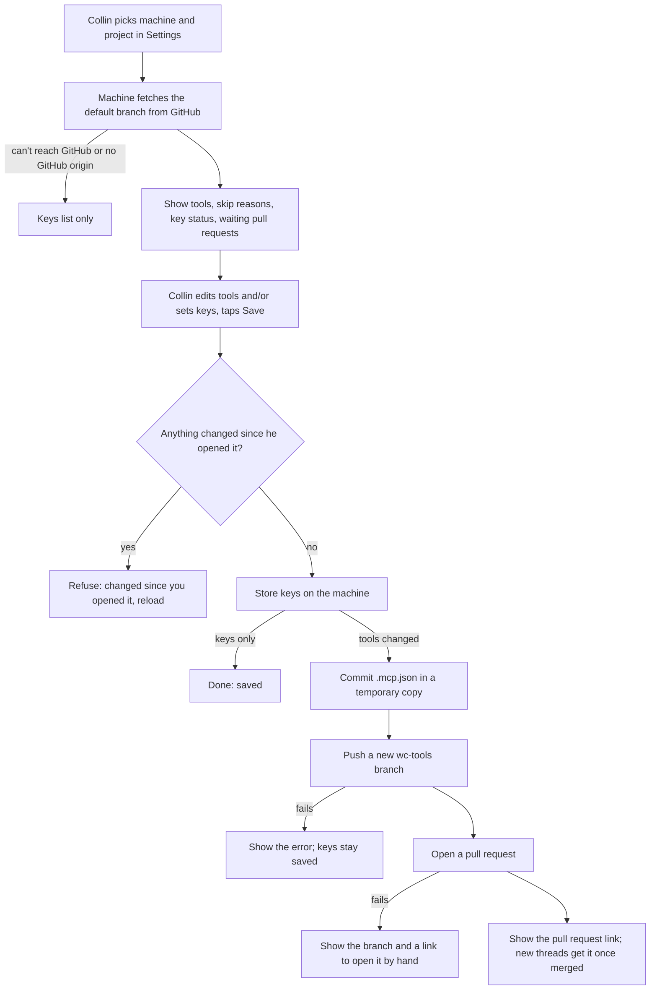

# A screen for a project's tools

**Idea:** `IDEA.md` — what this is for and why, in plain language. Read it first; it is
the north star this plan serves. Goal and Constraints live there, not here, so they don't
get buried as this file grows.

**Map:** `MAP.md` and `docs/maps/project-tools.md`.

## Open Questions

None.

## Watch List

| # | Noticed | What needs looking into | Raised to user? | Outcome |
|---|---------|-------------------------|-----------------|---------|

## Decision Log

| # | Decision | Rationale | Source |
|---|----------|-----------|--------|
| 1 | Mode is thorough | Collin picked it | user |
| 2 | Save delivers changes as a pull request against the project's default branch; Collin merges it | Reviewable, works with protected branches | user |
| 3 | Keys are typed on the screen, stored on the project's machine outside the repo, given to agents at start; the screen shows only whether a key is set | Phone-friendly, never reaches git | user |
| 4 | The screen is a "Project tools" section in Settings with a machine and project picker like New thread; no new project page | No project page exists; Settings already has the picker pattern (`viewer/pages/settings.js`, `viewer/app/routes.js:125-178`) | defaulted |
| 5 | The screen notes that Antigravity agents don't get project tools | Matches `machine/adapters/agy.js:30-32`; changing that is out of scope | defaulted |
| 6 | Each entry shows the same validation the machine and Codex adapter apply, with the reason it would be skipped | IDEA: skipped entries are flagged on screen | defaulted |
| 7 | Unknown fields and entries the form can't edit are kept byte-for-byte in meaning and shown read-only | File stays usable by Claude Code outside wheelchair | defaulted |
| 8 | Key values never appear in argv, `session.command`, persisted session data, hub storage or logs | Map: launch env is in tmux argv and sessions persist the command | defaulted |
| 9 | While a tools PR from the screen is open, the screen edits on top of it and Save adds a commit to that PR | Avoids two conflicting tools PRs | defaulted |
| 10 | Keys are never deleted automatically; unused keys are listed with a Remove button | A key removed at Save would break the default branch, older threads and unmerged or failed PRs | review-round-1 |
| 11 | Same key name across tools shares one value, shown on the form | Matches Codex same-name passthrough; simplest | review-round-1 |
| 12 | Tools PRs use one fixed branch `wc-tools`; open PR found with `gh pr list --head wc-tools` | No lookup ambiguity; retries reuse it | review-round-1 |
| 13 | Save carries the read sha and is refused if the source moved | Prevents a stale editor undoing another save | review-round-1 |
| 14 | Project identity is the realpath of the git common dir | Shared by checkout aliases and thread worktrees | review-round-1 |
| 15 | Checks run before any key is written; Save only sets keys; removal only via rechecked Remove | No half-applied or stale writes | review-round-2 |
| 16 | Reserved key names narrowed to process, loader, wheelchair and the CLIs' own login/config names | Wide prefixes blocked ordinary tools; exact collisions still break launch | review-round-2 |
| 17 | Sessions get only the keys their `.mcp.json` references, and only on Claude/Codex tool roles | Less exposure, same outcome | review-round-2 |
| 18 | `wc-tools` ownership proven by a commit trailer; lease uses the sha seen at read | Never overwrite a foreign branch or a concurrent save | review-round-2 |
| 19 | Launch reader rejects a symlinked `.mcp.json` too | Settings and launch agree | review-round-2 |
| 20 | Supersedes 19: launch is unchanged; only Settings refuses a symlinked file | Claude reads the file itself, so rejecting it in the reader doesn't stop launch (`machine/adapters/claude.js:69-74`) | review-round-3 |
| 21 | Managed keys only in env values and header values; refs elsewhere never injected | Keeps key values out of tool argv via Claude's expansion | review-round-3 |
| 22 | Default branch resolved live with `ls-remote --symref`; machine commands bounded at 60 s | Renames and hung git/gh | review-round-3 |
| 23 | Supersedes 9, 12 and 18: every Save opens its own PR on a new `wc-tools/<id>` branch; edits start from the default branch; waiting tools PRs are listed | Shared-branch design drew new gaps in all three rounds | user |
| 24 | Supersedes 10's "not used" rule: any stored key can be removed with a confirming warning; no PR scan | Every scan design had a race; removing is Collin's explicit act and re-entering a key is cheap | review-round-4 |
| 25 | Stale check compares the `.mcp.json` blob, not the branch sha; key-only Save doesn't fetch | Unrelated merges shouldn't block editing | review-round-4 |
| 26 | Machine keeps a last-save record per project; the screen shows it after a timeout | Reload can learn a dropped Save's result | review-round-4 |
| 27 | The screen no longer updates `origin/HEAD`; thread startup unchanged | Out of scope; rename mismatch is an Accepted Risk | review-round-4 |
| 28 | Save status by browser-made save id, read from local state only; `saved` terminal state for key-only | Identifies the lost request; works when GitHub is slow | review-round-5 |
| 29 | Push and fetch URLs must name the same GitHub repository | PR and push must target one repo | review-round-5 |
| 30 | "Add a key" by name on the keys list | Re-entering a removed or not-yet-stored key without a PR | review-round-5 |
| 31 | Supersedes 26: the per-id save status (Log 28) replaces any per-project last-save record | Avoid building both | review-round-6 |
| 32 | Read token binds the project identity and GitHub repository; Save pushes only to the one validated URL | No write to a retargeted alias or a second push URL | review-round-6 |
| 33 | Unset and held-back keys are key warnings, not skip reasons | Adapters still start the tool | review-round-6 |
| 34 | Supersedes 26, 28 and 31: no save tracking; after a lost reply the screen reloads and tells Collin to check Waiting to merge | Lost replies are rare and the list shows whether it landed | user |
| 35 | Exactly one fetch and one push URL, same GitHub repo; all git calls use that URL | One destination, checked once | review-round-7 |
| 36 | `start_over` flag; per-Save commit trailer; Remove checks identity; lock-held shown on Read | Close gaps from round 7 | review-round-7 |
| 37 | Keys-only mode without a single GitHub origin; replies carry a fresh token and a defined `outcome` | Defines fallback and the reply contract | review-round-8 |
| 38 | Token bound to the machine; private fetch ref; `--repo` with host; Git `insteadOf` honored | Close round 8 destination gaps without overriding Collin's git config | review-round-8 |
| 39 | Token split into machine/project, tool baseline and key revision; machine uses a random id of its own; form stays bound to its baseline | Machine has no name; key writes mustn't refresh the tool baseline | review-round-9 |
| 40 | Reply contract with `push_failed`, field checks, hub pass-through and 504 `transport` | Known failures vs lost replies end to end | review-round-9 |
| 41 | `tools: null` for key-only; unreadable source writable only via Start over; keys-only shows tools read-only when one fetch URL exists | Close round 9 gaps | review-round-9 |
| 42 | Mode changed from thorough to two-part; rare-case hardening moved to Deferred rows 1-8 | Collin chose it after nine review rounds kept finding rarer cases | user |
| 43 | Supersedes the deferred parts of 35, 36, 38, 39, 40 and 41 (all-URL checks, commit trailer, lock-held display, machine-bound token, field checks and 504 `transport`, read-only tools in keys-only mode): see Deferred | Two-part mode | review-round-10 |
| 44 | `failed` outcome for errors after validation; Read falls back to keys when GitHub is unreachable; Save round-trips the raw document; key headers have a prefix field; key writes return `keys` | Close round 10 gaps | review-round-10 |
| 45 | Tool edits patch the original raw entry; `keys` updates only set status; key store writes are atomic with `failed` on error | Close round 11 gaps | review-round-11 |
| 46 | Unrepresentable settings/headers kept verbatim and read-only; Keys list rebuilt from full stored names plus baseline references; key-store temp file cleaned up | Close round 12 gaps | review-round-12 |
| 47 | Args with a newline are read-only; kind change refused while an entry has read-only parts | Clarify round 13 edge rules | review-round-13 |
| 48 | While a machine or project is loading (including the reload after a Save), the picker and every action are disabled until it answers; nothing from the previous selection can be sent or shown | Stale-switch gaps survived two fix attempts in verification | user |
| 49 | The machine returns, per tool, the key names its warnings are about (including read-only references and held-back names); the page shows "needs X, not set on this machine" whenever X is unset in the current key list, from the loaded baseline's references (not unsaved draft edits); "shared with" uses the same per-tool names | Key-warning gaps survived two fix attempts in verification | user |

## Spec

Mode is two-part: rare-case hardening is listed under Deferred and is not built here.

### Flow

Session start (separate): tool-role sessions on Claude or Codex get only the keys their
worktree's `.mcp.json` references, outside argv and saved session data.

### What it is
A "Project tools" section on the Settings page (`viewer/pages/settings.*`). Collin picks a
machine and a project (same choices as New thread: saved directories, found repos and past
thread paths for that machine, `viewer/app/routes.js:125-178`). The section then shows the
project's tools and lets him add, change and remove them. Works at phone width.

### Project identity
- A project is identified on its machine by the real path of its git common directory
  (`git rev-parse --git-common-dir`, resolved with realpath). The project checkout and every
  thread worktree made from it (`machine/service.js:535-538`) resolve to the same value, so
  symlinked or aliased picker paths, Save, key status and session launch all use one identity.

### Reading
- The machine reads `git remote get-url origin` and `git remote get-url --push origin`. Tool
  changes are allowed only when both are github.com URLs naming the same repository
  (`owner/name`); that push URL is the **validated URL**, used explicitly for every fetch,
  push and `ls-remote` in Read and Save. Git's own `insteadOf` rewriting is honored (Accepted
  Risks). Every `gh` call passes `--repo <owner/name>` and runs non-interactively.
- **Keys-only.** Otherwise the section says "Tools can't be shown or edited here: pull
  requests need a GitHub origin", shows no tool list, and shows the keys list with every
  stored key (usage "unknown"). Setting, adding and removing keys work. Its token has no tool
  baseline.
- The machine fetches the current default branch with
  `git fetch --no-write-fetch-head --no-tags <validated URL> +refs/heads/<branch>:refs/wheelchair/tools/<random>`,
  reads the commit from that private ref, and deletes the ref when the request ends. It reads
  `.mcp.json` from that commit: the **source**. Collin's working checkout is never read or
  touched. The default branch is the current remote default, from
  `git ls-remote --symref <validated URL> HEAD`, not the cached `origin/HEAD`. The screen
  doesn't change the clone's `origin/HEAD` or how threads start (`machine/service.js:529-542`);
  after a default-branch rename the two can differ (Accepted Risks).
- It lists waiting tools PRs: `gh pr list --repo R --base <default branch> --state open
  --limit 1000 --json number,url,title,headRefName,isCrossRepository`, keeping
  same-repository PRs whose head branch starts with `wc-tools/`. The section shows them as
  "Waiting to merge" with links, and says edits start from the default branch and don't
  include them.
- If `gh` fails (not installed, no login, network), the section still shows the tools, with
  "couldn't check for waiting pull requests: <reason>". Editing and Save still work; a failed
  PR creation is handled by Saving step 6.
- If the `ls-remote` or fetch fails or times out (offline, GitHub down, auth), the section says
  "Couldn't reach GitHub: <reason>", shows no tool list, and works like keys-only (keys list
  with usage "unknown"; set, add and remove work) until a reload succeeds.
- The read also returns the source document as parsed JSON (all top-level fields and every
  raw `mcpServers` entry, including ones the validator skips). The form edits a copy of the
  raw entries; the validator's output is used only for skip reasons.
- The file is read from the source with `git ls-tree` / `git cat-file`. Missing: empty list.
  An entry that is not a regular blob (symlink, submodule, tree) is unreadable, reason "not a
  regular file; edit it by hand or Start over". Session launch is unchanged and may still
  follow a symlink (Accepted Risks). Otherwise the same checks as `machine/lib/project-mcp.js`
  apply, with the same reasons.
- Unreadable file: the section shows the reason, offers no editing, and offers "Start over": a
  Save with `start_over: true` and an empty tool list, which counts as a tool change and writes
  a regular file in place of whatever was there. Save accepts `start_over` only if the token's
  `source_state` is `unreadable` and the step 1 fetch still finds it unreadable. On an
  unreadable source a tool Save without `start_over` is refused (400); key-only Saves work.
- The read returns a **read token**:
  - **project**: the project identity;
  - **tool baseline**: the validated repository, `source_state` (`missing`, `ok` or
    `unreadable`), the default branch name and `.mcp.json`'s tree mode plus object id (or
    "absent"); absent in keys-only mode;
  - **key revision**: a counter the machine bumps on every key write.
  The screen sends it back on Save and Remove.
- The tool form stays bound to the baseline it was loaded with. A reply after a key write
  returns the key revision and `keys`, the full list of stored key names. The screen
  rebuilds the Keys list as: every name in `keys` (set) plus every key name the loaded baseline
  references (not set if absent from `keys`). So an added key appears, a removed key that the
  baseline still references stays as not set, and a removed unused key disappears. Usage,
  "shared with" and held-back warnings stay as computed from the loaded baseline; "needs <name>"
  warnings follow the current key list at once (Log 49). The form and its baseline are kept. After a Save that pushed a branch, the form reloads from the default branch.
- While a machine or project is loading (the picker list, a Read, or the reload after a Save),
  the picker and every action are disabled until it answers; nothing from the previous
  selection can be sent or shown (Log 48).
- Each tool shows its name, kind (command or web address), what it runs, and its settings
  (env names; plain values shown, key values shown as "set" or "not set" on this machine).
- Each tool shows any reason it would be skipped, by the machine's validator or by Codex, and
  the section shows the Codex "too large for the command line" result
  (`machine/adapters/codex.js:98-101`) when the whole file trips it. The Codex per-entry
  reasons live inline in `command()` today (`machine/adapters/codex.js:63-75`); extract them
  and the aggregate size check into exported functions used by both `command()` and this
  screen. Export the per-entry validator from `machine/lib/project-mcp.js` too (only
  `readProjectMcp` and `TOOL_ROLES` are exported today, line 44). The viewer gets results from
  the machine, never its own copy of the rules.
- Notes on the section: Antigravity agents don't get project tools; keys are kept on this
  machine only, so another machine running this project needs its own keys entered.

### Editing
- Add / edit form fields: name; kind (command or web address); for command: command,
  arguments (one per line), settings (name + value, each value marked plain or key); for web
  address: URL and headers (name + value, plain or key). A key header has a "text before the
  key" field, so `Authorization` can be `Bearer ` + key, written as `Bearer ${NAME}`; a key
  setting is written as exactly `${NAME}`. Adding a header shows, on the form right away:
  "Codex agents don't get tools with headers. Claude may read some credential-like names as
  empty in headers, so check the tool signs in."

- Remove (a tool) asks for confirmation.
- Fields the form doesn't know, and entries it can't represent, are kept as they were and
  shown read-only with "edit in the file". Editing a tool applies the form's
  fields onto that tool's original raw entry: fields the form knows are replaced or removed,
  every other field in the entry is kept. A single setting or header the form can't represent
  (for example a header with two `${...}` references, or text after the key) is shown
  read-only and kept verbatim through any edit of that entry's other fields. The same holds
  for an `args` list containing an argument with a newline: the arguments field is then
  read-only and kept as is. Changing a tool's kind is refused ("edit in the file") while the
  entry has any read-only setting or header. An entry whose
  shape the form can't represent at all (not a stdio or http entry) is read-only. Save sends the whole `mcpServers` object built
  that way (untouched entries exactly as read); the machine keeps every other
  top-level field of the source document as it was.
- A tool name already used is refused.

### Keys
- Keys belong to the project (identity above), by name. A key is written in `.mcp.json` as
  `${NAME}` (env value or header value); for env entries the setting name equals the key name
  so Codex passthrough works (`machine/adapters/codex.js:84-92`). Two tools using the same key
  name share one value; the form shows "shared with <other tool>", from the per-tool key names
  the machine returns for the loaded baseline (Log 49).
- Keys live only in two places: an env value exactly `${NAME}` and a header value containing
  `${NAME}`. A reference in a command, args or URL, as `${NAME}` or `${NAME:-default}`, is not
  a managed key and is never injected, so a key value can't reach a tool's own argv through
  Claude's expansion; such a reference is shown read-only. Read, Save and launch use one shared
  function for this rule. A name referenced both ways is refused on Save ("<name> is also used
  in <field>") only when an entry added or edited in this Save creates the conflict; an
  existing conflict in untouched entries doesn't block. On Read it is shown as a key warning
  on that tool ("<name> is held back: also used in <field>").
- A hand-written reference in an eligible place to a non-reserved name is a key: set or not
  set, settable. A reference to a reserved name is left to the session's normal environment:
  not a key, no flag.
- A key shown "not set" on this machine is shown as a key warning on the tool ("needs <name>,
  not set on this machine"). The read returns, per tool, every key name the tool references in
  the loaded baseline, read-only references and held-back names included; the screen shows the
  warning whenever that name is missing from the current key list, so it follows key writes at
  once (Log 49). Key warnings are separate from skip reasons: the adapters still
  start the tool, which then runs without that value unless the session's normal
  environment has one.
- Key names must match `^[A-Za-z_][A-Za-z0-9_]*$`. Reserved names, refused by form and machine
  API and shown as "can't be set here: it would change how the agent itself runs":
  - process and loader: `PATH`, `HOME`, `USER`, `LOGNAME`, `SHELL`, `TERM`, `TMPDIR`, `PWD`,
    `LANG`, `TZ`, `NODE_OPTIONS`, `NODE_PATH`, `NODE_EXTRA_CA_CERTS`, `PYTHONPATH`,
    `PYTHONHOME`, `SSL_CERT_FILE`, `SSL_CERT_DIR`, `HTTP_PROXY`, `HTTPS_PROXY`, `NO_PROXY`
    (any case); prefixes `LD_`, `DYLD_`, `LC_`, `XDG_`, `TMUX`, `SSH_`, `DBUS_`, `GIT_`, `GH_`; exact
    `GITHUB_TOKEN` (they change which account the agent's own `gh` and git use);
  - wheelchair: prefix `WHEELCHAIR_`;
  - the CLIs' own login and config: prefixes `CLAUDE_`, `CODEX_`, `ANTHROPIC_`; exact
    `OPENAI_API_KEY`, `OPENAI_BASE_URL`, `OPENAI_ORG_ID`, `OPENAI_PROJECT_ID`; and any name an
    adapter's `loginEnv` sets.
- Values go browser -> hub -> machine and are stored in a mode-600 file per project under the
  machine's state directory. The hub forwards them and never stores or logs them. The screen
  never receives values back.
- At session start, only lead, sub-lead, worker and verifier sessions on Claude or Codex get
  keys, and only the keys that session's worktree `.mcp.json` references and that are not
  reserved. They are added to the session environment without putting values in argv,
  `session.command`, persisted session data or logs (for example a launcher that reads the
  file).
- A "Keys on this machine" list shows every stored key and every key the default branch
  references, each as set or not set, with where main uses it ("used by <tool>" or "not used
  on main"; a key only a waiting PR uses shows "not used on main"). Any listed key can be set
  from there, and an "Add a key" field sets any eligible name by hand, so a key for a tool
  still waiting to merge can be entered or re-entered without touching tools.
- When Save adds a key reference whose key isn't set on this machine, the form asks for the
  value (it may be left empty; the tool then shows "not set").
- Save can only set keys. Remove is a separate button on that list, with a confirmation that
  names the tools on main using it and warns that waiting pull requests may need it too. The
  machine checks the read token's project identity and the key-store revision before
  removing, refusing like Save step 1 on a mismatch; it does not scan PRs (Accepted
  Risks).
- At session start, a name referenced in any form (`${NAME}` or `${NAME:-default}`) in a
  command, args or URL anywhere in that worktree's `.mcp.json` is never injected, even if an
  eligible field also uses it; the machine logs which names it held back. This is checked at
  launch on the actual file, not only on Save. An agent editing its own worktree's
  `.mcp.json` after launch is not guarded against (Accepted Risks).

### Saving
- Save sends `tools` (the new `mcpServers` object, or `null` for no tool change; keys-only mode and the Keys
  list always send `null`), keys to set (by name), and the read token. A non-null `tools` is a
  tool change, decided by comparing it with the source's parsed `mcpServers`; an equal object
  is treated as `null`.
- No tool change and no keys set: refused, "nothing to save".
- One save or removal per project at a time on the machine (a lock); a second waits.
- Order, with nothing written until step 3:
  1. Project identity or key revision differs from the token: refuse (409) "changed since you
     opened it"; the screen reloads. For a tool change, also re-resolve the validated
     repository and fetch the default branch, refusing the same way if the repository, the
     branch name or `.mcp.json`'s mode and object id (or absence) differ; other new commits
     don't matter. A key-only Save does not fetch.
  2. For a tool change: serialize the candidate (2-space JSON, trailing newline) and run the
     reader's checks on it. A whole-file failure blocks Save (400) with the reason. Per-entry
     skip reasons and the Codex size result are warnings, for edited and untouched entries.
  3. Store the keys being set, all at once: write a mode-600 temporary file in the same
     directory, then rename it over the store; on any failure delete the temporary file (in a
     `finally`) and reply `failed` with the unchanged key revision. Don't reuse
     `atomicWrite` (`machine/service.js:68-73`) unless it gains that cleanup. Remove uses the
     same write. With no tool change, stop: reply
     `saved`.
  4. In a temporary worktree (never Collin's checkout) at the default-branch head just
     fetched, replace `.mcp.json` with a regular file holding the candidate and commit
     "Update project tools".
  5. Push to a new branch `wc-tools/<12 random hex>` with
     `git push --force-with-lease=refs/heads/<branch>: <validated URL> HEAD:refs/heads/<branch>`
     (an empty lease: the push fails if the branch exists, so nothing is overwritten). 
  6. Run `gh pr create --repo R --head <branch> --base <default branch> --title "Update
     project tools" --body "Saved from the wheelchair app's Project tools screen."`. Success
     replies `opened`. Failure replies `pr_failed` with the error, the branch name and
     GitHub's compare link so Collin can open it himself. Creation is never retried.
  7. Remove the temporary worktree.
- Any failure after step 3 and before a branch is pushed (fetch, temporary worktree, commit,
  push, a 60-second limit) replies `failed` with the current key revision, `keys` and the
  error; keys stored in step 3 stay stored. A failure in step 1 or 2 replies `refused`, or
  `failed` (for example an offline fetch) with the unchanged key revision, before anything is
  written.
- Every Save makes its own branch and PR; two saves never share anything. Two waiting PRs may
  conflict; GitHub shows that and Collin closes one.
- The section shows the PR link and that new threads get the change once it is merged. Keys
  stored in step 3 stay stored whatever happens after.
- Every git and `gh` command these routes run has a 60-second limit: add an optional timeout
  to `commandAsync` (`machine/service.js:87-99`) that kills the child on expiry. The lock and
  temporary worktree are released in a `finally`.
- The machine runs a Save to the end even if the HTTP request is dropped. It keeps no record
  of saves.
- Replies. JSON with an `outcome`: `saved` (`key_revision`, `keys`, `warnings`), `opened`
  (`key_revision`, `keys`, `pr_url`, `warnings`), `pr_failed` (`key_revision`, `keys`,
  `branch`, `compare_url`, `error`), `failed` (HTTP 502; `key_revision`, `keys`, `error`),
  `removed` (`key_revision`, `keys`), `refused` (409 or 400, `reason`). `failed` and
  `pr_failed` show their error in plain words.
- Hub forwarding. The hub calls the new read, save and remove routes with a 120-second timeout
  (`viewer/app/machine-client.js:64` takes a timeout argument; the default is 5 seconds) and
  passes the machine's status and JSON body through unchanged whenever the machine answered
  with JSON (2xx, 4xx and the `failed` 502) (today
  `MachineClient.call()` throws on non-2xx and keeps only `error`,
  `viewer/app/machine-client.js:64-77`; add a pass-through variant). A `refused` reply is
  shown as its `reason`.
- A hub timeout, dropped connection or a reply without a known `outcome` shows "Save may still be finishing;
  reload in a minute and check Waiting to merge before saving again." The screen never
  retries on its own.

### Not doing
Running or testing a tool; changing which roles or CLIs get tools; changing running threads;
account-level tools; merging the PR; everything under Deferred.

### Validation
- `bash machine/test/run.sh` (fake git remote and fake `gh`): reading from the remote default
  branch via a private ref with `FETCH_HEAD` and tags untouched; keys-only without a GitHub
  origin; temp-worktree commit, new-branch push and PR; two saves make two PRs; push refuses an
  existing branch name; `failed` for an offline fetch (original key revision and `keys`) and for a commit or
  push failure after keys were stored (updated key revision and `keys`); a failed key write
  leaves no temporary file; and `pr_failed`
  (with compare link) replies; Read with GitHub unreachable falls back to the keys list;
  editing one tool keeps read-only entries and other top-level fields byte-for-byte in meaning;
  `Bearer ${NAME}` header round-trips; key writes return `keys`; key store
  mode 600; keys reach Claude/Codex tool-role session environments only when referenced and
  not reserved, and are absent from argv, `session.command` and persisted sessions;
  `${NAME:-x}` in args holds back that key at launch; reserved names refused; Save refused on
  a changed `.mcp.json`, key revision, project identity or repository, but not on unrelated new
  commits; key-only Save (`tools: null`) never fetches or opens a PR; fresh key revision after
  a key write lets the next Save through; Start over replaces an unreadable file and is refused
  on a readable one; tool Save on an unreadable source refused; Remove refused on a key
  revision or identity change; a checkout alias and a thread worktree share one key store;
  `gh` failure still lists tools; a dropped Save still runs to the end; command timeout kills
  the child; waiting tools PRs filtered by `wc-tools/` and same repository.
- `node --test viewer/test/*.test.js`: hub routes forward keys without storing them, pass 4xx
  bodies through, use the 120-second timeout, and pass a `failed` 502 through so the page shows its error and
  applies its key revision and `keys`; auth and origin checks on the new write routes.
- `npm --prefix viewer run test:browser`: editing a URL keeps an unrepresentable header in
  the outgoing Save; adding and removing keys rebuilds the Keys list while an unsaved tool edit
  stays; add, edit, remove, key set/not set, skip reasons and
  key warnings, waiting PRs and PR link, at phone width.

## Deferred

| # | Item | Why it can wait | Source | Notes for the follow-up |
|---|------|-----------------|--------|-------------------------|
| 1 | Recovering from a lost or garbled save reply | Rare (phone drops mid-save); a plain "may still be finishing" message covers it | planning | Review rounds 4-9: per-outcome field checks on replies, hub mapping of timeouts to 504 `transport`, per-case lost-reply messages (tool change vs key-only vs `gh` down). Collin chose no save tracking (Log 34). |
| 2 | Showing that a save is still running | Only matters when two saves overlap | planning | Rounds 7-9: report the project lock on Read, a local-only lock-status route polled every 10 s, then one full read keeping unsaved edits. |
| 3 | Tying the read token to one machine | Needs two machines with the same project path and key revision | planning | Round 8-9: a random machine id kept in the machine's state dir, refused on mismatch. |
| 4 | Origins with several URLs or other GitHub hosts | Unusual git setups | planning | Rounds 6-9: check every fetch and push URL (`git remote get-url --all` / `--push --all`), pass `--repo host/owner/name`, show tools read-only in keys-only mode when one fetch URL exists. |
| 5 | Confirming a push or pull request whose result was unclear | Only when GitHub's answer is lost | planning | Rounds 4-7: `git push --porcelain` new-ref check, `ls-remote` confirmation, `gh pr list --head` confirmation filtered by same repo and head sha, a `Wheelchair-Save` commit trailer for uniqueness. |
| 6 | Stopping hung git commands' child processes too | Only when a child process hangs holding the pipe | planning | Round 5: spawn in a process group, kill the group, settle without waiting for `close`. |
| 7 | Warning when the tools change on main while you edit | The stale check already refuses the Save | planning | Round 9: on a read with a different baseline and unsaved edits, show a banner and keep the old baseline until reload. |
| 8 | Clear message when a `wc-tools` branch blocks saving | Only if someone made a branch with that name | planning | Round 4: name the blocking ref; never touch it. |

## Accepted Risks

| Risk | Why accepted | Round |
|------|--------------|-------|
| Integers beyond 2^53 in untouched `.mcp.json` fields can change when another tool is edited (JSON parse and re-serialize) | MCP configs don't use such numbers; a custom serializer isn't worth it | 11 |
| Git `insteadOf` rewriting can send fetch and push somewhere other than the URL text that was validated | It is Collin's own git config and he set it on purpose; overriding it would break his setup | 8 |
| An agent that edits its own worktree's `.mcp.json` after launch can make Claude expand a key into a tool's argv | The agent already holds the key in its environment; no extra exposure | 5 |
| Removing a key a waiting PR or a pushed branch still needs leaves that tool without its key until re-entered | Removal is an explicit, warned action; every automatic check had a race | 4 |
| After a default-branch rename, the screen uses the new default while threads may start from the clone's cached one | Thread startup is existing behavior outside this feature | 4 |
| A tool that needs a reserved name (for example `OPENAI_API_KEY`) can't get its key from the screen; the screen says why | Setting it would change the CLI's own login or runtime; renaming needs adapter support outside this feature | 2 |
| Settings refuses a symlinked `.mcp.json` while session launch may still follow it | Rare; making launch refuse it needs Claude-side suppression outside this feature | 3 |

## Review Rounds

### Round 1 — 2026-11-18

**Lanes:** intent — claude / claude-opus-5-5; mechanics — gpt / gpt-6.2-sol; cross-family: yes.

**Changed since Round N-1:** n/a (first round — whole Spec in scope)

| Lane | Reported | Finding | Lead verdict | Resolution |
|------|----------|---------|--------------|------------|
| intent | major | Deleting unused keys on Save breaks the active config before merge | upheld | Keys never auto-deleted; unused listed (Log 10) |
| intent | minor | Same key name in two tools silently shares a value | upheld | Shared by design, shown on form (Log 11) |
| intent | minor | Keys are per machine; screen doesn't say so | upheld | Note added in Reading |
| intent | minor | Random branch name makes PR discovery undefined | upheld | Fixed `wc-tools` branch (Log 12) |
| intent | minor | Codex rules aren't a callable function yet | upheld | Spec says extract and export them |
| mechanics | blocking | Key deletion on Save breaks pending/closed PRs and older threads | upheld | Same as intent finding 1 (Log 10) |
| mechanics | blocking | Duplicate key names across tools | downgraded to major: undefined choice, not a wrong build | Log 11 |
| mechanics | blocking | Key names can collide with launch env (PATH, WHEELCHAIR_*) | upheld | Reserved names list in Keys |
| mechanics | blocking | Stale editor can undo another save | upheld | Save carries ref + sha, refused if moved (Log 13) |
| mechanics | major | PR discovery and retry undefined | upheld | Saving steps 4-5 |
| mechanics | major | Which validation results block Save | upheld | Saving step 2 |
| mechanics | major | Key store keyed by an aliasable path | upheld | Project identity (Log 14) |
| mechanics | major | Symlinked or non-regular `.mcp.json` | upheld | Reading via ls-tree; Saving step 3 writes a regular file |
| mechanics | major | Key-only vs tool change vs no-op undefined | upheld | Saving first three bullets |

### Round 2 — 2026-11-18

**Lanes:** intent — claude / claude-opus-5-5; mechanics — gpt / gpt-6.2-sol; cross-family: yes.

**Changed since Round 1:** new "Project identity" section; Reading rewritten (fixed `wc-tools`
PR lookup, `git ls-tree` read, non-regular entries, ref + sha returned, exported validators,
per-machine keys note); Keys rewritten (shared names, reserved names, no auto-delete, unused
keys listed); Saving rewritten as numbered steps (no-op / key-only / tool change, stale-sha
refusal, which checks block, force-with-lease recreate, PR retry); Validation extended.
Decision Log 10-14.

| Lane | Reported | Finding | Lead verdict | Resolution |
|------|----------|---------|--------------|------------|
| intent | major | Reserved prefixes block common tools; hand-written `${X}` undefined | upheld | List narrowed (Log 16); hand-written refs are keys; residue in Accepted Risks |
| intent | minor | Keys stored before stale check | upheld | Saving order (Log 15) |
| intent | minor | Two ways to remove keys | upheld | Save only sets (Log 15) |
| intent | minor | All keys reach every session, incl. Antigravity | upheld | Log 17 |
| intent | minor | Viewing needs `gh` | upheld | Reading gh-failure fallback |
| mechanics | blocking | Stale combined Save still writes keys | upheld | Log 15 |
| mechanics | blocking | Remove uses stale "not used" | upheld | Remove rechecks on machine |
| mechanics | blocking | `wc-tools` may be default or foreign branch | upheld | Log 18, Saving step 5 |
| mechanics | blocking | Concurrent saves race between push and PR | upheld | Lease on read-token sha + per-project lock |
| mechanics | blocking | NODE_OPTIONS / LD_PRELOAD not reserved | upheld | Reserved list (Log 16) |
| mechanics | major | Symlink: Settings and launch disagree | upheld | Log 19 |
| mechanics | major | `gh` repo targeting and non-interactive PR | upheld | `--repo`, `--json`, title/body |
| mechanics | major | Read omits Codex size check | upheld | Reading shows it |
| mechanics | major | 5-second hub timeout | upheld | 120 s deadline and reload-not-retry |

### Round 3 — 2026-11-18

**Lanes:** intent — claude / claude-opus-5-5; mechanics — gpt / gpt-6.2-sol; cross-family: yes.

**Changed since Round 2:** Reading (GitHub repo pinning, `gh` flags and failure fallback,
read token, Codex size check); new "Launch reader change" (symlink rejected at launch);
Keys (hand-written refs, narrowed reserved list, only referenced keys to Claude/Codex tool
roles, Save sets only, rechecked Remove); Saving (per-project lock, checks before key writes,
trailer ownership of `wc-tools`, lease from read token, non-interactive PR create, 120 s
deadline and reload-not-retry); Validation; Accepted Risks row 1; Decision Log 15-19.

| Lane | Reported | Finding | Lead verdict | Resolution |
|------|----------|---------|--------------|------------|
| intent | minor | Keyed web tools never reach Codex; form silent | upheld | Form note on adding a header |
| intent | minor | GH_TOKEN / GITHUB_TOKEN not reserved | upheld | Added to reserved list |
| intent | minor | `${HOME}` refs flagged though they work | upheld | Reserved-name refs aren't keys, no flag |
| intent | minor | Foreign-branch refusal is a dead end | upheld | Shared branch removed (Log 23) |
| intent | minor | Unset key not shown as a skip reason | upheld | Listed as a skip reason |
| mechanics | blocking | RE-RAISE: open-PR path and empty range bypass ownership | upheld | Shared branch removed (Log 23) |
| mechanics | blocking | RE-RAISE: race between push and PR creation | upheld | Shared branch removed (Log 23) |
| mechanics | blocking | Stale tracking ref after branch deletion | upheld | Shared branch removed (Log 23) |
| mechanics | blocking | Key-only Save with `gh` unavailable contradicts | upheld | `unknown` PR state in token |
| mechanics | major | Key-only replay after timeout | downgraded to minor: replays Collin's own earlier value | Key-store revision in token |
| mechanics | blocking | RE-RAISE: symlink reject doesn't stop Claude | downgraded to major, accepted-risk | Log 20; Accepted Risks |
| mechanics | blocking | `${NAME}` in args puts values in tool argv | downgraded to major: needs a rule, not a wrong build | Log 21 |
| mechanics | major | Cached `origin/HEAD` after rename | upheld | Log 22 |
| mechanics | major | Hung git/gh holds the project lock | upheld | Log 22 |

### Round 4 — 2026-11-18

**Lanes:** intent — claude / claude-opus-5-5; mechanics — gpt / gpt-6.2-sol; cross-family: yes.

**Changed since Round 3:** the shared `wc-tools` branch is gone (Log 23): Reading now reads
only the default branch and lists waiting `wc-tools/*` PRs; read token is default branch +
sha + key-store revision; Saving steps 1 and 4-6 rewritten (new branch per Save, push refuses
existing names, PR-create failure shows a compare link); Remove rechecks against all waiting
tools PRs. Also from round 3 triage: managed keys only in env and header values (Log 21);
reserved-name refs aren't keys; unset keys are skip reasons; `GH_`/`GITHUB_TOKEN` reserved;
header note for Codex; launch reader change dropped (Log 20, Accepted Risks); live default
branch and 60 s command limits (Log 22).

| Lane | Reported | Finding | Lead verdict | Resolution |
|------|----------|---------|--------------|------------|
| intent | minor | Any merge to main refuses Save | upheld | Blob compare (Log 25) |
| intent | minor | `gh` failure needlessly disables editing | upheld | Editing stays on; step 6 fallback |
| intent | minor | Keys used only by a waiting PR can't be fixed | upheld | Keys list shows all stored keys, settable |
| mechanics | blocking | RE-RAISE: existing `wc-tools` blocks `wc-tools/*` | downgraded to minor: rare, now a clear message | Saving step 5 |
| mechanics | blocking | `gh pr list` 30-item limit hides PRs from Remove | downgraded to minor, accepted-risk | Remove no longer scans PRs (Log 24); `--limit 1000` for display |
| mechanics | blocking | RE-RAISE: Remove race across a merge | accepted-risk | Log 24 |
| mechanics | blocking | Pushed branch without PR not in key check | accepted-risk | Log 24 |
| mechanics | blocking | RE-RAISE: same-name exclusion at launch, `${NAME:-x}` | upheld | Checked at launch on the real file, both forms |
| mechanics | major | RE-RAISE: `unknown` PR state missing | upheld | Moot: `gh` no longer gates Save |
| mechanics | major | Reload after timeout can't learn the result | upheld | Last-save record (Log 26) |
| mechanics | major | RE-RAISE: thread startup after rename | downgraded to minor, accepted-risk | Log 27 |
| mechanics | minor | Empty lease doesn't prove a new branch | upheld | Porcelain `*` check |

### Round 5 — 2026-11-18

**Lanes:** intent — claude / claude-opus-5-5; mechanics — gpt / gpt-6.2-sol; cross-family: yes.

**Changed since Round 4:** Reading (no `origin/HEAD` update, `--limit 1000`, `gh` failure no
longer blocks editing, last-save record, read token uses `.mcp.json` blob id); Keys (keys list
with all stored keys, Remove is a warned manual action with no PR scan, launch-time hold-back
for names also in command/args/URL in either `${NAME}` or `${NAME:-x}` form); Saving (step 1
blob compare, key-only Save doesn't fetch, step 4 builds on the fresh head, step 5 porcelain
new-ref check and blocking-ref message, last-save record); Accepted Risks rows 3-4 (round 4);
Decision Log 24-27.

| Lane | Reported | Finding | Lead verdict | Resolution |
|------|----------|---------|--------------|------------|
| intent | major | Read/Save check `${NAME}` only; launch holds back `${NAME:-x}` too, unseen | upheld | One shared rule; held-back shown as skip reason |
| intent | minor | Polling the full read during a save | upheld | Local status route (Log 28) |
| intent | minor | Key only a waiting PR uses can't be set | upheld | "Add a key" + prompt on Save (Log 30) |
| intent | minor | "main" vs live default branch | upheld | Wording fixed |
| mechanics | blocking | "not regular" token too coarse | downgraded to major | Token uses tree mode + object id |
| mechanics | major | RE-RAISE: last-save record can't identify the lost request | upheld | Save id (Log 28) |
| mechanics | major | Key-only Save has no terminal state | upheld | `saved` state |
| mechanics | major | RE-RAISE: status depends on remote calls | upheld | Local status route |
| mechanics | major | RE-RAISE: removed key used only by a PR can't be re-entered | upheld | Log 30 |
| mechanics | major | RE-RAISE: killing only the child doesn't enforce the deadline | upheld | Process-group kill, settle at once |
| mechanics | major | Lost push acknowledgment | upheld | ls-remote confirmation |
| mechanics | major | Push URL can differ from fetch URL | upheld | Log 29 |
| mechanics | major | RE-RAISE: worktree edit after launch check | accepted-risk | Accepted Risks row (round 5) |

### Round 6 — 2026-11-18

**Lanes:** intent — claude / claude-opus-5-5; mechanics — gpt / gpt-6.2-sol; cross-family: yes.

**Changed since Round 5:** Reading (push and fetch URL check, "Save status" by save id from
local state, token uses tree mode + object id, wording); Keys (one shared held-back rule for
Read/Save/launch with skip reason, "Add a key", prompt for unset keys on Save, agent-edit
risk); Saving (ls-remote confirmation after an unclear push, process-group timeouts, status
polling); Validation; Accepted Risks row (round 5); Decision Log 28-30.

| Lane | Reported | Finding | Lead verdict | Resolution |
|------|----------|---------|--------------|------------|
| intent | major | Both-ways conflict in untouched entries blocks every Save | upheld | Refused only when this Save creates it |
| intent | major | Status poll races the live Save request | upheld | Poll only after a lost reply |
| intent | minor | Save id lost with the tab | upheld | localStorage |
| intent | minor | Log 26 not marked superseded | upheld | Log 31 |
| mechanics | blocking | RE-RAISE: multiple push URLs | upheld | Log 32 |
| mechanics | blocking | RE-RAISE: lost push fallback passes an equal-sha branch | declined: step 4 makes a fresh commit in this Save, so a remote branch at that sha can only be this push's | — |
| mechanics | blocking | Token not bound to the project | upheld | Log 32 |
| mechanics | major | RE-RAISE: unknown id read as "didn't reach" | upheld | "Couldn't confirm" wording |
| mechanics | major | PR created but response lost | upheld | `gh pr list --head` confirmation |
| mechanics | major | Unset/held-back keys aren't real skips | upheld | Log 33 |

### Round 7 — 2026-11-18

**Lanes:** intent — claude / claude-opus-5-5; mechanics — gpt / gpt-6.2-sol; cross-family: yes.

**Changed since Round 6:** save tracking removed (Log 34): no save ids, status route or
localStorage; a lost reply reloads with a "check Waiting to merge" message. From round 6
triage: single validated push URL and token bound to project identity and GitHub repository
(Log 32); both-ways key conflicts refused only when this Save creates them; unset and
held-back keys are key warnings, not skip reasons (Log 33); PR-create confirmation via
`gh pr list --head`.

| Lane | Reported | Finding | Lead verdict | Resolution |
|------|----------|---------|--------------|------------|
| intent | major | Log 32's validated URL not in step 5 | upheld | Log 35 |
| intent | minor | Reload often too early after a lost reply | upheld | Lock-held "A save is still running" |
| intent | minor | Lost-reply message points to the wrong place | upheld | Message per case |
| intent | minor | Remove skips identity check | upheld | Log 36 |
| mechanics | blocking | RE-RAISE: push/ls-remote to `origin`; multiple URLs | upheld | Log 35 |
| mechanics | blocking | RE-RAISE: Remove without identity | upheld | Log 36 |
| mechanics | major | RE-RAISE: fork PR taken as this Save's | upheld | Same-repo + head sha filter |
| mechanics | major | RE-RAISE: commit id not unique per Save | upheld | `Wheelchair-Save` trailer |
| mechanics | major | Unreadable 200 body treated as success | upheld | Lost-reply rule |
| mechanics | major | Start over refused as unchanged | upheld | `start_over` flag |
| mechanics | major | Claude empties some credential headers | downgraded to minor: a warning, not a wrong build | Header-key note and warning |

### Round 8 — 2026-11-18

**Lanes:** intent — claude / claude-opus-5-5; mechanics — gpt / gpt-6.2-sol; cross-family: yes.

**Changed since Round 7:** Reading (all fetch/push URLs, single validated URL used for every
git call, `start_over` flag, lock-held state); Keys (Remove checks identity); Saving (step 1
identity, step 4 `Wheelchair-Save` trailer, step 5 validated URL, step 6 same-repo + head sha
filter, header-key notes, complete-reply rule, per-case lost-reply messages); Validation;
Decision Log 35-36.

| Lane | Reported | Finding | Lead verdict | Resolution |
|------|----------|---------|--------------|------------|
| intent | major | No fresh token after a write; form state after PR | upheld | Fresh token in replies; form behavior defined (Log 37) |
| intent | major | Fallback can't read tools | upheld | Keys-only mode (Log 37) |
| intent | minor | `ls-remote --symref origin` | upheld | Uses validated URL |
| intent | minor | Refuse header names on Claude's list | declined: Claude publishes no exact list (mechanics finding 8) | General note instead |
| intent | minor | "Still running" needs manual reload | upheld | Re-read every 10 s |
| intent | minor | Validation list stale | upheld | Updated |
| mechanics | blocking | RE-RAISE: `origin` in default-branch discovery; `insteadOf` rewriting | upheld for `origin`; `insteadOf` accepted-risk | Log 38; Accepted Risks |
| mechanics | blocking | RE-RAISE: `GH_HOST` changes the `gh` host | upheld | `--repo host/owner/name` |
| mechanics | blocking | Keys-only Read undefined | upheld | Log 37 |
| mechanics | major | Shared `FETCH_HEAD` | upheld | Private ref, `--no-write-fetch-head` |
| mechanics | major | RE-RAISE: token not bound to machine | upheld | Log 38 |
| mechanics | major | Start over readability not in token | upheld | `source_state` + recheck |
| mechanics | major | No reply contract | upheld | Replies list |
| mechanics | minor | RE-RAISE: header list not published | upheld | List dropped |

### Round 9 — 2026-11-18

**Lanes:** intent — claude / claude-opus-5-5; mechanics — gpt / gpt-6.2-sol; cross-family: yes.

**Changed since Round 8:** Reading (keys-only mode, `--repo` with host, `insteadOf` honored,
private fetch ref with `--no-write-fetch-head`, validated URL for `ls-remote --symref`,
`source_state`, token bound to the machine, fresh token in replies and form behavior after a
PR, lock re-read every 10 s); Saving (Start over recheck, reply contract with `outcome`,
header note without a name list); Validation; Accepted Risks (round 8); Decision Log 37-38.

| Lane | Reported | Finding | Lead verdict | Resolution |
|------|----------|---------|--------------|------------|
| intent | major | Machine has no name to check | upheld | Random machine id (Log 39) |
| intent | minor | Keys-only hides readable tools | upheld | Read-only list (Log 41) |
| intent | minor | Form after `pr_failed` | upheld | Reloads; compare link holds edits |
| intent | minor | Lock re-reads cost and form edits | upheld | Lock-status route; edits kept |
| intent | minor | Validation says two push URLs refused | upheld | Fixed |
| mechanics | major | RE-RAISE: no shared machine identity | upheld | Log 39 |
| mechanics | blocking | RE-RAISE: draft paired with a newer baseline | upheld | Log 39 baseline rule |
| mechanics | major | RE-RAISE: hub drops non-2xx bodies; timeouts look like known failures | upheld | Log 40 |
| mechanics | major | RE-RAISE: outcome without required fields | upheld | Field checks |
| mechanics | major | Keys stored then push fails | upheld | `push_failed` |
| mechanics | blocking | RE-RAISE: unreadable source writable without Start over | upheld | Log 41 |
| mechanics | major | Tool change detection; key-only representation | upheld | `tools: null`, parsed compare |
| mechanics | minor | RE-RAISE: fetch follows tags | upheld | `--no-tags` |

### Round 10 — 2026-11-18

**Lanes:** intent — claude / claude-opus-5-5; mechanics — gpt / gpt-6.2-sol; cross-family: yes.

**Changed since Round 9:** mode is now two-part (Log 42). The Spec was rewritten to the
everyday design and eight hardening items moved to Deferred: lost-reply recovery, save-running
display, machine-bound token, multi-URL origins, unclear push/PR confirmation, process-group
kill, main-changed banner, blocking-branch message. Reading (single origin URL pair, keys-only
without tool list), Saving (empty-lease push, `push_failed`/`pr_failed` replies, plain
lost-reply message) and Validation were simplified to match.

| Lane | Reported | Finding | Lead verdict | Resolution |
|------|----------|---------|--------------|------------|
| intent | major | No reply or Read behavior when GitHub/network is unreachable | upheld | `failed` outcome; Read fallback (Log 44) |
| intent | minor | Deferred Log rows not marked superseded | upheld | Log 43 |
| intent | minor | Header note duplicated | upheld | One note under Editing |
| mechanics | major | RE-RAISE: worktree/commit failure after keys stored | upheld | `failed` outcome |
| mechanics | major | Key header encoding (`Bearer ${NAME}`) | upheld | Prefix field |
| mechanics | major | Save could drop raw entries and top-level fields | upheld | Raw document round-trip |
| mechanics | minor | Key status after a key write | upheld | `keys` in replies |

### Round 11 — 2026-11-18

**Lanes:** intent — claude / claude-opus-5-5 (no findings); mechanics — gpt / gpt-6.2-sol; cross-family: yes.

**Changed since Round 10:** Reading (GitHub-unreachable fallback, raw parsed document returned,
`keys` refresh after key writes); Editing (key header prefix field, single header note, raw
round-trip); Saving (`tools` is the `mcpServers` object, `failed` outcome replaces
`push_failed`, hub passes JSON 502 through); Validation; Decision Log 43-44.

| Lane | Reported | Finding | Lead verdict | Resolution |
|------|----------|---------|--------------|------------|
| mechanics | major | RE-RAISE: editing an entry with unknown fields | upheld | Patch onto raw entry (Log 45) |
| mechanics | major | RE-RAISE: merging `keys` into the form | upheld | Status-only merge (Log 45) |
| mechanics | major | RE-RAISE: key write failure; offline step 1 | upheld | Atomic write, `failed` with unchanged revision |
| mechanics | minor | RE-RAISE: large integers change on re-serialize | accepted-risk | Accepted Risks (round 11) |
| mechanics | minor | Validation lacks the 502 path | upheld | Added |

### Round 12 — 2026-11-18

**Lanes:** intent — claude / claude-opus-5-5 (no findings); mechanics — gpt / gpt-6.2-sol; cross-family: yes.

**Changed since Round 11:** Editing (form fields patched onto the original raw entry; only
unrepresentable entries are read-only); Reading (`keys` merge updates set status only); Saving
(atomic key write with `failed` on error, offline step 1 `failed` with unchanged revision);
Validation (502 path through the hub); Accepted Risks (large integers); Decision Log 45.

| Lane | Reported | Finding | Lead verdict | Resolution |
|------|----------|---------|--------------|------------|
| mechanics | blocking | RE-RAISE: URL edit can rewrite an unrepresentable header | downgraded to major: needs a rule, not a wrong build | Kept verbatim, read-only (Log 46) |
| mechanics | blocking | RE-RAISE: Keys list rows after Add/Remove | downgraded to major | Rebuild rule (Log 46) |
| mechanics | major | RE-RAISE: plaintext temp file left on failure | upheld | Cleanup in `finally` |
| mechanics | minor | Validation groups offline fetch with post-write failures | upheld | Split |

### Round 13 — 2026-11-18

**Lanes:** intent — claude / claude-opus-5-5 (no findings); mechanics — gpt / gpt-6.2-sol; cross-family: yes.

Clean: no blocking or major finding upheld, no open user decision.

**Changed since Round 12:** Editing (unrepresentable settings and headers kept verbatim and
read-only); Reading (Keys list rebuilt from the full stored names plus baseline references);
Saving step 3 (temporary key file cleaned up, `atomicWrite` not reused as is); Validation
(offline fetch vs post-write failures); Decision Log 46.

| Lane | Reported | Finding | Lead verdict | Resolution |
|------|----------|---------|--------------|------------|
| mechanics | major | RE-RAISE: kind change with read-only headers | downgraded to minor: the Spec already keeps read-only parts verbatim and the Codex skip shows on screen, so a worker wouldn't build something wrong; rule made explicit | Log 47 |
| mechanics | major | Args containing newlines in a line editor | downgraded to minor: rare, and the existing "can't represent, keep read-only" rule covers it; made explicit | Log 47 |
| mechanics | minor | Browser tests for round 13 behaviors | upheld | Added to Validation |

## Implementation Tasks

| # | Objective | Ownership boundary | Lane | Session id | Validation | Status |
|---|-----------|--------------------|------|-----------|------------|--------|
| T1 | Machine: exported validators (project-mcp, Codex), shared key-reference rule, key store, key injection at launch, `commandAsync` timeout | `machine/lib/project-mcp.js`, `machine/adapters/codex.js`, `machine/lib/project-keys.js`, `machine/service.js` (commandAsync, launch only), `machine/test/project-keys.test.js`, `machine/test/project-mcp*.test.js`, `machine/AGENTS.md` | standard / gpt-6.1-terra | wc-406595075040-worker | `bash machine/test/run.sh` | done |
| T2 | Machine: read, save and remove-key routes (fetch, temp worktree, push, PR) per API.md; tricky | `machine/lib/project-tools.js`, `machine/service.js` (routes), `machine/API.md`, `machine/test/project-tools.test.js`, `machine/AGENTS.md` | standard / gpt-6.1-terra | wc-406595075040-worker-4 | `bash machine/test/run.sh` | done (fixes in T2b) |
| T2b | Machine fixes from the T2 read: validate the configured origin URL text (not the insteadOf-rewritten one); PR URL from the last line of `gh` output; missing route tests | `machine/lib/project-tools.js`, `machine/test/project-tools.test.js` | standard / gpt-6.1-terra | wc-406595075040-worker-6 (replaces worker-4, same worktree) | `bash machine/test/run.sh` | done |
| T3 | Hub: pass-through forwarding of the three routes, 120 s timeout, machine double | `viewer/app/machine-client.js`, `viewer/app/routes.js`, `viewer/test/helpers/app-machine.js`, `viewer/test/app-project-tools.test.js`, `viewer/AGENTS.md` | standard / gpt-6.1-terra | wc-406595075040-worker-2 | `node --test viewer/test/*.test.js` | done |
| T4 | Page: Project tools section in Settings (picker, tools, form, keys, replies) | `viewer/pages/project-tools.js`, `viewer/pages/settings.{html,js,css}`, `viewer/test/app-project-tools.spec.js` | standard / claude-sonnet-5-5 | wc-406595075040-worker-3 | `npm --prefix viewer run test:browser -- app-project-tools.spec.js app-settings.spec.js` | done (fixes in T4b) |
| T4b | Page fixes from the T4 read: reserved-name `${NAME}` refs aren't keys; keep the section across panel re-renders | `viewer/pages/project-tools.js`, `viewer/pages/settings.js`, `viewer/test/app-project-tools.spec.js` | light / claude-haiku-5-5 | wc-406595075040-worker-5 | `npm --prefix viewer run test:browser -- app-project-tools.spec.js app-settings.spec.js` | done |

## Log

Round 3 was the third round without a clean result since Collin's last decision; budget stop. The `wc-tools` shared-branch design (Log 9, 12, 18) drew findings in all three rounds. Put to Collin; he chose one PR per save (Log 23). Budget reset.
Round 6 was the third round without a clean result since that decision (rounds 4-6); budget stop. Recurring: recovering a Save whose reply was lost (rounds 4-6) and GitHub destination checks (rounds 5-6). Round 6 fixes applied before asking. Collin chose no save tracking (Log 34). Budget reset.
Round 9 was the third round without a clean result since that decision (rounds 7-9); budget stop. Recurring: lost-reply and reply-contract handling, token binding, destination checks. All findings fixed before asking. Collin chose two-part mode (Log 42). Budget reset.
Round 12 was the third round without a clean result since that decision (rounds 10-12); budget stop. Intent lens clean in rounds 11 and 12; mechanics findings are now precise edge rules in the form and key list. All fixed before asking. Collin pressed Keep going; budget reset.

Watch List items 1-6 (Antigravity note, Codex flags, project identity, unknown fields, key values in argv, second save) were settled as Decision Log 4-9.

Ready check 2026-11-18: hub and machine service answer (session list ok); claude, codex and gh installed; gh logged in to github.com; Codex preflight passed (token fresh). Ready.
Build accepted: approval b3e3c9c4-f81c-47fc-ba9c-244926be6f2c
- 2026-11-18 — Choice: T3, `viewer/app/routes.js`: transport failures answer 504 with a generic "machine unavailable" (plus "machine timeout" / "machine returned invalid JSON"), so no request data leaks into errors.
- 2026-11-18 — Choice: T3, `viewer/test/helpers/app-machine.js`: replies configured per route with `status`, `body`, `raw` and `delay`.
- 2026-11-18 — Choice: T3, `viewer/app/machine-client.js`: a `strict` mode on `requestJson` (aborted response rejects, empty or non-JSON body rejects); `passThrough` defaults to 5 s and the routes pass 120 s; the timeout is the existing socket-idle timeout, as `call()` uses (scout-listed, not in the report).
- 2026-11-18 — Choice: T3, `viewer/app/routes.js`: a non-string or empty `machine` falls back to `hub`; unknown machine detected by its error message (scout-listed, not in the report).
- 2026-11-18 — Choice: T3, `viewer/AGENTS.md`: reworded the `machine-client.js` and `routes.js` rows (scout-listed, not in the report).
- 2026-11-18 — T3 accepted (band: scout): viewer suite 641/641 re-run by sub-lead; scout found no brief deviation; untested 504 timeout path and idle-vs-overall timeout noted as minor.
- 2026-11-18 — Choice: T1, `machine/lib/project-mcp.js`: `readProjectMcp` also returns `rawServers` (every entry, including skipped ones) so launch can hold back and reference names in malformed entries too.
- 2026-11-18 — Choice: T1, `machine/lib/project-keys.js`: `projectIdentity` takes an optional command runner, falling back to `execFile`.
- 2026-11-18 — Choice: T1, `machine/service.js`: identity and store are read only when an eligible reference exists; the held-back log line names only held-back names that are stored (would otherwise have been injected).
- 2026-11-18 — Choice: T1, `machine/service.js`: `commandAsync` exported for tests (scout-listed, not in the report).
- 2026-11-18 — Choice: T1, `machine/adapters/codex.js`: `codexOverrides` returns `{ args, tooLarge, warnings }` (scout-listed).
- 2026-11-18 — Choice: T1, key store: temp file `<store>.<uuid>.tmp`; `readKeyStore` throws on an invalid or mismatched store rather than treating it as empty; env file `<stateDir>/session-env/<name>.sh`; reserved prefixes compare case-sensitively, every exact name case-insensitively (scout-listed).
- 2026-11-18 — T1 accepted (band: bigger-scout): machine suite 176/176 re-run by sub-lead. Scout noted minor gaps, accepted: nested `${A:-${B}}` holds back only A; an env file is left if tmux fails to start; tests don't assert env-file mode or a store-failure start.
- 2026-11-18 — Choice: T4, `viewer/test/app-settings.spec.js`: two section-count assertions updated from five to six (outside the brief's boundary, forced by the new section; accepted).
- 2026-11-18 — Choice: T4, picker: a "Choose a project…" placeholder, so nothing is read until a project is picked.
- 2026-11-18 — Choice: T4, tool and key Remove: inline "Yes, remove / Cancel" confirmation rather than `window.confirm`.
- 2026-11-18 — Choice: T4, form: edits go to a working list on "Keep changes"/"Add to the list"; one Save button sends them; Save disabled with no changes and no pending key values.
- 2026-11-18 — Choice: T4, reserved check: exact names case-insensitive, prefixes case-sensitive (same as the machine).
- 2026-11-18 — Choice: T4, entry shapes: stdio = no `type` or `stdio` with string `command`; http = `type: "http"` with string `url`; anything else (including `sse`, headers on stdio) is "edit in the file"; empty-string args make the arguments read-only.
- 2026-11-18 — Choice: T4, form: a plain value containing `${` is refused ("use a key"); a header's text before the key may not contain `${`.
- 2026-11-18 — Choice: T4, key values typed in the tool form are sent with the next Save only if the key is still referenced.
- 2026-11-18 — Choice: T4, the tool list repaints on every key-carrying reply so set/not set updates; the open form and unsaved edits stay.
- 2026-11-18 — Choice: T4, a 409 refusal reloads the section and shows the reason plus "make your change again".
- 2026-11-18 — Choice: T4, the header note shows whenever a web-address form has at least one header.
- 2026-11-18 — T4 accepted (band: self): browser 96/96 re-run by sub-lead; read the whole page file. Two defects sent to T4b: an env `PATH: "${PATH}"` (reserved name) is shown as an unset key and blocks editing that tool; any `renderPanel()` call (e.g. a late reply from another section) rebuilds the section and drops unsaved edits.
- 2026-11-18 — Choice: T4b, `viewer/pages/project-tools.js`: a header `<text>${RESERVED}` is a read-only "agent's own environment" row whatever its prefix; the reserved lists update only on a successful read.
- 2026-11-18 — Choice: T4b, `viewer/pages/settings.js`: the section is built once per page load and kept across section switches (scout-listed: it isn't re-read on returning to it; the project picker re-reads).
- 2026-11-18 — T4b accepted (band: scout): browser 100/100 re-run by sub-lead; no deviation from the brief.
- 2026-11-18 — Choice: T2, `machine/lib/project-tools.js`: a non-null `tools` equal to the baseline blob's `mcpServers` (read from the local object database) counts as no tool change, so it doesn't fetch.
- 2026-11-18 — Choice: T2, `machine/lib/project-tools.js`: conflict pairs compared by tool and field, so editing unrelated fields of an entry with an existing conflict isn't refused.
- 2026-11-18 — Choice: T2, `machine/test/project-tools.test.js`: hid the test's `insteadOf` from `git remote get-url` (replaced in T2b).
- 2026-11-18 — Choice: T2, `machine/service.js`: the per-project lock is a promise chain keyed by identity; a path whose identity fails runs without the lock and gets the refusal; Read takes no lock (not in the report; seen in the diff).
- 2026-11-18 — Choice: T2, `machine/lib/project-tools.js`: an unreadable key store on Read shows keys-only/empty keys with the error appended to `notice`; on Save/Remove it answers `failed` without `key_revision` (not in the report; seen in the diff).
- 2026-11-18 — T2 accepted (band: self, tricky): machine suite 194/194 by the worker; read the whole route module and route wiring. Sent to T2b: `git remote get-url` returns the insteadOf-rewritten URL, but Accepted Risks (round 8) says git's rewriting is honored after validation, so validation must read the configured text (settled here, not a plan question); `pr_url` is the whole `gh` stdout; untested: two concurrent saves serialized by the lock, changed default branch refused, a checkout alias and a thread worktree sharing one store through the routes.
- 2026-11-18 — Lead clarification (to T2): validate the raw `git config remote.origin.url` and `remote.origin.pushurl` (fall back to url) and pass the raw push URL to network commands so insteadOf applies there. Same as the T2b brief's Fix 1.
- 2026-11-18 — Choice: T2b, `machine/lib/project-tools.js`: any git failure reading `remote.origin.pushurl` other than "not set" (exit 1) means keys-only (report said none; scout-listed).
- 2026-11-18 — Choice: T2b, `machine/test/project-tools.test.js`: the lock test drives `service.handle` over HTTP with auth bypassed and `projectTools` stubbed with a 1 s fake `gh`; the alias test shares a key through a key-only save; a non-GitHub origin is covered by the existing keys-only test (scout-listed).
- 2026-11-18 — T2b accepted (band: scout): machine suite 201/201 re-run by sub-lead; scout found the code matches the brief and the lock test really goes through `service.js`'s lock.
- 2026-11-18 — Full validation on the feature branch: machine 201/201, viewer node 641/641, browser 842 passed / 2 failed / 28 skipped; the two failures were in `app-threads.spec.js` (not touched by this build), a re-run failed a different test there, and a third run passed 162/162: flaky, unrelated.
- 2026-11-18 — Verification attempt 1 (515a36f): FAIL from both verifiers; 8 distinct gaps (REMEDIATION-1.md). Lead chose fix all, defer none. Dispatched R1-1 (gaps 1-7, page; standard / claude-sonnet-5-5, wc-406595075040-worker-7) and R1-2 (gap 8, machine; light / gpt-6-luna, wc-406595075040-worker-8).
- 2026-11-18 — Choice: R1-2, `machine/lib/project-tools.js`: `worktree prune` runs after `worktree remove --force` even when the remove fails; the regression test uses a minimal tool payload (report said none; scout-listed).
- 2026-11-18 — R1-2 accepted (band: scout): machine suite 202/202 re-run by sub-lead; scout found no deviation (test doesn't assert the failure came from the hook; minor).
- 2026-11-18 — Choice: R1-1, `viewer/pages/project-tools.js`: the machine's "needs X, not set" warnings are recognised by their exact wording and replaced by ones computed from current keys; computed lines render before the other key warnings.
- 2026-11-18 — Choice: R1-1, unknown fields also block a kind change.
- 2026-11-18 — Choice: R1-1, "shared with" in the editor is a hint line under each key row, excluding the tool being edited; sharing matches key names across env and header rows (scout-listed).
- 2026-11-18 — Choice: R1-1, waiting PRs sit inside the unreadable-file box; unknown fields are listed above the "runs" line on the card (scout-listed).
- 2026-11-18 — R1-1 accepted (band: scout): browser 120/120 and viewer node 641/641 re-run by sub-lead; scout found all seven fixes as briefed. Thin tests, accepted: read-only command/URL kept by `buildEntry` and Remove's stale-reply drop are untested; the late-reply test uses a 300 ms wait.
- 2026-11-18 — Verification attempt 2 (0cd19d1): FAIL from both verifiers; attempt-1 gaps confirmed fixed; 7 new gaps (REMEDIATION-2.md). Lead: fix all, defer none. Dispatched R2-1 (gaps 1, 2, 5, 6, page; standard / claude-sonnet-5-5, wc-406595075040-worker-9) and R2-2 (gaps 3, 4, 7, machine; standard / gpt-6.1-terra, wc-406595075040-worker-10). Gap 2 is attempt-1 gap 2's family after its first fix.
- 2026-11-18 — Choice: R2-1, `viewer/pages/project-tools.js`: `loadPicker` sets `state.machine` to the requested machine before fetching so its reply is tagged; a stale reply only clears the single busy flag (one request at a time, so after a mid-save switch the new project's Save stays disabled until the old reply or the hub's 120 s limit).
- 2026-11-18 — Choice: R2-1, `readSeq`/`pickSeq` kept alongside the new `gen` tag; the old `ctx`/`stale` pair removed; `handle()` takes the request tag.
- 2026-11-18 — Choice: R2-1, `state.tools` and tool entries stay plain clones of the source (JSON parse gives own `__proto__` properties); every write and lookup goes through `setOwn`/`own`/`Object.hasOwn` helpers; `pending`, `buildEntry` env/headers and rename use null-prototype objects.
- 2026-11-18 — Choice: R2-1, machine `needs` warnings track the loaded read (not the draft); computed warnings are added only for keys the machine didn't name; duplicate machine warnings are all shown (scout-listed).
- 2026-11-18 — R2-1 accepted (band: bigger-scout): browser 136/136 re-run by sub-lead; viewer node 640/641 then 641/641 on re-run (flaky). Scout found all four fixes as briefed. Thin tests, accepted: the picker, read, remove-key and `constructor` tests would also pass on the pre-fix page; there's no test for a same-project generation change; a key removed again doesn't re-check the returning warning.
- 2026-11-18 — Choice: R2-2, `machine/lib/project-tools.js`: Start over requires a plain, empty object (no own keys, `Object.prototype` prototype) and is checked before the request-shape checks (report said none; scout-listed).
- 2026-11-18 — Choice: R2-2, `machine/lib/project-keys.js`: the key store's `keys` becomes a null-prototype object on read and write; the store's top level stays plain. Bare `$NAME` inside a default isn't collected (Claude expands only `${...}`). Existing test assertions were rewritten to spreads for prototype-strict comparison; the three bullets per file were merged into one test each (scout-listed).
- 2026-11-18 — R2-2 accepted (band: scout): machine suite 204/204 re-run by sub-lead; scout confirmed nested and unbalanced hold-back and the null-prototype lookups in memory; no test uses `__proto__` as a machine-side name (accepted).
- 2026-11-18 — Pre-verification check found `app-project-tools.spec.js:337` flaky (1 in ~4 runs: `boundingBox()` null during a Save-bar repaint). Dispatched R2-3 (light / claude-haiku-5-5, wc-406595075040-worker-11) to measure inside `evaluate` with `expect.poll`.
- 2026-11-18 — Choice: R2-3, worker ran a fifth validation run after run 4 failed in `app-settings.spec.js` (outside its boundary) rather than stopping (report said none; scout-listed).
- 2026-11-18 — R2-3 accepted (band: scout): diff is exactly the briefed line, no other `boundingBox()` uses. Sub-lead ran app-settings + app-project-tools with `--repeat-each 3`: 379 passed, 1 failed in `app-settings.spec.js:61` (Firefox, table cell; a test this build didn't change); earlier the worker saw a hash-navigation failure there. Different tests each time: load flakes.
- 2026-11-18 — Verification attempt 3 (96feb07): claude verifier PASS; gpt verifier FAIL with 7 gaps. Two families have survived two fix attempts (A: stale state across a machine/project switch; B: key warnings vs current key state), so they're plan defects and were sent to the lead for Collin. Work stopped pending the answer. Five new gaps were sent for fix or defer.
- 2026-11-18 — Lead on attempt-3 gaps: fix 1 (refuse a header renamed onto a read-only header's name as a duplicate), 2 (args containing \r are read-only, like newline), 3 (`git add -f` in the temp worktree), 4 (fold into B's fix), 5 (failed replies carry the last known revision and keys; revision 0 and keys [] if the store can't be read). No Deferred rows. Remediation 3 is held until Collin answers A and B, so it runs in one pass.
- 2026-11-18 — Collin answered A and B (Decision Log 48, 49; folded into Spec Reading and Keys). Remediation 3 covers A, B and attempt-3 gaps 1-5.
- 2026-11-18 — Remediation 3 dispatched: R3-1 (A, B page side, gaps 1, 2, 4; standard / claude-sonnet-5-5, wc-406595075040-worker-12) and R3-2 (B machine per-tool names, gaps 3, 5; standard / gpt-6.1-terra, wc-406595075040-worker-13).
- 2026-11-18 — Choice: R3-2, `machine/lib/project-tools.js`: per-tool `keys` come from every entry (skipped ones too); `held_back` isn't filtered for reserved or invalid names (the page doesn't use it for "needs"); a local `keys` shadows the module helper (report said none; scout-listed).
- 2026-11-18 — R3-2 accepted (band: scout; API.md read by the sub-lead): machine suite 207/207 re-run by sub-lead; the scout listed every `failed` path and each carries `key_revision` and `keys`.
- 2026-11-18 — Choice: R3-1, `viewer/pages/project-tools.js`: the lock is a load counter, so a superseded request can't unlock early; both selects and "Add a tool" are disabled while loading; the lock is released before the stale check; the select `change` handlers aren't guarded (disabled selects block users; the stale tests force a change through `page.evaluate`).
- 2026-11-18 — Choice: R3-1, "shared with" lists other tools from the loaded baseline's `checks`, even ones the draft removed; a draft tool reusing a removed tool's name gets its old checks (Log 49 baseline rule; scout-listed). Card line order: skip, other machine warnings, "shared with", "needs".
- 2026-11-18 — R3-1 accepted (band: bigger-scout): browser 144/144 twice and viewer node 641/641 re-run by sub-lead. The scout found A, B, 1 and 2 as briefed. Thin tests, accepted: the A test shows the selects disabled and the project list cleared, but not the handler guards or a failed load; the draft-based "shared with" assertions were replaced by baseline ones per Log 49.
- 2026-11-18 — Verification attempt 4 (cccad56): FAIL from both verifiers; Remediation 3 items confirmed; 4 gaps after merging one duplicate (a draft rename loses baseline checks [family B, first failure under Log 49]; key-store parse errors leak into replies; `headers: {}` dropped on URL edit; a failed post-save reload is hidden). Sent to the lead for fix or defer.
- 2026-11-18 — Lead: fix all four attempt-4 gaps, defer none; gap 1 is the first attempt under Log 49. Dispatched R4-1 (gaps 1, 3, 4, page; standard / claude-sonnet-5-5, wc-406595075040-worker-14) and R4-2 (gap 2, machine; standard / gpt-6.1-terra, wc-406595075040-worker-15). The lead's "lock/status route" doesn't exist in this build (Deferred row 2); R4-2 also scrubs the launch log line.
- 2026-11-18 — Choice: R4-1, `viewer/pages/project-tools.js`: a kind change rebuilds that kind's fields as before (the as-read rule applies to same-kind edits; extras block kind changes); key rows compare absent and '' as equal; "original" means the draft entry when the form opened.
- 2026-11-18 — Choice: R4-1, failed reloads: the Reload button re-reads and re-shows the Save's message; the failure block is styled as an error even after a successful PR; a failed reload leaves the view empty, so unsaved edits are gone (as on any reload); a stale reload returns silently (scout-listed).
- 2026-11-18 — Choice: R4-1, the three untouched-field cases share one test (separate tools).
- 2026-11-18 — R4-1 accepted (band: scout): browser 152/152 twice and viewer node 641/641 re-run by sub-lead; the scout found fixes 1, 3 and 4 as briefed. Thin tests, accepted: no test for `env: {}` / `args: []` kept as read; no test for a failed reload after pr_failed.
- 2026-11-18 — Choice: R4-2, `machine/lib/project-keys.js`: kept error codes come from Node's system error map; a read failure inside a write reports "can't be written".
- 2026-11-18 — Choice: R4-2, `machine/service.js`: the launch catch logs the fixed key-store message for any failure in the key-injection block (also identity and env-file errors) and drops the session-name prefix (scout-listed; safe, less informative).
- 2026-11-18 — R4-2 accepted (band: scout; boundary extended by the sub-lead to one assertion in `machine/test/project-keys.test.js`): machine suite 208/208 re-run by sub-lead. The scout traced every key-store error path to the fixed message. The test's value-absence check would also pass on the old code (Node's parse messages happen not to quote this value); its exact-message checks fail on the old code.
- 2026-11-18 — Verification attempt 5 (1e162e0): claude verifier PASS; gpt verifier FAIL with 4 gaps (pushInsteadOf, proposed decline as the round-8 Accepted Risk; an untouched header name trimmed; a hidden value prompt after a key removal; Reload not locked). Sent to the lead.
