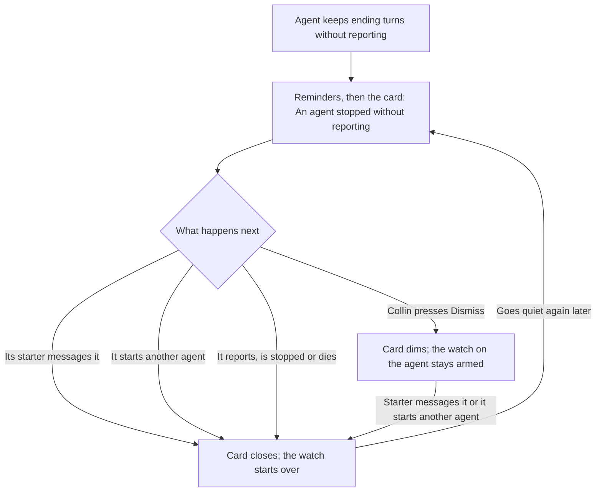

# Close the "agent stopped without reporting" card

**Idea:** `IDEA.md` — what this is for and why, in plain language. Read it first; it is
the north star this plan serves. Goal and Constraints live there, not here, so they don't
get buried as this file grows. Code map: `MAP.md` and `docs/maps/system-needs-quiet.md`.

## Open Questions

None.

## Watch List

| # | Noticed | What needs looking into | Raised to user? | Outcome |
|---|---------|-------------------------|-----------------|---------|

## Decision Log

Append-only. A reversal is a new entry superseding the old, never an edit.

| # | Decision | Rationale | Source |
|---|----------|-----------|--------|
| 1 | Mode is two-part | Collin picked it | user |
| 2 | The open quiet card closes automatically when (a) a message from the quiet session's starter is delivered to it, or (b) the quiet session starts another session. Either does a full quiet reset, so a later quiet episode can raise a fresh card | These are the two signals from the agent-lessons case: the lead dealt with it, and the sub-lead went back to work. Both are already observable in the hub | defaulted |
| 3 | Auto-close triggers act only while a quiet card is open; the reminders before the card are unchanged | IDEA "Not doing": no change to the ladder before the card | defaulted |
| 4 | Dismissing closes the card only: no quiet reset, no message to the lead, no change to any session hold | Nobody is waiting on an app card's answer; real activity still resets the ladder; IDEA constraint on holds | defaulted |
| 5 | Dismiss goes on every system needs card except "Permission needed" and "Session stuck at startup" | Collin picked "All but blocking ones": other app cards such as "Session ended" never close today; the two blocking ones mean a session is held and close themselves | user |
| 6 | (Superseded by 8) Blocking cards are recognised by title ("Permission needed", "Session stuck at startup"), so cards already in existing threads are covered without a migration | Titles are fixed strings posted in one place (`viewer/app/sessions.js` ~638) | defaulted |
| 7 | S1's closers act whenever the session still holds a quiet card, answered (dismissed) or not; the starter-message closer fires when the starter's message card is accepted, not on delivery | A dismissed card otherwise left the agent at stage 3 with quiet detection off for good; closing at post time matches "when the starter sends it a message" and needs no new queue field | review-round-1 |
| 8 | A system needs card is blocking only while some session has it as its current `needs_card` with `needs_open` true; every other system needs card can be dismissed. Supersedes 6 | Old permission/startup cards that were overwritten or whose session stopped never close; the title rule would leave them lit for good | review-round-1 |

## Spec

### S1. Auto-close of the quiet card
The quiet card is the system needs card "An agent stopped without reporting" raised by `alert()` in `viewer/app/quiet.js`, whose id is stored on the quiet session as `s.quiet_card` with `s.quiet_stage = 3`.

Whenever `s.quiet_card` is set (whether that card is still open or was dismissed by Collin, S2), the hub calls `quiet.reset(thread, s)` (normal reset, not `stopped`) when either happens:
- **Starter sends a message:** `viewer/app/cards.js` accepts a `message` card (same thread, not cross-thread) posted by the session named `s.started_by` whose `to` is `s`. Call reset right after the message is pushed onto `s.queue` (~`cards.js:162-167`). Reset only strips quiet reminders, so the new message stays queued. App messages (`[wc:from app]` reminders, turn-failed and ended notices, card presses) are not `message` cards and do not count.
- **Child started:** `s` calls the hub's session-start path (`viewer/app/sessions.js` ~686-718) and that call returns a session record: a new start (including one that comes back `waiting`), a `duplicate` live start, or a `resumeUnanswered()` retry. A call that throws (refused, 4xx, machine failure) does not count. Put the reset where all three returning branches pass, and save the thread with the reset under the same thread lock before the start call returns success (the duplicate branch saves nothing today, and the other branches have already saved).

Reset already answers the card if still open, clears `quiet_card`, clears queued quiet reminders and returns `s` to stage 0, so a later quiet turn goes through the usual reminders and may raise a fresh card. When `s.quiet_card` is not set, neither event changes quiet state (the ladder before the card is unchanged); existing delivery bookkeeping, such as `deliver()` clearing `quiet_check_at`, stays as it is. The existing closers (message/result from `s`, a reviewer/verifier report, stop, death) are unchanged.

### S2. Dismiss button on app cards
- **Which cards:** an unanswered, unreplaced `needs` card with `system: true`, unless it is **blocking**: some **live** session in the thread has `needs_card` equal to its id and `needs_open` true (a stopped or dead session's leftover hold does not count) (an open "Permission needed" or "Session stuck at startup" hold, `viewer/app/sessions.js:634-655`). Cards already in existing threads qualify the same way. The thread page needs to know which cards are blocking: expose it from the hub's thread view (for example a `blocking: true` flag on such cards in the data the page already gets), computed at read time, not stored.
- **Thread page** (`viewer/pages/thread.js`, needs case ~1009): such a card shows a "Dismiss" button in its actions row, after the "Open terminal" link when that is present. It is disabled for an archived thread, like other card buttons. Pressing it posts to the existing route `POST /wheelchair/api/threads/<id>/cards/<card>/dismiss` (`viewer/app/routes.js:631`) and refreshes like other presses; an error is shown the way other press errors are.
- **Hub** (`viewer/app/threads.js` `dismiss`, ~440): for a card that qualifies, mark it with `resolveCard(card, 'user', 'Dismissed')`, set `thread.user_at`, save, and enqueue nothing to any session. For a blocking card (same rule, checked at press time) return 422 `a session is waiting on this; it closes itself`. Non-system needs cards keep today's dismiss behaviour (resolved and the lead told `[card <id>] dismissed`). An already-answered card stays 422 `card is already answered`; frozen threads are refused as today.
- **Not changed:** `resolvable`/`retractable` in `viewer/app/card.js` still refuse system cards for leads (lead `resolve` and `retract` keep "a system needs card closes itself"). The press route in `threads.js` (~394) still refuses Keep going / Talk about it on system cards. Dismissing never touches `needs_open`, `permission_open`, `quiet_stage`, `quiet_card`, `needs_card` or any queue. If a dismissed quiet card's session is later reset, reset finds the card already answered and leaves it.
- **Result:** the card dims as resolved ("Dismissed") and drops out of the Needs you count (`viewer/app/views.js:140-149`), so the thread stops showing "needs you" for it.

### S2b. Project-tools card stays dismissed
`applyProjectTools` in `viewer/app/sessions.js` (~151-184) reposts its card whenever no open card exists. Change it so that when `stored.card` names a card Collin dismissed (resolved by `user`) and the problem names are unchanged (`card_names` equal), it skips the card update and posts no new card; the stored report (`boot`, `seq`, `created_at`, `state`) still refreshes as today, so `session list` shows current problems. A change in the names posts a fresh card as today; problems clearing still resets `stored.card` as today.

### S3. Docs
`protocol/app/cards-lead.md` (needs section and `retract` rule 3) and `cards.md` say system needs cards close themselves; add one sentence that the user can dismiss any of them except a "Permission needed" or "Session stuck at startup" card while its live session is still held, and that the quiet card also closes when its agent's starter messages it or the agent starts another agent. Update `docs/maps/system-needs-quiet.md` closure lines, and the dismiss row in `viewer/app/API.md` (~line 23), which today says the page has no Dismiss button and system cards are refused: it accepts non-blocking system needs cards without telling the lead, refuses blocking ones with 422.

### Non-goals
No change to when an agent counts as quiet or to the reminders before the card; no lead resolve/retract of system cards; no change to the blocking cards' own closing.

### Validation
- New tests in `viewer/test/app-quiet.test.js`: a raised quiet card closes and the stage returns to 0 when (a) the starter posts a message card to the quiet session, (b) the quiet session starts a child (a new start, an unanswered-start retry, and a duplicate start of a live child's attempt id, each checked on a fresh thread read), and a refused start does not; the same two events also reset a session whose quiet card was dismissed, after which a new quiet turn runs the ladder again and can raise a fresh card; an app reminder does not close it; with no card raised, a starter message leaves `quiet_stage` unchanged.
- In the starter-message test, hold delivery (for example the target's turn not ended) and assert that accepting the message card already closes the warning and the starter's message stays queued.
- A test that the project-tools card, once dismissed, is not reposted by a later report with the same names but changed text (and that the stored report advances), and is reposted when the names change.
- New tests in `viewer/test/app-hub.test.js` (next to the system dismiss refusal ~1805): dismissing a quiet card and a "Session ended" card succeeds, marks resolved by user with note "Dismissed", enqueues nothing to the lead; dismissing a card that is a session's current `needs_card` with `needs_open` true returns 422 and leaves `needs_open`/`permission_open` unchanged, while an old permission card no session holds open can be dismissed, and so can a held session's card after that session is stopped; lead resolve/retract of a system card still refused. Update the existing refusal test to the new behaviour.
- A browser test (extend `viewer/test/app-needs.spec.js`): an open non-blocking system needs card shows Dismiss, clicking it dims the card and shows "Dismissed"; a blocking card shows no Dismiss.
- `node --test viewer/test/*.test.js` (unquoted glob) and `npm --prefix viewer run test:browser` pass.

## Deferred

| # | Item | Why it can wait | Source | Notes for the follow-up |
|---|------|-----------------|--------|-------------------------|

## Accepted Risks

| Risk | Why accepted | Round |
|------|--------------|-------|

## Review Rounds

### Round 1 — 2026-11-21

**Lanes:** claude / claude-opus-5-5 (intent); gpt / gpt-6.2-sol (mechanics); cross-family: yes.

**Changed since Round 0:** n/a (first round — whole Spec in scope)

| Lane | Reported | Finding | Lead verdict | Resolution |
|------|----------|---------|--------------|------------|
| intent | major | Dismissed quiet card leaves stage 3 and S1 gates on an unanswered card, so quiet detection stays off for that agent | upheld | Decision 7; S1 gates on `quiet_card` set |
| intent | minor | Title rule blocks dismissal of stale permission/startup cards that never close | upheld | Decision 8; blocking = current `needs_card` with `needs_open` |
| intent | minor | Starter-message closer fires on delivery, not on send | upheld | Decision 7; reset at message post time |
| intent | minor | Child-start bullet contradicts itself on refused starts | upheld | S1 child-start bullet rewritten |
| mechanics | major | Same as intent major: dismissed episode cannot rearm | upheld | Decision 7 |
| mechanics | minor | Which child-start outcomes count; `resumeUnanswered` path | upheld | S1: any returned session record, incl. duplicate and retry |
| mechanics | minor | "No change" without a card could drop `quiet_check_at` clearing | upheld | S1 keeps existing delivery bookkeeping |
| mechanics | minor | Title rule leaves old hold cards lit | upheld | Decision 8 |
| mechanics | minor | API.md dismiss row not in docs update | upheld | S3 names API.md |
| mechanics | minor | Browser test should click Dismiss | upheld | Validation: click, dims, "Dismissed" |

### Round 2 — 2026-11-21

**Lanes:** claude (intent); gpt (mechanics); cross-family: yes.

**Changed since Round 1:**
- S1: closers act whenever `quiet_card` is set (open or dismissed); starter closer fires when the message card is accepted, not on delivery; child-start counts any returned session record (new, waiting, duplicate, `resumeUnanswered`), not a throw; existing delivery bookkeeping kept.
- S2: blocking = a session's current `needs_card` with `needs_open` true (title rule dropped); page learns blocking from a read-time flag.
- S3: `viewer/app/API.md` dismiss row added.
- Validation: dismissed-card rearm tests, stale hold card test, browser test clicks Dismiss.

| Lane | Reported | Finding | Lead verdict | Resolution |
|------|----------|---------|--------------|------------|
| intent | minor | Dismissed project-tools card is reposted by the next report | upheld | S2b |
| intent | minor | S3 doc sentence still uses the title rule | upheld | S3 says "while its live session is still held" |
| mechanics | blocking | Stopped/dead session's hold card stays blocking forever | upheld | S2: blocking requires a live session; test added |
| mechanics | minor | Child-start reset must be saved under the lock | upheld | S1 says so |
| mechanics | minor | Starter-message test could pass with delivery-time reset | upheld | Validation holds delivery |
| mechanics | minor | Same as intent minor on S3 doc wording | upheld | as above |

### Round 3 — 2026-11-21

**Lanes:** claude (intent); gpt (mechanics); cross-family: yes.

**Changed since Round 2:**
- S2: blocking requires a live session holding the card.
- S2b (new): a dismissed project-tools card is not reposted for the same problem names.
- S1: child-start reset saved under the thread lock before returning.
- S3: doc sentence uses the live-hold rule.
- Validation: held-delivery starter test, project-tools repost test, stopped-session hold card test.

| Lane | Reported | Finding | Lead verdict | Resolution |
|------|----------|---------|--------------|------------|
| intent | minor | S2b "updates nothing" could freeze the stored project-tools report | upheld | S2b keeps refreshing the report |
| mechanics | minor | Same, plus validation for changed text under same names | upheld | S2b and validation |
| mechanics | minor | Validation misses the duplicate-live start branch | upheld | Validation adds it |

## Implementation Tasks

| # | Objective | Ownership boundary | Lane | Session id | Validation | Status |
|---|-----------|--------------------|------|-----------|------------|--------|
| T1 | Hub side: S1 quiet auto-close, S2 dismiss + read-time `blocking` flag, S2b, S3 docs, node tests | viewer/app/{quiet,cards,card,sessions,threads,chat}.js, viewer/app/API.md, protocol/app/cards.md, cards-lead.md, docs/maps/system-needs-quiet.md, viewer/test/app-{quiet,hub,project-tools-card}.test.js | standard / hub-chosen | | `node --test viewer/test/*.test.js` | in progress |
| T2 | Thread page Dismiss button (S2 page) and browser test; after T1 | viewer/pages/thread.js, viewer/test/app-needs.spec.js | standard / claude (claude-sonnet-5-5) | | `npm --prefix viewer run test:browser`, `node --test viewer/test/*.test.js` | not started |

## Log
- 2026-11-21 Ready check at approval: hub and machine answer session list; Claude and GPT sessions started this thread (both logged in); codex/preflight.sh: token fresh. Ready.
- Build accepted: approval 2cc75ea4-d5cc-4250-9aec-810a887d4395
