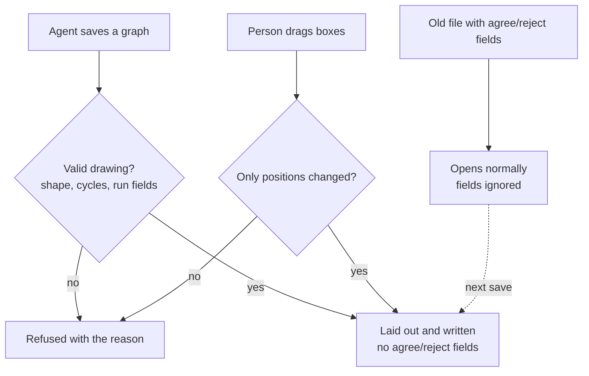

# Remove agree/reject from node graphs

**Idea:** `IDEA.md` — what this is for and why, in plain language. Read it first; it is
the north star this plan serves. Goal and Constraints live there, not here, so they don't
get buried as this file grows.

## Open Questions

None.

## Watch List

| # | Noticed | What needs looking into | Raised to user? | Outcome |
|---|---------|-------------------------|-----------------|---------|

## Decision Log

Append-only. A reversal is a new entry superseding the old, never an edit.

| # | Decision | Rationale | Source |
|---|----------|-----------|--------|
| 1 | Committed graph files are left as they are. `origin` and `was` on disk are ignored when read and dropped on the next write | Archived threads load graph JSON straight from their branches, so tolerant reading is needed anyway; rewriting 37 historical files adds a large diff for no behavior change | defaulted |
| 2 | Selection (click, marquee, group click) stays; only the approve and reject buttons go | Selection also drives the detail panel and multi-node dragging (`viewer/index.html:1885`, `2434-2445`) | defaulted |
| 3 | The `container-orphan` and `container-unreadable-child` refusals go; the containment cycle check stays | Both refusals exist only to protect verdicts in child graphs; cycles are a separate structural check | defaulted |
| 4 | The red colour stays for run status (needs-you) and errors, renamed off "rejected" | It has uses unrelated to verdicts (`viewer/index.html:58,145-151`) | defaulted |
| 5 | The README screenshot is retaken without verdict styling | The current one shows approved and struck entries, which will no longer exist | defaulted |
| 6 | Striking a worker's choice on the run picture is removed too. Choice boxes stay as a record; to undo one, Collin tells the lead | Keeping it would keep most of the verdict machinery; the app's sub-lead flow never used it | user |

## Spec

### Behavior after the change

A graph's nodes and edges have no `origin` or `was`. Nothing marks an entry agreed or
rejected, and nothing refuses a write for changing or dropping an entry.



### Server (`viewer/server.js`)

- Normalization no longer adds `origin` or `was`, and canonical output no longer writes
  them. A file that carries them still parses (unknown keys are already dropped); its next
  canonical write omits them.
- Remove these refusals and their checks: `bad-origin-value`, `agent-verdict`,
  `preservation-rejected`, `preservation-agreed`, `bad-was`, `bulk-not-additive`,
  `container-orphan`, `container-unreadable-child`. Remove the preservation comparison and
  its run-picture exemption.
- Keep: HTTP `bad-origin` (request Origin header check, unrelated), registration, stale
  hash, validation, positions, layout, cycle detection, the run-field rules, and `PUT /view`'s
  refusal to edit run fields. `PUT /view` now accepts position changes only; any other
  difference keeps the refusal it gets today for a structural change.

### Page (`viewer/index.html`)

- Remove the approve and reject buttons, `applyOrigin`, the verdict hint text, the legend
  entries for verdicts, the reset dot for `was`, and every verdict class, data attribute and
  style (strikethrough, dashed red, green).
- Arrows use one marker regardless of any `origin` in the data. An archived graph that still
  carries `origin` renders exactly like one without it.
- Selection, the detail panel, dragging, groups, marked-phrase clicks and run status styling
  stay. Rename the `--rejected` colour variable (e.g. `--danger`) where it is used for
  needs-you and errors.

### Rules and docs

Remove or rewrite every passage that depends on verdicts:

- `protocol/graphs.md`: the schema example and field list (`origin`, `was`), defaults and
  field order, the "Verdicts and the preservation contract" section, the agent-write rules
  around `agent-verdict`, the slug-reuse note, the run-picture exemption, the refusal table
  rows above, and the line saying a wrong verdict rule erases Collin's work. Add one sentence:
  older files may carry `origin` and `was`; they are ignored and dropped on the next write.
- `protocol/planning.md:87-98,206-211`: the rejected-entry re-read and exit gate.
- `protocol/diagrams.md:84-90`: "rejected entries are left out" and the reason for the walk.
- `protocol/implementation.md` (Decision 6): remove the step that collects `rejected`
  `choice` boxes before COMPLETION.md and turns them into follow-up tasks (`:219-231`),
  "They keep their rulings there" (`:58`), "nothing struck there is acted on unless Collin
  asks" (`:67`), and "each struck choice ... and what replaced it" in the COMPLETION
  deviations (`:236`). Choice boxes and the Log's `Choice:` lines stay; the end-of-run
  message still lists the `Choice:` lines.
- `protocol/app/lead.md:370-371`: "Proposals he approves or strikes keep using the graph page."
- `skills/graph/SKILL.md` description: "rearrange and rule on" becomes "rearrange".
- `README.md` "Pictures": the approve/strike text, the run-picture "box you can strike"
  bullet (choices are shown, not struck), and the screenshot (Decision 5).
- Routers: `protocol/AGENTS.md:32`, `viewer/AGENTS.md:43-46`.

Leave alone: reviewer and verifier verdicts, HTTP Origin, `origin/<branch>` in git, and the
`origin` of a spec item in COMPLETION.md.

### Tests

Delete tests whose subject is verdicts (`viewer/test/server.test.js`, `run.test.js`,
`browser.spec.js`; the map lists the ranges). A test that also checks preserved behavior is
trimmed, not deleted: keep its non-verdict assertions. Examples: `run.test.js:64-76` also
checks that the page cannot edit run status; `browser.spec.js:620-663` also checks that
dragging several nodes issues exactly one write. Strip `origin`/`was` from fixtures that carry
them incidentally. Add:

- A server test: a graph file on disk carrying `origin: "rejected"` and `was: "agreed"` loads
  with `GET`, and an agent `PUT` that drops that entry succeeds and writes no `origin`/`was`.
- A browser test: a graph with `origin` values renders with no verdict class or strikethrough,
  and no approve or reject button exists.

### Validation

```bash
node --test viewer/test/*.test.js
npm --prefix viewer run test:browser
grep -rnE "agent-verdict|preservation-(rejected|agreed)|bad-was|bad-origin-value|bulk-not-additive|container-orphan|container-unreadable-child|applyOrigin" protocol skills codex viewer README.md AGENTS.md CONTRIBUTING.md   # no hits
```

### Not doing

No rewrite of committed graph files. No change to layout, groups, run pictures, the thread's
diagram card or dragging.

## Accepted Risks

| Risk | Why accepted | Round |
|------|--------------|-------|

## Review Rounds

### Round 1 — 2026-11-15

**Lanes:** gpt / gpt-6.1-terra (intent); gpt / gpt-6.1-terra (mechanics); cross-family: no (Claude unavailable to the hub at start).

**Changed since Round N-1:** n/a (first round — whole Spec in scope)

| Lane | Reported | Finding | Lead verdict | Resolution |
|------|----------|---------|--------------|------------|
| intent | — | No findings | — | — |
| mechanics | minor | Mixed-purpose tests could be deleted wholesale, losing coverage of preserved behavior | upheld | Tests section now says trim, keep non-verdict assertions, with the two examples |

## Prior Work

| Spec item | State | Evidence (file:line) | Confidence |
|-----------|-------|----------------------|------------|

## Implementation Tasks

| # | Objective | Ownership boundary | Lane | Session id | Validation | Status |
|---|-----------|--------------------|------|-----------|------------|--------|
| T1 | Server: drop origin/was from normalization and canonical output, remove the verdict refusals and preservation; node tests trimmed, legacy-file test added | viewer/server.js, viewer/test/*.test.js, viewer/test/helpers/, viewer/test/fixtures/ (except verdicts.json, bulk-verdicts.json) | Standard, gpt-6.1-terra (asked default; hub chose gpt) | wc-d1880dd5eb13-worker | node --test viewer/test/*.test.js; refusal grep | done |
| T2 | Page: remove approve/reject UI and verdict styling, one arrow marker, --rejected → --danger; browser tests trimmed, legacy-render test added | viewer/index.html, viewer/list.html, viewer/doc.html, viewer/test/*.spec.js, fixtures verdicts.json and bulk-verdicts.json | Standard, gpt-6.1-terra (asked claude; Claude unavailable, hub sent to gpt) | wc-d1880dd5eb13-worker-2 | npm --prefix viewer run test:browser; node --test viewer/test/*.test.js | done |
| T3 | Rules and docs: graphs.md, planning.md, diagrams.md, implementation.md, app/lead.md, graph SKILL.md, README Pictures text, routers | protocol/graphs.md, protocol/planning.md, protocol/diagrams.md, protocol/implementation.md, protocol/app/lead.md, protocol/AGENTS.md, skills/graph/SKILL.md, README.md, viewer/AGENTS.md | Standard, gpt-6.1-terra (asked claude; Claude unavailable, hub sent to gpt) | wc-d1880dd5eb13-worker-3 | spec grep, verdict-term grep | done |
| T4 | Retake docs/viewer.png without verdict styling (after T2 merges) | docs/viewer.png | Standard, claude-sonnet-5-5 | wc-d1880dd5eb13-worker-4 | file docs/viewer.png is 2880x1800; image shows no verdict styling | in progress |
| R1 | Remediation 1: last verdict wording (implementation.md:146,:202; README.md:106); geometry test skips run pictures | protocol/implementation.md, README.md, viewer/test/browser.spec.js (named lines only) | Light, gpt-6-luna | wc-d1880dd5eb13-worker-5 | ruling grep; geometry test; full browser suite | done |

## Log
- 2026-11-15 — Choice: T3, protocol/graphs.md: removed the producer read-back requirement, since its purpose and the planning re-read it fed depended on verdicts; the general GET instructions stay.
- 2026-11-15 — Sub-lead fix on T3 after merge: protocol/graphs.md "Depth and cycles" still named the removed re-read, exit-gate walk and read-back; reworded to "any walk through containers", and the invalid-json note now says "a GET" instead of "your read-back". Rewrapped one overlong line in protocol/implementation.md.
- 2026-11-15 — T1 accepted: the one failing node test ("a starter that loses the freed port registers through the new holder", viewer/test/lifecycle.test.js:423) fails identically on the feature branch before T1, so it is pre-existing and outside this plan. T1 reported choices: none; none seen in the diff beyond the brief.
- 2026-11-15 — Sub-lead fix after T1 merge: viewer/AGENTS.md named `checkAgentWrite`, which T1 removed; the bullet now names `checkAgentProse` and keeps the reason it stays out of `validateGraph`.
- 2026-11-15 — Choice: T2, viewer/index.html: the neutral grey that verdicts shared is renamed `--graph-stroke`, and the run-done green `--success`.
- 2026-11-15 — Choice: T2, viewer/test/browser.spec.js: the legacy-render test injects `origin`/`was` into the GET response, since the new server drops them before the page sees them.
- 2026-11-15 — T2 accepted: its one failing browser test ("no drawn arrow's line passes through either box it connects, over every committed graph", browser.spec.js:2133, both engines) fails identically with the pre-change index.html and spec; it chokes on the curved wires of committed run pictures (app-shell, model-pins run.json). Pre-existing and outside this plan.
- 2026-11-15 — Choice: T4, docs/viewer.png: used docs/plans/app-shell/graphs/hub-to-machines.json; the capture is the opening viewport, so the bottom of the flow is cut off at the edge.
- 2026-11-15 — All four tasks merged; COMPLETION.md written; status verifying.
- 2026-11-15 — Verification 1 FAIL (both verifiers): leftover ruling wording in implementation.md and README.md; pre-existing browser.spec.js:2133 failure counted against "the test suites pass". REMEDIATION-1.md written; R1 dispatched.
- 2026-11-15 — R1 accepted and merged (choices: none; none seen in the diff). Browser suite 578 passed, 2 skipped. Verification attempt 2 started.
- 2026-11-15 — Verification 2 on 7940aba: Claude PASS; GPT FAIL on pre-existing failures only (app-accounts.spec.js waiting-line clock bug after 21:00, lifecycle.test.js:423, one Firefox navigation in app-threads.spec.js), all in files this branch did not touch, reproduced on 635c45f. Asked the lead whether to accept as residual or fix the clock test here.
