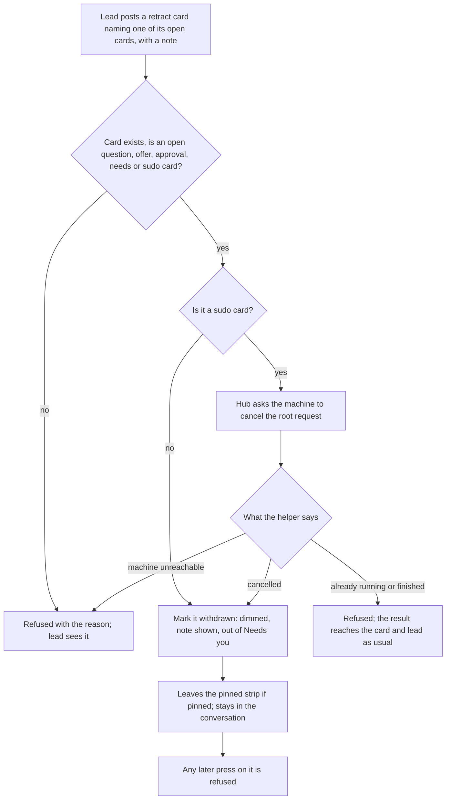

# Retract cards that no longer apply

**Idea:** `IDEA.md` — what this is for and why, in plain language. Read it first; it is
the north star this plan serves. Goal and Constraints live there, not here, so they don't
get buried as this file grows.

## Open Questions

_None._

## Watch List

| # | Noticed | What needs looking into | Raised to user? | Outcome |
|---|---------|-------------------------|-----------------|---------|

## Decision Log

Append-only. A reversal is a new entry superseding the old, never an edit.

| # | Decision | Rationale | Source |
|---|----------|-----------|--------|
| 1 | Retraction is a new hidden card kind, `retract` (`card`, `note`), separate from `resolve` | `resolve` means "answered in chat" and its label says so (MAP: `viewer/pages/thread.js:552-579`); IDEA requires a retracted card to look different from an answered one | defaulted |
| 2 | Retractable kinds: open `question`, `offer`, `approval`, lead-posted `needs`, and `sudo` while `waiting` | IDEA "What good looks like"; app-posted needs close on their own (IDEA "Not doing") | defaulted |
| 3 | Only a lead may retract, only in its own thread, with a required one-line note; any lead of the thread, including a later one, may retract an earlier lead's card | Mirrors `resolve` rules (MAP: `viewer/app/card.js:24-39`) | defaulted |
| 4 | A retracted card shows "Withdrawn" and the note, dimmed; all its controls are removed or disabled | IDEA; MAP shows approval Re-check, objection talk, and sudo controls ignore `answered`, so each needs an explicit check | defaulted |
| 5 | A sudo card can be retracted only while `waiting`. Retraction cancels the helper request through the existing machine cancel path (the one Decline uses), so the helper needs no change and no reinstall. If the helper reports the request already running or finished, the retraction is refused with that state and the card reports the outcome as usual | MAP: `machine/lib/sudo.js:77-84`, `sudo-helper/helper.py:306-322`; the helper is root-owned and reinstalled only by Collin; IDEA constraint on running commands | defaulted |
| 6 | A retracted offer lets the lead post one more offer, like "keep talking first" does; the hub's limit of two offers stays | MAP: `viewer/app/cards.js:72-76`; a retracted offer was never answered "take it into planning" | defaulted |
| 7 | Retraction is final; no un-retract. The lead posts a new card instead | IDEA "Not doing" | defaulted |
| 8 | Retracting an approval card leaves PLAN.md `status: approved`. When Collin is ready, the lead posts a fresh approval card with a new Ready check. A Spec change during the talk returns the plan to `ready-for-review` under the existing rule | Retraction alone changes nothing in the plan, so re-review would cost a round for nothing | user |
| 9 | The approval card is pinned at the top of the thread until Collin presses Start building or it is retracted; a new approval card replaces the pinned one | Collin asked for it mid-planning; added to IDEA.md "What good looks like" | idea-change |
| 10 | Any retracted card that is pinned (an offer, an approval) leaves the pin; it stays in the conversation, dimmed | A pin is for what is live; consistent with the approval card leaving on Start building | defaulted |

## Spec

### What changes, in one paragraph

A lead posts a new hidden card kind, `retract`, naming an open card it posted and a one-line
note. The hub marks that card withdrawn: it stays in the thread, dims, shows "Withdrawn ·
<note>", every control on it stops working (in the page and at the hub), it stops counting
as waiting on Collin, and it leaves the pinned strip if it was pinned. A waiting sudo card's
root request is cancelled at the helper before the card is marked. Separately, the approval
card becomes pinned until Start building is pressed or it is retracted.

### The flow

### 1. The `retract` kind (`viewer/app/card.js`)

- Fields: `card` (string, required, the target id) and `note` (string, required, one line).
  Roles: lead only. Not in the `shown` set; never stored as a card of its own.
- New function `retractable(thread, cardId)`, beside `resolvable`, returning
  `{ok, card}` or `{ok: false, reason}`. Refusals, checked in this order:
  1. `no such card in this thread`: id missing, or the target is `replaced`.
  2. `only a question, offer, approval, needs or sudo card can be retracted`: any other kind.
  3. `a system needs card closes itself`: a needs card with `system` set.
  4. `card is already answered`: the target has `answered: true` (this includes an earlier
     retraction, a resolve, an approval whose Start building was pressed, and an offer or
     question already pressed). A sudo card is not checked against `answered` here; see 3.
- `card.js` CLI validates `retract` like any kind (fields and that `kind` matches); target
  checks happen only at the hub.

### 2. Applying a retraction at the hub (`viewer/app/cards.js`, `acceptCard`)

A `retract` branch, beside the `resolve` branch, under the same thread lock:

- Run `retractable`; a refusal is `422` with the reason. Record `delivery_id` as the
  resolve branch does. Return `{ card: { ok: true, retracted: <id> }, targetName: null }`:
  nothing is queued to any session.
- New `retractCard(card, by, note)` sets `answered: true`, `retracted_by` (the lead's
  session name), `retracted_note`, `retracted_at` (ISO time). Setting `answered` is what
  keeps every existing "is it open?" check (Needs you list, aside panel, offer and question
  press guards) right without touching each one.
- If the target is pinned (`thread.pinned[target.kind]?.id === target.id`), delete that
  pin entry. This applies to `offer` and `approval`.
- **Sudo target** (only while `state === 'waiting'`; any other state refuses with
  `the sudo request is already <state>`):
  1. Call `hub.client.sudoCancel(thread.machine, card.request_id)`, as `pressSudo` does
     for Decline (`viewer/app/threads.js:248-267`). If it throws or the response fails
     `validSudoStatus`, refuse with `422` `couldn't reach <machine> to cancel the sudo
     request; try again`. A `4xx` makes the machine reject the spooled card and return the
     refusal to `card.js` synchronously, so the lead sees it and can retry; a `5xx` would
     be re-spooled silently, which is why this is a `422`.
  2. Response `declined`: set `card.state = 'declined'` and call `retractCard`, directly on
     the thread object inside the `acceptCard` transaction. **Do not call `applySudoState`,
     `hub.save` or `hub.enqueue` here**: `acceptCard` runs inside `hub.updateThread`, which
     holds the thread file's write queue (`viewer/app/state.js:54-60,122-131`), and any
     `hub.save` awaited inside it queues behind the transaction awaiting it, a deadlock. The
     transaction's own write persists the change. No message goes to the lead.
  3. Response `running`, `ran`, `expired` or `failed`: refuse with `422`
     `the sudo request is already <state>` and leave the card untouched in this
     transaction. The machine already stored that state when it handled the cancel
     (`machine/lib/sudo.js:66-84`); its poll delivers every unacknowledged state to
     `/api/machine/sudo-outcome` on the next tick (`machine/lib/sudo.js:86-112`), which
     applies it through `applySudoState` outside any transaction, with the normal lead
     message for a terminal state.
  4. When the machine later delivers the `declined` outcome for a retracted card,
     `applySudoState` finds it not newer than the card's state (both rank 2) and changes
     nothing and queues nothing; a test pins that.
  The helper itself is unchanged: its run page shows a cancelled request as "Declined" and
  hides the password form; the cancel is atomic with a run under the helper's own lock
  (`sudo-helper/helper.py:175-185,306-322`).
- **Offer limit** (`viewer/app/cards.js:72-76`): a second offer is allowed when the first
  was answered `keep talking first` **or retracted** (`retracted_at` set). A third is still
  refused.

### 3. Presses on a retracted card (`viewer/app/threads.js`)

- At the top of the press handler, after the card is found and before any per-kind branch
  (including sudo, approval Re-check and Start building), refuse a card with `retracted_at`
  with `422` `this card was withdrawn`. This covers presses from a page opened before the
  retraction.
- `dismiss` stays as it is (it already refuses an answered card).

### 4. Approval card pinned (`viewer/app/cards.js` `addCard`)

- Posting an `approval` sets `thread.pinned.approval` to the new record. An earlier
  approval that is still open (`answered` false, not `replaced`) is marked `replaced`, as
  the singleton kinds are, so a stale approval never stays pressable. An earlier answered
  or retracted approval is left as it is and stays visible in the conversation.
- The pin is removed (`delete thread.pinned.approval`) when Start building is accepted
  (the press that queues `start building` to the lead) and on retraction. Re-check, a
  Start building press refused by a changed Ready result, and "Talk about this" leave it
  pinned.
- `addNeeds` (`viewer/app/views.js:122-133`) skips cards marked `replaced`, so a superseded
  approval (open when it was replaced) never stays in Needs you. This also covers any
  `replaced` card of the other listed kinds.
- `approval` is not added to `SINGLETONS`: it is not limited to one per thread over time,
  and it unpins, which singletons never do.
- **Retracted cards are never marked `replaced`.** When a new offer (singleton) or a new
  approval is posted, `addCard` skips any earlier card with `retracted_at` when choosing what
  to mark `replaced`, so a withdrawn card stays in the conversation history. (`chat.js:268`
  drops `replaced` cards from the page payload, and `resolvable`/`retractable` treat a
  `replaced` card as missing.)

### 5. The thread page (`viewer/pages/thread.js`, `thread.css`, `aside.js`)

- `renderCard`: a card with `retracted_at` is `off` (like answered), dimmed with the same
  opacity as a resolved card, and gets a tag reading `Withdrawn · <retracted_note>` in place
  of any answered tag (`answeredTag`, `viewer/pages/thread.js:454-471`). This takes
  precedence over "Answered in chat", "You picked" and the sudo state line.
- Approval: Start building, Re-check and every "Talk about this" button are disabled or
  hidden when retracted.
- Sudo: a retracted card shows no "Open to run" link, Decline or Talk buttons, and shows the
  Withdrawn tag instead of "Declined".
- **Conversation vs pinned strip by pin membership, not kind.** Today the conversation
  drops every card whose kind is in `PINNED_KINDS` (`viewer/pages/thread.js:290`), so a card
  that leaves the pin would vanish. Change that filter to drop only cards whose id is a
  current pin (`data.pinned` ids). A retracted offer or approval, and an approval whose
  Start building was pressed, then appear in the conversation at their posted time, with
  their dimmed state; idea and progress pins are unaffected because they never leave the
  pin while current.
- Render invalidation follows the same rule: the `chat` sync key
  (`viewer/pages/thread.js:925`) uses the cards not currently pinned (by id) instead of the
  `PINNED_KINDS` filter, and both the `chat` and `pinned` keys include `retracted_at`, so a
  retraction or an unpin redraws both.
- Pinned strip: `PINNED_KINDS` and `renderPinned`'s order include `approval` (order: offer,
  idea, approval, progress). `pinLabel` for approval: `Plan approved: needs you` while open.
  A card absent from `thread.pinned` is not shown in the strip.
- `aside.js` open-card lists (`:16`, `:98`) need no change because a retracted card is
  `answered`; the implementer confirms that in a test or by reading.

### 6. Protocol

- `protocol/app/cards.md`: add `retract` to the kinds table (never shown, lead, not
  pinned) and a section under "The kinds never shown" with the fields, the refusal reasons
  from §1 and §2, the sudo behavior, and the difference from `resolve` (resolve = he
  answered in chat; retract = the card no longer applies). Mark `approval` pinned in the
  table and describe when it unpins. Note under `offer` that a retracted offer allows one
  more.
- `protocol/app/lead.md`:
  - In "How you talk to Collin": when a card you posted no longer applies because the
    conversation moved on (he talks instead of pressing and the card's question is now
    moot, or he no longer wants what it offers), post a `retract` card with a one-line note
    in his terms, then carry on. Use `resolve` instead when he answered its question in
    chat. On a restart, retract or resolve open cards that no longer apply.
  - In step 6: if he wants to talk instead of building, retract the approval card; status
    stays `approved`; post a fresh approval card (with a fresh Ready check) when he is
    ready; a Spec change returns the plan to `ready-for-review` as today.
  - In "Asking Collin to run something as root": a waiting sudo card that is no longer
    needed is retracted, which cancels the request; a refusal saying it is already running
    or finished means the outcome will arrive as usual.
- `viewer/app/API.md` and `viewer/AGENTS.md`: update wherever they list card kinds,
  resolve, or pinned kinds, so the routers stay true.

### Non-goals

Collin retracting cards; deleting cards; un-retracting; retracting progress, idea, diagram,
image, done, stub or merged cards; any change to the root sudo helper; telling the lead
about a refused retraction that was spooled during a hub outage (an existing limit shared
with `resolve`).

### Validation

- `node --test viewer/test/*.test.js` (unquoted glob), with new tests in
  `viewer/test/app-hub.test.js` and `viewer/test/app-sudo.test.js` covering:
  - each retractable kind retracted: fields set, `answered` true, not stored as a card,
    nothing queued to the lead, Needs you list excludes it;
  - each refusal reason in §1 and §2, including another thread's card and a non-lead
    poster;
  - every press action on a retracted card refused with `this card was withdrawn`,
    including approval Re-check, Start building and Talk, and sudo Decline and Talk;
  - offer: a second offer allowed after a retracted first, a third refused;
  - approval pin: set on post, an open older approval marked `replaced` and absent from
    Needs you (including after the newer approval is answered or retracted), removed on
    accepted Start building and on retraction, kept on Re-check and on a refused start;
  - sudo: waiting → cancel called, card retracted and `declined`, no lead message;
    cancel returns `running` or `ran` → refused with the card unchanged by the retraction,
    and the later sudo-outcome delivery applies the state with the normal lead message;
    cancel throws → `422`, card unchanged, still waiting; a later `declined` outcome on a
    retracted card queues nothing; and a sudo retraction returns (no deadlock: the test
    awaits it under a timeout).
- `npm --prefix viewer run test:browser` with browser cases in
  `viewer/test/app-threads.spec.js` / `app-sudo.spec.js`: a retracted question, offer,
  approval and sudo card show "Withdrawn · <note>", are dimmed and have no enabled
  controls; the approval appears in the pinned strip while open and leaves it after
  retraction.
- `bash machine/test/run.sh` stays green (no machine change expected).

## Accepted Risks

| Risk | Why accepted | Round |
|------|--------------|-------|
| The helper's own run page shows a retracted sudo request as "Declined", not "Withdrawn" | Changing the root-owned helper means Collin reinstalls it with sudo; the thread card shows "Withdrawn" and the command cannot run either way | planning |

## Review Rounds

### Round 1 — 2026-11-17

**Lanes:** gpt / intent; gpt / mechanics; cross-family: no (claude unavailable at start).

**Changed since Round N-1:** n/a (first round — whole Spec in scope)

| Lane | Reported | Finding | Lead verdict | Resolution |
|------|----------|---------|--------------|------------|
| intent (gpt) | blocking | Unpinned retracted offers/approvals vanish: the page filters pinned kinds out of the conversation by kind, and a new offer marks the retracted one `replaced` | upheld (blocking): confirmed at `viewer/pages/thread.js:290`, `viewer/app/cards.js:22-25`, `viewer/app/chat.js:268` | §4 never marks retracted cards `replaced`; §5 filters the conversation by current pin id |
| mechanics (gpt) | blocking | `applySudoState` inside the `acceptCard` transaction deadlocks: its `hub.save`/`enqueue` queues behind the transaction | upheld (blocking): `acceptCard` runs in `updateThread` (`viewer/app/cards.js:39`), whose queue `save` joins (`viewer/app/state.js:54-60,113-131`) | §2 sets the declined state in-transaction with no save/enqueue; non-declined states refuse and arrive through the machine's outcome poll |
| mechanics (gpt) | blocking | Unpinned offers/approvals vanish from the conversation (kind filter); chat render key must follow | upheld (blocking): duplicate of the intent finding, plus `viewer/pages/thread.js:925` | Fixed with the intent finding; §5 now also names the sync keys |
| mechanics (gpt) | blocking | A second offer marks the retracted first `replaced` | upheld (blocking): duplicate of the intent finding | Fixed with the intent finding (§4) |

### Round 2 — 2026-11-17

**Lanes:** gpt / intent; gpt / mechanics; cross-family: no (claude unavailable at start).

**Changed since Round 1:**
- §2 sudo: the declined path sets state and retraction in-transaction with no save or enqueue; other states refuse and arrive through the machine's outcome poll; a later `declined` outcome is a no-op.
- §4: retracted cards are never marked `replaced` when a new offer or approval is posted.
- §5: the conversation excludes only cards that are current pins (by id), and the `chat`/`pinned` render keys follow that and include `retracted_at`.
- Validation: tests for the above.

| Lane | Reported | Finding | Lead verdict | Resolution |
|------|----------|---------|--------------|------------|
| intent (gpt) | — | No findings | — | — |
| mechanics (gpt) | blocking | A replaced open approval stays in Needs you forever, linking to a card the page no longer shows | upheld (blocking): `addNeeds` has no `replaced` filter (`viewer/app/views.js:124`); `chat.js:268` drops replaced cards | §4: `addNeeds` skips `replaced` cards; test added to Validation |

### Round 3 — 2026-11-17

**Lanes:** gpt / intent; gpt / mechanics; cross-family: no (claude unavailable at start).

**Changed since Round 2:**
- §4: `addNeeds` skips `replaced` cards; Validation tests that a superseded approval leaves Needs you.

| Lane | Reported | Finding | Lead verdict | Resolution |
|------|----------|---------|--------------|------------|
| intent (gpt) | — | No findings | — | — |
| mechanics (gpt) | — | No findings | — | Round clean |

## Prior Work

| Spec item | State | Evidence (file:line) | Confidence |
|-----------|-------|----------------------|------------|

## Implementation Tasks

| # | Objective | Ownership boundary | Lane | Session id | Validation | Status |
|---|-----------|--------------------|------|-----------|------------|--------|

## Log
