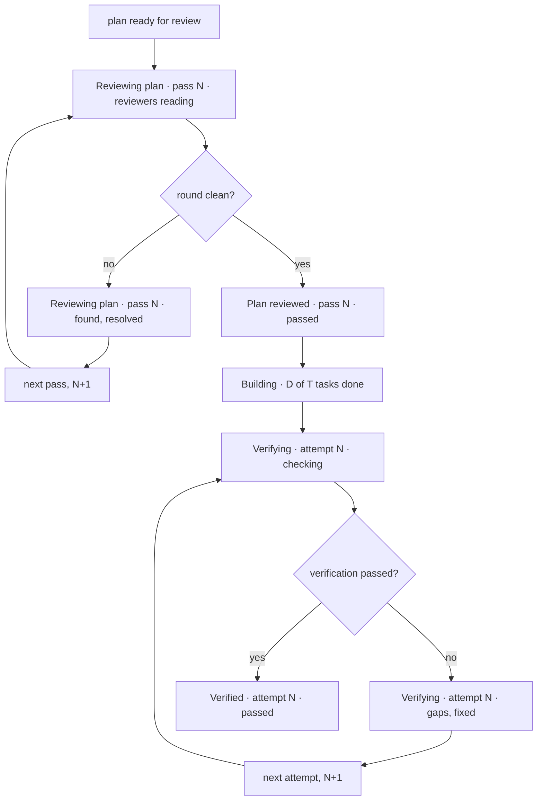

# See progress while a plan is reviewed and a build is verified

**Idea:** `IDEA.md` — what this is for and why, in plain language. Read it first; it is
the north star this plan serves. Goal and Constraints live there, not here, so they don't
get buried as this file grows.

**Map:** `MAP.md` and `docs/maps/app-review-progress.md`.

## Open Questions

None.

## Watch List

| # | Noticed | What needs looking into | Raised to user? | Outcome |
|---|---------|-------------------------|-----------------|---------|

## Decision Log

Append-only. A reversal is a new entry superseding the old, never an edit.

| # | Decision | Rationale | Source |
|---|----------|-----------|--------|
| 1 | Show stage plus counts, never finding text | Collin picked "where it stands plus counts" | user |
| 2 | Reuse the one pinned `progress` card, adding a stage, rather than a new card kind | One pinned line per thread that moves Building → Verifying, or shows Review before a build; pinning and replacement already work (`viewer/app/cards.js:22-25`) | defaulted |
| 3 | During review the lead posts the line; during verification the sub-lead posts it | Only the lead triages review findings; only the sub-lead runs verifiers (`protocol/app/sub-lead.md:161-195`) | defaulted |
| 4 | Review counts only findings the lead judged real (upheld, downgraded, accepted-risk), not declined ones | Counting declined findings makes "fixed" never catch up, so a healthy review looks stuck | defaulted |
| 5 | Pass numbers count every review round in the thread, never reset when Collin settles a fork | Reset numbering would make pass 1 appear twice; the budget reset is internal | defaulted |
| 6 | Shown in the thread only; Threads and Features lists unchanged | IDEA scopes it to the thread page; list labels come from PLAN status and are out of scope | defaulted |
| 7 | Small fixes and after-done fixes get no progress line | IDEA covers plan review and a feature build's verification only; those verifiers are one quick check | defaulted |
| 8 | A progress card without a stage renders as today's "Building" line | Older threads keep working with no migration | defaulted |
| 9 | Counts cover the current pass only, not a running total | Collin picked "this pass only": a converging review reads 8, then 3, then 0 | user |
| 10 | While reviewers are still reading, the line shows no counts | Per-pass counts are unknown until triage | defaulted |
| 11 | A pass that finds nothing shows "clean"; a passed verification shows "passed" | Ends each stage with a visible outcome rather than a stale "checking" | defaulted |
| 12 | The review line counts upheld, downgraded, accepted-risk and user-decision findings as found; one is resolved once its Spec fix is saved, its risk recorded, or Collin's decision logged | Matches decision 4; "resolved" is honest for accepted risks where "fixed" is not | defaulted |
| 13 | `choice_waiting` is also set while the review budget's needs card is open | That card also waits on Collin | defaulted |
| 14 | `clean` means the round passed lead.md's existing clean test, not zero findings; it may carry resolved counts | Keeps the review gate unchanged while ending the line on a true outcome | review-round-1 |
| 15 | After `verifying` is committed, the sub-lead's per-task progress posts use the `verify` line; `fixed` rises on each accepted remediation task | Otherwise remediation would flip the pin back to Building | review-round-1 |

## Spec

### What changes, in one paragraph

The pinned `progress` card (one per thread, a new one replaces the old in the pin,
`viewer/app/cards.js:9-28`) gains a `stage`. Before a build, the lead posts it with
`stage: review` while the plan is reviewed. During a build the sub-lead posts it as today
(`stage: build` or no stage). When the build moves to verification the sub-lead posts it
with `stage: verify`. The thread page renders each stage as its own line. No finding text,
reviewer or verifier names, severities or lens names ever appear in it.

### The line through a feature's life

The pin moves from review, through the build, to verification. Each review pass and each
verification attempt goes "checking" → "fixing" (with this pass's counts) and repeats until
it passes.

### Card schema (`viewer/app/card.js`, documented in `protocol/app/cards.md` `progress`)

| Field | Type | Required | Meaning |
|---|---|---|---|
| `stage` | `build` \| `review` \| `verify` | no | Absent means `build` |
| `done`, `total` | integer | `build` only | As today, `0 <= done <= total` |
| `machines` | string array | yes, every stage | As today; may be empty for `review` |
| `choice_waiting` | boolean | yes, every stage | As today |
| `pass` | integer `>= 1` | `review`, `verify` | Review round number, or verification attempt number (the N of `REMEDIATION-N.md` + 1 for a re-verify) |
| `phase` | `checking` \| `fixing` \| `clean` | `review`, `verify` | `checking`: reviewers or verifier running. `fixing`: lead triaging and fixing the Spec, or sub-lead remediating. `clean`: the round met lead.md's clean test — no upheld blocking or major finding and no open `user-decision`, whatever minor or accepted-risk findings it had (review) — or verification passed (verify) |
| `found`, `fixed` | integer | required with `fixing`; optional (both or neither) with review `clean`; forbidden otherwise | This pass only. `0 <= fixed <= found`; with `fixing`, `found >= 1`; with `clean`, `fixed == found` |

Validation rules, all refused with a 422 reason through the shared `validate`
(`viewer/app/card.js:119-139`, called by the hub at `viewer/app/cards.js:46`):

- `stage` not one of the three: `invalid or missing field: stage`.
- `build` (or absent): `done`/`total` required as today; `pass`, `phase`, `found`, `fixed` refused.
- `review`/`verify`: `pass` and `phase` required; `done`/`total` refused; `found`/`fixed`
  required with `fixing`; with review `clean` both-or-neither and `fixed == found`; refused with `checking` and with verify `clean`; count rules above.
- Roles unchanged: lead and sub-lead may post any stage (`viewer/app/card.js:28`).

The field-allowlist check (`card.js:126-128`) admits the new keys for `progress`; the
per-stage required/forbidden rules are an extra block after the existing progress count
check (`card.js:135-137`).

### Who posts what, when

**Lead, plan review** (`protocol/app/lead.md` step 5):

1. Launching round N (after its reviewers start): `stage: review, pass: N, phase: checking`.
2. Triage done for round N:
   - the round is clean by lead.md's test (no upheld blocking/major, no open
     `user-decision`) → resolve any counted minor or accepted-risk findings, then post
     `phase: clean` with `found`/`fixed` equal (omitted if none were counted), then approval
     as today, step 6. The review gate itself is unchanged;
   - otherwise → `phase: fixing, found: F, fixed: 0`, re-posted with `fixed` rising as each
     Spec fix, Accepted Risk or Collin decision is saved.
3. Round numbering counts every triaged round in the thread; it never resets, including
   when Collin settles a fork or a Spec change after approval returns to review. A round
   ended by a dead reviewer keeps its number; the restart re-posts `checking`.
4. Found = findings the lead's triage marked `upheld`, `downgraded`, `accepted-risk` or
   `user-decision`. `declined` never counts. Resolved (`fixed`) = Spec fix saved, risk
   moved to Accepted Risks, or Collin's decision logged.
5. While a `question` card or the review budget's `needs` card waits on Collin, re-post the
   current line with `choice_waiting: true`, and `false` once answered.
6. The old sentence "No round count, summary or finding ever reaches the thread" becomes:
   no finding, summary or reviewer detail reaches the thread; the progress line's pass
   number and counts are the only review state shown.

**Sub-lead, verification** (`protocol/app/sub-lead.md` "Finishing and verifying"):

1. After committing `verifying` and starting the verifier(s) for attempt N:
   `stage: verify, pass: N, phase: checking`, `machines` as during the build.
2. On FAIL: `phase: fixing, found: <gaps in that attempt's report, counted once each>,
   fixed: 0`; re-post with `fixed` rising as each remediation task is accepted.
3. On PASS (every verifier of the attempt passed): `phase: clean`, then the `result` to the
   lead as today.
6. **Remediation tasks are stage-aware.** Once `status: verifying` is committed, the
   "post `progress` on dispatch and acceptance" rules (`protocol/app/sub-lead.md:93-95`,
   `:126-129`) post the `verify` line instead of a `build` one: dispatching a remediation
   task re-posts the current `verify`/`fixing` line unchanged; accepting one re-posts it
   with `fixed` + 1. A `build`-stage card is never posted after `verifying` is committed.
   Both sub-lead.md places get a sentence saying so.
4. When two verifiers run in one attempt, `found` is the number of distinct gaps across both
   reports after the sub-lead merges duplicates into REMEDIATION-N.md.
5. A gap that survives two fixes and goes to the lead: the line stays on `fixing`; the lead
   sets `choice_waiting` as it does today for build questions (lead.md step 7.3, which now
   says "same fields as the sub-lead's last one" instead of naming `done` and `total`).

**Not posted:** the lead's small-fix verifier (step 1) and after-done fix verifier (step 9)
post no progress line. Mapping and planning questions post none.

### Rendering (`viewer/pages/thread.js:573-588`, `viewer/pages/thread.css`)

The pinned progress box keeps its blue dot, amber `choice_waiting` styling, "choice for
you" pill, sticky/fold behaviour (`thread.js:684-719`) and replacement behaviour.

| Stage / phase | Label | Text |
|---|---|---|
| `build` / absent | Building | unchanged: segments + "D of T tasks done · machines" |
| `review` / `checking` | Reviewing plan | "pass N · reviewers reading" |
| `review` / `fixing` | Reviewing plan | "pass N · F found, X resolved" |
| `review` / `clean` | Plan reviewed | "pass N · passed", or "pass N · passed, F resolved" when counts are present |
| `verify` / `checking` | Verifying | "attempt N · checking" |
| `verify` / `fixing` | Verifying | "attempt N · F gaps, X fixed" |
| `verify` / `clean` | Verified | "attempt N · passed" |

When the pin is folded (`viewer/pages/thread.js:691-692` builds a separate one-line
label, shown instead of the card at `:707-716`), the folded label is the box's label and
text joined with " · ", plus ": choice for you" when `choice_waiting`, e.g. "Reviewing plan
· pass 2 · 5 found, 3 resolved". The `build` folded label is unchanged ("Building D of T").

No segment bar for `review`/`verify`. Machines are appended (" · hub") only for `verify`
when non-empty. The line must fit a 360px-wide viewport without horizontal scroll; the
text wraps rather than overflows. Unknown `stage` values from a future build (cannot occur
past validation) render as Building.

### Files to change

- `viewer/app/card.js` — schema and validation.
- `viewer/pages/thread.js`, `viewer/pages/thread.css` — rendering.
- `protocol/app/cards.md` — `progress` section: the new fields and the table above.
- `protocol/app/lead.md` — step 5 posting rules and the reworded silence sentence; step 7.3
  wording.
- `protocol/app/sub-lead.md` — "Finishing and verifying" posting rules.
- `viewer/app/API.md` only if it documents progress fields (check; update if so).
- Tests below.

### Non-goals

- No change to how review or verification decide anything (rounds, budget, verdicts,
  attempts, who is started).
- No change to the Threads or Features lists, or to PLAN `status` values.
- No finding text anywhere in the thread.
- No progress for small fixes, after-done fixes, mapping or planning.
- No new card kind and no inference of stage from session records.

### Validation

- `node --test viewer/test/*.test.js` — add to `viewer/test/app-hub.test.js` cases that:
  accept a `review` card in each phase and a `verify` card in each phase; accept a stage-less
  build card unchanged; refuse `stage: "foo"`; refuse `review` without `pass`, with
  `pass: 0`, with `done`; refuse `fixing` without `found`; refuse `fixed > found`; refuse
  `found` on `checking`; refuse `pass` on `build`; confirm a `verify` card replaces a `build`
  card in `pinned.progress`.
- `npm --prefix viewer run test:browser` — add to `viewer/test/app-threads.spec.js`: a pinned
  review `fixing` line reads "Reviewing plan" and "pass 2 · 5 found, 3 resolved" and has no
  segment bar; a verify `clean` line reads "Verified"; a stage-less card still reads
  "Building … tasks done"; `choice_waiting` turns a review line amber; at 360px width the
  pin has no horizontal overflow; a folded review pin reads "Reviewing plan · pass 2 · 5
  found, 3 resolved" and never contains "undefined"; posting a remediation-task acceptance
  during verification leaves the pin on "Verifying".
- Grep check: `grep -n "No round count" protocol/app/lead.md` returns nothing.

## Accepted Risks

| Risk | Why accepted | Round |
|------|--------------|-------|

## Review Rounds

### Round 1 — 2026-11-15

**Lanes:** intent — gpt (claude unavailable); mechanics — gpt; cross-family: no.

**Changed since Round N-1:** n/a (first round — whole Spec in scope)

| Lane | Reported | Finding | Lead verdict | Resolution |
|------|----------|---------|--------------|------------|
| mechanics | blocking | Remediation dispatch/acceptance still post build-task progress, replacing the Verifying line | upheld | Sub-lead rule 6: after `verifying`, those posts re-post the `verify` line; build cards never follow (decision 15) |
| mechanics | minor | Folded pin label formats done/total, so review/verify fold to "Building undefined of undefined" | upheld | Folded label rule added to Rendering, with a browser test |
| intent | major | No outcome for a round that passes with minor or accepted-risk findings: they force `fixing`, so either the gate changes or the pin lies | upheld | `clean` now means lead.md's clean test, may carry equal counts; rendered "Plan reviewed · pass N · passed" (decision 14) |

### Round 2 — 2026-11-15

**Lanes:** intent — gpt (claude unavailable); mechanics — gpt; cross-family: no.

**Changed since Round 1:**
- `clean` redefined as lead.md's existing clean test; review `clean` may carry equal `found`/`fixed`; rendered "Plan reviewed · pass N · passed[, F resolved]" (decision 14).
- Sub-lead rule 6: remediation dispatch/acceptance posts the `verify` line, never `build` (decision 15).
- Folded pin label rule for review/verify, plus tests.

| Lane | Reported | Finding | Lead verdict | Resolution |
|------|----------|---------|--------------|------------|

## Prior Work

## Implementation Tasks

| # | Objective | Ownership boundary | Lane | Session id | Validation | Status |
|---|-----------|--------------------|------|-----------|------------|--------|

## Log
