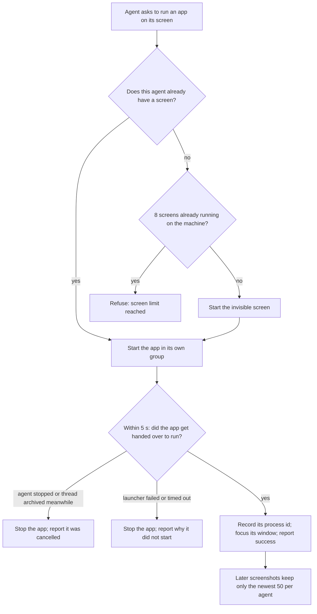

# Make agent screens solid

**Idea:** `IDEA.md` — what this is for and why, in plain language. Read it first; it is
the north star this plan serves. Goal and Constraints live there, not here, so they don't
get buried as this file grows.

Map: `MAP.md` and `docs/maps/agent-screens.md`. Parent plan:
`docs/plans/drive-local-app/PLAN.md` on branch `wc/940599e3df66` (merged as PR #113).

## Open Questions

_None open._

## Watch List

| # | Noticed | What needs looking into | Raised to user? | Outcome |
|---|---------|-------------------------|-----------------|---------|

## Decision Log

Append-only. A reversal is a new entry superseding the old, never an edit.

| # | Decision | Rationale | Source |
|---|----------|-----------|--------|
| 1 | Mode is thorough | Collin picked Thorough | user |
| 2 | Archive deletion of screenshots already exists; the screenshot item becomes pruning while the thread is open | MAP.md: archive removes `<stateDir>/screens/<thread>/` (`machine/lib/screen.js:72`) | defaulted |
| 3 | Screen cap is machine-wide, 8 running-or-starting screens, overridable by `WHEELCHAIR_MAX_SCREENS`; past the cap `start`/`run` return 422 naming the cap and how many run | hearth: 16 cores, 27 GB; Xvfb plus an app is a few hundred MB | defaulted |
| 4 | Pruning keeps the newest 50 screenshots per session, pruned after each new shot | Agents read the latest shots; image cards copy the file, so older ones are safe to delete | defaulted |
| 5 | Launch failure and drag overrun use the approaches in the parent's Deferred rows 7 and 8 | Already evidenced and agreed there | adopted |
| 6 | App pid and process group recorded in state.json from the scope's MainPID once active; unread by teardown (still by slice) | Parent Spec Ownership line; Decision 21 there | adopted |
| 7 | Support openbox: each screen starts openbox when it is on the service PATH; without it screens behave as today. Installer and Ready say it is optional and give `sudo apt install openbox` | Collin picked Support openbox | user |
| 8 | Missing screen tools only warn; they never set Ready `ok: false` | Collin picked Just warn | user |
| 9 | The warning rides on the approval card's machine-added `warnings` (next to the startup-size warning), computed by the thread's machine service when a lead posts an approval; `viewer/app/ready.js` and `/v1/status` are unchanged | `warnings` already exist for exactly this (service.js:1571-1574); a status field nothing reads would be dead code | defaulted |
| 10 | With openbox running, windows are listed from the root's `_NET_CLIENT_LIST` (via `xprop`) and `focus` uses `xdotool windowactivate`; without it both behave as today | A reparenting window manager makes root children frame windows, so today's listing would return frames, not app windows (screen-input.js:31-35) | defaulted |
| 11 | openbox is started only when both `openbox` and `xprop` are on the service PATH | Decision 10 needs `xprop`; otherwise screens behave as today | defaulted |
| 12 | Screenshots are kept when a session stops; only the per-session cap of 50 and archive remove them | A lead posts a stopped agent's screenshot from its report (lead.md, Diagrams); deleting on stop would break that | review-round-1 |
| 13 | The screen cap is a `maxScreens` constructor option (default 8), no environment variable; supersedes Decision 3's override | The service unit sets only PATH (install.sh:398), so the variable could only serve tests | review-round-1 |
| 14 | App pid = pgid = the detached spawned child's pid; supersedes Decision 6's MainPID | One source; known at spawn even when the app exits early | review-round-1 |
| 15 | Launch failure is detected by a marker file written inside the scope just before hand-over, not by never-active plus a `Failed to` line; only pre-hand-over failures are errors; supersedes Decision 5's S6 approach | The old test misreads a fast app printing `Failed to`, and misses spawn errors | review-round-1 |
| 16 | openbox counts only once `_NET_SUPPORTING_WM_CHECK` is set; otherwise its scope is stopped. If it later exits, the screen drops back to today's window handling | Scope registration doesn't mean openbox is managing windows | review-round-1 |
| 17 | The optional hint says `sudo apt install openbox` only | `xprop` ships in x11-utils with `xwininfo`, which screens already need | review-round-1 |
| 18 | Launch waits for the hand-over marker or the launcher ending, within one 5 s deadline; scope activation alone is not hand-over | Activation precedes `exec`; a launcher can still fail after it | review-round-2 |
| 19 | openbox start uses one 5 s deadline for registration and readiness, and kills the launcher at expiry | Separate waits could overrun, and a late openbox could survive | review-round-2 |
| 20 | Test settings `maxScreens` and `allowOpenbox` are instance properties on `service.screens`; supersedes Decision 13's constructor option | The fixture builds `MachineService`, which constructs the manager itself | review-round-4 |
| 21 | openbox runs with a fixed config with no key or mouse bindings | Default bindings open menus with `Execute` actions, which would run commands outside the Codex sandbox | review-round-5 |
| 22 | openbox mode ends when the openbox process exits (child `exit` listener); supersedes Decision 16's scope check and the per-op `systemctl` query | A leftover process can keep the scope active; openbox can exit after setting its property | review-round-5 |
| 23 | openbox's config allows only click-to-focus (`Focus`, `Raise`) in `Client`/`Frame`; its config lookup is isolated to the screen directory; supersedes Decision 21's empty bindings | No bindings would break clicking into a dialog; openbox falls back to the desktop `rc.xml` if ours fails to load | review-round-6 |
| 24 | The window manager moves to its own thread; this plan builds the other six items. Decisions 7, 10, 11, 16, 17 and 19–23 now belong to that thread's design | Collin picked Own thread after six review rounds kept finding openbox gaps | idea-change |
| 25 | `maxScreens` stays an instance property here (the part of Decision 20 this plan keeps); only `allowOpenbox` moved with Decision 24 | S2 and its tests still use it | review-round-7 |
## Spec



The picture shows the `run` path only: S1's warnings, S5's process ids and S7's drag limit
sit beside it. The prose below is complete without it.

Builds on the merged screens work (`wc.js screen`, PR #113). Everything in
`docs/plans/drive-local-app/PLAN.md` (branch `wc/940599e3df66`) still holds unless changed
here. File references are to `main` at `e4117bd`. Screens are Linux-only; nothing below
runs or warns on macOS.

### S1. Missing screen tools: installer warning and approval-card warning

**Tool list.** The required tools are `TOOLS` in `machine/lib/screen.js:10`
(`Xvfb, xauth, mcookie, ffmpeg, xdotool, xwininfo, systemd-run, systemctl`). Export a
function from `machine/lib/screen.js`, `screenTools(searchPath = process.env.PATH)`,
returning `{ missing: [names in TOOLS order] }`. It uses the same
`findCommand` check `start()` uses, so the two never disagree. `start()` uses it for its
existing missing-tools 422 (message unchanged).

**Approval card.** In `machine/service.js`, where a lead's `approval` card gets
`input.warnings` (`:1571-1574`), on Linux, when `missing` is non-empty, also add this warning. It goes after the
startup-size warning when both are present, keeping today's position for that one:
`Screens won't work on <hostname>: missing <a, b>. Builds that don't use a screen are unaffected.`

`<hostname>` is `os.hostname()`. `warnings` is present only when it has at least one
entry, and holds at most 10 (the card validator's limit, `viewer/app/card.js:171`). These
are information only: `ready`, `viewer/app/ready.js` and `/v1/status` do not change, and
Start building is never blocked by them.

**Installer.** In `install.sh`, only when `platform` is `Linux`, before
`configure_service` is first called (`install.sh:474`), so the bookmark stays the last
line of output (`install/test/run.sh:188-191,575`), check each tool with `command -v`. Keep the same eight names as
`TOOLS`, with a comment in both places saying to keep them in step. Print to stderr:

- when any are missing: `screens: warning — missing <names>; agents can't use screens until they're installed (Debian: sudo apt install <packages>)`. Map each missing tool to its
  Debian package: Xvfb→xvfb, xauth→xauth, mcookie→util-linux, ffmpeg→ffmpeg,
  xdotool→xdotool, xwininfo→x11-utils, systemd-run/systemctl→systemd. List each package once.
- otherwise nothing.

The installer never installs anything and its exit status is unchanged.

### S2. Screen limit

- A machine-wide cap on screens held by the service: every entry in
  `ScreenManager.screens` (starting or running) counts.
- The cap is 8, held in the instance property `maxScreens` (set to 8 in the
  `ScreenManager` constructor). Tests set it on `service.screens` after construction, as
  the fixture already overrides `service.liveTmux`. There is no environment variable.
- Checked in `start()` only when a new screen would be created. Reusing a session's own
  running screen skips the check, while that screen still occupies its one slot for
  every other session. The check and `this.screens.set(...)` happen with no
  `await` between them, so two sessions starting at once cannot both slip under the cap.
- Past the cap, `start` and `run` fail with 422:
  `screen limit reached: <n> screens running on this machine (limit <cap>); try again later`. Nothing is created and no state file changes.
- The cap counts map entries. A screen leaves the count exactly when it leaves `screens`
  today (teardown, reset, stop, archive, sweep). A screen being torn down can overlap a
  new one for about 4 s: up to 1 s for the SIGTERM command (`ctl`'s timeout), then the
  existing 3 s grace before SIGKILL. This is accepted (see
  Accepted Risks).
- **No stranded slots.** If the first `save()` after `this.screens.set(...)` in `start()`
  throws, the entry is deleted from `screens` (if it is still that screen) before the
  error propagates. `reset()` deletes the entry in a `finally`, so a failing `save()` there
  still frees the slot. A failed start therefore never holds a slot, and the same session
  can retry.
- **One rule for new state writes.** Every state write this plan adds uses a
  `trySave(screen)` helper: it calls `save()`, and if that throws, logs the error with
  `service.log` and returns. The in-memory state stays authoritative, and the operation
  carries on as if the write succeeded. The writes are: the
  post-spawn pid write (S5), the `failed` flag (S6) and `reset()`. Existing writes keep
  their current behaviour, except the first write in `start()` (above).
- **Cleanup survives a failed write.** In `reset()`, a failing `save()` is logged and does
  not stop the rest: the `xauth` cookie is still removed and the map entry still deleted.
  So `reset()` no longer throws, and `teardown()` (unchanged) always goes on to signal the
  slice.

### S3. Screenshot pruning

- After a `shot` succeeds and its file has been renamed into place (`screen.js:229`;
  `screen-input.js:63`), delete that session's older screenshots so at most the newest 50
  `shot-<n>.png` files remain in the session's screen directory, keeping the highest `n`.
- Only files matching `^shot-(\d+)\.png$` are touched; `.tmp-*` files, logs, `state.json`
  and `xauth` never are.
- The whole pruning pass (listing the directory and each deletion) is wrapped so any
  error is logged with `service.log` and never fails the shot. The shot's result is
  unchanged.
- Screenshots are not deleted when a session stops: a lead may post a stopped agent's
  screenshot from its report (see Accepted Risks).
- `next_shot` numbering is unchanged: numbers are never reused after pruning.
- Archive's existing removal of the whole thread directory is unchanged.

### S4. Window manager — moved

Moved to its own thread (Decision 24). This plan starts no window manager, and window
listing and focus are unchanged.

### S5. App process ids in state

- Each app record in `state.json` gains `pid` and `pgid`. `systemd-run --scope` execs the
  command in place, and the launch is spawned with `detached: true`. So the spawned
  child's pid is the top process of the app's scope, and it leads its own process group:
  `pid = pgid = child.pid`. For Codex sessions that top process is the `codex sandbox`
  wrapper; this is expected and is said so in a code comment.
- This is the only pid source (it supersedes Decision 6's MainPID). It is known as soon
  as `spawn` returns, so it is recorded even when the app exits before registration is
  seen.
- **Order after spawn.** First attach the child's `exit` and `error` listeners (the ones
  S6's wait reads), then set `pid`/`pgid` to `child.pid ?? null`, then `trySave`. An
  asynchronous spawn failure leaves `child.pid` undefined, so both are stored as `null`.
  They are never omitted. If `spawn` throws, the record keeps `pid: null, pgid: null`.
- If that write fails, launch carries on with the hand-over wait (the `trySave` rule). The
  app is never left running behind an error response.
- Teardown does not read them; teardown stays by slice (parent Decision 21).
  `status` adds `pid` to each app entry.

### S6. Launch that fails before the app starts

**What is detected.** Only failures before the command is handed over inside the scope:
`spawn` throwing or emitting `error`, and `systemd-run` failing to create the scope or to
exec. Anything after hand-over is the app's own outcome and still returns `ok: true`, with
`status` showing it `exited` and its log holding the reason. That includes a script with
a missing interpreter, a `codex sandbox` wrapper failing, or an app crashing at once.

**How hand-over is known.** The scope's command is prefixed with a marker step:
`sh -c '(umask 077; : > "$0") || exit 127; exec "$@"' <dir>/app-<n>.started <the existing command…>`.
The umask is set only in the subshell, so the app keeps the service's umask, and `exec`
runs only if the marker was created. The existing
command is `env -- …`, or `codex sandbox … -- env -- …` for sandboxed Codex sessions. The
marker sits outside the Codex sandbox, so the sandbox never has to write to the screen
directory. `exec` keeps the pid (S5 unchanged).

- `launch()` no longer calls `registered()`; the hand-over wait below replaces it.
- In `launch()`, record the log size just before `spawn`, then:
  - `spawn` throws: keep the app record (`pid: null`) and fail with 422
    `app did not start: <error message>`.
  - **Hand-over wait.** After spawn, wait until one of these, polling every 50 ms, with a
    single 5 s deadline from spawn. Scope activation does not end this wait. When the
    deadline is reached, check the marker and the child's exit once more first: an
    outcome seen in that last check wins over the timeout.
    - `app-<n>.started` exists: hand-over happened. Continue as today.
    - The child emitted `error`, or exited with any code (including a non-zero code, or
      `null` from a signal), and the marker does not exist: fail with 422
      `app did not start: <reason>`.
    - The deadline passes with neither: SIGKILL the child, then fail with 422
      `app did not start: no hand-over within 5 s`. This fixed message is the reason;
      the log is not read.
  - The `<reason>` for the other failures is worked out only after the fence (below):
    - the last non-empty line of the log bytes written since spawn, preferring the last
      line starting `Failed to`;
    - if there is none, or the log can't be read (any read error is caught), the error
      message or `systemd-run exited <code|signal>`.
  - In every failure case (including the timeout), in this order: stop the app scope at
    once (`immediate(unit)`, called exactly once),
    run the generation fence (see Cancellation first; a fenced launch writes nothing and
    returns 409), then read the reason, set `failed: true` on the in-memory record,
    `trySave`, and skip
    autofocus. A failed write never
    changes the 422 or the cleanup. `status` reports a record
    with `failed: true` as `exited` without querying its scope.
- **Cancellation first.** After every post-spawn outcome (hand-over, any failure, or
  timeout), the existing generation fence runs before anything is returned. If the
  session stopped or the thread was archived meanwhile, the app scope is stopped at once
  and the response is the existing 409. A 422 is never returned for a cancelled launch.
- After hand-over, launch returns as today, `{ ok: true, app, log, focused }`. The marker file is
  left in place; it is small and goes with the directory on archive.

### S7. Drag within 10 seconds

- In `pointer()` (`screen-input.js:69-80`), `drag` gets a reserve for mouseup:
  `mouseupReserveMs`, a new test-hook option next to `baseDeadlineMs`, default 1000.
- The moves and mousedown use the deadline `end - mouseupReserveMs`.
- The guaranteed mouseup's timeout is `Math.max(0, end - Date.now())`, which is at least
  the reserve unless a step overran.
- A drag therefore finishes within the base deadline (10 s in production) plus process
  overhead. As today, mouseup is attempted whenever the first move succeeded: a failure of
  the first move ends the drag before mousedown, with no mouseup. The first error still
  wins.
- `move` and `click` are unchanged.
- **Timeouts really end.** In `runTool()` (`screen-input.js:7-19`), when the timeout
  fires, SIGKILL the child, destroy its stdout and stderr streams, and resolve at once
  with `timedOut: true`, without waiting for `close`. A descendant holding the pipes open
  can no longer delay the result. This applies to every screen tool call.
- The existing drag test that uses `baseDeadlineMs: 100` (`machine/test/screen-input.test.js:39`)
  passes `mouseupReserveMs: 25`.

### Non-goals

- Installing any tool or window manager.
- Changing teardown (still by systemd user slice).
- Any window manager (moved to its own thread, Decision 24).
- Pruning app logs.
- New screen commands.
- Changes to the Ready check's `ok`/`missing`.

### Validation

Every item gets a test with fake tools in the existing style (`machine/test/screen.test.js:21-60`,
`machine/test/screen-input.test.js:8-27`, `install/test/run.sh`):

- S1: approval-card warnings with tools missing, and with everything present (no screen
  warning). `screenTools(searchPath)` is unit-tested with temp PATHs for presence and
  absence. Linux-only lines are absent when the platform
  is not Linux, if the service has a platform seam; otherwise the test is skipped off
  Linux. Installer prints each message in a temp home with a shimmed PATH, and prints
  nothing on Darwin.
- S2, with `service.screens.maxScreens = 1`:
  - A second session's `start` gets the 422, and the first's screen is unaffected.
  - After stopping the first, the second starts.
  - Two simultaneous starts yield exactly one screen.
  - A start whose first state write fails (e.g. a read-only screen directory) leaves no
    slot held and spawns no scope, so a later start succeeds.
  - A screen whose final `save()` fails during start still has its cookie removed and
    its slice signalled.
  - Stopping a screen signals its slice.
- S3: after 52 shots, `shot-1.png` and `shot-2.png` are gone, 3–52 remain, and the next
  shot is `shot-53.png`. A non-shot file in the directory survives. A pruning error (e.g.
  an unreadable directory) still returns the shot.
- S5: `state.json` app record has numeric `pid` equal to `pgid`, and `status` shows `pid`.
- S6:
  - A fake `systemd-run` that writes `Failed to start transient scope unit: boom` to
    stderr and exits 1 without running the command gives 422
    `app did not start: Failed to start transient scope unit: boom`.
  - An app that runs (marker created) and prints `Failed to x` then exits 1 within 10 ms
    returns `ok: true`.
  - A script whose interpreter is missing returns `ok: true`, and `status` shows it
    `exited`.
  - `spawn` emitting `error` (e.g. `systemd-run` removed from PATH after the tool check)
    gives 422, and the app record is kept with `pid: null, pgid: null`.
  - A fake `systemd-run` that marks the scope active, then exits 1 without running the
    command, gives 422 (scope activation does not count as hand-over).
  - A fake `systemd-run` killed by a signal before running the command gives 422.
  - A fake `systemd-run` that writes a `Failed to …` line and then hangs without running
    the command gives exactly 422 `app did not start: no hand-over within 5 s` (not the
    log line). The child is killed, and the app scope is stopped exactly once.
  - The marker file is mode `0600`, and the app sees the service's umask (not `077`).
  - Failed launches show `exited` in `status` even while the fake scope still reports
    active.
  - A session stopped while hand-over is pending gets 409, not 422, and the app scope is
    stopped. A failed launch whose log was removed gets the fallback reason, or 409 if
    fenced, never 500. When the thread is archived during a failing launch, the screen directory is
    still absent afterwards.
  - A failing state write right after spawn, or when recording `failed`, still gives the
    hand-over outcome (`ok` or the 422), not 500.
- S7, `runTool`: a fake tool that starts a background `sleep 5` holding its stdout and
  exits at once, then a tool that hangs, called with a 100 ms timeout, resolves within
  300 ms with `timedOut: true`.
- S7, with `baseDeadlineMs: 3000` and the default 1 s reserve, using a fake `xdotool`
  whose stalls are set per subcommand. A stall hangs until the process is killed, not for
  a fixed time:
  - The second `mousemove` hangs and `mouseup` returns at once: the drag rejects in under
    3.3 s, and `mouseup` was called.
  - The second `mousemove` hangs and `mouseup` also hangs: the drag rejects in under
    3.3 s, and `mouseup` was attempted.
  - With the old code, the second case takes about 4 s, so the test fails.
  - The first `mousemove` fails: the drag rejects with that error, and neither
    `mousedown` nor `mouseup` was called.

Commands:

```bash
bash machine/test/run.sh
bash install/test/run.sh
node --test viewer/test/*.test.js
```

On hearth with the real tools, `bash machine/test/screen-live.sh` still passes.

## Accepted Risks

| Risk | Why accepted | Round |
|------|--------------|-------|
| A screen being torn down can overlap a newly started one for about 4 s, so briefly more than the cap run | The cap guards against runaway use, not a hard memory limit; holding slots through teardown would add state for a 3 s window | 3 |
| A thread keeps up to 50 screenshots per screen-using session until it is archived | Deleting on session stop would break posting a stopped agent's screenshot; growth is bounded per session | 1 |

## Review Rounds

### Round 1 — 2026-11-18

**Lanes:** intent — claude / claude-opus-5-5; mechanics — gpt / gpt-6.2-sol; cross-family: yes.

**Changed since Round 0:** n/a (first round — whole Spec in scope)

| Lane | Reported | Finding | Lead verdict | Resolution |
|------|----------|---------|--------------|------------|
| intent | major | S3 per-shot pruning leaves up to 50 per stopped session; delete on stop | downgraded (minor) | Deleting on stop breaks the lead posting a stopped agent's screenshot (lead.md Diagrams); growth is bounded. Accepted Risk; Decision 12 |
| intent | minor | `xprop`/x11-utils in the WM gate and hint are redundant | upheld | Hint is openbox only (Decision 17); `xprop` check kept since S4 uses it |
| intent | minor | S6 misses `codex sandbox` failing after hand-over; say so | upheld | S6 "What is detected" names it |
| intent | minor | `WHEELCHAIR_MAX_SCREENS` only serves tests | upheld | Constructor option (Decision 13) |
| mechanics | blocking | Scope registration isn't proof openbox is ready; no recovery if it exits | downgraded (major) | Implementable as written, only missing edge cases. Fixed: readiness via `_NET_SUPPORTING_WM_CHECK`, fallback on exit, live assertion (Decision 16) |
| mechanics | blocking | S6 misses post-hand-over failures and misreads fast apps printing `Failed to` | upheld | Marker-file design; detected scope stated (Decision 15) |
| mechanics | major | S6 omits spawn errors (sync throw → 500) | upheld | Both cases give 422 and keep the record |
| mechanics | major | Cap slot stranded when a state write fails | upheld | Rollback on the first save; `reset()` frees in `finally` |
| mechanics | major | S5 has two pid sources | upheld | `child.pid` only (Decision 14) |
| mechanics | major | S7 test can't fail the old code; 100 ms fixture vs 1 s reserve | upheld | Separate stalls; `mouseupReserveMs` hook; old code fails |
| mechanics | minor | Autofocus timeout ambiguous | upheld | Keeps its 1 s / 6 s timings |
| mechanics | minor | Pruning enumeration errors unspecified | upheld | Whole pass logged and swallowed |

### Round 2 — 2026-11-18

**Lanes:** intent — claude; mechanics — gpt (no provider flag; the first start waited); cross-family: yes.

**Changed since Round 1:**
- S1: the optional hint is openbox only.
- S2: `maxScreens` constructor option replaces the environment variable; no stranded slots on failed writes.
- S3: the whole pruning pass is error-safe; no deletion on session stop (Accepted Risk).
- S4: readiness via `_NET_SUPPORTING_WM_CHECK`; fallback when openbox exits; autofocus timings; live assertion.
- S5: one pid source.
- S6: rewritten around a hand-over marker file; spawn errors.
- S7: `mouseupReserveMs` hook; stronger tests.
- Decisions 12–17.

| Lane | Reported | Finding | Lead verdict | Resolution |
|------|----------|---------|--------------|------------|
| intent | minor | The no-window-manager warning shows on every approval card on hearth; may teach Collin to skip the box | declined | Collin chose this option, whose text said the Ready check would say openbox is optional (Decision 7) |
| intent | minor | Checking the `wm` scope before each window op is heavy; use `xprop` instead | declined | `_NET_SUPPORTING_WM_CHECK` stays set on the root after openbox dies, so xprop alone can't tell; it's one call either way |
| mechanics | blocking | S6 can still succeed before hand-over (activation ends the wait; timeout; signal exit) | upheld | Bounded hand-over wait for marker or launcher end; timeout and signal give 422 (Decision 18) |
| mechanics | major | Failed `reset()` write skips cookie removal and slice kill | upheld | Cleanup continues; teardown always signals the slice |
| mechanics | major | Transient `systemctl` failure drops openbox mode | upheld | Only confirmed inactivity clears it |
| mechanics | major | openbox registration and readiness waits overlap; late openbox can survive | upheld | One 5 s deadline; kill the launcher at expiry (Decision 19) |
| mechanics | major | Listener/save ordering; undefined pid | upheld | Listeners, then pid `?? null`, then save |
| mechanics | minor | Marker mode depends on umask | upheld | Subshell `umask 077`; exec only if created |
| mechanics | minor | S7 stall must exceed both budgets | upheld | Stalls hang until killed |
| mechanics | minor | Installer warnings after the bookmark break the last-line test | upheld | Printed before `configure_service` |

### Round 3 — 2026-11-18

**Lanes:** intent — claude; mechanics — gpt; cross-family: yes.

**Changed since Round 2:**
- S1: the installer warnings are printed before `configure_service`.
- S2: cleanup survives a failed write.
- S4: one 5 s deadline for registration and readiness, killing the launcher at expiry; only a confirmed-inactive scope clears openbox mode.
- S5: order after spawn; `?? null`.
- S6: bounded hand-over wait (timeout, signal and activation cases); marker umask.
- S7: stalls hang until killed.
- Decisions 18–19; Validation additions for each.

| Lane | Reported | Finding | Lead verdict | Resolution |
|------|----------|---------|--------------|------------|
| intent | minor | `registered()`'s new return shape has no reader | upheld | `launch()` drops `registered()`; return unchanged, optional deadline only |
| intent | minor | Double guard in teardown after `reset()` stops throwing | upheld | Only the `reset()` rule stays |
| mechanics | blocking | Failed state write after spawn is undefined (500 while app runs) | upheld | Logged; hand-over wait continues |
| mechanics | major | 422 vs 409 when cancelled during hand-over | upheld | Fence first on every outcome |
| mechanics | major | Cap frees the slot before teardown ends | downgraded (minor) | 3 s overlap is harmless for a runaway guard. Accepted Risk |
| mechanics | major | `status` shows failed launches as running while the scope is active | upheld | `failed: true` record; scope stopped |
| mechanics | major | `runTool` timeout waits for pipes held by descendants | upheld | Resolve at once on timeout |
| mechanics | minor | Unrecognised `systemctl` output clears openbox mode | upheld | Only `inactive`/`failed` |
| mechanics | minor | Fixture may start host openbox | upheld | `windowManager` option, off in the shared fixture |

### Round 4 — 2026-11-18

Collin chose Keep going after round 3; review budget reset.

**Lanes:** intent — claude; mechanics — gpt; cross-family: yes.

**Changed since Round 3:**
- S2: cap counts map entries, with a 3 s teardown overlap accepted; `reset()` no longer throws, and the teardown guard is dropped.
- S4: only `inactive` or `failed` clears openbox mode; `registered()` gets an optional deadline; `windowManager` constructor option for tests.
- S5: a failed save after spawn is logged, and the hand-over wait continues.
- S6: `launch()` drops `registered()`; failed records carry `failed: true` and show `exited`; the cancellation fence comes first.
- S7: `runTool()` resolves at once on timeout.
- Validation additions; one new Accepted Risk.

| Lane | Reported | Finding | Lead verdict | Resolution |
|------|----------|---------|--------------|------------|
| intent | minor | openbox start doesn't need `registered()` | upheld | Poll `xprop` alone; `registered()` unchanged |
| intent | minor | Constructor options don't reach the manager the fixture builds | upheld | Instance properties set on `service.screens` |
| intent | minor | "windowManager" names four things | upheld | `openboxInstalled`, `allowOpenbox`, `ctx.openbox`, `state.window_manager` |
| mechanics | blocking | No fence after the openbox wait; a stopped session's start can be saved as running | upheld | Fence again before saving running; stop both scopes |
| mechanics | major | openbox fallback save can 500 | upheld | `trySave` rule |
| mechanics | major | `failed` flag write unspecified | upheld | Set in memory, stop scope, `trySave` |
| mechanics | minor | Readiness test can't catch split budgets | upheld | Slow-registering fake scope |
| mechanics | minor (RE-RAISE) | Overlap bound is about 4 s, not 3 s | upheld | Wording and Accepted Risk corrected |

### Round 5 — 2026-11-18

**Lanes:** intent — claude; mechanics — gpt; cross-family: yes.

**Changed since Round 4:**
- S2: test settings are instance properties (`maxScreens`, `allowOpenbox`); one `trySave` rule for new writes; overlap bound about 4 s.
- S4: readiness polls `xprop` only (no `registered()`); fence again after the wait; names `openboxInstalled`, `allowOpenbox`, `ctx.openbox`.
- S5 and S6: post-spawn and `failed` writes use `trySave`; the failure order is set, stop, save.
- Validation additions.

| Lane | Reported | Finding | Lead verdict | Resolution |
|------|----------|---------|--------------|------------|
| intent | minor | Decision 13 disagrees with the Spec | upheld | Decision 20 |
| intent | minor | 2 s slow-registration fixture tests nothing now | upheld | Removed |
| mechanics | blocking | Default openbox config can run commands outside the Codex sandbox | upheld | Fixed binding-free config (Decision 21) |
| mechanics | blocking (RE-RAISE) | A leftover process keeps the `wm` scope active after openbox exits | upheld | Track openbox's own exit (Decision 22) |
| mechanics | major | Property set before config load; openbox can still abort | upheld | Covered by the exit listener |
| mechanics | major | Fence vs failure write order in S6 | upheld | Stop, fence, then write |
| mechanics | minor | S2 test asks for a slice signal where none exists | upheld | Assertions split |

### Round 6 — 2026-11-18

**Lanes:** intent — claude; mechanics — gpt; cross-family: yes.

**Changed since Round 5:**
- S4: a fixed openbox config with no bindings; openbox mode ends on openbox's own exit (no per-op `systemctl` query); readiness also needs the child alive.
- S6: failure order is stop, fence, write.
- Validation: S2 assertions split; S4 tests for leftover processes, early exit and the config.
- Decisions 20–22.

| Lane | Reported | Finding | Lead verdict | Resolution |
|------|----------|---------|--------------|------------|
| intent | major | Validation still has the replaced scope-inactive test | upheld | Removed; covered by the exit test |
| intent | major | No bindings breaks click-to-focus for dialogs | upheld | Focus/Raise bindings only (Decision 23) |
| mechanics | major | openbox falls back to the desktop config if ours fails | upheld | XDG and HOME isolated to the screen directory |
| mechanics | major | Xvfb dying during the openbox wait still saves running | upheld | Xvfb scope check after the fence |
| mechanics | major | Log read before the fence can 500 | upheld | Reason read after the fence; read errors caught |
| mechanics | minor | The `systemctl` ban reads as covering the Xvfb probe | upheld | Scoped to the `wm` scope |
| mechanics | minor | Stale `ctx.openbox` in autofocus | upheld | Getter; baseline reasoning stated |
| mechanics | minor | The live test should need both `openbox` and `xprop` | upheld | Reworded |

### Round 7 — 2026-11-18

Collin moved the window manager to its own thread; review budget reset.

**Lanes:** intent — claude; mechanics — gpt; cross-family: yes.

**Changed since Round 6:**
- S4 (openbox) removed: Decision 24 and IDEA.md.
- S1: no window-manager warning or hint; `screenTools` returns only `missing`.
- S2: `trySave` list without openbox.
- Validation: openbox tests and live assertion removed.

| Lane | Reported | Finding | Lead verdict | Resolution |
|------|----------|---------|--------------|------------|
| intent | minor | Decision 20's `maxScreens` part moved by mistake | upheld | Decision 25 |
| intent | minor | S1 "in this order" leftover | upheld | Reworded |
| mechanics | major | Timeout has two reasons and two `immediate` calls | upheld | Fixed message; one `immediate` |
| mechanics | minor | Decision 20 split | upheld | Same as the intent finding |
| mechanics | minor | Installer guard should be `Linux` | upheld | `platform` is `Linux` |
| mechanics | minor | Mouseup guarantee when the first move fails | upheld | Stated as today's behaviour |

### Round 8 — 2026-11-18

**Lanes:** intent — claude / claude-opus-5-5; mechanics — gpt / gpt-6.2-sol; cross-family: yes.

**Changed since Round 7:**
- S1: one warning, no ordering; the installer guard is `platform` = `Linux`.
- S6: the timeout uses its fixed message, and `immediate(unit)` is called once.
- S7: mouseup applies once the first move succeeded.
- Decision 25.

| Lane | Reported | Finding | Lead verdict | Resolution |
|------|----------|---------|--------------|------------|
| mechanics | major | S6 deadline boundary: late poll vs timeout precedence | downgraded (minor) | Either reading is safe, and the window is one 50 ms poll at a 5 s deadline. Clarified: a last check wins |
| mechanics | minor | Timeout test can't catch a double cleanup or a log-derived reason | upheld | Test uses a `Failed to` line; asserts one cleanup |
| mechanics | minor | No test for a failing first move | upheld | Added |
| mechanics | minor | S1 ordering wording | upheld | Clarified |
| mechanics | minor | Reused screen and the cap | upheld | Clarified |

## Prior Work

| Spec item | State | Evidence (file:line) | Confidence |
|-----------|-------|----------------------|------------|

## Implementation Tasks

| # | Objective | Ownership boundary | Lane | Session id | Validation | Status |
|---|-----------|--------------------|------|-----------|------------|--------|
| T1 | S7: drag reserve for mouseup; runTool resolves at once on timeout; tests | `machine/lib/screen-input.js`, `machine/test/screen-input.test.js` | standard · gpt-6.1-terra | wc-2aac26176dff-worker | `node --test machine/test/screen-input.test.js`; `bash machine/test/run.sh` | done |
| T2 | tricky — S2 cap, S3 pruning, S5 pids, S6 hand-over marker, plus `screenTools` export (S1 part); tests | `machine/lib/screen.js`, `machine/test/screen.test.js` (+ optional `machine/test/screen-hardening.test.js`) | standard · gpt-6.1-terra | wc-2aac26176dff-worker-2 | `node --test machine/test/screen.test.js`; `bash machine/test/run.sh` | done |
| T3 | S1: approval-card warning and installer warning; tests (after T2, needs `screenTools`) | `machine/service.js` (approval block), `install.sh`, `install/test/run.sh`, a new machine test file | standard · gpt-6.1-terra | wc-2aac26176dff-worker-3 | `bash machine/test/run.sh`; `bash install/test/run.sh` | done |

## Log

- 2026-11-19 — Build started. S4 (openbox) excluded per the lead: moved to its own thread. T1 and T2 run in parallel (disjoint files); T3 waits for T2's `screenTools`. S3 pruning lives in `screen.js` `execute()` so T1 owns `screen-input.js` alone.
- 2026-11-19 — Choice: T1, `machine/test/screen-input.test.js`: a space-delimited `HANG` variable in the bash fake stalls named subcommands until killed (`exec sleep 30`), leaving `STALL` as it was.
- 2026-11-19 — Choice: T1, `machine/test/screen-input.test.js` runTool test: a standalone `hang` script (backgrounds `sleep 5` on stdout, then `exec sleep 5`) instead of the shared bash fake; one fake per the brief rather than the Spec's two tools.
- 2026-11-19 — Choice: T1, `machine/lib/screen-input.js` drag: a `dragRun` helper applies the reserved deadline to the first move, mousedown and second move.
- 2026-11-19 — T1 accepted (band: scout): validation re-run passed (screen-input 19/19; machine suite 349/349 on a second run, the first failed one test under load from the parallel T2 run).
- 2026-11-19 — Deviation (sub-lead): the existing drag test uses `baseDeadlineMs: 600, mouseupReserveMs: 400` instead of the Spec's `100`/`25`. With 25 ms, a bash `xdotool` fake for mouseup was killed before logging in 3 of 6 parallel runs; with 400 ms, 8 of 8 parallel runs passed. The test still checks the same thing: a stalled second move is cut by the deadline and mouseup still runs.
- 2026-11-19 — Choice: T2, `machine/lib/screen.js`: the hand-over deadline is an instance property `handoverMs` (5000), and the timeout reason derives its seconds from it.
- 2026-11-19 — Choice: T2, `machine/test/screen.test.js`: write failures are simulated by overriding the manager's `save`, not by read-only directories (privileged users ignore permissions).
- 2026-11-19 — Choice: T2, `machine/test/screen.test.js`: fixture `systemd-run` gained `launch` knobs (`fail`, `signal`, `hang`); the fake wrapper propagates the logger's exit status and kills itself on 137; the spawn-error test isolates the launch PATH from the host `systemd-run`.
- 2026-11-19 — Choice: T2, `machine/lib/screen.js`: `TOOLS` is exported alongside `screenTools`; pruning sorts `shot-<n>.png` by numeric n and unlinks synchronously.
- 2026-11-19 — T2 accepted (band: self): diff read against S2, S3, S5, S6; merged-tree machine suite 368/368.
- 2026-11-19 — Deviation fix (sub-lead): T2's timeout test ran at `handoverMs = 1000` and asserted `1 s`; changed it to the production 5 s deadline and the exact Spec message plus status 422.
- 2026-11-19 — Choice: T3, `machine/service.js`: the platform seam is the instance property `platform` (`process.platform`), read only in the approval-card block.
- 2026-11-19 — Choice: T3, `install/test/run.sh`: a `restricted_path` per-case switch (default 0) limits the shim PATH so the screen tools are absent unless shimmed.
- 2026-11-19 — Choice: T3, `machine/test/screen-tools-warning.test.js`: a fake hub HTTP server captures posted cards, and `refreshStartupWarning` is stubbed to a no-op.
- 2026-11-19 — Choice: T3, `install.sh`: package de-duplication by a nested loop over the packages already listed; the warning prints on every Linux run, including `--no-serve`.
- 2026-11-19 — T3 accepted (band: scout): merged-tree machine suite 369/369; installer suite 197 passed, 1 failed. The one failure, `real wheelchair directory is byte-identical after suite`, also fails on the base branch without T3: it hashes the live `~/.wheelchair`, which the running app writes to during the suite. Viewer suite 694/694 (an earlier run stalled at load average ~33).
- 2026-11-19 — Addition (sub-lead): installer tests now also assert exit status 0 in the missing, present and Darwin cases, and a new `screen_partial` case covers some tools missing (xdotool, xwininfo, systemd-run → xdotool x11-utils systemd). The scout found the present and Darwin cases would pass on an installer crash.
- 2026-11-19 — All tasks done; COMPLETION.md written; status verifying. Verification attempt 1: one top-tier verifier, not GPT (every builder ran on GPT; review_families both).
- 2026-11-19 — Verification attempt 1 PASS (claude-opus-5-5) on a8b5111d: machine 369/369, viewer 694/694, live 22/22; installer 197/1, and the verifier confirmed the one failure also occurs on base 144c7f89.
