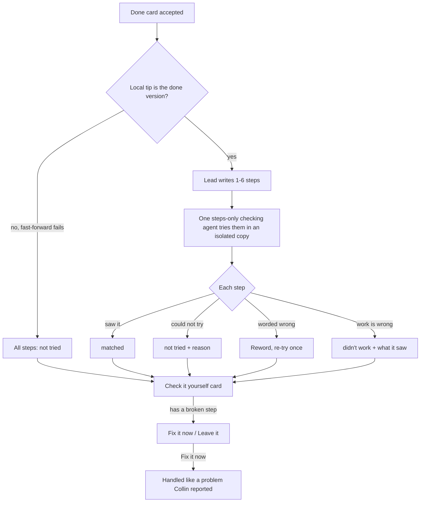

# Check-it-yourself steps after Done

**Idea:** `IDEA.md` — what this is for and why, in plain language. Read it first; it is
the north star this plan serves. Goal and Constraints live there, not here, so they don't
get buried as this file grows.

## Open Questions

Ordered by leverage; discussed one at a time. A settled question moves to the Decision
Log and is deleted from here.

None.

## Watch List

Things noticed that need looking into — not yet decisions for the user. Written down the
moment they're spotted so they can't be forgotten, surfaced to the user one line at a
time as they appear, and emptied before Stage 1 exits.

Each item ends up settled by the agent (noted in the Log), promoted to an Open Question,
promoted to a Constraint or Accepted Risk, or waved off by the user.

| # | Noticed | What needs looking into | Raised to user? | Outcome |
|---|---------|-------------------------|-----------------|---------|

## Decision Log

Append-only. A reversal is a new entry superseding the old, never an edit.

| # | Decision | Rationale | Source |
|---|----------|-----------|--------|
| 1 | Plan mode: thorough | Collin's pick on the mode card | user |
| 2 | Steps fit the change, phone first: a change visible in the app gets steps done in the app on a phone; only a change with nothing to see there (scripts, machine service, protocol docs) gets commands to run on the machine | Most changes show in the app; the rest can only be checked by running something | user |
| 3 | The steps are a card of their own, posted right after the done card, not a section of it | Easier to spot and lays out step by step; Collin picked it over the leaning (part of Done) | user |
| 4 | An agent follows the steps before Collin sees them: a verifier tries each step and reports what it saw; the lead fixes any step that does not match | The point is not having to trust; untried steps would be one more thing to trust | user |
| 5 | The steps are for after Collin merges and updates; the card says so. Before merging he relies on the agent having tried them. A live preview of the branch is not part of this | Works for every project today; a preview is its own thread | user |
| 6 | Kind name `check`, not pinned, tied to its done card by `head` | A done card can be followed by fixes with their own done cards; `head` says which one a set of steps belongs to | defaulted |
| 7 | One combined verifier for small fixes and after-done fixes (it checks the fix and tries the steps); a separate steps verifier for a planned build, started by the lead after the sub-lead's result | Small paths already start one verifier; a planned build's verification is the sub-lead's and is finished by then | defaulted |
| 8 | A step that shows the work itself is wrong is fixed by the lead in the worktree, like an after-done fix, before any push | The sub-lead's result already handed the worktree back; restarting a sub-lead for one gap costs more than the fix | defaulted |
| 9 | A step no agent could try is still shown, marked "Not tried by an agent" with the reason | Hiding it loses a check Collin can still do; marking it keeps the card honest | defaulted |
| 10 | No buttons for "it worked" or "it didn't" on the check card; he reports a problem by typing in the thread as today | IDEA.md: not recording whether he did them | defaulted |
| 11 | Protocol-only changes (how agents behave) get `where: app` steps about what he will see agents do; machine commands are for scripts and the machine service. Supersedes the "protocol docs" example in Decision 2's wording | Collin's pick was "if you can see it in the app, phone steps"; agent behaviour shows in a thread, and the "protocol docs" example was the lead's wording, not on his card | review-round-4 |
| 12 | A step an agent tried and saw fail is shown as "An agent tried this and saw something else", distinct from "Not tried by an agent" | He should be able to tell what was actually checked (IDEA.md) | review-round-4 |
| 13 | Supersedes 7 and 8. Steps ride on verifiers that already run (planned build: the sub-lead's, from a `### Check steps` subsection the lead writes in the final Spec; fixes: the fix's verifier; repairs: the repair verifier). A step showing the work is wrong is a GAP in that verifier's existing loop; the feature adds no fix loop. Only a reworded step gets a steps-only re-try, which never opens a loop. The sub-lead protocol gains three small rules | Rounds 1 to 4 kept finding conflicts between a new steps fix loop and the existing ones; reusing the existing loops removes the conflicts. Round 1's "drift" objection is handled by the rewording rule | review-round-4 |
| 14 | Supersedes 7, 8 and 13. The steps are tried once, after the `done` card is accepted, by one steps-only verifier on the done head; then the check card is posted. A step showing the work broken is shown as `differed` and the lead asks "Fix it now" (step 9) or "Leave it". No verification path before Done changes; the sub-lead protocol does not change | Collin's pick on Q5 (leaning). Removes carrying step results through fix, repair, merge and restart paths, which rounds 1 to 5 kept finding holes in | user |
| 15 | A fourth step state, `broken` ("An agent tried this and it didn't work"), separate from `differed` (saw something else that may still be right). Only `broken` triggers the "Fix what the check found?" question | Keeps "work is wrong" visible to Collin and recoverable after a restart | review-round-6 |
| 16 | Supersedes the `differed` state in 12 and 15. A reworded step whose re-try still differs but meets intent takes the agent's observation as its `see` and is `matched`; three states remain (matched, not-tried, broken) | Every step Collin gets is one he can follow (IDEA.md) | review-round-7 |
| 17 | A check card with a `broken` step carries "Fix it now" and "Leave it" buttons (Decision 14's two choices) instead of a separate question card; the hub accepts it once, only while the card's head is the current done head. Decision 10 still holds (no "it worked / it didn't" buttons) | A button on the stored card cannot drift from it: no duplicate, missing or stale question after restarts or newer dones | review-round-7 |
| 18 | One last review round (9). Findings about crashes or restarts at awkward moments, retrying or recovering verifier sessions, and this thread's first-release stand-in are recorded as accepted risks instead of fixed, unless they would make the feature behave wrongly for Collin (not just leave a check card missing, late or marked not tried) | Collin's choice after rounds 6 to 8; the design has held since Decision 14 | user |
| 19 | Fix it now presses are judged by what the lead can observe. A live lead treats a fix press as stale if it has posted a `done` since its latest `check` card, and uses that card's broken notes. A restarted lead handles a fix press unless a later `done` is in the context or the branch has commits past the pressed card's head (then it carries on that fix). Supersedes "with no lead reply after it" | Verification attempt 2: the press carries only the card id, and the restart context has no lead replies, so the Spec's checks could not be made | verification (decided by lead under Decision 18's intent) |

## Spec

### What Collin gets

The picture leaves out restarts, retries and the first-release stand-in; the text below
covers them.

A few minutes after every accepted `done` card (once an agent has tried the steps on
exactly that version), the lead posts a `check` card: "Check it yourself".
It says first how to get the change running (merge, then how this project updates), then
gives numbered steps. Each step says where it is done (in the app, or on the machine), what
to do, and what he should see. Steps an agent followed say nothing extra; a step no agent
could try carries "Not tried by an agent" and the reason; a step an agent tried and found
not working carries "An agent tried this and it didn't work" and what it saw, and such a card
has "Fix it now" and "Leave it" buttons. All three done paths get one:
small fix, planned build, and a fix after done (whose steps cover only what that fix
changed). Steps are for after merging (Decision 5).

### Where the steps are done (Decision 2)

- A change Collin can see in an app (wheelchair's own app, or the project's) gets steps he
  follows there on his phone: what to open or tap, and what he should see.
- Only a change with nothing to see in an app (scripts, the machine service) gets commands
  to run on the machine, each with the output to look for.
- One card may mix both; app steps first.
- A protocol-only change (how agents behave) shows in the app, so its steps are
  `where: app` (Decision 11): they check what he would see agents do in a thread: a step names the behaviour to watch for and when it shows up ("next time a
  thread finishes, a Check it yourself card follows Done"). If no agent could stage that
  in isolation, the step is `agent: not-tried` with `note` "only shows in a later thread".
  Never a step that only proves the merge landed (such as grepping for the new text).
- Machine commands point at
  the installed paths Collin will have after updating; the lead gives the verifier a path
  map from those paths to the worktree so it can try them.

### The `check` card

Lead-only, shown, not pinned; presses only as in "Two buttons" below. Fields:

| Field | Type | Required | Rule |
|---|---|---|---|
| `head` | string | yes | 40-char lowercase hex. Must equal the `head` of the thread's **current done card**: the most recent `done` card that is not retracted and, when the thread has an import cutoff (`thread.imported.at`), was created after it. Done cards are never replaced, and a lead cannot retract one (`viewer/app/card.js:224-233`), but a handoff Advance retracts every card (`viewer/app/handoff-ops.js:103-105`), and cards before the cutoff are hidden from Collin; the hub refuses otherwise (422 `check head must match the latest done card`), refuses when the thread has no current done card (422 `post the done card first`), and refuses a second check card for the same `head` (422 `this done card already has a check card`) |
| `update` | string | yes | How to get the merged change running, e.g. "Merge the pull request, then on the machine run `cd /home/collin/projects/personal/wheelchair && git pull && ./install.sh`". At most 300 chars |
| `steps` | array | yes | 1 to 6 items, each `{where, do, see, command?, agent, note?}` |

Each step:

| Field | Type | Required | Rule |
|---|---|---|---|
| `where` | `app` \| `machine` | yes | |
| `do` | string | yes | What to do, at most 300 chars |
| `see` | string | yes | What he should see if it worked, at most 300 chars |
| `command` | string | no | Only with `where: machine`; the exact command, full paths, at most 1000 chars; may span lines |
| `agent` | `matched` \| `not-tried` \| `broken` | yes | `matched`: an agent followed the step and saw `see`. `not-tried`: no agent could follow it as written. `broken`: an agent followed it and judged the change does not do what it should |
| `note` | string | unless `agent` is `matched` | Forbidden with `matched`. For `not-tried`, why; for `broken`, what the agent saw. One line, at most 300 chars |

Unknown fields are refused, as for every kind. The card is posted through the normal
spooled path (not synchronous like `done`); the head and duplicate rules are checked at the
hub when the card is accepted (`viewer/app/cards.js` `acceptCard`, under the thread lock).
The duplicate rule makes posting idempotent: a lead that gets
`this done card already has a check card` treats it as posted.

Two buttons, only when needed (Decision 17): a check card with at least one `broken` step
shows "Fix it now" and "Leave it" under the steps. `press` in `viewer/app/threads.js`
accepts exactly two actions on a `check` card, `fix` and `leave`, and only when: the card has a `broken` step
(else 400 `this check card has nothing to fix`), its `head` is still the thread's current
done head (else 422 `a newer version was finished since`), and it is not already answered
(else 422 `card is already answered`). An accepted press marks the card answered and
reaches the lead as `[card <id>] fix what the check found` or `[card <id>] leave it` (the
lead replies in a line and changes nothing). Every other action is refused
with 400 `a check card has no buttons`, before anything is marked answered or enqueued.
After a press, or once the card's head is no longer current, both buttons are hidden.

Rendering (`viewer/pages/thread.js` `renderCard`): heading "Check it yourself", the `update` text
(which says whether to merge first), then an ordered list. Each item shows a small label
"In the app" or "On the machine", the `do` text, the `command` in a monospace block with a
Copy button (hidden when `navigator.clipboard` is unavailable; copying never posts
anything; after a successful copy the button reads "Copied" for about two seconds), then "You should see:" and the `see` text. A `not-tried` step shows a muted line
"Not tried by an agent: <note>". A `broken` step shows a warning-styled line "An
agent tried this and it didn't work: <note>". All text is set as text, never HTML. It must read at
phone width (390px) without horizontal page scroll; a long command scrolls inside its own
block.

Other app touch points:
- `viewer/app/card.js`: add `check` to `shown`, `roles` (`['lead']`) and `fields`, with the
  rules above and the cross-field checks (`command` only with `machine`; `note` required
  unless `agent` is `matched`, forbidden with it).
- `viewer/app/handoff.js`: add `check` to `KINDS`; `historyText` returns the `update` line
  and one line per step: `<n>. [app|machine] <do> — see: <see>`, plus the command and
  "(not tried: <note>)" or "(didn't work: <note>)" where present.
- `machine/service.js`: no change beyond what the generic card path already does (confirm
  `check` is spooled and forwarded like other shown kinds).
- `protocol/app/cards.md`: add `check` to the kinds table (shown, lead, not pinned).
  Add `[card <id>] fix what the check found` and `[card <id>] leave it` to the press forms.
- `protocol/app/cards-lead.md`: a `check` section with the fields, rendering summary and
  refusals.

### How the lead writes and tries the steps (`protocol/app/lead.md`) (Decision 14)

Nothing before `done` changes: the work's own verification, repairs and the done gate are
as today. The steps are written, tried and posted after `done`.

**Writing.** The lead drafts 1 to 6 steps (usually 3 to 5; a sentence or two per field,
readable on a phone) from what the change is for: IDEA.md's "What good looks like" for a
planned build, Collin's request for a small fix, the reported problem for an after-done fix
(whose steps cover only what that fix changed). Steps follow "Where the steps are done".
Each `see` is something he can observe, not "it works". Commands use full paths and name
the output to look for. `update` says how this project picks up a merged change; when the
lead does not know, it says so plainly and gives its best guess marked as such. When the
done card is for an already merged pull request, `update` leaves out the merge. Steps are
never written into the Spec (verifiers grade every Spec item).

**Trying.** Immediately after a `done` card is accepted, the lead makes the local branch tip
the done head: if `HEAD` already equals it, nothing to do; if `HEAD` is an ancestor of it
(the merged-PR path, which fetched the newer PR head), the lead runs
`wc.js git merge --ff-only <done head>` and then confirms `git rev-parse HEAD` equals the
done head; if `HEAD` is not an ancestor, the merge fails, or `HEAD` still differs, every step is posted `agent: not-tried`, `note` "an agent
could not try them on this exact version", without a verifier. Then the lead starts one fresh
**steps-only** verifier (`--not-provider <lead's provider>` when `review_families` is
`both`, else no provider flag), briefed with the numbered steps, a **path map** from the
installed paths the machine commands use to the worktree (for example
`/home/collin/projects/personal/wheelchair` → the worktree), the plan slug or Collin's
request (so it can judge intent), and the done head. It posts no progress line. The
verifier checks the branch tip (`viewer/app/sessions.js:625-630`); if its `COMMIT:` line is
not the done head, the lead starts one more; if that one also differs, the steps that
verifier was trying (all of them, or the reworded subset) are posted `agent: not-tried`,
`note` "an agent could not try them on this exact version"; results already obtained on
the done head are kept.

**Turning STEP lines into the card.**
- `MATCH` → `agent: matched`.
- `COULD NOT TRY` (including "ran a safe stand-in") → `agent: not-tried`, `note` the reason
  in Collin's words.
- `DIFFERS (meets intent)` (the step was worded wrong) → the lead rewords it and starts one
  steps-only verifier for the reworded steps on the same head. Its result: MATCH →
  `matched`; COULD NOT TRY → `not-tried`; DIFFERS (meets intent) → the lead sets `see` to
  what the agent saw, rewritten in Collin's words (something he can see on screen or in
  output, not markup or internal names) while keeping every observable detail the agent
  reported and adding none, and the step is `matched` (the agent saw it and judged it right);
  DIFFERS (work wrong) → `broken`, `note` what it saw.
- `DIFFERS (work wrong)` → `agent: broken`, `note` what it saw.
- A step with no STEP line → `agent: not-tried`, `note` "an agent did not report on it".
  Two lines for one step: use the less favourable (DIFFERS (work wrong), DIFFERS (meets
  intent), COULD NOT TRY, MATCH).
- A failed try is a `VERDICT: BLOCKED` report, a verifier start the hub refuses, or a
  verifier that dies or ends without a report. A start that ends in "hub unavailable" or
  no answer is not a failed try: it is re-run with the same `--attempt` id, as lead.md
  already requires, so the hub recovers the original session instead of starting a second. The lead fixes what it can and starts a fresh
  verifier. After two failed tries for the same head, every step not yet resolved is posted
  `agent: not-tried`, `note` "an agent could not set up to try it: <short reason>", and the
  lead carries on (check card).
- A steps verifier that has not started 30 minutes after the lead asked for it (for example
  waiting for an account) is stopped and counts as a failed try.

**Posting.** Post the `check` card with the done card's `head`. One check card per head: if
a retried `done` was recorded twice at the same head, the one check card covers both. A
`broken` step gives the card its "Fix it now" button; no separate question is posted. On
`[card <id>] fix what the check found`, the lead first checks that the card's `head` is
still the current done head (a newer done may have been posted while the press was
queued): the press does not name the head, so if the lead has posted a `done` with a
different `head` since its latest `check` card, a newer version has replaced it (a retried
`done` at the same head does not); it says so in a line and does nothing.
Otherwise it handles it as a problem Collin reported (step 9, which checks the PR state
first), using its latest check card's broken steps' notes as the report (Decision 19). `[card <id>] leave it` gets a one-line
reply and nothing else. In
a two-part thread the follow-up `stub` is posted right after `done`, as today, without
waiting for the check card. The `check` card is never a condition for `done` or the stub.

A new `done` accepted while a steps verifier for an older head is running: the lead stops
that verifier, posts no check card for the older head, and starts over for the new one.

**Restart.** After `[wc:context restart]`:
- The lead runs `session list` and stops any live steps verifier the dead lead started (its
  report would go to the dead lead); any steps it was trying are tried afresh below.
- A `fix what the check found` press in the context's recent messages is handled now, as on
  "Posting" (current-head check first, using the pressed card's `head` from the context's
  cards), unless the context has a `done` card with a different `head` or a `stub` card
  created after the press (already handled: fixed, or a follow-up thread for a merged pull
  request), or the local branch has commits past that card's `head` (a fix in progress: carry on from them as step 9). The
  restart context carries no lead replies (Decision 19).
- If the latest done card in its context without `retracted_at` has a `head` and no `check`
  card has that `head`, and the local `HEAD` equals that `head` or is an ancestor of it
  (fast-forward as above), the lead writes and tries the steps as above and posts. A duplicate refusal means the original arrived; any other
  head refusal means that done card is not current (for example before an import cutoff);
  stop there in both cases. Otherwise it posts none for that done card.
- A stub that missed the merge ("Making the pull request mergeable" 4, exit 1) posts no
  check card.

**Imported threads.** No check card is posted on import.

**First release.** In the thread that builds this feature, the installed hub does not know
`check` until the pull request is merged and installed, and installed verifiers do not have
the new verifier rules. That thread's lead tries its steps as above with the verifier rules
written out in full in the brief, and, instead of a check card, posts a `needs`
card titled "Check it yourself" whose `body` starts "For version <first 12 characters of
the done head>." and then gives the `update` text and whose `items` are
the steps, one per item ("In the app: <do> — you should see: <see>", with any command,
and "Not tried by an agent: <note>" or "An agent tried this and it didn't work: <note>"
where it applies). If a step is broken, the `body` ends "Keep going fixes what didn't
work"; then "Keep going" is handled like "Fix it now" (with the same current-head check,
reading the version from the body), and otherwise it just closes the card. On a restart in
that thread, an existing "Check it yourself" `needs` card whose body names the current
done head counts as its check card: the lead does not post another.

### How the verifier tries steps (`protocol/app/verifier.md`)

A new section, for a brief that says "steps only":
- **Remit.** Only the steps: do not verify the Spec or the request, but use them to judge
  whether what you see is what the change should do.
- Try each step against the commit being checked, in the throwaway worktree. Run any app in
  isolation, never against Collin's live apps, their data, or his other checkouts: find how
  this project starts its app from its own README, AGENTS/CLAUDE files, scripts and test
  helpers, and start it from the worktree on a free port (never 7374) with its own temporary
  data. For wheelchair that means `viewer/server.js` with a free `--port`, a temporary
  `--cache-root` **and** a temporary `--state-dir` (without `--state-dir` it opens the live
  app state: `viewer/test/helpers/server.js:66-74`). App steps are followed in a headless
  browser at phone size (390×844), using the project's Playwright if it has one, otherwise
  any headless browser available on the machine.
- If the project gives no safe way to run its app in isolation (it needs real accounts,
  devices, paid services or its live data), report those steps COULD NOT TRY with that
  reason; do not improvise against live systems.
- Machine commands are run exactly as written, with only the path map's prefixes swapped
  (that still counts as written and can MATCH). Reading Collin's installed copy counts as
  live state: it shows the old version until he merges. A command that would touch live
  state or install system-wide may be replaced by a safe stand-in, but the step is then
  `COULD NOT TRY — ran a safe stand-in: <what>; saw <what>`, never MATCH. MATCH means the
  step was followed as written and showed what `see` says.
- A step that needs state the isolated app lacks may be set up in the isolated copy only
  when that setup does not do the thing the step is checking (staging a card does not show
  that an agent posts it); otherwise COULD NOT TRY with the reason.
- The `update` text is not run.
- **Report.** `COMMIT:` first as today, then `VERDICT: PASS` or `VERDICT: BLOCKED` (no GAP
  lines), then exactly one line per step, numbered as given:
  `STEP <n>: MATCH|DIFFERS (meets intent)|DIFFERS (work wrong)|COULD NOT TRY — <what it saw
  or why>`.

### Non-goals

- No pass/fail buttons or tracking of whether he followed the steps (Decision 10); the only
  buttons are "Fix it now" and "Leave it" on a card with a broken step (Decision 17).
- No preview of the unmerged branch (Decision 5).
- No change to anything before `done`: the work's verification, repairs, the done card,
  its fields, its GitHub gate and "Making the pull request mergeable".
- No change to the sub-lead or worker protocols.
- No check cards posted on import. A thread finished before this ships gets none, except
  that a lead restarted in one may post one under the restart rule (harmless).

### Edge cases

- Several done cards in one thread (fixes after done): each gets its own check card; older
  ones stay in the conversation unchanged.
- A `check` with a head matching an older, not latest, done card is refused; so is a second
  `check` for the same head.
- An archived or handed-off thread refuses `check` like any card.
- More than 6 steps seem needed: the lead picks the few that best show the change works
  from Collin's side; detail belongs to the verifier, not the card.
- Largest valid card (6 steps at the limits plus `update`) is about 12,000 characters of
  history text, under the handoff's 20,000-character entry limit; no truncation expected.

### Validation

- `cd viewer && npm test` passes, including new node tests:
  - `card.js` validation: accepts a valid card; refuses each missing required field,
    `command` with `where: app`, `note` with `agent: matched`, missing `note` with
    `not-tried` or `broken`, an unknown `agent` value (including `differed`), 0 or 7 steps, over-length fields, unknown
    fields, a non-lead role.
  - hub acceptance: refused with no done card; refused when the only done card is retracted
    or created before the thread's import cutoff; refused when `head` differs from the latest
    done; accepted when it matches; refused as a duplicate for the same head; accepted
    after a second done only with the second head.
  - `viewer/test/protocol-rules.test.js`: `leadKinds` includes `check`, and the test
    passes with the new `### \`check\`` section in cards-lead.md.
  - press: on a check card with no `broken` step every action is refused with 400; on one
    with a `broken` step, `fix` or `leave` is accepted once (card answered, lead message
    enqueued), refused when a newer done exists (422) or already answered (422), and any
    other action is refused with 400; refused presses leave the card unanswered and enqueue nothing.
  - handoff: a thread with a `check` card at the size limits exports, the file validates,
    and its `historyText` is untruncated and matches the format above.
- `cd viewer && npx playwright test` passes, including a new browser test (its server
  started with a temporary `stateDir` as well as a temporary cache root): a posted check
  card renders the heading, the update text, numbered steps with "In the app"/"On the machine" labels, the command
  block with Copy (the test stubs `navigator.clipboard.writeText` with `page.addInitScript`
  so it runs in both Chromium and Firefox; pressing Copy shows "Copied" and the stub received
  the command), "You should see:", the "Not tried by an agent" and "An agent
  tried this and it didn't work" lines; "Fix it now" and "Leave it" only on a card
  with a broken step, gone after a press or a newer done; no other buttons besides Copy; at 390px wide the page has no horizontal scroll.
- `grep -n -i "check" protocol/app/cards.md protocol/app/cards-lead.md protocol/app/lead.md protocol/app/verifier.md`
  shows the new kind row, its section, the lead's after-done writing/trying/posting rules
  (all three done paths), the "Fix it now" and "Leave it" press handling, the restart rules, and the
  verifier's steps-only section with the STEP format.
- `git diff origin/main -- protocol/app/sub-lead.md protocol/app/worker.md` is empty.

## Check steps for this thread

Not part of the Spec: verifiers and workers ignore this section. The lead uses it after
`done` under the first-release rule. Path map: `/home/collin/projects/personal/wheelchair` →
the worktree.

`update`: "Merge the pull request, then on the machine run
`cd /home/collin/projects/personal/wheelchair && git pull && ./install.sh` (my best guess at
how the app picks up the change)."

1. `app` — Open the next thread you finish after updating (any project). This step only
   shows in a later thread; a verifier reports it COULD NOT TRY.
   See: right after the Done card, a "Check it yourself" card with numbered steps, each
   labelled "In the app" or "On the machine", saying what to do and what you should see.
2. `app` — On the first check card you get after updating that has a step with a command,
   tap Copy. See: the button reads "Copied" for a
   moment; nothing new appears in the thread.
3. `app` — Look at a check card with a long command (it may take a few threads before one
   has one) on your phone. See: nothing makes the page scroll
   sideways; a long command scrolls inside its own box.

Verifiers may stage a done and a check card in a test thread of the isolated app for
steps 2 and 3 (they check how the card looks and behaves), as the browser tests do.

## Accepted Risks

Real issues consciously not fixed, each with the reason. Part of the spec, not review
scaffolding — an implementer should read these, and later review rounds must not
re-raise them.

| Risk | Why accepted | Round |
|------|--------------|-------|
| In projects that cannot run their app in isolation, many app steps reach Collin marked "Not tried by an agent" | Trying them would mean touching live systems; the mark keeps the card honest and the steps are still useful to him | 1 |
| A step that shows the work broken reaches Collin after Done, as a marked step with "Fix it now" and "Leave it" buttons, instead of being fixed first | Collin's choice (Decision 14); Done still means the work passed its own checks | 5 |
| The check card arrives some minutes after Done | It is tried on exactly the Done version first | 5 |
| The first-release stand-in `needs` card shows a short version id, and its buttons are "Keep going" / "Talk about it" rather than "Fix it now" / "Leave it" | One-time card in this thread only (Decision 18); "Talk about it" serves as leaving it | 9 |
| A steps verifier the machine started without acknowledging can run alongside a replacement after a lead restart | Rare session-recovery case (Decision 18); the worst outcome is a duplicate refused by the one-check-per-head rule | 9 |
| On the first-release stand-in, "Talk about it" closes the card and its fix offer | One-time card (Decision 18); Collin can still ask for the fix in chat | 9 |
| A handoff exported by an updated hub with a `check` entry is refused by a hub still on the old code | Handoffs move between machines of one install kept at the same version (the Ready check compares versions) | 9 |
| A check card still queued when the thread is archived or handed off is refused and lost | Archive and handoff end the thread's work; the done card and PR remain | 1 |
| Other items can appear between `done` and `check` in the conversation | The card names what it checks; the gap is the time to try the steps | 1 |

## Review Rounds

### Round 1 — 2026-11-18

**Lanes:** intent: claude / claude-opus-5-5; mechanics: gpt / gpt-6.2-sol; cross-family: yes.

Written for every round, including one where the table below stays empty. The table gets a row
per finding, so a clean round would otherwise leave no record of which gate ran — which is the
round where knowing it matters most.

<!-- Round 2+: list what changed since the previous round; that list scopes the reviewers. -->

**Changed since Round N-1:** n/a (first round — whole Spec in scope)

| Lane | Reported | Finding | Lead verdict | Resolution |
|------|----------|---------|--------------|------------|
| intent | major | Verifier's try-the-steps rules only fit wheelchair; other projects' app steps would all be untried | upheld | Project-neutral isolation rule in the verifier section; COULD NOT TRY when no safe isolated run; accepted risk recorded |
| intent | minor | Limits (10 steps, 600/2000 chars) and writing rule ignore the phone constraint | upheld | 1–6 steps, usually 3–5; do/see 300, command 1000, update 300; brevity rule |
| intent | minor | Put steps in the plan so the sub-lead's verifier tries them; saves a session | declined | Steps describe what was actually built (labels, screens, output) and are written after it; plan-time steps would drift and turn wording mismatches into verification gaps. One extra session per feature is the cost of keeping the sub-lead protocol unchanged |
| intent | minor | Work-is-wrong branch turns steps into another gate; just mark and tell Collin | declined | A step showing the work is wrong is a defect found before push; shipping it marked contradicts IDEA's "not have to trust" and lead.md already fixes defects found before Done the same way. Adding a check is not replacing the automatic checks |
| intent | minor | "After you merge" and the update text are wrong when done is posted for an already merged PR | upheld | Optional `merged` flag; label "Already merged"; update leaves out the merge |
| intent | minor | Hub head check is unnecessary; "non-replaced" never applies to done | upheld (wording) | Wording fixed: done cards are never replaced or retracted. Hub check kept: it is small and stops a card attached to the wrong done |
| mechanics | blocking | Combined small-fix verifier gets steps drafted after it passes; one report per session | upheld | Lead drafts before starting the fix verifier; fix verdict handled first, STEP lines from the acted-on report |
| mechanics | blocking | Repairs/merges change code after steps were tried; restart may try an unverified tip | upheld | Every later verifier carries the steps and replaces STEP results; unverified commits carry results forward (accepted risk); restart only when HEAD equals the done head |
| mechanics | blocking | Restart backfills pre-release/legacy/pre-import dones | upheld | Restart eligibility: latest done in the given conversation, has head, no check for it, HEAD equals it; non-goal amended to allow the harmless old-thread case |
| mechanics | blocking | Crash between spool and accept can duplicate or lose a check | upheld | Hub refuses a second check per head and the lead treats it as posted; loss at archive/handoff accepted |
| mechanics | major | Ordering with two-part stub; timestamps can interleave | upheld | Order done, check, stub; interleaving accepted |
| mechanics | major | Finish path undefined when steps dropped, fix reverted, or parallel workers needed | upheld | No steps dropped or reverted on this path; question offers finish-with-step-marked or finish-plus-stub; dropped small fix gets no check |
| mechanics | major | Steps-only remit and incomplete STEP reports undefined | upheld | Steps-only remit and report format in verifier section; missing lines re-tried once, duplicates take the less favourable |
| mechanics | major | Safe stand-in commands could show as MATCH | upheld | Stand-in is COULD NOT TRY with what ran; MATCH only when followed as written |
| mechanics | major | Press API would accept presses on a check card | upheld | `press` refuses every action on check (400); test added |
| mechanics | minor | Check could exceed handoff's 20,000-char history entry | declined | With the round-1 limits the largest card is about 12,000 chars; edge case noted and the test exercises it |

Reported severity is the reviewer's opinion; the lead verdict
(`upheld`/`downgraded`/`declined`/`accepted-risk`/`user-decision`) is what gates the
exit. Downgrades and declines cite evidence.

### Round 2 — 2026-11-18

**Lanes:** intent: claude / claude-opus-5-5; mechanics: gpt / gpt-6.2-sol; cross-family: yes.

**Changed since Round 1:**
- Card limits tightened (1–6 steps; 300/300/1000/300 chars), optional `merged` flag and
  "Already merged" label.
- Hub refuses a duplicate check per head; `press` refuses all actions on check.
- Lead section rewritten: when steps are drafted per path, which verifiers carry them,
  how STEP lines are used (wording vs work-wrong, missing/duplicate lines), the
  finish question (no revert), posting order with the two-part stub, restart eligibility.
- Verifier section: project-neutral isolation, steps-only remit, stand-in rule, report
  format.
- New Accepted Risks (isolation-less projects, unverified commits, queued card lost at
  archive/handoff, interleaving); non-goals and edge cases amended; validation extended.

| Lane | Reported | Finding | Lead verdict | Resolution |
|------|----------|---------|--------------|------------|
| intent | major | Machine steps reading installed state cannot pass before merge; DIFFERS from not-yet-merged has no rule | upheld | Reading the installed copy is live state; lead gives a path map (installed → worktree); a prefix-swapped run counts as written |
| intent | minor | Lead grades its own DIFFERS by rewriting `see` and posting tried | upheld | Verifier classifies DIFFERS (meets intent / work wrong); every reworded step is re-tried before `tried: true` |
| intent | minor | Two failure loops on combined paths | upheld | Combined reports also raise a GAP for work-wrong steps; today's loop and question apply; new question only for steps-only |
| intent | minor | `merged` flag only switches the eyebrow | upheld | Field and eyebrow removed; `update` says whether to merge |
| mechanics | blocking | Repair verifier FAIL plus a work-wrong step hits two retry rules | upheld | Combined reports (including repairs) raise a GAP; the path's existing loop, count and outcome control; the new question is steps-only |
| mechanics | major | Restart after push but before done loses the draft | upheld | Restart rule also applies after any done the restarted lead posts without steps in hand: re-draft and re-try on HEAD |
| mechanics | major | Subset re-tries vs replacement rule | upheld | Full reports replace; subset reports replace only their step numbers; reworded steps keep only the re-try |
| mechanics | major | Steps-only verifier's commit in lighter modes; COMMIT mismatch | upheld | Verifier checks the branch tip; a later plan-only commit is fine; COMMIT mismatch → one fresh verifier |
| mechanics | major | Handoff Advance retracts done cards; pre-import dones hidden | upheld | "Current done card" excludes retracted and pre-cutoff cards, for hub and restart; test added; wrong "never retracted" claim removed |
| mechanics | major | Example isolation misses `--state-dir`, opening live state | upheld | Temporary `--state-dir` required for the verifier and the browser test |

### Round 3 — 2026-11-18

**Lanes:** intent: claude / claude-opus-5-5; mechanics: gpt / gpt-6.2-sol; cross-family: yes.

**Changed since Round 2:**
- `merged` field and eyebrow removed; `update` says whether to merge.
- Hub's "current done card": not retracted, after the import cutoff.
- Lead: brief contents and path map; which results count (full vs subset, rewording);
  which commit a verifier checks; DIFFERS split into "meets intent" / "work wrong";
  combined reports raise a GAP and keep each path's own loop; restart also covers a done
  posted by a restarted lead.
- Verifier: installed copy counts as live state, path map, `--state-dir` isolation, new
  STEP labels.
- Validation: import-cutoff and retracted-done tests; browser test with temp `stateDir`.

| Lane | Reported | Finding | Lead verdict | Resolution |
|------|----------|---------|--------------|------------|
| intent | minor | Use one steps-only verifier on the final head just before done on every path | declined | Final head is known only after the PR is ready; a step showing the work wrong would then force a repair push and another verifier anyway. Trying before the push keeps a broken step out of the PR; the extra rules are bounded and specified |
| intent | minor | Protocol-change fallback grep only proves the merge landed | upheld | Protocol changes name a behaviour to watch for in a later thread, marked untried when it cannot be staged; merge-proving steps forbidden |
| mechanics | blocking | Restart backfill finding work wrong after done accepted has no outcome | upheld | Posted untried with the reason, said in the reply; no commits on that path; Collin may report it (step 9) |
| mechanics | major | Restarted lead cannot see the import cutoff | upheld | Lead uses the latest non-retracted done in its context; the hub's refusal is the eligibility check |
| mechanics | major | Second COMMIT mismatch undefined | upheld | Second mismatch → all steps untried with the reason |
| mechanics | major | Planned-build repair verifier remit and verdict loop undefined | upheld | Repair re-verify is combined (Spec, gap, steps); FAIL counts an attempt, PASS ends the loop |
| mechanics | major | Retried done recorded twice at one head | upheld | One check card per head covers both |

### Round 4 — 2026-11-18

Collin chose "Keep going" after three rounds without a clean one; budget reset.

**Lanes:** intent: claude / claude-opus-5-5; mechanics: gpt / gpt-6.2-sol; cross-family: yes.

**Changed since Round 3:**
- Protocol-only changes: steps name a behaviour to watch for in a later thread; no
  merge-proving steps.
- Second `COMMIT:` mismatch → all steps untried.
- Planned-build repair re-verify is combined; its verdict drives the two-attempt loop.
- One check card per head covers a done recorded twice.
- Restart: lead picks the latest non-retracted done in its context, the hub's refusal is
  the eligibility check; a work-wrong step found after done is posted untried and reported
  in the reply, with no commits.

| Lane | Reported | Finding | Lead verdict | Resolution |
|------|----------|---------|--------------|------------|
| intent | major | Protocol-only rule contradicts Decision 2's "protocol docs → machine commands" | upheld | "protocol documents" dropped from the machine bullet; protocol steps are `where: app`; Decision 11 (Collin's card never listed protocol docs) |
| intent | minor | A step that failed is shown as "Not tried" | upheld | `tried`/`why_not` replaced by `agent` (matched / not-tried / differed) and `note`; differed has its own warning line; Decision 12 |
| intent | minor | Restart-found defect waits for Collin to retype it | upheld | Lead posts a question card: Fix it now (step 9) or Leave it |
| mechanics | blocking | Failed planned-build repair can still be pushed; finish options ignore it | upheld | Decision 13: no steps fix loop; work-wrong steps are GAPs in the sub-lead's remediation, which already handles surviving gaps |
| mechanics | blocking | Second COMMIT mismatch leaves the work verdict unresolved | upheld | A mismatched report counts for nothing (verdict or steps) and is not an attempt; after two in a row, a needs card |
| mechanics | major | No restart rule for a planned-build repair before done | upheld | Decision 13: steps in PLAN.md, results in COMPLETION.md, loop owned by the sub-lead and its existing restart rules |
| mechanics | major | Missing-step re-try finding work wrong on a small fix has no route | upheld | Missing step lines are posted not-tried; no re-try |
| mechanics | minor | Reworded step re-try COULD NOT TRY shown as differed | upheld | Re-try mapping explicit: MATCH matched, COULD NOT TRY not-tried, DIFFERS differed |

### Round 5 — 2026-11-18

**Lanes:** intent: claude / claude-opus-5-5; mechanics: gpt / gpt-6.2-sol; cross-family: yes.

**Changed since Round 4:**
- Decision 13 (supersedes 7 and 8): no steps fix loop. Planned build: lead writes
  `### Check steps` in the final Spec; the sub-lead's verifiers try them; work-wrong steps
  are GAPs in existing loops. Sub-lead gains three small rules. Lead section rewritten
  (draft location, which results count, which commit, turning STEP lines into the card,
  restart). Verifier section tidied.
- Step fields `tried`/`why_not` replaced by `agent` (matched / not-tried / differed) and
  `note` (Decision 12); new "An agent tried this and saw something else" line.
- Protocol-only changes get `where: app` steps (Decision 11).
- Restart-found defect → question card (Fix it now / Leave it).
- This plan's own `### Check steps` added.

| Lane | Reported | Finding | Lead verdict | Resolution |
|------|----------|---------|--------------|------------|
| intent | minor | COMMIT-mismatch rule changes how work verdicts are handled, against the non-goal | upheld | Work verdict as today; mismatch only voids STEP lines (one steps-only re-try, then all not-tried); needs card dropped |
| intent | minor | Copy gives no visible confirmation, so step 2's `see` is not observable | upheld | Button reads "Copied" for about two seconds; step 2 updated |
| intent | minor | Step 1 makes him start a real thread and PR | upheld | Step 1 points at the next thread he finishes anyway |
| mechanics | blocking | Two passing verifiers' STEP lines: which wins | user-decision | Decision 14: one steps verifier after Done |
| mechanics | blocking | Lighter-mode "Defer them and finish" leaves no STEP route | user-decision | Decision 14 |
| mechanics | major | COMMIT-mismatch re-try finding work wrong has no outcome | user-decision | Decision 14 |
| mechanics | major | After-done merge re-verifier not covered | user-decision | Decision 14 |
| mechanics | major | Restart cannot rely on COMPLETION.md results | user-decision | Decision 14 |
| mechanics | major | Crash between check card and its question loses the question | upheld | On restart, a check card with a `differed` step and no later question about it gets the question |
| mechanics | major | This feature's own thread cannot post a check card before its PR is installed | upheld | First-release exception, steps given in the lead's reply after done; verifier briefs carry the rules in full |
| mechanics | major | Own step 1 could MATCH via a fixture that bypasses the lead | upheld | Step 1 is not-tried ("only shows in a later thread"); fixtures only for rendering steps |

### Round 6 — 2026-11-18

Collin decided Q5 (try the steps after Done); budget reset.

**Lanes:** intent: claude / claude-opus-5-5; mechanics: gpt / gpt-6.2-sol; cross-family: yes.

**Changed since Round 5:**
- Decision 14 (supersedes 7, 8, 13): steps are written, tried by one steps-only verifier on
  the done head, and posted after `done`; nothing before `done` changes; sub-lead protocol
  unchanged (its section removed).
- Lead section rewritten: writing, trying, STEP mapping, posting with the "Fix it now /
  Leave it" question, a newer done superseding a running steps verifier, restart (missing
  card; missing question), first-release exception.
- Verifier section is steps-only; staging rule (may not stage the thing being checked).
- Own check steps: step 1 is COULD NOT TRY; Copy shows "Copied".
- Accepted Risks updated; validation checks sub-lead and worker files are unchanged.

| Lane | Reported | Finding | Lead verdict | Resolution |
|------|----------|---------|--------------|------------|
| mechanics | blocking | First-release reply to a verifier result is hidden | upheld | First release posts a `needs` card titled "Check it yourself" with the steps as items |
| mechanics | major | Done head can be ahead of the local tip on the merged path | upheld | Lead fast-forwards to the done head when it is a descendant; otherwise all not-tried without a verifier; restart same |
| mechanics | major | Restart cannot tell whether a fix question is owed | upheld | New `agent: broken` value persists the trigger; question has fixed wording and is tied to that head's check card |
| mechanics | major | Endless BLOCKED retries | upheld | Two BLOCKED for a head → remaining steps not-tried, carry on |
| mechanics | minor | Own steps 2 and 3 depend on a later card having a (long) command | upheld | Steps say so |
| mechanics | minor | protocol-rules test allowlist; Copied not tested | upheld | Validation names both |
| intent | major | Early `### Check steps` in the Spec brings back before-Done grading | upheld | Early draft option removed; steps never go in the Spec; this plan's own steps moved to a non-Spec section verifiers ignore |
| intent | minor | Own steps 2 and 3 do not say which card to use | upheld | They name the first check card after updating that has a command |

### Round 7 — 2026-11-18

**Lanes:** intent: claude / claude-opus-5-5; mechanics: gpt / gpt-6.2-sol; cross-family: yes.

**Changed since Round 6:**
- Early `### Check steps` in the Spec removed; this plan's own steps moved to a non-Spec
  section "Check steps for this thread".
- New step state `broken` (Decision 15); fixed-wording question tied to that head's check.
- Lead fast-forwards to the done head before trying (merged path); restart same.
- Two BLOCKED for a head → remaining steps not-tried, carry on.
- First release: a `needs` card titled "Check it yourself" carries the steps.
- Validation: protocol-rules allowlist, Copied feedback, broken line.

| Lane | Reported | Finding | Lead verdict | Resolution |
|------|----------|---------|--------------|------------|
| mechanics | blocking | Question can describe a check card the hub never stored | upheld | Decision 17: "Fix it now" button on the stored card; no question card |
| mechanics | blocking | Clipboard permission grant fails in Firefox | upheld | Test stubs `navigator.clipboard.writeText` via `addInitScript` in both browsers |
| mechanics | major | Fast-forward not guaranteed | upheld | `--ff-only`, confirm `HEAD`, fallback all not-tried |
| mechanics | major | First-release fallback has no restart rule | upheld | Existing "Check it yourself" needs card counts as the check card; its Keep going is the fix |
| mechanics | major | Old question stays actionable after a newer done | upheld | Button only while the card's head is current; hub refuses otherwise |
| mechanics | major | Exact-head fallback could erase earlier results for a subset re-try | upheld | Fallback covers only the steps that verifier was trying; earlier results kept |
| mechanics | major | Verifier start failures or deaths not bounded | upheld | Counted as failed tries with BLOCKED; two per head → not-tried, carry on |
| intent | minor | "What Collin gets" omits `broken` and its question | upheld | Summary updated |
| intent | minor | `differed` leaves him a step whose `see` the agent did not see | upheld | Decision 16: observation becomes `see`; `differed` removed |
| intent | minor | First-release stand-in has no rule for `broken` | upheld | Items carry the broken line; the question is posted after the `needs` card |

### Round 8 — 2026-11-18

**Lanes:** intent: claude / claude-opus-5-5; mechanics: gpt / gpt-6.2-sol; cross-family: yes.

**Changed since Round 7:**
- `differed` removed (Decision 16): three step states.
- "Fix it now" button on a check card with a broken step replaces the question card
  (Decision 17): press rules, hub refusals, press form, rendering, tests.
- `--ff-only` fast-forward with a `HEAD` check; exact-head fallback limited to the steps
  being tried; failed starts and deaths count as failed tries.
- First release: broken steps and restart handled through the "Check it yourself" needs card.
- Browser test stubs the clipboard for both browsers.

| Lane | Reported | Finding | Lead verdict | Resolution |
|------|----------|---------|--------------|------------|
| mechanics | blocking | Counting every start error can create two sessions for one attempt | upheld | Ambiguous starts re-run with the same `--attempt`; only refused starts, deaths and missing reports count |
| mechanics | major | Fix press delivered after a newer done | upheld | Lead re-checks the card's head when handling the press |
| mechanics | major | Restart leaves the dead lead's steps verifier live | upheld | Restarted lead stops it and tries afresh |
| mechanics | major | First-release needs card has no head | upheld | Body starts "For version <head>"; restart and Keep going match on it |
| mechanics | minor | "no presses" and validation still contradict the buttons | upheld | Card definition points at the button rules; validation already aligned this round |
| intent | major | Validation grep still names the removed question | upheld | Grep criterion names the button press handling |
| intent | minor | Accepted Risk still says "a question" | upheld | Reworded to the buttons |
| intent | minor | "the lead shows" the button invites a lead step | upheld | Reworded: such a card has the buttons |
| intent | minor | Decision 17 dropped Collin's "Leave it" | upheld | "Leave it" button added; Decision 17 updated |
| intent | minor | Agent's observation as `see` may be technical | upheld | Rewritten in Collin's words |

### Round 9 — 2026-11-18

Final round (Decision 18).

**Lanes:** intent: see table; mechanics: see table; cross-family: yes.

**Changed since Round 8:**
- "Leave it" button beside "Fix it now"; both pressable once, only while the card's head is
  current; the lead re-checks the head when handling a press.
- `see` from an agent's observation is rewritten in Collin's words.
- Ambiguous verifier starts re-run with the same `--attempt`; restarted lead stops the dead
  lead's steps verifier.
- First-release needs card names the done head.
- Wording fixes: card definition, accepted risk, "What Collin gets", validation grep.

| Lane | Reported | Finding | Lead verdict | Resolution |
|------|----------|---------|--------------|------------|
| mechanics | major | A verifier waiting for an account holds the check card and the two-part stub | upheld | Stub posted right after done as today; a verifier not started in 30 minutes is a failed try |
| mechanics | major | Fix press accepted, lead dies before acting: nothing happens | upheld | Restarted lead handles an unanswered fix press from recent messages |
| mechanics | minor | Unacknowledged verifier start survives restart cleanup | accepted-risk | Decision 18 |
| mechanics | minor | First-release "Talk about it" loses the fix offer | accepted-risk | Decision 18 |
| mechanics | minor | Handoff with `check` refused by an old hub | accepted-risk | Same-version install |
| intent | minor | Rewritten `see` never re-tried | upheld | Rewrite keeps every reported detail and adds none |
| intent | minor | First-release card shows a version id and needs-card buttons | accepted-risk | One-time stand-in (Decision 18) |
| intent | minor | First-release card has no "Leave it" | accepted-risk | "Talk about it" serves; one-time stand-in (Decision 18) |

## Prior Work

Parts of the Spec already built before this plan reached Stage 3 — adopted from outside
with work already done, or left behind by an implementation run that died partway.

Stage 3 does not re-implement `pre-existing` items and does not touch their code. Stage 4
verifies them exactly as rigorously as everything else: this code has never been through
the gate, so skipping it would leave the least-trustworthy part of the change as the only
part nobody checked.

Ambiguous evidence means **not done**. A wrong "done" is a silent hole; a wrong "not done"
costs a worker one look.

| Spec item | State | Evidence (file:line) | Confidence |
|-----------|-------|----------------------|------------|
|           | pre-existing / partial | | high / low |

`partial` items are implemented by Stage 3 — the brief names what exists so the worker
completes it instead of restarting it.

## Implementation Tasks

Filled by Stage 3. One row per worker brief.

| # | Objective | Ownership boundary | Lane | Session id | Validation | Status |
|---|-----------|--------------------|------|-----------|------------|--------|
| T1 | `check` kind: schema (card.js), hub acceptance (cards.js), press (threads.js), handoff, cards.md/cards-lead.md, node tests | viewer/app/{card,cards,threads,handoff}.js, protocol/app/cards.md, cards-lead.md, viewer/test/protocol-rules.test.js, new viewer/test/*.test.js | standard / gpt-6.1-terra | wc-2daed8b3ee7f-worker | `node --test viewer/test/*.test.js` | done |
| T2 | lead.md after-done check-step rules + pointers; verifier.md steps-only section | protocol/app/lead.md, protocol/app/verifier.md | standard / claude-sonnet-5-5 | wc-2daed8b3ee7f-worker-2 | grep -i check; protocol-rules test | done |
| T3 | `tricky` check card rendering, Copy, Fix it now/Leave it buttons, CSS, browser test | viewer/pages/thread.js, viewer/pages/thread.css, new viewer/test/*.spec.js | standard / claude-sonnet-5-5 | wc-2daed8b3ee7f-worker-3 | `npm --prefix viewer run test:browser` | done |
| R1 | Remediation 1: check card update wrapping; buttons honour the import cutoff | viewer/pages/thread.js, thread.css, viewer/test/app-check-card.spec.js | standard / claude-sonnet-5-5 | wc-2daed8b3ee7f-worker-4 | `npm --prefix viewer run test:browser` | done |
| R2 | Remediation 1: note rejects U+2028/U+2029/U+0085 | viewer/app/card.js, viewer/test/app-check-card.test.js | light / gpt-6-luna | wc-2daed8b3ee7f-worker-5 | `node --test viewer/test/*.test.js` | done |
| R3 | Remediation 1: lead may start the steps-only verifier after any done | protocol/app/lead.md | light / claude-haiku-5-5 | wc-2daed8b3ee7f-worker-6 | protocol-rules test | done |
| R4 | Remediation 2: note rejects every line terminator (adds U+000B, U+000C) | viewer/app/card.js, viewer/test/app-check-card.test.js | light / gpt-6-luna | wc-2daed8b3ee7f-worker-7 | `node --test viewer/test/*.test.js` | done |
| R5 | Remediation 2: fix press after a newer done; restart replay (Decision 19) | protocol/app/lead.md | light / claude-haiku-5-5 | wc-2daed8b3ee7f-worker-8 | protocol-rules test | done |
| R6 | Remediation 3: same-head retried done is not stale; a stub after the press counts as handled on restart (Decision 19 refined) | protocol/app/lead.md | light / claude-haiku-5-5 | wc-2daed8b3ee7f-worker-9 | protocol-rules test | done |
| R7 | Remediation 4: check card `update` shown as plain text | viewer/pages/thread.js, thread.css, viewer/test/app-check-card.spec.js | light / claude-haiku-5-5 | wc-2daed8b3ee7f-worker-10 | check-card browser spec | in progress |

Session id = the `thread_id` of a `codex exec` lane, so remediation can resume it.

## Log

Free-form running notes: deviations discovered mid-implementation, scope events,
anything a future session needs that fits nowhere above.

- 2026-11-18 Ready check at approval: hub and machine service answer (`session list`); claude and codex CLIs installed; Codex preflight passes (token fresh). Approved after round 9 per Decision 18; no blocking or major finding was declined or downgraded in any round.
- 2026-11-18 — Choice: T2, verifier.md: "Steps only" section placed before "## The report" and replaces "How to check" and the verdict forms for a steps-only brief.
- 2026-11-18 — Choice: T2, lead.md: "Where the steps are done" rules written as a paragraph inside the new `### 10. Check it yourself`.
- 2026-11-18 — Choice: T2, lead.md step 9 item 4: pointer also says the fix's steps cover only what the fix changed.
- 2026-11-18 — Choice: T2, lead.md briefing list: the steps verifier's brief carries the words "steps only" (from the task brief, not the Spec).
- 2026-11-18 — T2 accepted (band: scout): every Spec rule present per scout read; report summarised rather than pasted validation output, so I re-ran `node --test viewer/test/protocol-rules.test.js` (35 pass) and the sub-lead/worker diff (empty). Sub-lead fix after merge: verifier.md steps-only lead-in said "The report below it" for both sections and dropped BLOCKED's `REASON:` line; reworded.
- 2026-11-18 — T1: worker's report said choices "none"; the scout's diff read lists 10, logged below.
- 2026-11-18 — Choice: T1, threads.js press: `answered_value` set to `input.value ?? null` (null for fix/leave); return shape `{ queued: true, text }`.
- 2026-11-18 — Choice: T1, card.js: one-line `note` enforced as no `\r`/`\n`; `update` length measured on the raw string; the 6-step cap sits in the `steps` predicate.
- 2026-11-18 — Choice: T1, cards.js: `check` acceptance block placed after `offer`, before `sudo`; `currentDone` exported from cards.js and reached from threads.js by lazy require.
- 2026-11-18 — Choice: T1, cards-lead.md `check` section: adds "Post after the current done card", says buttons show "until answered or superseded", lists refusals without their exact messages.
- 2026-11-18 — Choice: T1, cards.md: both press forms in one bullet; tests in new `viewer/test/app-check-card.test.js`.
- 2026-11-18 — T1 accepted (band: scout): I re-ran `node --test viewer/test/*.test.js` in its worktree: exit 0, 636/636 pass. Noted for COMPLETION risks: a spooled check card's 422 refusal (including the duplicate) is dropped to `spool/rejected` rather than returned to the lead (generic spool behaviour, `machine/service.js:973-985`); `views.js:135` and `aside.js:16` do not count a check card with a broken step as waiting (Spec silent).
- 2026-11-18 — Choice: T3, thread.js: Fix it now / Leave it also hidden while the thread is frozen (uses the card's existing `off` flag).
- 2026-11-18 — Choice: T3, thread.js: `update` rendered through the markdown `prose` helper (text nodes, so backticks show as code); steps set as text.
- 2026-11-18 — Choice: T3, thread.js: "Copied" state kept per card and step, survives re-renders, cleared after 2 s.
- 2026-11-18 — Choice: T3, thread.js: the page's current done card is the last non-retracted `done` in the page's card list; no import cutoff on the page (pre-cutoff dones are never newer than post-cutoff ones).
- 2026-11-18 — Choice: T3, app-check-card.spec.js: fake `gh` reads its head from a file so a second done can be posted; thread `branch`/`default_branch` nulled as in app-threads.spec.js.
- 2026-11-18 — T3 accepted (band: self, tricky): read the full diff; re-ran `npm --prefix viewer run test:browser` in its worktree: exit 0, 782 passed, 28 skipped (16 app-check-card runs, all pass).
- 2026-11-18 — Verification attempt 1 on 2344766: claude PASS, gpt FAIL (4 gaps); REMEDIATION-1.md, tasks R1-R3.
- 2026-11-18 — Choice: R3, lead.md:69: the widened verifier sentence kept on one line (~104 chars) to avoid rewrapping the bullet.
- 2026-11-18 — R3 accepted (band: scout; 4-line diff exactly the brief's text, read inline): protocol-rules 35/35 in its worktree.
- 2026-11-18 — Choice: R2, card.js: regex written with `\u` escapes (raw separators are invalid in a regex literal).
- 2026-11-18 — R2 accepted (band: scout; 4-line diff read inline): I ran `node --test viewer/test/*.test.js` in its worktree, exit 0, 636/636 (the worker's own full run did not finish). Sub-lead edit after merge: the test's raw U+2028/U+2029 characters replaced with `\u` escapes so they are visible.
- 2026-11-18 — Choice: R1, app-check-card.spec.js: the wrap test uses a ~250-char path plus a 24-char code span (update is capped at 300); the cutoff test moves `imported.at` to the done card's own time, then 60 s before it.
- 2026-11-18 — R1 accepted (band: self, tricky; 41 lines read): on the merged tip 786c0fa, `npm test` 636/636 and `npm --prefix viewer run test:browser` exit 0, 790 passed, 28 skipped.
- 2026-11-18 — Verification attempt 2 on 591ec3a: claude PASS, gpt FAIL (3 gaps); REMEDIATION-2.md. Asked the lead about the restart-replay gap (Spec wording not observable).
- 2026-11-18 — Lead answered the restart-replay question: Option 1 (observable rule), Decision 19; Spec Posting and Restart wording updated to match.
- 2026-11-18 — R4: worker reported choices 'none'; I see none in the diff (worker didn't add choices beyond the brief; I listed 0).
- 2026-11-18 — R4 accepted (band: scout; 4-line diff read inline): app-check-card.test.js 4/4 and the raw-character scan empty in its worktree.
- 2026-11-18 — R5: worker reported choices 'none'; I see none in the diff (I listed 0).
- 2026-11-18 — R5 accepted (band: scout; 18-line word diff read inline, exactly the brief's text). Its worktree was not removed: it holds an untracked `docs/plans/self-check-steps/reports/.r5-test.log`, and I do not force-delete.
- 2026-11-18 — Remediation 2 merged at 32c7580: `npm test` 636/636; browser suite exit 0, 790 passed, 28 skipped.
- 2026-11-18 — Verification attempt 3 on 9af6246: claude PASS, gpt FAIL (2 gaps, both refinements of Decision 19's wording: same-head retried done; merged-PR stub on restart). REMEDIATION-3.md; Spec Posting/Restart wording refined to match. Second fix attempt for both.
- 2026-11-18 — Choice: R6, lead.md Posting/Restart: rewrapped so each new phrase sits whole on one line; some lines run ~99 columns.
- 2026-11-18 — R6 accepted (band: scout; 17-line word diff read inline, exactly the brief's text): protocol-rules 35/35. On f91546a `npm test` 636/636; no viewer or machine code changed since the 32c7580 browser run.
- 2026-11-18 — Verification attempt 4 on 5e693f8: claude PASS, gpt FAIL (2 gaps). Queued Fix-it-now press for the wrong version survived two fix attempts (R5, R6): sent to the lead as a plan defect (REMEDIATION-4.md). Lead: fix the Markdown `update` gap meanwhile (R7).
