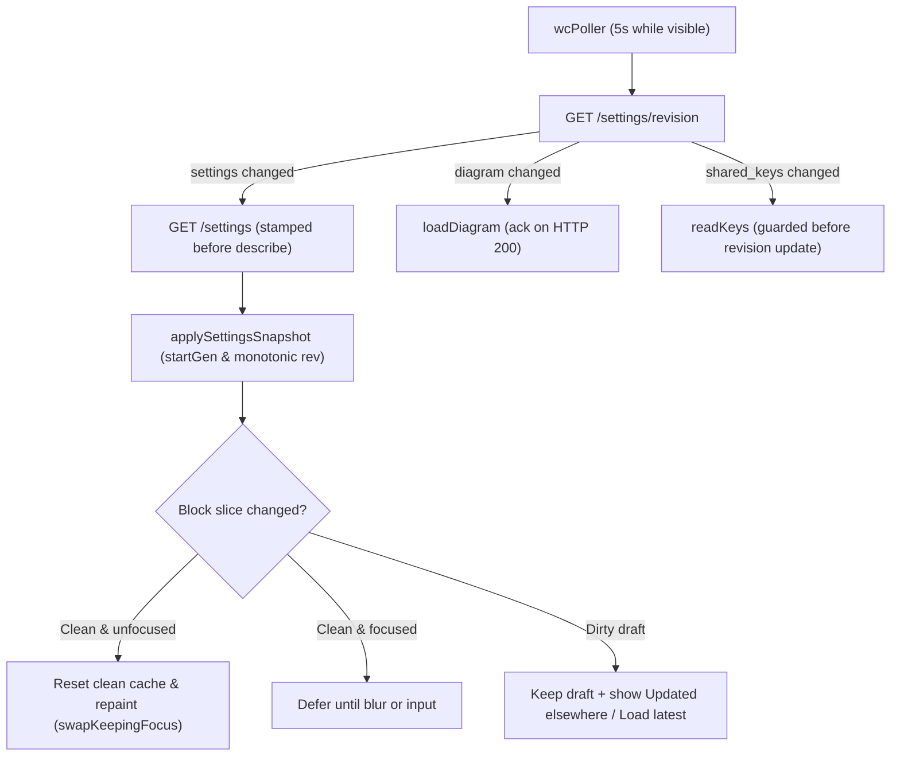

# Auto-refresh an open Settings page when settings change

**Idea:** `IDEA.md` — what this is for and why, in plain language. Read it first; it is
the north star this plan serves. Goal and Constraints live there, not here, so they don't
get buried as this file grows.

## Open Questions

*(None — all planning questions settled.)*

## Watch List

*(Empty — peer overlap check for `11c53653de4e` moved to Log per lead rules: never wait on another lead; a late reply will be handled by the late-overlap rule.)*

## Decision Log

Append-only. A reversal is a new entry superseding the old, never an edit.

| # | Decision | Rationale | Source |
|---|----------|-----------|--------|
| 1 | Skip designer mockups for this feature | Only visible addition is a compact inline note and Load latest button reusing existing Settings page styles; no new screen or layout redesign | defaulted |
| 2 | Track external changes with a lightweight hub revision endpoint (`GET /wheelchair/api/settings/revision`) returning restart-safe `<boot-id>:<seq>` tokens per domain, polled every 5 seconds via `window.wcPoller` (paused when hidden), fetching full data only when a token changes | Keeps idle tabs cheap (zero `model.sh` subprocesses or machine calls when unchanged) and prevents revision collisions after a hub restart | defaulted |
| 3 | Preserve typed edits with a clear conflict note if saving a lesson fails because it was removed externally (HTTP 409) | Matches existing lesson import/action draft retention and ensures user text is never silently wiped | defaulted |
| 4 | When an external change arrives while a section has unsaved edits, keep the draft untouched and show an inline "Updated elsewhere" note with a one-tap "Load latest" button (Save still saves the draft as usual) | Gives a one-tap way on a phone to pull in external changes without manually undoing a draft or reloading the whole page, while never blocking Save | user |
| 5 | Drop the redundant `background` revision domain (keep `background.js`'s existing 10 s/focus/visibility poller with `syncBackground` dirty/focus guards); narrow `blockFocused` to `'input, textarea, select, [contenteditable]'` and use `repaint()` (`swapKeepingFocus`) for buttons/summaries; track `renderedSlice` per block and editor baselines (`styleBaseline`, `balBaseline`, `draftBaseline`, `lessonEdit.baseList`, `backgroundVisit.baseRevision`) | Removes duplicate background polling machinery, prevents a clicked Save/toggle button from holding stale values across tab switches, and makes dirty detection and snapshot reconciliation immune to `data` replacement and whole-page reloads | review-round-1 |
| 6 | Switch plan mode from `thorough` to `two-part`; move cross-category DOM-draft persistence, shared-key/lesson 409 draft-recovery hardening, unavailable-account recovery UI, and mid-decode background revision carry-over to `## Deferred` for a follow-up thread | Ships core auto-refresh, focus protection, and the Updated elsewhere / Load latest banner cleanly without further review churn on multi-step conflict hardening | user |

## Spec



### §1. Hub revision tracking (`viewer/app/hub.js`, `viewer/app/settings.js`, `viewer/app/routes.js`, `viewer/app/diagram-sensitivity.js`, `viewer/app/API.md`)

1. **Per-boot revision state on `Hub` (`viewer/app/hub.js`)**
   - In `Hub` constructor, generate a per-boot random id `this.settingsBootId = crypto.randomBytes(6).toString('hex')` and initialize `this.settingsRevs = { settings: 0, diagram: 0, shared_keys: 0 }`.
   - Add two methods on `Hub`:
     - `settingsRevisions()`: returns `{ settings: `${this.settingsBootId}:${this.settingsRevs.settings}`, diagram: `${this.settingsBootId}:${this.settingsRevs.diagram}`, shared_keys: `${this.settingsBootId}:${this.settingsRevs.shared_keys}` }`.
     - `bumpSettingsRevision(domain = 'settings')`: increments `this.settingsRevs[domain]` (if `Object.hasOwn(this.settingsRevs, domain)`) and returns `${this.settingsBootId}:${this.settingsRevs[domain]}`.
   - Because `settingsBootId` is fresh on every `new Hub(...)`, a hub restart produces new tokens across all domains so open Settings tabs refresh cleanly and never collide with a cached counter.
   - Background appearance continues to use `viewer/pages/background.js`'s existing 10 s / focus / visibility poller and persisted `background.revision` (no duplicate `background` hub revision domain).

2. **Revision endpoint and stamped `GET /settings` (`viewer/app/routes.js`, `viewer/app/API.md`)**
   - Add `GET /wheelchair/api/settings/revision` in `handleSettings` (`bits[1] === 'revision' && bits.length === 2 && request.method === 'GET'`), returning HTTP `200` with `hub.settingsRevisions()`. This route performs zero disk I/O, zero `model.sh` subprocesses, and zero machine calls.
   - In `GET /wheelchair/api/settings` (`routes.js:265`), capture `const settings_revision = hub.settingsRevisions().settings;` **before** awaiting `settings.describe(hub)` and `settings.load(hub)`, and include `settings_revision` in the JSON response object. Stamping before async reads guarantees that a write landing mid-`describe()` leaves the returned snapshot tagged with the older revision so the next poll detects the newer revision and refreshes again.
   - Document `GET /settings/revision` and `settings_revision` on `GET /settings` in `viewer/app/API.md`.

3. **Write sites that bump revisions**
   - `settings` domain:
     - Inside `settings.update(hub, change)` (`viewer/app/settings.js:428`), call `hub.bumpSettingsRevision('settings')` immediately after `hub.state.updateSettings(...)` resolves. This covers every `settings.json` mutation (harnesses, accounts, balancing, models `PUT`, heads-up `switch`, preferences, saved-dirs, templates, style, lessons save/restore/keep/waiting/import/merge, and all assistant `setting` actions routed through `routes.invokeSettings`).
     - In `POST /settings/models/heads-up` (`viewer/app/routes.js:394`), for `skip` and `reset` (which invoke `settings.modelCommand` without `settings.update`), call `hub.bumpSettingsRevision('settings')` immediately after `settings.modelCommand` succeeds.
   - `diagram` domain:
     - Inside `diagramSensitivity.write(hub, body)` (`viewer/app/diagram-sensitivity.js:45-49`), call `hub.bumpSettingsRevision('diagram')` whenever at least one machine succeeded (`Object.values(machines).some((m) => !m.error)`). This covers both browser `POST /settings/diagram-sensitivity` and assistant `diagram-sensitivity` writes, including partial multi-machine updates.
   - `shared_keys` domain:
     - In `viewer/app/routes.js` (`POST /shared-keys/save` and `POST /shared-keys/remove`), call `hub.bumpSettingsRevision('shared_keys')` when the machine response is 2xx.

### §2. Client save ordering, snapshot monotonicity, and polling (`viewer/pages/settings.js`)

1. **Settings-scoped write guard and monotonic snapshot acceptance**
   - Track `let localWriteGen = 0;` (incremented ONLY when an actual Settings mutation HTTP request starts and again when that mutation HTTP request finishes, NEVER when a read-only reread wrapper exits) and `let inFlightWrites = 0;` (counts active save-and-reread handlers to pause polling while a local write flow is running):
     - Helper `withLocalWrite(fn)` increments `inFlightWrites` on entry and decrements it in `finally` (without touching `localWriteGen`).
     - Helper `withMutationRequest(fn)` increments `localWriteGen += 1` before `fn()` and `localWriteGen += 1` in `finally` (inside `withLocalWrite`). This guarantees that when two saves overlap (e.g., `app-settings.spec.js:1438`), an older save's follow-up reread finishing and exiting its `withLocalWrite` wrapper never bumps `localWriteGen` or invalidates the newer save's follow-up reread.
   - Scope `withMutationRequest` strictly to Settings-domain mutations (never account sign-in POSTs under `/accounts/.../signin` or read-only POSTs `/settings/style/preview`, `/project-tools/read`, `/shared-keys/read`, `/usage/seen`):
     - Inside `api(path, opts)` when `opts && opts.method && opts.method !== 'GET'` and `(path.startsWith('/settings') && path !== '/settings/style/preview') || path === '/shared-keys/save' || path === '/shared-keys/remove'`.
     - Raw `fetch` writes in lesson import (`settings.js:1450`) and `saveBackground` (`settings.js:2320-2321`).
   - Wrap full save-plus-reread handlers (`saveTemplate`, `duplicateTemplate`, `deleteTemplate`, `toggleTemplate`, `saveLessons`, lesson import, account add/edit/delete/restore, `modelPicker` `commit` + `refreshModels`, `legacyNotice` `use`, and `saveBackground`) in `withLocalWrite` so `inFlightWrites > 0` across both the mutation and its immediate follow-up `GET /settings`.
   - Add `parseRev(token)` parsing `<boot>:<seq>` into `{ boot, seq }` (or `null`), and helper `isOlderRev(incoming, current)` returning `true` when both parse with the same `boot` and `incoming.seq < current.seq`.
   - Add one monotonic snapshot helper `applySettingsSnapshot(next, { reconcile = true, startGen, skipBlocks = [], source = 'poll' } = {})`:
     - If `startGen !== undefined && localWriteGen !== startGen`, discard `next` and return `false` (an intervening local mutation ran after this GET started).
     - If `isOlderRev(next?.settings_revision, data?.settings_revision)`, discard `next` and return `false` (an older snapshot can never roll back a newer one).
     - Save `const prev = data;`.
     - Set `data = next;` and `if (next.settings_revision) lastRev.settings = next.settings_revision;`.
     - **Invalidate `sharedProjects` on any accepted snapshot whose `saved_dirs` changed**, regardless of which category is currently open (`if (prev && JSON.stringify(prev.saved_dirs) !== JSON.stringify(next.saved_dirs)) { sharedProjectsGen += 1; sharedProjects = null; }`).
     - If `reconcile`, run `reconcileVisibleBlocks(skipBlocks)` (§3) against `renderedSlice` so even a whole-page `reload()` after a local save surfaces any external changes that arrived in the same snapshot.
     - **Dispatch secondary refreshes inside `applySettingsSnapshot` whenever `prev` exists** (so non-poll rereads like `readReserved()` never acknowledge a newer revision without updating dependent views):
       - If `section === 'providers'` and `source !== 'account-reload'` (account add/edit/delete/restore already call `refreshUsage()` and `refreshStatus()` explicitly, so skipping `source === 'account-reload'` avoids duplicate `?fresh=1` machine reads without suppressing status refreshes from template/lesson reloads) and (`JSON.stringify(prev.harnesses) !== JSON.stringify(next.harnesses)` or `JSON.stringify(prev.accounts) !== JSON.stringify(next.accounts)`), call `refreshStatus()`.
       - If `section === 'usage'`: if `accounts`, `harnesses`, `within`, `leave`, or `notify_below` changed, call `refreshUsage()`; if `source !== 'reserved'` and any balancing key or `provider_orders` / `lead_order` / `worker_order` changed, call `readReserved()`.
       - If `section === 'shared-tools'`: if `sharedProjects === null`, call `loadSharedProjects({ fromRefresh: true })`; if `prev.shared_tools_repo !== next.shared_tools_repo` OR `JSON.stringify(prev.saved_dirs) !== JSON.stringify(next.saved_dirs)`, trigger `refreshSharedKeys(null)` (guarded by §3).
     - Return `true`.
   - **All `/settings` rereads pass `startGen = localWriteGen` (captured immediately before `await api('/settings')`) into `applySettingsSnapshot`**:
     - `reload(keep, { skipBlocks = [], source = 'reload' } = {})` captures `const startGen = localWriteGen;` before `api('/settings')` and applies `fresh` via `applySettingsSnapshot(fresh, { reconcile: true, startGen, skipBlocks, source })`. Every local save handler that calls `reload(...)` (`saveTemplate`, `duplicateTemplate`, `deleteTemplate`, `toggleTemplate`, `saveLessons`, lesson import at `settings.js:1459`, and account mutate/add replacing `data = await api('/settings')` at `settings.js:1927,2007` with `source: 'account-reload'`) passes its own block in `skipBlocks` (e.g., `skipBlocks: ['templates']` or `skipBlocks: ['accounts']`) so the user's own save never triggers a false `.stale-banner` while the editor still holds its pre-save draft, and clears `staleBlocks.delete(ownBlock); deferredBlocks.delete(ownBlock);` before repainting (except `toggleTemplate` with `keep = true`, which leaves any pre-existing `staleBlocks` entry intact).
     - `refreshModels()` (`settings.js:250-268`) captures `const startGen = localWriteGen;` before `api('/settings')`. Maintain `let renderedTiers = null;` (cloned `{ models, heads_up, harnesses }` captured ONLY when `renderTiers()` paints the whole block); inside `redrawCell(provider, slot)`, update ONLY `renderedTiers.models[provider][slot]` (never copying the whole `data.models` table, since `commit()`'s PUT reply can carry another tab's edit to a different cell). In `refreshModels()`, compare `fresh` against `renderedTiers` (ignoring `model_options` and the locally saved `unreadCells` entries): if nothing else in `models`, `heads_up`, or `harnesses` changed, pass `skipBlocks: ['tiers']` to `applySettingsSnapshot(fresh, { reconcile: true, startGen, skipBlocks: ['tiers'], source: 'models' })`, redraw ONLY the saved `unreadCells` via `redrawCell(provider, slot)` (preserving `app-settings.spec.js:1398`), and update `renderedSlice.set('tiers', ...)` using the previous `model_options` (so if `model_options` changed, untouched cells pick up the new options on the next accepted snapshot without breaking immediate cell-only redraw). If `fresh` ALSO changed any other tier cell, `heads_up`, or `harnesses` relative to `renderedTiers`, omit `skipBlocks` so `reconcileVisibleBlocks` reconciles `tiers` normally (preserving `.other` if dirty).
     - `refreshDiffs()` (`settings.js:680-686`), `legacyNotice`'s `use` reread (`settings.js:866`), and `readReserved()` (`settings.js:2138-2151`, passing `source: 'reserved'`) each capture `startGen = localWriteGen` before `api('/settings')` and apply via `applySettingsSnapshot(fresh, { reconcile: true, startGen, source })`.

2. **Non-blocking per-domain polling loop via `window.wcPoller`**
   - Maintain `let lastRev = { settings: null, diagram: null, shared_keys: null };`, `let startupRev = null;`, `let revRunning = false;`, and per-domain in-flight flags `const domainRunning = { settings: false, diagram: false, shared_keys: false };` so a slow machine read (such as `/shared-keys/read`) never stalls `settings` or `diagram` polling on later ticks.
   - On initial page load (`settings.js:2914`), fetch `GET /settings` (required) and `GET /settings/revision` (best-effort, stored in `startupRev`). Initialize `lastRev = { settings: data.settings_revision || null, diagram: null, shared_keys: null }`. When the initial `loadDiagram()` or `readKeys()` succeeds on page open, acknowledge `lastRev.diagram = startupRev.diagram` / `lastRev.shared_keys = startupRev.shared_keys` (if `startupRev` is set and `lastRev` is still `null`), avoiding a redundant machine read 5 s after initial page load without acknowledging before the read succeeds. Start one `window.wcPoller(pollSettings, 5000)` (pauses while hidden and fires once on tab visible).
   - On each `pollSettings()` tick:
     1. Return immediately if `!data || revRunning || inFlightWrites > 0`.
     2. Set `revRunning = true` and `const tickGen = localWriteGen;`.
     3. Fetch `const rev = await api('/settings/revision');` inside `try/finally` (`revRunning = false`; on network error, return silently and retry on next tick).
     4. If `inFlightWrites > 0 || localWriteGen !== tickGen`, return without dispatching.
     5. Dispatch each changed domain independently (without awaiting slow secondary reads inside `revRunning`), each guarded by its own `domainRunning[domain]` flag and its own `try/catch/finally`:
        - **`settings` (`rev.settings !== lastRev.settings && !domainRunning.settings`)**:
          - Set `domainRunning.settings = true;` and capture `const startGen = localWriteGen;`.
          - Fetch `const next = await api('/settings');`.
          - If `inFlightWrites > 0 || localWriteGen !== startGen`, return without mutating `data` or `lastRev.settings`.
          - Call `applySettingsSnapshot(next, { reconcile: true, startGen, source: 'poll' })` (which also runs all secondary refreshes for `providers`, `usage`, and `shared-tools`).
        - **`diagram` (`rev.diagram !== lastRev.diagram && !domainRunning.diagram`)**:
          - If `!youShown()`: set `diagram = null; lastRev.diagram = rev.diagram;` so entering `you` fetches fresh.
          - If `youShown()`: set `domainRunning.diagram = true;`, call `const ok = await loadDiagram({ fromRefresh: true });`, and advance `lastRev.diagram = rev.diagram;` when `ok === true` (HTTP 200 from the hub, even if an offline/asleep machine returned a per-machine `.error`, so an asleep laptop never causes a 5 s fan-out timeout on every 5 s poll while idle; per-machine `.error` text displays as usual and re-entering You already re-reads).
        - **`shared_keys` (`rev.shared_keys !== lastRev.shared_keys && !domainRunning.shared_keys`)**:
          - If `section !== 'shared-tools'`: set `lastRev.shared_keys = rev.shared_keys;`.
          - If `section === 'shared-tools'`: set `domainRunning.shared_keys = true;` and call `refreshSharedKeys(rev.shared_keys)` (which calls `readKeys({ fromRefresh: true })` when clean and unfocused, advancing `lastRev.shared_keys = rev.shared_keys` only on success; if focused, defers in `deferredBlocks` without advancing `lastRev.shared_keys`; if dirty, marks `staleBlocks.add('shared-tools')` and shows `.stale-banner` without advancing `lastRev.shared_keys` until loaded or saved).

### §3. Uniform per-block rendered slices, editor baselines, focus/dirty guards, and "Updated elsewhere" banner (`viewer/pages/settings.js`, `viewer/pages/settings.css`)

1. **Focus guard (`blockFocused(name)`) and exact-match `swapKeepingFocus`**
   - `blockFocused(name)` returns `true` when `document.activeElement` is inside `blockHost(name)` and matches `'input:not([type="checkbox"]):not([type="radio"]):not([type="button"]):not([type="submit"]), textarea, select, [contenteditable]'`.
   - Buttons, native checkboxes/radios, `<summary>` disclosures, and links are excluded from `blockFocused` so clicking Save, a checkbox, or a toggle (or switching tabs and returning) never freezes stale values in a clean block.
   - Extend `swapKeepingFocus(host, swap)` (`settings.js:235-240`) to restore focus **only on exact identity matches** (never guessing by ordinal/text, which could jump to a neighbouring row after a removal or reorder):
     1. If `focused.closest('[data-focus]')` exists, restore by `[data-focus="<key>"]` (existing behavior).
     2. Else if `focused.id`, restore by `#${CSS.escape(focused.id)}` inside `host`.
     3. Else if `focused.getAttribute('aria-label')`, restore by `${tag}[aria-label="${CSS.escape(label)}"]` inside `host`.
     4. Otherwise, if a button/summary/link in a refreshable block lacks a unique identity (such as diagram radio buttons, account row buttons, shared-key row buttons, or template list items), add a stable `data-focus` key (e.g., `diagram:<value>`, `account:<id>:<action>`, `shared-key:<name>:set|remove`, `shared-key:add`, `tpl:<id>`) so focus restores deterministically; if the item itself was removed, leave focus unset rather than moving it to a sibling row.
   - Also route `drawDiagram()` (`box.replaceChildren(...)` wrapped in `swapKeepingFocus(box, ...)`), `refreshUsage()` (`repaint('usage')` with stable `data-focus="usage:provider:<provider>"` on each provider disclosure button, and `repaint('accounts')` instead of `paint('accounts')`), and `paintKeys()` (`keyHost.replaceChildren(...)` wrapped in `swapKeepingFocus(keyHost, ...)`) through `swapKeepingFocus` so every refresh path preserves button focus.

2. **Editor baselines and dirty guard (`blockDirty(name)`)**
   - Every editor compares against the **baseline it was built from**, never against live `data` (so updating `data` before or during reconciliation never makes an untouched editor look dirty):
     - `name`: `nameDraft !== null && nameDraft !== nameBaseline` (set `nameBaseline = data.user_name || ''` when `nameRow` initializes or saves).
     - `writing`: store `styleBaseline = structuredClone(data.style)` whenever `styleDraft` is initialized or saved. Dirty when `styleDraft !== null && JSON.stringify(currentStyle()) !== JSON.stringify(styleBaseline)` (`currentStyle()` already includes any non-empty `pending` "Never say" input).
     - `balancing`: store `balBaseline = ...` (cloned keys `within`, `leave`, `notify_below`, `save_for_leads`, `margin`, `held_back`) inside `ensureDraft()` and after `saveBalancing()`; dirty when `balDraft !== null && ['within', 'leave`, `notify_below`, `save_for_leads`, `margin`, `held_back'].some((k) => JSON.stringify(balDraft[k]) !== JSON.stringify(balBaseline[k]))`.
     - `templates` (holds both Templates and Lessons under `behavior`):
       - When `isLessons(selected)`: in `select('lessons:...')`, set `lessonEdit.baseList = data ? structuredClone(lessonList(role)) : null;` (safe when `readHash()` runs before initial `GET /settings` loads `data`, per `app-settings.spec.js:778`). When `data` first loads or `renderLessons()` runs while `lessonEdit.baseList === null`, initialize `lessonEdit.baseList = structuredClone(lessonList(lessonEdit.role))`. Also refresh `lessonEdit.baseList` after `saveLessons()` / `lessonAction()` / lesson import. Both `lessonDirty()` and `saveLessons()` (`settings.js:1264-1274`) iterate over `lessonEdit.baseList || []` (not live `lessonList(role)`) so an externally removed lesson still submits its edited id and gets the existing 409 error instead of silently dropping the edit; similarly, when `lessonDirty()` is true, `renderLessons()` (`settings.js:1478`) renders the lesson rows and Save button from `lessonEdit.baseList` so same-category repaints (such as toggling History) never hide an edited row or Save button. Dirty when `lessonDirty() || Boolean(lessonEdit?.confirming) || Boolean(lessonEdit?.saving)`.
       - When a template or `'new'` is selected: store `draftBaseline = structuredClone(draft)` in `select(id)`. Dirty when `confirming` or any editable field (`name`, `role`, `scope`, `switches`, `text`) differs between `draft` and `draftBaseline` (ignoring `in_use` and `live_sessions` so `toggleTemplate` never marks an untouched template dirty). An unedited open template editor is clean and refreshes automatically.
     - `thread-view`: `folderDraft !== null && folderDraft !== folderBaseline` (set `folderBaseline = data.default_project_folder || ''` when `folderRow` initializes or saves).
     - `tiers`: `Boolean(blockHost('tiers')?.querySelector('.other input'))` (custom "Other" model input open).
     - `accounts`: separate `accountsDirty()` from focus: `Boolean(editing || adding || (signCard && signCard.waiting && signCard.el.isConnected && blockHost('accounts')?.contains(signCard.el)))`.
     - `harnesses`: `Boolean(hz.confirmOff)`.
     - `background`: `Boolean(backgroundVisit && (backgroundVisit.dirty || backgroundVisit.pending || backgroundVisit.saving))`.
     - `shared-tools`: any `<input>` inside `blockHost('shared-tools')` with non-empty `.value` (password key values or new key name/value inputs).
     - `diagrams`, `usage`, `agents`, `ladders`, `escalation`, `assistants`, `conversations`, `permission`, `lead-names`, and any unlisted future hub-backed block: `false` (immediate-save or read-only; protected by `blockFocused`).
   - `enter` (browser-only) and `tools` (Project tools, out of scope per `IDEA.md`) are never touched by external refresh.

3. **Per-block rendered slice tracking (`renderedSlice` & `blockSlice(name, d)`)**
   - Maintain `const renderedSlice = new Map();`. Inside `paint(name)`, record `renderedSlice.set(name, JSON.stringify(blockSlice(name, data)))` (and if `staleBlocks.has(name)`, prepend the `.stale-banner` so any independent repaint such as `refreshUsage()` or category re-entry never drops an active banner).
   - Define `stripVolatileTemplate(t)` returning `{ id: t.id, name: t.name, role: t.role, scope: t.scope, switches: t.switches, text: t.text, in_use: t.in_use }` (omitting `live_sessions` and `scope_missing` so thread starts/stops never trigger false "Updated elsewhere." banners).
   - Exact `blockSlice(name, d)` per block:
     - `name`: `d.user_name`
     - `writing`: `[d.style, d.style_version]`
     - `harnesses`: `d.harnesses`
     - `accounts`: `[d.accounts, d.harnesses]`
     - `usage`: `[d.accounts, d.harnesses]`
     - `balancing`: `[d.within, d.leave, d.notify_below, d.save_for_leads, d.margin, d.held_back, d.reserved_provider]`
     - `agents`: `[d.models, d.provider_orders, d.lead_order, d.worker_order, d.other_agents, d.review_families, d.harnesses, d.legacy_lead_diffs, d.lead_tier_notice_dismissed]`
     - `ladders`: `[d.lead_order, d.worker_order, d.harnesses]`
     - `tiers`: `[d.models, d.model_options, d.heads_up, d.harnesses]`
     - `escalation`: `[d.escalation, d.escalation_text]`
     - `assistants`: `[d.models, d.provider_orders, d.lead_order, d.worker_order, d.other_agents, d.harnesses]`
     - `conversations`: `[d.assistant, d.project_leads]`
     - `thread-view`: `[d.tool_steps, d.auto_merge, d.auto_merge_delete_branch, d.default_project_folder]`
     - `permission`: `[d.permission_mode, d.codex_mode, d.aside_access]`
     - `lead-names`: `[d.lead_name_list, d.lead_names]`
     - `templates`: `[(d.templates || []).map(stripVolatileTemplate), d.lessons, d.lesson_history, d.lesson_waiting]` (omits `d.projects`)
     - `shared-tools`: `[d.shared_tools_repo, d.saved_dirs]`
     - **Default fallback for unlisted future hub-backed blocks** (such as a future Theme block under `you` from peer thread `11c53653de4e`): return `d` so any newly added hub-stored block refreshes automatically when `data` changes. (`enter`, `tools`, `diagrams`, and `background` are excluded from `reconcileVisibleBlocks()` because their state does not live in `data`, so unrelated `data` changes never flag `background` or `diagrams`.)
   - **Category switching & re-entry (`readHash` & `renderCategory()`)**:
     - When `leaving` a category in `readHash`: clear `deferredBlocks.clear()`, and remove from `staleBlocks` blocks that are no longer dirty (`for (const b of [...staleBlocks]) if (!blockDirty(b)) staleBlocks.delete(b);`).
     - On `renderCategory()` entry: for each clean editor (`!blockDirty(...)`), reset its cache (`styleDraft = null`, `balDraft = null`, `nameDraft = null`, `folderDraft = null`, or re-run `select(...)` for clean `templates` / `lessons`) and remove it from `staleBlocks`. For dirty module-backed editors (`styleDraft`, `balDraft`, `nameDraft`, `folderDraft`, `draft`, `lessonEdit`), compare baseline vs `data` and keep `staleBlocks` set if `data` differs. (Preserving DOM-only drafts across category switches is deferred in `## Deferred` `d1`.)

4. **Reconciliation rules (`reconcileVisibleBlocks()` & secondary read completion guards)**
   - Maintain `const deferredBlocks = new Set();` and `const staleBlocks = new Set();`.
   - For each block `name` in the active category **excluding** `'enter'`, `'tools'`, `'diagrams'`, and `'background'`: if `renderedSlice.get(name) !== JSON.stringify(blockSlice(name, data))`:
     - **Clean and unfocused (`!blockDirty(name) && !blockFocused(name)`)**:
       - Reset clean draft caches (`styleDraft = null` for `writing`; `balDraft = null` for `balancing`; `nameDraft = null` for `name`; `folderDraft = null` for `thread-view`; for `templates`: if `!isLessons(selected) && selected !== 'new'`, `select(data.templates.some((t) => t.id === selected) ? selected : (data.templates[0]?.id || 'new'))`, and if `isLessons(selected)`, clear `lessonEdit.texts = {}; lessonEdit.removals = new Set();` and refresh `lessonEdit.baseList = structuredClone(lessonList(lessonEdit.role))`).
       - Clear `deferredBlocks.delete(name)` and `staleBlocks.delete(name)`.
       - Call `repaint(name)` (which uses exact-match `swapKeepingFocus`).
     - **Clean and focused (`!blockDirty(name) && blockFocused(name)`)**:
       - Do not repaint now. Add `name` to `deferredBlocks`.
     - **Dirty (`blockDirty(name)`)**:
       - Do not repaint and do not overwrite the draft.
       - Add `name` to `staleBlocks` and ensure a compact inline `.stale-banner` (`role="status"`) is shown at the top of `blockHost(name)` without rebuilding existing form controls:
         - Text: `Updated elsewhere.`
         - Button: `<button type="button" class="small">Load latest</button>`
   - **Deferred and stale block resolution (`focusout`, `input`, and `click` on `panel`)**:
     - On `input` inside a block:
       - If `deferredBlocks.has(name)` and `blockDirty(name)` is now true: move `name` from `deferredBlocks` to `staleBlocks` and render `.stale-banner` immediately so the user never misses the external update after typing.
       - If `staleBlocks.has(name)` and `!blockDirty(name)` and `!blockFocused(name)` (the user reverted their draft back to its baseline): remove `name` from `staleBlocks` and run the clean repaint path from current `data`.
     - On `click` on `panel` (via `queueMicrotask` so button handlers—including buttons that detach themselves such as removing a Never say chip—finish first): iterate all `name` in `[...staleBlocks]` (without relying on `event.target.closest()`) and if `!blockDirty(name)` and `!blockFocused(name)`, remove `name` from `staleBlocks` and run the clean repaint path from current `data`.
     - On `focusout` on `panel` (checked via `queueMicrotask`):
       - For each `name` in `deferredBlocks`, if `!blockFocused(name)`: remove `name` from `deferredBlocks`; if `blockDirty(name)`, add `name` to `staleBlocks` and render `.stale-banner`; else run the clean repaint path from current `data` (and for `diagrams`, call `drawDiagram()`; for `shared-tools`, call `readKeys({ fromRefresh: true })`; for `background`, `repaint('background')`; for `harnesses`, `repaint('harnesses')`).
       - For each `name` in `staleBlocks`, if `!blockDirty(name)` and `!blockFocused(name)` (draft reverted to baseline and focus left): remove `name` from `staleBlocks` and run the clean repaint path from current `data`.
   - **Clicking `Load latest` on `.stale-banner`**:
     - Discards that block's draft:
       - `name`: `nameDraft = null;`
       - `thread-view`: `folderDraft = null;`
       - `writing`: `styleDraft = null;`
       - `balancing`: `balDraft = null;`
       - `accounts`: close any open `signCard` (stopping its timers and clearing `signCard = null`), clear `editing = null; adding = null;`, and call `refreshUsage()` (in addition to repainting `accounts`).
       - `harnesses`: `hz.confirmOff = null;`
       - `templates`: `select(...)` (or for lessons, reset `lessonEdit` from current `data.lessons[role]`).
       - `background`: `discardBackground(); bg.refresh(); ensureBackground();`
       - `shared-tools`: clear live inputs and call `readKeys({ fromRefresh: false })` (advancing `lastRev.shared_keys` on success).
       - `tiers`: remove `.other`.
     - Clears `staleBlocks.delete(name)` and `deferredBlocks.delete(name)`, and repaints `name` from current `data`.
   - **Clicking `Save` on a stale block**:
     - Proceeds as normal and clears `staleBlocks.delete(name)` and `deferredBlocks.delete(name)` on success.
   - **Secondary read completion guards** (every async completion checks guards at render time, not only before starting):
     - `loadDiagram({ fromRefresh = false } = {})`: on response, store `diagram = next`; if `fromRefresh && blockFocused('diagrams')`, add `'diagrams'` to `deferredBlocks` instead of calling `drawDiagram()`; otherwise call `drawDiagram()` (using `swapKeepingFocus`). Return `true` on HTTP 200 (even if an individual offline machine has `.error`), and `false` only on hub request failure.
     - `loadHarnesses()`: capture `const startRev = data?.settings_revision; const startGen = localWriteGen;` before `api('/harnesses')`. When the response arrives, assign `data.harnesses` ONLY if `data?.settings_revision === startRev && localWriteGen === startGen` (so an older `/harnesses` read can never roll back a newer Settings snapshot's switches). On repaint (success or error), if `blockDirty('harnesses')` add `'harnesses'` to `staleBlocks` and show `.stale-banner`; if `blockFocused('harnesses')` add `'harnesses'` to `deferredBlocks`; otherwise `repaint('harnesses')`.
     - `loadSharedProjects({ fromRefresh = false } = {})`: track `let sharedProjectsGen = 0;` (incremented whenever `saved_dirs` changes in `applySettingsSnapshot`). Capture `const gen = sharedProjectsGen;` before fetching; on completion, if `gen !== sharedProjectsGen`, discard the stale result and restart `loadSharedProjects({ fromRefresh })` if `section === 'shared-tools'`. Persist the selected machine in module state (`let sharedMachine = 'hub'`, updated on machine `<select>` change) so `paint('shared-tools')` restores `machine.value = sharedMachine`. Before calling `repaint('shared-tools')` on completion: if `blockDirty('shared-tools')`, only show `.stale-banner` when `fromRefresh` is true (on initial load `fromRefresh = false`, defer in `deferredBlocks` without showing a false `Updated elsewhere.` banner); if `blockFocused('shared-tools')`, defer in `deferredBlocks`; otherwise `repaint('shared-tools')`.
     - `readKeys({ fromRefresh = false } = {})`: on both success and `catch` error, check `fromRefresh && blockDirty('shared-tools')` and `fromRefresh && blockFocused('shared-tools')` **before** assigning `revision = result.revision` (keeping the write `revision` tied to the key list the editor was built from). If `fromRefresh && blockDirty('shared-tools')`, mark `staleBlocks.add('shared-tools')` and show `.stale-banner` without updating `revision` or calling `paintKeys()`; if `fromRefresh && blockFocused('shared-tools')`, add `'shared-tools'` to `deferredBlocks` without updating `revision` or painting; otherwise assign `revision = result.revision` and paint as usual.
     - `syncBackground(state)`:
       - In `renderBackground()`, when `!v.dirty && m`, record `v.renderedMeta = m` (the metadata rendered into the slider), and in `beginBackground(v)`, initialize `v.revision`, `v.imageId`, and `v.opacity` from `v.renderedMeta || bg.current().metadata` so adjusting a focused Visibility slider after a deferred external image replacement starts the draft from what was rendered (getting a 409 on Save instead of silently overwriting the replacement image).
       - In `selectBackground(v, file)`, capture `v.baseRevision = bg.current().metadata?.revision ?? null` when setting `v.pending = true` so `baseRev = v.dirty ? v.revision : v.baseRevision` is always defined during decoding.
       - In `syncBackground(state)`: let `incomingRev = state?.metadata?.revision`; if `v && (v.dirty || v.pending || v.saving)`: only if `incomingRev != null && baseRev != null && incomingRev !== baseRev`, add `'background'` to `staleBlocks` and show `.stale-banner` without repainting (never on unchanged poll notifications). If clean and `v.renderedState !== backgroundStateKey(state)`: if `blockFocused('background')`, add `'background'` to `deferredBlocks`; else `repaint('background')`.

### §4. Validation

Targeted commands covering all touched files (full-run is handled before push per `AGENTS.md`):

1. **Node unit/API tests:**
   ```bash
   node --test viewer/test/app-settings.test.js viewer/test/app-diagram-sensitivity.test.js machine/test/name-guard.test.js
   ```
   Required assertions to add:
   - `GET /wheelchair/api/settings/revision` returns `{ settings, diagram, shared_keys }` tokens with `<bootId>:<seq>` format.
   - Mutating `settings` (e.g., `PUT /settings/preferences`, `POST /settings/models/heads-up` `skip`/`reset`), `diagram` (`POST /settings/diagram-sensitivity`, including partial failure where at least one machine succeeded), and `shared_keys` each bump only their respective counter.
   - `GET /wheelchair/api/settings` includes `settings_revision` captured before `settings.describe(hub)` starts (never stamped with a write that occurs mid-read).
   - Creating a new `Hub` instance (simulating hub restart) produces a different `bootId` so tokens never collide with the prior instance.

2. **Playwright browser tests:**
   ```bash
   npm --prefix viewer run test:browser -- viewer/test/app-settings.spec.js viewer/test/app-accounts.spec.js viewer/test/app-lessons.spec.js viewer/test/app-diagram-sensitivity.spec.js viewer/test/background-editor.spec.js
   ```
   Required assertions to add/update:
   - External setting change (made via API while Settings is open) automatically updates a clean unfocused block within one poll interval without manual reload — covering main settings (`name`, `writing`, `balancing`, `models` including `lead_order`/`worker_order`/`other_agents`/`review_families`, `templates` open by default, `accounts`/`harnesses`, `diagrams`, and `shared-tools` repo/keys, including `saved_dirs` changed while another category is open).
   - Focused text/select control in a clean block defers repaint until focus leaves (or transitions to `.stale-banner` if the user types before blurring), then repaints cleanly without stealing focus; focusing a native checkbox in a clean block (without changing it, or clicking an immediate-save checkbox like a ladder's "then whatever's left") or clicking a button, toggle, or `<summary>` does not hold stale values after an external update and preserves focus on exact-match controls (including diagram radios, account buttons, and shared-key buttons).
   - Unsaved draft in a dirty block (tested on `name`, `writing` including pending Never say input, `balancing`, `templates`, `lessons`, `accounts` including `Load latest` closing a waiting sign-in card, `shared-tools` key inputs) is preserved when an external change arrives, shows the inline `Updated elsewhere.` banner with `Load latest`, and clicking `Load latest` discards the draft and paints the newer values (while clicking `Save` still saves the draft, and reverting a draft back to baseline clears the stale banner and refreshes cleanly).
   - Local save ordering: a slow in-flight refresh GET or delayed `refreshModels()` / `refreshDiffs()` / `readReserved()` / `loadHarnesses()` response never overwrites a newer local save or newer snapshot, and a clean local save (template, lesson, or account) never shows a false `Updated elsewhere.` banner.
   - `background-editor.spec.js`: extend the external-conflict test to verify `.stale-banner` and `Load latest`, verify no false banner while an image is decoding against an unchanged poll, and verify an unrelated Settings change (e.g. `user_name`) does not trigger a background stale banner.
   - Idle Settings tab does not re-fetch `GET /settings` when `GET /settings/revision` is unchanged, and an offline machine in `diagram-sensitivity` does not cause repeated 5 s fan-out retries when unchanged.

## Deferred

| # | Item | Why it can wait | Source | Notes for the follow-up |
|---|------|-----------------|--------|-------------------------|
| d1 | Preserve unsaved DOM-only drafts (Never say input, account rename/plan edits, and shared-tool key inputs) across category switches | Today Settings already drops DOM-only inputs when switching categories; protecting drafts while staying in a category covers normal use | planning | Review Rounds 3–6: persist `stylePendingText` on Writing, rename/plan fields on `editing` in Accounts, and pre-leave `sharedKeyDraft` (with its original machine-store `revision`) in Shared tools; render dirty `renderLessons()` from `lessonEdit.baseList` when leaving and returning after external removal. |
| d2 | Draft-preserving 409 conflict recovery for shared-tool keys (restoring typed values, orphaned keys, and mid-save edits across conflicts and machine switches) | Shared-tool keys already show a clear 409 reload warning; auto-refresh still skips repainting when keys are typed and shows the Updated elsewhere banner | planning | Review Rounds 1–6: track `loadedMachine` and disable old controls during machine switch so Save cannot target the wrong machine; snapshot live inputs + `revision` before 409 `readKeys()` and merge live inputs inside `paintKeys()` clearing only fields matching the exact submitted value; restore `.pt-addkey` first and place orphaned removed keys into `.pt-addkey` with `.pt-warn`. |
| d3 | Unavailable-draft recovery UI when an account or provider is removed or disabled externally while editing | Rare outside simultaneous multi-tab account management; Load latest and Cancel remain available | planning | Review Rounds 4–6: keep `editing`/`adding` drafts visible with an inline notice when `!harnessOn(provider)` or edited account id is missing, and make Cancel clear only the unavailable draft(s) without discarding a second valid draft. |
| d4 | Draft-preserving 409 conflict recovery for lesson edits after an external deletion | Normal-use auto-refresh already keeps dirty lesson drafts untouched, submits `baseList` ids so 409 still fires, and shows the Updated elsewhere banner | planning | Review Rounds 1–5 & 7: capture `const edit = lessonEdit` in `saveLessons()`, update `keepLessonEdits()` to compare/advance `lessonEdit.baseList`, wrap 409 `reload(false)` in `try/catch/finally`, carry forward only genuinely modified entries with lost-text inline error, and update `viewer/test/app-lessons.spec.js:111-117`. |
| d5 | Carry pre-decode background revision into Save when another tab changes the background during image decoding | Image decoding takes milliseconds; normal-use background refresh and the Updated elsewhere banner on dirty drafts still work | planning | Review Round 6: inside `beginBackground(v)`, assign `v.revision = v.baseRevision` when `v.baseRevision != null` instead of reading newer metadata after decode completes, and add a decode-conflict test in `background-editor.spec.js`. |

## Accepted Risks

| Risk | Why accepted | Round |
|------|--------------|-------|
| If a user clicks Save on Lessons and switches to another lesson role or template during the ~50 ms local HTTP request right as another tab deleted that exact lesson, the 409 removed-text notice is not persisted across role switches | Rare path per `protocol/app/realism.md` (requires two unlikely concurrent events inside a sub-second window); `saveLessons()` still guards `lessonEdit === edit` so the newly selected editor is never corrupted | review-round-5 |
| If another tab replaces the background image while the Visibility slider holds focus and the user adjusts the slider before blurring, `bg.acquire()` previews the newly loaded background image while `Save` still submits the pre-replacement revision and receives 409 | Rare path per `protocol/app/realism.md` (simultaneous external background upload while holding keyboard focus on the slider); `v.renderedMeta` guarantees Save never overwrites the replacement image | review-round-8 |
| If a user has unsaved edits in a template and clicks Mark in use / Stop using at the exact moment another tab edits a template, `toggleTemplate`'s `skipBlocks: ['templates']` reload skips flagging that simultaneous external edit | Rare path per `protocol/app/realism.md` (requires unsaved template edits + clicking In use inside the same sub-second window as an external template edit); skipping prevents false banners on normal-use toggles (including clearing an incumbent template's `in_use`) | review-round-9 |

## Check Once Built

| # | What to check | Round |
|---|---------------|-------|

## Review Rounds

### Round 1 — 2026-11-28

**Lanes:** claude / claude-opus-5-5 (intent); gpt / gpt-6.2-sol (mechanics); cross-family: yes.

**Changed since Round 0:** n/a (first round — whole Spec in scope)

| Lane | Reported | Finding | Lead verdict | Resolution |
|------|----------|---------|--------------|------------|
| intent | minor | `templates` slice includes volatile `live_sessions`/`scope_missing` and `d.projects`, causing false stale banners when threads start/stop | upheld | Stripped `live_sessions`/`scope_missing` and dropped `d.projects` from `templates` slice in Spec §3.3 |
| intent | minor | `background` revision domain duplicates `background.js`'s existing 10 s/focus/visibility poller | upheld | Dropped `background` revision domain from §1–§2; kept `syncBackground` dirty/focus guards in §3.4 (Decision 5) |
| intent | minor | Focus guard on buttons/selects holds stale values after clicking Save/toggle and switching tabs | upheld | Narrowed `blockFocused` to `'input, textarea, select, [contenteditable]'` and used `repaint()` (`swapKeepingFocus`) for buttons/summaries in Spec §3.1 (Decision 5) |
| intent | minor | `withLocalWrite` wraps account sign-in POSTs too | upheld | Scoped `withLocalWrite` strictly to Settings/shared-keys mutations in Spec §2.1 |
| mechanics | blocking | Replacing `data` before checking `blockDirty` makes untouched Writing/Balancing drafts look edited | upheld | Added editor baselines (`styleBaseline`, `balBaseline`, `nameBaseline`, `folderBaseline`, `draftBaseline`, `lessonEdit.baseList`) in Spec §3.2 (Decision 5) |
| mechanics | blocking | `saveLessons()` loops live `data.lessons` after poll updates `data`, omitting externally removed id so 409 never fires | upheld | Iterate `lessonEdit.baseList` in `lessonDirty()` and `saveLessons()` in Spec §3.2 & §4.1 |
| mechanics | blocking | Model slices omit `lead_order`, `worker_order`, `other_agents`, `review_families`, and `thread-view` wrongly includes `other_agents`/`review_families` | upheld | Corrected `agents`, `assistants`, `ladders`, `tiers`, and `thread-view` slices in Spec §3.3 |
| mechanics | blocking | Diagram function is `loadDiagram()` (not `readDiagram()`), and its response redraws unconditionally | upheld | Named `loadDiagram()` and applied focus guard at render time in Spec §2.2 & §3.4 |
| mechanics | blocking | Shared-key Save after same-machine change hits 409 and `readKeys()` wipes password/name inputs | upheld | Added draft-preserving 409 recovery in `shared-tools` `change()` in Spec §4.2 |
| mechanics | major | `withLocalWrite` ends before post-save `reload()`, allowing older reread to roll back newer poll snapshot | upheld | Wrapped full save+reread in `withLocalWrite` and added monotonic `applySettingsSnapshot` in Spec §2.1 |
| mechanics | major | Whole-page `reload()` absorbs external changes without drawing them; retained caches go stale when category closed | upheld | Added per-block `renderedSlice` tracking and category-entry clean cache reset in Spec §3.3 (Decision 5) |
| mechanics | major | Blur handler skips deferred block if it became dirty after update arrived, never showing stale banner | upheld | Promote `deferredBlocks` to `staleBlocks` + `.stale-banner` on `input` or on `focusout` when dirty in Spec §3.4 |
| mechanics | major | `loadHarnesses()`, `loadSharedProjects()`, and `readKeys()` failures bypass guards and reset selected machine | upheld | Guarded all completion/error paths and persisted `sharedMachine` across repaints in Spec §3.4 |
| mechanics | major | `accountsBusy()` includes focus, misclassifying focused Accounts input as dirty; usage repaint wipes `.stale-banner` | upheld | Separated `accountsDirty()` from `blockFocused('accounts')` and re-rendered `.stale-banner` in `paint()` in Spec §3.2–§3.3 |
| mechanics | major | Diagram/shared-key tokens acknowledged before reads succeed; failed `/settings` aborts later domains; initial revision fetch failure unhandled | upheld | Isolated per-domain `try/catch`, advance tokens only on success, and made initial revision fetch best-effort in Spec §2.2 |
| mechanics | major | Background conflict check compares `backgroundVisit.revision` before set while decoding (`v.pending`) | upheld | Capture `v.baseRevision` when `v.pending` starts and compare only non-null differing revisions in Spec §3.4 |
| mechanics | minor | Focus selector excludes `<summary>` and lesson source link | upheld | Addressed via `repaint()` (`swapKeepingFocus`) for buttons/summaries/links while `blockFocused` protects text/select inputs in Spec §3.1 |
| mechanics | minor | Targeted validation omits `node --test machine/test/name-guard.test.js` | upheld | Added `machine/test/name-guard.test.js` to Spec §5 |
| mechanics | minor | Existing `app-lessons.spec.js:111-117` asserts exact 409 text and mutates `settings.json` directly | upheld | Specified updating that assertion and adding a hub-route removal test case in Spec §5 |

### Round 2 — 2026-11-28

**Lanes:** claude / claude-opus-5-5 (intent); gpt / gpt-6.2-sol (mechanics); cross-family: yes.

**Changed since Round 1:** Dropped `background` revision domain; added monotonic `applySettingsSnapshot`, editor baselines, `renderedSlice`, generalized `blockSlice`, `loadDiagram()`/`loadHarnesses()`/`loadSharedProjects()`/`readKeys()` guards, `lessonEdit.baseList` 409 handling, shared-key 409 recovery, and updated validation.

| Lane | Reported | Finding | Lead verdict | Resolution |
|------|----------|---------|--------------|------------|
| intent | major | Switching category clears `staleBlocks` while dirty drafts survive, dropping the "Updated elsewhere" banner on re-entry | upheld | Keep dirty blocks in `staleBlocks` on `readHash` leave and re-check dirty baselines vs `data` on `renderCategory()` entry in Spec §3.3 |
| intent | major | `swapKeepingFocus` only restores focus on `[data-focus]` elements (~13 in file), dropping focus from normal buttons/links on clean repaint | upheld | Extended `swapKeepingFocus` with id, `aria-label`, and tag/text/index fallback for buttons, `<summary>`, and links in Spec §3.1 |
| intent | minor | Closed `blockSlice` map leaves unlisted future blocks (e.g., Theme from peer thread `11c53653de4e`) without live refresh | upheld | Added default fallback returning `d` for unlisted hub-backed blocks in Spec §3.3 |
| mechanics | blocking | Delayed `refreshModels()` partial reread can overwrite newer `data.models` after a poll advanced `data` | upheld | Routed `refreshModels()` and `legacyNotice` `use` rereads through monotonic `applySettingsSnapshot` and wrapped in `withLocalWrite` in Spec §2.1 |
| mechanics | blocking | `sharedProjects` cache stays stale if `saved_dirs` changes while another category is open | upheld | Invalidate `sharedProjects = null` inside `applySettingsSnapshot` whenever `saved_dirs` changes, regardless of active category, in Spec §2.1 |
| mechanics | blocking | Shared-key 409 recovery loses replacement value when another tab removes a stored-only key or recovery `readKeys` fails | upheld | Added persistent `sharedKeyDraft` restoring orphaned keys into `.pt-addkey` (and retaining draft across failed recovery reads) in Spec §4.2 |
| mechanics | blocking | Dirty Lessons editor loses visible draft and Save button on leave-and-return if another tab removed its only lesson | upheld | Render dirty `renderLessons()` from `lessonEdit.baseList` until Save or Load latest resolves the conflict in Spec §3.3 |
| mechanics | major | `keepLessonEdits()` in `lessonAction`/import compares against live `data` instead of `lessonEdit.baseList` and does not advance baseline | upheld | Updated `keepLessonEdits()` to compare against and advance `lessonEdit.baseList` in Spec §4.1 |
| mechanics | major | `loadHarnesses()` mutates `data.harnesses` directly from an older `/harnesses` response, rolling back newer switches | upheld | Guarded `data.harnesses` assignment in `loadHarnesses()` with `startRev` and `startGen` in Spec §3.4 |
| mechanics | major | `loadDiagram()` HTTP 200 with per-machine `.error` acknowledges `lastRev.diagram`, leaving recovered machine stuck unreachable | upheld | Return `true` from `loadDiagram()` only when HTTP 200 AND no machine has `.error` in Spec §2.2 & §3.4 |
| mechanics | major | Awaiting slow secondary read (`/shared-keys/read`) holds `pollRunning` and stalls other domains | upheld | Replaced global `pollRunning` with `revRunning` + independent per-domain `domainRunning` flags in Spec §2.2 |
| mechanics | minor | Targeted browser command omits `viewer/test/background-editor.spec.js` | upheld | Added `viewer/test/background-editor.spec.js` and its conflict-banner test assertions to Spec §5 |

### Round 3 — 2026-11-28

**Lanes:** claude / claude-opus-5-5 (intent); gpt / gpt-6.2-sol (mechanics); cross-family: yes.

**Changed since Round 2:** Preserved `staleBlocks` across category switches and rendered dirty `renderLessons()` from `lessonEdit.baseList`; generalized `swapKeepingFocus` and added default `blockSlice` fallback; routed partial rereads through `applySettingsSnapshot`, invalidated `sharedProjects` on `saved_dirs` change, and guarded `loadHarnesses()`; replaced `pollRunning` with `revRunning` + per-domain `domainRunning` and required zero per-machine `.error` for `loadDiagram()`; updated `keepLessonEdits()`, added `sharedKeyDraft` orphaned-key recovery, and added `background-editor.spec.js`.

| Lane | Reported | Finding | Lead verdict | Resolution |
|------|----------|---------|--------------|------------|
| intent | major | Default `blockSlice` fallback (`return d`) covers `background` and `diagrams`, causing false "Updated elsewhere." banners on unrelated Settings writes | upheld | Excluded `diagrams` and `background` (alongside `enter` and `tools`) from `reconcileVisibleBlocks()` in Spec §3.3–§3.4 |
| intent | minor | `swapKeepingFocus` ordinal/text fallback can jump focus to a neighbouring row after removal or reorder | upheld | Removed ordinal/text fallback; restore focus only on exact identity (`data-focus`, `id`, `aria-label`) in Spec §3.1 |
| mechanics | blocking | Delayed partial reread (`refreshModels`, `refreshDiffs`, `readReserved`) can undo a newer local slice save that did not advance `data.settings_revision` | upheld | Required `startGen = localWriteGen` check in `applySettingsSnapshot` across `reload`, `refreshModels`, `refreshDiffs`, `legacyNotice`, and `readReserved` in Spec §2.1 |
| mechanics | blocking | Rebasing Lessons can turn a reverted edit into a new edit on clean refresh or 409 recovery | upheld | Cleared `lessonEdit.texts` on clean refresh and carried forward only entries differing from prior baseline during 409 recovery in Spec §3.4 & §4.1 |
| mechanics | blocking | Shared-key 409 recovery omitted restoring `addName`/`addValue` in `paintKeys()` and cleared all pending orphans after saving one | upheld | Restored `addName`/`addValue` first in `paintKeys()` and deleted only the saved key's entry on Save in Spec §4.2 |
| mechanics | blocking | Category rebuild drops DOM-only drafts for Writing (`pending` Never say), Accounts (rename/plan), and Shared tools (key inputs) | upheld | Persisted `stylePendingText`, `editing` form values, and pre-leave `sharedKeyDraft` snapshot across category switches in Spec §3.2–§3.3 |
| mechanics | major | In-flight `loadSharedProjects()` can undo `sharedProjects = null` invalidation when `saved_dirs` changes mid-flight | upheld | Added `sharedProjectsGen` check in `loadSharedProjects()` to discard superseded results and restart if active in Spec §2.1 & §3.4 |
| mechanics | major | Failed `reload(false)` inside `saveLessons()` 409 recovery leaves `lessonEdit.saving = true` and controls disabled | upheld | Wrapped 409 `reload(false)` in `try/catch/finally` restoring `lessonEdit.saving = false` and `setLessonsBusy(false)` in Spec §4.1 |
| mechanics | major | `Load latest` in Accounts leaves an active waiting `signCard` open | upheld | Closed `signCard` (stopping timers and setting `signCard = null`) and called `refreshUsage()` in `Load latest` for `accounts` in Spec §3.4 |
| mechanics | minor | `drawDiagram()` and `refreshUsage()`'s `paint('accounts')` bypass `swapKeepingFocus` | upheld | Wrapped `drawDiagram()` in `swapKeepingFocus` and used `repaint('accounts')` in `refreshUsage()` in Spec §3.1 |
| mechanics | minor | `saved_dirs` change can alter declared keys/notes for selected `shared_tools_repo` without changing `shared_tools_repo` | upheld | Triggered guarded `refreshSharedKeys(null)` when either `shared_tools_repo` or `saved_dirs` changes on `shared-tools` in Spec §2.2 |

### Round 4 — 2026-11-28

**Lanes:** claude / claude-opus-5-5 (intent, no findings); gpt / gpt-6.2-sol (mechanics); cross-family: yes.

**Changed since Round 3:**
- Excluded `diagrams` and `background` (alongside `enter` and `tools`) from `reconcileVisibleBlocks()` so unrelated Settings writes never trigger false banners on them (§3.3–§3.4).
- Removed ordinal/text fallback from `swapKeepingFocus` (exact identity match only: `data-focus`, `id`, `aria-label`) and routed `drawDiagram()` and `refreshUsage()`'s accounts repaint through `swapKeepingFocus` (§3.1).
- Required `startGen = localWriteGen` check in `applySettingsSnapshot` across `reload`, `refreshModels`, `refreshDiffs`, `legacyNotice`, and `readReserved` so no delayed partial reread can undo a newer local save (§2.1).
- Cleared `lessonEdit.texts` on clean refresh, carried forward only genuinely modified entries during 409 recovery, and wrapped 409 `reload(false)` in `try/catch/finally` so controls are never stranded disabled (§3.4, §4.1).
- Restored `addName`/`addValue` first in `paintKeys()` and deleted only the saved key's entry from `sharedKeyDraft` on Save; persisted `stylePendingText`, `editing` form values, and pre-leave `sharedKeyDraft` across category switches (§3.2–§3.3, §4.2).
- Added `sharedProjectsGen` check in `loadSharedProjects()`, triggered guarded `refreshSharedKeys(null)` on `saved_dirs` change on `shared-tools`, and closed `signCard` + called `refreshUsage()` on Accounts `Load latest` (§2.1–§2.2, §3.4).

| Lane | Reported | Finding | Lead verdict | Resolution |
|------|----------|---------|--------------|------------|
| mechanics | blocking | Initializing `lessonEdit.baseList` in `select('lessons:…')` crashes on direct lesson hash links before `data` loads (`app-settings.spec.js:778`) | upheld | Set `baseList = data ? structuredClone(lessonList(role)) : null` and lazily initialize once `data` loads in Spec §3.2 |
| mechanics | blocking | Incrementing `localWriteGen` on `withLocalWrite` wrapper exit invalidates a newer concurrent `refreshModels()` reread (`app-settings.spec.js:1438`) | upheld | Split `withMutationRequest` (bumps `localWriteGen` on actual mutations only) from `withLocalWrite` (pauses polling across save+reread) in Spec §2.1 |
| mechanics | blocking | Routing `refreshModels()` through full-block reconciliation repaints untouched Tiers cells, breaking `app-settings.spec.js:1398` | upheld | Pass `skipBlocks: ['tiers']` from `refreshModels()` to preserve cell-level `redrawCell` and update `renderedSlice.set('tiers', ...)` in Spec §2.1 |
| mechanics | major | Saving one shared key replaces all rows in `paintKeys()`, wiping other unsaved inputs typed during the current visit | upheld | Snapshot remaining live inputs into `sharedKeyDraft` before `readKeys()` on successful `change()` too in Spec §4.2 |
| mechanics | major | `readKeys()` assigns `revision` before checking the refresh guard, letting a subsequent Save overwrite external changes without 409 | upheld | Check `fromRefresh` dirty/focus guards before assigning `revision` in Spec §3.4 |
| mechanics | major | `saveLessons()` 409 recovery lacks ownership check if the user switches lesson roles or templates mid-request | upheld | Capture `const edit = lessonEdit` at start of `saveLessons()` and guard state/repaint updates with `lessonEdit === edit` in Spec §4.1 |
| mechanics | major | Disabling a provider externally while away hides/mutates Accounts `editing`/`adding` drafts on re-entry | upheld | Preserve unavailable `editing`/`adding` drafts with inline notice + Cancel + stale banner until `Load latest` or `Cancel` in Spec §3.2 |
| mechanics | minor | Non-poll `applySettingsSnapshot` (e.g. `readReserved()`) can advance `lastRev.settings` before secondary refreshes run | upheld | Moved secondary-refresh dispatch (`refreshStatus`, `refreshUsage`, `readReserved`, `loadSharedProjects`, `refreshSharedKeys`) inside `applySettingsSnapshot` in Spec §2.1 |
| mechanics | minor | `blockFocused` selector includes native checkboxes/radios, conflicting with the toggle-click assertion | upheld | Excluded `checkbox`, `radio`, `button`, `submit` from `blockFocused` and added checkbox test case in Spec §3.1 & §5 |
| mechanics | minor | `paintKeys()` bypasses `swapKeepingFocus` on key-only refreshes | upheld | Wrapped `paintKeys()` `keyHost.replaceChildren(...)` in `swapKeepingFocus` with stable `data-focus` keys in Spec §3.1 |

### Round 5 — 2026-11-28

**Lanes:** claude / claude-opus-5-5 (intent); gpt / gpt-6.2-sol (mechanics); cross-family: yes.

**Changed since Round 4:**
- Split `withMutationRequest` (bumps `localWriteGen` only on actual mutation requests) from `withLocalWrite` (pauses polling across save+reread), moved secondary-refresh dispatch inside `applySettingsSnapshot`, and passed `skipBlocks: ['tiers']` from `refreshModels()` to preserve cell-level redraws (§2.1).
- Excluded native checkboxes/radios/buttons from `blockFocused` and wrapped `paintKeys()` in `swapKeepingFocus` with stable `data-focus` keys (§3.1, §5).
- Deferred `lessonEdit.baseList` initialization until `data` loads (safe for direct lesson hash links), captured `const edit = lessonEdit` in `saveLessons()`, and kept unavailable Accounts drafts visible with notice + Cancel when their provider is disabled externally (§3.2, §4.1).
- Guarded `revision` assignment in `readKeys()` before updating it on skipped refreshes, and snapshotted remaining live shared-key inputs before `readKeys()` on successful single-key saves (§3.4, §4.2).

| Lane | Reported | Finding | Lead verdict | Resolution |
|------|----------|---------|--------------|------------|
| intent | minor | Accounts unavailable-draft rule gave two designs joined by "or" | upheld | Chose one inline notice at top of `accounts` with Cancel button in Spec §3.2 |
| intent | minor | Secondary refresh in `applySettingsSnapshot` duplicates `refreshStatus()` on local account save (`source: 'reload'`) | upheld | Skipped `providers` `refreshStatus()` dispatch when `source === 'reload'` in Spec §2.1 |
| mechanics | blocking | `refreshModels()` skipping `tiers` could acknowledge external changes to other tier cells, `heads_up`, or `harnesses` | upheld | Pass `skipBlocks: ['tiers']` only when Tiers changed solely on `model_options` and saved `unreadCells`; otherwise reconcile `tiers` normally in Spec §2.1 |
| mechanics | major | Startup path did not specify token acknowledgment (`lastRev.settings` from snapshot; secondary tokens only after successful reads) | upheld | Removed startup `/settings/revision` fetch; seed `lastRev.settings` from `data.settings_revision` and acknowledge secondary tokens only after successful reads in Spec §2.2 |
| mechanics | major | Shared-key drafts survived category navigation without their original write `revision` | upheld | Stored `revision` on `sharedKeyDraft` and kept old `revision` + stale banner on re-entry if machine revision changed in Spec §4.2 |
| mechanics | major | Snapshotting shared-key inputs before `await readKeys()` loses edits typed/cleared during the read | upheld | Snapshot live `keyHost` inputs immediately before `keyHost.replaceChildren(...)` inside `paintKeys()` (omitting only the submitted key/add fields) in Spec §4.2 |
| mechanics | major | Shared-key recovery snapshotted against current `sharedMachine` rather than submitting `targetMachine` | upheld | Captured `targetMachine` at `change()` start and ignored DOM/draft updates if machine changed mid-request in Spec §4.2 |
| mechanics | major | Lesson 409 after switching roles mid-request does not persist removed-text notice when returning | accepted-risk | Rare path per `realism.md` (sub-second race between clicking Save, switching roles, and external deletion); recorded in Accepted Risks (`review-round-5`) |
| mechanics | major | Unavailable Accounts draft rule missed an edited account deleted externally while its provider stays enabled | upheld | Extended unavailable-draft notice in Spec §3.2 to cover deleted account id too |
| mechanics | minor | Checkbox focus test example used `held_back` click which makes `balDraft` dirty | upheld | Updated Spec §5 to test a focused unchanged checkbox or immediate-save ladder checkbox |

### Round 6 — 2026-11-28

**Lanes:** claude / claude-opus-5-5 (intent); gpt / gpt-6.2-sol (mechanics); cross-family: yes.

**Changed since Round 5:**
- Removed startup `/settings/revision` fetch (`lastRev.settings` seeded from `data.settings_revision`; secondary tokens acknowledged only after successful reads), skipped `providers` `refreshStatus()` on `source: 'reload'`, and restricted `refreshModels()`'s `skipBlocks: ['tiers']` to snapshots where only `model_options` and saved `unreadCells` changed (§2.1–§2.2).
- Unified the unavailable Accounts draft rule into one inline notice + Cancel button covering both disabled providers and deleted accounts (§3.2).
- Updated shared-key draft recovery to store original `revision` across category navigation, bind `change()` completion to `targetMachine`, and snapshot live `keyHost` inputs inside `paintKeys()` right before DOM replacement (§4.2).
- Recorded sub-second lesson-role-switch mid-Save 409 as a rare-path Accepted Risk (`review-round-5`), and fixed the clean checkbox focus example in §5.

| Lane | Reported | Finding | Lead verdict | Resolution |
|------|----------|---------|--------------|------------|
| intent | major | Requiring zero per-machine `.error` before acknowledging `lastRev.diagram` makes an offline/asleep machine cause a 5 s fan-out timeout every 5 s on an idle You tab | upheld | Acknowledge `lastRev.diagram` on HTTP 200 from hub even when a machine has `.error` in Spec §2.2 & §3.4 |
| intent | minor | Spec stated account saves go through `reload(false)` as a fact rather than directing replacement of `settings.js:1927` and `:2007` | upheld | Explicitly directed replacing `data = await api('/settings')` at `settings.js:1927,2007` with `await reload(false)` in Spec §2.1 |
| intent | minor | Removing startup `/settings/revision` causes the first 5 s poll to repeat the initial `loadDiagram()`/`readKeys()` machine read | upheld | Fetch `GET /settings/revision` best-effort into `startupRev` and acknowledge `lastRev.diagram`/`lastRev.shared_keys` when initial read succeeds in Spec §2.2 |
| mechanics | blocking | `refreshModels()` Tiers skip check compared `prev` after `commit()` already overwrote `data.models`, potentially missing an external change to another cell | upheld | Compare `fresh` against the last rendered Tiers state (before `commit()` wrote `data.models`) in Spec §2.1 |
| mechanics | blocking | Switching shared-key machines left previous machine's inputs usable until replacement read finished, risking a Save to the wrong machine | upheld | Track `loadedMachine`, disable/clear old controls on machine switch, and require `targetMachine === loadedMachine` in `change()` in Spec §4.2 |
| mechanics | major | Failed shared-key 409 recovery read bypasses `paintKeys()` and can erase an un-snapshotted draft | upheld | Snapshot live inputs + `revision` into `sharedKeyDraft` on 409 before `readKeys()` as well as merging inside `paintKeys()` in Spec §4.2 |
| mechanics | major | Post-save `excludeKey`/`excludeAdd` discards newer edits typed into the same submitted field during the follow-up read | upheld | Clear a submitted field only if its live input value still equals the exact submitted value in Spec §4.2 |
| mechanics | major | Unavailable-account notice's Cancel cleared both `editing` and `adding` even when only one became unavailable | upheld | Clear only the unavailable draft(s) on Cancel in Spec §3.2 |
| mechanics | major | `beginBackground()` read newer metadata at decode completion, allowing upload after external save during decode to overwrite without 409 | upheld | Carry `v.baseRevision` into `v.revision` in `beginBackground(v)` and test external save during decode in Spec §3.4 & §5 |
| mechanics | minor | Reverting a dirty draft back to baseline left a stale block showing old values until Load latest or category leave | upheld | Reconcile `staleBlocks` in `input` and `focusout` handlers when `!blockDirty(name) && !blockFocused(name)` in Spec §3.4 |

### Round 7 — 2026-11-28

**Lanes:** claude / claude-opus-5-5 (intent); gpt / gpt-6.2-sol (mechanics); cross-family: yes.

**Changed since Round 6:**
- Switched plan mode from `thorough` to `two-part` per Collin's choice (Decision 6, `IDEA.md` `mode: two-part`) and moved 5 hardening items (`d1`–`d5`: cross-category DOM-draft persistence, shared-key 409 recovery, unavailable-account recovery UI, lesson 409 recovery, and pre-decode background revision carry-over) into `## Deferred`.
- Applied Round 6 core fixes: acknowledged `lastRev.diagram` on HTTP 200 (so sleeping machines don't trigger 5 s timeouts every poll), fetched `startupRev` best-effort on startup to avoid redundant initial secondary reads, explicitly directed replacing `settings.js:1927,2007` with `await reload(false)`, compared `refreshModels()` against rendered Tiers state before `commit()`, and reconciled `staleBlocks` when a reverted draft becomes clean.

| Lane | Reported | Finding | Lead verdict | Resolution |
|------|----------|---------|--------------|------------|
| intent | major | Deferring all of `d4` left `saveLessons()` iterating live `lessonList(role)`, so polling + Save silently drops edits to a removed lesson instead of hitting 409 | upheld | Pulled `saveLessons()` iterating `lessonEdit.baseList` into Spec §3.2 (and updated `d4` notes); rest of `d4` remains deferred |
| mechanics | blocking | Single-cell `redrawCell()` updating whole `data.models` could hide an external edit to another cell returned by `PUT /settings/models` | upheld | Track `renderedTiers` captured on full `renderTiers()` and update only `renderedTiers.models[provider][slot]` in `redrawCell()` in Spec §2.1 |
| mechanics | major | Adjusting a focused Visibility slider after a deferred external background replacement starts a draft from newer metadata instead of rendered metadata | upheld | Record `v.renderedMeta = m` in `renderBackground()` and initialize `beginBackground(v)` from `v.renderedMeta || bg.current().metadata` in Spec §3.4 |
| mechanics | minor | `toggleTemplate` mutating `draft.in_use`/`draft.live_sessions` makes an untouched template look dirty | upheld | Compare only editable fields (`name`, `role`, `scope`, `switches`, `text`) in Spec §3.2 |
| mechanics | minor | Reverting a draft via button click (e.g., removing a Never say chip) misses `input`/`focusout` stale-block cleanup | upheld | Added `click` (via `queueMicrotask`) to stale-block clean check in Spec §3.4 |
| mechanics | minor | External `within`, `leave`, `notify_below` changes did not trigger `refreshUsage()` on `usage` | upheld | Added `within`, `leave`, `notify_below` to `refreshUsage()` trigger in Spec §2.1 |

### Round 8 — 2026-11-28

**Lanes:** claude / claude-opus-5-5 (intent); gpt / gpt-6.2-sol (mechanics); cross-family: yes.

**Changed since Round 7:**
- Required `saveLessons()` to iterate `lessonEdit.baseList` so an externally removed lesson still returns 409 instead of silently dropping edits (§3.2, `d4` notes updated).
- Tracked `renderedTiers` updated per-cell in `redrawCell(provider, slot)` so `refreshModels()` detects external changes to other cells returned by `PUT /settings/models` (§2.1).
- Recorded `v.renderedMeta` in `renderBackground()` and initialized `beginBackground(v)` from it so a deferred external image replacement cannot be overwritten by adjusting a focused slider (§3.4).
- Compared only editable template fields against `draftBaseline` (ignoring `in_use`/`live_sessions`), added `click` to stale-block clean checks, and included `within`/`leave`/`notify_below` in the `usage` `refreshUsage()` trigger (§2.1, §3.2, §3.4).

| Lane | Reported | Finding | Lead verdict | Resolution |
|------|----------|---------|--------------|------------|
| intent | major | Local save handlers calling `reload(false)` while editor holds pre-save draft trigger false `.stale-banner` on the saved block | upheld | Added `skipBlocks` to `reload()` for local save handlers and explicit `staleBlocks`/`deferredBlocks` cleanup before repaint, plus browser assertion in Spec §2.1 & §4 |
| intent | minor | `refreshModels()` stamping fresh `model_options` into `renderedSlice` hides newly available options in untouched cells until category reload | upheld | Keep previous `model_options` in `renderedSlice` when skipping `tiers` so untouched cells refresh on next poll in Spec §2.1 |
| mechanics | blocking | Dirty Lessons editor loses edited row and Save button on same-category History click after external deletion | upheld | Render dirty `renderLessons()` from `lessonEdit.baseList` in Spec §3.2 |
| mechanics | minor | `refreshUsage()` calls `paint('usage')` directly, dropping focus from open provider disclosure button | upheld | Routed `refreshUsage()`'s usage repaint through `repaint('usage')` with `data-focus="usage:provider:<provider>"` in Spec §3.1 |
| mechanics | minor | Panel `click` handler misses detached Never say chip button when using `event.target.closest()` | upheld | Iterate `[...staleBlocks]` directly on `panel` `click` (via `queueMicrotask`) instead of `event.target.closest()` in Spec §3.4 |
| mechanics | minor | `toggleTemplate` (`reload(true)`) with unsaved edits can show `.stale-banner` for the user's own `in_use` toggle | upheld | Handled via `reload(true, { skipBlocks: ['templates'] })` updating `renderedSlice` for `in_use` only when nothing else changed in Spec §2.1 |
| mechanics | minor | Deferred Visibility slider preview shows newly loaded image via `bg.acquire()` even though Save targets old revision | accepted-risk | Rare path per `realism.md`; `v.renderedMeta` guarantees Save hits 409 without overwriting; recorded in Accepted Risks (`review-round-8`) |

### Round 9 — 2026-11-28

**Lanes:** claude / claude-opus-5-5 (intent); gpt / gpt-6.2-sol (mechanics); cross-family: yes.

**Changed since Round 8:**
- Added `skipBlocks` to `reload()` so local save handlers (`saveTemplate`, `duplicateTemplate`, `deleteTemplate`, `toggleTemplate`, `saveLessons`, account mutate/add) never flag their own block with a false `.stale-banner`, and added a browser assertion for clean local saves (§2.1, §4).
- Kept previous `model_options` in `renderedSlice` when `refreshModels()` skips `tiers` so untouched cells pick up newly available models on the next poll (§2.1).
- Rendered dirty `renderLessons()` from `lessonEdit.baseList` so same-category repaints (like History) never hide an edited row or Save button (§3.2).
- Routed `refreshUsage()`'s `usage` repaint through `repaint('usage')` with stable `data-focus` keys, iterated `[...staleBlocks]` directly on `panel` `click` (handling detached chip buttons), and recorded deferred slider preview mismatch as a rare-path Accepted Risk (§3.1, §3.4, Accepted Risks).

| Lane | Reported | Finding | Lead verdict | Resolution |
|------|----------|---------|--------------|------------|
| intent | minor | Lesson import (`settings.js:1459`) was omitted from `skipBlocks: ['templates']` list, risking a false banner on import | upheld | Added lesson import (`settings.js:1459`) to `skipBlocks: ['templates']` in Spec §2.1 |
| intent | minor | Rare path: simultaneous external template edit while clicking Mark in use with unsaved edits skipped by `skipBlocks` | accepted-risk | Rare path per `realism.md`; recorded in Accepted Risks (`review-round-9`) |
| intent | minor | `"on the next poll"` for `model_options` should say `"on the next accepted snapshot"` since `model_options` is derived in `describe()` | upheld | Reworded to `"on the next accepted snapshot"` in Spec §2.1 |
| mechanics | blocking | `model_options` update cannot run on an unchanged poll because `applySettingsSnapshot` already acknowledged the revision | downgraded | Minor (`app-settings.spec.js:1398` explicitly requires untouched Tiers cells not to redraw immediately after a local model save, and `model_options` is derived in `describe()`; same wording point rated minor by intent lens); reworded to `"on the next accepted snapshot"` in Spec §2.1 |
| mechanics | major | `toggleTemplate` activation can clear incumbent `in_use` and its `skipBlocks` could skip a simultaneous external template edit | accepted-risk | Rare path per `realism.md` (`skipBlocks: ['templates']` handles incumbent `in_use` clear without false banner; simultaneous external edit during 50 ms toggle recorded in Accepted Risks `review-round-9`) |
| mechanics | minor | Suppressing `refreshStatus()` for all `source: 'reload'` also suppresses it on template/lesson reloads while on Providers | upheld | Scoped suppression to `source: 'account-reload'` for account mutate/add in Spec §2.1 |
| mechanics | minor | Initial `loadSharedProjects()` could show `.stale-banner` if user typed a key before initial lookup finished | upheld | Added `fromRefresh` flag to `loadSharedProjects()` so initial load defers without showing `.stale-banner` in Spec §2.1 & §3.4 |

## Prior Work

| Spec item | State | Evidence (file:line) | Confidence |
|-----------|-------|----------------------|------------|

## Implementation Tasks

| # | Objective | Ownership boundary | Lane | Session id | Validation | Status |
|---|-----------|--------------------|------|-----------|------------|--------|

## Log

- 2026-11-28: Created `PLAN.md` after `IDEA.md` confirmation and mapping (`MAP.md` at `86e9b02d`). Messaged peer lead `wc-11c53653de4e-lead` to check whether "Custom accent color and theme options" overlaps with Settings page/hub files.
- 2026-11-28: Settled Q1 (Decision 4: inline "Updated elsewhere" note + "Load latest" button). Watch List #1 (`11c53653de4e` overlap check) cleared from Watch List per lead rule "Never wait on another lead"; any late reply from `wc-11c53653de4e-lead` will be handled under the late-overlap rule. Wrote Spec (§1–§5) and set `status: ready-for-review`.
- 2026-11-28: Peer lead `wc-11c53653de4e-lead` confirmed its theme-options thread will add a Theme section in Settings → You (`viewer/pages/settings.js`, and possibly `viewer/app/settings.js` / `viewer/app/routes.js`). Because this thread is already in review (late overlap), replied with our Spec details and noted to mention this overlap in one line of our next visible reply to Collin.
- 2026-11-28: Triaged Review Round 1 (19 findings: 4 intent minor, 15 mechanics — 5 blocking, 7 major, 3 minor; all 19 upheld) and updated Spec for Round 2.
- 2026-11-28: Triaged Review Round 2 (12 findings: 3 intent — 2 major, 1 minor; 9 mechanics — 4 blocking, 4 major, 1 minor; all 12 upheld) and updated Spec for Round 3.
- 2026-11-28: Triaged Review Round 3 (11 findings: 2 intent — 1 major, 1 minor; 9 mechanics — 4 blocking, 3 major, 2 minor; all 11 upheld) and applied all fixes to Spec. Hit the 3-round review budget without a clean round; posted budget `needs` card for Collin.
- 2026-11-28: Collin chose "Run another review pass (Thorough)" (budget reset); launching Round 4.
- 2026-11-28: Triaged Review Round 4 (intent: no findings; mechanics: 10 findings — 3 blocking, 4 major, 3 minor; all 10 upheld) and updated Spec for Round 5.
- 2026-11-28: Triaged Review Round 5 (intent: 2 minor upheld; mechanics: 1 blocking, 5 major, 1 minor upheld, 1 rare-path major accepted-risk) and updated Spec for Round 6.
- 2026-11-28: Triaged Review Round 6 (intent: 1 major, 2 minor upheld; mechanics: 2 blocking, 4 major, 1 minor upheld) and applied all fixes to Spec. Hit the 3-round review budget without a clean round; posted budget `needs` card for Collin.
- 2026-11-28: Collin switched plan mode to `two-part` (Decision 6). Moved 5 hardening items (`d1`–`d5`) to `## Deferred`, posted the `deferred` card, and launched Review Round 7 (budget reset).
- 2026-11-28: Triaged Review Round 7 (intent: 1 major upheld — pulled `saveLessons()` `baseList` iteration out of `d4`; mechanics: 1 blocking, 1 major, 3 minor upheld) and updated Spec for Round 8.
- 2026-11-28: Triaged Review Round 8 (intent: 1 major, 1 minor upheld; mechanics: 1 blocking, 3 minor upheld, 1 rare-path minor accepted-risk) and updated Spec for Round 9.
- 2026-11-28: Round 9 clean (0 upheld blocking/major; 4 minor upheld, 1 blocking downgraded to minor and fixed, 2 rare-path accepted-risk). Added Spec Mermaid diagram, set `status: approved`, verified Ready check (`wc.js session list` ok, `codex/preflight.sh` fresh 131h remaining), and posted `approval` card.
- 2026-11-28: Build accepted: approval 825360b2-9343-4bac-8e24-b0bdb3dddcaf
