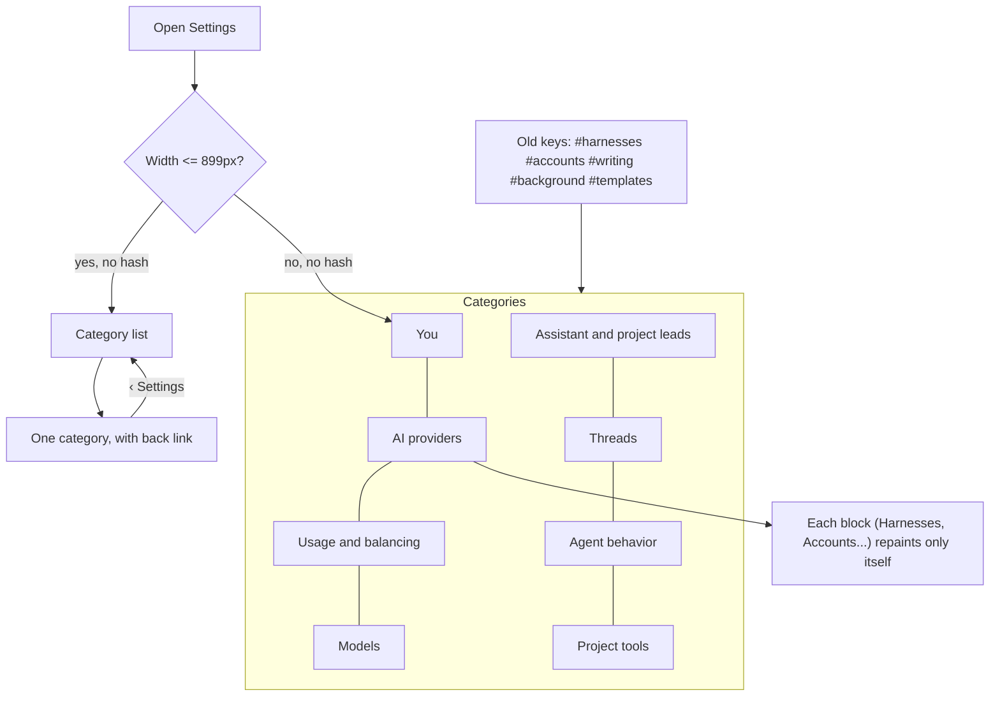

# Rework the Settings page

**Idea:** `IDEA.md` — what this is for and why, in plain language. Read it first; it is
the north star this plan serves. Goal and Constraints live there, not here.

Map: `MAP.md`.

## Open Questions

(none)

## Watch List

| # | Noticed | What needs looking into | Raised to user? | Outcome |
|---|---------|-------------------------|-----------------|---------|

## Decision Log

| # | Decision | Rationale | Source |
|---|----------|-----------|--------|
| 1 | Mode two-part | Collin's pick on the mode card | user |
| 2 | Eight categories: You; AI providers; Usage and balancing; Models; Assistant and project leads; Threads; Agent behavior; Project tools (graphs/categories.json) | Collin plans to add customization for the assistant and project leads; one shared home keeps Threads focused | user |
| 3 | Show each repeated thing once: sign-in only on account cards (Harnesses links to them); detailed usage only in Usage, account cards keep a one-line reading | The repetition is a main source of clutter; each thing stays one tap away | user |
| 4 | New section keys `you`, `providers`, `usage`, `models`, `leads`, `threads`, `behavior`, `tools`; old keys keep working as aliases (`harnesses`, `accounts` → providers; `writing`, `background` → you; `templates` and `templates/lessons/<role>` → behavior); in-repo links and texts that name old sections are updated | Lesson cards and onboarding already link to old keys; aliases cost a lookup table | defaulted |
| 5 | Mockups agreed: graphs/mockup-phone-navigation.html, mockup-phone-you.html, mockup-phone-assistant.html, mockup-desktop-threads.html (versions at commit 9abeca2f) | Collin pressed "Looks good" | user |
| 6 | Keep lead and worker provider orders together in Usage and balancing, as planned (Collin: "it makes sense to me that agent orders like lead order and worker orders sort of go in the same category") | Answer to the review-budget question; the mechanical issues are fixed in S1 | user |
| 7 | Keep Harnesses and Accounts merged in AI providers in this thread (split offered and declined) | Collin, after hearing the issue is redraw wiring, not design | user |

## Spec

### Overview



The picture repeats S1, S3, S5 and S7: the phone list, the eight categories, old addresses as aliases, and blocks that repaint independently.

### S1. Categories

The Settings page has eight categories, in this order, each holding exactly these existing controls (MAP.md Inventory names them). No control changes what it does or where it is stored.

1. **You**: your name, Writing style (whole current section), Diagrams, Enter-to-send, Background (whole current section).
2. **AI providers**: Harnesses and Accounts (both whole current sections).
3. **Usage and balancing**: Usage (whole current section, including Balancing) plus the lead provider order moved from Models. The lead order keeps its own Save, in its own box above Balancing. Both share one draft (`viewer/pages/settings.js:1663-1671`); a Save sends only its own keys and, after saving, refreshes only those keys in the draft, so unsaved edits in the other box survive. The reserve labels ("Save <provider> for leads", margin and held-back lines) name the hub's `reserved_provider` (`viewer/app/routes.js:322`, which weighs the saved orders, enabled harnesses and signed-in accounts). After either Save succeeds, both boxes take `reserved_provider` from the response and rebuild from the shared draft, so the labels are current and the other box's unsaved edits stay. Opening Usage and balancing also re-reads `reserved_provider` from the hub (labels only; neither draft is replaced), so a harness switched off elsewhere is reflected.
4. **Models**: Tiers, lead and sub-lead models, Other agents, Escalation.
5. **Assistant and project leads**: the personal assistant switch and the project leads switch. Future customization for both goes here.
6. **Threads**: tool steps, auto-merge and branch deletion, default project folder, Permission mode, lead names.
7. **Agent behavior**: Behavior templates and Lessons learned (whole current section).
8. **Project tools**: unchanged.

### S2. Each repeated thing shown once

- Sign-in for a provider happens only on its account cards in AI providers. A Harnesses row that needs sign-in links to that provider's account cards instead of signing in itself; the link carries the machine selected in Harnesses, and the account card's sign-in opens for that machine. Where no account card can sign in (every account paused, or none), the Harnesses row keeps today's "Open Accounts" / "Add an account" links, pointing to the Accounts block. After any account action that can change a harness's status (sign-in, add, pause, resume, remove, restore default login), the Harnesses block reloads its status (today only usage refreshes, `viewer/pages/settings.js:1401-1408`).
- Detailed usage (5-hour and weekly bars, per-account tables) appears only in Usage and balancing. Each account card keeps a one-line reading of its current usage.

### S3. Section addresses and references

- Keys: `you`, `providers`, `usage`, `models`, `leads`, `threads`, `behavior`, `tools`. An unknown key opens `you`.
- Old keys open the category now holding them: `harnesses`, `accounts` → `providers`; `writing`, `background` → `you`; `templates` → `behavior`.
- A role's lesson editor opens at `#behavior/lessons/<role>`; the old `#templates/lessons/<role>` still opens it. Lesson cards (`viewer/pages/thread.js:1534`, `viewer/pages/assistant-popup.js:287`) link to the new address.
- Settings opened with no hash (the app nav's Settings link, `viewer/pages/nav.js`) shows `#you` on desktop, and the category list on a phone (S7). Nothing opens `#models` by default any more.
- The New Thread page's hint for a missing default project folder (`viewer/pages/new.html:24`) links to `#threads`.
- Update every live link and user-facing text naming an old section or "Models > Diagrams" in code, tests, `protocol/`, `README.md` and `AGENTS.md` files (MAP.md Literal section-reference index); never edit other plans' or reports' files under `docs/plans/`. Text naming a section by its old name says the new category ("Settings → Harnesses" becomes "Settings → AI providers", e.g. `viewer/pages/thread.js:1636`, `README.md:261`). Includes: onboarding card, lesson card links, Harnesses' internal links, `protocol/sensitivity.md` (its delimited region: Settings page (You, Diagrams), and the later "Models > Diagrams" line becomes "You > Diagrams"), `sensitivity/test/run.sh`'s expected text, and tests.

### S7. Getting around on a phone

At 899px wide or less (the agreed mockups' breakpoint, also the page's first narrow rule, `viewer/pages/settings.css:126`), replacing today's horizontal tab strip:

- Settings with no hash, or `#` alone, shows only the category list (`mockup-phone-navigation.html`): each of the eight categories with its one-line description, tapping one opens it.
- A category (any key, including old keys and `templates/lessons/<role>`) shows only that category, full width, with a "‹ Settings" link at the top that always opens the list (clears the hash), even when the category was reached by a direct link. The browser's Back button follows real history as usual.
- Above 899px there is no list screen and no back link: the side navigation (`mockup-desktop-threads.html`) is always shown and no hash means `#you`.
- Crossing the breakpoint (rotating, resizing) changes layout only: the open category's content is not rebuilt, so typed text and open edits survive. With no hash, crossing from phone to desktop shows `#you` and back shows the list.

### S4. Mockups

The built page matches these agreed files (in `docs/plans/settings-rework/graphs/`):

| File | Screen / state | Size |
|---|---|---|
| mockup-phone-navigation.html | Category list, all eight categories | 390 x 844 |
| mockup-phone-you.html | You open | 390 x 844 |
| mockup-phone-assistant.html | Assistant and project leads open | 390 x 844 |
| mockup-desktop-threads.html | Side navigation with Threads open | 1280 x 800 |

Categories not mocked follow the same pattern: the moved controls keep today's wording and look, under a heading per former group.

### S5. Boundaries and non-goals

- No control changes behaviour, wording (beyond headings that name a moved group), stored value or save route. Server endpoints (`viewer/app/settings.js`, `routes.js`) do not change.
- Each former section or group inside a category (for example Harnesses and Accounts in AI providers; your name, Writing style, Diagrams, Enter-to-send and Background in You) is its own block. A repaint caused by one block (its poll or timer, its Save, its machine picker) rebuilds only that block, so unsaved edits and typed text in the other blocks survive.
- Section-specific live work moves with its controls: Harnesses install polling, Accounts and Usage 30-second refresh, and the Diagrams read and draw (which fills `#diagram-choices`, `viewer/pages/settings.js:127-146`, today guarded by `section === 'models'` at :2254) all move to the category that now holds them. Each runs while the category holding it is open and stops when it is left, as today per section.
- The saved background's 10-second refresh (`viewer/pages/background.js:68-105`) stays page-wide, running whatever category is open. Only the editor's repaint and preview cleanup are tied to the You visit (today's `section === 'background'` checks become "You is open").
- An open sign-in card keeps polling while another category is open, as today, and shows its latest status when AI providers is opened again (it is not restarted).
- Turning a harness on or off also rebuilds the Accounts block (waiting while an account edit is open, as below), so account cards and Sign in buttons match the switch at once.
- Within the Accounts block, its own refresh still waits while an account edit is open (rename, plan or weight, add-account form), as today (`viewer/pages/settings.js:1371-1373`).
- Enter-to-send stays in browser storage.
- Not doing: new settings, the personal assistant changing settings, separate phone/computer backgrounds (other threads).

### S6. Validation

Run from the worktree:

```bash
node --test viewer/test/app-settings.test.js viewer/test/app-harnesses.test.js viewer/test/app-usage.test.js viewer/test/app-lessons.test.js viewer/test/background.test.js viewer/test/app-diagram-sensitivity.test.js
npm --prefix viewer run test:browser -- browser.spec.js app-send-now.spec.js app-openrouter-spend.spec.js app-new-thread.spec.js app-assistant.spec.js app-project-lead.spec.js app-settings.spec.js app-harnesses.spec.js app-accounts.spec.js app-diagram-sensitivity.spec.js app-lessons.spec.js app-project-tools.spec.js app-hidden-tabs.spec.js background-editor.spec.js background-network.spec.js background-readiness.spec.js background-rendering.spec.js background-settings-surfaces.spec.js
bash sensitivity/test/run.sh
node --test machine/test/name-guard.test.js
```

New or updated browser checks (in `viewer/test/app-settings.spec.js`) must show: the eight categories in S1 order; each moved control is found in its S1 category; each old key in S3 opens the right category; Harnesses' sign-in link opens the provider's account cards; account cards show one usage line and no usage bars; on a 390px-wide page, no hash shows the category list and "‹ Settings" returns to it; reordering leads, changing a worker balancing value, then pressing either Save keeps the other's unsaved edit and updates the reserve label when the reserved provider changes; turning a harness on shows its account cards without leaving the category; typing in Writing style then saving a background keeps the typed text; switching the Harnesses machine with an account rename open keeps it; resizing across 899px with a rename open keeps it; Diagrams choices show in You; `#behavior/lessons/<role>` and `#templates/lessons/<role>` both open that editor; a Harnesses progress tick with an account rename open keeps the typed name. `app-assistant.spec.js` and `app-project-lead.spec.js` open `#leads` to find their switches; `app-new-thread.spec.js` expects the hint to link to `#threads`.

## Deferred

| # | Item | Why it can wait | Source | Notes for the follow-up |
|---|------|-----------------|--------|-------------------------|
| 1 | Titles and hints wrap onto a different number of lines than the mockups (phone list You line, phone assistant title, desktop Threads folder hint), moving rows 7-37 px | Line wraps differ from the mockups only because of the app's real fonts | verification | Check whether the taller rows bother Collin on a real phone |

## Accepted Risks

| Risk | Why accepted | Round |
|------|--------------|-------|
| Turning a harness off while an add-account form for that provider is open leaves the form as it was | Rare path: two actions together in one visit; the hub's own checks still apply on submit | review-round-3 |
| On desktop with no hash, narrowing the window below 899px mid-way through a Background preview may discard the unsaved preview | Rare path: a desktop resize across the breakpoint during an unsaved image pick | review-round-3 |
| A hand-typed lesson address naming an inherited object key (`#behavior/lessons/constructor`) breaks the page ("lessonList(...).some is not a function") instead of opening You | Rare path: malformed input no link in the app produces; real lesson links name real roles | verification-1 |
| Pressing Balancing's Save and then Lead order's Save while the first answer is still on its way, with the first answer arriving last, can put back the older reserve label until the next Save or visit | Rare path: two saves in flight with their answers arriving out of order | verification-2 |

## Check Once Built

| # | What to check | Round |
|---|---------------|-------|
| 1 | After signing in from an account card, Harnesses and the account card both show the new status (not one stale from the shared 15-second machine cache, `viewer/app/usage.js:63`) | review-round-5 |

## Review Rounds

### Round 1 — 2026-11-24

**Lanes:** intent: claude; mechanics: gpt / gpt-6.2-sol; cross-family: yes.

**Changed since Round 0:** n/a (first round — whole Spec in scope)

| Lane | Reported | Finding | Lead verdict | Resolution |
|------|----------|---------|--------------|------------|
| intent | major | Phone mockup shows a category list with back links; Spec never says so and S3 sent no-hash to `#you` | upheld (major) | Added S7; S3 no-hash rule split by width |
| mechanics | blocking | No address opens the phone category list | upheld (blocking) | Same as the intent major; S7 |
| mechanics | blocking | Background 10-second refresh is page-wide, not tied to the section | upheld (blocking) | S5: refresh stays page-wide; only editor tied to You |
| mechanics | major | Lead and worker order on one screen with two Saves lose each other's edits | upheld (major) | S1: lead order joins Balancing, one Save |
| mechanics | major | Harnesses poll repaint can erase an open account edit | upheld (major) | S5: repaint waits for open edits |
| mechanics | major | Sign-in handoff drops the selected machine; Harnesses not refreshed after | upheld (major) | S2: link carries machine, Harnesses refresh |
| mechanics | minor | New Thread hint should link to `#threads` | upheld (minor) | S3 |
| mechanics | minor | Assistant and project-lead specs missing from S6 | upheld (minor) | S6 |
| mechanics | minor | No step to refresh harness instructions from the canonical clone | declined | `install.sh` / `sensitivity/set.sh` refuse from a worktree (CONTRIBUTING.md); the refresh is Collin's update after merge, not a Spec validation. Goes in the check card's update text |
| intent | minor | S3 "every in-repo link" would rewrite old plans; "Settings → Harnesses" texts unaddressed | upheld (minor) | S3 limited to live files; old-name texts renamed |

### Round 2 — 2026-11-24

**Lanes:** intent: claude; mechanics: not claude; cross-family: yes.

**Changed since Round 1:**
- S7 added: phone category list, "‹ Settings" back link, breakpoint 899px; S3 no-hash rule split by width.
- S3: renaming limited to live files; old-name texts renamed; New Thread hint links to `#threads`.
- S1: lead provider order inside Balancing with one Save.
- S2: Harnesses sign-in link carries the machine; Harnesses refresh after sign-in.
- S5: background refresh stays page-wide; repaints wait for open edits.

Round 2 fixes (for round 3): S5 blocks repaint independently (replaces the poll-wait rule); Diagrams read and draw move to You; S1 lead order keeps its own Save, each Save keeps the other's draft (replaces the one-Save rule); S2 Harnesses reload after every account action; S3 `#behavior/lessons/<role>`; S7 back link always opens list, layout change rebuilds nothing; S6 more specs.
- S6: more specs and checks.

| Lane | Reported | Finding | Lead verdict | Resolution |
|------|----------|---------|--------------|------------|
| intent | minor | S7 breakpoint 640px differs from the agreed mockups' 899px | upheld (minor) | S7 now 899px |
| intent | minor | "a text field with focus" freezes Harnesses progress needlessly | upheld (minor) | S5 limited to account edits |
| mechanics | blocking | Diagrams moved to You but its read/draw stayed guarded by Models | upheld (blocking) | S5: read and draw move with it |
| mechanics | major | One Save with reserve labels from saved order can reserve the wrong provider | upheld (major) | S1: back to two Saves that keep each other's draft; labels as today |
| mechanics | major | Other blocks' actions (machine change, background save) rebuild the panel and erase drafts | upheld (major) | S5: each block repaints only itself |
| mechanics | major | Rerender on crossing the breakpoint loses open edits | upheld (major) | S7: layout change only |
| mechanics | major | Lesson cards moved to `#behavior` lose the role editor | upheld (major) | S3: `#behavior/lessons/<role>`, old alias kept |
| mechanics | minor | Harnesses status not refreshed after other account actions | upheld (minor) | S2 |
| mechanics | minor | Back link vs browser Back after a direct link | upheld (minor) | S7 |
| mechanics | minor | Missing send-now and openrouter-spend specs | upheld (minor) | S6 |

### Round 3 — 2026-11-24

**Lanes:** intent: claude; mechanics: not claude; cross-family: yes.

**Changed since Round 2:**
- S5: each block inside a category repaints only itself; Diagrams read and draw move to You; Accounts' own edit guard kept.
- S1: lead order keeps its own Save; each Save refreshes only its keys in the shared draft.
- S2: Harnesses reloads status after any account sign-in, pause, resume or remove.
- S3: lesson editor address `#behavior/lessons/<role>`, old one kept.
- S7: breakpoint 899px; "‹ Settings" always opens the list; crossing the breakpoint rebuilds nothing.
- S6: more specs and checks.

| Lane | Reported | Finding | Lead verdict | Resolution |
|------|----------|---------|--------------|------------|
| intent | — | No findings | — | — |
| mechanics | major | Balancing labels stale after a lead-order Save on the same screen | upheld (major) | S1: lead-order Save rebuilds Balancing from the draft |
| mechanics | major | Harness switch changes Accounts while an add-account form is open | accepted-risk | Rare path (Accepted Risks) |
| mechanics | major | No-hash desktop resize to phone width during Background preview | accepted-risk | Rare path (Accepted Risks) |
| mechanics | minor | Sign-in card left mid-sign-in doesn't resume on return | upheld (minor) | S5 |

### Round 4 — 2026-11-24

**Lanes:** intent: claude; mechanics: not claude; cross-family: yes.

**Changed since Round 3:**
- S1: a successful lead-order Save also rebuilds the Balancing box from the shared draft, so its provider labels update and unsaved edits stay.
- S5: an open sign-in card rechecks and resumes polling when AI providers is reopened.
- Accepted Risks: two rare paths added.

| Lane | Reported | Finding | Lead verdict | Resolution |
|------|----------|---------|--------------|------------|
| intent | — | No findings | — | — |
| mechanics | major | Harness on/off doesn't update the Accounts block on the same screen | upheld (major) | S5: toggle rebuilds Accounts |
| mechanics | minor | Resuming sign-in polling on return can time out the login | upheld (minor) | S5: cut; polling keeps running as today |
| mechanics | minor | Reserve label comes from hub `reserved_provider`, not saved order alone | upheld (minor) | S1, S6 |
| mechanics | minor | Harnesses handoff needs destinations when no account can sign in | upheld (minor) | S2 |
| mechanics | minor | Missing `machine/test/name-guard.test.js` | upheld (minor) | S6 |

### Round 5 — 2026-11-24

**Lanes:** intent: claude; mechanics: not claude; cross-family: yes.

**Changed since Round 4:**
- S5: turning a harness on/off rebuilds the Accounts block; an open sign-in card keeps polling while away (not restarted).
- S1: both Saves take `reserved_provider` from the response and rebuild both boxes from the shared draft.
- S2: Harnesses keeps "Open Accounts"/"Add an account" links when no account can sign in; reload after restore default login too.
- S6: name-guard test and new checks.

| Lane | Reported | Finding | Lead verdict | Resolution |
|------|----------|---------|--------------|------------|
| intent | — | No findings | — | — |
| mechanics | major | `reserved_provider` stale on opening Usage after switching off the reserved harness | downgraded (minor) | Pre-existing: today opening Usage also fetches only `/usage` (`viewer/pages/settings.js:1377`), so the rework does not introduce it. Fixed anyway in S1 (one re-read on entry) |
| mechanics | minor | Add account should also refresh Harnesses | upheld (minor) | S2 |
| mechanics | minor | S5 contradiction: sign-in polling both stops and continues | upheld (minor) | S5: sign-in removed from the stop list |
| mechanics | minor | Harnesses and account card could disagree after sign-in via cache order | check-once-built | Check Once Built #1 |
| mechanics | minor | Missing `browser.spec.js` | upheld (minor) | S6 |

## Implementation Tasks

| # | Objective | Ownership boundary | Lane | Session id | Validation | Status |
|---|-----------|--------------------|------|-----------|------------|--------|
| T1 | `tricky` Settings shell: eight categories, keys and aliases, blocks that repaint only themselves, live work per category, phone list and back link (S1 except lead-order Save semantics, S3 in-page, S4, S5 except harness-toggle→Accounts, S7) | `viewer/pages/settings.{js,css,html}`; Settings browser specs (app-settings, diagram, assistant, project-lead, harnesses, accounts, hidden-tabs, lessons, openrouter-spend, send-now, project-tools, browser, background-*) | standard / claude-sonnet-5-5 | wc-d14474dffb25-worker | S6 node + browser lists, name-guard | done |
| T2 | `tricky` After T1: lead-order box Save semantics and `reserved_provider` (S1), sign-in handoff and Harnesses reload, one-line account usage (S2), harness toggle rebuilds Accounts (S5), Check Once Built #1 | `viewer/pages/settings.{js,css}`, `viewer/test/app-settings.spec.js`, `app-harnesses.spec.js`, `app-accounts.spec.js` | standard / claude-sonnet-5-5 | wc-d14474dffb25-worker-3 | S6 lists | done |
| T3 | Links and texts outside the page (S3): threads.js, thread.js, assistant-popup.js, new.html, README, protocol/sensitivity.md, sensitivity/test/run.sh | those files + `viewer/test/app-new-thread.spec.js` | light / gpt-6-luna | wc-d14474dffb25-worker-2 | `bash sensitivity/test/run.sh`; app-new-thread.spec.js | done |
| R1-6 | `tricky` Remediation 1 (REMEDIATION-1.md): 5-hour bars in Usage table, Add account and background-surface flakes, Diagrams re-read when You shows, test name, phone You preview panes and slider | `viewer/pages/settings.{js,css}`, app-settings, app-accounts, background-settings-surfaces, app-diagram-sensitivity specs | standard / claude-sonnet-5-5 | wc-d14474dffb25-worker-4 | S6 lists + repeat-each=5 of the two flaky files | done |

## Log

Build accepted: approval c097ed47-f022-4759-a895-e5d8bb654791
- 2026-11-24 — Dispatched T1 (claude standard) and T3 (light) in parallel; T2 waits on T1 (same file).
- 2026-11-24 — T3 accepted (band: scout): all ten link/text edits as briefed; sensitivity 67 pass, app-new-thread.spec.js 26 pass (re-run by sub-lead). Worker reported choices: none.
- 2026-11-25 — Choice: T1, settings.js parseHash: old-key and unknown-key addresses are kept as typed, not rewritten
- 2026-11-25 — Choice: T1, category ledes without a mockup: AI providers "The agent programs wheelchair runs and the logins they use.", Usage and balancing "What is left this week, and how agents share it.", Models "Who runs what.", Agent behavior "How agents work, and what they have learned."; Project tools keeps its own heading
- 2026-11-25 — Choice: T1, block headings: Your name, Writing style, Diagrams, Enter to send, Background Customization, Conversations, Threads, Permission mode, Lead names, Leads, Lead order, Harnesses, Accounts, Usage, Behavior templates; Accounts' provider headings became h3
- 2026-11-25 — Choice: T1, Harnesses links: "Open Accounts"/"Add an account" go to #providers and scroll to the Accounts block; "Leads try" and "Workers try first" go to #usage
- 2026-11-25 — Choice: T1, phone root: You is built behind the list and CSS shows one or the other; going from a category back to the list counts as leaving it (discards a background preview, stops polling)
- 2026-11-25 — Choice: T1, a hash change within the same category rebuilds nothing; two background tests now expect the same editor
- 2026-11-25 — Choice: T1, Saved notes sit under the category lede (You, Models, leads, Threads); Lead order and Balancing each show their own Save's note
- 2026-11-25 — Choice: T1, Usage Saves still reset both boxes from saved values until T2
- 2026-11-25 — Choice: T1, Diagrams choices (radio circles), Covers line, Never say box and In your own words count restyled to match the You mockup at every width
- 2026-11-25 — Choice: T1, Lead names and Your name sections are not named regions, so their control labels stay unique
- 2026-11-25 — Choice: T1, tests: app-harnesses.spec.js navigates by hash and stubs harness status in the switched-off-account test; app-send-now.spec.js opens #you
- 2026-11-25 — T1 accepted (band: self): read the settings.js/css diff; on the merged branch (with T3) S6 node tests 87 pass, sensitivity 67 pass, S6 browser list 853 pass / 1 fail (firefox app-accounts.spec.js:262 'adding a GPT account does not warn'), which passed twice when re-run alone — flaky under load, watch in verification. The worker's four 'lead waiting line' failures near midnight did not recur.
- 2026-11-25 — Choice: T2, settings.js signinLink: following the Harnesses link opens the sign-in card at once for the provider's first usable account, not only scrolls there
- 2026-11-25 — Choice: T2, settings.js openSignin/renderAccounts: a card opened from Harnesses sits in the provider's account group; an account's own Sign in keeps the card at the top of Accounts
- 2026-11-25 — Choice: T2, settings.js usageLine: wording "5-hour 42% used · week 61% used · as of 14:00", no reset times; a missing window is left out; "no reading yet" when neither exists
- 2026-11-25 — Choice: T2, settings.js closeSignin: status (harnesses ?fresh=1, then usage) reloads whenever a sign-in card closes, signed in or not
- 2026-11-25 — Choice: T2, settings.js mutate: rename and plan changes also reload status (shared path with pause/remove)
- 2026-11-25 — Choice: T2, settings.js setHarness: with an Add account form open, a harness switch repaints Accounts only when the form's provider was switched off; otherwise it waits
- 2026-11-25 — Choice: T2, settings.js refreshUsage: a usage answer older than the newest request is dropped
- 2026-11-25 — Choice: T2, settings.js readReserved: re-reading the reserved provider rewrites the three labels in place so focus is kept
- 2026-11-25 — Choice: T2, settings.js refreshAfterInstall: an open sign-in card still stops post-install version re-reads (comment only changed)
- 2026-11-25 — T2 accepted (band: self): read the diff; Check Once Built #1 handled by reading /harnesses?fresh=1 (clears the hub's machine cache, viewer/app/harnesses.js:14) before /usage after sign-in and account changes. Merged branch: S6 node 87 pass, sensitivity 67 pass, S6 browser 870 pass. Worker noted a pre-existing stray "0" on an account card with no machine readings (settings.js accountCard `machines.length && …`), not fixed.
- 2026-11-25 — Verification attempt 1 on 6d7c4f03: both verifiers FAIL. Check Once Built #1 passed (both). One rare path recorded in Accepted Risks. Full run: viewer-browser (app-permit.spec.js:26 firefox), viewer-node (app-quiet.test.js:41), install ('real wheelchair directory is byte-identical', live ~/.wheelchair written by running sessions) failed; each passed on re-run alone (install 213/213, quiet 3x, permit 4/4).
- 2026-11-25 — Lead's answer on verification-1 gaps: 1-3 remediate; 4 fix (re-read Diagrams each time You is shown); 5 fix; 6 fix to match the mockup (short Visibility track; preview panes as drawn); 7 deferred (Deferred row 1).
- 2026-11-25 — Remediation 1 dispatched as one brief (R1-R6 share settings.js) to claude standard (the provider that built T1/T2).
- 2026-11-25 — Choice: R1-6, settings.js holdPlace: any block repainted wholly above the screen keeps what is below in place (not only Harnesses)
- 2026-11-25 — Choice: R1-6, settings.css .meter: between 640px and ~900px the number wraps under the bar in the Usage table
- 2026-11-25 — Choice: R1-6, settings.js syncDiagrams: Diagrams shows "Reading each machine…" while re-reading, not the previous answer
- 2026-11-25 — Choice: R1-6, settings.js syncDiagrams: returning to the browser tab does not count as You becoming visible
- 2026-11-25 — Choice: R1-6, settings.css .pane: only the panes' box and gap follow the mockup; text size and wide-screen two columns unchanged
- 2026-11-25 — Choice: R1-6, background-settings-surfaces.spec.js: the surfaces check is one in-page measurement instead of one assertion per element
- 2026-11-25 — R1-6 accepted (band: self): read the diff. R2 was a real bug (Harnesses repaint above the screen moved Accounts' buttons mid-press; fixed by holdPlace); R3 was the test measuring a detached node (test fixed). Merged branch: S6 node 87, sensitivity 67, S6 browser 878 pass.
- 2026-11-25 — Verification attempt 2 on 05eb9de3: Claude verifier PASS; GPT verifier FAIL (4 gaps; one rare path recorded in Accepted Risks). Check Once Built #1 passed (both). Full run: every suite exit 0 except install ('real wheelchair directory is byte-identical after suite'), which fails the same way at the comparison commit 8440ad72 (run from a git archive: 212 passed, 1 failed) because running sessions write to ~/.wheelchair; it does not fail the gate.
