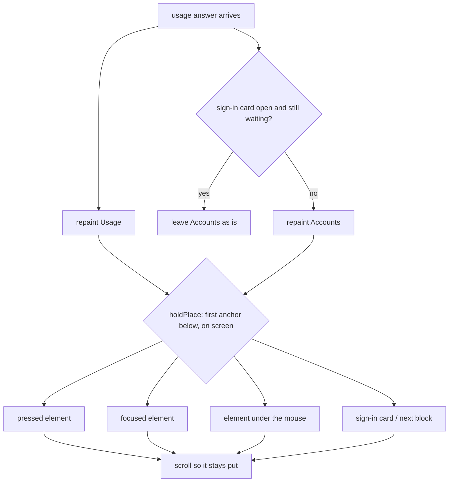

# Make the Settings page solid

**Idea:** `IDEA.md` — read it first. **Map:** `MAP.md`. Source of the four items: Deferred
rows 1-4 of `docs/plans/settings-rework/PLAN.md`.

## Open Questions

## Watch List

| # | Noticed | What needs looking into | Raised to user? | Outcome |
|---|---------|-------------------------|-----------------|---------|
| 1 | Collin prefers his own wording to the `build-up` sentence: plain words first; a technical term only when truly needed, then built up to; never tack a term's name onto a plain explanation | Scope change: rewrite the agent sentence at `viewer/app/settings.js:144` (and the label) to say that | Yes | Added to scope, Decision 7 |

## Decision Log

Append-only. A reversal is a new entry superseding the old, never an edit.

| # | Decision | Rationale | Source |
|---|----------|-----------|--------|
| 1 | Mode is thorough | Collin picked it | user |
| 2 | No designer: no new screens, only matching or keeping the settings-rework mockups | The visible parts are a label/size tweak judged against existing mockups | defaulted |
| 3 | While a sign-in card is open in Accounts, usage answers do not repaint Accounts (its usage lines refresh once the card closes or the sign-in finishes); Usage still repaints | Certain fix for lost focus and dropped presses; the frozen numbers are only visible while signing in | defaulted |
| 4 | Any Settings block repaint holds the position of the focused control or the control under a pressed pointer when it lies below the repainted block and is on screen; a repaint that would land during a press waits until the press ends | Covers Lead order under Usage and any later case, not only the sign-in card | defaulted |
| 5 | Q1: shorten the Technical terms option to "Build up to them, unless already used" (label only; stored value `build-up` and the agent sentence at `viewer/app/settings.js:144` unchanged). Collin: "we can do shorter wording" | The label is display only; agents get the fixed sentence from the stored value | user |
| 6 | Q2: leave the taller phone rows and boxes (and the desktop Threads folder hint) as they are; no change to match the settings-rework mockups' heights | Collin picked "Leave them"; nothing is cut off or overlapping | user |
| 7 | Rewrite the `build-up` agent sentence to: "Use plain words when they work. Use a technical term only when it's truly needed, and then build up to it and ground it first. Don't add a term's name to something already said plainly." Its picker label becomes "Plain words first, build up if needed" (supersedes the label in Decision 5; the stored value stays `build-up`). IDEA.md What/Why/What good looks like updated | Collin pressed "Add it" after saying agents explain plainly then tack on the jargon name | idea-change |
| 8 | Drop the press-queue rule; instead the pressed element is the first anchor `holdPlace` holds. The sign-in guard lives in `refreshUsage` only and applies only while the card is still waiting. Row hint becomes "How the lead handles technical terms"; the default free text drops its "Build up…" line | A queue conflicted with existing tests and could rebuild a just-opened card; holding the pressed element keeps its click without delaying anything | review-round-1 |

## Spec

Law: `CONTRIBUTING.md` (Validation, Editing conventions). A spec that tests scroll or
pixels goes on `viewer/test/firefox-specs.js`.



### S1. Technical terms option wording

- `viewer/pages/settings.js:1235`: the `build-up` option's label becomes exactly
  `Plain words first, build up if needed`. The other two labels, the stored values
  (`build-up`, `freely`, `avoid`) and saved settings are unchanged; no migration.
- The Technical terms row hint (`viewer/pages/settings.js:1338`) becomes exactly
  `How the lead handles technical terms`.
- On a 390px-wide page with You open, the closed Technical terms select shows that label
  in full: the label's text width, measured in the select's computed font, is at most the
  select's content-box width minus 24px (room for the browser's arrow).
- `viewer/app/settings.js:144` (`renderStyle`): the `build-up` sentence becomes exactly
  `Use plain words when they work. Use a technical term only when it's truly needed, and then build up to it and ground it first. Don't add a term's name to something already said plainly.`
  `freely` and `avoid` sentences are unchanged. It reaches sessions the way the style
  already does (sessions started after the change).
- The default free text (`DEFAULT_STYLE.text`, `viewer/app/settings.js:36`) drops its
  second line, becoming exactly
  `Be concise. Cut anything that makes it longer without changing the meaning.`
  This only affects installs with no saved style; saved text is never rewritten. The done
  card's note tells Collin that a saved text still containing the old "Build up to
  technical terms…" line now sits beside the new sentence and can be deleted in
  Settings > You.

### S2. A waiting sign-in card is never rebuilt by a usage answer

- In `refreshUsage` only (`viewer/pages/settings.js:1432`), Accounts is not repainted
  while a sign-in card is open inside the Accounts block **and still waiting**: from the
  moment the card is attached (including "Starting sign-in…" while its start request is
  pending) until it is signed in, failed (including a failed start request) or expired.
  Usage still repaints.
  This applies to the 30-second timer and every other usage answer.
- `accountsBusy()` and every other `paint('accounts')` caller (Collin's own actions:
  account edits, turning a harness on or off, opening the card) are unchanged.
- Once the card stops waiting (failed or expired, card still shown), the next usage
  answer repaints Accounts as today. When the card closes, `closeSignin` already calls
  `refreshStatus`, which repaints Accounts with the latest usage.

### S3. Whatever is in use holds its place

`holdPlace(host)` (`viewer/pages/settings.js:2487`) picks the first anchor that exists,
is outside `host`, comes after `host` in the page, and is at least partly on screen below
the sticky nav:

1. the element a pointer is pressed on (the `pointerdown` target inside the Settings
   panel, until `pointerup` or `pointercancel` on the window), so the release lands on it
   and its click fires;
2. the focused element, if inside the Settings panel;
3. with a mouse (not touch or pen), the element at the last known pointer position
   (`document.elementFromPoint` from the latest `pointermove` over the panel), if inside
   the panel; the position is forgotten on `pointerleave` of the panel;
4. the open sign-in card (today's rule);
5. otherwise today's next-sibling rule, unchanged.

After the repaint it scrolls by the anchor's change in `getBoundingClientRect().top`, so
the anchor stays at the same screen position. If the page cannot scroll far enough
(near the top), the anchor may still move; no other compensation. An anchor inside the
host being replaced is not held. Repaints are never delayed or queued.

Concrete case this must fix: Usage and balancing open, page scrolled so Lead order's
buttons are on screen under the Usage block, mouse resting on (or pressed on) a Lead
order button; the first usage answer adds the bars; the button stays under the pointer.

### Non-goals

No change to what usage shows, how often it refreshes, the phone row heights, the
category layout or the old `#` addresses (Decision 6, IDEA.md Not doing).

### Validation

New browser spec `viewer/test/app-settings-hold.spec.js`, added to
`viewer/test/firefox-specs.js` (it tests scroll position). Every position test adds
`* { overflow-anchor: none !important; }` first, as `viewer/test/app-settings.spec.js:1030`
does, so the browser's own anchoring cannot hide a missing hold. Tests:

- Sign-in card open and waiting in Accounts, focus **not** in any field (moved to the
  page body), a marker set on an account card; mouse pressed on Send code, a usage answer
  released, mouse released: the marker survives and exactly one code request is sent.
- Sign-in card open and waiting in Accounts, code box focused with text typed; a usage
  answer arrives (and the 30-second refresh fires): the card is the same node, the code
  box keeps focus and text, and Accounts was not rebuilt (a marker set on an account card
  survives); after the card is closed, Accounts shows the newer usage.
- Sign-in card failed or expired (still shown): a usage answer repaints Accounts.
- With the card open, turning another harness on still updates Accounts at once.
- Lead order setup for the next three tests: Usage and balancing open, scrolled so part
  of the Usage block is still visible below the sticky nav and Lead order buttons are on
  screen, with enough page below for the hold to scroll; each test waits until the usage
  bars are rendered before measuring the button again or releasing a press.
- Usage and balancing open, Lead order buttons on screen below Usage, no usage answered
  yet: mouse pressed on a Lead order button, the first usage answer released (adding the
  bars), mouse released: the button's on-screen top changed by at most 1px and its action
  ran once.
- Same layout, mouse only resting on the button (not pressed): on-screen top changes by
  at most 1px across the first usage answer.
- Same layout, a Lead order button focused by keyboard, mouse moved out of the panel:
  on-screen top within 1px across a usage answer.
- At 390px wide, `#you`: the Technical terms select shows
  `Plain words first, build up if needed`, its hint reads
  `How the lead handles technical terms`, and the S1 width rule holds.

Update `viewer/test/app-settings.test.js` so a `build-up` style renders the new S1
sentence exactly and a fresh install's default style text is the new one-line default.
The existing Harnesses-hold tests (`viewer/test/app-settings.spec.js:1022`, `:1046`) must
still pass unchanged.

Commands:

```bash
node --test viewer/test/app-settings.test.js
node --test machine/test/name-guard.test.js
npm --prefix viewer run test:browser -- app-settings-hold.spec.js app-settings.spec.js app-accounts.spec.js app-harnesses.spec.js
```

## Accepted Risks

| Risk | Why accepted | Round |
|------|--------------|-------|
| A saved style within ~120 characters of the 12,000-character composed-instruction cap (`viewer/app/settings.js:69`) goes over it with the longer S1 sentence, so later settings saves fail until the style is shortened | Rare path: needs a style almost exactly at the cap | review-round-1 |

## Review Rounds

### Round 1 — 2026-11-26

**Lanes:** intent: claude / claude-opus-5-5; mechanics: gpt / gpt-6.2-sol; cross-family: yes.

**Changed since Round 0:** n/a (first round — whole Spec in scope)

| Lane | Reported | Finding | Lead verdict | Resolution |
|------|----------|---------|--------------|------------|
| mechanics | blocking | S3's press queue makes Harnesses wait, but two existing tests expect Harnesses rows while the pointer is down | upheld | S3 queue removed; pressed element is now an S3 anchor; existing tests must pass unchanged |
| mechanics | blocking | A queued Accounts repaint replayed after a Sign in click would rebuild the new card | upheld | Queue removed (Decision 8) |
| mechanics | major | Putting the card check in `accountsBusy()` also blocks Collin's own harness toggles from updating Accounts | upheld | Guard moved into `refreshUsage` only; test added |
| mechanics | major | Rare path: longer sentence can push a near-cap saved style over 12,000 characters | accepted-risk | Rare path; Accepted Risks |
| mechanics | minor | After expiry the card stays shown and Accounts would freeze until Close | upheld | Guard only while the card is still waiting; test added |
| mechanics | minor | Stale pointer position after the mouse leaves the panel | upheld | Forgotten on `pointerleave` |
| mechanics | minor | Send code test can pass without the queue; native scroll anchoring can mask a missing hold | upheld | Tests rewritten; `overflow-anchor: none` required |
| mechanics | minor | Content-box width check ignores the native arrow | upheld | Width rule minus 24px |
| intent | minor | S3's only test cannot fail without S3 | upheld | Lead order press test replaces it |
| intent | minor | Row hint still describes the old option | upheld | New hint in S1 |
| intent | minor | Default free text still says "Build up to technical terms…" | upheld | Default drops that line (S1) |

### Round 2 — 2026-11-26

**Lanes:** intent: claude; mechanics: not claude; cross-family: yes.

**Changed since Round 1:**
- S2: sign-in guard moved from `accountsBusy()` into `refreshUsage` only, and only while the card is still waiting.
- S3 (old): press queue removed. New S3: the pressed element is the first anchor `holdPlace` holds; pointer position forgotten on `pointerleave`.
- S1: new row hint; default free text drops its "Build up…" line; width rule allows 24px for the arrow.
- Validation rewritten (Lead order press/hover/focus tests, failed/expired card, harness toggle, `overflow-anchor: none`).

| Lane | Reported | Finding | Lead verdict | Resolution |
|------|----------|---------|--------------|------------|
| intent | minor | S2's focused-field test passes without S2 (`accountsBusy()` already covers a focused field) | upheld | Send code press test with focus off the field |
| intent | minor | Saved style text on existing installs keeps the old "Build up…" line beside the new sentence | upheld | Done card note (S1) |
| mechanics | minor | Card exposed while its start request is pending | upheld | Waiting starts at card attach; failed start ends it |
| mechanics | minor | Waiting-card test passes on current code | upheld | Same fix as the intent finding |
| mechanics | minor | Lead order tests could pass via the next-sibling fallback | upheld | Setup requires Usage partly visible, scroll room, bars rendered |
| mechanics | minor | Missing targeted `machine/test/name-guard.test.js` | upheld | Added to Commands |

## Implementation Tasks

| # | Objective | Ownership boundary | Lane | Session id | Validation | Status |
|---|-----------|--------------------|------|-----------|------------|--------|
| T1 | S1 agent sentence and default style text (`renderStyle`, `DEFAULT_STYLE.text`) + unit test | `viewer/app/settings.js`, `viewer/test/app-settings.test.js` | light / gpt-6-luna | wc-4a3b11f9c1b8-worker | `node --test viewer/test/app-settings.test.js`; `node --test machine/test/name-guard.test.js` | in progress |
| T2 | S1 labels, S2 sign-in guard in `refreshUsage`, S3 `holdPlace` anchors, new hold spec — tricky | `viewer/pages/settings.js`, `viewer/test/app-settings-hold.spec.js`, `viewer/test/firefox-specs.js` | standard / gpt-6.1-terra (asked claude; hub sent it to gpt) | wc-4a3b11f9c1b8-worker-2 | `node --test machine/test/name-guard.test.js`; `npm --prefix viewer run test:browser -- app-settings-hold.spec.js app-settings.spec.js app-accounts.spec.js app-harnesses.spec.js` | in progress |

## Log
- 2026-11-26 — T1 and T2 dispatched in parallel (disjoint files).
