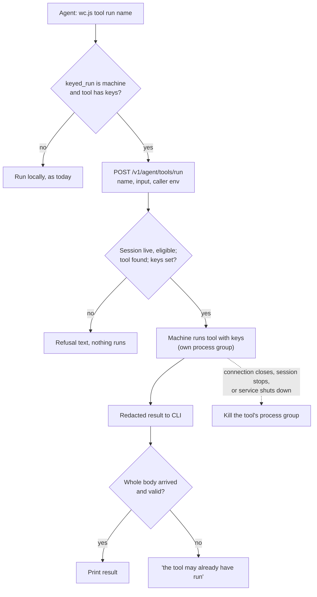

# Keyed folder tools for Kimi and Pi

**Idea:** `IDEA.md` — what this is for and why, in plain language. Read it first; it is
the north star this plan serves. Goal and Constraints live there, not here, so they don't
get buried as this file grows.

## Open Questions

None.

## Watch List

| # | Noticed | What needs looking into | Raised to user? | Outcome |
|---|---------|-------------------------|-----------------|---------|

## Decision Log

Append-only. A reversal is a new entry superseding the old, never an edit.

| # | Decision | Rationale | Source |
|---|----------|-----------|--------|
| 1 | Mode: thorough | Collin picked it | user |
| 2 | Sandboxed Codex keeps its "set Codex to unrestricted" line; only Kimi and Pi get machine runs | Running tools on the machine for a sandboxed agent would get around its sandbox (IDEA.md Not doing) | user |
| 3 | No designer: the only visible change is that a problems line disappears and `list` shows key status, both in existing text formats | Nothing new to draw | defaulted |
| 4 | Which sessions may use machine runs is a new optional connector machine function `keyedToolsByMachine(session)` (true on Kimi and Pi), plus the same role eligibility launch discovery uses; no provider names outside `connectors/` | Old review round 1 and 2 findings; repo's connector rule | defaulted |
| 5 | The CLI sends its own environment (PATH included); the machine runs the tool with that environment, minus the session token, plus the keys. Discovery for the run uses that same PATH | A machine run then sees exactly what a local run or the MCP bridge (started by the agent) would; `list` and `run` agree on program lookup (old round 2 finding) | defaulted |
| 6 | Keys are bound to agent start, as for MCP: only keyed tools whose keys were all set at launch run, and only while their declared key names are unchanged; values are read on each run | Same rule the guide already states for MCP, so one rule for every AI | defaulted |
| 7 | The CLI reads the whole response as bytes and decodes once; any connection loss or unreadable body after the request was sent prints "the tool may already have run" and no partial result; a refused connection says the tool did not run | Old round 6 finding; refused connections can't have run anything | defaulted |
| 8 | Each machine run gets its own cancel handle; a closed connection kills only that run's process group; service shutdown kills every live tool group through the runner's existing exit handlers | Old round 1 and 10 findings; MAP: global `killAll` is unsafe per request | defaulted |
| 9 | Keyless tools on Kimi and Pi keep running locally, and Claude, Antigravity and Codex are unchanged | IDEA.md What good looks like | defaulted |
| 10 | Supersedes 6: machine runs are not bound to agent start. Each run discovers the tool and reads its keys live, so a key added or a `keys` list changed mid-session applies on the next run; no launch record | `list` reads key status live, and IDEA.md says `list` and `run` must agree; this is also what the old design said for Kimi and Pi ("at once") | review-round-1 |

## Spec

How a keyed tool runs on Kimi and Pi (S4, S5); the agent only ever sees redacted output:



Terms: a **keyed tool** is a folder script tool whose `tool.json` declares `keys`
(`protocol/tools.md`, Keys). A **machine run** is the machine service running a keyed tool
for a session, with its keys, and returning the redacted result. The MCP bridge path
(`machine/lib/tool-bridge.js`) and every keyless tool behave exactly as today.

### S1. Connector capability

- Add `keyedToolsByMachine` to `OPTIONAL.machine` in `connectors/contract.js` and to the
  optional-function table in `connectors/README.md`: `keyedToolsByMachine(session)` returns
  `true` when keyed tools in a shell-only session run through the machine.
- Kimi (`connectors/kimi/machine.js`) and Pi (`connectors/pi/machine.js`) define
  `keyedToolsByMachine() { return true; }` and drop `keyedToolsReason` (so it is absent,
  meaning no reason). Codex is unchanged.
- **Eligible session** (used in S2, S3 and S4): the session's role is in `TOOL_ROLES`
  (`machine/lib/project-mcp.js:9`), it is not an assistant or project lead, its connector's
  `shellToolsOnly(session)` is true, and its connector's `keyedToolsByMachine(session)` is
  true. One helper in `machine/service.js` (or `machine/lib/`) computes this; launch, the
  tools route and the run route all call it. No provider or CLI name is compared outside
  `connectors/`.
- Run `node connectors/export.js` if the change affects the exported registry, and commit
  its output.

### S2. Launch

In `prepareLaunch` (`machine/service.js`, folder tools part), for an eligible session:

- Keyed script tools are **not** filtered out of the problems and get **no**
  "needs keys, which …" line. They go through the same missing-key check MCP sessions get:
  a tool with any key not set gets a per-session problems line in the existing `keyed`
  bucket (`keyedLines`, which reaches the Project tools card for any worktree while the
  session is live, `viewer/app/sessions.js:145`), not in `folder`: `tool <name> needs key(s) …, not set on
  this machine when this session started; set it and run again` (`shared tool …` for
  shared tools), worded as true only at start because runs read keys live.
- Nothing about keyed tools is recorded on the session for machine runs: each run reads
  the tool and its keys live (Decision 10).
- Keyed tools never go into the MCP bridge entry for these sessions (as today).
- The starting-instructions line for shell-only sessions adds the clause "Tools that need
  keys aren't available in this session (…)" **only** when `keyedToolsReason(session)`
  returns text; on Kimi and Pi it is left out. For every eligible session that gets the
  line (it has a valid script tool), the line instead adds: "`wc.js tool run` runs tools that need keys on the machine with
  their keys; their key values never appear in the result."
- Sandboxed Codex launch text and lines are unchanged.

### S3. `POST /v1/agent/tools`

Adds `keyed_run`: `"machine"` for an eligible session, `"local"` otherwise.
`keyed_unavailable` stays as today (now `null` on Kimi and Pi). `machine/API.md` documents
both fields (its row currently lists only `worktree` and `shared_copy`).

### S4. `POST /v1/agent/tools/run`

New agent route, authenticated with the session token like the other `/v1/agent/*` routes.
Body: `{ name, input, env }` — `name` a tool name, `input` a JSON object, `env` an object
of string values (the caller's environment).

Checks, in order, before anything runs; each refusal is `{ error }` with the status shown
and runs nothing:

1. Session ended (it has `ended_at`, or its status is `ended`, `stopped` or `failed`, the
   same test the shared-copy pin uses in `prepareLaunch`), or its tmux session is not in
   `liveTmux()` (as the account switch checks; `null` from `liveTmux()` also refuses):
   403 `this session has ended`. A project lead never reaches this route: the existing
   `/v1/agent/*` guard refuses it first with 403 `a project lead can't do that`.
   Session not eligible (S1): 403 `this session can't run keyed tools through the machine`.
2. Body invalid (`name` not a string, `input` not a plain object, `env` not an object of
   strings, or `env.PATH` missing): 400 naming the field.
3. Discover with `folderTools.discover({ worktree: session.worktree, shared:
   session.shared_tools?.copy, path: env.PATH })`, the machine's own record of the
   worktree and pinned shared copy, never caller-supplied paths. No visible row with that
   name: 404 `unknown tool: <name>`. Row not ok: 422 `<name>: <reason>`. Not a script:
   422 `server tools must be used through MCP or check`. No `keys`: 422 `<name> has no
   keys; run it with wc.js tool run in your own shell` (the CLI never sends these, S5).
4. Read the store (`folderTools.toolKeyStore(row, !!session.shared_tools?.own)`, then
   `readSharedKeys` or `readKeyStore` as the bridge does). Store read error: 500 with its
   message. Any declared key not set or not usable: 422 with the bridge's missing-key text
   `tool <name> needs key(s) <K…>, not set on this machine`.

Run: `env` is `toolEnv(callerEnv, session.worktree)` (strips `WHEELCHAIR_SESSION_TOKEN`,
sets `WHEELCHAIR_PROJECT_DIR`) with each declared key set to its stored value, overriding
any same-named caller variable. Call `runScript({ dir: row.dir, tool: row.tool, input,
env, keys: values, signal })` (S6). Respond 200 with
`{ ok, text, stderr, code, signal, timed_out, truncated }` from its result; a `refused`
result (Node child-process debug on) is 422 with that text. Key values appear nowhere in
the response except as already redacted by `runScript`, nowhere in logs, and nowhere in
the session record.

- **Disconnect:** if the client connection closes before the response is written, abort
  the run's signal so its process group is killed (S6), and write nothing.
- **Session stopped mid-run:** each run's `AbortController` is kept in a per-session set
  on the service from the moment the route accepts the request until it responds.
  `stop(name)` (and the other paths that end a session record) aborts every controller in
  that session's set. The route checks the signal once more immediately before calling
  `runScript`, and if aborted responds 403 `this session has ended` without spawning.
- **Service shutdown:** before the first machine run, the service calls the runner's
  `installExitHandlers()` (`machine/lib/tool-run.js`), so a stop or restart (SIGTERM,
  SIGINT, SIGHUP, or normal exit) kills every live tool group, as the bridge does today.

### S5. `wc.js tool` CLI (`viewer/app/tool-cli.js`, `viewer/app/wc.js`)

- `roots` also returns `keyed_run` (missing means `"local"`, for an older machine).
- `run` on a keyed tool when `keyed_run` is `"machine"`: the CLI still does its own local
  discovery and checks as today (unknown, not ok, server), then posts `{ name, input,
  env: process.env }` to `/v1/agent/tools/run` instead of running locally, and prints no
  "Ran without folder-tool keys" line.
  - 200 and `ok`: write `text` to stdout, exit 0.
  - 200 and not `ok`: fail with the same message a local run gives (`tool failed (exit
    code …, signal …[, timed out])[: stderr]`).
  - Any other status with a readable `{ error }` body: fail with that error.
  - The connection was refused or the machine could not be reached before the request was
    sent, including when `roots()`'s own `/tools` request fails that way: `run` fails with
    `couldn't reach the machine service; the tool did not run`.
  - The connection broke after the request was sent, the response ended early, or the
    body is not valid JSON of the expected shape: fail with `lost the connection to the
    machine before the tool's result arrived; the tool may already have run, so check
    before running it again`, printing no partial result.
- The response is collected as bytes (`Buffer` chunks) and decoded as UTF-8 once at the
  end, so a character split across chunks is never damaged. This uses its own request
  function (or an option on the shared one) that also listens for `aborted`/`error` on
  the response; other `wc.js` commands are unchanged.
- The CLI sets no timeout of its own; if it is killed or exits, its connection closes and
  the machine kills the tool (S4).
- `run` on a keyless tool, and `run` everywhere `keyed_run` is `"local"`, behave exactly
  as today, including the "Ran without folder-tool keys" line for keyed tools.
- `list` on Kimi and Pi shows keyed tools' key status from `/v1/agent/tool-keys` as on
  Claude (it does already once `keyed_unavailable` is `null`). Both read the store live,
  so a key `list` shows as set is used by the next `run`.

### S6. Runner cancel handle (`machine/lib/tool-run.js`)

`runScript` accepts an optional `signal` (an `AbortSignal`). When it aborts while the
child runs, the runner kills that child's process group (`killGroup`), marks open streams
as cut (as for a timeout), and resolves as it does after a kill. An already-aborted signal
runs nothing and resolves `{ ok: false, … }`. No other run is affected; `killAll` is
unchanged. The bridge and the local CLI path pass no signal and behave as today.

### S7. Guide and docs

- `protocol/tools.md`, every place that says Kimi and Pi can't use keyed tools:
  - Keys section: replace "sandboxed Codex, Kimi and Pi can't use them yet" with: Kimi and
    Pi run keyed tools through `wc.js tool run`, which asks the machine to run them with
    their keys and returns redacted output; sandboxed Codex can't use them (set Codex to
    unrestricted in Settings). Both sentences about mid-session changes (a key added
    "is usable from the next agent start"; a changed `keys` list "is refused as changed
    until the next agent start") say these are for MCP; on Kimi and Pi an added key and a
    changed `keys` list both apply from the next `wc.js tool run`, with no refusal. The
    "A tool with a missing key is not offered" sentence adds that on Kimi and Pi the
    problems line is as of session start.
  - Make and test, `run` sentences: on Kimi and Pi `run` uses the machine for keyed tools;
    a lost connection means the tool may already have run. "To try a keyed tool for real,
    use it through MCP" applies to the other AIs.
  - AI limits: "They cannot use keyed tools yet; their problems and `wc.js tool list` say
    so." becomes: Kimi and Pi run keyed tools through the machine as above; sandboxed Codex
    cannot, and its problems and `list` say so.
- `machine/API.md`: the new route and the S3 fields.
- `connectors/README.md`: the S1 row.
- Routers (`AGENTS.md` files) only if a file-to-role entry becomes false.

### Not doing

Sandboxed Codex machine runs; server tools on Kimi and Pi; changes to key storage, entry
or redaction; folder tools for reviewers, assistants or project leads; a CLI-side timeout.

### Validation

Targeted tests to add (each names its file):

- `machine/test/folder-tools-run.test.js`: S6 — an aborted signal kills only that run's
  group (a second concurrent run completes); an already-aborted signal runs nothing.
- `machine/test/project-tools-service.test.js` (or a new
  `machine/test/tool-machine-run.test.js`): S4 — each refusal 1–4 with its status and
  text and nothing run; a Kimi-like session runs a keyed tool and gets its output with the
  key value replaced; the caller's `PATH` decides program lookup (a program only on the
  caller's PATH runs); caller env reaches the tool, the session token does not; a key set after launch is used by the next run; an ended session's token is refused, and so is a `ready` record whose tmux session is gone; stopping a session while its client stays connected kills the run, and a stop during discovery prevents the spawn; a project lead gets `a project lead can't do that`; a missing-key line for a worker on its own worktree reaches that session's keyed bucket; a key
  overrides a same-named caller variable; closing the request mid-run kills the tool's
  group (a marker child is gone shortly after); a reviewer, assistant, project lead and
  sandboxed Codex session are refused.
- `machine/test/folder-tools-launch.test.js`: S2 — on Kimi and Pi, no "needs keys, which"
  line; a missing key gives the not-set line; the instructions line has the machine-run clause and not
  the "aren't available" clause; sandboxed Codex unchanged.
- `viewer/test/wc-tool.test.js`: S5 — machine path success, tool failure, `{error}`
  refusal, refused connection ("did not run"), response cut mid-body and invalid JSON
  ("may already have run", no partial output), service down from the start ("did not run"), a multi-byte character split across two
  chunks decodes intact; `keyed_run: "local"` or missing keeps the local path and its line.
- `machine/test/connectors-contract.test.js`: Kimi and Pi define `keyedToolsByMachine`
  and no `keyedToolsReason`; the contract accepts the new optional member.

Commands:

```bash
node --test machine/test/folder-tools-run.test.js machine/test/folder-tools-launch.test.js machine/test/project-tools-service.test.js machine/test/key-redact.test.js machine/test/connectors-contract.test.js machine/test/name-guard.test.js
node --test viewer/test/wc-tool.test.js viewer/test/app-project-tools-card.test.js
node connectors/export.js --check
! grep -nE "Kimi and Pi can't|cannot use keyed tools yet" protocol/tools.md
```

Protocol documents have no suite (`CONTRIBUTING.md`, Validation): read the rendered
`protocol/tools.md` sections S7 names and check they agree with S2's starting-instructions
text.

Plus any new test file named above, run with `node --test <file>`.

## Accepted Risks

| Risk | Why accepted | Round |
|------|--------------|-------|
| The machine service dies without running its exit handlers (a crash or SIGKILL) while a machine run is in progress; the tool keeps running until it ends by itself, because the unit uses `KillMode=process` and the live set is in memory | Needs a service crash and a tool mid-run at once (`realism.md`, rare path); stop and restart send SIGTERM, which is handled | review-round-1 |
| Kimi and Pi agents choose the environment (including `PATH` and loader variables) of the process that receives keys, so a deliberate agent could have other code receive them | Kimi and Pi run unsandboxed as the same user that owns the key store files (`machine/lib/project-keys.js:55`, mode 0600), so such an agent can read keys directly; protection is against accidental exposure, as for MCP (row below) | review-round-2 |
| An agent can edit a keyed tool's script in its worktree to print a key in a form redaction doesn't catch | Same as MCP today (parent plan, Decisions 20 and 23); the guide forbids it | planning |

## Check Once Built

| # | What to check | Round |
|---|---------------|-------|

## Review Rounds

### Round 1 — 2026-11-27

**Lanes:** intent: claude / claude-opus-5-5; mechanics: gpt / gpt-6.2-sol; cross-family: yes.

**Changed since Round 0:** n/a (first round — whole Spec in scope)

| Lane | Reported | Finding | Lead verdict | Resolution |
|------|----------|---------|--------------|------------|
| intent | major | Launch binding makes `list` say "set" while `run` refuses as changed | upheld | Decision 10: live reads; S2 record and S4 check 4 removed |
| intent | minor | S7 misses the AI limits paragraph and the MCP-only sentence in tools.md | upheld | S7 names all three places; negative grep in Validation |
| intent | minor | Old findings closed (observation) | declined | Not a defect; confirms coverage |
| mechanics | blocking | Ended sessions' tokens still authorize runs | downgraded (minor) | No live agent holds the token after stop (tmux killed); same for every agent route today. Fixed anyway: S4 check 1 refuses ended sessions |
| mechanics | blocking | `list` shows set while launch binding refuses | upheld (major) | Same as intent finding; Decision 10 |
| mechanics | major | Launch snapshot uses service PATH, caller PATH may differ → 409 | upheld | Moot with Decision 10: no snapshot; run discovers with caller PATH |
| mechanics | major | Service crash bypassing handlers leaves tools running | accepted-risk | Rare path: crash and mid-run tool together; Accepted Risks |
| mechanics | minor | AI limits paragraph; rendered guide review | upheld | S7 (as intent finding); Validation names the rendered review |

### Round 2 — 2026-11-27

**Lanes:** intent: claude; mechanics: not claude; cross-family: yes.

**Changed since Round 1:** Decision 10 (live key reads, no launch binding; S2 record and old S4 check 4 removed); S4 check 1 refuses ended sessions and a stopped-session note; S5 `list` sentence; S7 names all three `protocol/tools.md` places; Validation (negative grep, rendered guide review, new test cases); Accepted Risks (service crash).

| Lane | Reported | Finding | Lead verdict | Resolution |
|------|----------|---------|--------------|------------|
| intent | minor | Launch missing-key line goes stale once a key is set mid-session; machine-run clause only with a keyed tool at launch | upheld | S2: line worded as of session start; clause for every eligible session with the line; S7 |
| intent | minor | S7 names one of two mid-session sentences | upheld | S7 names both |
| mechanics | blocking | Caller env/PATH lets other code receive keys | declined | Only by deliberate agent action, and an unsandboxed Kimi/Pi agent already shares the key store owner (`project-keys.js:55`); recorded in Accepted Risks |
| mechanics | major | Stop doesn't cancel runs whose client survives tmux, or runs still in discovery | downgraded (minor) | Needs a CLI outliving its tmux session or a stop in a sub-second window; fixed anyway: per-session abort set and pre-spawn check |
| mechanics | major | `ready` record with dead tmux passes the ended check | downgraded (minor) | Nothing holds the token once the agent exits on its own; fixed anyway: `liveTmux()` check |
| mechanics | minor | `roots()` connection failure shows raw error | upheld | S5 |
| mechanics | minor | Project lead refused by existing guard first | upheld | S4 check 1 notes it |
| mechanics | minor | Missing-key line in `folder` misses separate worktrees | upheld | S2: `keyed` bucket |

## Implementation Tasks

| # | Objective | Ownership boundary | Lane | Session id | Validation | Status |
|---|-----------|--------------------|------|-----------|------------|--------|
| T1 | S6: `runScript` optional abort signal | machine/lib/tool-run.js, machine/test/folder-tools-run.test.js | standard / gpt-6.1-terra | wc-c5d33de8d545-worker | folder-tools-run, -launch, key-redact tests | done |
| T2 | S1 connector part: `keyedToolsByMachine` in contract, Kimi, Pi, README; export | connectors/contract.js, README.md, kimi/machine.js, pi/machine.js, registry.json, machine/test/connectors-contract.test.js | light / gpt-6-luna | wc-c5d33de8d545-worker-2 | connectors-contract, name-guard, export --check | done |
| T3 | tricky: S1 eligibility helper, S2 launch, S3, S4 run route, API.md | machine/service.js, machine/API.md, machine/test/project-tools-service.test.js, machine/test/folder-tools-launch.test.js, machine/test/tool-machine-run.test.js | standard / gpt-6.1-terra | wc-c5d33de8d545-worker-5 | Spec Validation machine command | done (code); tests continue in T6 |
| T6 | Finish S2/S4 tests from Validation; fix service route only where a test proves it wrong | machine/test/tool-machine-run.test.js, machine/test/folder-tools-launch.test.js, machine/service.js (run route, machineKeyedTools, abortToolRuns only) | standard / gpt-6.1-terra | wc-c5d33de8d545-worker-6 | Spec Validation machine command; tool-machine-run ×3 | done |
| T4 | S5: CLI machine runs | viewer/app/tool-cli.js, viewer/app/wc.js, viewer/test/wc-tool.test.js | standard / gpt-6.1-terra | wc-c5d33de8d545-worker-3 | wc-tool, app-project-tools-card tests | done |
| T5 | S7 guide text in protocol/tools.md | protocol/tools.md | standard / gpt-6.1-terra | wc-c5d33de8d545-worker-4 | negative grep; rendered read | done |

## Log

- 2026-11-27 Ready check: hub and machine answer; claude 2.1.332 and codex installed; Codex preflight passed (token fresh).
- 2026-11-27 — T5: worker reported "none" for choices; the scout listed 5, logged below.
- 2026-11-27 — Choice: T5, protocol/tools.md Make and test: kept "Otherwise, `run` runs in your own shell…" after the new Kimi/Pi sentence.
- 2026-11-27 — Choice: T5, protocol/tools.md Make and test: "On the other AIs, to try a keyed tool for real, use it through MCP…".
- 2026-11-27 — Choice: T5, protocol/tools.md Make and test: lost-connection advice as its own sentence.
- 2026-11-27 — Choice: T5, protocol/tools.md AI limits: kept the exact `set Codex to unrestricted in Settings to use it` message text.
- 2026-11-27 — Choice: T5, protocol/tools.md Keys: "Sandboxed Codex cannot use keyed tools; set Codex to unrestricted in Settings to use them."
- 2026-11-27 — T5 accepted (band: scout): guide edits at all three S7 places; negative grep passes.
- 2026-11-27 — Choice: T2, connectors/contract.js: `keyedToolsByMachine` placed right after `keyedToolsReason`.
- 2026-11-27 — Choice: T2, machine/test/connectors-contract.test.js: one test looping over the Kimi and Pi machine halves; absence checked with `in`; contract acceptance checked by membership in OPTIONAL.machine (the scout listed these; the report did not).
- 2026-11-27 — T2 accepted (band: scout): contract, Kimi, Pi, README row; registry unchanged by export. The launch test "shell-only sessions report keyed tools…" now fails (the prompt would say "(undefined)") until T3 lands, as briefed.
- 2026-11-27 — Choice: T1, machine/lib/tool-run.js: an `aborted` flag makes a cancelled run resolve ok:false even if the child exits 0 after SIGTERM.
- 2026-11-27 — Choice: T1, machine/lib/tool-run.js: the already-aborted check runs before the keyed NODE_DEBUG refusal (the scout listed this; the report did not).
- 2026-11-27 — Choice: T1, machine/test/folder-tools-run.test.js: both cancel tests run for keyed and keyless paths, with timeout_seconds 6 fixtures.
- 2026-11-27 — T1 accepted (band: scout): `runScript` takes `signal`; abort kills only that run's group; already-aborted runs nothing.
- 2026-11-27 — Choice: T4, viewer/app/tool-cli.js: "did not run" only for ECONNREFUSED, ENOENT, EHOSTUNREACH, ENETUNREACH, ENOTFOUND before the socket connected and the request finished; every other transport failure says "may already have run".
- 2026-11-27 — Choice: T4, viewer/app/tool-cli.js: all seven result fields type-checked before printing.
- 2026-11-27 — Choice: T4, viewer/app/tool-cli.js: a non-200 without a string `error` is reported as "may already have run" (scout-listed).
- 2026-11-27 — Choice: T4, viewer/app/tool-cli.js: any `keyed_run` other than "machine" runs locally (scout-listed).
- 2026-11-27 — Choice: T4, viewer/app/tool-cli.js: `run`'s `roots()` call uses the new request, so every `run` (keyless too) says "did not run" when the machine is unreachable, as S5 asks for roots() (scout-listed).
- 2026-11-27 — Choice: T4, viewer/test/wc-tool.test.js: refused-connection stub closes its server with `Connection: close` (scout-listed).
- 2026-11-27 — T4 accepted (band: scout): CLI machine path per S5; 29/29 tests pass on rerun. Scout noted weak spots left for verification: the emoji split test does not assert two chunks arrived, and only one mutation was shown.
- 2026-11-27 — Choice: T3, machine/service.js: client disconnect detected with the response `close` event; tool-run exit handlers installed lazily just before the first machine run.
- 2026-11-27 — Choice: T3, machine/service.js: the launch missing-key check for eligible sessions skips the bridge entry for keyed tools (`scriptRows` excludes them) after the store check (scout not used; self read).
- 2026-11-27 — Choice: T3, machine/service.js: `abortToolRuns` is called from `stop`, `stopFatal` and the archive loop.
- 2026-11-27 — Choice: T3, machine/test/tool-machine-run.test.js: basic route checks combined into one test.
- 2026-11-27 — T3 accepted as code only (band: self): service code matches S1–S4 on reading; validation 93/93 passes on the merged tip. The worker reported many required tests missing, so they go to a new task T6.
- 2026-11-27 — Choice: T6, machine/test/tool-machine-run.test.js: session-stop cases call `abortToolRuns` directly rather than `service.stop`; the tool reaps its own child on SIGTERM.
- 2026-11-27 — Choice: T6, machine/test/tool-machine-run.test.js: discovery stubbed by replacing the `folder-tools` module export; the exit-handler check is a SIGTERM listener count inside the first test; a `runFixture` helper with 8 s fetch timeouts (scout-listed).
- 2026-11-27 — Choice: T6, machine/test/folder-tools-launch.test.js: a `sessionWorktree` start option and a real linked git worktree; the shared-tool wording is checked in the same test.
- 2026-11-27 — T6 accepted (band: scout): all nine brief items covered; tool-machine-run 14/14 on five runs. The route's disconnect and stop tests can't tell a group kill from a parent-only SIGTERM; the group kill itself is covered by T1's runner tests.
