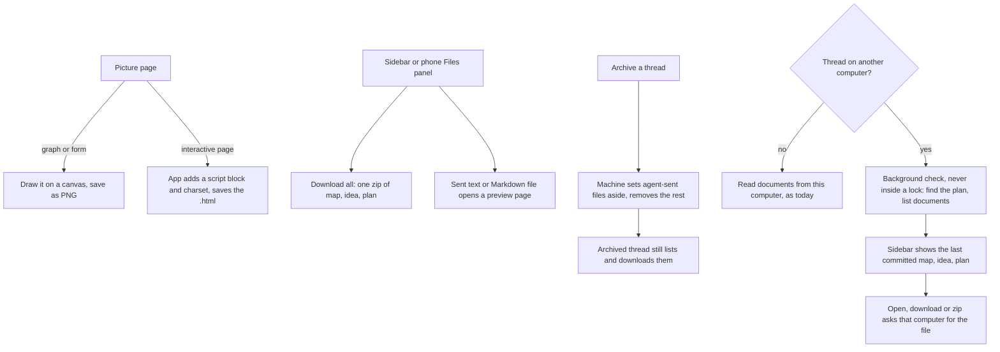

# Thread files: the parts saved for later

**Idea:** `IDEA.md` — what this is for and why, in plain language. Read it first; it is
the north star this plan serves. Goal and Constraints live there, not here.

Background: `docs/plans/thread-sidebar-files/PLAN.md` (Deferred D1–D7, Accepted Risks,
Review Rounds) and this plan's `MAP.md`.

## Open Questions

## Watch List

| # | Noticed | What needs looking into | Raised to user? | Outcome |
|---|---------|-------------------------|-----------------|---------|

## Decision Log

Append-only. A reversal is a new entry superseding the old, never an edit.

| # | Decision | Rationale | Source |
|---|----------|-----------|--------|
| 1 | Mode is two-part | User's pick | user |
| 2 | Picture downloads are PNG | Opens in every phone gallery and app; SVG often does not | defaulted |
| 3 | "Download all" is one zip of the thread's existing MAP.md, IDEA.md and PLAN.md | IDEA asks for project documents; pictures have their own image download, sent files their own rows | defaulted |
| 4 | In-app preview covers Markdown (rendered like the doc page) and plain text types (.txt, .log, .csv, .json and similar, shown as text) | IDEA's "text or Markdown"; other types keep downloading | defaulted |
| 5 | Threads on another computer read documents and pictures through that thread's machine service, with the network call made outside the per-thread locks | Required by IDEA's "must not freeze the thread list" and the lock rules in MAP.md | defaulted |
| 6 | Files already deleted by past archives are not recovered | They no longer exist anywhere | defaulted |
| 7 | Files agents sent are kept for good after archive; no timer, no delete button | User's pick; few, small files (25 MiB cap each) | user |
| 8 | HTML pictures download as their .html file, not PNG; graphs and forms download as PNG | HTML pictures run in a sandboxed frame the page cannot draw from; they are the rare fallback form | defaulted |
| 9 | The zip is built on the hub with a small built-in writer (stored, no compression), no new dependency | Three small Markdown files; the package has no zip library | defaulted |
| 10 | Remote threads show the last committed plan on `wc/<id>`, read through a new machine route; local threads keep reading the working tree | Leads commit plan changes each turn; reading refs avoids trusting worktree paths sent by the hub | defaulted |
| 11 | Supersedes Decision 10's rationale: remote reads use the branch because one path serves live and archived threads alike (the machine can already find a thread's worktree itself, `machine/service.js:1720-1723`). Trade-off: mid-turn, a remote live thread can show the plan as of the lead's last commit, while a local one shows unsaved edits | Correcting a wrong rationale from review | review-round-1 |
| 12 | Interactive-page (HTML) pictures download as their page file with scripts blocked; IDEA's "What good looks like" updated to say so | User's pick ("Save the page file") over no download | idea-change |
| 13 | Pictures of threads on another computer (plan pictures live or archived, and aside pictures) split into their own thread; IDEA's "What good looks like" drops pictures from the remote bullet and "Not doing" points to the new thread | User chose "Split it off" after four review rounds of findings on that part | idea-change |

## Spec

Five parts, independent of each other except where noted. "Remote thread" means a thread
whose `thread.machine` does not resolve to the hub's own machine (resolution as in
`viewer/app/state.js:212-220`, compared like `viewer/app/peers.js:6-10`). Everything else is a
"local thread" and keeps today's code paths, apart from what S1–S4 change.



### S1. Picture download (D1)

- The picture page (`viewer/pages/picture.js`) gets a **Download** button for every picture
  it can show.
- **Graph pictures:** clone the rendered SVG from the graph viewer
  (`viewer/index.html:1888-1906`); on the clone, remove the pan/zoom `transform` from the
  content group (the `<g>` created at `viewer/index.html:1905`); set the clone's `viewBox` to
  that group's `getBBox()` measured on the live SVG (which is in the group's own, untransformed
  coordinates) plus a 24 px margin, and its width/height to that box, so the export is
  independent of the viewport, pan or zoom; copy each
  element's computed style that affects drawing (fill, fill-opacity, stroke, stroke-opacity,
  stroke-width, stroke-dasharray, opacity, visibility, text-transform, letter-spacing,
  font-style, filter, font-family, font-size, font-weight, text-anchor, dominant-baseline) inline,
  remove the viewer's hidden label-measurement element (`text.label-metric`,
  `viewer/index.html:1902`) from the clone; serialize it, draw it onto a canvas at 2× scale on the page's background colour, and
  save the canvas as PNG. If either canvas side would exceed 8192 px, scale down to fit.
- **Form pictures** (timeline, before-after, layers, side-by-side): draw the form onto a
  canvas from its JSON with a small drawer per form, following the same reading order and
  text as the on-screen form (`viewer/pages/diagram.js:28-80`), wrapping long text, at 2×
  scale (scaled down if either side would exceed 8192 px, as for graphs), then save as PNG. Pixel-identical styling is not required; every string shown on
  screen appears in the image.
- **HTML pictures:** download the `.html` file itself (Decision 8), with
  `content-disposition: attachment`. The saved file must stay inert when opened: the hub
  inserts, immediately after the `<!doctype ...>` if one appears before any element (after
  optional BOM, whitespace and `<!-- -->` comments), otherwise as the very first bytes, `<meta charset="utf-8">`
  followed by `<meta http-equiv="Content-Security-Policy"
  content="default-src 'none'; style-src 'unsafe-inline'; img-src data:; font-src data:;
  base-uri 'none'; form-action 'none'">`: every directive of the in-app policy
  (`viewer/app/routes.js:17`) that a `<meta>` policy can carry (`frame-ancestors` and
  `sandbox` are ignored in `<meta>`; with no script, frame or connect source allowed, the
  file cannot run script, submit forms, load or send anything). The hub also removes every
  `<meta>` tag whose `http-equiv` is `refresh` (case-insensitive match on the tag), so the
  file cannot navigate away by itself.
- The download URL is the **same URL the picture page already displays the HTML from**, plus
  `&download=1`: the local-live `/wheelchair/diagram-html?path=...` route
  (`viewer/server.js:1673-1696`, which already resolves the card's plan and registered file)
  and the thread-scoped `.../diagram-html?file=` route (archived threads). Each route,
  given `download=1`, adds the prefix and `content-disposition: attachment; filename=
  "<graph file name>"` (the `.html` file's own name, e.g. `flow.html`; the title-based name is
  for PNGs only); without it, it behaves as today. The client never builds the file itself. This is the
  one new behaviour for local threads besides S1–S4's buttons.
- PNG file name: the picture's title, reduced to `[A-Za-z0-9._-]`, spaces to `-`, max 80
  characters, falling back to the graph file name; extension `.png`.
- Saving uses a blob URL on an `<a download>` element, which works in phone Safari and
  Chrome. The canvas never reads cross-origin images, so it is never tainted.
- Graph and form PNGs work wherever the picture page shows the picture, since they run on
  what the page already rendered.

### S2. Download all documents (D2)

- New hub route `GET /wheelchair/api/threads/:id/docs.zip`, same auth as the doc route
  (`viewer/app/routes.js:572-582`). It gathers the thread's existing MAP.md, IDEA.md and
  PLAN.md through the same readers the doc route uses (local, archived or remote, per S5),
  and returns a ZIP: `content-type: application/zip`,
  `content-disposition: attachment; filename="<slug>-documents.zip"`, entries named
  `<slug>/<FILE>`.
- The ZIP writer is a new hub module (`viewer/app/zip.js`, Decision 9): stored entries
  (method 0), CRC-32, local headers, central directory, end record; no ZIP64 (inputs are at
  most 3 × 2 MiB).
- A document qualifies for the ZIP exactly when the sidebar would list it: it exists and is
  at most 2 MiB. Local archived listing (`documents.list`, `viewer/app/documents.js:40-47`)
  changes to check the blob size (`git cat-file -s`) as well as existence, so an oversized
  archived document is no longer listed (matching local live and remote listing). Its cache
  key adds the branch tip commit (`git rev-parse <branch>`), so a branch that moved (for
  example an imported thread archived again) is listed afresh.
- 404 when the thread has no slug or no document qualifies.
- For a remote thread the route first calls `list` live (not the cache), then `read` for
  each listed file. If any machine call fails (unreachable, timeout, or an error status,
  including a 404 for a file `list` just reported), the route returns 502 "Couldn't reach
  <machine>"; it never returns a partial ZIP as success. For local threads a file that
  disappears between listing and reading is skipped.
- The sidebar's Project documents section and the phone Files panel
  (`viewer/pages/thread.js:381-465`) get a **Download all** link above the list when at least
  one of the three files exists.

### S3. Preview sent documents (D3)

- Previewable: a sent `file` card whose name ends (case-insensitive) in `.md`, `.markdown`,
  `.txt`, `.log`, `.csv`, `.tsv`, `.json`, `.yaml`, `.yml`, `.xml`, `.ini`, `.toml` and whose
  size is at most 2 MiB. Images keep today's behaviour.
- For those, the sent row in the sidebar/phone panel and the file chat card open a new page
  `viewer/pages/file.html` (+ `file.js`) at `?thread=<id>&file=<stored name>`. Others keep
  today's download link.
- The page fetches the existing file route (`viewer/app/routes.js:551-562`; a `fetch` reads
  the body regardless of `content-disposition`/`nosniff`, so the machine route is unchanged),
  stops with "Too big to preview" past 2 MiB, decodes as UTF-8, and shows:
  - Markdown through the shared `renderMarkdown` (`viewer/pages/markdown.js`), with a link
    resolver that allows only external `http(s)` links (no plan-file or relative links);
  - everything else as text in a `<pre>` via `textContent`, wrapping on narrow screens.
- The page shows the file name, a **Download** link (the plain file route) and a back link to
  the thread. Nothing from the file is ever inserted as HTML outside `renderMarkdown`'s
  existing escaping.
- On archived threads the preview works when the file is kept (S4).

### S4. Keep sent files after archive (D4)

- **Hub:** the archive call (`viewer/app/threads.js:217`) sends
  `{thread_id, keep: [names]}`, where `names` are the stored names (`card.file`) of the
  thread's `file` and `image` cards posted by a lead and not retracted, deduplicated. User
  attachments are never in the list.
- **Machine** `archive()` (`machine/service.js:1138-1217`): inside the existing per-thread
  lock and before removing `uploads/<thread>`, for each name matching
  `^[0-9]+-[A-Za-z0-9._-]+$` that is a regular file (lstat, not a symlink) in
  `uploads/<thread>/`, move it to `<stateDir>/kept/<thread>/<name>` (create the directory
  mode 0700; `rename`, falling back to copy-then-unlink across file systems). A name that
  does not exist is skipped. Any other failure is reported like a failed uploads removal
  (`uploads_removed: false` plus `uploads_error`), so today's retry contract
  (`viewer/app/threads.js:226-241`) applies unchanged. The response adds `kept_uploads: [names]` (a new field: the existing `kept` field lists
  retained worktrees and keeps its meaning and the hub's rebase retry check):
  the requested names present in `kept/<thread>/` after the move step, whether moved by this
  attempt or an earlier one, so a retried archive reports files an earlier attempt already
  preserved.
- A machine not yet updated ignores `keep` and returns no `kept_uploads`; the hub treats a
  missing or non-array `kept_uploads` as empty and keeps only string entries (links stay hidden, the same as today's behaviour).
- `GET /v1/uploads/:threadId/:file` (`machine/service.js:1973-1981`) serves
  `uploads/<thread>/<file>` and, if absent, `kept/<thread>/<file>`, with the same name check,
  headers and symlink refusal.
- `reserveUpload` (`machine/service.js:300-315`) takes the highest `N-` prefix across both
  `uploads/<thread>/` and `kept/<thread>/`, so a restored thread never reuses a kept number.
- Kept files are never removed (Decision 7). A thread restore leaves them in `kept/`.
- **Hub record:** on a finished archive, set `thread.kept_files` to the response's
  `kept_uploads` list (an array of stored names; absent or empty means none). The chat response carries it.
  On an archived thread, a sent row, file chat card or image card shows its link, preview or
  image only when its `card.file` is in `thread.kept_files` (today they are always
  suppressed: `viewer/pages/thread.js:405-445,1139`); any other keeps today's archived
  "Removed when the thread was archived" state.

### S5. Documents of remote threads (D5, D7)

**What it shows.** For a remote thread (live or archived), the sidebar and phone panel list
the plan's MAP.md, IDEA.md and PLAN.md, and they open, download and zip as for a local
thread. They show the **last committed** version on the thread's branch `wc/<id>` (leads
commit plan changes before each turn ends); a local live thread keeps reading the working
tree. Pictures of remote threads are not part of this plan (Decision 13): they behave as
today.

**Machine route.** New hub-authenticated `POST /v1/plan-files` with body
`{thread_id, project, default_branch, slug?, action, file?}`:

- `thread_id` must match `^[0-9a-f]{12}$`; the branch is always `wc/<thread_id>`.
- `project` must be absolute, a directory with `.git`, and exist on this machine.
- `action: "discover"`: run the `newPlanDirectories` logic on refs only — merge base of
  `wc/<id>` and `origin/<default_branch>` (falling back to `<default_branch>`), added files
  under `docs/plans` in `base..wc/<id>`, minus directories present at the base. Returns
  `{slug}` when exactly one, else `{slug: null}`.
- `action: "list"`: `slug` required and valid (`documents.validSlug` rules). Returns
  `{files: [...], status}`: which of the three plan files exist at `wc/<id>` and are at most
  2 MiB (`git cat-file -s`), matching the local 2 MiB rule (`viewer/app/documents.js:13`);
  an oversized file is not listed, so it never appears in the sidebar or the ZIP. `status`
  is the value of PLAN.md's `status:` front-matter line at `wc/<id>` (same regex as
  `viewer/app/views.js:115-118`), or `null` when PLAN.md is not listed.
- `action: "read"`: `slug` and `file` required. `file` is one of the three plan files
  (the follow-up thread for pictures may extend this). Returns the blob
  via `git show wc/<id>:docs/plans/<slug>/<file>` (with `maxBuffer` of at least 3 MiB), as
  `{content}` (UTF-8 string). A file over 2 MiB (`git cat-file -s` first) is answered as
  404, like a missing file, so the doc page shows its not-found state.
- Errors: 400 for bad input, 404 for a missing ref or file. All git calls use `execFile`
  with argument arrays, never a shell.

**Hub reads.** A new hub module (`viewer/app/remote-plan.js`) owns remote reads through the
machine client with an overall 10 s deadline covering the whole response, not just the
connection: if the response is aborted, errors or has not finished within 10 s, the read
rejects (a new `MachineClient` helper may be added for this; `requestJson` today does not
reject on an abort after headers, `viewer/app/machine-client.js:30-46`). The in-flight flag
of a background refresh is cleared in a `finally`, so no failure leaves it set:

- **Discovery and listing, never under a lock.** `discoverSlug`/`findSlug`, the Features
  page's own discovery (`viewer/app/views.js:38-41`) and `documents.list` skip remote threads
  (return null / use the cache). After the chat lock is
  released (as `refreshHandoffStatus` does: `viewer/app/hub.js:267-295`), and after the
  thread-list poll finishes its per-thread section, the hub fires a background refresh for
  each remote thread whose last refresh **attempt** (successful or not) started more than
  30 s ago and has no refresh in flight. The
  refresh snapshots `machine`, `project`, `default_branch`, `slug`; calls `discover` if no
  slug, then `list`; then takes `withThread`, re-reads the thread and stores the result only
  if `machine`, `project` and `slug` (when it had one) still match. A discovered slug is
  saved to `thread.slug`; a non-null `status` that differs from `thread.last_status` is saved
  to `thread.last_status` in the same locked section; `{files}` goes into an in-memory cache
  keyed by thread id. Failures keep the last good cache and are not shown as errors.
- **Features and Agents page stage:** no code change. `readStatus` already falls back to
  `thread.last_status` when PLAN.md is not on the hub's disk (`viewer/app/views.js:115-118`,
  used by `viewer/app/agents.js:133`), which is the case for a remote thread, so both pages
  group a remote thread by its committed plan status once a refresh has saved it.
- The chat response and thread list use the cached file list for remote threads.
- **Document reads** (doc route view and download, S2 ZIP) for a remote thread call `read`
  outside any lock. Status mapping for the doc route: a machine **404** (missing ref or
  file) or 400 becomes the doc route's existing 404, so the doc page shows its existing
  not-found state; a connection error, timeout or any other status becomes 502 "Couldn't
  reach <machine>". The S2 ZIP is stricter, as stated there.
- Archived remote threads read documents through the machine too, instead of the hub-local
  `git -C thread.project` (`viewer/app/threads.js:251-266`); local archived threads keep
  that local path.
- Local threads behave as today apart from S1–S4 and the HTML routes' `download=1` (S1).
- Graph, form and HTML picture routes, `viewer/pages/diagram.js`, `viewer/pages/picture.js`
  and `viewer/index.html` picture loading and polling are unchanged by S5.

### Non-goals

- Pictures (plan or aside) of threads on another computer: split into their own thread
  (Decision 13).
- Showing uncommitted plan edits of remote threads.
- Editing, deleting or expiring kept files; recovering files deleted by earlier archives.
- Previews for other file types; zipping pictures or sent files.

### Validation

```bash
node --test viewer/test/*.test.js
bash machine/test/run.sh
npm --prefix viewer run test:browser
```

New tests, at least:

- `viewer/test/zip.test.js`: the ZIP writer's output unzips (`unzip -t` or Python
  `zipfile`) with the right names and bytes.
- Viewer route tests: `docs.zip` for a local live, local archived and remote thread (fake
  machine); 404 with no documents; remote doc reads (live and archived); machine 404 → 404
  and unreachable machine → 502 on the doc route; any failure → 502 on the ZIP;
  remote discovery stores the slug only when the snapshot still matches; no caller starts
  or awaits a `/v1/plan-files` request inside a `withThread`/`withChatThread` callback (a
  background refresh started after a lock was released may still be in flight when the lock
  is taken again; that is allowed). Chat's existing transcript fetch is unchanged.
- Browser tests also: an exported graph keeps
  its group shading translucent (`fill-opacity`); a saved HTML file with a doctype (also one preceded by a comment) keeps it
  first and has no refresh meta.
- Viewer route tests also: a remote thread's Features page group follows the `status`
  from `list`; an archived listing is recomputed after the branch tip moves; an oversized
  local archived document is not listed and not
  zipped; archived rows show
  links only for names in `thread.kept_files`; a rebase-kept archive still stays unarchived.
- Machine tests: `/v1/plan-files` discover/list/read on a temp repo, input refusals, a
  1.5 MiB file listed and read whole, a file over 2 MiB unlisted and read as 404; archive moves only listed names to `kept/`, a retried archive after a
  completed move reports the right `kept_uploads` (the viewer test checks `thread.kept_files`), serves them afterwards, still
  removes everything else; a move failure yields `uploads_removed: false`; `reserveUpload`
  numbering across `kept/`.
- Browser tests: picture page Download produces a PNG blob for a graph (including one wider
  than a 390 px phone viewport, panned and zoomed before downloading, whose PNG contains every
  node) and a form, and an `.html`
  download for an HTML picture (a doctype-free fixture with non-ASCII text) whose first bytes
  are the charset and CSP metas, whose non-ASCII text displays correctly, and which, opened as a
  page, runs no inline script and does not submit a form; file preview page renders Markdown and text and shows
  "Too big to preview"; Download all link appears; archived thread with `kept_files` shows
  download links.

## Deferred

| # | Item | Why it can wait | Source | Notes for the follow-up |
|---|------|-----------------|--------|-------------------------|

## Accepted Risks

| Risk | Why accepted | Round |
|------|--------------|-------|
| A saved HTML picture could still navigate away through refresh tricks the tag match misses | Needs an agent writing deliberately evasive HTML (tampering, a rare path); the file opens from disk, not the app's origin, so it cannot reach the app or its secrets | review-round-3 |
| A remote thread merged before the hub learned its slug never shows its documents | Same limitation local discovery has today; slugs are learned within about 30 s of a plan appearing, so it affects only threads older than this feature | review-round-6 |
| A plan document path committed as a directory or symlink could be listed or zipped as its listing or link text | Rare path: agents write plan files as regular files | review-round-6 |
| A remote thread's stage could read a hub-local file if the hub has a checkout at that thread's worktree path | Rare path: worktree paths carry the thread id and live on the thread's own machine | review-round-7 |
| After undoing a handoff archived before files were kept, a new attachment could reuse an old file card's numbered name and be kept or served as it | Rare path: needs an undone handoff of a thread archived before this feature, then a numbering collision | review-round-7 |
| A very large graph or form may exceed older iOS Safari's canvas area limit and fail to download | Rare path: older browser versions with unusually large pictures | review-round-7 |

## Check Once Built

| # | What to check | Round |
|---|---------------|-------|
| 1 | A plan document between 1 MiB and 2 MiB is listed and read whole through `/v1/plan-files` (no `execFile` buffer cut-off) | review-round-5 |

## Review Rounds

### Round 1 — 2026-11-20

**Lanes:** intent: claude; mechanics: gpt (gpt-6.2-sol); cross-family: yes.

**Changed since Round 0:** n/a (first round — whole Spec in scope)

| Lane | Reported | Finding | Lead verdict | Resolution |
|------|----------|---------|--------------|------------|
| intent | minor | HTML pictures download as .html, departing from IDEA's "image file" | user-decision | User chose "Save the page file"; Decision 12 |
| intent | minor | Decision 10's rationale is wrong; mid-turn lag on remote threads unrecorded | upheld | Decision 11 |
| intent | minor | Background refresh is heavier than on-demand listing | declined | The sidebar list already rides the chat poll; an on-demand route adds a request per poll and still needs stored discovery |
| mechanics | blocking | Older machine ignores `keep` and deletes uploads | downgraded (minor) | Same as today's behaviour on that machine, not a wrong build; S4 now treats missing `kept_files` as 0 |
| mechanics | blocking | Retry accounting for `kept_files` undefined | downgraded (major) | S4: count requested names present in `kept/` |
| mechanics | blocking | Exported HTML can run script when opened | upheld | S1: hub prefixes a CSP meta; download is a hub route |
| mechanics | major | Remote graph names have no defined path to picture rows | upheld | S5: rows stay card-driven, `list` drops graphs, reads use thread slug like archived |
| mechanics | major | ZIP error handling for remote reads unspecified | upheld | S2: live `list` then `read`; any failure is 502, never a partial ZIP |
| mechanics | major | Lock test would fail on chat's existing transcript fetch | upheld | Validation scoped to `/v1/plan-files` calls |
| mechanics | minor | Pan/zoom reset does not fit the graph for export | upheld | S1: export bounds from content bbox, 8192 px cap; wide-graph test |

### Round 2 — 2026-11-21

**Lanes:** intent: claude; mechanics: gpt; cross-family: yes.

**Changed since Round 1:**
- S1: graph export bounds from content bbox, 8192 px cap; HTML download is a hub route that prefixes a CSP meta (Decision 12, IDEA updated).
- S2: remote ZIP lists live then reads; any machine failure is 502, never a partial ZIP.
- S4: `kept_files` counts requested names present in `kept/` (retry-safe); missing `kept_files` from an older machine means 0.
- S5: `list` returns files only; picture rows stay card-driven; remote picture reads use the thread slug like archived reads.
- Validation: lock test scoped to `/v1/plan-files`; wide-graph and CSP-prefix browser tests; retry test.
- Decision 11 corrects Decision 10's rationale and records the mid-turn lag.

| Lane | Reported | Finding | Lead verdict | Resolution |
|------|----------|---------|--------------|------------|
| intent | minor | S1 "local, archived or remote" HTML download contradicts S5 "local threads exactly as today" | upheld | S1: download reuses the displayed URL + `download=1`; named as the one new local behaviour |
| intent | minor | S1 "works for all threads" no longer true for HTML | upheld | S1 limited to graph and form PNGs |
| mechanics | blocking | Pan/zoom transform left on cloned group crops export | upheld | S1: remove transform, bbox in group coordinates; test pans/zooms first |
| mechanics | blocking | Saved HTML policy weaker than in-app (form-action, base-uri) | downgraded (major) | S1: meta carries every meta-capable directive; behaviour test |
| mechanics | major | Local-live HTML download can't resolve the card's file | upheld | S1: download = displayed URL + `download=1` on both routes |
| mechanics | major | Kept count can't say which files survived | upheld | S4: `kept` names list; per-file links |
| mechanics | blocking | Remote picture 404 vs 502 mapping undefined | downgraded (major) | S5: status mapping |
| mechanics | blocking | Remote live graph hash from length misses same-length edits | downgraded (major) | S5: SHA-1 content hash from route |
| mechanics | minor | Failed refresh retried every poll | upheld | S5: 30 s from last attempt |

### Round 3 — 2026-11-21

**Lanes:** intent: claude; mechanics: gpt; cross-family: yes.

**Changed since Round 2:**
- S1: export removes the pan/zoom transform and uses the group's bbox; saved HTML meta policy adds font-src, base-uri, form-action; HTML download is the displayed URL plus `download=1` on both the local-live and thread-scoped routes.
- S4: archive returns `kept: [names]`; `thread.kept_files` is that list; archived links per file.
- S5: 404 vs 502 status mapping for remote reads; graph route returns a SHA-1 content `hash` used by `getArchivedGraph`; refresh retry 30 s from last attempt.
- Validation: pan/zoom export test, saved-HTML behaviour test, status-mapping, hash and per-file tests.

| Lane | Reported | Finding | Lead verdict | Resolution |
|------|----------|---------|--------------|------------|
| intent | minor | S5 "local exactly as today" conflicts with the hash wrapper on local archived | upheld | S5 lists the local route changes |
| intent | minor | CSP meta before doctype forces quirks mode | upheld | S1: meta after a leading doctype |
| mechanics | blocking | `kept` already names retained worktrees | upheld | S4: new `kept_uploads` field; rebase check untouched |
| mechanics | blocking | Saved HTML can navigate away via meta refresh | downgraded (minor) | S1: hub strips refresh metas; obfuscated variants are an agent-tampering rare path (Accepted Risks) |
| mechanics | blocking | `MachineClient.call` can hang on an aborted response | downgraded (major) | S5: 10 s whole-response deadline; in-flight cleared in finally |
| mechanics | major | HTML download name needs the card title | upheld | S1: `.html` saves under its own file name |
| mechanics | major | Picture UI states for 404/502 not defined per format | upheld | S5: per-format failure display; tests |
| mechanics | major | Remote graph opened before commit stays hidden | upheld | S5: successful poll clears fatal for thread-scoped reads |
| mechanics | minor | Export omits fill-opacity | upheld | S1 style list; test |
| mechanics | minor | Meta-first forces quirks mode | upheld | Same fix as intent finding |

### Round 4 — 2026-11-21

**Lanes:** intent: claude; mechanics: gpt; cross-family: yes.

**Changed since Round 3:**
- S1: export style list adds fill-opacity and stroke-opacity; CSP meta goes after a leading doctype; refresh metas stripped; HTML downloads save under the `.html` file's own name.
- S4: archive response field renamed `kept_uploads` (existing `kept` worktree field and rebase check untouched); hub keeps only string entries.
- S5: 10 s whole-response deadline for machine reads, in-flight cleared in finally; per-format failure display on the picture page and inline cards; thread-scoped graph polls recover from the fatal screen; local route changes listed.
- Accepted Risks: first row (refresh tricks).
- Validation: matching browser and route tests.

| Lane | Reported | Finding | Lead verdict | Resolution |
|------|----------|---------|--------------|------------|
| intent | minor | Form 404 text contradicts "existing 404" mapping | upheld | Moved to the split thread with its part |
| intent | minor | Machine retry test names `kept_files` | upheld | Validation names `kept_uploads` |
| mechanics | blocking | `/graph` wrapper breaks form pictures | upheld | Moved to the split thread with its part |
| mechanics | blocking | Recovery skips initial fit and breadcrumbs | downgraded (major) | Moved to the split thread with its part |
| mechanics | major | 404 then 502 leaves "graph is gone" showing | upheld | Moved to the split thread with its part |
| mechanics | major | Overlapping 10 s polls can redraw stale graphs | upheld | Moved to the split thread with its part |
| mechanics | major | Form cache keeps failed reads for the tab's life | upheld | Moved to the split thread with its part |
| mechanics | major | Oversized remote document listed then unreadable | upheld | S5: `list` excludes files over 2 MiB |
| mechanics | minor | Export style list misses visibility and text styles; measurement element leaks | upheld | S1: styles added, measurement element removed |
| mechanics | minor | Machine retry test names `kept_files` | upheld | Same fix as intent finding |

### Round 5 — 2026-11-21

**Lanes:** intent: claude; mechanics: gpt; cross-family: yes.

**Changed since Round 4:**
- Split (Decision 13, IDEA updated): pictures of remote threads moved to their own thread. S5 now covers documents only; picture routes, pages and polling are unchanged by S5; the hash wrapper and per-format failure display are gone; `read` accepts only the three plan files; archived remote threads read documents through the machine.
- Deferred D1 (aside pictures on remote threads) moved to the split thread; Deferred is empty.
- S1: export style list adds visibility, text-transform, letter-spacing and removes the label-measurement element; HTML download applies to the local-live and archived routes.
- S5: `list` excludes files over 2 MiB.
- Validation: picture-remote tests removed; machine retry test checks `kept_uploads`.

| Lane | Reported | Finding | Lead verdict | Resolution |
|------|----------|---------|--------------|------------|
| intent | minor | `remote: true` has no reader after the split | upheld | Dropped from S5 |
| mechanics | major | Archived ZIP eligibility vs oversized documents | upheld | S2: archived listing checks size; qualifies = listed; 404 when none |
| mechanics | major | Lock test forbids overlap the background design allows | upheld | Validation: no `/v1/plan-files` start or await inside a lock callback |
| mechanics | minor | Oversized remote read status unspecified | upheld | S5: over 2 MiB answered as 404 |
| mechanics | minor | Check once built: 1–2 MiB documents survive `execFile` buffer | check-once-built | S5 sets maxBuffer ≥ 3 MiB; Check Once Built row; machine test |
| mechanics | minor | Saved HTML encoding implicit | upheld | S1: `<meta charset="utf-8">`; non-ASCII test |
| mechanics | minor | Export style list omits font-style and filter | upheld | S1 style list |
| mechanics | minor | Byte-zero CSP test should use a doctype-free fixture | upheld | Validation scoped |

### Round 6 — 2026-11-21

**Lanes:** intent: claude; mechanics: gpt; cross-family: yes.

**Changed since Round 5:**
- S1: saved HTML gets `<meta charset="utf-8">` before the CSP meta; style list adds font-style and filter.
- S2: a document qualifies for the ZIP exactly when listed; local archived listing now checks size ≤ 2 MiB; 404 when none qualifies.
- S5: `read` uses maxBuffer ≥ 3 MiB and answers over-2 MiB as 404; `remote: true` dropped.
- Validation: lock test rephrased (no start/await inside lock callbacks); size and encoding tests; byte-zero test uses a doctype-free fixture.
- New Check Once Built section (1 row).

| Lane | Reported | Finding | Lead verdict | Resolution |
|------|----------|---------|--------------|------------|
| intent | minor | Spec opening says local code paths unchanged; S2 changes archived listing | upheld | Opening says "apart from S1–S4" |
| mechanics | blocking | Remote discovery fails for a branch merged before its slug was learned | accepted-risk | Same limitation as today's local discovery (`viewer/app/views.js:71-97`); only threads merged before the hub learned their slug, in practice threads older than this feature (Accepted Risks) |
| mechanics | major | Features page reads remote stage from the hub filesystem | upheld | S5: `list` returns `status`; refresh stores `last_status`; `currentStatus` uses it for remote threads |
| mechanics | minor | Archived listing cache ignores branch tip | upheld | S2: cache key adds tip commit |
| mechanics | minor | Rare path: tree or symlink entry at a plan document path | accepted-risk | Rare path (a plan file committed as a directory or symlink); Accepted Risks |
| mechanics | minor | Comment before doctype puts metas first | upheld | S1: skip leading comments |
| mechanics | minor | Form canvas has no size cap | upheld | S1: same 8192 px cap |

### Round 7 — 2026-11-21

**Lanes:** intent: claude; mechanics: gpt; cross-family: yes.

**Changed since Round 6:**
- S1: metas go after a doctype preceded only by BOM, whitespace or comments; form canvas gets the 8192 px cap.
- S2: archived listing cache key adds the branch tip commit.
- S5: `list` returns PLAN.md `status`; refresh saves it to `last_status`; Features page discovery skips remote threads and `currentStatus` uses `last_status` for them.
- Spec opening: local threads change only where S1–S4 say.
- Accepted Risks: two new rows (merged-before-discovery, non-regular plan file entries).

| Lane | Reported | Finding | Lead verdict | Resolution |
|------|----------|---------|--------------|------------|
| intent | minor | `currentStatus` change unneeded; `readStatus` already falls back to `last_status` | upheld | S5: no stage-reader change; both pages use the fallback |
| mechanics | blocking | RE-RAISE: a thread can merge before the hub ever polls | declined | Not normal use: between a plan appearing and merging, the user must use the app (plan questions, Start building, Done card), and each chat poll triggers a refresh within 30 s; the accepted-risk rationale stands |
| mechanics | minor | Agents view reads a hub path before `last_status` | accepted-risk | Rare path: needs a checkout on the hub at the remote thread's own worktree path |
| mechanics | minor | Rare path: undone handoff reuses upload numbers of old cards | accepted-risk | Rare path; Accepted Risks |
| mechanics | minor | Rare path: older iOS canvas area limit | accepted-risk | Rare path; Accepted Risks |

## Implementation Tasks

| # | Objective | Ownership boundary | Lane | Session id | Validation | Status |
|---|-----------|--------------------|------|-----------|------------|--------|
| T1 | Machine: `/v1/plan-files` route (S5), archive keeps lead-sent files, kept serving and numbering (S4) | `machine/service.js`, `machine/API.md`, `machine/test/plan-files.test.js` | standard, gpt-6.1-terra | wc-291bff9fbda1-worker | `bash machine/test/run.sh` | done |
| T2 | tricky — Hub: ZIP writer and `docs.zip` (S2), remote plan reads and background refresh (S5), archive `keep` and `kept_files` (S4), HTML `download=1` (S1) | `viewer/app/*`, `viewer/server.js` diagram-html handling, `viewer/test/*.test.js` | standard, gpt-6.1-terra | wc-291bff9fbda1-worker-2 | `node --test viewer/test/*.test.js` | done |
| T3 | Picture page Download (S1 PNG export, HTML link) and sent-file preview page (S3) | `viewer/pages/picture*`, `viewer/pages/file.*`, `APP_PAGES` line, new specs | standard, claude-sonnet-5-5 | wc-291bff9fbda1-worker-3 | `npm --prefix viewer run test:browser`; `node --test viewer/test/*.test.js` | done |
| T4 | Thread page: Download all link (S2), sent rows open preview (S3), archived rows honour `kept_files` (S4), HTML download inertness browser test (S1); after T2 and T3 | `viewer/pages/thread.js`, `thread.css`, new spec | standard, claude | | `npm --prefix viewer run test:browser`; `node --test viewer/test/*.test.js` | not started |

## Log

Build accepted: approval a40eb86e-c69f-46d8-815d-be9ef02baa25
- 2026-11-21 — Choice: T1, archive response: pending archive responses omit `kept_uploads`; rebase-in-progress responses report requested regular files already kept.
- 2026-11-21 — Choice: T1, archive `keep`: duplicate names reported once, in request order; invalid entries silently dropped (scout-noted, not in report).
- 2026-11-21 — Choice: T1, plan-files: extra `default_branch` validation (no leading `-`, `check-ref-format`) (scout-noted, not in report).
- 2026-11-21 — T1 accepted (band: scout): machine suite 449/449 re-run by sub-lead; scout found no spec deviations; minor robustness notes (ENOTDIR when `kept/<thread>` is a file, EACCES after removal) are rare paths.
- 2026-11-21 — Choice: T2, `viewer/app/remote-plan.js`: per-hub WeakMap holds the file cache, attempt times and in-flight set, so separate Hub instances do not share remote results.
- 2026-11-21 — Choice: T2, `viewer/app/remote-plan.js` refresh: the snapshot check also compares `default_branch`, and a snapshot without a slug is dropped if a slug appeared meanwhile (seen in diff, not in report).
- 2026-11-21 — Choice: T2, `viewer/app/machine-client.js`: `requestJson` now rejects on a dropped response for every caller, not only `strict` ones (seen in diff, not in report).
- 2026-11-21 — Choice: T2, `viewer/app/threads.js` archive `keep`: "posted by a lead" means `card.session` is any session in `thread.sessions` with role `lead` (seen in diff, not in report).
- 2026-11-21 — Choice: T2, `viewer/app/remote-plan.js` `isRemote`: a thread whose machine is `hub` is local; otherwise remote unless both names resolve to the same registry entry (identity, as `peers.js` `sameMachine`).
- 2026-11-21 — T2 accepted (band: self, tricky): viewer suite 732/732 re-run by sub-lead; diff read in full; no lock-held machine calls, 404/502 mapping and ZIP strictness as Spec.
- 2026-11-21 — Choice: T3, `viewer/pages/file.js`: previewable-file helper is `window.WCFilePreview {previewable, href, MAX}`; the thread page must load `file.js`; `previewable` is false when the size is unknown.
- 2026-11-21 — Choice: T3, `viewer/pages/picture-export.js` forms: export re-fetches the form JSON from `WCDiagram.source(...)` instead of reading the drawn DOM; fixed 900 px logical width, colours from the page's CSS variables.
- 2026-11-21 — Choice: T3, `viewer/test/app-picture-download.spec.js`: the wide-graph PNG is checked by exact dimensions plus non-background pixels in each quarter of the width, not per node.
- 2026-11-21 — Choice: T3, `viewer/pages/file.js`: a non-previewable extension shows "cannot be previewed" with the Download link; stored names not matching `^[0-9]+-[A-Za-z0-9._-]+$` are refused.
- 2026-11-21 — Choice: T3, preview tests serve files through the fake machine's `uploadsDir`.
- 2026-11-21 — T3 accepted (band: bigger-scout): full browser suite 1120 passed re-run by sub-lead on the worker branch; scout found no Spec deviation and no HTML injection; weak spots (pan/zoom proof is a transform-string check; only the timeline form is tested) left for verification.
