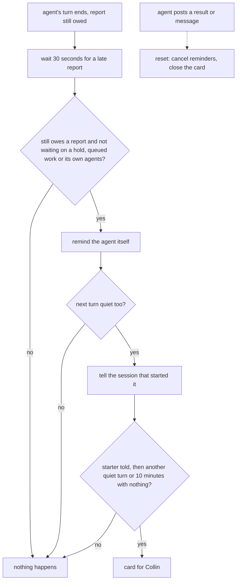

# Catch agents that stop silently

**Idea:** `IDEA.md` — what this is for and why, in plain language. Read it first; it is
the north star this plan serves. Goal and Constraints live there, not here, so they don't
get buried as this file grows. **Map:** `MAP.md`.

## Open Questions

(none)

## Watch List

| # | Noticed | What needs looking into | Raised to user? | Outcome |
|---|---------|-------------------------|-----------------|---------|

## Decision Log

Append-only. A reversal is a new entry superseding the old, never an edit.

| # | Decision | Rationale | Source |
|---|----------|-----------|--------|
| 1 | Watched roles: worker, mapper, sub-lead (post `result` cards) and reviewer, verifier (result synthesized from their last text). Never the lead. | Every role that owes its starter a report can stall; reviewer/verifier stall when their turn ends with no text (MAP.md §5). Lead excluded by IDEA "Not doing". | defaulted |
| 2 | "Owes a reply" starts when a message is delivered to the session, including its initial brief, and is cleared by any `result` or `message` card it posts (or, for reviewer/verifier, by a synthesized result). A `finished` session never owes one. | A `message` means it is waiting on someone (a question to the lead) and is legitimate. The initial brief bypasses `thread.sent` (MAP.md §1, §3), so it must be counted explicitly. | defaulted |
| 3 | A quiet turn is judged after a grace period (30 s) from the turn-end event, not at the event, and only if the session is still idle, live, owes a reply, has an empty queue and no open permission/stuck hold. | Card and event spools drain independently, so a result can land after its turn end (MAP.md §4). An agent with a queued message, or blocked on a prompt, is not silent. | defaulted |
| 4 | App posts the nudge as `[wc:from app] ...` messages and Collin's alert as an app (system) `needs` card that closes itself when the session posts a `result` or `message`, or is stopped or ends. | Reuses the existing turn-failed / dead-session / stuck patterns (MAP.md §6); system needs cards cannot be resolved by a lead, matching "Sessions ended". | defaulted |
| 5 | Rules: worker.md, sub-lead.md, lead.md say a session's own `wc.js` and `card.js` calls are always allowed and no brief can forbid them; briefs restricting ports or the network must exempt them; a worker (and mapper, sub-lead) facing a conflict between its brief and finishing posts `result` `blocked` with the reason, never stops silently. cards.md gets the same one-line rule. | IDEA "What good looks like". | defaulted |
| 6 | No Agents tab change. | Collin sees the alert in the thread (IDEA); the tab's idle state is correct. | defaulted |
| 7 | Escalation order: on a quiet turn the app first messages the quiet agent itself (it ended without reporting; its own wc.js and card.js calls are always allowed; post a `result`, or `blocked` with the reason, or a `message` if it needs an answer). If its next turn is quiet too, the app messages the session that started it. | Fixes the common case (an agent that forgot or misread a brief) without spending the starter's turn. | user |
| 8 | Collin sees it (a system `needs` card) once the starter has been told and then either the agent ends another quiet turn or 10 minutes pass with no `result` or `message` from it. | A timer alone is slow when the agent visibly stalls again; a second quiet turn alone never fires if the starter does nothing. | user |
| 9 | Supersedes part of 2: `finished` does not end watching for worker, mapper, sub-lead; any delivered message makes them owe a reply again. A session waiting on its own live, unfinished children is never quiet. | A sub-lead may re-message a finished worker; a sub-lead dispatching workers legitimately ends turns with no card. | defaulted |
| 10 | If the starter is no longer live at the starter step, go straight to Collin's card. | Nobody else can act. | defaulted |
| 11 | The rule fix gets its failing-first test as a text check over the role files (`viewer/test/protocol-rules.test.js`). | The repo has no protocol test suite; the stub requires a test per fix. | defaulted |
| 12 | Timers configurable through Hub options and `WHEELCHAIR_QUIET_GRACE_MS` / `WHEELCHAIR_QUIET_ESCALATE_MS`; the check runs on the queue retry timer. | Tests need short timings; the existing 5 s timer is fine-grained enough. | defaulted |
| 13 | Review round 1: nudges are tagged and cancelled on reset; the escalation timer starts at the starter nudge's delivery; a re-messaged finished child counts as outstanding; a due check survives holds and is re-checked each tick. | Mechanics findings 1–4, upheld. | review-round-1 |
| 14 | Collin's card wording follows the path that reached it; reviewer.md and verifier.md get the report-a-conflict rule. | Intent findings 2–4, upheld. | review-round-1 |
| 15 | Watched agents never end a turn to wait on their own background work; they wait in the foreground. The agent reminder adds a line telling an agent that did to wait in the foreground now. No exemption in the hub. | The hub cannot see a CLI's background jobs; a rule costs nothing and Codex already works this way. | user |
| 16 | Supersedes the Terms part of 13: a child is outstanding only while it owes a reply or is still waiting to start; `finished` is not consulted. Reviewer/verifier reminder gets the background-work line. | Review round 2 intent findings, upheld. | review-round-2 |
| 17 | Stage 3 from a quiet turn waits until the starter reminder is delivered; a starter that dies with the reminder queued sends it straight to Collin's card. | Review round 2 mechanics findings, upheld. | review-round-2 |
| 18 | A child with a non-empty queue also counts as outstanding. Decisions 16 and 18 together supersede Decision 9's second sentence: `finished` plays no part in "waiting on others" (Spec Terms is authoritative). | Review round 3 mechanics finding, upheld. | review-round-3 |

## Spec

Two parts: rule text in `protocol/app/`, and a quiet-turn detector in the hub
(`viewer/app/`). Read `MAP.md` for how turns, deliveries and cards flow today.

### The flow at a glance

An agent's turn ends while it still owes a report. After a short wait, if it still owes one
and isn't legitimately waiting, the app reminds the agent. If it goes quiet again, the app
tells the session that started it. Once that session has actually been told, another quiet
turn or ten minutes with nothing reaches Collin as a card. Any result or message from the
agent resets everything and closes the card.



### Terms

- **Watched session:** a live session whose role is `worker`, `mapper`, `sub-lead`,
  `reviewer` or `verifier`, with a `started_by`. The lead is never watched.
- **Owes a reply:** a per-session flag `owes_reply`.
  - Set to `true` when the hub creates a watched session whose `first_message` is true (the
    brief, or Codex's role line: `viewer/app/sessions.js:243-247`), and whenever `deliver()`
    successfully submits a message to a watched session (`viewer/app/sessions.js:330-346`),
    whatever its source, including the app's own nudges.
  - Cleared (`false`) when that session posts a `result` or `message` card that the hub
    accepts (`viewer/app/cards.js:79-95`), or when the hub synthesizes a reviewer/verifier
    result for it (`viewer/app/sessions.js:259-280`).
  - `finished` is not consulted for `worker`, `mapper`, `sub-lead`: a sub-lead may message a
    worker that already posted a result, and that worker then owes a reply. A `reviewer` or
    `verifier` with `finished: true` is not watched (its report path is closed:
    `viewer/app/sessions.js:260`).
- **Waiting on others:** the session has at least one child (`started_by` equals its name)
  that is `live` and either owes a reply, is still `status: 'waiting'` to start
  (`viewer/app/sessions.js:133`), or has a non-empty `queue` (work handed to it but not yet
  submitted because it is busy or held: `viewer/app/cards.js:81-85`,
  `viewer/app/sessions.js:312-314`). `finished` is not consulted: a worker re-messaged after its
  first result owes a reply again, and a child that has asked its starter something (a
  `message`, which clears its `owes_reply`) is waiting on the starter, so it is no reason for
  the starter to stay quiet. The Agents tab's `waiting_on`
  (`viewer/app/agents.js:13`) is not changed. A sub-lead dispatching workers ends many turns with no
  card; this is what makes those turns legitimate.
- **Quiet:** a watched session that, at check time, owes a reply, has `turn_ended: true`, an
  empty `queue`, no `permission_open`/`needs_open` hold, no `limited_until` in the future, and
  is not waiting on others.

### The detector

State on each session (persisted with the thread, like `turn_ended`):
`owes_reply`, `quiet_stage` (0–3, absent = 0), `quiet_check_at` (ISO time or absent),
`quiet_starter_at` (ISO time or absent), `quiet_card` (card id or absent).

1. **Arming.** On a `turn-ended` event (`viewer/app/sessions.js:386-391`) for a watched
   session with `owes_reply` true, after `deliverReport` has run, set
   `quiet_check_at = now + grace`. A successful `deliver()` to the session deletes
   `quiet_check_at` (a new turn is starting).
2. **Checking.** A new `sessions.checkQuiet(hub)` runs on the existing queue retry timer
   (`viewer/app/hub.js:56`, every `queueRetryInterval`), per thread under
   `hub.withThread`, skipping archived threads, catching all errors like `retryQueues`
   (`viewer/app/sessions.js:615-629`). For each session:
   - If `quiet_check_at` is due and the session is quiet: delete it and advance one stage
     (below). If it is due but the session is not quiet only because of a hold, a future
     `limited_until`, a non-empty queue or waiting on others, keep it: it is re-checked on every
     tick, so a hold that clears or a child that finishes after the grace still gets the session
     checked. It is deleted without advancing when `owes_reply` is false, the session is not
     live, or a delivery starts a new turn (step 1).
   - Else if `quiet_stage` is 2, `quiet_starter_at` is set, `quiet_starter_at + escalate` is due, and the session is
     still `live`, owes a reply and is not waiting on others: advance to stage 3. (This path
     does not require `turn_ended`: an agent stuck mid-turn for ten minutes after its starter
     was told also reaches Collin.)
3. **Stages.**
   - 0 → 1: enqueue to the session itself the agent nudge text below, as a queue entry with
     `source: 'app'` and `quiet: 'agent'`.
   - 1 → 2: enqueue to its starter the starter nudge text below, as a queue entry with
     `quiet: 'starter'` and `about: <session name>`. `quiet_starter_at` is set only when
     `deliver()` successfully submits that entry (the starter has then been told), to the
     submit time. If the starter is not live, skip straight to stage 3.
   - 2 → 3 needs the starter to have been told: on a due quiet check at stage 2 with
     `quiet_starter_at` unset, keep `quiet_check_at` (re-checked each tick) and do not
     advance. Exception: if the starter is no longer live and `quiet_starter_at` is unset (it
     died with the reminder still queued), advance to stage 3 on the next tick, quiet turn or
     not, with the "starter not live" card body.
   - 2 → 3: post a system `needs` card (`addCard(..., { system: true, session: name })`,
     `viewer/app/cards.js:11-29`) and store its id in `quiet_card`.
   - At stage 3 nothing further happens until a reset.
4. **Reset.** When `owes_reply` is cleared (a `result` or `message` card, or a synthesized
   result): set `quiet_stage` to 0, delete `quiet_check_at` and `quiet_starter_at`, mark the
   `quiet_card` card answered if open, and remove still-queued nudges about it: entries with
   `quiet: 'agent'` from its own queue, and entries with `quiet: 'starter'` and `about` equal
   to its name from its starter's queue (keeping `thread.queues` in step). A failed submit
   leaves a nudge queued (`viewer/app/sessions.js:333-339`), and delivering it after a valid
   result would make the agent owe a reply again and raise a false alarm. When the session is stopped (`stopSession`,
   `viewer/app/sessions.js:502-515`) or found ended (`pollDead`,
   `viewer/app/sessions.js:574-576`): mark its `quiet_card` answered and delete
   `quiet_check_at`, and remove its queued nudges as above. A delivered message does not reset the stage: after the starter is told,
   the starter messaging the agent gives it one more turn, and if that turn is quiet too,
   Collin sees it.

Timings: grace defaults to 30 000 ms, escalate to 600 000 ms. `Hub`'s constructor takes
`quietGraceMs` and `quietEscalateMs`, falling back to `WHEELCHAIR_QUIET_GRACE_MS` and
`WHEELCHAIR_QUIET_ESCALATE_MS`, then the defaults, validated like `queueRetryInterval`
(`viewer/app/hub.js:38-39`). Tests set them, and `WHEELCHAIR_QUEUE_RETRY_MS`, small.

### Texts

- **Agent nudge** (worker, mapper, sub-lead):
  `[wc:from app] Your turn ended without a result or message card, and the session that started you is waiting for one. Your own wc.js and card.js commands are always allowed, whatever your brief says about ports or the network. If your task is done, post your result. If you cannot finish, post a result with outcome blocked and the reason. If you need an answer, send a message. If you ended your turn to wait on your own background work, wait for it in the foreground now and report when it is done. If you already posted one, ignore this.`
- **Agent nudge** (reviewer, verifier):
  `[wc:from app] Your turn ended with no report. If you ended it to wait on your own background work, wait for it in the foreground now. End your next turn with your report as your last message.`
- **Starter nudge:**
  `[wc:from app] your session <name> ended two turns without a result or message, one of them after a reminder from the app. Check on it: message it, or stop and replace it.`
  For a reviewer or verifier, "without a result or message" reads "with no report".
- **Collin's card:** `kind: needs`, `title: "An agent stopped without reporting"`. The body
  depends on how stage 3 was reached, and ends with "Open it from the Agents tab to see what
  it's doing, or tell the lead.":
  - another quiet turn: "<name> keeps ending its turns without reporting back; reminders to it
    and to <starter name> didn't help."
  - the timer: "<name> hasn't reported back in the 10 minutes since <starter name> was told it
    had gone quiet." (the minutes are the escalate setting, rounded)
  - starter not live: "<name> ended its turns without reporting back, and a reminder to it
    didn't help. <starter name>, which started it, is no longer running."

Only the lead sees `[wc:from app]` text when it is the starter, and its reply is hidden, as
for the existing turn-failed and ended notices (`viewer/app/sessions.js:380-382,571-573`).
The `needs` card is a system card, so the lead's `resolve` refuses it
(`viewer/app/card.js:171-180`) and it closes only on the resets above. The existing needs
card rendering is reused unchanged.

### Rules

- `protocol/app/cards.md`, "The commands, in one place": add that a session's own `wc.js`
  and `card.js` calls (which go to its own machine service, default port 7374) are always
  allowed, and no brief can forbid them; and, in the markers section, that an app
  `[wc:from app]` reminder means your turn ended without the card your starter is waiting for.
- `protocol/app/worker.md` and `protocol/app/mapper.md`: the same rule, plus: if your brief
  seems to forbid something you need to finish, or two instructions conflict and you cannot
  resolve them, post a `result` with outcome `blocked` and the reason (or a `message` to the
  lead if an answer would unblock you). Never end your work silently.
- `protocol/app/sub-lead.md` and `protocol/app/lead.md`, where they say what a brief
  contains: a brief that restricts ports, the network or commands must exempt the
  session's own `wc.js` and `card.js` calls, and never names port 7374 as off limits. The
  sub-lead gets the same blocked-not-silent rule for its own `result`, and both get one line
  on the starter nudge: message the agent, or stop and replace it.
- `protocol/app/reviewer.md` and `protocol/app/verifier.md`: if something stops you
  finishing (a conflict in your brief, something you cannot read or run), say so as your report
  rather than ending silently with no report. verifier.md gains a third report form,
  `VERDICT: BLOCKED` followed by `REASON: <what stopped you>`, which is not a `GAP` and never
  starts remediation; sub-lead.md and lead.md, where they handle a verifier's result, treat it
  as a problem with the verifier's setup to fix or raise, then start a fresh verifier.
  reviewer.md gains one line form, `BLOCKED: <what stopped you>`, given instead of findings;
  the lead restarts that reviewer and the round does not count, like a dead reviewer. an app reminder means your last turn ended with no report.
- Every watched role's file (worker, mapper, sub-lead, reviewer, verifier): never end a turn to
  wait on your own background work (a background command, a subagent, a monitor); wait for it in
  the foreground, because the app reads an ended turn with no report as having stopped. A
  sub-lead waiting on sessions it started through `wc.js session start` is not background work:
  the app sees those.

### Tests (each fails before its fix)

New `viewer/test/app-quiet.test.js`, using `viewer/test/helpers/app.js` with grace ≈ 50 ms,
escalate ≈ 400 ms and queue retry ≈ 20 ms (env through `setup({ env })`). Sessions and
turn ends are driven as `viewer/test/app-balancer.test.js:185-215` does (machine events and
`machinePost` cards):

1. A worker started with a brief ends its first turn with no card: after the grace, the
   fake machine receives a submit to the worker with the agent nudge; the starter receives
   nothing.
2. Its next turn ends quiet: the starter receives the starter nudge.
3. Another quiet turn: one system `needs` card titled "An agent stopped without reporting".
   The worker then posts a `result`: the card is answered and `quiet_stage` is 0.
4. Timer path: after the starter nudge, no further event for longer than escalate: the card
   appears.
5. A `result` card accepted after the `turn-ended` event but within the grace: no nudge.
6. A `message` card from the worker clears it: no nudge.
7. A sub-lead with a live worker child that owes a reply (it has its brief and has posted no
   card) ends turns quietly: never nudged. After the child posts its result and the sub-lead's
   next turn ends quiet, it is nudged. A second sub-lead whose only child is still `status:
   'waiting'` to start is not nudged either.
8. A reviewer whose turn ends with no assistant text is nudged with the reviewer text; one
   whose turn has text gets a result and no nudge.
9. The lead ends turns with no card: never nudged, no card.
10. Stopping a session at stage 3 answers its card.
11. The fake machine fails submits to the worker, the worker's nudge stays queued, then the
    worker posts a `result`: the nudge is removed from its queue and never delivered.
12. The starter is held (`permission_open`) when the starter nudge is enqueued: no card after
    escalate; once the hold clears and the nudge is delivered, the card appears escalate later.
13. A worker that already posted a result is re-messaged by its sub-lead: while it owes a
    reply, the sub-lead's quiet turns are not nudged.
14. A worker whose grace expires while it holds `needs_open`: once the hold clears, it is
    nudged without any new turn.
15. A worker sends its sub-lead a `message` (a question); the sub-lead's turn ends with no card:
    the sub-lead is nudged, although the worker is live and not finished.
16. At stage 2 with the starter busy (reminder still queued), the starter messages the worker
    and the worker's turn ends quiet: no card until the reminder is delivered.
17. At stage 2 with the reminder still queued, the starter is marked ended: the card appears
    with the "starter not live" body.
18. A worker that asked its sub-lead a question is held (`needs_open`) when the sub-lead's answer
    arrives, so the answer stays in the worker's queue. The sub-lead is then given fresh work (a
    delivered message, so it owes a reply again) and its turn ends with no card: not nudged while
    the worker's answer is queued. (The fresh work isolates the queue rule: the answer card alone
    already clears the sub-lead's own `owes_reply`.)

New `viewer/test/protocol-rules.test.js`: asserts `protocol/app/worker.md`, `mapper.md`,
`sub-lead.md`, `lead.md` and `cards.md` each state that a session's own `wc.js` and
`card.js` calls are always allowed (match on the phrase "own `wc.js` and `card.js`"), and that
`worker.md`, `mapper.md`, `sub-lead.md` say a conflict is reported as `blocked`, not by
stopping silently (match "blocked" and "silently" in one paragraph), that `reviewer.md` and `verifier.md` say
it goes in the report instead of ending silently (match "report" and "silently" in one
paragraph), and that all five say to wait on background
work in the foreground (match "background" and "foreground" in one paragraph).

### Validation

```bash
node --test viewer/test/*.test.js
npm --prefix viewer run test:browser
```

Update `viewer/app/API.md` (new session fields) and `viewer/AGENTS.md` if they list session
state or timers.

### Non-goals

- No automatic restart or stop. No change to the Agents tab. The lead is not watched.
- No change to how cards or events are spooled on the machine.
- No rewording of briefs in other threads.

## Accepted Risks

| Risk | Why accepted | Round |
|------|--------------|-------|

## Review Rounds

### Round 1 — 2026-11-15

**Lanes:** claude (intent); gpt (mechanics); cross-family: yes.

**Changed since Round N-1:** n/a (first round — whole Spec in scope)

| Lane | Reported | Finding | Lead verdict | Resolution |
|------|----------|---------|--------------|------------|
| gpt mechanics | blocking | Reset leaves a failed-submit nudge queued; delivered later it re-arms `owes_reply` and raises a false alarm | upheld | Nudges tagged `quiet`, removed on reset (Spec Detector 4); test 11 |
| gpt mechanics | blocking | Escalation timer starts at enqueue, before the starter is told | upheld | `quiet_starter_at` set on successful delivery (Detector 3); test 12 |
| gpt mechanics | blocking | `finished` never clears, so a sub-lead waiting on a re-messaged worker counts as quiet | upheld | Waiting on others includes children that owe a reply (Terms); test 13 |
| gpt mechanics | major | A due check is deleted while a hold blocks it and never re-armed | upheld | Due check kept and re-checked each tick (Detector 2); test 14 |
| claude intent | major | Claude agents end turns on purpose while waiting on their own background work (background tests, subagents); the hub can't see it, so they would be flagged and Collin alerted while working normally | user-decision | Collin chose foreground waiting (Decision 15); Rules and agent reminder updated |
| claude intent | minor | Card says "keeps ending its turns" on the timer path, where that may be false | upheld | Card body per path (Texts) |
| claude intent | minor | Card names a reminder to the starter when the starter was not live | upheld | Card body per path (Texts) |
| claude intent | minor | reviewer.md and verifier.md get no report-a-conflict rule though both roles are watched | upheld | Rules adds them; rules test covers them |

### Round 2 — 2026-11-15

**Lanes:** claude (intent); gpt (mechanics); cross-family: yes.

**Changed since Round 1:**
- Terms: "Waiting on others" counts a live child that owes a reply even if `finished`.
- Detector 2: a due check survives holds, queue, limits and outstanding children; re-checked each tick.
- Detector 3: nudges are tagged queue entries; `quiet_starter_at` set when the starter nudge is delivered.
- Detector 4: reset and stop/end remove queued nudges.
- Texts: Collin's card body per path (quiet turn, timer, starter not live); agent nudge adds the background-work line.
- Rules: reviewer.md and verifier.md added; every watched role gets the foreground-waiting rule (Decision 15).
- Tests 11–14 added; rules test extended.

| Lane | Reported | Finding | Lead verdict | Resolution |
|------|----------|---------|--------------|------------|
| gpt mechanics | blocking | Quiet-turn path can reach stage 3 before the starter reminder is delivered | downgraded to major | Needs a busy starter to message the worker meanwhile, but real; 2 → 3 gated on `quiet_starter_at` (Detector 3); test 16 |
| gpt mechanics | major | Starter dies with its reminder queued: stage 2 never escalates | upheld | Dead starter with undelivered reminder goes to stage 3 (Detector 3); test 17 |
| claude intent | major | A child that asked its starter a question stays unfinished, exempting a starter that never answers | upheld | Outstanding child = owes a reply or waiting to start (Terms, Decision 16); test 15 |
| claude intent | minor | Reviewer/verifier reminder lacks Decision 15's background-work line | upheld | Line added (Texts) |

### Round 3 — 2026-11-15

**Lanes:** claude (intent); gpt (mechanics); cross-family: yes.

**Changed since Round 2:**
- Terms: an outstanding child is one that is live and owes a reply or is still waiting to start; `finished` no longer consulted (Decision 16).
- Texts: reviewer/verifier reminder gains the background-work line.
- Detector 3: stage 2 → 3 on a quiet turn waits until the starter reminder is delivered; a starter that dies with the reminder queued goes straight to stage 3 (Decision 17).
- Tests 15–17 added.

| Lane | Reported | Finding | Lead verdict | Resolution |
|------|----------|---------|--------------|------------|
| gpt mechanics | major | A child whose new work is queued but not yet delivered neither owes a reply nor is waiting, so its starter can be nudged | upheld | Non-empty child queue counts as outstanding (Terms, Decision 18); test 18 |
| claude intent | minor | Test 7 still phrased as "unfinished child", so it would not pin Decision 16 | upheld | Test 7 reworded, waiting-to-start case added |
| claude intent | minor | Starter nudge says "result or message" for reviewers/verifiers, who post no cards | upheld | Role-specific wording (Texts) |
| claude intent | minor | Test list out of order | upheld | Renumbered in order |

### Round 4 — 2026-11-15

**Lanes:** claude (intent); gpt (mechanics); cross-family: yes.

**Changed since Round 3:**
- Terms: an outstanding child also includes one with a non-empty queue (Decision 18).
- Texts: starter nudge wording for reviewer/verifier.
- Rules test: reviewer/verifier matched on "report" and "silently".
- Tests renumbered 1–18; test 7 reworded; test 18 added.

| Lane | Reported | Finding | Lead verdict | Resolution |
|------|----------|---------|--------------|------------|
| gpt mechanics | minor | Test 18 passes without the queue rule, since the answer card clears the sub-lead's flag | upheld | Test 18 delivers fresh work to the sub-lead first |
| claude intent | minor | Decision 9's `finished`-based sentence never superseded in the log | upheld | Decision 18 states the supersession |
| claude intent | minor | Verifier/reviewer have no report form for being blocked; a stuck verifier would write FAIL and start remediation | upheld | `VERDICT: BLOCKED` and `BLOCKED:` forms (Rules) |

## Prior Work

| Spec item | State | Evidence (file:line) | Confidence |
|-----------|-------|----------------------|------------|

## Implementation Tasks

| # | Objective | Ownership boundary | Lane | Session id | Validation | Status |
|---|-----------|--------------------|------|-----------|------------|--------|
| T1 | Hub quiet-turn detector, Texts, timers, tests 1–18 (`viewer/test/app-quiet.test.js`), API.md/AGENTS.md notes | viewer/app/sessions.js, cards.js, hub.js (+ other viewer/app/*.js if needed), viewer/app/API.md, viewer/AGENTS.md, viewer/test/app-quiet.test.js | Standard, codex gpt-6.1-terra; attempt 2: Standard, effort high (escalated: attempt 1 came back unfinished) | wc-989abf66ac00-worker (attempt 1), wc-989abf66ac00-worker-3 (attempt 2) | node --test viewer/test/app-quiet.test.js; node --test viewer/test/*.test.js; npm --prefix viewer run test:browser | done (attempt 2, merged 3e90726) |
| T2 | Rules text in protocol/app/*.md and `viewer/test/protocol-rules.test.js` | protocol/app/cards.md, worker.md, mapper.md, sub-lead.md, lead.md, reviewer.md, verifier.md, viewer/test/protocol-rules.test.js | Standard, codex gpt-6.1-terra | wc-989abf66ac00-worker-2 | node --test viewer/test/protocol-rules.test.js; node --test viewer/test/*.test.js | done (merged c122c1d) |
| R1-T1 | Remediation 1: test 5 exercises the grace (REMEDIATION-1.md) | viewer/test/app-quiet.test.js | Light, codex gpt-6-luna | wc-989abf66ac00-worker-4 | node --test viewer/test/app-quiet.test.js x3; mutation check; node --test viewer/test/*.test.js | done (merged 9f7c9a9) |
| R1-T2 | Remediation 1: make app-quiet tests reliable under load (found by the sub-lead) | viewer/test/app-quiet.test.js, viewer/test/helpers/* (test switches only) | Standard, codex gpt-6.1-terra | (see Log) | 4 concurrent runs x3 of app-quiet; node --test viewer/test/*.test.js x2 | in progress |

## Log

- 2026-11-15 Ready check: hub and machine answer (session list ok); review_families both; Codex preflight ok (token fresh). The canonical clone is at 635c45f (#53), behind main: the running app predates the review progress line, so progress cards with `stage` are refused (seen in round 1). Not a build blocker.
- 2026-11-15 — Choice: T2: worker reported none; its choices section says "none". Placement choices visible in the diff are covered by the brief ("where a reader of that file would look").
- 2026-11-15 — T2 accepted. Failing-first: protocol-rules.test.js committed alone (cb2d22e), 15 of 15 failing, then passing after 91a7698; re-run by the sub-lead, 15/15 pass. Sub-lead integration edits: sub-lead.md's `VERDICT: BLOCKED` step was a duplicate "4." and is folded into step 3; lead.md's `VERDICT: BLOCKED` paragraph sat in the stub section and moved to "Restarting what died" beside the dead-verifier rule; doubled blank lines removed; long lines wrapped keeping "own `wc.js` and `card.js`" on one line.
- 2026-11-15 — Full node suite after T2: 402/403 pass. The one failure, "a starter that loses the freed port registers through the new holder", is the recorded known issue (docs/known-issues.md:6) and fails the same way on the pre-build commit 9f7f5b6. The worker's second failure (font route 404) was missing viewer/node_modules in its worktree; it passes after `npm --prefix viewer ci`.
- 2026-11-15 — T1 attempt 1 (wc-989abf66ac00-worker, Standard, effort medium) came back unfinished: no detector, only a 48-line test file (d56da6b on branch wc-989abf66ac00-w1, not merged; worktree left in place). Brief rewritten (where each hook goes, a new viewer/app/quiet.js, negative tests must not pass vacuously, the comma-separated `--paths`, the known lifecycle failure) and started fresh as attempt 2 one effort step up: Standard, effort high (wc-989abf66ac00-worker-3).
- 2026-11-15 — Choice: T1, viewer/app/quiet.js: the timer card's minutes are the escalate setting rounded, so the 400 ms test setting reads "0 minutes".
- 2026-11-15 — Choice: T1, viewer/test/app-quiet.test.js: test 7's waiting-to-start child is written directly into thread state, because the hub allows only one live sub-lead per thread and a real waiting worker needs provider limits to arise.
- 2026-11-15 — Choice: T1, viewer/app/quiet.js: the check runs as `quiet.checkQuiet(hub)` chained after `retryQueues` on the same timer, not as `sessions.checkQuiet` (the brief put the logic in quiet.js).
- 2026-11-15 — T1 accepted. Failing-first re-run by the sub-lead: app-quiet.test.js at 4b750ca against pre-fix code, 17 of 18 fail; test 9 (the lead is never watched) passes before the fix by nature. After the merge: app-quiet 18/18 three runs in a row; full node suite 420/421 (only the known freed-port issue); browser suite 584 passed, 6 failed (app-accounts.spec.js:442-462 "lead waiting line", which expects "about <digit>" but gets a weekday when now + 3 h crosses local midnight; no page code changed in this build), and with TZ=UTC 590 passed, 0 failed.
- 2026-11-15 — Verification attempt 1 (wc-989abf66ac00-verifier, claude-opus-5-5) on 34a33d6: FAIL, one gap (test 5 does not exercise the grace). REMEDIATION-1.md written; R1-T1 dispatched at Light with the exact diff, provider gpt.
- 2026-11-15 — Choice: R1-T1: worker reported none; diff identical to the brief's patch.
- 2026-11-15 — R1-T1 accepted (merged 9f7c9a9). Its full-suite run showed app-quiet test 7 failing once ("3 !== 2"); the font failure was missing viewer/node_modules in its worktree. Sub-lead re-check: app-quiet alone 6 runs, one failure (test 16); 15 isolated runs of tests 7 and 16, none; 8 runs at 4 concurrent, two failures (test 7 "expected 2, actual 3"; test 12 "timed out waiting for condition"). Cause seen: the tests change thread state from a second Hub instance (read, modify, save) outside the server's lock while the 20 ms timer reads and saves the same thread, and `until` gives up after 2 s under load. A test-harness race, not a detector defect; dispatched as R1-T2.
