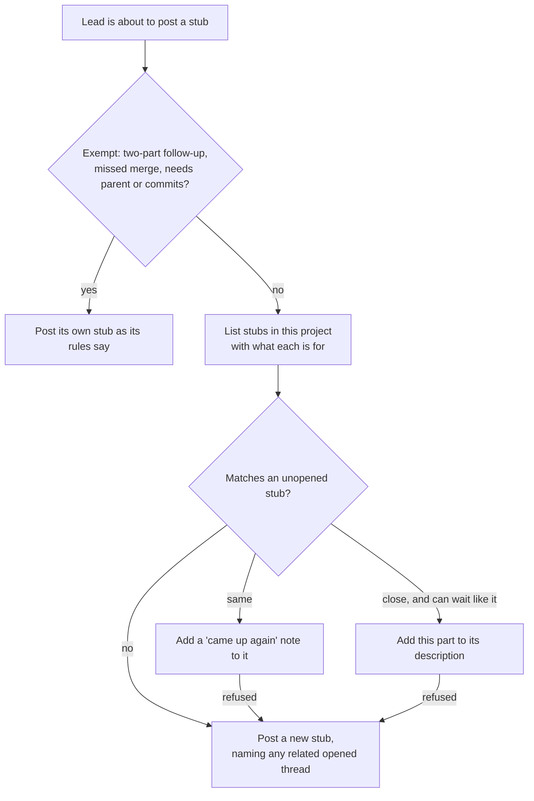

# No duplicate stubs

**Idea:** `IDEA.md` — what this is for and why, in plain language. Read it first. Map: `MAP.md`.

## Open Questions

## Watch List

| # | Noticed | What needs looking into | Raised to user? | Outcome |
|---|---------|-------------------------|-----------------|---------|

## Decision Log

Append-only. A reversal is a new entry superseding the old, never an edit.

| # | Decision | Rationale | Source |
|---|----------|-----------|--------|
| 1 | Mode is two-part | Collin picked it | user |
| 2 | Candidates are stubs (threads created from a stub card) in the same project on the same machine, not archived or handed off, and whose own work is not done (no `done` card, no merged PR) | Only these can still take the work | defaulted |
| 3 | `session leads` lists candidate stubs even with no lead (`lead: null`), and every stub entry carries `stub: true` and `summary` (its current context, additions included) | Agents can't compare without the summary; MAP.md shows both are missing today | defaulted |
| 4 | Adding uses the existing `stub` card with a new optional `adds_to: <thread id>` field; the card's `summary` is the addition. Exact duplicates use it too, with a one-line summary ("Also came up in this thread") | One card kind, and the target stub records every thread that hit the same problem | defaulted |
| 5 | An addition with `depends_on_parent: true` or `commits` is refused; such work gets its own stub | A stub waits on exactly one parent branch | defaulted |
| 6 | An agent may add only to a stub that is unopened, or opened and still planning (its PLAN.md `status` is `planning`, or it has no plan status and no `progress` card yet). Otherwise it makes a new stub as today, whose summary names the related stub | Keeps approved or in-progress work from changing underneath Collin (IDEA.md constraint) | user |
| 7 | The lead adds without asking Collin; the addition is visible in both threads, and an opened stub's lead brings it to its own user before taking it on | Collin picked "Just add it" | user |
| 8 | An opened stub's lead that receives an addition asks its user with a question card (take it in / make it its own thread / drop it); a duplicate note gets no card | Keeps the IDEA.md constraint: nothing joins work Collin has seen without him | defaulted |
| 9 | A duplicate note (`duplicate: true`) may go on any candidate stub, including one being built, because it adds no work | Decision 6 limits added work, not a record that the problem came up again | defaulted |
| 10 | An addition (not a duplicate note) to an opened stub whose lead is not live is refused; the agent makes its own stub. Holding it for the next lead is deferred | Thread f4c68e8cbb15 is building held delivery for cross-thread messages; the follow-up can reuse it | defaulted |
| 11 | Additions and duplicate notes go only to unopened stubs. Supersedes 6, 8, 9 and 10. An exact duplicate of an opened, unfinished stub posts nothing and the lead names that thread in its reply; close work gets its own stub naming the related one | Collin picked "Only unopened stubs" after review round 1 showed the opened-stub path needs live status reads, a pending state and restart recovery | user |
| 12 | Only candidates get the new discovery fields; finished stubs are listed as today with no `stub` field. Any refused addition falls back to the lead's own stub naming the related one. No `stub_additions` record and no message to any lead | Fixes the round-1 finding on finished stubs; the rest is cut by 11 | review-round-1 |
| 13 | IDEA.md "What good looks like": an opened stub is no longer told about additions; a duplicate is pointed to it and close work gets its own stub naming it | Follows Collin's "Only unopened stubs" press on the review-round-1 question, which removed this promise | idea-change |
| 14 | Candidates also exclude stub threads with a `merged` card (`viewer/app/threads.js:483`); supersedes the merged-PR part of Decision 2 with a test the hub can read | A merged stub can't take the work | review-round-2 |
| 15 | Unopened stub entries (`takes_additions: true`) are used only by the stub rule, never by the overlap checks in lead.md | They have no lead and no plan; overlap cards for them would ask Collin about work nobody has started | review-round-2 |
| 16 | An exact match to an opened stub suppresses a new stub only when that stub's `idea` bullets (current scope) cover the work; its startup `summary` is not enough | Collin may have narrowed the opened stub's plan since it started | review-round-3 |
| 17 | An opened stub never stops a new stub: same or close work gets its own stub naming it. Supersedes 16 and the opened-stub part of 11 | Collin picked "Never; just name it" after rounds 2-4 kept finding no reliable record of an opened stub's current scope | user |
| 18 | IDEA.md "What good looks like" narrowed: matching and adding apply to unopened stubs; an opened stub is left alone and the new stub names it | Follows Collin's pick in Decision 17 | idea-change |

## Spec

### Flow

### Terms
- **Stub thread**: a thread whose record has `stub: true` (created by `createStub`, `viewer/app/threads.js:92`). Its `context` is the summary its first lead receives when the user opens it (`openStub`, `viewer/app/threads.js:109`).
- **Candidate**: a stub thread in the caller's project, on the same resolved machine, not archived, not frozen (handed off), with no current `done` card (`currentDone`, `viewer/app/cards.js:51`) and no `merged` card (`viewer/app/threads.js:483`).
- **Unopened**: a candidate with no sessions (`sessions.length === 0`). Only unopened candidates take additions.

### 1. Discovery: `wc.js session leads`
`listLeads` (`viewer/app/peers.js:41`) also lists every unopened candidate in the caller's own project (`lead: null`). Every candidate entry in the caller's project (opened or not) gains:
- `stub: true`
- `summary`: the thread's current `context`
- `takes_additions`: true when unopened, else false.
- `waits_on_parent`: true when the stub has `depends_on_parent` and is not yet `ready` (it will not start until its parent thread merges).
Other entries are unchanged, including stub threads that are no longer candidates (they get no new fields). Cross-project entries (linked or `--all-projects`) are unchanged and no unopened stubs are added for them.

### 2. Adding: the `stub` card's `adds_to`
`stub` cards gain two optional fields, validated in `viewer/app/card.js` (fields table at line 170) and again by the hub:
- `adds_to`: the target thread id, 12 lowercase hex characters.
- `duplicate`: boolean; allowed only with `adds_to`.
With `adds_to` present, `depends_on_parent` must be `false` and `commits` absent, else refused: `an addition can't depend on this thread's unmerged work; post your own stub`. `title` and `summary` stay required.

In `acceptCard` (`viewer/app/cards.js`, the `card.kind === 'stub'` branch near line 192), when `adds_to` is set, no child is created. Under the target thread's own lock (`hub.withThread`, as `createStub` uses), the hub refuses (422, card not stored), checking in order:
1. `no such stub`: missing, not a stub thread, another project, or another machine;
2. `that stub is archived, handed off or finished`: not a candidate;
3. `that stub has started; post your own stub`: it has sessions.
On success it appends to the target's `context` `\n\nAdded from "<parent title>" (<YYYY-MM-DD>): 
`, or for a duplicate `\n\nAlso came up in "<parent title>" (<YYYY-MM-DD>): 
`, saves the target, and stores the card with `adds_to`, `thread_id` = target id and `target_title` = target's title. `<parent title>` uses `threadName` (`viewer/app/peers.js:13`).

### 3. What the user sees
- Parent thread: the stub card (`viewer/pages/thread.js:1219`) with `adds_to` shows heading "Added to another thread" (duplicate: "Already a thread for this"), `target_title`, the summary, and "Go to it" to `thread_id`. Without `adds_to`, unchanged.
- Target thread: its unopened page already renders `context` and re-renders when it changes (`viewer/pages/thread.js:529`, `:1434`), so additions appear there; that paragraph keeps line breaks (`white-space: pre-line`) so each addition shows as its own paragraph. Its first lead receives them in `[wc:context stub]`.

### 4. Protocol text
`protocol/app/lead.md`, Stubs section, gains a "Before posting a stub" rule: run `session leads` and read entries with `stub: true`, comparing by `summary`.
- Same thing, unopened (`takes_additions: true`): post the stub card with `adds_to` and `duplicate: true`, summary one line on where it came up.
- Same thing or close, opened (`takes_additions: false`): post your own stub as today, naming that thread as related in the summary. An opened stub never stops a new stub.
- Close (the stub's work would naturally cover it with a small addition) and unopened: post with `adds_to`, summary saying what to add and what this thread knows. If the entry's `waits_on_parent` is true, add only if your part can also wait until that parent merges; otherwise post your own stub.
- When an unopened and an opened stub both match, the unopened rule wins; name the opened one in the summary.
- Otherwise: post a new stub as today, naming any related stub in the summary.
- This comparison runs whenever a stub is about to be posted, at any step; the wait for PLAN.md in "Other leads on this machine" applies only to overlap looks.
- On any refusal of a duplicate note or addition: post a new stub naming the related one.
- These stubs skip this comparison and are always posted as their own rules say (their existing duplicate checks still apply): the two-part follow-up stub, a missed-merge stub, and any stub needing `depends_on_parent: true` or `commits`.
- "Other leads on this machine" lists the new entry fields (`stub`, `summary`, `takes_additions`, `waits_on_parent`) and says unopened stubs now appear with `lead: null`. It and "Overlap questions" gain one line: entries with `takes_additions: true` (unopened stubs) are not overlaps and are used only by this rule; opened stubs stay in the overlap checks as today.
`protocol/app/cards-lead.md` `stub` section documents `adds_to`, `duplicate`, the refusals and the parent card's look, and drops the "same CLI" claim (MAP.md shows creation does not copy `cli`). `protocol/app/cards.md` adds `stub.adds_to` to the list of fields that may carry another thread's id.

### Non-goals
Merging existing duplicates; threads Collin starts directly; other projects or machines; adding to stubs that have been opened; editing or removing an addition after it is posted.

### Validation
- `cd viewer && npm test` passes, with new tests in `viewer/test/app-lead-list.test.js` (unopened candidate listed with `lead: null`, `stub: true`, `summary`, `takes_additions: true`; opened candidate has `takes_additions: false`; archived, frozen, done, merged and other-project stubs get no new fields or are absent; `waits_on_parent` is true only for a dependent stub not yet `ready`; non-stub entries unchanged) and `viewer/test/app-hub.test.js` (addition and duplicate note to an unopened stub append the exact paragraph to `context` and create no thread; each of the three refusals; `adds_to` with `depends_on_parent: true` or `commits`, or `duplicate` without `adds_to`, refused by `card.js` validation).
- `cd viewer && npm run test:browser` passes, with a case in `viewer/test/app-threads.spec.js` showing the parent card heading, target title and "Go to it" link for an addition.

## Deferred

| # | Item | Why it can wait | Source | Notes for the follow-up |
|---|------|-----------------|--------|-------------------------|

## Accepted Risks

| Risk | Why accepted | Round |
|------|--------------|-------|
| An addition queued on the machine while the hub is down can be refused later with no fallback stub | Rare path: hub outage at post time plus the target changing state before delivery | review-round-1 |
| A stub whose PR merged before its lead posted `done` (and so has no `merged` card yet) still counts as a candidate | Rare path: needs that gap plus another thread hitting the same work inside it; the lead's reply names the thread, so Collin sees it | review-round-2 |
| A stub's own lead posting `adds_to` with its own thread id could wait on a lock it holds | Rare path: discovery never lists the caller's own thread, so only malformed input reaches it | review-round-2 |
| A hub restart between saving the target and the parent card can double-append an addition on replay | Rare path: crash inside the write plus replay | review-round-1 |

## Review Rounds

### Round 1 — 2026-11-21

**Lanes:** intent: claude; mechanics: other family; cross-family: yes.

**Changed since Round 0:** n/a (first round — whole Spec in scope)

| Lane | Reported | Finding | Lead verdict | Resolution |
|------|----------|---------|--------------|------------|
| intent | minor | Addition text goes into an opened stub's `context` before its user answers; "Drop it" never removes it and restarts read it | upheld | Moot: Decision 11 removes additions to opened stubs |
| intent | minor | Duplicate note interrupts a live (possibly building) lead with a message it must ignore | upheld | Moot: Decision 11 removes additions to opened stubs |
| intent | minor | Duplicate note adds noise to an opened (maybe built) stub's `context` | upheld | Moot: Decision 11 removes additions to opened stubs |
| mechanics | blocking | Gate uses `last_status`, which lags PLAN.md (views.js:116, remote-plan.js:24); addition can land after planning closed | user-decision | Decision 11 |
| mechanics | major | Finished stubs with a lead listed as `stub: true`, so a lead may post a duplicate note the hub refuses, with no fallback | upheld | Fixed: Decision 12 and Spec 4 |
| mechanics | major | Dropped additions stay in `context` and mislead later comparisons | upheld | Moot: Decision 11 removes additions to opened stubs |
| mechanics | major | Queued `card.js` receipt can hide a later refusal; fallback never runs | accepted-risk | Rare path: needs hub down at post time and the target changing state before the spool drains |
| mechanics | major | Two-thread write has no replay rule; a hub restart mid-write can double-append on replay | accepted-risk | Rare path: hub crash between two saves plus replay |
| mechanics | major | Addition to an opened planning stub has no durable pending state; can arrive after review starts; restart strands it | upheld | Moot: Decision 11 removes additions to opened stubs |
| mechanics | minor | Opened page's chat signature omits `context`, so a shown addition can go stale | upheld | Moot: Decision 11 removes additions to opened stubs |
| mechanics | minor | `cards.md` lists the only fields that may carry another thread's id; `adds_to` must be added there | upheld | Fixed: Decision 12 and Spec 4 |

### Round 2 — 2026-11-21

**Lanes:** intent: claude; mechanics: other family; cross-family: yes.

**Changed since Round 1:** Decision 11 (additions and duplicate notes only to unopened stubs; no messages to leads, no `stub_additions`); Decision 12 (discovery fields only on candidates; refusal fallback); Spec rewritten to match; `cards.md` id-field exception added; Deferred row 1 removed as moot.

| Lane | Reported | Finding | Lead verdict | Resolution |
|------|----------|---------|--------------|------------|
| intent | minor | IDEA.md still promises an opened stub's agent is told about additions | upheld | Fixed: IDEA.md edited, Decision 13 |
| intent | minor | Candidate term dropped Decision 2's merged-PR test | upheld | Fixed: Decision 14, Spec Terms |
| intent | minor | Additions to a stub waiting on its parent wait too | upheld | Fixed: `depends_on_parent` in discovery, Spec 4 rule |
| mechanics | major | Duplicate note refused because the stub opened in between leads the lead to make a second stub | downgraded (minor): needs the stub opened in the minutes between listing and posting; outcome is one extra stub | Fixed: Spec 4 refusal rule |
| mechanics | major | Merged-before-done stubs still count as candidates | upheld | Fixed: Decision 14; residual gap is an Accepted Risk |
| mechanics | major | Self-target `adds_to` can wait on its own lock | accepted-risk | Rare path: discovery never lists the caller's own thread |
| mechanics | minor | "Name it in the reply" may be a hidden reply | upheld | Fixed: Spec 4 says next visible reply |
| mechanics | minor | Unopened stubs could trigger overlap cards | upheld | Fixed: Decision 15, Spec 4 |
| mechanics | minor | Exemption wording could override existing follow-up and missed-merge checks | upheld | Fixed: Spec 4 wording |

### Round 3 — 2026-11-21

**Lanes:** intent: claude; mechanics: other family; cross-family: yes.

**Changed since Round 2:** IDEA.md "What good looks like" bullet on opened stubs (Decision 13); candidates exclude merged stubs (Decision 14); discovery adds `depends_on_parent`; Spec 4 rewritten (visible-reply wording, waiting-parent rule, refusal handling split, exemption wording, unopened stubs excluded from overlap checks per Decision 15); two new Accepted Risks.

| Lane | Reported | Finding | Lead verdict | Resolution |
|------|----------|---------|--------------|------------|
| intent | major | Overlap exclusion keyed on `lead: null` also drops opened stubs whose lead stopped | upheld | Fixed: keyed on `takes_additions: true` (Decision 15, Spec 4) |
| intent | minor | "Other leads on this machine" field list not updated | upheld | Fixed: Spec 4 |
| mechanics | major | Opened stub's `summary` is its startup ask; matching on it can drop work Collin since cut | upheld | Fixed: Decision 16, Spec 4 |
| mechanics | minor | `depends_on_parent` stays true after the stub is ready | upheld | Fixed: `waits_on_parent` in Spec 1 and 4 |
| mechanics | minor | Same as intent major (overlap exclusion) | upheld | Fixed with it |

### Round 4 — 2026-11-21

**Lanes:** intent: claude; mechanics: other family; cross-family: yes.

**Changed since Round 3:** overlap exclusion keyed on `takes_additions: true` (Decision 15); "Other leads" field list update in Spec 4; opened-stub exact match judged by `idea` bullets (Decision 16); `depends_on_parent` in discovery replaced by `waits_on_parent`.

| Lane | Reported | Finding | Lead verdict | Resolution |
|------|----------|---------|--------------|------------|
| intent | minor | `session leads` returns only six idea bullets, so an opened stub's scope can be partly hidden | upheld | Moot: Decision 17 removes the opened-stub check |
| mechanics | major | Pinned idea bullets can outlive scope cuts and are cleared at build, so they are not a reliable current scope | upheld | Moot: Decision 17 removes the opened-stub check |
| mechanics | major | The `that stub has started` refusal suppresses a stub on the startup summary, bypassing the current-scope check | upheld | Moot: Decision 17 removes the opened-stub check |

### Round 5 — 2026-11-21

**Lanes:** intent: claude; mechanics: other family; cross-family: yes.

**Changed since Round 4:** Decision 17 (opened stubs never stop a new stub; refusals always fall back to a new stub naming the related one); Decision 18 (IDEA.md "What good looks like" narrowed to match); Spec 4 opened-stub and refusal bullets rewritten.

| Lane | Reported | Finding | Lead verdict | Resolution |
|------|----------|---------|--------------|------------|
| intent | minor | No precedence when both an opened and an unopened stub match | upheld | Fixed: Spec 4 precedence bullet |
| mechanics | minor | Same precedence gap | upheld | Fixed with it |
| mechanics | minor | PLAN.md wait for overlap looks could be read as delaying the stub comparison | upheld | Fixed: Spec 4 says the comparison runs at any step |
| mechanics | minor | Unopened page collapses blank lines, so additions run into the summary | upheld | Fixed: Spec 3 `pre-line` |

## Implementation Tasks

| # | Objective | Ownership boundary | Lane | Session id | Validation | Status |
|---|-----------|--------------------|------|-----------|------------|--------|

## Log

- 2026-11-21: Overlap check with f4c68e8cbb15 (Make lead-to-lead chat solid): its lead says it does not change listLeads or its output; it changes cross-thread delivery. No clash; not an overlap for this plan.
- 2026-11-21: Deferred row 1 (hold additions for a stopped lead) removed: moot once additions go only to unopened stubs.
- 2026-11-21: Review budget reached (rounds 2-4 not clean since Collin's last decision). Recurring objection: deciding an opened stub already covers work. Proposed cut: opened stubs never suppress a stub; the new stub names the related one.
- 2026-11-21: Round 5 clean (four minor findings fixed). Ready check: hub and machine service answer (`session list`), claude and codex CLIs installed, Codex preflight passes (token fresh). Ready.
- Build accepted: approval 6c27d049-c465-477d-aefd-f736fd3482cc
