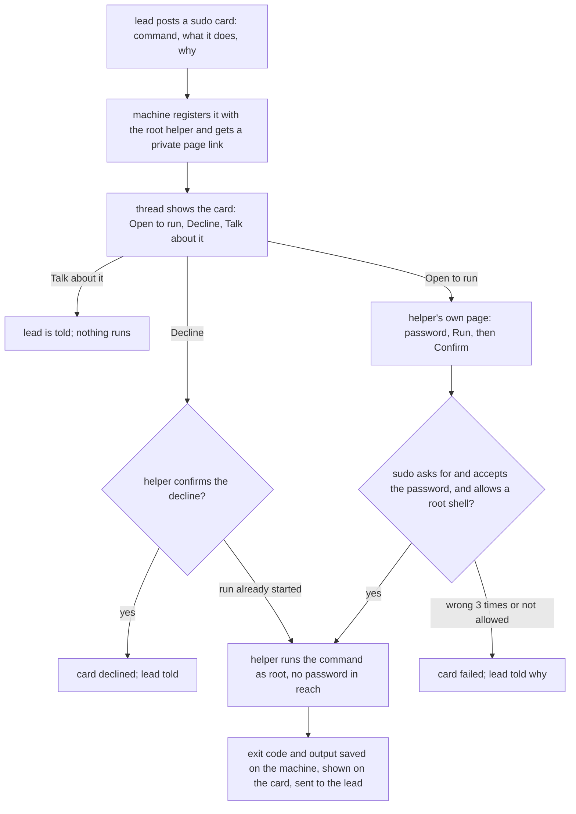

# Run sudo commands from a card

**Idea:** `IDEA.md` — what this is for and why, in plain language. Read it first; it is
the north star this plan serves. Goal and Constraints live there, not here, so they don't
get buried as this file grows.

## Open Questions

None.

## Watch List

| # | Noticed | What needs looking into | Raised to user? | Outcome |
|---|---------|-------------------------|-----------------|---------|

## Decision Log

Append-only. A reversal is a new entry superseding the old, never an edit.

| # | Decision | Rationale | Source |
|---|----------|-----------|--------|
| 1 | The command runs non-interactively, stdin closed after the password, with a time limit (default 10 minutes). *Stdin part superseded by 14 and 19: the command's stdin is `/dev/null`* | IDEA.md rules out interactive commands; a hung command must not hang forever | defaulted |
| 2 | The agent gets the exit code and output (stdout and stderr, capped in size); the card shows the same result to Collin | IDEA.md: the agent learns whether it worked | defaulted |
| 3 | "Talk about it" sends the lead a message that Collin wants to discuss the request; nothing runs and the card stays open | IDEA.md | defaulted |
| 5 | Isolation must hold against a hostile agent: a separate helper, running under an identity agents can't control, with root-owned code agents can't edit, serves the password box and runs the command; the password never passes through the hub, the machine service or any page they serve | Collin picked "safe from a hostile agent" | user |
| 6 | The helper runs as a root system service (installed once with sudo), checks Collin's password against his account via PAM and that he may use sudo, then runs the command as root. It is reachable only through Tailscale HTTPS on its own port | sudo authenticates the invoking user, so a separate unprivileged user can't use Collin's password; PAM keeps the check as strict as sudo's | defaulted |
| 7 | Only a lead may post a sudo request; other sessions ask the lead with a `message`, and the lead decides whether to bring it to Collin. The hub refuses the card from any other role | Collin picked "only the lead" | user |
| 8 | Confirm is two presses: Run, then a red "Confirm: run as root" button replaces it for 5 seconds; letting it lapse returns to Run. This lives on the helper's page, beside the password box | Collin picked "press, then confirm" | user |
| 9 | No secret word or other anti-phishing check; a lookalike password page built by a hostile agent is an accepted risk | Collin picked "accept the risk" | user |
| 10 | Supersedes 6: the helper is a root system service that checks the password by running Collin's own `sudo` with `-k` (through `runuser`), so his sudoers rules, logging and password policy apply unchanged; no separate PAM code | Reuses sudo's own check instead of reimplementing it; `runuser` + setuid `sudo` keeps every process holding the password out of reach of Collin's user | defaulted |
| 11 | The helper is Python 3 standard library only, served through `tailscale serve` from a root-only Unix socket; the machine service reaches it through a second socket | `/usr/bin/python3` ships with Debian, with nothing to install; a root-only socket can't be taken over by an agent the way a TCP port could | defaulted |
| 12 | Requests live in the helper's memory only: unrun after 1 hour they expire; a helper restart expires them all; 3 wrong passwords end the request | Nothing durable to leak or replay | defaulted |
| 13 | The sudo request runs on the machine where the lead runs | The work that needs sudo is on that machine | defaulted |
| 14 | Supersedes 10: the password is checked by `sudo -S -k -l <command>` run as Collin (authenticates and checks the command is allowed, runs nothing); the helper then runs the command itself as root with stdin `/dev/null` | With `sudo -S` running the command, a NOPASSWD rule leaves the password unread in the command's stdin | review-round-1 |
| 15 | `request_id` correlates card and outcomes; the machine keeps a small request file and posts outcomes only after the card is accepted; new idempotent hub route `sudo-outcome`; unknown id → 409 retry | Review: no correlation or ordering defined | review-round-1 |
| 16 | Decline is reported only after the helper confirms it; a lost race shows the run result; an unreachable machine returns the card to waiting | Review: Decline could promise nothing runs when something did | review-round-1 |
| 17 | The helper page carries no request data in HTML; a static script sets every field with `textContent`; strict CSP with no inline script | Review: agent-controlled fields could inject script into the real password page | review-round-1 |
| 18 | Only the command text is frozen. The lead writes the actual commands into the card, never a script it wrote; the helper flags any file named in the command that Collin's user could change, on the card and the run page. IDEA.md "What good looks like" narrowed to match | Collin picked "inline it, flag files" | idea-change |
| 19 | Supersedes 14's check: the password is checked with `sudo -k -v` and the command's permission with `sudo -k -l`, each writing the password only after a sentinel prompt appears; a machine whose sudo asks for no password fails closed | Review round 2: `-l` follows `listpw` (default any), so one NOPASSWD entry let any password pass | review-round-2 |
| 20 | Intake refuses `~` in the command; the editable-file scan uses `shlex` | `~` meant Collin's home in the warning but /root at run time | review-round-2 |
| 21 | Supersedes 16: Decline is one synchronous call; no saved `declining` state, attempt id or restart recovery. Failed calls save nothing | Review round 4: the saved state kept producing race findings; a cancel the helper didn't confirm already changes nothing | review-round-4 |
| 22 | The machine's cancel endpoint answers with its saved terminal result when it has one, and saves any terminal helper answer before returning it | Review round 5: a helper restart could turn Decline's answer into `expired` and drop a saved `ran` | review-round-5 |
| 4 | The command is fixed when the card is posted; the run uses the stored text byte for byte and the card shows it in full, unabridged | IDEA.md: what runs is exactly what is shown | defaulted |

## Spec

### Summary

A lead that needs a command run as root posts a `sudo` card. Collin sees the command, what it
does and why, and can Decline, Talk about it, or open a page served by a separate root-owned
**sudo helper** on the lead's machine, type his password there, press Run then Confirm, and
have the helper run the command. The lead gets the exit code and output, never the password.



### Who may ask

- Only a lead posts a `sudo` card. The hub and the machine service both refuse it from any
  other role. Workers and sub-leads ask the lead by `message`; `lead.md`, `sub-lead.md`,
  `worker.md` and `cards.md` say so.
- `lead.md` adds: ask for sudo only when the task truly needs root, use the smallest command
  that does the job, and say plainly in `does` and `why` what it changes on the machine.

### The `sudo` card (lead → app)

Fields, all required strings: `command` (the exact shell command, run with `/bin/sh -c`,
at most 4096 bytes, no NUL), `does` (plain words: what it changes), `why` (why the task needs it).

Flow:
1. `card.js sudo <file>` validates and posts to the machine service as any card.
2. The machine service, for kind `sudo` only, first registers the request with its local
   helper through the intake socket (below) and gets back `request_id` and `url`. It adds both
   to the card and forwards it to the hub as usual (spool, retry). If the helper is not installed
   or not answering, the post fails and `card.js` exits non-zero with: `sudo helper not
   installed on <machine>; Collin installs it once with: sudo <root>/sudo-helper/install.sh`.
   The lead then tells Collin that in a reply (and with a `needs` card).
3. The hub stores and shows the card: command in a monospace block, shown in full (wrapping, no
   truncation), `does`, `why`, and three controls: **Open to run** (a link to `url`, opening
   a new tab), **Decline**, **Talk about it**. No password field exists anywhere in the hub's pages.
4. Card states: `waiting`, `running`, `ran` (exit code + output), `declined`, `expired`,
   `failed` (with its reason). Buttons show only in `waiting`; `running` shows "Running…"; the
   rest show the outcome.

**Correlation.** The helper's `request_id` is the one key. The machine service adds it to the
card before forwarding; the hub stores it on the card and keeps a `request_id → card id` index in
thread state. Every outcome names `request_id`; the hub never needs the machine to know card ids.
Intake takes `{command, does, why}` only (no thread or card reference).

**Outcomes, machine → hub.** New route `POST /api/machine/sudo-outcome` (machine secret,
beside `cards` and `events` in `viewer/app/routes.js` `handleMachine`), body
`{request_id, state, exit_code?, output?, truncated?, reason?, delivery_id}`, where `state` is `running`,
`ran`, `declined`, `expired` or `failed`. Idempotent: a repeat or an older state than the card
already has returns 200 and changes nothing.

An unknown `request_id` returns 409, which the machine treats as "retry later", not as a rejection.

**One state handler in the hub.** Every sudo card state change goes through one function,
`applySudoState(request_id, {state, exit_code?, output?, truncated?, reason?})`, called from this
route and from the Decline press. Under the thread's existing save, it: ignores `waiting`;
ignores a state older than or equal to the card's (order `waiting` < `running` < terminal);
otherwise sets the card's state and result; and, on the card's first terminal state only, queues
exactly one message to the lead (below), in the same save. A later call with the same or another
terminal state is a no-op. So whichever path reports a result first, the lead hears it once and
with the output. The hub never moves a card back to `waiting`.

**Ordering and durability on the machine.** The machine service keeps a small file
`sudo-requests.json` in its state directory (0600; no password ever exists in the machine
service): per `request_id`, whether its card has been accepted by the hub, the last state the
helper reported (for a terminal state, with its exit code and output) and whether the hub has
acknowledged it. Every change to this file is written atomically before the action it records
is treated as done. It:
- polls the helper every 2 seconds for each request whose state is not yet terminal. Once a
  terminal state is saved, it stops polling that request and delivers the saved result; a later
  `expired` from the helper (restart, retention) can never replace a saved terminal result;
- for a `sudo` card, saves "accepted" **before** deleting the card's spool file. A crash between
  the hub's 2xx and that save leaves the spool file, so the card is resent; the hub answers the
  duplicate `delivery_id` with 200, and the machine then saves "accepted" and deletes the file;
- posts an outcome only after that request's card has been accepted (2xx from `/api/machine/cards`);
- retries outcome posts on 5xx, 409 or no connection until a 2xx, newest state only;
- on restart, reloads the file and resumes. A helper that no longer knows the id answers
  `expired`, which is posted like any outcome. Entries are dropped once a terminal state is
  acknowledged.

**Decline.** One synchronous call. The press handler (in `viewer/app/threads.js` `press`,
which already awaits work) calls the machine (`POST /sudo/<request_id>/cancel` on the machine
service API, `machine/API.md`), with a 10-second timeout overall. The machine answers from its request file first:
if it has a saved terminal result for that request, it returns that and does not call the helper.
Otherwise it calls the helper's cancel; a terminal state in the helper's answer is saved to the
request file first, under the same never-replace rule, and the machine returns what is saved.
Nothing is saved on the card before the answer.
- Any answer: the full status (same shape as `GET /requests/<id>`) goes to `applySudoState`.
  `declined` closes the card and tells the lead; if Run won the race, Collin sees the run result,
  not "declined".
- Unreachable or timed out: nothing is saved; the press returns an error and the card shows
  "Couldn't reach <machine> to decline. Try again." beside its unchanged buttons. Nothing is
  reported as declined until the helper confirms it.
While the call is pending the page alone shows "Declining…" on the button.
The helper's own transitions are atomic under one lock: `waiting → running` on a good password,
`waiting → declined` on cancel; whichever comes first wins. A cancel that arrives while the
password check is still going wins, and the check's result is discarded.

What reaches the lead (typed like any press, shown as a short bubble in the thread):
- `[card <id>] sudo ran: exit <n>` followed by the output block.
- `[card <id>] declined`, `[card <id>] sudo expired`, `[card <id>] sudo failed: <reason>`.
- `[card <id>] talk about: sudo request`: nothing runs; the card stays `waiting` and Open to run
  still works.

### The sudo helper

Lives in the clone at `sudo-helper/` (new top-level directory, with an `AGENTS.md` router and a
row in the root `AGENTS.md` tables), but **runs only from an installed root-owned copy**.

**Install** — `sudo-helper/install.sh`, run by Collin with sudo, from the canonical clone
(refused from a worktree via `install/guard.sh`, as the other writers are):
- Copies `helper.py` and `static/` (`page.html`, `page.js`, `page.css`) to `/usr/local/lib/wheelchair-sudo/` (root:root,
  dirs 0755, files 0644).
- Writes `/etc/wheelchair-sudo.conf` (root, 0644): `user=<SUDO_USER>`, the user whose password
  is checked and whose sudo rights apply; `url_base=https://<tailnet DNS name>:8445`.
- Writes and enables `wheelchair-sudo.service` (systemd system unit, `User=root`,
  `RuntimeDirectory=wheelchair-sudo`, `Restart=on-failure`).
- Runs `tailscale serve --bg --https=8445 unix:/run/wheelchair-sudo/page.sock`.
- Idempotent; re-running is also how Collin updates the helper. `./install.sh` (the user-level
  installer) never touches it; it only prints a one-line hint when the helper is missing.
- `sudo-helper/install.sh --uninstall` removes the unit, the installed files, the config and
  the serve entry.

**Sockets** (in `/run/wheelchair-sudo/`, dir root 0755):
- `page.sock`, root:root 0600: the browser page, reachable only via `tailscale serve`.
- `intake.sock`, root:<user's group> 0660: the machine service's API.

**Intake API** (JSON over HTTP on `intake.sock`):
- `POST /requests` `{command, does, why}` → `{request_id, url, editable}`.
  `request_id` is 128 random bits, hex; `url` is `<url_base>/r/<request_id>`.
- `GET /requests/<id>` → `{state, exit_code?, output?, truncated?, reason?}`. `reason` is set for
  `failed` (the page's plain message, e.g. "wrong password 3 times") and kept with the result on
  the machine and on the card.
- `POST /requests/<id>/cancel` → declines a `waiting` request; answers with the request's actual
  status either way, in the same shape as `GET /requests/<id>`.

**Page** (on `page.sock`):
- `GET /r/<id>`: a fixed HTML page (`static/page.html`) that loads `/static/page.js` and
  `/static/page.css` from the helper and nothing from the network. It shows the
  helper's own copy of command, does and why; the target user name; a password box; Run.
  Run becomes a red "Confirm: run as root" for 5 seconds, then reverts. Mobile-first layout.
  An unknown or closed id shows its outcome or "No such request".
- `POST /r/<id>/run` with the password (form body). The page then shows "Running…" and polls
  `GET /r/<id>/status` until done, then shows exit code and output.
- **Rendering contract.** `command`, `does`, `why` and `output` are agent-controlled. The HTML
  template contains no request data at all. A static script file served by the helper
  (`/static/page.js`) fetches `GET /r/<id>/data` (JSON) and sets every field with `textContent`.
  No inline script, no `innerHTML`, no template interpolation of request data anywhere.
- Headers: `Cache-Control: no-store`, `Referrer-Policy: no-referrer`, a CSP of
  `default-src 'none'; script-src 'self'; style-src 'self'; connect-src 'self'; form-action 'self'; frame-ancestors 'none'`, `X-Frame-Options: DENY`. The password box has
  `autocomplete="current-password"`.

**Running** (on `run`, only while state is `waiting`; one run at a time per request):
1. Check, in two sudo calls run as the user, neither of which runs the command. Each uses a
   prompt sentinel: `-p` set to a fresh random string per call. The helper writes the password
   to sudo's stdin **only after** that sentinel appears on sudo's stderr, then closes stdin.
   - a. Password: `/usr/sbin/runuser -u <user> -- /usr/bin/sudo -S -k -v -p <sentinel>`.
     Good only if the sentinel appeared and the exit code is 0. If sudo exits without
     prompting (every sudoers entry for the user is NOPASSWD), the request becomes `failed`
     with "sudo on this machine asks for no password, so a sudo card can't check one". Fail
     closed: agents could already run sudo themselves there.
   - b. Allowed: `/usr/sbin/runuser -u <user> -- /usr/bin/sudo -S -k -l -u root -p <sentinel> -- /bin/sh -c <command>`,
     password written only if the sentinel appears (`-l` may not prompt under `listpw`; that is
     fine, the password was already checked in a). `-u root` because the helper runs the command
     as root whatever the sudoers `runas_default` is. Exit 0 = allowed; otherwise `failed` with
     "Your sudo rules don't allow running a shell as root". Sudo cards need sudo rights to run
     `/bin/sh` as root (in practice `ALL`); per-command sudoers rules are not supported.
   - A wrong password in a counts one try; the page says "Wrong password" and the try count; on
     the third the request becomes `failed`. Because the password is written only after a
     prompt, it is never left unread in a pipe.
2. Run: the helper, already root, runs `/bin/sh -c <command>` itself as root, with stdin
   `/dev/null`, `cwd=/`, environment only `PATH=/usr/sbin:/usr/bin:/sbin:/bin`, `HOME=/root`,
   `LANG=C.UTF-8`, in a new process group. The password never reaches this process. The helper
   writes one syslog line per run (user, request id, command, exit code; never the password).
3. Time limit 10 minutes: SIGTERM to the group, SIGKILL 10 seconds later; output notes the timeout.
4. Output: stdout and stderr merged in order, the first 32 KiB and last 32 KiB kept, with a
   `[… N bytes cut …]` line between when longer.
5. State becomes `ran` with exit code and output. The password is dropped right after writing it;
   it is never stored, logged, echoed or included in any response or error.

`-k` on both check calls means sudo neither uses nor updates a cached ticket, so the checks
leave nothing unlocked. The run itself does not go through sudo.

**What "exactly the command shown" covers:** the command text is frozen when the card is posted
and run byte for byte. Files that text runs or reads are not frozen (Decision 18). So:
- `lead.md`: write the actual commands into `command`; never ask to run a script or file the
  agents wrote or can edit.
- **No `~`.** Intake refuses a command in which any word (split as below) starts with `~`, with
  "Write the full path; ~ would mean /root here". `card.js` passes the error to the lead.
- **Editable-file warning.** At intake the helper splits the command with Python's
  `shlex.shlex(command, posix=True, punctuation_chars=True)` with `commenters = ''` (so quoting
is removed and a `#` never hides the rest of the line) and takes
  every word that starts with `/` or `./` (`./` resolved against `/`, the run directory).
  A command that `shlex` can't split (unbalanced quotes) is refused at intake. A path is flagged when the user, with
  their groups, could write it or any directory above it (checked from owner, group and mode
  bits as root; a missing path is checked through its nearest existing parent). Intake returns
  `editable: [path, ...]`; the machine adds it to the card. The thread card and the helper page
  both show, above the command, "An agent could change these files before this runs:" and the
  list. This is a best-effort warning, not a guarantee: paths built at run time (variables,
  globs) are not seen.

**Where to open the page:** on a device other than the agents' machine, such as Collin's phone.
A browser running on the agents' machine as Collin's user holds the password in memory an agent
can read. The page says so in one line under the password box. All paths (`runuser`, `sudo`, `sh`) are absolute and configurable only in
the root-owned config, so tests can point them at shims.

**Logging:** request lines only (method and path), never bodies. Errors never include the body.

**Lifetime:** requests live in memory only. `waiting` requests expire after 1 hour; a helper
restart loses all of them, and status lookups then answer `expired`. Closed requests are kept in
memory for 24 hours so their page and status still answer, then dropped.

### Not in scope

Remembered passwords, passwordless sudo, approving a command for reuse, batching, interactive
commands, an anti-phishing check (Decision 9), running on a machine other than the lead's.

### Validation

```bash
python3 -m unittest discover -s sudo-helper/test      # helper: editable-file flags (user-owned file, user-writable parent, root-owned file not flagged, `~/` and `./`); shims for runuser/sudo; wrong password x3, NOPASSWD shim (command run with stdin /dev/null, cannot read the password), timeout, truncation, cancel vs run race, expiry, no password in logs or responses
                                                      # rendering: command/does/why/output of `</script><script>alert(1)</script>` and `` appear as text; page HTML contains no request data
bash sudo-helper/test/install-test.sh                 # installer against a temp root, no real systemctl/tailscale (shims)
bash machine/test/run.sh                              # sudo card registration, refusal without helper, outcome held until card accepted, 409 retried, restart resumes, non-lead refusal
node --test viewer/test/*.test.js                     # hub: card validation, lead-only, idempotent outcomes, unknown request 409, decline states (declined / lost race / unreachable)
npm --prefix viewer run test:browser                  # card renders full command, three controls, outcome states
```

Each suite also asserts that a test password string never appears in any file, log or HTTP
response it can see.

## Accepted Risks

| Risk | Why accepted | Round |
|------|--------------|-------|
| A browser on the agents' own machine, as Collin's user, holds the typed password where an agent can read it | Collin uses the app from his phone or another device; the page warns; isolating a same-user browser is out of reach without a separate desktop account | review-round-1 |
| A hostile agent can edit the thread page to show a lookalike password box and capture the password | Collin's choice (Decision 9) | planning |
| A hostile agent can post its own requests to the intake socket, bypassing the lead-only rule | Each still needs Collin to open it, read it and type his password | planning |
| Anyone on Collin's tailnet who has a request URL can see its command and output | 128-bit id; tailnet is Collin's own devices | planning |
| A hostile agent can tamper with the clone before Collin runs the helper's installer | Installer runs only from the canonical clone, after review; Collin runs it himself | planning |

## Review Rounds

### Round 1 — 2026-11-15

**Lanes:** intent — gpt (claude unavailable); mechanics — gpt; cross-family: no.

**Changed since Round N-1:** n/a (first round — whole Spec in scope)

| Lane | Reported | Finding | Lead verdict | Resolution |
|------|----------|---------|--------------|------------|
| intent | blocking | Password shares stdin with the command; under NOPASSWD sudo leaves it unread for the command to read | upheld | Decision 14: check with `sudo -l`, run as root with stdin `/dev/null` |
| intent | major | Frozen command text doesn't freeze the files it runs (`sh ~/fix.sh`) | user-decision | Decision 18 |
| mechanics | major | NOPASSWD: wrong password accepted, password left on command stdin | upheld | Same as intent blocking; Decision 14. Wrong password under NOPASSWD passes, as at a terminal (Spec) |
| mechanics | major | Agent fields could inject script into the real helper page | upheld | Decision 17 |
| mechanics | major | No request↔card correlation or restart recovery | upheld | Decision 15 |
| mechanics | major | Outcome can arrive before its spooled card and be lost | upheld | Decision 15 |
| mechanics | major | Decline vs Run race, unreachable machine | upheld | Decision 16 |
| intent | major | A browser on the agents' machine, same user, holds the password | accepted-risk | Spec "Where to open the page"; Accepted Risks |

### Round 2 — 2026-11-15

**Lanes:** intent — claude; mechanics — gpt; cross-family: yes.

**Changed since Round 1:**
- Password check is `sudo -S -k -l <command>` (runs nothing); the helper runs the command itself as root with stdin `/dev/null` (Decision 14).
- `request_id` correlation, machine request file, outcome ordering, new `sudo-outcome` hub route (Decision 15).
- Decline confirmed by the helper; race and unreachable handling; new `declining` and `running` states (Decision 16).
- Helper page rendering contract and strict CSP (Decision 17).
- Editable-file warning; IDEA.md narrowed to the command text (Decision 18).
- "Where to open the page" and its accepted risk.

| Lane | Reported | Finding | Lead verdict | Resolution |
|------|----------|---------|--------------|------------|
| intent | major | RE-RAISE: `sudo -l` follows `listpw`; one NOPASSWD entry lets any password pass | upheld | Decision 19; the Round 1 rationale "as at a terminal" was wrong |
| intent | major | `~` is Collin's home in the warning, /root at run time | upheld | Decision 20 |
| mechanics | major | Page spec contradicts itself (inline JS/CSS vs CSP); installer omits static files | upheld | Page and Install bullets rewritten |
| mechanics | minor | Quoted paths escape the editable-file scan | upheld | `shlex` split (Decision 20) |
| mechanics | minor | A card can stick in `declining` if the hub restarts mid-call | upheld | 10 s timeout; hub start returns `declining` cards to `waiting` |

Round 2, GPT lane (mechanics), reviewed the text before the intent lane's fixes:

| Lane | Reported | Finding | Lead verdict | Resolution |
|------|----------|---------|--------------|------------|
| mechanics | blocking | `sudo -l` follows `listpw`; NOPASSWD entry lets garbage passwords through | upheld | Already fixed by Decision 19 (`-v`, sentinel, fail closed) |
| mechanics | blocking | Permission check omits `-u root`, run is always root | upheld | `-u root` added to check b |
| mechanics | major | A saved result could be replaced by `expired` before delivery | upheld | Terminal results saved with output; polling stops; never replaced |
| mechanics | major | Card acceptance flag vs spool deletion order | upheld | Save "accepted" before deleting the spool file; duplicate resend is 200 |
| mechanics | minor | Page assets vs CSP contradiction | upheld | Already fixed in the intent lane's triage |

### Round 3 — 2026-11-15

**Lanes:** intent — claude; mechanics — gpt; cross-family: yes.

**Changed since Round 2:**
- Password check: `sudo -k -v` and `sudo -k -l -u root`, sentinel prompts, fail closed (Decision 19).
- `~` refused; `shlex` scan (Decision 20).
- Page assets as static files; installer list.
- `declining` timeout and hub-start recovery.
- Machine durability: saved terminal results, accepted-before-spool-delete.

| Lane | Reported | Finding | Lead verdict | Resolution |
|------|----------|---------|--------------|------------|
| mechanics | major | Cancel response can set a terminal state, then the real outcome is a no-op and the lead misses it | upheld | One `applySudoState` handler, one message on first terminal state |
| mechanics | major | Decline timeout could overwrite a delivered `declined` with `waiting` | upheld | `decline_attempt` id; restore only if still declining with the same id |
| mechanics | minor | `shlex` comments hide paths after `#` | upheld | `commenters = ''` |
| intent | minor | `sudo -K` step unneeded and clears Collin's terminal cache | upheld | Dropped |
| intent | minor | Leftover `-k` paragraph implies the run uses sudo | upheld | Rewritten |
| intent | minor | Hub could poll the machine instead of machine durability file | declined | The machine design is reviewed and sound; switching re-opens the whole outcome path for no behavior change |
| intent | minor | Post-restart `declining` note can be false | upheld | Neutral note |
| intent | minor | Check b needs shell-as-root rights; message misstates the reason | upheld | Message and Spec say so |
| intent | minor | Watch List rows left open | upheld | Rows removed: row 1 settled by Decision 5 (password only crosses browser → helper over Tailscale HTTPS); row 2 by Decision 19 and `-k`; row 3 by Decision 19 |

### Round 4 — 2026-11-15

**Lanes:** intent — claude; mechanics — gpt; cross-family: yes.

**Changed since Round 3:**
- One hub `applySudoState` handler for every sudo state change; one lead message per card.
- Decline: `decline_attempt` id guards the restore; cancel answers with full status.
- `shlex` with comments off.
- Dropped `sudo -K`; check-b message and shell-as-root requirement; neutral note after hub restart.

| Lane | Reported | Finding | Lead verdict | Resolution |
|------|----------|---------|--------------|------------|
| mechanics | major | `applySudoState` rank rule can't do the `declining → waiting` restore | upheld | Decision 21: no `declining` state at all |
| mechanics | minor | `failed` reason has no field to travel in | upheld | `reason` added to status, outcome, handler |
| intent | major | Same as the mechanics major above | upheld | Superseded: Decision 21 removes `declining` altogether |
| intent | minor | Make Decline one synchronous call | upheld | Decision 21 |
| intent | minor | "Decline status unknown; checking…" promises a check that never runs | upheld | Gone with Decision 21 |
| intent | minor | Decision 1 still says the command's stdin carries the password | upheld | Marked superseded |

### Round 5 — 2026-11-15

Collin chose "keep going" after three rounds without a clean one; budget reset.

**Lanes:** intent — claude; mechanics — gpt; cross-family: yes.

**Changed since Round 4:**
- Decline is one synchronous call; no saved `declining` state (Decision 21).
- `applySudoState` handles helper-reported states only; never moves a card back to `waiting`.
- `reason` field for `failed` outcomes.
- Decision 1 marked superseded on stdin.

| Lane | Reported | Finding | Lead verdict | Resolution |
|------|----------|---------|--------------|------------|
| intent | — | No findings | — | — |
| mechanics | major | Decline's cancel answer (`expired` after helper restart) could override a saved, undelivered `ran` | upheld | Decision 22 |

### Round 6 — 2026-11-15

**Lanes:** intent — claude; mechanics — gpt; cross-family: yes.

**Changed since Round 5:**
- The machine's cancel endpoint answers from its saved terminal result first and saves helper answers before returning (Decision 22).

| Lane | Reported | Finding | Lead verdict | Resolution |
|------|----------|---------|--------------|------------|

## Prior Work

| Spec item | State | Evidence (file:line) | Confidence |
|-----------|-------|----------------------|------------|

## Implementation Tasks

| # | Objective | Ownership boundary | Lane | Session id | Validation | Status |
|---|-----------|--------------------|------|-----------|------------|--------|
| T1 | Root sudo helper: intake/page sockets, sentinel password check, run, page assets, unit tests | `sudo-helper/helper.py`, `sudo-helper/static/`, `sudo-helper/test/` (not `install*`) | standard, gpt (gpt-6.1-terra) | wc-306ee0793e11-worker (medium) | done |
| T2 | Helper installer + `--uninstall`, fixture test; root `install.sh` missing-helper hint | `sudo-helper/install.sh`, `sudo-helper/test/install-test.sh`, `sudo-helper/test/install-fixtures/`, hint lines in `install.sh`, `install/test/run.sh` | standard, gpt (gpt-6.1-terra) | wc-306ee0793e11-worker-2 (medium) | done |
| T3 | Machine: sudo card registration, lead-only, request file, outcome delivery, cancel route | `machine/service.js`, `machine/lib/sudo.js`, `machine/test/`, `machine/API.md`, `machine/AGENTS.md` | standard, gpt (gpt-6.1-terra) | wc-306ee0793e11-worker-3 (medium) | done |
| T4 | Hub: sudo kind, `sudo-outcome`, `applySudoState`, Decline/Talk presses, thread page card; `cards.md` sudo kind | `viewer/app/{card,cards,routes,threads,machine-client,state,chat}.js`, `viewer/pages/thread.js` + card CSS, `viewer/app/API.md`, `protocol/app/cards.md`, `viewer/test/app-sudo.*` | standard, claude (claude-sonnet-5-5) | wc-306ee0793e11-worker-4 (medium) | done |
| T5 | Routers and role files: `sudo-helper/AGENTS.md`, root `AGENTS.md` rows, `lead.md`, `sub-lead.md`, `worker.md` | `sudo-helper/AGENTS.md`, `AGENTS.md`, `CONTRIBUTING.md`, `protocol/app/{lead,sub-lead,worker}.md` | light, gpt (gpt-6-luna) | wc-306ee0793e11-worker-6 (medium) | done |
| T6 | Page keeps checking after a dropped Run POST; ignore `__pycache__/` | `sudo-helper/static/page.js`, `.gitignore` | light, gpt (gpt-6-luna) | wc-306ee0793e11-worker-5 (medium) | `python3 -m unittest discover -s sudo-helper/test -v` | done |
| R1-1 | Helper page: wrong-password message only while waiting (verification 1 gap) | `sudo-helper/helper.py`, `sudo-helper/static/page.js`, `sudo-helper/test/test_helper.py` | light, gpt (gpt-6-luna) | wc-306ee0793e11-worker-7 (medium) | `python3 -m unittest discover -s sudo-helper/test -v` | done |
| R1-2 | Helper page keeps polling while the password is checked (verification 1 gap) | `sudo-helper/helper.py`, `sudo-helper/static/page.js`, `sudo-helper/test/test_helper.py` | light, gpt (gpt-6-luna) | wc-306ee0793e11-worker-8 (medium) | `python3 -m unittest discover -s sudo-helper/test -v` | dispatched |

## Log

- 2026-11-15 — Sub-lead: decomposed into T1–T5; T1–T4 dispatched in parallel against a shared interface written into every brief (helper config keys, intake API shapes and error texts, machine `/v1/sudo/<id>/cancel` under the service's `/v1` prefix, `WHEELCHAIR_SUDO_INTAKE` socket override, `WHEELCHAIR_SUDO_TEST_ROOT` installer test root).
- 2026-11-15 — Choice: T2, `sudo-helper/install.sh`: checks Tailscale status before writing any installed file.
- 2026-11-15 — Choice: T2, `sudo-helper/install.sh`: `--uninstall` needs the same non-root `SUDO_USER` as install.
- 2026-11-15 — Sub-lead: T2 accepted. `install/test/run.sh` "real wheelchair directory is byte-identical after suite" fails on the feature branch without T2 too (the live hub writes `$HOME/.wheelchair/accounts` while the suite runs); pre-existing, not T2's. ShellCheck reports only SC1091 (info) on the sourced guard.
- 2026-11-15 — Choice: T3, `machine/lib/sudo.js`: outcome `delivery_id` is a SHA-256 of request id and state, so retries carry the same id.
- 2026-11-15 — Choice: T3, `machine/lib/sudo.js`: a late `waiting` poll answer after `running` is ignored rather than moving the saved state back.
- 2026-11-15 — Choice: T3, `machine/test/sudo.test.js`: the fake helper lives inside the test file.
- 2026-11-15 — Sub-lead: T3 accepted; `machine/test/run.sh` 98/98 re-run by the sub-lead.
- 2026-11-15 — Choice: T1, `helper.py`: a non-socket file at a socket path stops the helper at start instead of being unlinked.
- 2026-11-15 — Choice: T1, `helper.py`: each sudo check call is bounded by `run_timeout`.
- 2026-11-15 — Choice: T1, `page.js`: the Run POST stays open until the command finishes; the page polls status meanwhile.
- 2026-11-15 — Choice: T1, `helper.py`: a configured user of root counts as able to write every path in the editable scan.
- 2026-11-15 — Sub-lead: T1 accepted; 6/6 helper tests and T2's installer test (now copying the real helper files) re-run by the sub-lead. Notes for T5 / follow-up: `sudo-helper/__pycache__/` from test runs is not ignored (it blocked `worktree-remove` of the T1 worktree, left in place; no rm); `page.js` shows "Could not run the request." and stops refreshing if the long Run POST drops (e.g. phone network), though the command keeps running; `sudo -k -v` as a flag combination is assumed valid on Debian 13 sudo and has not been checked against real sudo here.
- 2026-11-15 — Sub-lead: T6 accepted; worker reported no choices, diff matches the brief exactly. T5 must add `__pycache__/` to the root AGENTS.md `.gitignore` row.
- 2026-11-15 — Choice: T4, `viewer/app/cards.js`: `applySudoState(hub, thread, request_id, status)` lives in cards.js and takes `hub` first, because it saves and enqueues.
- 2026-11-15 — Choice: T4, `viewer/app/routes.js`: `sudo-outcome` calls `cards.js` `sudoOutcome` directly, leaving `hub.js` untouched.
- 2026-11-15 — Choice: T4, `viewer/app/cards.js`: `delivery_id` duplicates are made harmless by the state-rank rule alone; the id is required but not recorded.
- 2026-11-15 — Choice: T4, `viewer/app/cards.js`: a second card naming an already-indexed `request_id` is refused 422 (an exact redelivery with the same `delivery_id` still answers 200).
- 2026-11-15 — Choice: T4, `viewer/app/cards.js`: a `ran` outcome needs an integer `exit_code`; `waiting` as an outcome state is 400.
- 2026-11-15 — Choice: T4, `viewer/app/cards.js`: the lead message goes to the latest live lead, else the card's posting session, else the latest lead; with no lead at all the state is saved and nothing is queued.
- 2026-11-15 — Choice: T4, `viewer/app/threads.js`: presses on a non-`waiting` sudo card are 409; only `talk` and `decline` are accepted; `talk` always sends `sudo request`.
- 2026-11-15 — Choice: T4, `viewer/app/threads.js`, `viewer/pages/thread.js`: the decline error names `thread.machine` and shows without the usual "Could not send:" prefix.
- 2026-11-15 — Choice: T4, `viewer/app/threads.js`: a malformed or `waiting` cancel answer counts as unreachable; a `running` answer is applied with no lead message.
- 2026-11-15 — Choice: T4, `viewer/pages/thread.js`: "Declining…" is page-only state.
- 2026-11-15 — Choice: T4, `viewer/app/chat.js`: the thread bubble for `sudo ran:` shows only its first line.
- 2026-11-15 — Choice: T4, `viewer/app/routes.js`: `sudo_index` is left out of `?view=list` summaries.
- 2026-11-15 — Choice: T4, `viewer/test/app-sudo.*`: tests front the fake machine with their own proxy for `/v1/sudo/`, leaving `helpers/app-machine.js` untouched.
- 2026-11-15 — Sub-lead: T4 accepted. Re-ran: node suite 403/404, the one failure (`lifecycle.test.js` "a starter that loses the freed port registers through the new holder") fails identically on the feature branch without T4; browser suite 610 passed, 2 skipped. Decline and `sudo-outcome` both run under `hub.withThread`.
- 2026-11-15 — Sub-lead: T5 accepted; worker reported no choices; diff matches the brief.
- 2026-11-15 — Sub-lead: all tasks done; COMPLETION.md written; verification round 1 started at 0087751: wc-306ee0793e11-verifier (claude-opus-5-5) and wc-306ee0793e11-verifier-2 (gpt-6.1-sol).
- 2026-11-15 — Sub-lead: verification 1, Claude verifier FAIL with one gap (stale "Wrong password" message hides the result on the helper page); REMEDIATION-1.md written; R1-1 dispatched to GPT (the provider that built T1). GPT verifier still running; fixes merge after it reports.
- 2026-11-15 — Sub-lead: GPT verifier FAIL: same gap as Claude's plus a second (page stops polling if the Run POST drops during the password check); appended to REMEDIATION-1.md as R1-2, to run after R1-1 (same files). Browser suite under the GPT verifier: two flaky failures that passed on retry.
- 2026-11-15 — Sub-lead: R1-1 accepted (7/7 helper tests; worker reported no choices; diff matches brief). R1-2 dispatched.
