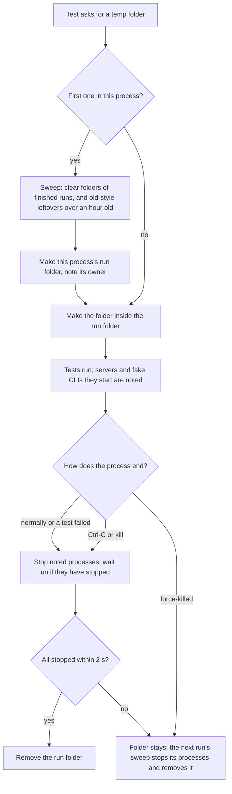

# Tests clean up their temp folders

**Idea:** `IDEA.md` — what this is for and why, in plain language. Read it first; it is
the north star this plan serves. Goal and Constraints live there, not here, so they don't
get buried as this file grows.

## Open Questions

(none)

## Watch List

| # | Noticed | What needs looking into | Raised to user? | Outcome |
|---|---------|-------------------------|-----------------|---------|

## Decision Log

Append-only. A reversal is a new entry superseding the old, never an edit.

| # | Decision | Rationale | Source |
|---|----------|-----------|--------|
| 1 | Scope is the JavaScript suites (machine `*.test.js`, viewer `*.test.js` and `*.spec.js`, their helpers) plus small hardening of the shell suites and `machine/test/aside-probe.sh` | MAP: shell suites already remove their root on EXIT; the leaks are in the Node suites (`docs/maps/test-temp-dirs.md`) | defaulted |
| 2 | One shared mechanism, not per-test `rm` calls scattered over ~150 allocation sites: every allocation goes through a helper that places it under a per-process run folder, removed once when the process ends | One removal point covers success, failure and thrown errors; fewer edits; new tests get it for free | defaulted |
| 3 | The run folder is removed on normal exit and on SIGINT/SIGTERM/SIGHUP (handler removes synchronously, then re-raises the signal so exit codes stay right) | IDEA "Ctrl-C removes its folders" | defaulted |
| 4 | Start-of-run sweep removes run folders whose owning process is gone (owner PID and start time recorded in the folder), never by age alone | IDEA constraint: never delete another live run's folder; covers force-killed runs | defaulted |
| 5 | The sweep also removes legacy leftovers matching the old prefixes (`wheelchair-machine-test-*`, `wc-doc-*`, `wc-git-*`, …) only when older than one hour | Clears what earlier code leaked; the one-hour age matches the existing viewer sweep and the cleanup Collin already approved | defaulted |
| 6 | Every helper that stops a spawned process (viewer `startServer().stop`, `pages.spec.js` starter, machine `service().close`, aside stores) awaits the child's actual exit, including after KILL, before the run folder can be removed | IDEA constraint: remove only once writers stopped (MAP: `viewer/test/helpers/server.js:100`) | defaulted |
| 7 | Shell suites add INT/TERM/HUP to their existing cleanup trap; `aside-probe.sh` removes its folder in its EXIT trap | Small hardening; EXIT alone is not guaranteed on signals (MAP) | defaulted |
| 8 | Test temp folders live in system temp (`os.tmpdir()`, so `TMPDIR` is honoured), one run folder per test process, removed at exit; this includes the viewer helper's `makeDir`, which moves out of `viewer/test/.tmp` | Keeps tests' behaviour identical (no folder inside a git checkout); removal at exit plus the sweep stop pile-up | user |
| 9 | The shared helper lives at a new root file `test-support/run-dir.js` (CommonJS, Node built-ins only) used by both machine and viewer suites, with its own suite `test-support/test/run-dir.test.js` | Machine must not depend on viewer code or vice versa; one mechanism, one test | defaulted |
| 11 | Keep the legacy-prefix sweep and the `viewer/test/.tmp` sweep at one hour by age, as Spec §3 steps 2–3 say | Collin: clearing leaks from threads still on older test code outweighs the tiny risk to an hour-long test; no test runs that long | user |
| 10 | Owner liveness = PID alive (`process.kill(pid, 0)`, EPERM counts as alive) **and**, on Linux, `/proc/<pid>/stat` start time equal to the recorded one; where start time cannot be read, a live PID counts as alive | Guards against PID reuse without ever risking a live run's folder | defaulted |

## Spec

### What changes, in one paragraph

Every temp folder a JavaScript test creates is made by one shared helper, inside one
**run folder** that belongs to the current Node process. The run folder is removed when the
process ends: normally, after a failure, or on Ctrl-C. Each new process first sweeps run
folders left by processes that no longer exist, and old-style leftovers from before this
change. Helpers that start child processes wait for them to exit, and anything still
running at exit is killed before removal. The shell suites keep their own `mktemp -d` +
trap, hardened for signals.



### 1. The helper: `test-support/run-dir.js`

New file, CommonJS, Node built-ins only (`node:fs`, `node:os`, `node:path`), works on
Node 20 and 26. Exports:

- `runDir()` → string. Lazily (first call per process) creates
  `<os.tmpdir()>/wheelchair-test-run-<pid>-XXXXXX` with `fs.mkdtempSync`, writes
  `owner.json` (`{ "pid": <process.pid>, "start": <start time or null> }`) inside it,
  runs the sweep (§3) once, and installs the exit/signal handlers (§2). Later calls
  return the same path. Synchronous, so it can be used from any setup code.
- `makeTemp(prefix = 'tmp-')` → `Promise<string>`: `fs.promises.mkdtemp(path.join(runDir(), prefix))`.
  `makeTempSync(prefix)` is the synchronous twin. Prefixes stay as today's (e.g.
  `wheelchair-machine-test-`, `wc-doc-`), so a leftover is still recognisable.
- `trackChild(child, { group = false } = {})`: records a `ChildProcess`; it drops itself from the set on `exit`. With `group: true` (a child spawned `detached`), cleanup kills its whole process group (`process.kill(-pid, 'SIGKILL')`). Each change to the tracked set rewrites `owner.json`'s `children` list (`[{ pid, start, group }]`, written to a temp name and renamed), so a later sweep knows them.
- `onCleanup(fn)`: registers a synchronous function run at cleanup before any kill or removal. It is the seam for processes the test did not spawn itself (§5).
  Used by every test helper that spawns a long-lived child (servers, fake machines,
  aside stores' CLIs where the test owns the spawn).
- `cleanupNow()`: the same removal the exit handler does; exported for the helper's own
  tests.

`start` is field 22 of `/proc/<pid>/stat` (parse after the last `)`); `null` where
`/proc` is absent.

### 2. Removal at exit

- `process.on('exit')`, in order: run every `onCleanup` function (errors swallowed);
  SIGKILL every tracked child still running (its group when `group: true`); **wait,
  synchronously, until each is confirmed stopped**: `/proc/<pid>/stat` is gone or shows
  state `Z` (a zombie runs no code and writes nothing), polled every 10 ms with
  `Atomics.wait` on a `SharedArrayBuffer` as the sleep, for at most 2 s. Where `/proc` is
  absent, `process.kill(pid, 0)` throwing `ESRCH` is the test. If any child is still not
  confirmed stopped after 2 s, **skip the removal** (the next sweep handles the folder).
  Otherwise `fs.rmSync(runDir, { recursive: true, force: true, maxRetries: 5, retryDelay: 50 })`.
  Errors are swallowed (a leftover is caught by the next sweep); nothing is printed on
  success.
- Removal happens only when the owning process is ending (here) or gone (§3), never while
  its tests run. A detached process started by code under test, not by the test itself
  (e.g. aside CLI children, `machine/lib/aside-turns.js:78`), is not tracked; if a failed
  test leaves one running, the folder may be removed under it (Accepted Risks).
- Tests that spawn detached children themselves (`aside-turns.test.js` "real detached
  groups") call `trackChild(child, { group: true })` in addition to their `finally` kills.
- `SIGINT`, `SIGTERM`, `SIGHUP`: a handler runs the same cleanup synchronously, removes
  its own listeners, and re-raises the signal with `process.kill(process.pid, signal)`,
  so the process still dies of that signal (exit status unchanged for the runner).
- Handlers are installed only when `runDir()` is first called, so a test file that makes
  no temp folder is unaffected.
- `node --test` runs each test file in its own child process, and each Playwright worker
  is its own process; each gets its own run folder. Ctrl-C at a terminal signals the whole
  process group, so each child cleans its own. SIGKILL (Playwright force-stopping a worker,
  `kill -9`, OOM) skips all of this: §3 handles it.

### 3. The start-of-run sweep

Runs once per process, inside the first `runDir()` call, before creating the new folder.
Every step ignores errors per entry (another process may be sweeping too).

1. For each entry in `os.tmpdir()` named `wheelchair-test-run-*`: read `owner.json`. If it
   is missing or unreadable, leave the folder (it cannot be proven unused; `owner.json`
   is written inside `runDir()` immediately after `mkdtemp`, so this is only a
   crash in that instant). If it parses and the owner is alive (Decision 10), leave it.
   If the owner is gone: for each recorded child, decide from its PID:
   - PID not alive (`ESRCH`): stopped.
   - PID alive, the recorded `start` is non-null **and** the live process's start time
     reads and equals it: it is the orphan; SIGKILL it (its group when `group: true`) and
     wait as in §2.
   - PID alive in any other case (recorded or live start time null or unreadable, or
     different): **never kill it**. If the start times are both readable and differ, the
     PID was reused, so the child counts as stopped; otherwise the folder is left for a
     later sweep.
   Remove the folder only when every recorded child is stopped or confirmed stopped.
   This also ends servers orphaned by a force-killed test run.
2. Legacy leftovers in `os.tmpdir()` whose name starts with one of the prefixes below and
   whose mtime is older than one hour are removed:
   `wheelchair-machine-test-`, `wc-accounts-`, `wc-statusline-`, `wc-seed-`, `aside-test-`,
   `aside-recover-`, `aside-groups-`, `aside-http-`, `aside-tombstone-`, `wc-doc-`,
   `wc-archived-`, `wc-gh-`, `wc-git-`, `wheelchair-viewer-version-`,
   `wheelchair-viewer-state-`, `wc-graph-`, `usage-test-`, `hub-version-`, `wc-asides-`,
   `app-slug-`. (Source: `docs/maps/test-temp-dirs.md`; implementers add any further
   system-temp prefix they find when converting a call site.)
3. Entries of `viewer/test/.tmp/` older than one hour are removed (the existing
   `pruneStaleScratch` rule, moved here; the folder itself stays gitignored).

### 4. Converting the call sites

Every system-temp or `viewer/test/.tmp` allocation in the JavaScript suites goes through
`makeTemp`/`makeTempSync`. The full list is in `docs/maps/test-temp-dirs.md`; the
groups:

- **machine:** `service.test.js` `temp()` (line 16); `accounts.test.js`;
  `aside-turns.test.js`.
- **viewer helpers:** `helpers/server.js` `makeDir()` becomes a thin wrapper over
  `makeTemp` (same signature, default prefix `server-`); `pruneStaleScratch` and
  `TMP_ROOT` go (moved into §3). `helpers/app.js`, `helpers/app-views-setup.js` and
  every other `makeDir` user need no change beyond that.
- **viewer direct `os.tmpdir()` users:** `app-doc.spec.js`, `app-threads.spec.js`,
  `app-hub.test.js`, `app-chat.test.js`, `app-usage.test.js`, `app-machines.test.js`,
  `app-asides.test.js`, `app-slug.test.js`, `app-settings.spec.js`, and
  `app-state-queue.test.js` (its child script gets a `makeTempSync` path in place of
  `os.tmpdir()`, passed in as a string).
- Existing per-test `rm` calls (e.g. `app-slug.test.js` finally blocks) may stay; they
  are harmless.
- Hard-coded `/tmp/...` strings that are fake paths in assertions (`helpers/app-machine.js:184`,
  `helpers/app.js:57`, `app-threads.spec.js:158`) are not allocations; leave them.

After conversion, `grep -rnE "os\.tmpdir\(\)|mkdtemp" machine/test viewer/test` matches
only `test-support/run-dir.js`-backed helpers (no raw `os.tmpdir()` allocation remains in
a test file).

### 5. Children stop before their folder goes

- `viewer/test/helpers/server.js` `startServer`: `trackChild(child)` right after spawn;
  if startup fails (`waitForLine` rejects or the token read fails) the child is killed and
  awaited before the error is rethrown. `stop()` awaits the child's `exit` event in every
  path, including after SIGKILL (no resolving on the timer alone).
- Every other test-owned spawn of a long-lived process gets the same treatment
  (`trackChild` right after spawn; stop paths await `exit` even after SIGKILL). Known
  sites: `pages.spec.js` (~84, ~109), `routes.test.js` (~14, ~23), `registration.test.js`
  (~18, ~26, ~215, ~262), `lifecycle.test.js` (~15, ~26, ~39, ~67, ~233),
  `server.test.js` (~177, ~920, ~966), `app-machines.test.js` (~145). Implementers
  confirm with `grep -n "spawn(" viewer/test/*.js machine/test/*.js` and convert any
  further hit that outlives a single synchronous call.
- `machine/test/service.test.js` `service().close()` already closes the HTTP server;
  child processes spawned by the service under test (fake tmux/CLI scripts) are short-lived
  and synchronous; hook-post/statusline children (lines ~405, ~813) are awaited where the
  test spawns them. No product code changes.
- `aside-turns.test.js` keeps its `finally` process-group kills. Every test there that
  holds an `AsideTurns` store whose turns spawn real (fake-CLI) children registers
  `onCleanup(() => { for (const t of Object.values(store.turns)) if (t.state === 'running' && t.pid) store.proc.kill(t.pid); })`
  right after creating the store. `store.proc.kill` already kills the turn's whole
  process group (`machine/lib/aside-turns.js:14`). No product change. Viewer
  `app-asides.test.js` talks to a fake machine and spawns no CLI, so it needs nothing.

### 6. Shell suites

- `install/test/run.sh`, `codex/test/run.sh`, `sensitivity/test/run.sh`,
  `seen/test/hook_test.sh`, `seen/test/wording_test.sh`, `seen/test/set_test.sh`: the
  existing `trap '<rm>' EXIT` stays, and `trap 'exit 130' INT; trap 'exit 143' TERM; trap 'exit 129' HUP`
  is added so a signal ends the script through its EXIT trap.
- `machine/test/aside-probe.sh`: its EXIT trap also removes its `mktemp -d` folder, after
  killing the tmux session; same INT/TERM/HUP lines.

### 7. Docs

- `AGENTS.md` (root): add `test-support/` to the Executable row and the Files/Where-to-go
  tables (one line: "shared run folder for the JavaScript test suites"); add
  `node --test test-support/test/*.test.js` to Verification.
- `viewer/AGENTS.md` and `machine/AGENTS.md`: one line each that test temp folders come
  from `test-support/run-dir.js`.
- `.gitignore` keeps `viewer/test/.tmp/` (older checkouts' leftovers).

### Non-goals

Temp files created by code under test or by external tools outside a test's folder;
product code changes; any cleanup run by an agent rather than the suites.

### Validation

1. Helper suite: `node --test test-support/test/*.test.js` covers, using a private
   `TMPDIR` per case (spawned child processes):
   - normal exit removes the run folder;
   - a failing test (`process.exitCode = 1` / thrown error) removes it;
   - SIGINT and SIGTERM to a child that is mid-test remove it and the child still dies of
     that signal;
   - a tracked child still running at exit is killed and the folder removed;
   - sweep removes a folder whose `owner.json` names a dead PID, keeps one owned by a live
     process (the test's own sibling), keeps a legacy-prefixed folder younger than one
     hour, removes one older (mtime set with `fs.utimesSync`).
2. Leak check, every JavaScript suite, run with a fresh `TMPDIR`:
   ```bash
   export TMPDIR=$(mktemp -d)   # outside the suites; inspect, do not delete others' files
   bash machine/test/run.sh
   node --test viewer/test/*.test.js
   npm --prefix viewer run test:browser
   find "$TMPDIR" -mindepth 1 -maxdepth 1 | wc -l   # expect 0
   ```
   (Playwright browsers may create their own profile folders in `TMPDIR`; those are
   external-tool files and outside scope. The check counts only `wheelchair-test-run-*`
   and the legacy prefixes.)
3. Interrupt check: start `bash machine/test/run.sh` with a fresh `TMPDIR`, send SIGINT
   to its process group after ~5 s, then confirm no `wheelchair-test-run-*` remains.
4. Kill check: start a suite, `kill -9` one test-file process, confirm its run folder
   remains, then run any suite again and confirm it is gone.
5. All existing suites pass as before: the commands in `AGENTS.md` Verification,
   except `./install.sh` (canonical clone only).
6. `viewer/test/.tmp/` gets no new entries from a full run.

## Accepted Risks

| Risk | Why accepted | Round |
|------|--------------|-------|
| The legacy-prefix sweep could remove a folder an older checkout's test still uses if that test created it over an hour ago and added nothing to it since | No test runs near an hour; same rule as the existing viewer sweep; the alternative leaves old leaks in /tmp until reboot | 1 |
| A detached process started by code under test (not by the test) can outlive a failed test and the folder can be removed under it | The test is already over; its writes fail or leave files the next sweep removes | 1 |

## Review Rounds

### Round 1 — 2026-11-15

**Lanes:** intent: GPT; mechanics: GPT; cross-family: no (Claude unavailable at start).

**Changed since Round 0:** n/a (first round — whole Spec in scope)

| Lane | Reported | Finding | Lead verdict | Resolution |
|------|----------|---------|--------------|------------|
| intent | blocking | Legacy sweep may delete an hour-old folder that an older checkout's run still uses | downgraded → minor, accepted-risk | A folder's mtime is at least its creation time, so only a folder that a run created over an hour ago and has added nothing to since is at risk; no test in these suites runs an hour (node --test and Playwright per-test timeouts are far below that). The rule matches the existing viewer sweep (`viewer/test/helpers/server.js:26-44`). Moved to Accepted Risks |
| intent | blocking | Killing tracked children then removing does not prove every writer stopped; untracked detached descendants (`machine/lib/aside-turns.js:78`) and owner-dead sweeps ignore survivors | downgraded → minor | Removal only happens when the owning test process is ending or gone, so no running test loses its folder, which is what the constraint protects. A detached grandchild that outlives a failed test writes into a folder whose test is over; its writes fail (ENOENT) or land in a folder the next sweep removes. Spec §2 now says this and tracks the tests' own detached spawns by process group |
| mechanics | blocking | SIGKILL then immediate removal does not confirm the child stopped | upheld | §2 now waits synchronously for each tracked child to be gone or a zombie (max 2 s) and skips removal otherwise |
| mechanics | blocking | Sweep treats a dead owner as proof; an orphaned server or CLI may still write | upheld | Tracked children are persisted in `owner.json`; the sweep kills and confirms them (PID + start time) before removing, else leaves the folder. Untracked descendants: see the aside seam and Accepted Risks |
| mechanics | blocking | Legacy cleanup deletes by age alone (also the existing `viewer/test/.tmp` sweep) | user-decision | Collin chose to keep the one-hour sweep (Decision 11); recorded in Accepted Risks |
| mechanics | major | No seam for AsideTurns' internally spawned detached CLIs | upheld | §2 `onCleanup`; §5 aside tests kill running turns' process groups through `store.proc.kill` |

### Round 2 — 2026-11-15

**Lanes:** intent: GPT; mechanics: GPT; cross-family: no.

**Changed since Round 1:**
- §1: `trackChild` persists children (pid, start, group) in `owner.json`; new `onCleanup(fn)` seam.
- §2: exit cleanup runs `onCleanup`, kills tracked children, waits synchronously (≤2 s) until each is gone or a zombie, skips removal otherwise; note on untracked descendants.
- §3 step 1: missing `owner.json` → leave; dead owner → kill and confirm recorded children before removal.
- §5: aside tests register an `onCleanup` killing running turns' process groups.
- Decision 11 (user): legacy one-hour sweep kept.

| Lane | Reported | Finding | Lead verdict | Resolution |
|------|----------|---------|--------------|------------|
| mechanics | major | A null start time compared to null could authorize SIGKILL of a reused PID | upheld | §3: a recorded child is killed only when both start times are readable and equal; any other live PID is never killed, and the folder waits for a later sweep unless start times prove reuse |
| mechanics | minor | Other server starters not named in the conversion list | upheld | §5 lists every known test-owned spawn and the grep to confirm |
| intent | — | No findings | — | — |

### Round 3 — 2026-11-15

**Lanes:** intent: GPT; mechanics: GPT; cross-family: no.

**Changed since Round 2:**
- §3 step 1: the rule for killing a dead run's recorded children now requires both start times readable and equal; otherwise never kill.
- §5: full list of test-owned spawns to track and await.

| Lane | Reported | Finding | Lead verdict | Resolution |
|------|----------|---------|--------------|------------|
| intent | — | No findings | — | — |
| mechanics | — | No findings (clean round) | — | — |

## Prior Work

| Spec item | State | Evidence (file:line) | Confidence |
|-----------|-------|----------------------|------------|
| Viewer `.tmp` age-based sweep | pre-existing | `viewer/test/helpers/server.js:26-44` | high |
| Shell suites' EXIT trap | pre-existing | `install/test/run.sh:8`, `codex/test/run.sh:8`, `sensitivity/test/run.sh:7`, `seen/test/*_test.sh` | high |

## Implementation Tasks

| # | Objective | Ownership boundary | Lane | Session id | Validation | Status |
|---|-----------|--------------------|------|-----------|------------|--------|
| T1 | Shared helper `test-support/run-dir.js` (Spec §1–3) and its suite | `test-support/` | GPT standard (gpt-6.1-terra) | wc-25ba351f336d-worker | `node --test test-support/test/*.test.js`; TMPDIR leak check | done |
| T2 | Machine suite conversion (Spec §4 machine, §5 machine/aside) | `machine/test/*.test.js` | GPT standard (gpt-6.1-terra) | wc-25ba351f336d-worker-4 (hub also started duplicates worker-3, worker-5 on attempt T2-a1; stopped unmerged) | `bash machine/test/run.sh`; TMPDIR leak check | done |
| T3 | Viewer unit suite + helpers conversion (Spec §4–5) | `viewer/test/helpers/`, `viewer/test/*.test.js` | GPT standard (gpt-6.1-terra) | wc-25ba351f336d-worker-6 | `node --test viewer/test/*.test.js`; TMPDIR leak check | done |
| T4 | Viewer browser specs conversion (Spec §4–5) | `viewer/test/*.spec.js`, `viewer/playwright.config.js` | GPT standard (gpt-6.1-terra) | wc-25ba351f336d-worker-7 | `npm --prefix viewer run test:browser`; TMPDIR leak check | done |
| T5 | Shell traps, aside-probe cleanup, docs (Spec §6–7) | six shell suites, `machine/test/aside-probe.sh`, `AGENTS.md`, `viewer/AGENTS.md`, `machine/AGENTS.md` | GPT light (gpt-6-luna) | wc-25ba351f336d-worker-2 | `bash -n`; shell suites | done |

## Log
- 2026-11-15 Ready check: hub and machine service answer (session list); claude 2.1.325 and codex 0.169.0 installed; codex preflight token fresh.
- 2026-11-15 — Choice: T1, test-support/test/run-dir.test.js: inline child scripts and helper-owned per-case folders, no fixture files.
- 2026-11-15 — Choice: T1, test-support/run-dir.js: malformed owner.json or child records leave the folder (conservative).
- 2026-11-15 — Choice: T5, viewer/AGENTS.md and machine/AGENTS.md: the temp-folder sentence sits right after each router's test commands.
- 2026-11-15 — Choice: T2, machine/test/aside-turns.test.js: each tombstone-test store is captured in its own constant so its onCleanup still targets it after the service is replaced.
- 2026-11-15 — Hub started T2 three times on one attempt id after a "machine timeout" (worker-3, -4, -5); merged worker-4, stopped the other two, left their branches wc-25ba351f336d-w3 and -w5 unmerged.
- 2026-11-15 — Choice: T3, viewer/test/lifecycle.test.js, routes.test.js, registration.test.js and similar: a local `trackedSpawn` wrapper spawns and tracks in one call, keeping the existing expressions.
- 2026-11-15 — T3 accepted with two failures not caused by it: "an app page carries font-src self…" fails because worktrees have no viewer/node_modules (the font packages are missing); "a starter that loses the freed port registers through the new holder" (lifecycle.test.js) fails on the feature branch before T3 too, every run of that file on its own. "run validation refuses each new schema violation" failed once on the baseline only, so it fails only some of the time.
- 2026-11-15 — Choice: T4, viewer/test/pages.spec.js: one shared `stopChild` for both the startup-failure path and normal stop, so each waits for exit after the SIGKILL fallback.
- 2026-11-15 — Choice: T4, validation: ran Playwright from the main clone's node_modules through NODE_PATH and PATH, because worktrees have none installed.
- 2026-11-15 — T4: the worker's browser run failed twice (5 failures: app-fonts ×2, the arrow-routing test ×2, one Firefox phone approval test) and it stopped as its rules require. The sub-lead merged it and compares the full browser suite on the feature branch against a baseline whose viewer tests are unchanged.
