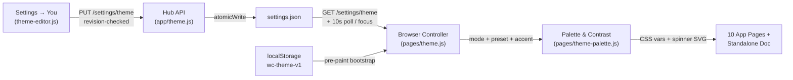

# Custom accent color and theme options

**Idea:** `IDEA.md` — what this is for and why, in plain language. Read it first; it is
the north star this plan serves. Goal and Constraints live there, not here, so they don't
get buried as this file grows.

## Open Questions

None.

## Watch List

| # | Noticed | What needs looking into | Raised to user? | Outcome |
|---|---------|-------------------------|-----------------|---------|

## Decision Log

| # | Decision | Rationale | Source |
|---|----------|-----------|--------|
| 1 | Automatically derive the accent token family (`--accent`, `--accent-ink`, `--accent-hover`, `--accent-hover-ink`, `--accent-vis`, `--accent-soft`, `--accent-line`, `--accent-text`, `--accent-hi`, `--accent-chip`, `--human`) from one chosen base hex color and active color mode, enforcing readable WCAG AA text contrast and replacing hardcoded blue literals (`assistant-popup.css`, etc.). | Users should pick one accent color, not individual CSS tokens; automatic contrast derivation keeps buttons, links, and chips legible in both light and dark modes. | defaulted |
| 2 | Place Theme controls in Settings → You alongside Background, using a browser-cached pre-paint bootstrap so signed-in pages do not flash the wrong color mode on load. | Matches the existing Appearance/You home in Settings and prevents light/dark FOUC on page load. | defaulted |
| 3 | Leave `signin.html` on the default theme. | Unauthenticated browsers cannot fetch user settings, and sign-in is a one-time gate. | defaulted |
| 4 | Apply theme (color mode, preset, custom accent color) to all signed-in app pages, standalone doc (`viewer/doc.html`), and graph viewer (`viewer/index.html` + `picture-export.js`), while keeping the embedded terminal (`xterm.js` in `viewer/pages/term-view.js`) dark. | Keeps all Wheelchair UI and diagrams cohesive without making CLI ANSI colors unreadable in light mode. | user |
| 5 | Store theme settings in hub `settings.json` synced across all devices, backed by a browser-local cache applied before first paint so pages do not flash the wrong theme on load. | Matches Background sync behavior across phone and computer; `system` color mode lets each device follow its own OS light/dark schedule. | user |
| 6 | Ship curated full-palette theme presets (Wheelchair Default plus Midnight, Forest, Amber, Rose, and Slate) that each define both light and dark surface/border/text palettes and a default accent, while allowing the user to override the accent to any custom hex color (and reset to preset or default). | Lets the user change the whole mood of the app in both light and dark modes while keeping full freedom over the accent color. | user |
| 7 | Overlap with 72ca062b2848: isolate Theme storage, routes, and Settings → You UI in dedicated modules (`viewer/app/theme.js`, `viewer/pages/theme.js`, `viewer/pages/theme-editor.js`) rather than modifying shared Settings polling; thread 72ca062b2848 was building Settings auto-refresh (in-memory revision endpoint and per-block polling in `viewer/pages/settings.js`, with no `settings.json` schema changes) at the time (overlap card 6ba3f145-8654-4340-8c7c-3268b8559d43) | Keeps Theme cleanly decoupled from Settings auto-refresh, matching how Background is structured. | user |
| 8 | Approved the three v1 mockups: `docs/plans/theme-options/graphs/mockup-theme-settings-desktop.html` (1280×900), `docs/plans/theme-options/graphs/mockup-theme-settings-phone.html` (390×844), and `docs/plans/theme-options/graphs/mockup-theme-thread-light.html` (1280×900). | Settings controls fit cleanly above Background on desktop and phone, and the light-mode Thread view shows clear contrast with a non-blue accent. | user |
| 9 | Default persisted theme for existing and fresh installs is `{ mode: "dark", preset: "default", accent: null, revision: 0 }`. | Preserves Wheelchair's exact current dark slate + `#5b9dd9` blue look on upgrade with zero visual regression until the user changes it. | defaulted |
| 10 | Apply the active accent color to the Wheelchair loading spinner's wheel/caster highlight (and match its wheelchair outline/spokes to the active light/dark ink and idle colors). | Collin requested that the loading spinner also use the chosen accent color. | user |
| 11 | Choosing a preset preserves an existing custom accent override until the user clicks "Reset to preset" or "Reset to default", and "Reset to default" resets preset and accent (`preset: "default", accent: null`) without overwriting the user's color mode. | Keeps accent overrides non-destructive while browsing presets and avoids unexpectedly switching a `system` user back to `dark`. | review-round-1 |
| 12 | Keep full scope (including light-mode graph viewer and contrast fixes) and continue review. | Collin confirmed keeping the full scope after discussing Round 3's contrast and graph-viewer findings. | user |
| 13 | Supersedes the graph-viewer portion of Decision #4: split graph viewer (`viewer/index.html`) and graph PNG export theming out of this plan into a follow-up thread (`depends_on_parent: true`). | The rest of the plan (app pages, standalone doc, Settings → You editor, presets, custom accent contrast, loading spinner, dark terminal) has settled; splitting out the graph viewer lets us ship the main app themes cleanly. | idea-change |
| 14 | Keep full contrast checks (including composer focus ring, assistant popup attribution, mockup error text, and light-mode activity trail) and run another review check. | Collin confirmed keeping full checks so everything ships cleanly without a follow-up. | user |

## Spec



### Mockups

| Path | Screen / state | Size |
|---|---|---|
| `docs/plans/theme-options/graphs/mockup-theme-settings-desktop.html` | Settings → You with Theme controls above Background (dark mode, desktop) | 1280×900 |
| `docs/plans/theme-options/graphs/mockup-theme-settings-phone.html` | Settings → You with Theme controls stacked (dark mode, phone) | 390×844 |
| `docs/plans/theme-options/graphs/mockup-theme-thread-light.html` | Thread page in Light mode with emerald custom accent (desktop) | 1280×900 |

### 1. Data model and hub API (`viewer/app/theme.js`, `viewer/app/settings.js`, `viewer/app/routes.js`, `viewer/app/API.md`)

1. **Settings schema (`settings.json`):**
   - Add top-level `theme` object to `DEFAULTS` in `viewer/app/settings.js`:
     ```json
     { "mode": "dark", "preset": "default", "accent": null, "revision": 0 }
     ```
   - `mode`: `"system" | "light" | "dark"`.
   - `preset`: `"default" | "midnight" | "forest" | "amber" | "rose" | "slate"`.
   - `accent`: `null` (use preset's default accent) or a lowercase 6-digit hex string matching `/^#[0-9a-f]{6}$/`.
   - `revision`: non-negative safe integer (`Number.isSafeInteger(v) && v >= 0`).
   - `viewer/app/theme.js` exports `DEFAULT`, `MODES`, `PRESETS`, `normalizeTheme(raw)`, and `handle(hub, request, response, url, bits, send)`.
   - `normalizeTheme(raw)` validates every field strictly; if `raw` is missing, malformed, or any field is out of range, it returns `{ ...DEFAULT }`. Uppercase hex in `accent` is accepted and lowercased on `PUT` input; stored/normalized `accent` is always lowercase `#rrggbb` or `null`.
   - `viewer/app/settings.js`'s `normalize()` calls `theme.normalizeTheme(raw?.theme)` so every `settings.update()` preserves `settings.theme` instead of dropping it.
   - **Malformed `theme` field vs unparseable `settings.json`:** A malformed `theme` field inside valid `settings.json` normalizes to `{ ...DEFAULT }` on `GET` and can be cleanly overwritten by `PUT` (at revision `0`). An unparseable `settings.json` file (JSON syntax error from `hub.state.settings(null)`) is never silently replaced: `viewer/app/theme.js` catches the read/parse error and returns `500` with `{ error: "Could not read settings.json" }` on both `GET` and `PUT` without touching `settings.json`.

2. **HTTP routes (`viewer/app/routes.js`):**
   - Dispatch `bits[0] === 'settings' && bits[1] === 'theme'` to `require('./theme.js').handle(hub, request, response, url, bits, send)` (matching `background.js` at `viewer/app/routes.js:49`).
   - Inherits the hub's remember-cookie auth and same-origin write checks from `viewer/server.js`.
   - **Shared error envelope:** All theme route errors return JSON via `send(response, status, { error: "<plain message>", ...extra })` (400 invalid input, 404/405 wrong path/method, 409 conflict with current theme fields `{ error: "Theme changed elsewhere", ...current }`, 413 body > 4 KiB). Do not mix `appError`'s `{ error: "app-error", detail }` envelope for validation/conflict responses; `theme-editor.js` still reads `body?.error || body?.detail` defensively.
   - **`GET /wheelchair/api/settings/theme`** (`bits.length === 2`): returns `200` with `{ mode, preset, accent, revision }` and `Cache-Control: no-store`.
   - **`PUT /wheelchair/api/settings/theme`** (`bits.length === 2`):
     - Body limit: 4 KiB (reject larger with `413` `{ error: "Request body too large" }`). Requires valid JSON object `{ mode, preset, accent, revision }`.
     - Validates `mode` in `MODES`, `preset` in `PRESETS`, `accent` is `null` or `/^#[0-9a-fA-F]{6}$/` (normalized to lowercase), and `revision` is a non-negative safe integer. Invalid input returns `400` with `{ error: "<reason>" }`.
     - Runs inside `hub.state.queued(hub.state.settingsPath, ...)` (same settings file queue as `background.js`):
       - Reads and normalizes current `settings.json` (propagating parse errors as 500).
       - If `body.revision !== current.revision`: returns `409` with `{ error: "Theme changed elsewhere", ...current }`.
       - If `mode`, `preset`, and `accent` all equal `current`: returns `200` with `current` without bumping `revision` or rewriting `settings.json`.
       - If `current.revision === Number.MAX_SAFE_INTEGER`: returns `400` (`{ error: "Revision limit reached" }`).
       - Otherwise writes updated `settings.theme` with `revision: current.revision + 1` via `atomicWrite(hub.state.settingsPath, ...)` and returns `200` with the new `{ mode, preset, accent, revision }`.
   - Document `GET /settings/theme` and `PUT /settings/theme` in `viewer/app/API.md`.

### 2. Shared palette & contrast derivation (`viewer/pages/theme-palette.js`)

- Pure, zero-dependency dual-environment module (CommonJS `module.exports` for Node tests and `window.wcThemePalette` in the browser, matching `viewer/pages/background-format.js`).
- **6 curated presets** (`PRESETS`), each defining `id`, `label`, `swatches: [c1, c2, c3]` (matching `mockup-theme-settings-desktop.html`), `defaultAccent`, and complete `dark` and `light` surface/border/text palettes:

| Preset | Label | Swatches | Default accent | Mode | `--bg` | `--panel` | `--panel-2` | `--panel-3` | `--band` | `--line` | `--line-2` | `--ink` | `--ink-2` | `--dim` | `--figure` | `--code-bg` | `--idle` |
|---|---|---|---|---|---|---|---|---|---|---|---|---|---|---|---|---|---|
| `default` | Wheelchair Default | `#18212c,#5b9dd9,#354a60` | `#5b9dd9` | dark | `#14161a` | `#1c1f25` | `#23262d` | `#181a1e` | `#161a20` | `#2a2f38` | `#3a3f48` | `#e6e8ec` | `#c5cad3` | `#8b929e` | `#111316` | `#23262d` | `#6b7280` |
| `default` | Wheelchair Default | `#18212c,#5b9dd9,#354a60` | `#5b9dd9` | light | `#f6f7f9` | `#ffffff` | `#edf0f4` | `#f2f4f7` | `#eef1f5` | `#d8dee6` | `#bfc8d4` | `#161b22` | `#3d4754` | `#576371` | `#e7ecf2` | `#edf0f4` | `#64707d` |
| `midnight` | Midnight | `#101725,#8294e8,#303b61` | `#8294e8` | dark | `#101522` | `#171e2f` | `#1f273c` | `#131928` | `#121827` | `#27314a` | `#374464` | `#e7ebf5` | `#c4cce0` | `#8d98b3` | `#0c101b` | `#1f273c` | `#6d7896` |
| `midnight` | Midnight | `#101725,#8294e8,#303b61` | `#8294e8` | light | `#f5f7fc` | `#ffffff` | `#ebeefa` | `#f0f3fb` | `#edf0f9` | `#d5dcef` | `#bcc7e2` | `#151b2b` | `#39435c` | `#545f7a` | `#e4e9f7` | `#ebeefa` | `#646f8a` |
| `forest` | Forest | `#14251e,#10b981,#365848` | `#10b981` | dark | `#111c17` | `#17261f` | `#1e3128` | `#14201b` | `#131f1a` | `#273d33` | `#365346` | `#e6efe9` | `#c2d4c9` | `#89a193` | `#0d1612` | `#1e3128` | `#6b8275` |
| `forest` | Forest | `#14251e,#10b981,#365848` | `#10b981` | light | `#f7f8f7` | `#ffffff` | `#edf1ee` | `#f2f5f3` | `#eef2ef` | `#dce3de` | `#c4d0c7` | `#18231c` | `#3e4d43` | `#55645a` | `#e4ebe6` | `#edf1ee` | `#637368` |
| `amber` | Amber | `#2c2418,#e5a63a,#705831` | `#e5a63a` | dark | `#1b1712` | `#252019` | `#2f2820` | `#201b15` | `#1e1913` | `#3d3428` | `#524636` | `#f0ebe3` | `#d3c9ba` | `#a49784` | `#15120e` | `#2f2820` | `#807464` |
| `amber` | Amber | `#2c2418,#e5a63a,#705831` | `#e5a63a` | light | `#faf7f2` | `#ffffff` | `#f2ece2` | `#f6f1e9` | `#f3ede3` | `#e3d9ca` | `#cfc1ac` | `#231d15` | `#4d4234` | `#665847` | `#ebe3d5` | `#f2ece2` | `#756858` |
| `rose` | Rose | `#291d22,#e06c75,#704650` | `#e06c75` | dark | `#1b1418` | `#261c21` | `#31242b` | `#20181c` | `#1e161a` | `#402e37` | `#573f4b` | `#f2e9ed` | `#d6c3cc` | `#a8909c` | `#151013` | `#31242b` | `#846e79` |
| `rose` | Rose | `#291d22,#e06c75,#704650` | `#e06c75` | light | `#fbf6f7` | `#ffffff` | `#f4eaec` | `#f7eff1` | `#f4ebed` | `#e5d5d9` | `#d2bcc2` | `#26181d` | `#523b43` | `#6b515a` | `#ede0e3` | `#f4eaec` | `#7a6069` |
| `slate` | Slate | `#20262c,#94a3b8,#4e5a69` | `#94a3b8` | dark | `#16191d` | `#1f242a` | `#272d35` | `#1a1e23` | `#181c21` | `#303741` | `#414a57` | `#e7eaee` | `#c5cbd3` | `#8f98a4` | `#111417` | `#272d35` | `#6e7784` |
| `slate` | Slate | `#20262c,#94a3b8,#4e5a69` | `#94a3b8` | light | `#f5f6f8` | `#ffffff` | `#eceff3` | `#f1f3f6` | `#edeff3` | `#d7dde5` | `#bfc7d2` | `#181d23` | `#3e4652` | `#586270` | `#e5e9ef` | `#eceff3` | `#66707e` |

- **Shared semantic status tokens** per resolved mode (dark matches `viewer/pages/app.css:18-22` verbatim):
  - **Dark:** `--good: #4ea87b`, `--good-ink: #0c1410`, `--good-bg: #172019`, `--good-line: #3f7a5c`, `--good-soft: #1d2a23`, `--good-text: #8fd0ad`, `--warn: #d9a441`, `--warn-bg: #241f15`, `--warn-line: #5c4a24`, `--warn-tint: #1a1813`, `--bad: #c4645f`, `--bad-text: #e09a96`, `--bad-bg: #2a1a19`, `--term-bg: #0c0e10`.
  - **Light:** `--good: #197a48`, `--good-ink: #ffffff`, `--good-bg: #e8f5ee`, `--good-line: #8bc9a8`, `--good-soft: #eef8f2`, `--good-text: #15693e`, `--warn: #7c5000`, `--warn-bg: #fdf5e6`, `--warn-line: #e2c27d`, `--warn-tint: #faf4e8`, `--bad: #c23b3b`, `--bad-text: #a32626`, `--bad-bg: #fdeeee`, and `--term-bg` is set to each preset's light `--figure` surface so Thread code blocks (`thread.css:95-108`) and Settings prompt previews (`settings.css:100-101,280`) stay light and legible under `--ink` text while the actual xterm terminal (`.tv-host`) stays dark (`#0c0e10`).
- **Quick accent swatches** exported as `QUICK_ACCENTS`: `['#5b9dd9', '#10b981', '#d6a53b', '#e06c75', '#a78bfa', '#94a3b8']`.
- **Accent derivation (`deriveAccent(hex, resolvedMode, surfaces, presetId)`):**
  - Special-case exact Wheelchair Default in dark mode (`presetId === 'default' && resolvedMode === 'dark' && hex === '#5b9dd9'`): returns exact original tokens (`--accent: #5b9dd9`, `--accent-ink: #0e1114`, `--accent-hover: #a9cdf0`, `--accent-hover-ink: #0e1114`, `--accent-vis: #5b9dd9`, `--accent-soft: #1a2230`, `--accent-line: #3a5778`, `--accent-text: #7fb4e6`, `--accent-hi: #a9cdf0`, `--accent-chip: #1f2b3a`, `--human: #23303f`) so existing default appearance is pixel-identical.
  - Helper `pickContrastInk(bgHex)`: computes WCAG 2.1 contrast ratio against `#0e1114`, `#000000`, and `#ffffff`. If `#0e1114` meets `>= 4.5` and is at least as high as `#ffffff`, return `#0e1114`; otherwise return whichever of `#000000` and `#ffffff` has the higher contrast ratio (mathematically `>= 4.58:1` for every RGB color, including mid-gray `#777777`).
  - For any other `(hex, resolvedMode, surfaces)`:
    - `--accent`: normalized `#rrggbb` chosen color.
    - `--accent-ink`: `pickContrastInk(accent)`.
    - `--accent-hover`: hover fill for filled primary buttons/FABs — shifts `--accent` in HSL lightness (+8% in dark mode, -8% in light mode; if already near 0% or 100% lightness, shifts toward middle so hover is visibly distinct).
    - `--accent-hover-ink`: `pickContrastInk(accentHover)` (guaranteed `>= 4.5:1` against `--accent-hover` even for `#000000` or `#ffffff` accents).
    - `--accent-soft`: RGB mix of `--accent` (starting at 14% in dark, 10% in light) over `surfaces['--panel']`; if any of `surfaces['--ink']`, `surfaces['--dim']`, `status['--warn']`, `status['--good-text']`, or `status['--bad-text']` falls below `4.5:1` against `--accent-soft` (e.g. `#ffffff` accent in Slate Dark), step the mix weight down (to 0% if needed) until all five clear `>= 4.5:1`.
    - `--accent-line`: RGB mix of `--accent` (42% in dark, 38% in light) over `surfaces['--line']`.
    - `--accent-chip`: RGB mix of `--accent` (20% in dark, 14% in light) over `surfaces['--panel']`.
    - `--accent-vis`: non-text visible accent derived from `--accent` by stepping HSL lightness (lighter in dark mode, darker in light mode) only if needed so its WCAG 2.1 non-text contrast ratio against `--bg`, `--panel`, `--panel-2`, `--panel-3`, `--figure`, `--line-2`, and `--accent-soft` is `>= 3.0:1` (unchanged exact `--accent` whenever it already clears `3.0:1`, including Default Dark `#5b9dd9`). Used for `:focus-visible` outlines, the loading spinner highlight, and non-text accent status indicators (including the Agents memory ring arc over `--line-2`).
    - `--human`: RGB mix of `--accent` (16% in dark, 12% in light) over `surfaces['--panel-2']` (verified `>= 4.5:1` with both `surfaces['--ink']` and `surfaces['--ink-2']`; if a very bright/dark accent lowers either below 4.5:1, reduce mix weight down to 0% until both clear `>= 4.5:1`).
    - `--accent-text`: computed **after** `--accent-soft`, `--accent-chip`, and `--human`; starts from `--accent` in HSL and steps lightness (lighter in dark mode, darker in light mode) until WCAG 2.1 contrast ratio against all six surfaces (`--bg`, `--panel`, `--panel-2`, `--accent-soft`, `--accent-chip`, `--human`) is `>= 4.5:1` (falling back to `surfaces['--ink']` if needed).
    - `--accent-hi`: hover/highlight text accent derived from `--accent-text` (slightly lighter in dark mode, slightly darker in light mode) while maintaining `>= 4.5:1` contrast against all six surfaces (`--bg`, `--panel`, `--panel-2`, `--accent-soft`, `--accent-chip`, `--human`).
- **Spinner SVG derivation (`buildSpinnerUrls(ink, idle, accentVis)`):**
  - Builds the two `url("data:image/svg+xml,...")` strings (normal speed and `prefers-reduced-motion` speed, matching `viewer/pages/app.css:204,206`) with `%23` URI-encoded `ink`, `idle`, and `--accent-vis` hex values, exposed as `--spinner-svg` and `--spinner-svg-reduced` in `vars`.
- **`resolveTheme(theme, prefersLight)`**: accepts `{ mode, preset, accent }` (normalizing invalid values to defaults) and boolean `prefersLight`, returns `{ mode, preset, accent, resolvedMode: 'light' | 'dark', effectiveAccent, vars }`.
- **`parseHexColor(input)`**: trims whitespace, accepts optional leading `#`, accepts 3-digit (`#abc` → `#aabbcc`) or 6-digit hex, returns lowercase `#rrggbb` or `null`.

### 3. Browser theme controller & pre-paint bootstrap (`viewer/pages/theme.js`)

- Loaded synchronously in `<head>` (after `theme-palette.js`, before page stylesheets paint; no `defer` attribute) on **all 11 signed-in app and standalone doc HTML pages**:
  - `viewer/pages/agents.html`, `viewer/pages/doc.html`, `viewer/pages/features.html`, `viewer/pages/file.html`, `viewer/pages/new.html`, `viewer/pages/picture.html`, `viewer/pages/settings.html`, `viewer/pages/terminal.html`, `viewer/pages/thread.html`, `viewer/pages/threads.html`
  - `viewer/doc.html` (standalone doc viewer).
  - **Not** loaded on `viewer/signin.html` or `viewer/index.html` (graph viewer theming was split off in Decision #13).
- **Pre-paint application:**
  - Reads `localStorage.getItem('wc-theme-v1')` inside `try/catch`; if valid, immediately resolves with `window.matchMedia('(prefers-color-scheme: light)').matches` and applies all `--*` CSS custom properties onto `document.documentElement.style`, sets `document.documentElement.dataset.themeMode` (`light` | `dark`), `document.documentElement.dataset.themePreset`, and `document.documentElement.style.colorScheme = resolvedMode`.
  - If `localStorage` is empty or invalid, leaves CSS defaults untouched until hub fetch resolves (default dark matches `app.css`).
- **Monotonic revision gate & hub sync:**
  - Track `acceptedRevision` (initialized from cached `localStorage` if present, or `-1`).
  - Route every incoming theme metadata (`GET` response, `PUT` response via `applySaved`, and `storage` event from another tab) through one `acceptMetadata(next, source)` function:
    - If `next.revision < acceptedRevision`, ignore it (prevents a delayed stale `GET` from clobbering a newer `PUT` or `storage` update).
    - If `next.revision === acceptedRevision` and `mode`/`preset`/`accent` are identical, do nothing.
    - Otherwise update `acceptedRevision`, store in `localStorage['wc-theme-v1']` (unless `source === 'storage'`), apply CSS variables if no preview token is active, and notify subscribers.
  - On load, fetches `GET /wheelchair/api/settings/theme` (`credentials: 'same-origin'`, `cache: 'no-store'`).
  - Listens to `window.matchMedia('(prefers-color-scheme: light)')` `change` events: immediately re-applies when active theme (saved or previewed) has `mode === 'system'`.
  - Listens to `window` `storage` events for key `wc-theme-v1`: routes parsed value through `acceptMetadata(next, 'storage')`.
  - Refreshes from hub every 10 seconds while `document.visibilityState === 'visible'` (using `window.wcPoller` when available or a visibility-gated timer on pages without `nav.js` like `viewer/doc.html`), plus on `focus` and `pageshow` (matching `background.js`).
  - Dispatches `CustomEvent('wc-theme-change', { detail })` on `window` whenever applied CSS variables change so JS consumers (such as `agents.js`) can re-read computed values.
- **Public API (`window.wcTheme`):**
  - `current()` → `{ metadata, ready, error }`
  - `subscribe(fn)` → returns unsubscribe function
  - `acquire()` → returns exclusive preview token (mirrors `window.wcBackground.acquire()`)
  - `preview(token, draft)` → applies `{ mode, preset, accent }` live on the current page without touching `localStorage` or hub (ignored if token is not current owner)
  - `release(token)` → releases preview ownership and restores the last saved hub theme
  - `refresh()` → fetches `GET /wheelchair/api/settings/theme`
  - `applySaved(metadata)` → routes through `acceptMetadata(metadata, 'save')`.

### 4. Settings → You Theme editor (`viewer/pages/theme-editor.js`, `viewer/pages/settings.js`, `viewer/pages/settings.css`)

- Isolated in `viewer/pages/theme-editor.js` (loaded by `viewer/pages/settings.html` via `<script defer>`) exposing `window.wcThemeEditor`.
- `viewer/pages/settings.js` makes minimal wiring changes in the `You` section: adds a `theme` block right above `background` that mounts `window.wcThemeEditor.render(...)` and calls `window.wcThemeEditor.discard()` whenever leaving the `You` section (desktop sidebar navigation, phone Back link, and `window` `pagehide` so bfcache navigation away from Settings releases the preview token and clears unsaved drafts, matching `settings.js:2385-2388,2879-2889`). On `window` `pageshow` (including bfcache restore), `theme-editor.js` repaints the mounted Theme block from the current saved `wcTheme.current().metadata` so restored DOM inputs and buttons never show stale draft values or disabled states. Does not alter Settings polling or other blocks.
- **Visit, draft baseline, and in-flight ownership:**
  - Each `You` section visit owns a `visit` state `{ generation, dirty, baseRevision, op, saving, token, draft, hexText, hexError, conflict, error, status }` (matching `backgroundVisit`).
  - While `visit.dirty === false`, subscribe to `wcTheme` updates and sync both `visit.draft` and `visit.baseRevision` from the same latest `wcTheme.current().metadata` snapshot (repainting the clean Theme block only when the saved metadata actually changes, matching `settings.js:2377-2386`). When `dirty` transitions `false → true`, snapshot `visit.draft` and `visit.baseRevision` from that same current metadata and acquire `visit.token = wcTheme.acquire()`. Subsequent hub polls or storage events do not mutate `visit.baseRevision` or `visit.draft` while dirty.
  - While `visit.saving === true`, disable all Theme editor inputs and buttons so edits cannot race with an in-flight `PUT`.
  - Capture `(visit, op)` before calling `PUT /wheelchair/api/settings/theme` with `{ mode, preset, accent, revision: visit.baseRevision }`. If `discard()` ran (user left `You`) before the response arrives, ignore the response cleanly (only calling `wcTheme.applySaved(body)` on `200` so the saved theme still propagates globally without touching any new visit's UI).
- **Controls (matching `mockup-theme-settings-desktop.html` and `mockup-theme-settings-phone.html`):**
  1. **Color mode:** 3-button segmented control (`System`, `Light`, `Dark`) with `aria-pressed`.
  2. **Theme preset:** 6-card grid (`Wheelchair Default`, `Midnight`, `Forest`, `Amber`, `Rose`, `Slate`), each showing its 3-color swatch bar, name, and active checkmark (`aria-pressed`). Clicking a preset sets `draft.preset = id` and preserves `draft.accent` (Decision #11): if `draft.accent` is `null`, the new preset's signature accent previews immediately; if a custom accent is set, it remains active over the new preset's surfaces until reset.
  3. **Accent color:**
     - Native `<input type="color">` synced to the effective accent (`draft.accent || preset.defaultAccent`). Picking a color sets `draft.accent` to that lowercase hex.
     - Hex `<input type="text">` (`aria-label="Accent hex color"`) displaying the effective hex; typing a valid 3- or 6-digit hex updates preview live; invalid text shows an inline validation hint and disables Save until corrected or reset.
     - 6 quick accent swatch buttons (`#5b9dd9`, `#10b981`, `#d6a53b`, `#e06c75`, `#a78bfa`, `#94a3b8`) that set `draft.accent` to that color.
     - **Reset to preset** button: sets `draft.accent = null` (disabled when `draft.accent === null`).
     - **Reset to default** button: sets `draft.preset = 'default'` and `draft.accent = null`, preserving `draft.mode` (Decision #11; disabled when `draft.preset === 'default' && draft.accent === null`).
  4. **Status line & Save / Reset actions (matching mockups):**
     - While dirty (and not conflicted/error): show status line `"Previewing on this page · Save to apply across devices"`.
     - **Reset** button: discards unsaved edits, releases preview token, clears conflict/error, restores last saved hub theme (disabled when clean).
     - **Save theme** button: sends `PUT /wheelchair/api/settings/theme` with `{ mode, preset, accent, revision: visit.baseRevision }`.
       - On `200`: calls `wcTheme.applySaved(saved)`, releases preview token, clears dirty state, shows `"Saved"`.
       - On `409`: calls `wcTheme.applySaved(latest)` (updating hub cache), keeps `visit.dirty = true` and `visit.draft` visible, shows inline conflict message `"Theme changed elsewhere. Click Reset to load the latest settings."` and disables Save until Reset (matching `background` conflict handling).
       - On network/4xx/5xx error: shows inline error message (`body?.error || body?.detail || "Couldn't save theme"`) and re-enables controls.
- **Responsive layout (`viewer/pages/settings.css`, matching both approved mockups):**
  - 6-column preset grid (`repeat(6, minmax(0, 1fr))`) on desktop, dropping to 3 columns (`repeat(3, minmax(0, 1fr))`) at `@media (max-width: 700px)`, with zero horizontal overflow at `390px` viewport width.

### 5. Surface tokenization & special views

1. **Main app stylesheets (`viewer/pages/app.css`, `assistant-popup.css`, `thread.css`, `views.css`, `settings.css`, `doc.css`, `file.css`, `background.css`):**
   - `viewer/pages/app.css`:
     - Keep `:root` dark defaults unchanged (add `--accent-hover: #a9cdf0; --accent-hover-ink: #0e1114; --accent-vis: #5b9dd9;`).
     - Set `color-scheme: dark;` on `html` only (removing `color-scheme: dark` from `body` in `app.css:29`), and override with `html[data-theme-mode="light"], html[data-theme-mode="light"] body { color-scheme: light; }` so native controls (such as `<input type="color">` and scrollbars) follow light mode while `.tv-host` keeps `color-scheme: dark`.
     - `#app-nav .logo` uses `color: var(--accent-ink)` instead of `color: var(--bg)` (intentional contrast improvement in Default Dark: `#0e1114` vs `#14161a`).
     - `:focus-visible` outline (`app.css:81`) uses `outline: 2px solid var(--accent-vis);` instead of raw `var(--accent)` so keyboard focus stays visible (`>= 3.0:1`) even with a `#ffffff` accent in light mode; also update the two thread textareas (`viewer/pages/thread.css:147-150,462-466`) and the main Thread composer (`#composer textarea` at `viewer/pages/thread.css:221-222`) to keep a visible `var(--accent-vis)` focus ring on `:focus-visible` instead of `outline: none` / `outline: 0` (intentional focus-visibility improvement in Default Dark).
     - Non-text accent status indicators (`viewer/pages/app.css:104` Threads working dot, `viewer/pages/views.css:241` Agents current-activity outline, and any other non-text accent borders/dots in `viewer/pages/*.css`) use `var(--accent-vis)` instead of raw `var(--accent)` so they stay visible (`>= 3.0:1`) with `#ffffff` and `#000000` accents; raise the Agents activity trail stroke opacity (`viewer/pages/views.css:236`) from `0.4` to `0.75` under `html[data-theme-mode="light"]` so the composited `--accent-hi` stroke clears `>= 3.0:1` over `--panel-3`.
     - Filled primary button/FAB hover rules (`app.css:70`, `app.css:121-122`, `assistant-popup.css:16`) use `background: var(--accent-hover); border-color: var(--accent-hover); color: var(--accent-hover-ink);` instead of `--accent-hi` with `--accent-ink`; add a new `.wc-asst-send:hover` rule beside `.wc-asst-send` (`assistant-popup.css:62`) with the same `--accent-hover` / `--accent-hover-ink` pair so `button:hover` does not override its foreground.
     - `.bubble.human .by-assistant` (`viewer/pages/thread.css:476`) and the matching assistant-popup attribution (`viewer/pages/assistant-popup.css:81`): use `color: var(--ink-2)` instead of `var(--dim)` so "From your assistant" attribution inside `--human` bubbles clears `>= 4.5:1` across all presets including Default Dark (intentional contrast improvement in Default Dark: 8.0:1 vs 4.28:1).
     - Mockup comment submission error (`viewer/pages/thread.css:468-470`): use `color: var(--bad-text)` instead of `var(--bad)` so 13px error text on `--figure` clears `>= 4.5:1` in every light preset including Rose Light.
     - Replace raw `color: var(--accent)` text rules (`app.css:141`, `views.css:249` `.latest-running`, and any other text-color uses of `var(--accent)` in `viewer/pages/*.css`) with `color: var(--accent-text)` so text always meets `>= 4.5:1` contrast (intentional contrast improvement in Default Dark: `#5b9dd9` → `#7fb4e6`).
     - `.spinner` (`app.css:203-206`): use `background-image: var(--spinner-svg, url(...))` and under `@media (prefers-reduced-motion: reduce)` use `background-image: var(--spinner-svg-reduced, url(...))` so the wheelchair spinner's wheel highlight uses `--accent-vis` and its outline/spokes use `--ink`/`--idle` (Decision #10).
   - `viewer/pages/assistant-popup.css:40`: replace hardcoded `#23303f` with `var(--human)`.
   - Audit `viewer/pages/*.css` for any remaining hardcoded blue hex/rgba literals or dark-only text/surface literals that break in light mode and replace them with theme tokens.
   - `viewer/pages/background.css`: verify opaque content surfaces remain opaque using `var(--bg)` / `var(--panel)` in light mode when a background image is active.
2. **Standalone doc page (`viewer/doc.html`) and embedded graph frames (`viewer/pages/picture-export.js`):**
   - Load `theme-palette.js` and `theme.js` in `viewer/doc.html` `<head>`, align `:root` variables with the shared palette (dark defaults as fallback, including `--accent-text`, `--accent-hi`, `--accent-vis`, `--accent-ink`, `--accent-hover`, `--accent-hover-ink`, `--bad-bg`, `--bad`, `--bad-text`), use `var(--accent-text)` (hover `var(--accent-hi)`) for links (`viewer/doc.html:66`), and style the error banner (`viewer/doc.html:44-45`) with `background: var(--bad-bg); border-color: var(--bad); color: var(--bad-text);` instead of hardcoded `#3a1f1f`/`#f2d4d1`.
   - Embedded graph iframes (`/wheelchair/?path=` → `viewer/index.html`, shown on Thread, aside, and Picture) stay on their existing default dark palette until the follow-up thread (Decision #13). To avoid putting dark graph artwork onto a light exported canvas when Picture is in light mode, `viewer/pages/picture-export.js` reads the graph PNG canvas background from the graph iframe (`getComputedStyle(svg).backgroundColor` / `iframe.contentDocument.documentElement` `--bg`) instead of the parent Picture page's body color.
3. **Embedded terminal (`viewer/pages/term-view.js`, `viewer/pages/views.css`):**
   - Terminal stays dark in all color modes (Decision #4): `.tv-host` in `viewer/pages/views.css` explicitly sets `background: #0c0e10; color: #e6e8ec; color-scheme: dark;` and xterm's constructor in `viewer/pages/term-view.js` passes an explicit dark `theme: { background: '#0c0e10', foreground: '#e6e8ec', cursor: '#e6e8ec' }`. The typing-mode cursor in `viewer/pages/term-view.js` uses the fixed dark-terminal warning color `#d9a441` (instead of reading page `--warn`, which is dark amber `#7c5000` in light mode) so it remains readable on `#0c0e10` in both modes. Surrounding controls (`.term-bar`, `.tv-view` border, `.tv-switch`, `.tv-notice`) remain themed with readable light/dark tokens including with an active background image.
4. **Agents activity colors (`viewer/pages/agents.js`):**
   - Read accent/status colors from computed CSS variables (with existing hex fallbacks) where accent-colored indicators appear, and refresh on `wc-theme-change`.
5. **Router & test map upkeep (`CONTRIBUTING.md`):**
   - Update `viewer/AGENTS.md` file table to include `app/theme.js`, `pages/theme-palette.js`, `pages/theme.js`, and `pages/theme-editor.js`.
   - Update `test-support/test-map.json` if any new files are not covered by existing globs.
   - Add **both** `test/theme-editor.spec.js` and `test/theme-rendering.spec.js` to `viewer/test/firefox-specs.js` (per `CONTRIBUTING.md`: specs testing pixels, rendering, or scroll containment run in both Chromium and Firefox).

### 6. Non-goals (from IDEA.md)

- Typography, font-size, layout density, or corner-radius controls.
- Per-project or per-thread theme overrides.
- Custom raw CSS editing or user-uploaded stylesheet files.
- Theming `viewer/signin.html`, switching xterm.js to a light terminal palette, or theming the graph viewer (`viewer/index.html`) and its graph PNG export (split off in Decision #13).

### 7. Validation commands

Targeted tests (run by workers and verifiers; full suite runs before push via `test-support/full-run.sh`):

1. **Theme unit & API tests (`viewer/test/theme.test.js`):**
   - Covers `theme-palette.js` WCAG 2.1 contrast (`>= 4.5:1`) for:
     - `--ink`, `--ink-2`, `--dim` against `--bg`, `--panel`, and `--panel-2`, `--ink` against `--term-bg`, `--bad-text` against `--figure`, plus `--good-ink` on `--good`, and `--ink`, `--dim`, `--good-text`, `--warn`, `--bad-text` against `--bg`, `--panel`, `--panel-2`, and `--accent-soft` (including `#ffffff` and `#000000` accents) for all 6 presets in both `light` and `dark` modes.
     - `--accent-ink` on `--accent`, `--accent-hover-ink` on `--accent-hover`, `--accent-text` and `--accent-hi` on `--bg`/`--panel`/`--panel-2`/`--accent-soft`/`--accent-chip`/`--human`, `--ink` and `--ink-2` on `--human`, and `--accent-vis` (`>= 3.0:1` non-text contrast on `--bg`/`--panel`/`--panel-2`/`--panel-3`/`--figure`/`--line-2`/`--accent-soft`) across all 6 presets, both modes, and edge hex colors (`#000000`, `#696969`, `#6f6f6f`, `#777777`, `#8a8a8a`, `#8d8d8d`, `#8f8f8f`, `#ffffff`, `#ffff00`, `#ff0000`, `#00ff00`, `#5b9dd9`, `#d6a53b`).
     - Exact pixel-identical default dark tokens and `--spinner-svg` / `--spinner-svg-reduced` color injection.
   - Covers `GET /wheelchair/api/settings/theme` and `PUT /wheelchair/api/settings/theme`: defaults, malformed `theme` field normalization vs unparseable `settings.json` returning `500` with `{ error: "Could not read settings.json" }` without overwriting, valid save + revision increment, idempotent no-op save, 400 invalid input (`{ error }`), 409 revision conflict (`{ error, mode, preset, accent, revision }`), 413 oversized payload, preservation across unrelated `settings.update()` calls.
   - Command: `node --test viewer/test/theme.test.js`
2. **Existing settings, background, name-guard, and mockup-browser regression tests:**
   - Command: `node --test viewer/test/background.test.js viewer/test/app-settings.test.js machine/test/name-guard.test.js`
   - Command: `npm --prefix viewer run test:browser -- browser.spec.js`
3. **Browser Settings editor & sync spec (`viewer/test/theme-editor.spec.js`, listed in `viewer/test/firefox-specs.js`):**
   - Isolated server via `viewer/test/helpers/server.js`.
   - Tests Settings → You Theme controls: live preview of mode/preset/custom hex/quick swatch without saving, status line `"Previewing on this page · Save to apply across devices"`, preset switch preserving custom accent, Reset to preset, Reset to default preserving color mode, Reset discarding preview, Save persisting across reload, System mode reacting to OS `prefers-color-scheme` changes (`emulateMedia`), clean editor adopting refreshed snapshot (fields + `baseRevision`) before first edit, hub sync to a second isolated browser context (no shared `localStorage`, opened and kept visible before Save, updating via polling without reload or focus change), invalid hex validation disabling Save, 409 conflict with stale baseRevision after concurrent update, delayed stale GET not overwriting newer PUT/storage state, navigating away (mobile Back link, header navigation + browser Back, plus same-document `pagehide` → `pageshow({ persisted: true })` lifecycle test with a live unsaved preview asserting both applied theme CSS vars and form controls return to saved values), 6-column desktop / 3-column phone (390×844) preset grid with zero horizontal overflow.
   - Command: `npm --prefix viewer run test:browser -- test/theme-editor.spec.js`
4. **Browser rendering & cross-page spec (`viewer/test/theme-rendering.spec.js`, listed in `viewer/test/firefox-specs.js`):**
   - Tests that saved light mode + custom accent color applies to Thread, Threads, Agents, New, Picture (outer page; embedded graph iframes stay dark and are not asserted as light), and Standalone Doc (`viewer/doc.html`, including error banner), including readable contrast on raw-accent-replaced labels, `.bubble.human .by-assistant` and assistant-popup attribution, Thread code blocks / `--term-bg` in light mode, keyboard `:focus-visible` outline (including `#composer textarea` and both other thread textareas, testing `#8a8a8a` on `--figure` and `#ffffff`), Threads working dot, Agents current-activity outline, and composited Agents activity trail over `--panel-3` (`>= 3.0:1`, including `#696969`) with `#ffffff` and `#000000` accents, standalone doc links, filled button hover pairs (including `.wc-asst-send:hover` with `#ffffff` accent in Default Dark), `body` computed `color-scheme: light`, and spinner `--spinner-svg` containing the contrast-checked `--accent-vis` hex; verifies Terminal (`.tv-host` / xterm) stays dark (`#0c0e10`) with readable `#d9a441` typing cursor when Typing is enabled in light mode, Sign-in stays default dark, pre-paint bootstrap avoids dark flash on reload in light mode, light mode + background image keeps cards opaque, and graph PNG export on a light-mode Picture page still paints a dark canvas background matching the dark graph iframe.
   - Command: `npm --prefix viewer run test:browser -- test/theme-rendering.spec.js`

## Accepted Risks

| Risk | Why accepted | Round |
|------|--------------|-------|
| If `settings.json`'s `theme` field is externally corrupted/malformed on disk and resets to revision `0` while a browser still caches a higher revision (e.g., `5`), the monotonic `acceptedRevision` gate ignores the lower revision until `localStorage` is cleared or revision catches up. | Rare path per `protocol/app/realism.md` (requires state-file corruption on disk combined with an already-cached higher browser revision). | review-round-2 |
| Transient queued-message bubbles (`viewer/pages/thread.css:77-81`, `opacity: 0.7`) intentionally dim the whole sending bubble while in flight, which can temporarily lower composited contrast of `.by-assistant` below 4.5:1 until delivered. | Pre-existing intentional dimmed/pending visual cue (exempt under WCAG 1.4.3 inactive/disabled states); delivered messages render at full opacity and >= 4.5:1. | review-round-9 |
| Chromium's unstyled UA default `::placeholder` (`#757575`) on enabled textareas (`viewer/pages/thread.css:148`) renders at 4.33:1 in Forest Light (`#f7f8f7`). | Pre-existing unstyled browser-default placeholder behavior across all modes (already 4.02:1 on Default Dark `#14161a`), outside Spec §5.1/§7.1/§7.4. | verification-4 |

## Check Once Built

| # | What to check | Round |
|---|---------------|-------|

## Review Rounds

### Round 1 — 2026-11-28

**Lanes:** claude / claude-opus-5-5 (intent); gpt / gpt-6.2-sol (mechanics); cross-family: yes.

**Changed since Round 0:** n/a (first round — whole Spec in scope)

| Lane | Reported | Finding | Lead verdict | Resolution |
|------|----------|---------|--------------|------------|
| intent | major | Preset grid layout in Spec (3-col / 2-col) contradicts approved mockups (6-col / 3-col at <=700px) | upheld | Updated Spec §4 responsive layout and §7.3 test to 6 columns desktop / 3 columns <=700px matching mockups |
| intent | major | Raw `color: var(--accent)` rules (`app.css:141`, `views.css:249`) fail contrast in light mode (e.g. amber `#d6a53b` on white is 2.26:1) | upheld | Updated Spec §5.1 to replace raw `color: var(--accent)` text rules with `var(--accent-text)` |
| intent | minor | Preset surface text tokens (`--ink`, `--ink-2`, `--dim`) not contrast-checked; Forest light `--dim #65756a` on `--panel-2 #edf1ee` is 4.28:1 | upheld | Darkened Forest light `--dim` to `#55645a` and added all-preset surface text contrast checks to §7.1 |
| intent | minor | Presets 2–6 only specified `--bg`/`--panel` hexes, leaving remaining surface/line/text/status tokens unspecified | upheld | Added complete token table for all 6 presets (dark + light) and shared dark/light status tokens in Spec §2 |
| intent | minor | "Reset to default" forcing `mode: 'dark'` surprises `system` users | upheld | Logged Decision #11 and updated Spec §4 so "Reset to default" resets preset & accent while preserving color mode |
| intent | minor | Clicking a preset always clears custom accent override | upheld | Logged Decision #11 and updated Spec §4 so preset click preserves an existing custom accent until reset |
| intent | minor | Editor button label ("Cancel (or Reset)") and missing status line drift from approved mockups | upheld | Updated Spec §4 to use exact mockup button label "Reset" and status line "Previewing on this page · Save to apply across devices" |
| intent | minor | Pre-paint page list omitted `new.html` and `picture.html` | upheld | Listed all 10 `viewer/pages/*.html` files explicitly plus `viewer/index.html` and `viewer/doc.html` in Spec §3 |
| mechanics | blocking | `#0e1114` vs `#ffffff` cannot meet 4.5:1 on mid-gray `#777777` | upheld | Added `#000000` fallback in `pickContrastInk` and added `#777777` to §7.1 contrast tests |
| mechanics | blocking | `--accent-hi` cannot serve as both readable text on dark panel and filled hover background with `--accent-ink` (fails on `#000000`) | upheld | Added dedicated `--accent-hover` / `--accent-hover-ink` tokens for filled hover buttons/FABs and added contrast tests |
| mechanics | blocking | Validation commands name nonexistent `viewer/test/settings.test.js` and `npx --prefix viewer` misses `viewer/playwright.config.js` | upheld | Fixed §7 commands to `viewer/test/app-settings.test.js` and `npm --prefix viewer run test:browser -- <spec>` |
| mechanics | major | Save contract leaves draft revision baseline unspecified (poll/storage update can bypass 409) | upheld | Specified capturing `baseRevision` when draft turns dirty and sending it on PUT in Spec §4 |
| mechanics | major | Delayed stale GET finishing after PUT or storage event can overwrite newer theme | upheld | Added monotonic `acceptedRevision` gate in Spec §3 and stale-GET test in §7.3 |
| mechanics | major | Save completion lacks ownership rule for in-flight edits and navigating away (including mobile Back) | upheld | Specified disabling controls during PUT and tying completion to `(visit, op)` with `discard()` on leaving You in Spec §4 |
| mechanics | major | Graph SVG literal dark fills (`#21252c`, `#2b3140`, `#2c3340`, `#d8b45f`), raw-accent SVG text, and standalone doc links break in light mode | upheld | Specified exact SVG fill/text/toggle variables in `viewer/index.html` and `--accent-text` links in `viewer/doc.html` in Spec §5.2–5.3 |
| mechanics | major | PNG export document ownership unspecified (iframe vs Picture page mismatch during live theme update) | upheld | Specified iframe-captured `--bg` for graph PNG export and Picture-page tokens for form export in Spec §5.2, plus pixel test in §7.4 |
| mechanics | minor | Nonexistent `terminal.css` and `.term-wrap` selector; actual target is `.tv-host` in `viewer/pages/views.css` | upheld | Updated Spec §5.4 to target `.tv-host` in `viewer/pages/views.css` and preserve themed surrounding controls |
| mechanics | minor | Corrupt `theme` field conflated with unparseable `settings.json` | upheld | Separated malformed `theme` field (normalizes to default) from unparseable `settings.json` (returns 500 without overwriting) in Spec §1.1 & §7.1 |
| mechanics | minor | `appError` envelope (`{ error: "app-error", detail }`) vs plain `{ error: message }` mismatch | upheld | Standardized theme route errors on `{ error: "<plain message>" }` via `send()` in Spec §1.2 |
| mechanics | minor | `theme-editor.spec.js` tests horizontal scroll at phone width so it belongs in `viewer/test/firefox-specs.js` | upheld | Added both `theme-editor.spec.js` and `theme-rendering.spec.js` to `viewer/test/firefox-specs.js` in Spec §5.6 & §7.3 |
| mechanics | minor | Responsive grid conflict with approved mockups (duplicate of intent finding) | upheld | Resolved with intent finding #1 in Spec §4 and §7.3 |

### Round 2 — 2026-11-28

**Lanes:** claude / claude-opus-5-5 (intent); gpt / gpt-6.2-sol (mechanics); cross-family: yes.

**Changed since Round 1:**
- Added Decision #10 (Wheelchair loading spinner `--spinner-svg` / `--spinner-svg-reduced` using active `--accent`, `--ink`, `--idle` in Spec §2, §5.1, §7.4).
- Added Decision #11 (preset click preserves custom accent override; "Reset to default" preserves color mode).
- Fixed contrast math (`pickContrastInk` with `#000000` fallback for `#777777`; dedicated `--accent-hover` / `--accent-hover-ink` tokens for filled button hovers; complete 6-preset dark/light token table + shared status tokens with adjusted Forest light `--dim`).
- Replaced raw `color: var(--accent)` text rules (`app.css:141`, `views.css:249`, `index.html:120,128`, `doc.html:66`) with `var(--accent-text)`.
- Fixed graph SVG literal dark fills (`#21252c`, `#2b3140`, `#2c3340`, `#d8b45f`), selected toggle ink, and iframe-captured `--bg` for PNG export.
- Added all 12 HTML pages explicitly (`new.html` and `picture.html` included), monotonic `acceptedRevision` gate for GET/PUT/storage, draft `baseRevision` capture, in-flight PUT locking and visit/discard ownership.
- Aligned Settings editor grid (6-col / 3-col <=700px), button label ("Reset"), and preview status line with approved mockups.
- Fixed terminal selector to `.tv-host` in `viewer/pages/views.css`, separated malformed `theme` field from unparseable `settings.json` (500), standardized `{ error }` JSON envelope, fixed validation commands (`app-settings.test.js`, `npm --prefix viewer run test:browser -- <spec>`), and added `theme-editor.spec.js` to `viewer/test/firefox-specs.js`.

| Lane | Reported | Finding | Lead verdict | Resolution |
|------|----------|---------|--------------|------------|
| intent | major | `--accent-text` and `--accent-hi` are rendered on `--accent-chip`/`--accent-soft` (lead avatar, popup avatar, side-row pill), where Slate dark falls to 4.28:1 | upheld | Ordered `--accent-soft`/`--accent-chip` derivation before `--accent-text`/`--accent-hi`, required >= 4.5:1 against all 5 surfaces, and added tests in §7.1 |
| intent | minor | Spinner highlight uses raw `--accent`, which fades on light surfaces for light accents like `#d6a53b` | upheld | Derived `spinnerAccent` with >= 3.0:1 non-text contrast against `--bg` and `--panel` in Spec §2 and added test in §7.1 |
| mechanics | blocking | `--accent-text`/`--accent-hi` on `--accent-chip` fails 4.5:1 for `#8d8d8d` in Default Dark (3.7:1) | upheld | Resolved with intent finding #1 and added `#8d8d8d` to §7.1 contrast tests |
| mechanics | blocking | Graph active Select button `:hover` keeps `#2b3542` fill under `#0e1114` ink (1.53:1) and inferred-edge detail keeps `#d8b45f` on white (1.98:1) | upheld | Specified `--accent-hover`/`--accent-hover-ink` on active toolbar button hover and `var(--warn)` on inferred-edge detail (`index.html:205-208`) in Spec §5.2, plus tests in §7.4 |
| mechanics | blocking | Setting `color-scheme: light` only on `html` leaves `body` explicitly dark under `app.css:28-29` | upheld | Removed `color-scheme: dark` from `body` and applied `color-scheme: light` to both `html` and `body` in Spec §5.1, plus check in §7.4 |
| mechanics | minor | Unsaved theme preview stays active across header navigation + browser Back (bfcache `pageshow`) | upheld | Added `pagehide` discard hook in Spec §4 (matching `settings.js:2385-2388`) and test in §7.3 |
| mechanics | minor | Spinner test only checked hex presence even when white accent disappears on light surfaces (1.07:1) | upheld | Resolved with intent finding #2 (`spinnerAccent` >= 3.0:1 non-text contrast tested in §7.1 & §7.4) |
| mechanics | major | Rare path: hub recovering malformed `theme` at revision 0 while browser caches revision 5 is ignored by monotonic gate | accepted-risk | Rare path per `realism.md` (requires on-disk state corruption + higher cached revision); recorded in Accepted Risks |

### Round 3 — 2026-11-28

**Lanes:** claude / claude-opus-5-5 (intent); gpt / gpt-6.2-sol (mechanics); cross-family: yes.

**Changed since Round 2:**
- Ordered `--accent-soft` and `--accent-chip` before `--accent-text`/`--accent-hi` and required >= 4.5:1 against all five surfaces (`--bg`, `--panel`, `--panel-2`, `--accent-soft`, `--accent-chip`), adding `#8d8d8d` and chip/soft pairs to §7.1.
- Added `spinnerAccent` (>= 3.0:1 non-text contrast against `--bg` and `--panel`) for `--spinner-svg` / `--spinner-svg-reduced` in Spec §2, §7.1, §7.4.
- Fixed `viewer/index.html` active toolbar button `:hover` (`--accent-hover`/`--accent-hover-ink`) and inferred-edge detail (`var(--warn)` at `index.html:205-208`) in Spec §5.2 & §7.4.
- Removed `color-scheme: dark` from `body` in `app.css:29` and applied `color-scheme: light` to `html` and `body` in Spec §5.1 & §7.4.
- Added `pagehide` discard hook in Spec §4 & §7.3 so header navigation + browser Back (bfcache) clears unsaved theme previews.
- Recorded the rare-path malformed-theme revision-reset case in `## Accepted Risks`.

| Lane | Reported | Finding | Lead verdict | Resolution |
|------|----------|---------|--------------|------------|
| intent | major | Generic graph toolbar button `:hover` (`index.html:31`) keeps `#2b3542` fill under dark light-mode ink (1.39:1) | upheld | Updated Spec §5.2 to re-token `#controls button:hover:not(:disabled)` to `--panel-2` / `--line-2` / `--ink` and audit all literal colors in `viewer/index.html` |
| intent | minor | Graph `--success` and `--danger` (`index.html:10`) not mapped to light-mode status tokens | upheld | Mapped `--success: var(--good-text)` and `--danger: var(--bad-text)` in Spec §5.2 |
| intent | minor | Graph error and notice banners (`index.html:55-59`) remain dark literal slabs in light mode | upheld | Tokenized error and notice banners with `--bad-*` and `--warn-*` in Spec §5.2 |
| mechanics | blocking | `.detail .detail-inferred` (`index.html:208`) is SVG text painted with `fill`, not `color` | upheld | Specified unambiguous `fill: var(--warn);` for `.node .node-fork` and `.detail .detail-inferred` in Spec §5.2 |
| mechanics | blocking | Light-mode `--warn: #9a6700` on `--accent-soft: #e6e6e6` (black accent) is 3.90:1 | upheld | Darkened light-mode `--warn` to `#7c5000` (>= 5.3:1 on `#e6e6e6`) and added status-on-surface contrast tests in §7.1 |
| mechanics | blocking | Light-mode `--good: #1f8a54` with `--good-ink: #ffffff` is 4.35:1 (< 4.5:1) | upheld | Darkened light-mode `--good` to `#197a48` (5.29:1 with `#ffffff`) and added `--good-ink` on `--good` to §7.1 |
| mechanics | minor | `spinnerAccent` check omitted `--panel-3` (desktop aside surface) | upheld | Extended `spinnerAccent` >= 3.0:1 check to `--bg`, `--panel`, `--panel-2`, `--panel-3` and added `#8f8f8f` to §7.1 |
| mechanics | minor | `pagehide` discards visit, but bfcache `pageshow` can leave stale DOM values/disabled controls in Theme block | upheld | Added `pageshow` repaint from saved `wcTheme.current().metadata` in Spec §4 |

### Round 4 — 2026-11-28

**Lanes:** claude / claude-opus-5-5 (intent); gpt / gpt-6.2-sol (mechanics); cross-family: yes.

**Changed since Round 3:**
- Darkened light-mode `--good` to `#197a48` (5.29:1 with `#ffffff`) and `--warn` to `#7c5000` (>= 5.3:1 on `--accent-soft` even for black accent), and added status-on-surface contrast tests to §7.1.
- Extended `spinnerAccent` `>= 3.0:1` non-text contrast check to `--bg`, `--panel`, `--panel-2`, and `--panel-3` (desktop aside surface), adding `#8f8f8f` to §7.1.
- Updated `viewer/index.html` in Spec §5.2: re-tokenized `#controls button:hover:not(:disabled)` to `--panel-2`/`--line-2`/`--ink`, mapped `--success: var(--good-text)` and `--danger: var(--bad-text)`, tokenized error/notice banners (`--bad-*`/`--warn-*`), and specified unambiguous `fill: var(--warn)` for `.node .node-fork` and `.detail .detail-inferred`.
- Added `pageshow` repaint from saved `wcTheme.current().metadata` in `theme-editor.js` (Spec §4) so bfcache Back restores clean form state.

| Lane | Reported | Finding | Lead verdict | Resolution |
|------|----------|---------|--------------|------------|
| intent | major | Changing `.node .node-box` stroke from `--graph-stroke` to `--line-2` drops outline contrast to 1.56:1 and breaks Default Dark | upheld | Preserved `--graph-stroke` (`#6b7280` dark / `var(--dim)` light) and `--node-fill` (`#21252c` dark / `var(--panel)` light) in Spec §5.2 |
| intent | minor | `#controls button:hover:not(:disabled)` used `--panel-2`, matching resting background | upheld | Changed hover background to `var(--accent-soft)` in Spec §5.2 |
| intent | minor | Mapping `--success`/`--danger` and banners unconditionally changed Default Dark graph viewer vs Decision #9 | upheld | Scoped `--success`/`--danger` and banner overrides to `html[data-theme-mode="light"]` in Spec §5.2 so Default Dark stays unchanged |
| mechanics | blocking | Slate Dark + white accent made `--accent-soft` `#3e4348`, dropping `--warn` (4.44:1) and `--bad-text` (4.39:1) below 4.5:1 | upheld | Capped `--accent-soft` mix weight in Spec §2 until `--ink`, `--dim`, `--warn`, `--good-text`, and `--bad-text` all clear >= 4.5:1, and added `#ffffff` to §7.1 |
| mechanics | blocking | Muted text `--dim` on `--accent-soft` dropped to 3.42:1 in Slate Dark + white accent | upheld | Resolved with mechanics finding #1 (`--dim` included in `--accent-soft` >= 4.5:1 mix cap and §7.1 matrix) |
| mechanics | blocking | `.node .node-box` fill/outline change contradicts Decision #9 and drops outline contrast | upheld | Resolved with intent finding #1 in Spec §5.2 and tested in §7.4 |
| mechanics | minor | White accent in Default Light leaves selected graph edge stroke at 1.07:1 | upheld | Generalized `spinnerAccent` to `--accent-vis` (>= 3.0:1) for both spinner highlight and selected graph node/edge strokes in Spec §2 & §5.2, tested in §7.4 |
| mechanics | minor | Terminal typing cursor reads light-mode `--warn` (`#7c5000`, 2.77:1 on `#0c0e10`) | upheld | Fixed terminal typing cursor to `#d9a441` in Spec §5.4 and added test in §7.4 |
| mechanics | minor | Browser Back test should confirm `pageshow.persisted` restoration and clean field/button state | upheld | Updated §7.3 to verify `pageshow` persisted restoration and clean saved values/button state |

### Round 5 — 2026-11-28

**Lanes:** claude / claude-opus-5-5 (intent); gpt / gpt-6.2-sol (mechanics); cross-family: yes.

**Changed since Round 4:**
- Capped `--accent-soft` mix weight in Spec §2 so `--ink`, `--dim`, `--warn`, `--good-text`, and `--bad-text` all clear `>= 4.5:1` (including `#ffffff`/`#000000` accents across all presets) and added them to §7.1.
- Generalized `spinnerAccent` into `--accent-vis` (`>= 3.0:1` against `--bg`/`--panel`/`--panel-2`/`--panel-3`) and applied it to selected graph node/edge strokes and `#marquee` in Spec §2 & §5.2.
- Preserved Default Dark graph viewer appearance in Spec §5.2 (`--graph-stroke: #6b7280`, `--node-fill: #21252c`, existing dark `--success`/`--danger`/banners), scoping light-mode overrides to `html[data-theme-mode="light"]`, and changed `#controls button:hover:not(:disabled)` to `var(--accent-soft)`.
- Fixed terminal typing cursor in `viewer/pages/term-view.js` to `#d9a441` (Spec §5.4) and added `pageshow` persisted restoration and `#ffffff`-accent edge stroke assertions to §7.3–§7.4.

| Lane | Reported | Finding | Lead verdict | Resolution |
|------|----------|---------|--------------|------------|
| intent | major | Four graph rules (toolbar hover, selected node fill, open-child-bg, marquee) still changed Default Dark | upheld | Scoped all four light-mode overrides under `html[data-theme-mode="light"]` in Spec §5.2 so Default Dark stays verbatim |
| intent | minor | Light-mode graph toolbar hover (`--accent-soft`) barely differs from resting `--panel-2` | upheld | Changed light-mode `#controls button:hover:not(:disabled)` to `background: var(--line)` in Spec §5.2 |
| intent | minor | Other non-text graph accent cues (in-progress node, edge handle, group hover, detail border/leader) still used raw `--accent` | upheld | Moved all non-text graph accent cues to `var(--accent-vis)` in Spec §5.2 |
| intent | minor | §5.1 spinner bullet said `--accent` while §2 used `--accent-vis` | upheld | Aligned §5.1 spinner wording to `--accent-vis` |
| mechanics | blocking | Graph rules changed Default Dark selected node fill and toolbar hover | upheld | Resolved with intent finding #1 in Spec §5.2 and added Default Dark preservation assertions to §7.4 |
| mechanics | blocking | Selected graph edge kept 85% opacity (2.62:1) and edge handle kept raw `--accent` fill | upheld | Set selected edge `opacity: 1` and `.edge.selected .edge-handle` fill to `var(--accent-vis)` in Spec §5.2 & §7.4 |
| mechanics | blocking | Dark graph `--danger: #c4645f` on `#21252c` is 3.91:1; needed explicit Default Dark exception | upheld | Documented pre-existing dark graph `--danger` as a Default Dark exception in Spec §5.2 (light mode uses `--bad-text` >= 4.5:1) |
| mechanics | major | `:focus-visible` outline in `app.css:81` used raw `--accent` (1:1 on white with `#ffffff` accent) | upheld | Changed `:focus-visible` outline to `var(--accent-vis)` in Spec §5.1 and added focus-ring check in §7.4 |
| mechanics | minor | `--accent-vis` not checked against `--accent-soft` (selected node inside edge 2.86:1 for `#6f6f6f`) | upheld | Added `--accent-soft` to `--accent-vis` >= 3.0:1 surfaces in Spec §2 and `#6f6f6f` to §7.1 |
| mechanics | minor | Inactive graph toolbar hover could equal resting `--panel-2` in Default Dark for `#4e515e` | upheld | Resolved by keeping `#2b3542` in dark mode and `var(--line)` in light mode in Spec §5.2 |
| mechanics | minor | Synthetic bfcache `pageshow` fallback could pass on fresh load | upheld | Specified same-document live-preview `pagehide` → `pageshow({ persisted: true })` test in §7.3 |
| mechanics | minor | Validation commands omitted `machine/test/name-guard.test.js` required by test picker for `viewer/app/` and `viewer/pages/` | upheld | Added `machine/test/name-guard.test.js` to §7.2 |

### Round 6 — 2026-11-28

**Lanes:** claude / claude-opus-5-5 (intent); gpt / gpt-6.2-sol (mechanics); cross-family: yes.

**Changed since Round 5:**
- Scoped all graph viewer light-mode overrides (`#controls button:hover:not(:disabled)` using `var(--line)`, `.node .node-box`, `.node.selected .node-box`, `.open-child-bg`, `#marquee`, banners, `--success`/`--danger`) under `html[data-theme-mode="light"]` in Spec §5.2 so Default Dark stays completely verbatim (explicitly noting pre-existing dark `--danger` exception).
- Extended `--accent-vis` (`>= 3.0:1`) to include `--accent-soft` (Spec §2, `#6f6f6f` in §7.1), applied `--accent-vis` to `:focus-visible` (`app.css:81`), aligned §5.1 spinner wording to `--accent-vis`, and applied `--accent-vis` + `opacity: 1` on selected graph edges and all other non-text graph accent cues (`index.html:111,134,145,156-158,197,214,216,219`).
- Updated §7.2 to include `machine/test/name-guard.test.js`, §7.3 for same-document live-preview `pagehide` → `pageshow({ persisted: true })`, and §7.4 for focus ring, composited selected edge/handle, and Default Dark preservation.

| Lane | Reported | Finding | Lead verdict | Resolution |
|------|----------|---------|--------------|------------|
| intent | major | Default Dark special case in `deriveAccent` omitted `--accent-vis`, leaving `viewer/index.html` selection cues undefined | upheld | Added `--accent-vis: #5b9dd9` to Default Dark special case in Spec §2; graph viewer split off in Decision #13 |
| intent | major | Shared graph rules in §5.2 still changed Default Dark (`#d8b45f` -> `#d9a441`, `#5b9dd9` -> `#7fb4e6`, sequence opacity `.85` -> `1`) | upheld | Removed graph viewer theming from Spec; split into follow-up stub (Decision #13) |
| intent | minor | Replacing `color: var(--accent)` with `var(--accent-text)` shifts two Default Dark labels (`app.css:141`, `views.css:249`) from `#5b9dd9` to `#7fb4e6` | upheld | Documented as intentional contrast improvement in Spec §5.1 |
| intent | minor | `viewer/index.html` lacks `:root` fallback defaults for new theme tokens on uncached first load | upheld | Removed graph viewer theming from Spec; split into follow-up stub (Decision #13); added full `:root` fallbacks for `viewer/doc.html` |
| intent | minor | Decision #1 token list omitted `--accent-vis` | upheld | Updated Decision #1 token list to include `--accent-vis` |
| mechanics | blocking | Scoped light-mode base node rule in `viewer/index.html` outranks shared selected/run-status stroke rules | upheld | Removed graph viewer theming from Spec; split into follow-up stub (Decision #13) |
| mechanics | blocking | Selected edge handle (90% opacity) and detail leader (80% opacity) drop below 3:1 in Default Light + `#ffffff` accent | upheld | Removed graph viewer theming from Spec; split into follow-up stub (Decision #13) |
| mechanics | blocking | Shared graph rules contradict exact Default Dark preservation (duplicate of intent #2) | upheld | Removed graph viewer theming from Spec; split into follow-up stub (Decision #13) |
| mechanics | blocking | Dark graph `--danger` (`#c4645f` on `#21252c`) fails 4.5:1 in non-default dark presets too | upheld | Removed graph viewer theming from Spec; split into follow-up stub (Decision #13) |
| mechanics | minor | `viewer/index.html` lacks `:root` defaults for uncached load path (duplicate of intent #4) | upheld | Removed graph viewer theming from Spec; split into follow-up stub (Decision #13) |
| mechanics | minor | Two thread textareas (`thread.css:147-150,462-466`) override `:focus-visible` with `outline: none` + `--accent-line` | upheld | Updated Spec §5.1 to keep `var(--accent-vis)` focus ring on those two textareas |
| mechanics | minor | Validation list omitted `npm --prefix viewer run test:browser -- browser.spec.js` (selected by test picker for mockups) | upheld | Added `npm --prefix viewer run test:browser -- browser.spec.js` to §7.2 |

### Round 7 — 2026-11-28

**Lanes:** claude / claude-opus-5-5 (intent); gpt / gpt-6.2-sol (mechanics); cross-family: yes.

**Changed since Round 6:**
- Split graph viewer (`viewer/index.html`) and graph PNG export theming out into a follow-up thread (`Decision #13`, `source: idea-change`), removing `viewer/index.html` and graph PNG export from Spec §3, §5, §6, and §7.4 and moving it to `IDEA.md`'s `Not doing`.
- Added `--accent-vis: #5b9dd9` to the Default Dark special case in Spec §2 and updated Decision #1's token list.
- Added full `:root` dark fallback tokens to `viewer/doc.html` in Spec §5.2.
- Updated Spec §5.1 to keep `var(--accent-vis)` focus rings on the two thread textareas (`viewer/pages/thread.css:147-150,462-466`) and documented the Default Dark contrast shift for `app.css:141` and `views.css:249`.
- Added `npm --prefix viewer run test:browser -- browser.spec.js` to Spec §7.2.

| Lane | Reported | Finding | Lead verdict | Resolution |
|------|----------|---------|--------------|------------|
| intent | minor | Decision #4 still mentioned graph viewer without noting Decision #13 supersedes that part | upheld | Added "Supersedes the graph-viewer portion of Decision #4" to Decision #13 |
| intent | minor | Spec didn't state that embedded graph iframes stay dark inside light Picture/Thread frames | upheld | Clarified in Spec §5.2 and §7.4 that embedded graph iframes stay dark until the follow-up thread |
| intent | minor | Default Dark intentional contrast/focus improvements (logo glyph, textarea rings, two labels) not all named together | upheld | Explicitly noted all three intentional Default Dark contrast/focus improvements in Spec §5.1 |
| intent | minor | `viewer/doc.html` error banner (`#3a1f1f`/`#f2d4d1`) stayed dark in light mode | upheld | Tokenized `viewer/doc.html` error banner with `--bad-bg`/`--bad`/`--bad-text` in Spec §5.2 & §7.4 |
| mechanics | blocking | Graph PNG export (`picture-export.js:13,71`) uses parent Picture page's body color, putting dark graph artwork on a light canvas | upheld | Specified in Spec §5.2 & §7.4 that `picture-export.js` reads graph PNG canvas background from the dark graph iframe, not the light Picture page |
| mechanics | blocking | Mockup comment textarea sits on `--figure`, where `#8a8a8a` drops to 2.91:1 | upheld | Added `--figure` to `--accent-vis` >= 3.0:1 surfaces in Spec §2 and `#8a8a8a` to §7.1 & §7.4 |
| mechanics | blocking | Threads working dot (`app.css:104`) and Agents current-activity outline (`views.css:241`) used raw `--accent` (1:1 on white) | upheld | Moved non-text accent status indicators (`app.css:104`, `views.css:241`) to `var(--accent-vis)` in Spec §5.1 and tested with `#ffffff`/`#000000` in §7.4 |
| mechanics | blocking | `--dim` ("From your assistant" attribution) on `--human` dropped to 2.83:1 in Slate Dark + `#ffffff` accent | upheld | Capped `--human` mix weight until both `--ink` and `--dim` clear >= 4.5:1 in Spec §2 and added `--dim` on `--human` to §7.1 |
| mechanics | minor | `viewer/doc.html` error banner outside palette (duplicate of intent #4) | upheld | Resolved with intent finding #4 in Spec §5.2 & §7.4 |
| mechanics | minor | Browser validation didn't explicitly exercise System `prefers-color-scheme` change or cross-context hub sync | upheld | Added `emulateMedia` System mode test and second-browser-context hub-sync test to §7.3 |

### Round 8 — 2026-11-28

**Lanes:** claude / claude-opus-5-5 (intent); gpt / gpt-6.2-sol (mechanics); cross-family: yes.

**Changed since Round 7:**
- Added `--figure` to `--accent-vis` `>= 3.0:1` surfaces (Spec §2, `#8a8a8a` in §7.1 & §7.4) and moved non-text accent indicators (`app.css:104`, `views.css:241`) to `var(--accent-vis)`.
- Capped `--human` mix weight until both `--ink` and `--dim` clear `>= 4.5:1` (Spec §2, §7.1).
- Specified `viewer/pages/picture-export.js` reads graph PNG canvas background from the dark graph iframe rather than the light Picture page (Spec §5.2 & §7.4) and noted embedded graph iframes stay dark until the follow-up thread.
- Tokenized `viewer/doc.html` error banner (`--bad-bg`/`--bad`/`--bad-text`), noted Decision #13 supersedes Decision #4's graph-viewer clause, named all three intentional Default Dark contrast/focus improvements in §5.1, and added System `emulateMedia` + second-browser-context hub-sync checks to §7.3.

| Lane | Reported | Finding | Lead verdict | Resolution |
|------|----------|---------|--------------|------------|
| mechanics | blocking | `--dim: #8b929e` on Default Dark `--human: #23303f` is 4.28:1, failing the attribution contrast test | upheld | Changed `.msg.human .msg-from` (`thread.css:476`) to `var(--ink-2)` (8.0:1 in Default Dark) and checked `--ink`/`--ink-2` on `--human` in Spec §2, §5.1, §7.1, §7.4 |
| mechanics | blocking | `.wc-asst-send:hover` (`assistant-popup.css:62`) inherits `button:hover` ink over raw `--accent` fill (1.23:1 with `#ffffff` in Default Dark) | upheld | Added `.wc-asst-send:hover` to `--accent-hover`/`--accent-hover-ink` hover rules in Spec §5.1 and tested in §7.4 |
| mechanics | blocking | Agents memory ring progress arc paints over `--line-2`, where `#777777` in Default Light is 2.65:1 | upheld | Added `--line-2` to `--accent-vis` >= 3.0:1 surfaces in Spec §2 & §7.1 |
| mechanics | blocking | Leaving `--term-bg` dark makes light-mode Thread code blocks and Settings prompt previews 1.12:1 under `--ink` | upheld | Set light-mode `--term-bg` to preset `--figure` in Spec §2 while keeping `.tv-host` / xterm dark `#0c0e10`, tested in §7.1 & §7.4 |
| mechanics | major | Clean editor must adopt refreshed fields and `baseRevision` from the same snapshot before first edit | upheld | Specified subscribing clean editor to `wcTheme` updates and snapshotting both `draft` and `baseRevision` together in Spec §4 & §7.3 |
| mechanics | minor | Second-context hub-sync test should open the second page before Save to exercise polling | upheld | Updated §7.3 to keep second page open and visible before Save and assert polling update without reload or focus |

### Round 9 — 2026-11-28

**Lanes:** claude / claude-opus-5-5 (intent); gpt / gpt-6.2-sol (mechanics); cross-family: yes.

**Changed since Round 8:**
- Changed `.msg.human .msg-from` (`thread.css:476`) to `var(--ink-2)` and checked `--ink`/`--ink-2` on `--human` (Spec §2, §5.1, §7.1, §7.4).
- Added `.wc-asst-send:hover` (`assistant-popup.css:62`) to `--accent-hover`/`--accent-hover-ink` hover rules (Spec §5.1, §7.4).
- Added `--line-2` to `--accent-vis` `>= 3.0:1` surfaces for the Agents memory ring arc (Spec §2, §7.1).
- Set light-mode `--term-bg` to each preset's `--figure` surface so Thread code blocks and Settings prompt previews stay legible while `.tv-host` / xterm stays `#0c0e10` (Spec §2, §7.1, §7.4).
- Specified clean editor snapshot sync (both `draft` and `baseRevision` from same refreshed snapshot) and pre-Save visible second-context polling test (Spec §4, §7.3).

| Lane | Reported | Finding | Lead verdict | Resolution |
|------|----------|---------|--------------|------------|
| intent | minor | `.msg.human .msg-from` selector does not exist; actual rule at `thread.css:476` is `.bubble.human .by-assistant` | upheld | Corrected selector to `.bubble.human .by-assistant` in Spec §5.1 & §7.4 |
| intent | minor | Spec implied editing existing `.wc-asst-send:hover` at `assistant-popup.css:62`, which is the base rule | upheld | Clarified in Spec §5.1 to add a new `.wc-asst-send:hover` rule beside `.wc-asst-send` |
| mechanics | blocking | Wrong selector `.msg.human .msg-from` (actual `.bubble.human .by-assistant` at `thread.css:476`) | downgraded | Downgraded to minor (exact file:line `thread.css:476` was cited so a careful reader reconciles it); corrected selector in Spec §5.1 & §7.4 |
| mechanics | blocking | Queued message bubble (`opacity: 0.7`) dims `.by-assistant` to ~3.56:1 in Slate Dark + `#ffffff` | accepted-risk | Pre-existing intentional dimmed/pending indicator while sending (WCAG 1.4.3 exempt); recorded in Accepted Risks |
| mechanics | blocking | Assistant popup attribution (`assistant-popup.css:81`) still used `--dim` on `--human` (2.83:1 in Slate Dark + `#ffffff`) | upheld | Updated Spec §5.1 & §7.4 to use `var(--ink-2)` on `assistant-popup.css:81` too |
| mechanics | blocking | Main Thread composer `#composer textarea` (`thread.css:221-222`) has `outline: 0`, suppressing `:focus-visible` | upheld | Updated Spec §5.1 & §7.4 to preserve `var(--accent-vis)` `:focus-visible` ring on `#composer textarea` |
| mechanics | blocking | Mockup comment error (`thread.css:468-470`) uses `--bad` instead of `--bad-text` (4.11:1 on Rose Light `--figure`) | downgraded | Downgraded to minor (borderline 4.11:1 on one error label in Rose Light); updated Spec §5.1 to `var(--bad-text)` and added `--bad-text` on `--figure` to §7.1 |
| mechanics | minor | Agents activity trail (`views.css:236`) keeps 40% opacity (2.83:1 on light `--panel-3`) | upheld | Updated Spec §5.1 to raise trail opacity to `0.55` under `html[data-theme-mode="light"]` |

### Round 10 — 2026-11-28

**Lanes:** claude / claude-opus-5-5 (intent); gpt / gpt-6.2-sol (mechanics); cross-family: yes.

**Changed since Round 9:**
- Corrected `.msg.human .msg-from` to `.bubble.human .by-assistant` (`thread.css:476`) and applied `var(--ink-2)` to the assistant popup attribution (`assistant-popup.css:81`) as well (Spec §5.1, §7.4).
- Clarified adding a new `.wc-asst-send:hover` rule beside `.wc-asst-send` (`assistant-popup.css:62`) with `--accent-hover`/`--accent-hover-ink` (Spec §5.1).
- Extended `:focus-visible` `var(--accent-vis)` ring preservation to `#composer textarea` (`thread.css:221-222`) (Spec §5.1, §7.4).
- Changed mockup comment submission error (`thread.css:468-470`) to `var(--bad-text)` and added `--bad-text` on `--figure` to §7.1.
- Raised Agents activity trail stroke opacity (`views.css:236`) to `0.55` under `html[data-theme-mode="light"]` (Spec §5.1).
- Recorded pre-existing transient queued-message `opacity: 0.7` dimming (`thread.css:77-81`) in `## Accepted Risks`.

| Lane | Reported | Finding | Lead verdict | Resolution |
|------|----------|---------|--------------|------------|
| intent | minor | Light-mode Agents activity trail contrast wasn't checked in §7 | upheld | Raised light-mode trail opacity to `0.75` in Spec §5.1 and added composited trail check to §7.4 |
| mechanics | minor | Activity trail at 55% opacity composites to 2.24:1 over `--panel-3` for `#696969` | upheld | Resolved with intent finding #1 (`0.75` opacity + `#696969` composited check in §7.4) |
| mechanics | minor | Aside handoff link inside `--human` bubble (`#696969`) reaches 4.14:1 | upheld | Ordered `--human` before `--accent-text`/`--accent-hi` and added `--human` to their >= 4.5:1 surfaces in Spec §2 & §7.1 |
| mechanics | minor | Propagating unparseable `settings.json` through hub wrapper returns `{ error: "internal" }` instead of plain message | upheld | Specified catching read/parse errors in `app/theme.js` to return `500` `{ error: "Could not read settings.json" }` in Spec §1.1 & §7.1 |

## Prior Work

| Spec item | State | Evidence (file:line) | Confidence |
|-----------|-------|----------------------|------------|

## Implementation Tasks

| # | Objective | Ownership boundary | Lane | Session id | Validation | Status |
|---|---|---|---|---|---|---|
| T1 | Palette & contrast math, Hub theme API, browser theme controller, API docs, and unit/API tests | `viewer/pages/theme-palette.js`, `viewer/pages/theme.js`, `viewer/app/theme.js`, `viewer/app/settings.js`, `viewer/app/routes.js`, `viewer/app/API.md`, `viewer/test/theme.test.js` | standard / gpt-6.1-terra | wc-11c53653de4e-worker | `node --test viewer/test/theme.test.js`; `node --test viewer/test/background.test.js viewer/test/app-settings.test.js machine/test/name-guard.test.js` | done |
| T2 | Settings → You Theme editor, responsive CSS, minimal `settings.js` wiring, `theme-editor.spec.js`, and Settings desktop/phone screenshots | `viewer/pages/theme-editor.js`, `viewer/pages/settings.js`, `viewer/pages/settings.css`, `viewer/pages/settings.html`, `viewer/test/theme-editor.spec.js` | standard / claude-sonnet-5-5 | wc-11c53653de4e-worker-2 | `npm --prefix viewer run test:browser -- test/theme-editor.spec.js`; `node --test machine/test/name-guard.test.js` | done |
| T3 | Surface tokenization across app CSS & `viewer/doc.html`, HTML `<head>` bootstrap wiring, terminal/agents/picture-export updates, `theme-rendering.spec.js`, and light Thread screenshot | `viewer/pages/app.css`, `viewer/pages/assistant-popup.css`, `viewer/pages/thread.css`, `viewer/pages/views.css`, `viewer/pages/doc.css`, `viewer/pages/file.css`, `viewer/pages/background.css`, `viewer/pages/term-view.js`, `viewer/pages/picture-export.js`, `viewer/pages/agents.js`, `viewer/doc.html`, `viewer/pages/{agents,doc,features,file,new,picture,terminal,thread,threads}.html`, `viewer/test/theme-rendering.spec.js` | standard / claude-sonnet-5-5 | wc-11c53653de4e-worker-3 | `npm --prefix viewer run test:browser -- test/theme-rendering.spec.js`; `node --test machine/test/name-guard.test.js` | done |
| T4 | Router & Firefox spec list upkeep, `settings.css` non-text `--accent-vis` marks, and cross-browser regression check | `viewer/AGENTS.md`, `viewer/test/firefox-specs.js`, `viewer/pages/settings.css` | light / gpt-6-luna | wc-11c53653de4e-worker-4 | `npm --prefix viewer run test:browser -- browser.spec.js test/theme-editor.spec.js test/theme-rendering.spec.js`; `node --test machine/test/name-guard.test.js` | done |

## Log

- 2026-11-28: Round 10 passed cleanly (0 blocking, 0 major, 4 minor fixed). Ready check passed (`wc.js session list` ok, `codex/preflight.sh` fresh with 131h remaining). Status set to `approved`.
- 2026-11-28 — Choice: T1, `viewer/pages/theme.js`: defer poller selection until DOMContentLoaded so deferred `nav.js` can provide `wcPoller`, falling back to a visibility-gated timer on standalone pages.
- 2026-11-28 — Choice: T1, `viewer/app/theme.js`: return `500` `{ error: "Could not write settings.json" }` if `atomicWrite` fails, set `X-Content-Type-Options: nosniff`, reject query params and unexpected/missing keys on `PUT` with `400`.
- 2026-11-28 — Choice: T1, `viewer/pages/theme-palette.js`: use `0.001` HSL lightness steps, `0.01` mix-weight steps, `0.08`/`0.92` hover-reversal bounds, `±0.08` `--accent-hi` shift, and export `luminance`/`contrast` helpers.
- 2026-11-28 — T1 accepted (band: bigger-scout): merged `wc-11c53653de4e-w1` (`c870ca15`), re-ran `theme.test.js` (4/4) and `background.test.js` + `app-settings.test.js` + `name-guard.test.js` (32/32), dispatched T2 and T3 in parallel.
- 2026-11-28 — Choice: T2, `viewer/pages/theme-editor.js`: choosing the already-saved value keeps a clean editor clean; typing in the hex field marks dirty (enabling Reset) while retaining the last valid `draft.accent` on invalid text; invalid hex survives mode/preset clicks and is cleared by swatch, color picker, or Reset buttons; after 409 only Save locks until Reset; added `"Saving…"`, `"Loading theme…"`, and `"Enter a 3- or 6-digit hex color, like #10b981."` messages; `reset()` also triggers `theme.refresh()`; DOM is built once per `render()` and mutated in place.
- 2026-11-28 — Choice: T2, `viewer/pages/settings.css`: capped Theme block width at `936px`, stacked at `<=700px`, added `.theme-hex[aria-invalid="true"]` red border and `.background-active .settings .theme-head` opaque backdrop, left prompt previews unchanged (`--term-bg` is already light in light mode).
- 2026-11-28 — Choice: T2, `viewer/pages/settings.js`: left You category summary line unchanged.
- 2026-11-28 — T2 accepted (band: bigger-scout): posted desktop (1280×900) and phone (390×844) `image` cards with mockups, merged `wc-11c53653de4e-w2` (`babb9879`), re-ran `theme-editor.spec.js` (19/19) and `name-guard.test.js` (2/2).
- 2026-11-28 — Choice: T3, `viewer/pages/agents.js`: only `none` and `uncounted` review squares follow `--good`/`--idle` (yellow/orange/red stay fixed so Default Dark is unchanged); legend uses `square()` so it repaints on `wc-theme-change`.
- 2026-11-28 — Choice: T3, `viewer/pages/thread.css`, `viewer/pages/views.css`, `viewer/pages/assistant-popup.css`: moved additional non-text accent marks (idea dots, lean option border, aside marks, form timeline dots, spot outline, selected agent/deck borders, activity ring) to `var(--accent-vis)` and assistant-popup stopped/unread markers to `--warn*`; left `.spot-pin` and `iframe.mockup-frame` background fixed.
- 2026-11-28 — Choice: T3, `viewer/pages/app.css`, `viewer/pages/picture-export.js`: kept original spinner SVG data URLs as `var()` fallbacks and `#14161a` fallback when graph iframe `--bg` is empty; Forest preset used for the light-mode Thread screenshot to match the mockup's green-tinted surfaces.
- 2026-11-28 — T3 accepted (band: bigger-scout): posted light-mode Thread (1280×900) `image` card with mockup, merged `wc-11c53653de4e-w3` (`77cc6911`), re-ran `theme-rendering.spec.js` (12/12) and `name-guard.test.js` (2/2), dispatched T4 (`wc-11c53653de4e-worker-4`).
- 2026-11-28 — T4 accepted (band: scout): merged `wc-11c53653de4e-w4` (`2457b26c`), re-ran combined Chromium + Firefox suite (184/184) and `name-guard.test.js` (2/2). Wrote `COMPLETION.md` and moved to `verifying`.
- 2026-11-28 — Choice: R1-1, `viewer/test/theme-rendering.spec.js`: ran `.agents-entry.selected` border contrast check for all accents in the loop, polling and skipping detached nodes; refactored `textContrast` to poll internally so callers stay unchanged.
- 2026-11-28 — R1-1 accepted (band: scout): merged `wc-11c53653de4e-w5` (`354c2148`), re-ran `theme-rendering.spec.js` (24/24 Chromium + Firefox) and `name-guard.test.js` (2/2). Updated `COMPLETION.md` with Remediation 1 and starting Attempt 2 verifiers + full run.
- 2026-11-28 — Choice: R2-1, `viewer/test/theme-rendering.spec.js`: added a dedicated timeline fixture test (leaving shared `seedThread` unchanged) asserting `>= 3.0:1` against both `--panel` and the composited background behind the connector.
- 2026-11-28 — R2-1 accepted (band: scout): merged `wc-11c53653de4e-w6` (`88846294`), re-ran `theme-rendering.spec.js` (26/26 Chromium + Firefox) and `name-guard.test.js` (2/2). Updated `COMPLETION.md` with Remediation 2 and starting Attempt 3 verifiers + full run.
- 2026-11-28 — Choice: R3-1, `viewer/test/theme-rendering.spec.js`: measured `--accent-soft` composited over `--panel` in the hovered `.opt.lean` contrast check, running across both Chromium and Firefox.
- 2026-11-28 — R3-1 accepted (band: scout): merged `wc-11c53653de4e-w7` (`b8bc971e`), re-ran `theme-rendering.spec.js` (28/28 Chromium + Firefox) and `name-guard.test.js` (2/2). Updated `COMPLETION.md` with Remediation 3 and starting Attempt 4 verifiers + full run (with disk-backed `TMPDIR`).
- 2026-11-28 — Verification Attempt 4: `wc-11c53653de4e-verifier-7` (Claude) PASS (all Spec §7 commands + 3 mockups); `wc-11c53653de4e-verifier-8` (GPT) passed all theme suites (4/4, 32/32, 38/38, 28/28), reproduced pre-existing load timeout on `browser.spec.js:2157` on main, re-flagged Spec §2/§4 pre-existing mockup chrome, and flagged Chromium UA default `::placeholder` (4.33:1 in Forest Light, recorded in Accepted Risks). Running final clean `full-run.sh` on this commit.
