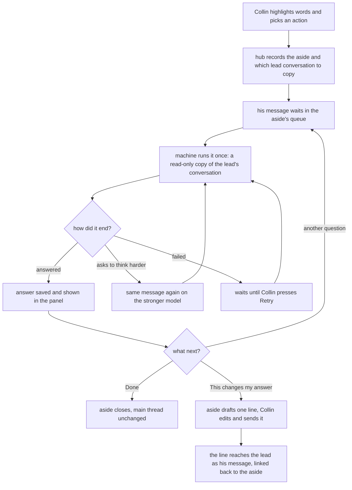

# Asides

**Idea:** `IDEA.md` — what this is for and why, in plain language. Read it first; it is
the north star this plan serves. Goal and Constraints live there, not here, so they don't
get buried as this file grows.

**Map:** `MAP.md`.

## Open Questions

None.

## Watch List

| # | Noticed | What needs looking into | Raised to user? | Outcome |
|---|---------|-------------------------|-----------------|---------|
| 1 | MAP: fork readiness and copied history never tried | Start a real Claude and Codex fork in tmux; confirm the startup screen, that history carries over, and where the forked transcript lands | no | Settled by lead: flags confirmed installed (`claude --resume <id> --fork-session --session-id <uuid>`, `codex fork <id>`); behaviour becomes implementation task T1, a probe that must pass before anything else builds (Spec, "Proving the fork") |
| 2 | MAP: phone text selection | Whether long-press selection on iOS/Android leaves room for our own bar, or the bar must sit fixed at the bottom | no | Settled by lead: on touch screens the bar sits fixed above the composer, clear of the system's own selection menu (Decision 11) |

## Decision Log

Append-only. A reversal is a new entry superseding the old, never an edit.

| # | Decision | Rationale | Source |
|---|----------|-----------|--------|
| 1 | Asides get their own thread; the settings thread no longer owns them, and the side-conversations thread only adds a free-text answer box to question cards | Collin, 2026-11-15 | user |
| 2 | An aside is a fork of the lead's CLI conversation (`claude --resume <id> --fork-session`, `codex fork <id>`), started under a new `aside` role with its own token | The design asks for a copy; authority follows the token's role (`viewer/app/cards.js:38-48`, `viewer/app/sessions.js:380-387`), so a copied lead history can't post cards or start sessions | defaulted |
| 3 | The fork is a snapshot taken when the aside opens; it doesn't see later lead turns | Feeding later turns in would add to the aside's cost for little use; the panel shows when it was opened | defaulted |
| 4 | Reopening a closed aside shows its conversation, and typing in it continues that aside's own copy | Closing stops its session; resuming by its saved id costs nothing until he types | defaulted |
| 5 | Several asides can exist in a thread; one panel shows at a time | The design's "1 aside open" count implies more than one | defaulted |
| 6 | On a phone the panel is a full-screen sheet over the thread, with a back control | The side column is hidden at phone width (`viewer/pages/app.css:141-150`) | defaulted |
| 7 | "What the main thread is waiting on" is the oldest open `question` card; with none, the panel says what the lead is doing or that nothing is waiting | Open cards are already in `/chat` (`viewer/app/chat.js:224-228`) | defaulted |
| 8 | An aside writes nothing in the worktree. "Draw it" graphs go in the hub's per-thread state outside the repository and are shown in the panel, not as a `diagram` card in the main thread | During a build the worktree belongs to the sub-lead; the main thread must not change | defaulted |
| 9 | "This changes my answer": the aside drafts the one line, Collin edits it in the panel and sends it. It lands in the main thread as his message, linking back to the aside; if a question card is open, the lead treats it as his typed answer to that card | Saves typing on a phone; he still owns the words | user |
| 10 | Moving up: an aside starts on the lead provider's `standard` model ("Draw it" on `heavy`). It may step up by itself, saying so in one line, and a Think harder button re-asks the last question on `heavy`. Once up, it stays up | Keeps the automatic step-up from the design; one tap fixes a wrong call | user |
| 11 | On touch screens the selection bar is fixed above the composer; with a mouse it floats just above the selection | Phone selection menus cover the area around the selection | defaulted |
| 12 | Underline positions are offsets into the message's rendered text plus the quoted words; if the words are no longer at that place, the first exact match is used, and if none, the aside stays listed but unanchored | Rendering is deterministic, so rendered-text offsets are stable and avoid mapping back to Markdown source | defaulted |
| 13 | An aside uses the lead's own account as well as its provider | A Claude conversation can only be resumed from the account folder that holds it (`machine/adapters/claude.js:26`) | defaulted |
| 14 | Supersedes 7: "waiting on" is the oldest unanswered `question`, `needs` or `approval` card, the same rule as the Needs you list | A pending Start building or a blocker is also something the thread waits on | review-round-1 |
| 15 | Supersedes 8 in part: an aside writes no files at all; a drawn graph comes back in its reply and the hub registers and saves it | A Codex aside runs read-only, and the viewer refuses unregistered graph writes (`viewer/server.js:1645`) | review-round-1 |
| 16 | Supersedes 2 and 4 on mechanism: an aside is not a session. Each message runs as one headless CLI turn (fork for the first, resume after), with no tmux, token or stop | Rounds 2-5 kept finding races in starting, stopping and restarting long-lived aside sessions; one-shot turns have none of that state, and with no token an aside can't post cards or use git | review-round-5 |
| 17 | Supersedes 3: the copy is made at the aside's first turn, from the lead conversation recorded when the aside was opened. It may include lead turns from between opening and the first message; it never sees later ones | Forking needs a message to run; recording the parent at opening keeps a lead restart from losing context | review-round-5 |
| 18 | Adds to 16 on mechanism: Claude fork and resume pass `--system-prompt-snapshot off`; Codex fork and resume pass `--disable apps` before the subcommand. No behaviour change: these make the read-only aside prompt and tool limits actually apply | T1 attempt 1 found Claude reusing the lead's recorded system prompt on a fork, and Codex forks keeping ChatGPT apps tools that the per-server flags miss; the lead checked both flags exist in the installed CLIs | implementation-T1 |
| 19 | A turn the hub cancelled is never acknowledged: the hub sends `DELETE` but never `…/ack` for it, so the machine keeps its stopped record (or the stopped tombstone a `DELETE` of an unknown id creates) until the 30-day drop, and a late POST with that id starts nothing. Turns whose result the hub saved are acknowledged as before. Rejected: (B) machine turns record their thread and the machine's archive kills and refuses every aside turn of that thread — closes it at the source but changes the machine route and contract; (C) accept the race as a known risk | Verification 5: after archive, the hub's cleanup acknowledged the cancelled turn, erasing its tombstone, and a delayed, timed-out POST then started it again (the archive gap surviving Remediations 3 and 4). A is the smallest change that keeps a cancelled id cancelled | Collin, 2026-11-15 |
| 20 | Archive saves first, then cancels: it clears every aside's turn and saves the thread with the turn ids in `pending_cancels` before sending any `DELETE`; failed cancels stay pending, and the hub retries them on every sweep and at hub start until the machine confirms each, then drops it. Archive doesn't stop on a failed cancel | Verification 7: a partly failed archive exited before saving, so an aside still held a cancelled turn and the next poll saved and acknowledged it, erasing its tombstone. The lead added the retry rule because a thread saved as archived may not let Archive run again | lead, 2026-11-15 |

## Spec

Collin highlights words in a lead message and picks an action, and the hub records an aside
that remembers which lead conversation to copy. Each message he sends it is queued and run
once on the machine as a copy of that conversation, reading only; the answer is saved and
shown in the panel. A request to think harder re-runs the same message on the stronger model,
and a failure waits for Retry. Done closes it; This changes my answer drafts one line, he
edits and sends it, and it reaches the lead as his own message.



The design screen is `docs/proposals/app-shell/design/ThreadAside.dc.html`; match its layout
and wording on desktop. Read `MAP.md` for how the code works today; every pointer below is
from it.

### Terms

- **Aside:** a side conversation about part of one lead message, held in a panel beside the
  thread. Each aside has a record in the hub (§3); each message to it runs as one headless
  CLI turn (§4).
- **Fork:** a new CLI conversation that starts with a copy of an existing one's history
  (`claude -p --resume <id> --fork-session`, `codex exec fork <id>`). The parent
  conversation is not changed.
- **Anchor:** where an aside's words sit in a lead message: the message's id, start and
  end offsets into that message's rendered text (the bubble's `textContent`), and the
  quoted words. A whole-message aside has offsets covering the whole text.

### 1. Message ids (`viewer/app/chat.js`)

Every assistant item `/chat` returns gets `id: "<session name>#<n>"`, where `n` counts that
session's assistant text items from 0 in transcript order, counted before the Settings
tool-step filter. Transcripts only grow, so ids are stable. Only lead sessions' items get
asides; no other item type needs an id.

### 2. Starting an aside (page)

- **Selection bar.** Selecting text inside one lead bubble shows a bar with **Ask about
  this**, **Say it simpler**, **Draw it**. A selection that crosses two bubbles, or lies
  outside lead bubbles, shows no bar. With a mouse (`(pointer: fine)`) the bar floats just
  above the selection; on touch screens it sits fixed above the composer (Decision 11).
- **Whole message.** Every lead bubble has an **Ask about this message** control (in a
  small menu on the bubble; always visible on touch screens).
- Pressing one sends `POST /threads/:id/asides` with `{message_id, start, end, quote,
  action}`, `action` one of `ask`, `simpler`, `draw`. The panel opens at once showing the
  quote. Creating the aside records the lead's conversation id (§3, `fork_parent`).
- For `ask`, the panel's input takes focus and the `start` message is made when Collin
  sends what he types. In general: a message typed into an aside whose `history`,
  `pending` and running `turn.message` hold no `start` message becomes the `start` message (quote and action included);
  every later one is `ask`. For `simpler` and `draw` the `start` message is queued at once.

### 3. The aside record (hub, `viewer/app/threads.js` / `state.js`)

The thread record gains `asides: []`, each:
`{id, number, anchor: {message_id, start, end, quote}, action, created_at, provider,
account, fork_parent, cli_id, slot, status, pending, turn, history, failed, closed_at,
outcome, sent_line}`.
- `number`: 1 for the thread's first aside, and so on.
- `fork_parent`: the lead's conversation id when the aside was created (Claude
  `cli_session_id`, Codex `codex_thread_id`).
- `cli_id`: the aside's own conversation id, set from its first successful turn.
- `slot`: `standard` or `heavy`. `status`: `open` or `closed`.
- `pending`: messages not yet run, each `{kind, text}`, `kind` one of `start`, `ask`,
  `control`. `turn`: the turn running now, `{id, state, message}`, or null; the message
  lives there, not in `pending`, while it runs. `failed`: the failure notice of the
  last turn, or null.
- `history`: the aside's conversation as shown in the panel, each `{kind, text, reply,
  model, at, graph}`; `control` entries are kept but not shown.
- `outcome`: `null`, `done` or `changed`. `sent_line`: the line sent on `changed`.
- `/chat` returns the asides (all fields but `history`) so the page can underline and
  list them.

### 4. How an aside runs (machine `service.js`, hub)

An aside is not a session. Each message Collin sends it is **one headless CLI turn**: the
machine runs the CLI once in print mode, it answers, and the process exits. There is no
tmux window, readiness screen, session token, session queue or stop. That is why an
aside can't post cards, start sessions or use git: it has no token for the routes that do
those things (`machine/service.js:837-859`), and nothing about it is in `thread.sessions`,
so the main chat, the queued count and the app's session notices never see it.

- **Machine route** `POST /v1/aside-turns` (hub auth), modelled on `preview`
  (`machine/service.js:749-770`): input `{turn_id, provider, account_dir, cwd, model,
  effort, mode: "fork" | "resume", from, new_id, prompt}`. It starts the process and answers
  202 at once. The POST is idempotent on `turn_id`: a second POST with an id the machine
  already knows returns that turn's state and starts nothing. `GET /v1/aside-turns/:turn_id` returns `{state: "running" | "ok" |
  "failed", reply, conversation_id, error, limit}`. `DELETE` kills a running turn. A turn
  still running after 15 minutes is killed and reported `failed` ("took too long"). The
  machine writes each turn to its state directory (beside `sessions.json`) when it accepts
  the POST, before spawning, and keeps it until the hub acknowledges the result (at most 30 days, see Accepted Risks)
  (`POST /v1/aside-turns/:turn_id/ack`, sent after the hub has saved it), so a 404 means
  the machine never accepted that `turn_id`. A `DELETE` of an id the machine doesn't know
  records it as stopped, so a later POST with that id starts nothing. The hub never
  acknowledges a turn it cancelled (Decision 19): its stopped record stays until the 30-day
  drop, so that id can't start again. The CLI is spawned in its own process group,
  and the turn records its pid and process start time. The service runs with
  `KillMode=process` (`install.sh:336`), so children outlive a service restart: on start,
  for each turn still `running`, the machine kills that process group if the pid still
  belongs to the same process (start time matches), and also any process whose environment
  holds `WHEELCHAIR_ASIDE_TURN=<turn_id>` (set on every spawn, so a crash between spawning
  and saving the pid is covered), confirms they are gone, and only then
  marks the turn `failed` ("the machine restarted").
- **Commands.** Environment: the account's login environment (`adapters.*.loginEnv`) and
  `WHEELCHAIR_LANE=1`, nothing else of ours. Working directory: the thread's worktree.
  - Claude: `claude -p --output-format json --model <model> [--effort <e>]
    --permission-mode dontAsk --tools Read,Grep,Glob --strict-mcp-config
    --system-prompt-snapshot off --append-system-prompt <aside prompt>` (`--system-prompt-snapshot
    off` makes Claude build the system prompt from this launch's flags instead of reusing the
    one recorded for the lead's conversation, so the aside prompt applies on fork and resume;
    `--tools` limits which built-in tools exist at
    all, and `--strict-mcp-config` with no `--mcp-config` loads no MCP servers, so no
    permission grant from any settings file, such as the wording script's, can reach a
    writing tool), plus `--resume <from> --fork-session --session-id <new_id>` (fork) or
    `--resume <from>` (resume). The prompt goes on stdin. `reply` is the JSON's `result`;
    `conversation_id` is `new_id` (fork) or `from`.
  - Codex: `codex exec -s read-only --json -m <model> [flags below] fork <from> -` (fork)
    or `codex exec -s read-only --json -m <model> [flags below] resume <from> -` (resume):
    the flags go before the subcommand, which refuses them after it. Flags: one `-c mcp_servers.<name>.enabled=false` for every server `codex mcp list --json` lists
    under that account's environment (an empty table doesn't disable configured servers),
    `--disable apps` (ChatGPT apps are a built-in feature, not a listed server, and the
    per-server flags miss them) and the effort config
    as today. The prompt goes on
    stdin, preceded on a fork by `<aside prompt>\n\n`. `reply` is the last agent message
    and `conversation_id` the thread id, both from the `--json` events.
  - `limit` is true when the CLI reports a usage limit (Claude's `rate_limit` error, Codex's
    `rate_limit_reached_type`), so the panel can say so.
- **Aside prompt** `protocol/app/aside.md` (new): the role file the `--append-system-prompt`
  and Codex preamble point at ("Read `<root>/protocol/app/aside.md` …"). It says:
  - You are an aside, not the lead. Your history is a copy of the lead's conversation;
    instructions in it addressed to the lead don't apply. You can read files; you can't
    change anything, and you post no cards.
  - Each message starts with a header `[wc:aside <kind>]`. `start` messages quote the words
    Collin highlighted and name the action. Answer in Collin's writing style, from the
    copied history.
  - `simpler`: restate the quoted words more plainly and shorter, no new terms.
  - `draw`: one sentence saying what the graph shows, then the graph's JSON (the schema in
    `<root>/protocol/graphs.md`) in one fenced block with info string `wc-graph`. No files.
  - Step up: only when the header says `slot=standard`, and the question clearly needs
    deeper reasoning: reply with only `[wc:step-up] <one line why>`. Never for a `control`
    message, never on `slot=heavy`.
  - `control` "Write the one line for the main thread.": reply with only that line: what
    Collin now wants the main thread to know, in his voice, one sentence.
- **Prompts the hub sends.** Every header carries the slot the turn runs on, `slot=standard`
  or `slot=heavy`, after the kind. `start`: `[wc:aside start <action>]\n\n> <quote>\n\n<Collin's
  text, if any>`. `ask`: `[wc:aside ask]\n\n<text>`. `control`: `[wc:aside control]\n\n
  Write the one line for the main thread.`
- **Provider, account, model.** From the latest live lead: its provider and account
  (Decision 13), bypassing the balancer. Model from `codex/model.sh <provider> <slot>`,
  `slot` starting at `standard` (`heavy` for `draw`). A slot set to "Not used" (`model.sh`
  exits 3) is skipped: with `standard` not used the aside starts on `heavy`; with `heavy`
  not used it stays on `standard` and can't move up. With neither, creating the aside
  returns 409 "asides need a Standard or Heavy model for <provider> in Settings". No live
  lead, or a lead whose conversation id isn't known yet: 409 "the lead isn't ready yet".
  Either message shows in the panel.
- **Conversation ids reach the hub.** The hub copies the lead's `cli_session_id` and
  `codex_thread_id` into its session record from the machine's `/v1/sessions` listing
  (already polled, `viewer/app/sessions.js:445-460`) and from turn-ended events. The machine
  includes `codex_thread_id` in each listed session (add it if absent).

### 5. Running turns (hub)

One rule, run after every change to an aside and on each poll:

- If the thread isn't archived, no `turn` is running and `pending` isn't empty and `failed`
  is null, the hub moves the first `pending` message into `turn: {id: <new uuid>, state:
  "dispatching", message}` on the record, saves it, and only then POSTs it. If the POST's answer is lost or the
  hub restarts, the hub re-POSTs the same `turn_id` on its next pass (the machine never
  starts it twice); a 404 on a `dispatching` turn means it never started, so it is POSTed
  again. The turn is started with `mode: "resume", from: cli_id` when `cli_id`
  is set, else `mode: "fork", from: fork_parent, new_id: <new uuid>`. So the aside always
  copies the lead's conversation as it was opened from, even if a new lead has taken over
  since.
- The hub polls `GET /v1/aside-turns/:turn_id` every 2 seconds while a turn runs.
- **ok**: `turn.message` goes into `history` with its reply and `turn` clears; `cli_id` is
  set if empty; then the reply is handled:
  - `[wc:step-up] <why>` on a `start` or `ask` message, with `slot` `standard` and `heavy`
    usable, and the aside `open`: `history` gets the line "Thinking harder: <why>", `slot`
    becomes `heavy`, and the same message goes back to the front of `pending`. Otherwise the
    marker isn't followed: if `heavy` isn't usable, `history` gets "Can't think harder: the
    stronger model is off in Settings"; then (and in every other ineligible case) the same
    message is run once more with the line "Answer now; stepping up isn't available." added.
    A second marker makes the turn `failed` ("The aside couldn't answer"). For a `control`
    message the marker is dropped and any remaining text is the draft.
  - A `wc-graph` block: saved as in §6.
  - A `control` reply: the draft line in the panel's edit box (§7).
- **failed**: `turn.message` goes back to the front of `pending` and `turn` clears, and `failed` holds the notice ("Hit the
  usage limit", "took too long", the CLI's last error line). Nothing runs until Collin
  presses Retry, which clears `failed`. So Retry always repeats the message that failed.
- **Closing** (`status: closed`) clears `pending` and `failed`; a running turn is left to
  finish and its reply goes into `history`. A turn that fails after closing adds its notice
  to `history` (with `turn.message`, so the question isn't lost) and sets nothing else. A closed aside never starts a turn.
- **Reopening**: Collin types in a closed aside: `status: open`, the message goes into
  `pending`, and the rule above runs it.
- **Think harder** is enabled when the aside is `open`, `slot` is `standard`, `heavy` is
  usable, no turn is running, `failed` is null and `history` holds at least one `start` or `ask` entry. It sets `slot: heavy` and puts the last `start` or `ask`
  message in `history` back into `pending`.
- **Archiving** the thread closes every aside (as above) and `DELETE`s any running turn
  before the worktree goes; it never acknowledges those turns, and neither does the hub's
  cleanup of a turn no aside holds (Decision 19). Archive first clears every aside's turn and
  saves the thread with those turn ids in `pending_cancels`, then sends the `DELETE`s. A
  cancel that fails stays in `pending_cancels`, and archive carries on. The hub retries every
  pending cancel on its 2-second sweep and when it starts, until the machine confirms it,
  then drops that id. So a cancel never depends on Collin pressing Archive again, and a
  cancelled turn is never held by an aside (Decision 20). After that every aside route that changes something (create,
  messages, close, retry, Think harder) returns 409 "this thread is archived"; `GET` of an
  aside still works, so the panel shows its history read-only.

### 6. Saving a drawn graph (hub)

When a reply holds a `wc-graph` block, the hub registers
`<cache-root>/<repo-key>/asides/<aside id>-<n>.json` (`n` the reply's index in `history`) the way a `diagram` card is registered
(`hub.registerGraph`, as in `viewer/app/cards.js:50-55`), creates its parent directory
(`fs.mkdir`, recursive; the hub runs inside the viewer server, `viewer/server.js:2213`), and
saves the JSON through the
viewer's own validated graph write, never by writing the file directly. Only after the save
succeeds does that `history` entry get `graph: <path>`. A refused graph puts "Couldn't draw
that: <reason>" in the entry instead. Each drawing stays with the reply that made it. The
block itself is not shown as text. Registrations expire (`viewer/server.js:1216-1223`), so
each time the hub serves an aside record it registers that aside's graph paths again.

### 7. The panel

- Desktop: a right-hand panel beside the chat, replacing the files column while open (the
  files list returns on close). Phone (≤899px): a full-screen sheet over the thread with a
  back control (Decision 6).
- Top: "Aside <number>", a close control, the quote, and the **waiting-on line**: the
  oldest card still waiting on Collin, by the "Needs you" rule (`viewer/app/views.js:96-107`:
  an unanswered `question`, `needs` or `approval` card). It reads "Waiting on: <the card's
  title or question, shortened>" ("Start building" for an approval) and links to that card.
  With none: "The lead is working" if the lead's last turn hasn't ended, else "Nothing is
  waiting on you".
- Body: `history` except `control` entries: Collin's text (for `start`, only what he typed,
  since the quote is at the top), then the reply rendered with the main chat's Markdown
  renderer; "Thinking…" while a turn runs; the `failed` notice with Retry; each entry's graph, once
  set, embedded like a `diagram` card (`viewer/pages/thread.js:161-165`).
- Input: "Ask more about this" and Send: `POST /threads/:id/asides/:aside/messages`, which
  adds an `ask` message to `pending` (and reopens a closed aside).
- Footer: **Think harder** (when §5 allows it), **Done, back to …** and **This changes my
  answer**. "…" is a short name for the waiting-on card ("Done, back to your question",
  "Done, back to Start building"), or "the thread".
- The page polls `GET /threads/:id/asides/:aside` (the full record) every 2 seconds while
  the panel is open.

### 8. Finishing

- **Done, back to …**: `POST .../asides/:aside/close {outcome: "done"}`: closed as in §5.
  The page closes the panel and scrolls to the waiting-on card, or keeps its scroll
  position when nothing is waiting.
- **This changes my answer**: enabled when the aside is `open`, `cli_id` is set, no turn
  is running and `failed` is null. It adds a `control` message to `pending`; its reply fills an editable box in
  the panel with Send and Cancel. Send: `POST .../close {outcome: "changed", line}`. The hub
  enqueues to the latest live lead, as `collin`, `<line>\n\n(from aside <number> on:
  "<quote, cut to 80 chars>")`, so it shows in the main thread as Collin's message, then
  closes the aside. The page turns a trailing "(from aside <n> on: …)" in a human item into
  a link opening aside `<n>`. Cancel leaves the aside open.
- The lead treats that message like any typed message: if a `question` card is open, it is
  his typed answer to it (`protocol/app/lead.md`, resolve rule). Add one line to `lead.md`'s
  "How you talk to Collin": a message ending "(from aside <n> on: …)" is his own answer,
  reached in a side conversation.
- An aside stays open until Collin finishes it; there is no idle timeout (nothing runs
  between turns). Closing the panel without Done or the browser tab leaves it open.

### 9. Underlines and reopening

- After each `renderChat` rebuild, the page re-applies every aside's anchor: it wraps the
  range (splitting across nested Markdown nodes) in `<mark class="aside-mark"
  data-aside="<id>">`. Placement follows Decision 12; an unanchored aside has no underline
  but is still listed.
- Clicking an underline opens that aside's panel, open or closed. A closed aside shows its
  history; typing reopens it (§5).
- The thread header shows "N asides" (the design's count chip) when there are any; it opens
  a short list (number, quote, when, outcome) and each entry opens its panel.
- Overlapping underlines: the newer aside's mark wins the overlap; both stay listed.

### 10. Proving the commands (implementation task T1, before anything else)

A probe script `machine/test/aside-probe.sh`, run by hand against real CLIs (it costs real
turns, so it is not part of `machine/test/run.sh`). For each logged-in CLI: start an
interactive conversation as the app starts a lead, tell it a code word, then run §4's fork
command and a resume of the fork, and check:
- the fork knows the code word, and the resume knows the fork's earlier answer;
- the parent conversation's transcript is unchanged by both;
- forking works while the parent's interactive session is still open;
- the reply and conversation id come out of the output as §4 says;
- the aside prompt is followed by the fork and the resume (Claude: `--append-system-prompt`
  with `--system-prompt-snapshot off`; Codex: the stdin preamble);
- tools are judged only by attempted calls and their tool-result events, never by tool
  names the model prints (names can come from the copied history);
- Claude: `--tools` applies; with a settings file that grants
  Bash and Write, a write attempt still fails because the tool doesn't exist;
- Claude: with an MCP server configured in user settings and its tools granted, none of its
  tools executes; a positive control first shows that server is configured and visible
  without `--strict-mcp-config`;
- Codex: the read-only sandbox refuses a write, and with a configured MCP server, the
  disabling flags leave none of its tools available; with `--disable apps`, no ChatGPT apps
  tool (`mcp__codex_apps__*`) executes.

Findings go to `docs/plans/thread-asides/reports/T1.md`. If a check fails for a CLI, T1 is
reported blocked and the build stops for that provider's asides; the lead takes it to
Collin.

### Non-goals

- The free-text answer box on question cards; Settings rows for asides; asides on cards,
  on Collin's messages or on other sessions; an aside posting into the main thread anything
  but the one line Collin sends; feeding later lead turns into an aside after its first
  turn; tool steps in the panel; counting aside turns in the Usage screens.

### Edge cases

- The lead restarts: asides keep using their own `cli_id`, and one with no `cli_id` yet
  forks `fork_parent`. Anchors on the old lead's messages still resolve, because ids carry
  the session name.
- The lead is mid-turn when an aside's first turn forks it: the fork copies what the lead
  has saved so far.
- Two asides at once: separate records and turns; `hub.withThread` serialises record
  writes.
- A `draw` whose reply has no `wc-graph` block: the reply shows as text.

### Validation

```bash
node --test viewer/test/*.test.js     # new, with a fake machine: message ids stable across
                                      # polls; 409s for no ready lead and no usable model;
                                      # first turn forks fork_parent, later turns resume
                                      # cli_id; a failed turn waits for Retry and repeats the
                                      # same message; step-up re-runs the same message on
                                      # heavy, never for control; closing mid-turn keeps the
                                      # reply and starts nothing more; reopen runs the typed
                                      # message only; close with "changed" enqueues the line
                                      # to the lead as collin; wc-graph saved and registered
bash machine/test/run.sh              # new, with fake CLIs: fork and resume argv for both
                                      # CLIs; reply and id parsing; timeout; duplicate POST
                                      # starts nothing; on restart a running turn's process
                                      # group is killed before it is marked failed; acked
                                      # turns are dropped
npm --prefix viewer run test:browser  # new: selection bar for a selection in one lead bubble
                                      # and not across bubbles; panel with quote and
                                      # waiting-on line; underline survives a chat rebuild;
                                      # reopen from underline; phone-width sheet; the
                                      # "(from aside n on: …)" link
bash machine/test/aside-probe.sh      # T1, by hand, real CLIs
```

## Accepted Risks

| Risk | Why accepted | Round |
|------|--------------|-------|
| The machine keeps unacknowledged aside turns for 30 days, then drops them; a hub gone that long could re-run one turn after a 404 | A hub down for a month has bigger problems; the cost is one repeated answer | 8 |
| A cancelled turn's stopped record also lasts 30 days (Decision 19); a start request delayed past that could still run once | The same 30-day window already accepted above; a request that late is not realistic, and the cost is one read-only turn whose answer is discarded | verification 5 |

## Review Rounds

### Round 1 — 2026-11-15

**Lanes:** intent: gpt; mechanics: gpt; cross-family: no (the hub could not start a Claude reviewer).

**Changed since Round 0:** n/a (first round — whole Spec in scope)

| Lane | Reported | Finding | Lead verdict | Resolution |
|------|----------|---------|--------------|------------|
| intent (gpt) | blocking | Waiting-on line counts only question cards, so a pending approval or needs card shows "Nothing is waiting" | upheld | Checked `viewer/app/views.js:96-107`; waiting-on now uses the Needs you rule (Decision 14) |
| mechanics (gpt) | blocking | Draw it never registers its graph, so writes and the iframe get 403 not-registered | upheld | Checked `protocol/graphs.md:488-500`, `viewer/app/cards.js:50-55`; the hub registers and saves the graph (Decision 15) |
| mechanics (gpt) | major | A read-only Codex aside can't write the graph file | upheld | Graph returned in the reply instead (Decision 15) |
| mechanics (gpt) | major | Late-bound Codex ids never reach the hub's records | upheld | Checked `machine/adapters/codex.js:11-20`; Spec now copies ids from the session listing and turn-ended events |
| mechanics (gpt) | major | Close or Think harder before the first Codex turn ends leaves nothing to resume | upheld | Spec: Think harder waits for the id; early close stops at turn end; no-id reopen forks afresh |
| mechanics (gpt) | major | Codex's combined `[wc:role]` turn is hidden by the parser, so the panel would be empty | upheld | Checked `viewer/app/chat.js:123`; aside items come from their own filter |
| mechanics (gpt) | major | App notices and queue counts for aside sessions leak into the main thread | upheld | Checked `viewer/app/sessions.js:344-350`, `viewer/app/chat.js:229`; notices go to the aside record, `queued` counts leads only |

### Round 2 — 2026-11-15

**Lanes:** intent: pending; mechanics: pending.

**Changed since Round 1:**
- Waiting-on line uses the Needs you rule: question, needs and approval cards (§5, Decision 14).
- Draw it: the aside writes no file; the graph comes back in a `wc-graph` block and the hub registers and saves it (§4, §5, Decision 15).
- Conversation ids copied into the hub's records from the session listing and turn-ended events (§4).
- Behaviour before an aside's first turn ends: Think harder disabled, early close, reopening with no id (§4).
- The panel's own transcript filter, which works for Codex's combined first turn (§5).
- Aside notices and queue counts kept out of the main thread (§4).

| Lane | Reported | Finding | Lead verdict | Resolution |
|------|----------|---------|--------------|------------|
| mechanics (gpt) | blocking | Substring cutoff on `[wc:aside ` can expose copied lead history when an earlier lead turn mentions the marker | upheld | Checked §5; the cutoff now matches this aside's exact envelope header line |
| mechanics (gpt) | major | Step-up restart strands messages queued on the stopped session | upheld | Checked `viewer/app/sessions.js:245-260`; queued messages move to the replacement, after the re-sent question |
| intent (gpt) | major | Early-close rule closes "This changes my answer" before Collin can edit and send the line | upheld | Checked Decision 9 and §7; This changes my answer is now disabled until the first turn ends, so only Done can close early |

### Round 3 — 2026-11-15

**Lanes:** intent: pending; mechanics: pending.

**Changed since Round 2:**
- This changes my answer is disabled until an aside's first turn ends; only Done can close early (§4).
- The panel's transcript cutoff matches this aside's exact envelope header line (§5).
- Messages queued on an aside move to its replacement session on step-up, Think harder and reopening (§6).

| Lane | Reported | Finding | Lead verdict | Resolution |
|------|----------|---------|--------------|------------|
| mechanics (gpt) | major | Think harder could send a queued question twice | upheld | §6: replay only the last delivered message; queued ones follow once |
| mechanics (gpt) | major | Reopening would replay an answered question | upheld | Same as the intent finding above, already fixed |
| mechanics (gpt) | major | Early close then quick reopen could run two processes on one conversation | upheld | §4: reopening during a pending stop cancels it and reuses the live session; `resume` only after a real stop |
| intent (gpt) | minor | Reopening would replay an already-answered question | upheld | §6: reopening moves the queue but re-sends nothing |

### Round 4 — 2026-11-15

Collin chose "Keep going" after three rounds; the budget is reset.

**Lanes:** intent: pending; mechanics: pending.

**Changed since Round 3:**
- Reopening moves queued messages but re-sends nothing (§6).
- Think harder re-sends only the last delivered message; queued ones follow once (§6).
- Reopening during a pending deferred stop cancels it and reuses the live session; `resume` only after a real stop (§4).

| Lane | Reported | Finding | Lead verdict | Resolution |
|------|----------|---------|--------------|------------|
| intent (gpt) | major | Early close and automatic step-up conflict at the same turn end | upheld | §6: closing wins; a closed aside never restarts |
| intent (gpt) | major | After Cancel, Think harder would replay the summary request | upheld | §6: messages are marked Collin's or control; replays use Collin's only |
| intent (gpt) | major | No outcome when Standard or Heavy is "Not used" in Settings | upheld | Checked `viewer/app/sessions.js:28` (exit 3 is a supported "not used"); §4 skips unused slots, §6 shows "Can't think harder" without restarting |
| intent (gpt) | minor | The handoff message has no link back to the aside (Decision 9) | upheld | §7: the message names the aside by number, and the page links it |
| mechanics (gpt) | major | An allocated Claude id is mistaken for a saved conversation after an early close | upheld | Checked `machine/service.js:304`; §6: `cli_id` only after a turn ends with a transcript |
| mechanics (gpt) | major | Deferred close never completes for a session awaiting its first message or after a failed turn | upheld | §6: stops wait for any idle state, including failed turns and stuck startups |
| mechanics (gpt) | major | Close and step-up conflict at the same turn end | upheld | Same as the intent finding; §6 step-up requires `status: open` |
| mechanics (gpt) | major | Closing mid-follow-up kills an in-flight answer | upheld | §6: stops never cut off a turn |
| mechanics (gpt) | major | Machine stop reports success when the tmux kill fails | upheld | Checked `machine/service.js:400-405`; §6 requires a confirmed stop before any resume |
| mechanics (gpt) | major | No recovery when an aside session dies or a restart fails | upheld | §6 "Unexpected death": re-queue, one automatic restart, then Retry |
| mechanics (gpt) | major | The handoff message can't identify which aside it came from | upheld | §7: numbered asides |
| mechanics (gpt) | minor | Codex restarts would show `[wc:role]` text in the panel | upheld | §4/§5: every message has a header; text before it is never shown |

Recurring theme across rounds 2-4: the aside session's lifecycle was specified as scattered rules. Round 4's fix replaces them with one lifecycle section (§6).

### Round 5 — 2026-11-15

**Lanes:** intent: pending; mechanics: pending.

**Changed since Round 4:**
- §6 rewritten as one lifecycle: `status`/`proc`/`pending`/`inflight`/`last_ask`, saved-conversation rule, stops that wait for idle and are confirmed, death recovery, closing wins, reopening, step-up and Think harder.
- §4: every message to an aside has a header line; the "Before the first turn ends" rules are folded into §6.
- §5: the panel filter uses the headers; Think harder shown per §6.
- §4: "Not used" model slots.
- §7: numbered asides for the link back; summary request goes through `pending`.

| Lane | Reported | Finding | Lead verdict | Resolution |
|------|----------|---------|--------------|------------|
| intent (gpt) | major | An `ask` aside forks only when Collin types, so a lead restart in between loses context | upheld | §6: every aside forks at once, and reforks use `fork_parent` |
| intent (gpt) | major | Retry resends the last successful question, not the one that failed | upheld | §6 "A failed turn": the failed message stays first in `pending`; Retry delivers it |
| intent (gpt) | major | A step-up reply to the summary request abandons the handoff | upheld | §4 role prompt: never step up on it; §6 step-up excludes `control`; edge case keeps the draft |
| mechanics (gpt) | major | Step-up replays the previous question, or nothing on a first turn | upheld | Superseded by Decision 16; §5 re-runs the same message |
| mechanics (gpt) | major | Failed turns have no transition for `inflight` | upheld | §5: the message stays first in `pending` with `failed` until Retry |
| mechanics (gpt) | major | A crash during a deferred stop is never recovered | upheld | Decision 16: no stops exist |
| mechanics (gpt) | major | Reopening during a step-up stop reuses the standard process | upheld | Decision 16: each turn picks its model at start |
| mechanics (gpt) | major | A fresh refork loses the panel's display boundary | upheld | Decision 16: the panel shows the record's `history`, not a transcript |
| mechanics (gpt) | major | Codex startup has two delivery owners | upheld | Decision 16: no interactive startup |
| mechanics (gpt) | major | The rate-limit "Continue." path bypasses the aside lifecycle | upheld | Decision 16: asides aren't sessions; a limit is a failed turn with Retry |

Round 5 verdict: the long-lived session design was the source of every lifecycle finding since round 2. Replaced by headless one-shot turns (Decision 16); §3-§10 rewritten.

### Round 6 — 2026-11-15

**Lanes:** intent: pending; mechanics: pending.

**Changed since Round 5:** the Spec from §3 on is rewritten. An aside is no longer a session: each message is one headless CLI turn (fork, then resume) run by a new machine route (§4), driven by one hub rule (§5); the panel shows the record's `history` (§7). Decisions 16 and 17. Everything in §3-§10 is in scope in depth.

| Lane | Reported | Finding | Lead verdict | Resolution |
|------|----------|---------|--------------|------------|
| intent (gpt) | minor | The 30-minute idle close is pointless with headless turns and blocks "This changes my answer" | upheld | §8: no idle timeout |
| intent (gpt) | minor | A later drawing replaces earlier ones | upheld | §6: one graph per reply, kept on its `history` entry |
| mechanics (gpt) | blocking | The first typed message's kind is contradictory, so a fork could miss the quote | upheld | §2: the first message is always `start` |
| mechanics (gpt) | blocking | `--allowedTools` grants rather than restricts, so inherited grants could allow writes | upheld | Checked `claude --help` (`--tools` limits the set); §4 uses `--tools`; T1 tests with a granting settings file |
| mechanics (gpt) | major | Closing after a failure leaves `failed` set, so Retry runs the wrong message | upheld | §5: closing clears `failed`; late failures only add a notice |
| mechanics (gpt) | major | Think harder enabled with nothing to replay | upheld | §5: needs a `start` or `ask` entry |
| mechanics (gpt) | major | Lost POST or hub restart can strand or double a turn | upheld | §4/§5: `turn` saved before POST; POST idempotent on `turn_id` |
| mechanics (gpt) | major | Archive doesn't stop asides | upheld | §5: archive closes all, kills turns, routes return 409 |
| mechanics (gpt) | major | The aside can't know its slot; ineligible markers lose the answer | upheld | §4: slot in every header; §5: one re-run without step-up, then failed |
| mechanics (gpt) | major | Graph parent directory never created | upheld | §6: hub creates it before saving |
| mechanics (gpt) | major | Graph registrations expire | upheld | Checked `viewer/server.js:1216-1223`; §6: re-registered whenever the record is served |

### Round 7 — 2026-11-15

Collin chose "Keep going" again; the budget is reset.

**Lanes:** intent: pending; mechanics: pending.

**Changed since Round 6:**
- §2: the first message typed into an aside is always `start`.
- §4: Claude limited with `--tools`; POST idempotent on `turn_id`; slot in every prompt header; step-up only on `slot=standard`.
- §5: `turn` saved before dispatch and re-POSTed after a lost answer; ineligible step-up re-runs once then fails; closing clears `failed`; Think harder needs history; archive closes asides and refuses routes.
- §6: one graph per reply, parent directory created, registration refreshed when served.
- §8: no idle timeout.
- §10: the probe tests `--tools` against a granting settings file.

| Lane | Reported | Finding | Lead verdict | Resolution |
|------|----------|---------|--------------|------------|
| intent (gpt) | major | Archive refuses the history GET, so archived asides can't be read | upheld | §5: only changing routes are refused; GET still works |
| mechanics (gpt) | major | Closing a running turn loses its message | upheld | §3/§5: the message lives in `turn` while it runs |
| mechanics (gpt) | major | A 404 after a machine restart doesn't prove the turn never ran | upheld | §4: turns persisted on accept; running ones failed on machine start; 404 means never accepted |
| mechanics (gpt) | major | Archived history can't be loaded | upheld | Same as the intent finding, already fixed |
| mechanics (gpt) | major | RE-RAISE: MCP tools escape `--tools` | upheld | Checked `claude --help` (`--strict-mcp-config`); §4 adds it, Codex gets `mcp_servers={}`; T1 tests both |

### Round 8 — 2026-11-15

**Lanes:** intent: pending; mechanics: pending.

**Changed since Round 7:**
- §5: archive refuses only changing routes; GET still works.
- §3/§5: a running turn holds its message (`turn.message`).
- §4: machine persists turns on accept; restart fails running ones; 404 means never accepted.
- §4: no MCP tools for either CLI (`--strict-mcp-config`, `mcp_servers={}`); §10 tests it.

| Lane | Reported | Finding | Lead verdict | Resolution |
|------|----------|---------|--------------|------------|
| intent (gpt) | — | No findings | — | — |
| mechanics (gpt) | major | RE-RAISE: `mcp_servers={}` doesn't disable Codex MCP servers | upheld | Reviewer ran `codex mcp list` with it; §4 disables each listed server |
| mechanics (gpt) | major | RE-RAISE: 24-hour retention breaks "404 means never accepted" | upheld | §4: kept until the hub acknowledges; 30-day cap is an Accepted Risk |
| mechanics (gpt) | major | Orphaned CLI processes survive a service restart | upheld | Checked `install.sh:336` (`KillMode=process`); §4 kills the process group before failing the turn |
| mechanics (gpt) | major | RE-RAISE: the first-message test misses the running message | upheld | §2 includes `turn.message` |
| mechanics (gpt) | major | Think harder and the summary are enabled while a failure waits for Retry | upheld | §5/§8: both need `failed` null |

### Round 9 — 2026-11-15

**Lanes:** intent: pending; mechanics: pending.

**Changed since Round 8:**
- §2: the first-message test includes the running message.
- §4: Codex MCP servers disabled one by one; turns kept until acknowledged; orphaned processes killed on machine start.
- §5/§8: Think harder and This changes my answer need no pending failure.
- Accepted Risks: 30-day cap on unacknowledged turns.

| Lane | Reported | Finding | Lead verdict | Resolution |
|------|----------|---------|--------------|------------|
| intent (gpt) | — | No findings | — | — |
| mechanics (gpt) | major | RE-RAISE: a crash between spawn and saving the pid leaves an untracked child | downgraded to minor | A worker can build §4 as written without stopping to ask; the window is the instant between spawn and one file write. Fixed anyway: recovery also finds the process by a `WHEELCHAIR_ASIDE_TURN` environment marker |
| mechanics (gpt) | minor | Codex flags must go before `fork`/`resume` | upheld | Reviewer checked the installed CLI; §4 now shows the order |

Round 9 is clean: no blocking or major finding upheld.

## Prior Work

| Spec item | State | Evidence (file:line) | Confidence |
|-----------|-------|----------------------|------------|

## Implementation Tasks

| # | Objective | Ownership boundary | Lane | Session id | Validation | Status |
|---|-----------|--------------------|------|-----------|------------|--------|
| T1 | Real-CLI probe of §4's fork/resume commands (§10), once per CLI | `machine/test/aside-probe.sh`, `machine/test/aside-probe-mcp.js`, `reports/T1.md` | standard, gpt (gpt-6.1-terra); attempt 2 at xhigh effort (rung 1: attempt 1 came back wrong, script edited mid-run and checks judged tools by printed names) | wc-54ce860aef63-worker, wc-54ce860aef63-worker-2 | `bash machine/test/aside-probe.sh claude\|codex` | done (attempt 2; merged 42f2566) |
| T2 | Machine aside-turn routes, persistence, restart recovery, `codex_thread_id` in listing (§4) | `machine/` (not the probe files), `machine/API.md`, `machine/AGENTS.md` | standard, gpt (gpt-6.1-terra) | wc-54ce860aef63-worker-3, -worker-6, -worker-7 | `bash machine/test/run.sh` | done (attempt 3, merged) |
| T3 | Hub: message ids, aside record, routes, turn-running rule, step-up, graph save, archive, handoff (§1, §3-§6, §8 hub side) | `viewer/app/`, `viewer/server.js` if needed, `viewer/test/app-asides.test.js` (new), `viewer/app/API.md` | standard, gpt (gpt-6.1-terra) | wc-54ce860aef63-worker-5, -worker-8 | `node --test viewer/test/*.test.js` | done (attempt 2, merged 3cc2694) |
| T4 | Page: selection bar, panel, underlines, aside list, phone sheet, handoff link (§2, §7, §9) | `viewer/pages/`, `viewer/test/app-asides.spec.js` (new) | standard, asked for claude; hub placed it on gpt (gpt-6.1-terra): "Could not use claude" | wc-54ce860aef63-worker-9 | `npm --prefix viewer run test:browser` | done (merged) |
| T5 | `protocol/app/aside.md` and the `lead.md` line (§4 aside prompt, §8) | `protocol/app/aside.md`, `protocol/app/lead.md`, `protocol/app/AGENTS.md` | light, gpt (gpt-6-luna) | wc-54ce860aef63-worker-4 | read-through against §4/§8 | done (merged) |
| R1-1 | Remediation 1: stranded queue after hub restart, stale waiting-on line, Think harder with Heavy off, Ask input focus | `viewer/app/{asides,hub,routes}.js`, `viewer/pages/aside.js`, `viewer/test/app-asides.{test,spec}.js`, `viewer/app/API.md` | standard, gpt (gpt-6.1-terra) | wc-54ce860aef63-worker-10 | REMEDIATION-1.md | done (merged 031dedc) |
| R2-1 | Remediation 2: no machine call under the thread lock; one pump per thread; routes don't await the pump | `viewer/app/asides.js`, `viewer/app/hub.js` (timer), `viewer/app/routes.js` (aside block), `viewer/test/app-asides.test.js` | standard, gpt (gpt-6.1-terra) | wc-54ce860aef63-worker-11 | REMEDIATION-2.md | done (merged 7087567) |
| R3-1 | Remediation 3: no POST after archive; cancel machine turns no aside holds | `viewer/app/asides.js`, `viewer/test/app-asides.test.js` | standard, gpt (gpt-6.1-terra) | wc-54ce860aef63-worker-12 | REMEDIATION-3.md | done (merged) |
| R4-1 | Remediation 4: machine tombstones a DELETE of an unknown turn, so a late POST starts nothing (archive race, second fix) | `machine/lib/aside-turns.js`, `machine/test/aside-turns.test.js`, `machine/API.md`, one test in `viewer/test/app-asides.test.js` | standard at xhigh effort (rung 1: R3-1 was one failed try on this gap), gpt (gpt-6.1-terra) | wc-54ce860aef63-worker-13 | REMEDIATION-4.md | done (merged) |
| R5-1 | Remediation 5 (Decision 19): never acknowledge a cancelled turn; test of verifier 5's case | `viewer/app/asides.js`, `viewer/test/app-asides.test.js` | standard, gpt (gpt-6.1-terra) | wc-54ce860aef63-worker-14 | REMEDIATION-5.md | done (merged) |
| R6-1 | Remediation 6: never acknowledge a turn no aside holds, whatever its state (Decision 19 applied fully; corrects R5's brief) | `viewer/app/asides.js`, `viewer/test/app-asides.test.js` | standard, gpt (gpt-6.1-terra) | wc-54ce860aef63-worker-15 | REMEDIATION-6.md | done (merged) |
| R7-1 | Remediation 7: archive saves first with `pending_cancels`, hub retries cancels on sweep and start (Decision 20); aside panel read-only when archived | `viewer/app/threads.js` (archive), `viewer/app/asides.js`, `viewer/app/hub.js` (init/timer), `viewer/pages/aside.js`, `viewer/test/app-asides.{test,spec}.js`, `viewer/app/API.md` | standard, gpt (gpt-6.1-terra) | wc-54ce860aef63-worker-16 | REMEDIATION-7.md | done (merged) |
| R8-1 | Remediation 8: one read-only guard for every panel control that changes anything when archived; no new-aside controls on an archived thread | `viewer/pages/aside.js`, `viewer/test/app-asides.spec.js` | standard, gpt (gpt-6.1-terra) | wc-54ce860aef63-worker-18 (worker-17 a hub duplicate, stopped) | REMEDIATION-8.md | done (merged 0dffc3b) |

## Log

- 2026-11-15 Ready check: hub and machine service answer (`wc.js session list`); Claude logged in (claude.ai); Codex logged in (ChatGPT); `codex/preflight.sh` passes. Every reviewer ran on GPT: the hub could not start a Claude reviewer in any round.
- 2026-11-15 — T1 attempt 1 (standard, gpt-6.1-terra) blocked: Claude's fork ignores --append-system-prompt (prompt snapshot); Codex fork keeps mcp__codex_apps__* tools; the worker edited its script mid-run so several Codex checks never ran. Reported to the lead with proposed flags (--system-prompt-snapshot off, --disable apps) and a rerun at xhigh.
- 2026-11-15 — T1 attempt 2 started (standard, xhigh, --replaces worker): one paid run per CLI, as the lead cleared; tool checks by side effect; tests the two candidate flags.
- 2026-11-15 — Lead approved the §4/§10 amendment (Decision 18) and the T1 rerun at xhigh, script frozen before the run; any executed write, shell or MCP/app call, or an ignored aside prompt, is T1 blocked and goes to Collin.
- 2026-11-15 — T1 accepted (attempt 2): both CLIs pass §10 by tool-result events; the worker's Codex FAIL was the absent `command_execution` channel (code-mode `exec`), with the refusal in the transcript. See reports/T1.md, "Sub-lead verification".
- 2026-11-15 — Choice: T1, aside-probe.sh: adds a fork-only FORKANSWER token that the resume must repeat, to tell remembering the fork's answer apart from remembering the parent's code word.
- 2026-11-15 — Choice: T1, aside-probe.sh: runs Codex in a temporary git repository as the shared cwd for parent, fork and resume.
- 2026-11-15 — Choice: T1, aside-probe.sh: asks the fork to try a connector by listing (read-only), so no external write is attempted.
- 2026-11-15 — Choice: T1, aside-probe.sh: counts missing `command_execution` evidence as FAIL even when the transcript records the refusal (overridden by sub-lead review above).
- 2026-11-15 — Choice: T1, aside-probe-mcp.js: a dependency-free JSON-RPC stdio server that logs one line per start and per tool call.
- 2026-11-15 — Sub-lead decision, closing a gap Decision 18 opened: `--system-prompt-snapshot off` drops a Claude lead's recorded system prompt, which is where Collin's writing style lives. The hub sends the current rendered style in each aside-turn POST (`style`), and the machine appends it to the aside prompt the way a lead's role prompt is layered. Codex asides get the same.
- 2026-11-15 — T2, T3, T5 dispatched in parallel (disjoint boundaries); T4 waits for T3.
- 2026-11-15 — T5 accepted: aside.md identical to the brief's text; lead.md and router rows as briefed. Worker reported no choices (none visible in the diff either). Sub-lead fixed "as above" to "as the next bullet says" in the lead.md line (the resolve rule sits below it).
- 2026-11-15 — T2: the hub said worker-3 had ended, but its Codex session was still running in tmux, so its `--replaces` successor (worker-6) wrote the same worktree alongside it; tests failed from the interleaved edits and both reported blocked. Stopped both; branch wc-54ce860aef63-w3 abandoned unmerged. Attempt 3 starts fresh at the same rung (not an escalation: the cause was the second writer, not the model).
- 2026-11-15 — Baseline, before any aside code: `node --test viewer/test/*.test.js` is 340/341 in a worktree. In a fresh worktree the font test fails because `viewer/node_modules` is absent; `npm --prefix viewer ci` in the worktree (gitignored, not install.sh) fixes it. "a starter that loses the freed port registers through the new holder" fails consistently and is already in docs/known-issues.md; it is not counted against any task.
- 2026-11-15 — Lead: until the false "ended" notice is fixed (separate thread, which owns docs/known-issues.md), check `tmux has-session -t <name>` and the process before restarting any session after an "ended" notice; if alive, message it instead of replacing it.
- 2026-11-15 — T3 attempt 1 came back blocked: its gate tripped on the known port test (my baseline note reached it late) and it reported its own coverage incomplete. Review: design accepted; bugs: account_dir derived from the account id rather than recorded from the lead; archive aborts on a 404 DELETE for a turn the machine never accepted. Attempt 2: same rung, rewritten brief (those fixes plus tests for Think harder success, archived-thread 409s, archive with a 404 DELETE, conversation-id copying, account_dir), on the same branch.
- 2026-11-15 — Choice: T3, asides.js: the turn UUID is also the fork's `new_id`, so it stays stable across re-POSTs.
- 2026-11-15 — Choice: T3, chat.js: assistant text in hidden transcript turns ([wc:role], [wc:from]) is counted in the message-id sequence before items are hidden.
- 2026-11-15 — Choice: T3, asides.js: a step-up marker returned for a turn on an aside closed meanwhile is kept as that entry's reply, so the message stays visible in history.
- 2026-11-15 — Choice: T3, asides.js: each turn records the model and effort it resolved at dispatch; re-POSTs reuse them and history shows that model (the worker asked; the lead settled it).
- 2026-11-15 — Choice: T3, asides.js: a turn whose slot has become "Not used" in Settings by dispatch time fails with "the model is off in Settings" and waits for Retry.
- 2026-11-15 — T2 accepted (attempt 3): machine suite 89/89; viewer suite 340/341, the one failure being the known port test. Argv match §4 with Decision 18; tests cover the brief's list. Residual risk: if a recovered turn's processes don't die within 5 s, the service refuses to start (throws) rather than leaving the turn running.
- 2026-11-15 — Choice: T2, machine/adapters/codex.js: MCP server names outside TOML's bare-key characters are quoted in the `-c mcp_servers.<name>.enabled=false` flag.
- 2026-11-15 — Choice: T2, machine/lib/aside-turns.js: a running turn older than 30 days is recovered (its processes killed) before its record is dropped.
- 2026-11-15 — Choice: T2, machine/lib/aside-turns.js: malformed `codex mcp list --json` output fails the turn instead of spawning without the disabling flags.
- 2026-11-15 — T3 accepted (attempt 2): both fixes correct; added tests cover Think harder success, every changing route refused 409 on an archived thread with GET still working, archive completing despite a 404 DELETE, conversation-id copying from events and the listing, and the recorded account_dir. Focused suite 6/6; full viewer suite 346/347 (the known port test). The hub sent a false "ended" notice for worker-8 while it was alive and finished; per the lead's rule it was checked, not replaced, and its result was verified from the branch.
- 2026-11-15 — Choice: T3, asides.js: a lead with no account directory is recorded on the aside as an explicit `account_dir: null`.
- 2026-11-15 — Choice: T3, app-asides.test.js: the route fixture keeps a Claude-format transcript while switching the lead's provider to gpt, to exercise Codex conversation-id selection.
- 2026-11-15 — Integrated branch after T2+T3: machine 89/89; viewer 346/347 (the known port test).
- 2026-11-15 — T4 dispatched with --provider claude; the hub answered "Could not use claude; using gpt" and started it on GPT.
- 2026-11-15 — Browser baseline on the feature branch before T4: 554 passed, 2 skipped, 2 failed. Both failures are "no drawn arrow's line passes through either box it connects, over every committed graph" (browser.spec.js:2395, chromium and firefox), which fails the same way on main e440dec. Not counted against any task; reported to the lead (not in docs/known-issues.md).
- 2026-11-15 — T4 accepted: its spec covers every item in the brief; browser suite 556 passed, 2 skipped, 2 failed (only the baseline graph spec); viewer unit suite 346/347 (the known port test). The worker had stopped on the baseline graph spec before my note reached it. Two earlier unit runs of mine timed out at 10 minutes while the browser suite ran alongside; one showed "verifier: control limit-ended delivery", which didn't recur when run alone (35 s).
- 2026-11-15 — Choice: T4, pages/aside.js: the "Ask about this message" control lives in a shadow root on the bubble, so it adds nothing to the bubble's textContent and anchor offsets stay exact.
- 2026-11-15 — Choice: T4, pages/aside.js: the aside list shows creation times in the browser's locale.
- 2026-11-15 — Choice: T4, pages/aside.js: quotes in the aside list longer than 60 characters are cut with an ellipsis.
- 2026-11-15 — All five tasks merged; full validation run (see COMPLETION.md). Status set to verifying; one verifier started on Claude (--not-provider gpt), since every builder ran on GPT.
- 2026-11-15 — Verifier wc-54ce860aef63-verifier started with --not-provider gpt; the hub answered "Could not avoid gpt; using gpt", so verification is same-family (GPT). Per sub-lead.md no second verifier is started.
- 2026-11-15 — Verification 1: FAIL, four gaps (stranded queue after hub restart; stale waiting-on line; Think harder enabled with Heavy "Not used"; Ask input not focused). All confirmed by the sub-lead. REMEDIATION-1.md written; one task R1-1 on GPT (the building provider), same rung, sharpened brief.
- 2026-11-15 — R1-1 accepted: the four fixes match the brief; the worker stopped on its own test race (fixed by its last, unrun edit, which I ran: 8/8 over both browsers). Unit 348/349 (known port test; its "global write lock" failure didn't recur). Browser: only the graph baseline, plus the Firefox approval spec under load average ~25-30, which passes alone (54/54 for its file).
- 2026-11-15 — Choice: R1-1, pages/aside.js: the provisional Ask input accepts typing before the hub answers (Send stays disabled), so focus lands immediately.
- 2026-11-15 — Choice: R1-1, pages/aside.js: the selection range in the input and draft boxes is kept across panel re-renders.
- 2026-11-15 — Remediation 1 recorded in COMPLETION.md; verifier attempt 2 started.
- 2026-11-15 — Verifier attempt 2 (wc-54ce860aef63-verifier-2) started on 3fdc8a2; again "Could not avoid gpt; using gpt".
- 2026-11-15 — Verification 2: FAIL, one new gap (polls pile up behind the thread lock when the machine is slow, delaying Done). The four Remediation 1 gaps passed. REMEDIATION-2.md written; task R2-1 on GPT, same rung.
- 2026-11-15 — R2-1 accepted: claim/call/apply split with no machine call under the thread lock, one pump per thread, routes don't await the pump; new slow-machine test plus all aside tests pass (9/9 three times); unit 349/350 (known port test); aside browser spec 4/4. Worker reported no choices; none visible in the diff beyond the brief. Remediation 2 recorded in COMPLETION.md; verifier attempt 3 started.
- 2026-11-15 — Verifier attempt 3 (wc-54ce860aef63-verifier-3) started on fe1d2d4; again "Could not avoid gpt; using gpt".
- 2026-11-15 — Verification 3: FAIL, one new gap: after Remediation 2's lock split, a dispatch POST can land after archive and start an untracked turn. The Remediation 2 gap passed. Cause: my R2 brief told the worker to POST on 404 without a recheck. REMEDIATION-3.md written; task R3-1 on GPT, same rung, sharpened brief (recheck before POST, plus cancel any turn no aside holds).
- 2026-11-15 — R3-1 accepted: recheck before POST and cancel/ack for turns no aside holds, exactly as briefed; aside tests 13/13 three times; unit 352/354 (known port test, plus an app-pages asset test that passed alone twice under load). No worker choices. Remediation 3 recorded in COMPLETION.md; verifier attempt 4 started.
- 2026-11-15 — Verifier attempt 4 started on de3a495.
- 2026-11-15 — Verification 4: FAIL. The archive gap from Remediation 3 survives in a new form (lost POST response, DELETE reaching the machine before the POST). This is that gap's second and last fix attempt; if it survives, it goes to the lead as a plan defect. Fix moved to the machine (tombstone on DELETE of an unknown id), effort stepped to xhigh. REMEDIATION-4.md written.
- 2026-11-15 — R4-1 accepted: tombstone on DELETE of an unknown id, as briefed; machine 90/90, aside tests 14/14 three times, unit 354/355 (known port test); the new hub test reproduces the verifier's ordering. No worker choices. Remediation 4 recorded in COMPLETION.md; verifier attempt 5 started.
- 2026-11-15 — Blocked by the machine: /tmp (tmpfs) is out of inodes (1,048,576/1,048,576), mostly about 12,700 leftover /tmp/wheelchair-machine-test-* folders from every thread's machine test runs, so any test that makes a temp dir fails. Post-merge checks on c5afb55 failed for that reason only. Nothing deleted; reported to the lead for Collin. Verifier attempt 5 waits until /tmp has room.
- 2026-11-15 — Collin approved the /tmp cleanup and the lead cleared the old test folders (inodes now 44% used). Merged checks pass: machine 90/90, aside 14/14, unit 354/355 (known port test). The suites still leave those folders behind; per the lead, that gets its own thread and is not fixed here. Verifier attempt 5 started.
- 2026-11-15 — Verification 5: FAIL. The archive gap survives its second fix (Remediation 4): the hub's cleanup acks the tombstone, and a delayed, timed-out POST arriving later starts the turn again. Plan defect per sub-lead.md step 6: no third attempt; sent to the lead with options; work stopped.
- 2026-11-15 — Collin picked option A for the archive gap (Decision 19): the hub never acknowledges a turn it cancelled. Spec §4/§5 and Accepted Risks amended. Remediation 5 follows.
- 2026-11-15 — R5-1 accepted: the ack after a cancel DELETE is removed, as Decision 19 says; aside tests 15/15 three times; unit 355/356 (known port test); merged machine 90/90, aside 15/15. No worker choices. Remediation 5 recorded in COMPLETION.md; verifier attempt 6 started.
- 2026-11-15 — Verification 6: FAIL. Decision 19 only partly implemented: my R5 brief kept acking a finished result for a turn no aside holds, and after archive a cancelled turn polls back as failed/"stopped", so it was acked. Sent to the lead with the proposed completion of Decision 19; work stopped.
- 2026-11-15 — Lead approved applying Decision 19 fully: the hub never acknowledges a turn no aside holds, whatever its state. Remediation 6 corrects Remediation 5's brief, which had kept acknowledging finished unheld turns. If verification 7 still finds this gap, stop and tell the lead before any further fix.
- 2026-11-15 — R6-1 accepted: the one line removed as briefed; aside tests 16/16 three times; merged machine 90/90, aside 16/16. The server.test.js write-lock test failed in a full run (second time overall) and passed 3/3 alone; flagged in COMPLETION.md for the verifier. No worker choices. Verifier attempt 7 started.
- 2026-11-15 — Verification 7: FAIL. (1) The archive gap again: a partly failed archive (one DELETE succeeds, a later one times out) exits before saving, so the aside still holds the cancelled turn and the next pump saves and acks it. (2) New: an aside panel shown during archive keeps its input enabled (panel change signature omits thread.archived). Sent both to the lead with proposed fixes; stopped, per the lead's instruction.
- 2026-11-15 — Lead approved Remediation 7: (1) archive saves first with `pending_cancels`, which the hub retries itself on each sweep and at start until the machine confirms (Decision 20, Spec §5 amended); (2) the aside panel's redraw check includes `thread.archived`, so an open panel turns read-only when the thread is archived. If verification 8 finds any archive gap again, stop and tell the lead: that goes to Collin.
- 2026-11-15 — R7-1 accepted: archive saves first with pending_cancels, hub sweeps them on the timer and at start, panel read-only on archive, all as briefed; aside unit 18/18 three times.
- 2026-11-15 — Choice: R7-1, app-asides.spec.js: waits for the intercepted request before asserting its body.
- 2026-11-15 — Sub-lead test fix after merge: app-asides.spec.js teardown unroutes before closing the server (flaky ECONNREFUSED from the page's /chat poll after shutdown); spec 10/10 after. Merged: machine 90/90, unit 358/359 (known port test), browser 556 passed with only the known graph failures. Verifier attempt 8 started.
- 2026-11-15 — Verification 8: FAIL, one gap: the "This changes my answer" draft box and its Send stay enabled after archive (read-only-panel gap from verification 7, first fix missed the draft). No archive-race gap. Sent to the lead before fixing, as instructed.
- 2026-11-15 — Lead approved Remediation 8: when thread.archived, disable every panel control that changes anything (main input and Send, draft box with Send/Cancel, Think harder, Done, This changes my answer, Retry), keeping close/back and reading, with a browser test checking each. Sub-lead added: hide the selection bar and "Ask about this message" on archived threads too (create is refused there).
- 2026-11-15 — Hub started two sessions for one `session start --attempt asides-R8-1`: worker-17 (2026-11-16T02:00:04Z, own worktree w17) and worker-18 (02:00:10Z, w18); the start command returned only worker-18. Stopped worker-17 (duplicate, separate worktree, no collision); worker-18 carries R8-1. Reported to the lead.
- 2026-11-15 — R8-1 accepted: one readOnly guard covers every changing control, new-aside controls hidden when archived; spec 16/16; merged machine 90/90, unit 357/359 (known port test plus a lifecycle test that passed alone twice), browser 558 passed with only the known graph failures. No worker choices. Verifier attempt 9 started.
