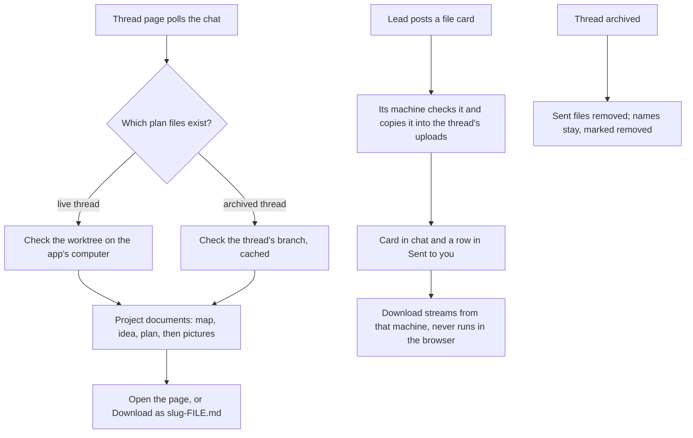

# Thread sidebar: project documents and files from agents

**Idea:** `IDEA.md` — what this is for and why, in plain language. Read it first; it is
the north star this plan serves. Goal and Constraints live there, not here, so they don't
get buried as this file grows.

## Open Questions

_None._

## Watch List

| # | Noticed | What needs looking into | Raised to user? | Outcome |
|---|---------|-------------------------|-----------------|---------|

## Decision Log

| # | Decision | Rationale | Source |
|---|----------|-----------|--------|
| 1 | Mode is two-part | User's pick | user |
| 2 | Only the lead sends documents to the user, through a new lead-only card kind; sub-leads and workers ask the lead with a `message` | Same rule as the `image` card; keeps one voice to the user | defaulted |
| 3 | A sent document is a copy taken at send time into the thread's uploads on its machine, like `image` | Reuses the existing copy, stream and safety path; later edits to the source do not change what the user got | defaulted |
| 4 | A sent document also shows as a small card in the chat, besides the sidebar listing | The user notices it arrived without watching the sidebar | defaulted |
| 5 | Plan documents are read through the thread's machine, so remote threads work | IDEA constraint; uploads already stream through the machine (`viewer/app/routes.js:104-117,501-510`) | defaulted |
| 6 | Each document gets its own open and download control; no "download all" | Simplest form of "easily downloadable" | defaulted |
| 7 | On a phone, both sections live where the plan links sit today, under the thread header | No right column on phones (`viewer/pages/thread.js:260`) | defaulted |
| 8 | Project documents are MAP.md, IDEA.md, PLAN.md and the thread's pictures (diagram cards and aside graphs); COMPLETION, REMEDIATION and reports/ are not listed | User's pick | user |
| 9 | Files agents sent are removed when the thread is archived, like attachments; their names stay listed, marked removed | User's pick | user |
| 10 | Images sent with the `image` card are listed in the sent-files section too | Both are things an agent handed the user | defaulted |
| 11 | Plan documents download as `<slug>-<FILE>.md` | Downloads from several threads don't overwrite each other | defaulted |
| 12 | On a phone, the header shows one Files button that opens a panel with both sections | A chip per file gets long once agents send files | defaulted |
| 13 | Superseding 5: map, idea and plan of threads on another computer move to the follow-up (Deferred D7); this build reads them on the app's own computer only. IDEA's remote constraint becomes a Not doing item | User picked "Save it for the follow-up" after three review rounds kept finding problems in that part | idea-change |

## Spec

Line numbers are from commit `a5f9d5f6`; see `MAP.md` and `docs/maps/thread-sidebar-files.md`.



The page lays both sections out the same way in the right column and, on a phone, inside
the panel the header's Files button opens.

### S1. The right column has two sections

`renderFiles` (`viewer/pages/thread.js:235-275`) is rewritten. The right column
(`#files`, `viewer/pages/thread.html:58-60`) shows, in order:

1. **Project documents** (heading text exactly `Project documents`):
   - One row per plan document among `MAP.md`, `IDEA.md`, `PLAN.md` that exists (S3's
     list), in that order. Each row: the file name as a link to the existing document page
     (`/wheelchair/app/doc?thread=<id>&file=<FILE>`), and a **Download** link (S4).
   - Then the pictures exactly as `pictureList()` builds them today (diagram cards
     deduplicated by file, then aside graphs), each a link to its picture page. No download
     for pictures (Deferred D1).
   - Nothing else from the plan folder (COMPLETION.md, REMEDIATION-*.md, reports/, other
     graphs) is listed.
2. **Sent to you** (heading text exactly `Sent to you`): one row per `file` card (S5) and
   per `image` card in the thread, newest first. Each row: the card's `title`, below it the
   file name (S5's `name`, or for an image the stored `file` with its leading `<digits>-`
   removed) and, for `file` cards, a human size (`12 KB`, `3.4 MB`), and a **Download**
   link to `/wheelchair/api/threads/<id>/files/<stored file>` with the HTML `download`
   attribute set to the shown name. An image row also links its title to the image (opens
   in a new tab, as the chat card does). On an archived thread, rows stay with name and
   title but the links are replaced by the dim text `Removed when the thread was archived`.

A section with nothing in it is not shown. When both are empty the column shows nothing,
as today. The old heading "This thread's files" is gone.

Sent to you skips cards with `retracted_at` and cards the chat hides as before an import
(the same `sinceImport` test, `viewer/pages/thread.js:344,382`), so cards replaced by an
import are not listed.

The render signature (`viewer/pages/thread.js:1115`) also covers the import time and the `file` and `image`
cards (id, title, file, name, size) and S3's document list, so new items appear on the next
poll without reload.

### S2. Phone layout

Below 900px wide there is no right column. The header's `#head-files` strip
(`viewer/pages/thread.html:26`) is replaced by one button labelled `Files (<N>)`, N being the
total rows across both sections, hidden when N is 0. Pressing it opens a panel directly
under the header with the same two sections and the same rows and links as S1 (one shared
render function fills both places); pressing it again or following a link closes it. Every
link and button in it is at least 44px tall.

### S3. Which plan documents exist

The thread's chat response (`GET /wheelchair/api/threads/<id>/chat`, built by `chat()` in
`viewer/app/chat.js:335-376`) gains a top-level `documents` field: an array of the names
among `MAP.md`, `IDEA.md`, `PLAN.md` that exist, in that order. No sizes, no new route.

- **Live thread** (not archived): the hub checks its own filesystem at
  `<thread.worktree>/docs/plans/<slug>/<FILE>` for each name and lists those that pass the
  eligibility check in S4 (one shared function, so every listed document can be opened and
  downloaded). A worktree that is not on the hub's filesystem (a thread on another
  computer) gives `[]` (Deferred D7).
- **Archived thread:** the hub runs `git -C <project> cat-file -e <branch>:docs/plans/<slug>/<FILE>`
  for each name (as `archivedDocument` reads them, `viewer/app/threads.js:251-265`) and lists
  those that succeed. The result is cached in memory per thread id and branch (an archived
  branch does not change), so polling does not start Git each time.
- No slug → `[]`. A live thread with no worktree → `[]`. An archived thread needs no
  worktree (it reads the branch).
- **Slug check:** before using `thread.slug` for a path, a Git object name or a download
  filename, the hub checks it matches `^[a-z0-9][a-z0-9._-]{0,79}$` and is not `.` or `..`;
  otherwise it is treated as no slug (`[]` here, 404 in S4).

Slug discovery is unchanged (`viewer/app/views.js:71-112`).

The page reads `data.documents` from the chat poll it already makes; S1's render signature
includes it, so a document appearing shows on the next poll.

### S4. Reading and downloading a plan document

The hub route `GET /wheelchair/api/threads/<id>/doc?file=<FILE>` (`viewer/app/routes.js:522-524`)
now serves live threads too:

- `FILE` must be one of `MAP.md`, `IDEA.md`, `PLAN.md`, else 404.
- Live: the hub reads `<thread.worktree>/docs/plans/<slug>/<FILE>` from its own filesystem
  after the eligibility check: the final component is not a symlink and is a regular file,
  its real path is inside the real path of `<thread.worktree>/docs/plans/<slug>/`, and it is
  at most 2 MiB (the same containment idea as the existing `/wheelchair/doc` read,
  `viewer/server.js:1551-1569`). Anything failing it is 404.
- Archived: as today (`git show`).
- Without `download`: response stays `{ "content": "<text>" }` (JSON), as today.
- With `download=1`: the file's bytes, `content-type: text/markdown; charset=utf-8`,
  `x-content-type-options: nosniff`, `content-disposition: attachment; filename="<slug>-<FILE>"`.

The document page (`viewer/pages/doc.js:53-67`) reads live documents through this route
instead of `/wheelchair/doc?plan=...`, so live and archived use one route. It gains a
**Download** link (to `...doc?file=<FILE>&download=1`) next to its title. The older plan
viewer's `/wheelchair/doc` route is left as it is.

The sidebar's **Download** link for a plan document is that same `download=1` URL.

### S5. The `file` card: an agent sends the user a document

New lead-only card kind `file`, shown to the user, not pinned.

| Field | Type | Required | Meaning |
|---|---|---|---|
| `path` | string | yes | Absolute path to a regular file on the lead's machine, at most 25 MB |
| `title` | string | yes | One line: what the document is |

- `viewer/app/card.js`: add `file` to the kinds, `roles.file = ['lead']`, fields `path`
  (absolute) and `title` (text). Any other field is refused, as for every kind.
- `machine/service.js`, in the `/v1/agent/cards` handler beside `copyImage`: before
  reserving or copying anything it refuses a non-lead session (403, `only a lead may post a
  file card`), a card with fields other than `kind`, `path`, `title` (422) and a missing or
  blank `title` (422, `title is required`). Then `copyFile`
  takes the same steps as `copyImage` (`machine/service.js:351-368`) without the extension
  check: absolute path, exists, regular file (following no symlink at the final component:
  `lstat` must say regular file), at most 25 MB (`UPLOAD_LIMIT`), real path not inside the machine's real `stateDir`
  (`machine/service.js:224`; that is where its secret, session records and uploads live;
  422 `file is inside the wheelchair state folder`) unless it is inside
  `<stateDir>/worktrees/` (`machine/service.js:584-585`), where every agent's checkout lives, copied into the thread's
  uploads with `reserveUpload`. Errors are 422 with plain sentences: `file path must be
  absolute`, `file does not exist`, `file is not a regular file`, `file exceeds 25 MB`. It
  passes on `{ path: <stored path>, title, name: <sanitized original basename>, size:
  <bytes> }`.
- `viewer/app/cards.js` (`:133`): a `file` card is stored with `file: path.basename(path)`
  as for `image`, plus `name` and `size` from the machine. The hub accepts `name` and
  `size` on a `file` card only from the machine relay.
- **Chat card:** title as heading, then `<name> · <size>` and a **Download** button (same
  link as S1). On an archived thread: `Removed when the thread was archived`, no button.
- **Serving:** unchanged route (`viewer/app/routes.js:501-510`). The machine's upload GET
  (`machine/service.js:1945-1953`) changes its non-image header to
  `content-disposition: attachment; filename="<stored name without its leading digits and dash>"`.
  The stored name is already limited to `[A-Za-z0-9._-]`, so it is header-safe. Images stay
  inline. Non-image files are never served inline and always with `nosniff`, so nothing
  sent can run in the browser.
- Archive removes them with the rest of the uploads folder, as today
  (`machine/service.js:1181-1189`).

### S6. Protocol

- `protocol/app/cards.md`: add `file` to the kinds table (shown, lead, not pinned).
- `protocol/app/cards-lead.md`: add a `### file` section with the fields, the 25 MB limit,
  that it is copied at send time (later edits to the source do not reach the user), that
  it shows in the chat and in the sidebar's Sent to you section, and that archiving the
  thread deletes it.
- `protocol/app/lead.md`, Diagrams section's last paragraph area: one sentence: to hand the
  user a document (a report, a spreadsheet, a PDF), post a `file` card; a sub-lead or
  worker that made one asks the lead with a `message` naming its path.
- `protocol/app/sub-lead.md` and `protocol/app/worker.md`: one sentence each that a document
  meant for the user goes to the lead with a `message` naming its path.

### Non-goals

Editing documents in the app; changing composer attachments; sharing files across threads;
carrying sent files through a handoff export or import; downloading pictures; download all;
in-app previews of sent non-image files; opening pictures of a live thread whose worktree is
only on another machine (Deferred D6; they are listed as today and open as today); keeping sent files after archive; making the
map, idea and plan of threads on another computer, live or archived (Deferred D5, D7).

### Validation

Existing browser tests that assert today's sidebar and phone strip (plan links shown for
missing files, picture chips visible under the header without opening a panel) are updated
to the new UI as part of S1–S3: `viewer/test/app-threads.spec.js:657-665,908-915`,
`viewer/test/app-doc.spec.js:111-119`, `viewer/test/app-pictures.spec.js:90-99`.

New or changed tests:

- `machine/test/`: `copyFile` accepts a text and a PDF file, refuses a relative path, a
  missing file, a directory, a symlink, a file over 25 MB, a file inside the state folder (but
  accepting one inside a worktree under `<stateDir>/worktrees/`),
  a non-lead session, an extra field and a blank title, leaving no upload behind for any refusal; the upload GET sends
  `content-disposition: attachment; filename="report.pdf"` for `3-report.pdf`.
- `viewer/test/` unit: `card.js` accepts a valid `file` card and refuses it from non-leads
  and with extra fields; the hub stores `file`, `name`, `size`; the chat response's `documents`
  and `/doc` for live and archived threads (including an archived record with no worktree),
  a slug failing the slug check giving `[]` and 404, a document over 2 MiB and a symlinked document neither listed
  nor served, a worktree not on the hub's filesystem giving `[]`; `download=1` headers.
- `viewer/test/` browser spec: the sidebar shows `Project documents` with only the existing
  plan files and a Download link carrying `download=1`, then pictures; `Sent to you` lists a
  `file` card and an `image` card newest first with Download links; archived thread shows
  `Removed when the thread was archived`; a retracted or pre-import `file` card is not listed; at 390px wide the `Files (N)` button opens the
  panel with both sections; the doc page has a Download link and loads a live document
  through the hub route.

Commands (all must pass):

```bash
bash machine/test/run.sh
node --test viewer/test/*.test.js
npm --prefix viewer run test:browser
```

## Deferred

| # | Item | Why it can wait | Source | Notes for the follow-up |
|---|------|-----------------|--------|-------------------------|
| D1 | Download pictures (diagrams) as image files | Pictures still open full size; the map, idea and plan downloads carry the content | planning | Graphs are JSON/HTML rendered client-side; needs a render-to-PNG or SVG export |
| D2 | Download all documents at once (zip) | Per-file download works | planning | |
| D3 | In-app preview for sent documents other than images | Download opens them with the phone's own viewer | planning | Markdown could reuse the doc page renderer |
| D4 | Keep sent files after the thread is archived | User chose removal for now | planning | Needs a store outside the uploads folder and a cleanup rule |
| D5 | Project documents of an archived thread whose project exists only on another machine | Archived reads stay as today | review-round-1 | Archived reads run `git -C <project>` on the hub (`viewer/app/threads.js:251-265`); pair with D7 and read through the thread's machine |
| D6 | Opening pictures (diagrams) of a live thread whose worktree is on another machine | Pictures already behave this way in chat today | review-round-2 | `viewer/pages/picture.js:31-41` and `viewer/pages/diagram.js:12-24` send the worktree path to a hub-local reader (`viewer/server.js:1673-1687`); pair with D7 and read graphs through the machine |
| D7 | Map, idea, plan of a live thread running on another computer | User chose to save it for the follow-up | user | Review rounds 1–3 show the hard part: finding the slug on that machine (`viewer/app/views.js:71-112` runs Git on the hub) without nesting `hub.withThread` (every `discoverSlug` caller already holds it: `viewer/app/routes.js:442-447`, `viewer/app/hub.js:266-268`, `viewer/app/routes.js:482`) or holding the list-poll lock across a machine request. Read documents through a hub-authenticated machine route with the same eligibility check as S4 |

## Accepted Risks

| Risk | Why accepted | Round |
|------|--------------|-------|
| A plan folder that is itself a symlink out of the worktree passes the eligibility check | Needs an agent to plant the symlink (tampering); the lead can already read any such file | review-round-2 |
| A `file` card carrying a `warnings` field passes the machine's extra-field check | `card.js` refuses unknown fields; needs a client bypassing it | review-round-3 |
| An archived plan document with non-UTF-8 bytes downloads re-encoded | Agents write UTF-8 Markdown | review-round-3 |
| An archived thread advanced by a handoff import and archived again can show a cached document list from before | Needs an import that advances an archived thread, a change in which plan files exist, and a re-archive, with the hub still running | review-round-5 |
| An archived plan document over 2 MiB is listed but its page fails | Plan documents are far smaller in ordinary use | review-round-2 |

## Review Rounds

### Round 1 — 2026-11-19

**Lanes:** intent — claude / claude-opus-5-5; mechanics — gpt / gpt-6.2-sol; cross-family: yes.

**Changed since the last round:** n/a (first round — whole Spec in scope)

| Lane | Reported | Finding | Lead verdict | Resolution |
|------|----------|---------|--------------|------------|
| intent | minor | Archived remote threads lose project documents; hidden in Non-goals | upheld | Moved to Deferred D5 with notes |
| intent | minor | Widen `image` to any file instead of a new `file` kind | declined | `image` has a fixed contract (inline display, image extensions) used by existing leads and the chat card; a separate kind keeps both simple and is what the reviewer calls defensible |
| intent | minor | `/documents` returns sizes nobody shows | upheld | S3 returns names only; archived check uses `cat-file -e` |
| intent | minor | S5 filename header also changes user attachments; say so | upheld | S5 Serving says it is intended |
| mechanics | blocking | Remote thread never gets a slug: discovery runs Git on the hub | upheld | S3 adds machine-side slug discovery (round 2: folded into the machine's `/documents` route) |
| mechanics | blocking | Machine copies before the hub checks role and fields; refused cards leave uploads | downgraded → minor | The orphan copy is never listed and needs a session bypassing `card.js`'s own role check; cheap to close: S5 checks role and fields on the machine before copying |
| mechanics | blocking | Lead could send the machine secret or session records | downgraded → minor | The lead already runs as the same user and can print any of these files into its reply, and the receiver is the owner; still cheap to refuse: S5 refuses sources inside the machine's state folder |
| mechanics | blocking | Listing and serving disagree (big files, symlinked parents) | downgraded → minor | Would show a dead link, not build the wrong thing; S3/S4 share one eligibility check |
| mechanics | blocking | Import-retracted file/image cards would still be listed | downgraded → minor | Edge of handoff import, a worker builds the rest correctly; S1 skips retracted and pre-import cards |

### Round 2 — 2026-11-19

**Lanes:** intent — claude / claude-opus-5-5; mechanics — gpt; cross-family: yes.

**Changed since the last round:**
- S3: `/documents` returns names only; archived existence check is `cat-file -e`.
- S3: new machine-side slug discovery for threads whose worktree is not on the hub.
- S3/S4: listing and serving share one eligibility check (no final symlink, regular file, real path inside the plan folder, at most 2 MiB).
- S5: machine checks lead role and allowed fields before copying; refuses sources inside the machine's state folder.
- S5: states that the filename header also applies to the user's own attachments, on purpose.
- S1: Sent to you skips retracted and pre-import cards; signature covers the import time.
- Deferred D5 added (archived threads from another machine); Non-goals points to it.
- Validation list extended for the above.

| Lane | Reported | Finding | Lead verdict | Resolution |
|------|----------|---------|--------------|------------|
| intent | blocking | State-folder refusal blocks files in agents' own worktrees | upheld | S5 exempts `<stateDir>/worktrees/`; test added |
| intent | minor | Decide "remote" from `thread.machine`, not a missing path | declined | `discoverSlug` runs on every thread-list poll; the local path check keeps local threads on the existing Git path with no machine round trip, and a missing worktree on an unarchived thread is exactly the remote case |
| intent | minor | `/plan-slug` duplicates `/documents`' worktree lookup | upheld | Machine `/documents` returns `{slug, documents}` and discovers the slug when none is given; `/plan-slug` removed |
| mechanics | blocking | State-folder refusal blocks worktree files | upheld | Same fix as the intent finding above |
| mechanics | blocking | Remote slug discovery widens the unlocked read–save window | downgraded → minor | Needs a save during the machine request; cheap to close: S3 saves under `hub.withThread` after re-reading |
| mechanics | blocking | Symlinked plan folder escapes the worktree | accepted-risk | Rare path: needs a planted symlink; Accepted Risks |
| mechanics | blocking | Live remote pictures listed but cannot open | upheld (major) | Existing behaviour of diagrams for remote threads; moved to Deferred D6, Non-goals point to it |
| mechanics | minor | Archived list includes documents over 2 MiB | accepted-risk | Rare path; Accepted Risks |
| mechanics | minor | Remote slug discovery ignores `default_branch` | upheld | S3 passes the lead record's `default_branch` |
| mechanics | minor | Title validated only at the hub, after copy | upheld | S5 refuses blank title before copying; test added |

### Round 3 — 2026-11-19

**Lanes:** intent — claude; mechanics — gpt; cross-family: yes.

**Changed since the last round:**
- S5: state-folder refusal exempts `<stateDir>/worktrees/`; blank title refused on the machine before copying.
- S3: slug discovery folded into the machine's `/documents` route (no `/plan-slug`); uses the lead record's `default_branch`; slug saved under the thread lock after a re-read.
- Deferred D6 (pictures of remote live threads) and two Accepted Risks added; Non-goals updated.

| Lane | Reported | Finding | Lead verdict | Resolution |
|------|----------|---------|--------------|------------|
| intent | blocking | Round-2 lock fix would nest `withThread` on the thread-list path and hang it | upheld | S3: remote branch inside `discoverSlug`; callers keep their own lock; only `chat()` adds `withThread` around re-read and save |
| intent | minor | Discovery runs twice per caller (test, then `findSlug`) | upheld | S3: discover once, pass the result to `saveSlug` |
| mechanics | blocking | `chat()` already runs under `withChatThread`; the round-3 `withThread` would deadlock | upheld | S3: no new lock anywhere; every caller already holds the lock; `saveSlug` re-reads and saves |
| mechanics | minor | Thread-list poll would hold the lock across a machine request | upheld | S3: only `chat()` does the remote lookup; the list poll stays local |
| mechanics | minor | `warnings` deleted before the machine's extra-field check | accepted-risk | Rare path: `card.js` refuses unknown fields; only a client bypassing it sends `warnings` on a file card |
| mechanics | minor | Archived download decodes non-UTF-8 Markdown | accepted-risk | Rare path: agents write UTF-8 Markdown |

### Round 4 — 2026-11-19

**Lanes:** intent — claude; mechanics — gpt; cross-family: yes.

**Changed since the last round:**
- User decision 13 (idea-change): map, idea and plan of threads on another computer moved to Deferred D7. IDEA's Not doing and Constraints updated.
- S3 rewritten: hub-local existence check with S4's eligibility function; no machine document routes; slug discovery unchanged (all round 2–3 slug and lock text removed).
- S4 rewritten: live reads from the hub's own filesystem with the eligibility check; doc page uses the hub thread route for live and archived.
- Validation and Non-goals updated to match.

| Lane | Reported | Finding | Lead verdict | Resolution |
|------|----------|---------|--------------|------------|
| intent | major | Validation still lists tests for removed machine document routes | upheld | Removed from the `machine/test/` bullet; the hub tests already cover them |
| intent | minor | D5/D6 notes describe the superseded remote design | upheld | Reworded; both point to D7 |
| intent | minor | Separate `/documents` route and refetch schedule is more than needed | upheld | S3: `documents` added to the chat response; archived result cached per thread and branch |
| mechanics | blocking | "No worktree → []" contradicts archived listing from the branch | upheld (major) | S3: worktree required only for live threads; archived-with-no-worktree test added |
| mechanics | blocking | Validation still lists removed machine document tests | upheld | Same fix as the intent finding above |
| mechanics | blocking | Slug never validated before path and filename use | downgraded → minor | The hub writes the slug itself from Git directory names (`viewer/app/views.js:76-82`), so a bad one needs tampering; still cheap: S3 adds a slug check used by S3 and S4, with a test |
| mechanics | minor | Document list not refreshed when the thread is archived | upheld | Resolved by the round-4 intent change: `documents` comes with every chat poll and is in the render signature |

### Round 5 — 2026-11-19

**Lanes:** intent — claude; mechanics — gpt; cross-family: yes.

**Changed since the last round:**
- S3: `documents` is a field of the chat response (no `/documents` route, no refetch schedule); archived result cached per thread and branch.
- S3: worktree required only for live threads; new slug check used by S3 and S4.
- Validation: stale machine document tests removed; archived-no-worktree and slug-check tests added.
- Deferred D5/D6 notes reworded to point to D7.

| Lane | Reported | Finding | Lead verdict | Resolution |
|------|----------|---------|--------------|------------|
| mechanics | blocking | Archived document cache goes stale after an import advances and re-archives a thread | accepted-risk | Rare path: needs import-advance, a changed set of plan files and re-archive in one hub run; Accepted Risks |
| mechanics | minor | Existing browser tests assert the old sidebar and phone strip | upheld | Validation names the tests to update |
| mechanics | minor | `file` title accepts line breaks | declined | Same `text` check as the `image` card's title (`viewer/app/card.js:148`); the card wraps text, nothing breaks |

## Implementation Tasks

| # | Objective | Ownership boundary | Lane | Session id | Validation | Status |
|---|-----------|--------------------|------|-----------|------------|--------|
| T1 | S5 machine half: `file` card checks, `copyFile`, upload GET filename header, tests | `machine/service.js`, `machine/test/` | gpt standard / gpt-6.1-terra | wc-620b2787c998-worker | `bash machine/test/run.sh` | done |
| T2 | S3, S4, S5 hub half, S6: `file` kind, `documents` in chat, live+archived `/doc` with download, protocol text, unit tests | `viewer/app/{card,cards,chat,routes,threads,documents}.js`, `viewer/AGENTS.md`, `viewer/test/*.test.js`, `protocol/app/{cards,cards-lead,lead,sub-lead,worker}.md` | gpt standard / gpt-6.1-terra | wc-620b2787c998-worker-2 | `node --test viewer/test/*.test.js` | in progress |
| T3 | S1, S2, S4 page half, S5 chat card: sidebar sections, phone Files panel, doc page via hub route + Download, browser specs (after T2) | `viewer/pages/`, `viewer/test/*.spec.js` | claude standard / claude-sonnet-5-5 | — | `npm --prefix viewer run test:browser`, `node --test viewer/test/*.test.js` | not started |

## Log

Build accepted: approval 4ceb0129-efd9-4063-a1da-9603a9f82e9b
- 2026-11-19 — T1 report said "Choices: none"; the scout listed 7 from the diff, logged below.
- 2026-11-19 — Choice: T1, machine card handler: `warnings` is deleted only for non-`file` kinds, so a `warnings` field on a `file` card gets the extra-field 422 (`field <name> is not allowed`).
- 2026-11-19 — Choice: T1, `copyFile`: reuses `copyImage`'s 409 `session is not writable` check; any `lstat` failure reports `file does not exist`.
- 2026-11-19 — Choice: T1, `copyFile`: if `<stateDir>/worktrees` does not exist, its unresolved path is used for the exemption.
- 2026-11-19 — Choice: T1, forwarded `name`: the original basename through `uploadName` sanitizing, with no leading-digits strip (a source named `3-report.pdf` keeps that name).
- 2026-11-19 — Choice: T1, `copyFile` does not call the `beforeImageLock` archive hook that `copyImage` calls.
- 2026-11-19 — Choice: T1, machine tests: the old `3---x.txt` GET disposition assertion was replaced by the `3-report.pdf` → `report.pdf` assertion.
- 2026-11-19 — T1 accepted (band: scout): machine suite 375/375 rerun by sub-lead; all required tests present.
