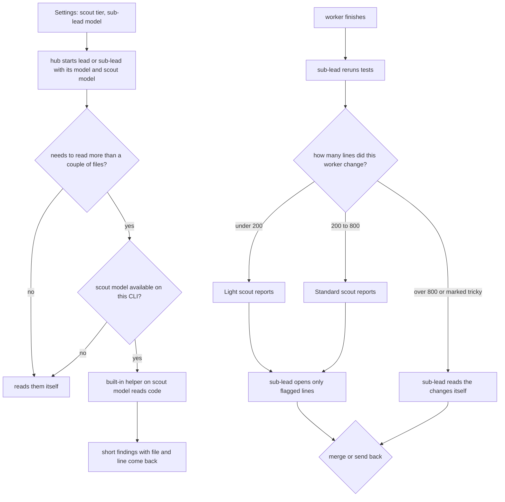

# Make wheelchair use fewer tokens

**Idea:** `IDEA.md` — what this is for and why, in plain language. Read it first; it is
the north star this plan serves. Goal and Constraints live there, not here, so they don't
get buried as this file grows.

## Open Questions

(none)

## Watch List

| # | Noticed | What needs looking into | Raised to user? | Outcome |
|---|---------|-------------------------|-----------------|---------|
| 1 | Codex and Antigravity subagent model choice untested in app sessions | live check before approval | no | Settled by the fallback rule: an agent whose helper cannot take the scout model reads code itself. Moved to Accepted Risks |

## Decision Log

| # | Decision | Rationale | Source |
|---|----------|-----------|--------|
| 1 | Scout model is a Settings choice | Collin, on confirming IDEA.md | user |
| 2 | Sub-lead gets its own model cell per provider, initially equal to the lead cell, so nothing changes until Collin changes it | no behaviour change on upgrade | defaulted |
| 4 | Scout is the CLI's built-in helper (Claude Agent tool, Codex subagent, Antigravity subagent), not a new app role | answers return in the same turn; far less code | user |
| 5 | Sub-lead hands each worker diff to the scout, reruns validation itself; no fresh-context restarts | removes the largest sub-lead input; the final verifier still checks the whole build | user |
| 6 | No measurement script ships; the method and baseline are in the Log | re-measuring is a one-off check, not a product feature | defaulted |
| 7 | Scout diff report also lists unbriefed choices and checks claimed file state | sub-lead.md's choices step needs a full list without the sub-lead reading the whole diff | review-round-1 |
| 8 | Worker changes are checked by size: under 200 changed lines the Light scout, 200–800 a Standard "bigger changes" scout (its own Other agents setting), over 800 or marked tricky the sub-lead itself | Collin: different tiers by size, the sub-lead for truly big ones. Line limits and the separate setting are defaulted | user |
| 9 | Worker diffs are sized and reviewed over `<feature>...<worker>`; lookups without the Light scout fall back to the agent, diff checks to the next band | review round 3 findings | review-round-3 |
| 3 | Scout setting sits in Other agents as a tier selector like reviewer/verifier/mapper, default Light | matches the existing pattern and Collin's "light tier" | defaulted |

## Spec

### Flow

A lead or sub-lead starts with its scout models in its instructions; code reading goes to the scout, and only its findings come back. The sub-lead's check of a finished worker reruns the tests, then picks a reader by the size of that worker's own change: the Light scout under 200 lines, the Standard scout from 200 to 800, the sub-lead itself above that or for a tricky task. Drawn from `graphs/scout-diff-check.json`.



### Settings
- New per-provider `sub-lead` model cell beside `lead` in `codex/model.sh`, the API and the Models page; on first load it copies the lead cell. `balancer.js` resolves sub-leads to it.
- New Other agents selector `scout`, a tier (`light` default), stored with reviewer/verifier/mapper.
- New Other agents selector `scout-heavy` ("Scout for bigger changes"), a tier (`standard` default), stored the same way.

### Scout
- At start, the hub resolves the scout tier to a model for the session's provider and adds one layer to the lead's and sub-lead's starting instructions: the scout model, and the rule below. The sub-lead's layer also names the bigger-changes scout model (resolved from `scout-heavy` the same way). For Claude the model is given as the Agent tool alias for its family (haiku, sonnet, opus); a model with no alias means no scout.
- lead.md and sub-lead.md rule: questions that need reading more than a couple of files go to the built-in helper on the scout model, with a brief asking for conclusions with file:line evidence, not file dumps. The agent acts on those conclusions and opens a file itself only to confirm a specific line. With no scout model, read code as today.

### Sub-lead diff checks
Replace the "read the diff" step in `protocol/app/sub-lead.md` (around :129-152) with: rerun the task's validation itself (unchanged); read the worker's report; pick the reader by the size of the worker's change (`git diff --shortstat <feature branch>...<worker branch>`, three dots, so only the worker's own changes since its branch was cut count, never other workers' merges; added plus removed lines). The scout is given the same range (`git diff <feature branch>...<worker branch>`): under 200 lines, the scout; 200 to 800, the bigger-changes scout; over 800, or a task whose Implementation Tasks row is marked `tricky`, the sub-lead reads the diff itself as today (the choices step then works as today too). The chosen scout is asked to compare the worker's diff with its brief and the Spec and report, each with file:line: (1) every deviation, missing piece or risky change; (2) whether the file state the report claims matches the diff; (3) every choice the diff makes that the brief did not dictate. Open only the flagged lines, then decide to merge or send back. The choices step (sub-lead.md:136-143) uses the scout's list (3): it is checked against the report's choices section, and when the report has none, it is the list the sub-lead logs as "worker didn't report its choices; I listed N". With no scout model for the band, use the next band up (no bigger-changes scout means the sub-lead reads it). The final verifier is unchanged.

### Boundaries and non-goals
- No new app role; `sessions.js` role sets and start rules are unchanged.
- Reviewers, verifiers, mappers and workers do not get a scout.
- Rule files (lead.md, cards.md, graphs.md) are not otherwise trimmed.
- Collin-visible behaviour is unchanged apart from the two new Settings controls.

### Edge cases
- Existing model files without a `sub-lead` cell: read as the lead cell, written on next save.
- A scout tier set to `none` for a provider, or a Claude model with no Agent-tool alias, makes that scout unavailable, and the layer says so. Code lookups use only the Light `scout`: without it, the lead or sub-lead reads code itself. Worker diff checks follow the band fallback in Sub-lead diff checks: without the Light scout, the bigger-changes scout reads small changes too; without the bigger-changes scout, the sub-lead reads every change at or above 200 lines itself.
- The composed role instructions must still fit the 12000-character limit (`settings.js:167`).

### Validation
```bash
bash codex/test/run.sh
bash machine/test/run.sh
node --test viewer/test/*.test.js
npm --prefix viewer run test:browser
```
New tests: model.sh reads, writes and defaults the sub-lead cell; balancer resolves sub-leads to it and leads to `lead`; settings stores the scout tier (default light) and the scout-heavy tier (default standard); the lead and sub-lead role layers carry the scout line (alias for Claude, the model id for GPT/Gemini, the no-scout line for `none`); Settings page shows and saves both controls.

## Accepted Risks

| Risk | Why accepted | Round |
|------|--------------|-------|
| A CLI may ignore the scout model and run its helper on the expensive model | No worse than one extra lookup; re-measuring would show it | planning |
| The scout may miss a defect in a worker diff | Validation is rerun by the sub-lead and the final verifier checks the whole build | planning |

## Review Rounds

### Round 1 — 2026-11-16

**Lanes:** intent — gpt / gpt-6.1-sol; mechanics — gpt / gpt-6.1-sol; cross-family: no (Claude unavailable for reviewers at start).

**Changed since Round 0:** n/a (first round — whole Spec in scope)

| Lane | Reported | Finding | Lead verdict | Resolution |
|------|----------|---------|--------------|------------|
| intent | — | No findings | — | — |
| mechanics | major | "Open only the flagged lines" leaves no way to list a worker's unreported choices (sub-lead.md:136-143) | upheld | Scout report now also lists choices the diff makes beyond the brief and checks claimed file state; choices step uses that list |

### Round 2 — 2026-11-16

**Lanes:** intent — gpt / gpt-6.1-sol; mechanics — gpt / gpt-6.1-sol; cross-family: no (Claude unavailable for reviewers).

**Changed since Round 1:**
- Sub-lead diff checks: the scout's report now has three parts (problems, claimed file state, unbriefed choices) and the choices step uses part 3.

| Lane | Reported | Finding | Lead verdict | Resolution |
|------|----------|---------|--------------|------------|
| intent | — | No findings | — | — |
| mechanics | — | No findings | — | — |

### Round 3 — 2026-11-16

**Lanes:** intent — gpt / gpt-6.1-sol; mechanics — gpt / gpt-6.1-sol; cross-family: no (Claude unavailable for reviewers).

**Changed since Round 2:**
- Settings: new `scout-heavy` Other agents selector, default Standard; the sub-lead layer names its model.
- Sub-lead diff checks: the reader is chosen by change size (Light scout under 200 lines, bigger-changes scout 200–800, sub-lead itself over 800 or `tricky`), with fallback to the next band up.

| Lane | Reported | Finding | Lead verdict | Resolution |
|------|----------|---------|--------------|------------|
| mechanics | major | Diff range for sizing and scout review undefined; branch-tip comparison after a parallel merge counts other workers' changes | upheld | Spec now uses `git diff <feature>...<worker>` (three dots) for both |
| mechanics | major | Fallback contradiction: diff-check band fallback vs edge case saying the agent reads code itself | upheld | Edge case rewritten: lookups use only the Light scout; diff checks follow the band fallback |
| intent | — | No findings | — | — |

### Round 4 — 2026-11-16

**Lanes:** intent — gpt / gpt-6.1-sol; mechanics — gpt / gpt-6.1-sol; cross-family: no (Claude unavailable for reviewers).

**Changed since Round 3:**
- Sub-lead diff checks: the size and the scout's diff use `<feature>...<worker>` (three dots).
- Edge cases: the fallback is split, lookups vs diff checks.

| Lane | Reported | Finding | Lead verdict | Resolution |
|------|----------|---------|--------------|------------|
| intent | — | No findings | — | — |
| mechanics | — | No findings | — | — |

## Prior Work

| Spec item | State | Evidence (file:line) | Confidence |
|-----------|-------|----------------------|------------|
| `model.sh family claude <slot>` prints the Claude family alias (haiku/sonnet/opus/fable) | pre-existing | codex/model.sh:331-338 | high |

## Implementation Tasks

| # | Objective | Ownership boundary | Lane | Session id | Validation | Status |
|---|-----------|--------------------|------|-----------|------------|--------|
| T1 | Sub-lead model cell (model.sh, balancer, routes), scout + scout-heavy settings, scout layer in lead/sub-lead start | codex/, viewer/app/{balancer,settings,routes,sessions}.js, viewer/app/API.md, viewer/test/*.test.js | standard (gpt-6.1-terra) | wc-f8cf8710a770-worker (t1-a1) | codex, machine, node tests | done |
| T2 | Settings page: Leads/Sub-leads model rows, Scout and Scout for bigger changes selectors (after T1) | viewer/pages/settings.js, viewer/test/app-settings.spec.js | standard, --provider claude; hub placed it on gpt (gpt-6.1-terra) | wc-f8cf8710a770-worker-3 (t2-a1) | node + browser tests | done |
| T3 | Scout rule in lead.md and sub-lead.md; size-banded diff check in sub-lead.md | protocol/app/lead.md, protocol/app/sub-lead.md | standard (gpt-6.1-terra) | wc-f8cf8710a770-worker-2 (t3-a1) | protocol-rules test | done |

## Log

Baseline (2026-11-16, all Claude transcripts under ~/.claude/projects/*wheelchair-worktrees*, sessions classified by the role file named in their first messages, input = cache read + cache write + input per call): sub-lead 45% (median context 168k), lead 36% (94k), verifier 8%, worker 7%, reviewer+mapper 4%. Re-measure the same way after a few threads.

- 2026-11-16 — Ready check: hub and machine service answer; Claude Code 2.1.326 and codex-cli 0.169.0 installed; Codex preflight passed.
- 2026-11-16 — Re-approved after rounds 3–4 (size-banded diff readers). Ready check rerun.
- 2026-11-16 — Choice: T3, sub-lead.md tricky marker: a task is marked `tricky` in its Objective cell.
- 2026-11-16 — Choice: T3, sub-lead.md diff check: the scout is also given the worker's report, to check its claimed file state.
- 2026-11-16 — T3 accepted: protocol-rules 15/15 rerun on the merge; diff read in full (71 lines). The lead.md scout section sits between steps 2 and 3 as its own heading.
- 2026-11-16 — Choice: T1, settings.js roleLayers: the provider is a fifth argument, so the Claude-only "(Claude Code: ...)" clause is chosen explicitly.
- 2026-11-16 — Choice: T1, app-balancer.test.js: direct balancer fixtures point WHEELCHAIR_MODELS at a temp file, so the machine's own pins cannot affect them.
- 2026-11-16 — T1 accepted: the worker stopped on its fails-twice guard at lifecycle.test.js "a starter that loses the freed port registers through the new holder". That test fails the same way on the feature branch before T1 (pre-existing, unrelated: port-holder lifecycle). On the merge: codex 101/0, machine 114/0, viewer node 471/1 (that test only). Diff read in full (232 lines).
- 2026-11-16 — Choice: T2, settings.js Models panel: lead and sub-lead rows are generated per provider from one [slot, title] list; the existing picker and save path take the slot as given.
- 2026-11-16 — T2 accepted: the worker stopped on its fails-twice guard at three app-accounts.spec.js "lead waiting line" tests per browser. They expect a clock time three hours ahead and get a weekday when that crosses midnight (run at 21:26 PST): clock-dependent, unrelated. On the merge: browser 636 passed, 6 failed (those), 2 skipped; app-settings.spec.js 46/46. Diff read in full.
