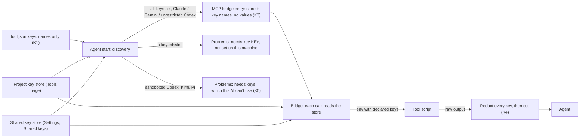

# Keys for folder tools

**Idea:** `IDEA.md` — read it first. **Map:** `MAP.md` and `docs/maps/folder-tool-keys.md`.
**Starting point:** the earlier key design in `docs/plans/easy-tools/PLAN.md` at commit
`a8211e9e` (S4, S9, S10) and that plan's Review Rounds 1-3 key findings, all of which this
plan carries forward unless a decision below changes them.

## Open Questions

## Watch List

| # | Noticed | What needs looking into | Raised to user? | Outcome |
|---|---------|-------------------------|-----------------|---------|

## Decision Log

Append-only. A reversal is a new entry superseding the old, never an edit.

| # | Decision | Rationale | Source |
|---|----------|-----------|--------|
| 1 | Mode: thorough | Collin picked it | user |
| 2 | No designer: the Shared keys section and "needs key" status were already drawn and agreed in easy-tools (its Decision 19); copied here as `graphs/mockup-shared-chosen-phone.html` and `graphs/mockup-tools-mixed-phone.html` | The visible part is small and already agreed | defaulted |
| 3 | Carry forward the earlier design: `keys` list in `tool.json`; bridge and server launcher read the key store themselves at spawn; keys never in agent env, generated MCP configs or instructions; project tools use project keys, shared tools a machine-local shared key set with the same private file modes | Settled in easy-tools rounds 1-3 | defaulted |
| 4 | Script output redaction as easy-tools round 3 left it: streaming redaction with hold-back before every cut and capture limit; `[key <NAME>]` replacement | Secret leaks are always fixed | defaulted |
| 5 | Server tools' stdout (newline-delimited MCP JSON) is redacted line by line in the launcher, matching both the raw and JSON-escaped key value | Closes the server-output leak the earlier design left to authors; cheap since the launcher already pipes it | defaulted |
| 6 | `check`/`run` as in easy-tools round 3: `check` never has keys and says a keyed server's failure may be that; keyless `run` in the caller's process on Claude, Codex and Antigravity, saying it ran without keys | Never crosses a sandbox; settled earlier | defaulted |
| 7 | A tool whose key is not set does not run and shows "needs key X, not set on this machine" on the Tools page, as in the mockup | Agreed mockup | defaulted |
| 8 | `.mcp.json` project-key injection into the agent's environment (Claude, Codex) stays as it is. Folder tools never add a key to the agent; a key also used by a `.mcp.json` server stays visible to the agent through that path, and the guide says so (moving that server to a folder tool removes it) | Collin: leave it; avoids breaking working setups | user |
| 9 | Keyed tools are not available to sandboxed Codex sessions (the default for Codex, and always for Codex project leads); this is shown plainly on the Tools page, in `wc.js tool list` and in the session's tool problems. Unrestricted Codex gets keyed tools through MCP like Claude, with no added prompt or step | Collin: not for now, but transparent, and no friction for unrestricted Codex | user |
| 10 | Supersedes 5: server stdout is redacted one complete line at a time, passed on at each newline; JSON lines are decoded, string values redacted except top-level `jsonrpc`, `id`, `method`, then re-encoded; stderr redacted line by line | Byte hold-back stalls request/response servers; raw matching corrupts framing and misses escaped spellings | review-round-1 |
| 11 | A key value under 8 characters counts as not set | Short values would mangle output when hidden; real keys are long | review-round-1 |
| 12 | Shared keys get a machine chooser (same control as the Tools page), not drawn in the mockup | Shared keys are per machine; the mockup had no chooser | review-round-1 |
| 13 | Supersedes 10 for server stdout: lines with no key pass byte for byte; raw replacement when the result checks clean; otherwise a reply is withheld with an error keeping its id, a notification dropped | JSON round-trips changed numbers and ids; property-name and escaped keys can't always be rewritten safely | review-round-2 |
| 14 | Usable key value: at least 8 characters and no NUL; Shared keys refuses others; project editor marks them for folder tools | Env-safe values, one rule in both places | review-round-2 |
| 15 | Keys for server tools split into their own thread; here only script tools get keys, and a server tool with `keys` is not connected and says so | Collin: split it off, after three review rounds of leak findings in server output | idea-change |
| 16 | Usable key values: 8–4096 characters of letters, digits and `. _ ~ + / = -`; redaction also matches `/` written as `\/` (supersedes 14's value rule) | Removes escaped and multiline leaks in script output | review-round-3 |
| 17 | Redaction matches every spelling where each key character is itself, `\uXXXX`, a backslash escape or `%XX` (supersedes 16's `\/` rule) | One rule instead of a growing list of encoders | review-round-4 |
| 18 | Server tools with `keys` are refused by `validateToolJson`, so the launcher never starts them | The launcher re-validates; one gate covers every path | review-round-4 |
| 19 | Supersedes 17: plain keys are replaced; if a key survives in any decoding (up to three rounds of JSON/backslash unescaping and percent-decoding), the stream is withheld; other transforms (base64, hashing, splitting) are the stated limit | One rule that ends the chase | review-round-5 |
| 20 | Confirms 19: the redaction limit is common escapes (JSON/backslash, percent, up to three layers); base64, hashing and splitting are not caught and the guide forbids printing keys. IDEA.md "What good looks like" updated | Collin: common escapes, clear limit | idea-change |
| 21 | Cut edges are trimmed by whole lines, not by a byte count | Keys contain no newline in any spelling, so this covers escaped keys at any cut | review-round-6 |
| 22 | Supersedes 21: cut edges are trimmed back to the nearest byte no key spelling can contain, each edge on its own | Keeps long single-line output; covers both stderr ends | review-round-7 |
| 23 | Catching keys printed in escaped forms (K4's former step 3) split into its own thread; here only keys printed as-is are hidden; supersedes 19 and narrows 20 | Collin: split it off, after four review rounds of findings in that part | idea-change |
| 24 | Keyed tools only through MCP; Kimi, Pi and sandboxed Codex (`shellToolsOnly`) get a clear "not available" line. Running keyed tools on the machine for Kimi and Pi is split into its own thread | Collin: drop Kimi/OpenRouter for now, after that piece drew serious findings in four rounds | idea-change |

## Spec

Builds on the merged easy-tools work (`docs/plans/easy-tools/PLAN.md`, PR #196); everything
there stays as it is except where an item below changes it. Current code is mapped in
`docs/maps/folder-tool-keys.md`.

How a keyed script tool's keys flow (K2 to K5); the agent only ever sees names and redacted output:

### K1. Declaring keys
`tool.json` gains an optional `keys`: an array of 1 to 20 unique key names. Each name must
match `KEY_NAME` and must not be reserved (`isReserved`), both in `machine/lib/project-keys.js`.
Anything else makes the tool invalid, and the reason names `keys`. The validated tool
(`validateToolJson`, `machine/lib/folder-tools.js`) carries `keys` (an empty array when
absent), so discovery and the bridge's changed-tool check see it. A tool with no `keys`
behaves exactly as today.
- **Script tools only.** Keys for server tools are split into their own thread (Decision 15).
  `validateToolJson` refuses a server tool with a non-empty `keys`, with the reason `keys for
  server tools aren't supported yet`. Since discovery, the launcher
  (`machine/lib/tool-launch.js`, which re-validates before every start) and `wc.js tool` all
  use that validator, such a tool is never started or connected, even if `keys` is added
  mid-session. Its status everywhere (session tool problems, `wc.js tool list`, the Tools
  page) is that reason, except that a shared tool hidden by a same-named project tool shows
  `hidden` as today. It is still never started. Session tool problems are worked out at agent
  start, so a mid-session edit shows there from the next agent start. Until then a new start
  of that server is refused by the launcher (reason on its stderr), and a server already
  running keeps running as it was.

### K2. Where a tool's keys come from
- A **project tool** (from the session's worktree) uses the project's key store, the one
  edited on the project's Tools page (`readKeyStore` with `projectIdentity` of the worktree).
- A **shared tool** (from the pinned shared copy) uses the machine's **shared key store**:
  `<stateDir>/shared-keys/keys.json`. It is created and written the same way as a project
  store (directory 0700, file 0600, atomic temporary file and rename, a `revision` counter)
  and has the same name rules. It is never committed and never leaves the machine except
  as key names. In the shared tools project's own threads (no shared copy, easy-tools S3),
  the tools there are its project tools, but they use the shared key store, so a shared
  tool can be tried before merge.
- A key is **set** for folder tools when the store has that name with a value that is
  **usable**: 8 to 4096 characters, each an ASCII letter, an ASCII digit or one of `. _ ~ + / = -` (what
  real API keys use). Any other stored value counts as not set, and the status gives the
  reason: `value too short (under 8 characters)`, `value too long` or `value has characters
  folder tools can't use (letters, digits and . _ ~ + / = - only)`. With these characters a
  key can't span lines, and K4's cut rule can rely on that. K4 states what is
  not caught.
- The Shared keys editor refuses an unusable value, with that same wording. The project key
  editor still accepts any non-empty value (`.mcp.json` servers may use short ones). It
  marks a stored value that folder tools can't use with `can't be used by folder tools:
  <reason>` beside its name. The key-names
  routes return, per name, `set` and `folder_usable` (with the reason), never the value. A
  name whose value is unusable still shows its Remove control.
- **Which store a tool uses** (the execution rule) is decided only by K2, and every place
  that shows key status (K6, K7) uses the same rule.

### K3. What reaches the tool, and what never reaches the agent
- The generated bridge entry (`bridgeEntry`) is **exactly as today** for a keyless tool
  (`--tool <dir>`), and a bridge with no keyed tools has exactly today's arguments, so its
  size against Codex's entry budget does not change. Only a keyed tool adds, after its
  folder, `project` or `shared` (the store, K2) and the key **names** discovery found
  declared at agent start, and the bridge then also gets `--state-dir` once. A `--tool`
  with no key names means no keys, which also covers a bridge started with an older
  wheelchair's arguments. The entry never carries a key value.
- The bridge (`machine/lib/tool-bridge.js`) reads that store itself on **each call** and
  adds exactly the entry's key names, with their values, to the environment it builds with
  `toolEnv`.
- **Bound to agent start.** Before each call the bridge checks the tool's current `keys`
  against the entry's names. If they differ (a tool gained, lost or changed keys after agent
  start), the call is refused as changed and nothing runs: keys are only ever used as
  declared when the agent started. Everything else about the changed-tool check, and every
  keyless tool, behaves exactly as today.
- No key value is written into any generated MCP config, any connector config file, the
  agent's environment or its starting instructions. Folder tools never use the
  `.mcp.json` env injection (`injectProjectKeys`, `machine/lib/env-launch.js`), which is
  unchanged (Decision 8). The guide says a key also used by a `.mcp.json` server still
  reaches the agent that way.
- Keys already in the inherited environment stay there, as in easy-tools Decision 22. A
  declared key overrides an inherited variable of the same name.
- **Missing key.** At discovery, a keyed tool with any declared key not set is not offered
  through MCP. The session's tool problems name it: `tool <name> needs key <KEY>, not set
  on this machine` (for a shared tool, `shared tool <name> …`), naming every missing key.
- **Changes mid-session.** Each bridge call reads the store when it starts. Replacing a
  value takes effect on the next call. Removing a key makes the next call return the
  missing-key text as an error and run nothing. Adding a key that was missing at session
  start makes the tool usable from the next agent start (a new session, a resume or an
  account switch, which rediscover tools), because the MCP tool list is fixed at start.

### K4. Hiding key values in output
Redaction lives in `machine/lib/key-redact.js` and works on the tool's own key values (K2).
A tool with no keys gets no redaction, and its output is passed through exactly as today.
- **Script tools** (`machine/lib/tool-run.js`): the runner keeps raw bytes: stdout up to the
  2 MiB capture limit, and the last 64 KiB of stderr. Nothing is returned until the process
  has ended, whether it exits, times out or its pipes are closed by force. Then each capture
  is processed in this order:
  1. **Cut edges.** Only an edge that was actually cut is trimmed, each on its own: the
     start of a stderr window that began mid-stream; the end of stdout when more than 2 MiB
     arrived (output of exactly 2 MiB that then ended is not cut);
     and the end of a stream that was still open when the tool timed out or its pipes were
     closed by force. A stream that ended normally keeps its end. Each cut edge is trimmed
     back to the nearest **separator**: any byte that is not one of K2's usable key
     characters (for example a space, `"`, `,`, `:` or a newline). So no piece of a plain key
     survives at a cut, and a long single line loses only its last unfinished word. If
     an edge has no separator at all, that capture is dropped. Where something was dropped,
     the text ends (or starts) with `[output cut]`.
  2. **Plain keys.** Every occurrence of every one of the tool's key values is found in the
     capture as it is (before any replacing). Every byte inside any occurrence is marked, and
     each run of marked bytes, however many keys overlap in it, becomes one `[key]`. So keys
     inside or overlapping other keys never leave a piece showing. The marker names no key, so it can never contain a value (values are at
     least 8 characters; `[key]` holds 3 usable characters).
  3. **Cuts for the agent.** Only then come the 1 MiB result cut and the 4 KiB stderr tail.
- **The limit.** Only keys printed as-is are hidden. A key printed in an escaped form
  (JSON `\uXXXX` or `\/` escapes, percent-encoding in a web address) is not caught here.
  Catching those is split into its own thread (Decision 23). Other transforms (base64,
  hashing, splitting) are not caught either. The guide tells authors never to print or log a
  key in any form, and warns that escaped forms are not yet hidden.
- **Node's own diagnostics.** Node prints a child's environment to its own stderr when its
  `child_process` debug output is on (`NODE_DEBUG`, including wildcards and any case). The
  bridge checks this in its own process with `util.debuglog('child_process').enabled`. When
  it is on, it refuses keyed runs with the
  reason `Node debug output for child processes is on; keyed tools won't run`. Keyless runs
  and their inherited environment are unchanged.
- **Launch errors** for a keyed tool (spawn failing in the bridge) report
  only `cannot start <program>: <error code>`, never the error's own message, which can echo
  environment values.

### K5. Which agents can use keyed tools
Keyed tools are used only through MCP (the standard tool connection, where the bridge starts
the tool and can add its keys). Agents that call folder tools from the shell instead
(the connector's existing `shellToolsOnly(session)`: Kimi, Pi and sandboxed Codex) can't use
keyed tools in this plan (Decision 24).
- **Claude, Antigravity (Gemini), unrestricted Codex:** keyed script tools through MCP, with
  keys, as in K3. No added prompt, setting or step (Decision 9).
- Each such session has one **reason**, and its tool problems show `tool <name> needs keys,
  which <reason>` for each valid keyed script tool that is not hidden by a same-named
  project tool (shadowing is resolved first; `wc.js tool list` still shows `hidden`):
  - **sandboxed Codex:** `sandboxed Codex can't use; set Codex to unrestricted in Settings
    to use it`;
  - **Kimi and Pi (OpenRouter):** `this AI can't use yet`.
- The machine works these lines out itself (using the connector's `sandboxed(session)` to
  pick the text) and keeps them with that session only. They stay on the problems card
  while that session runs, even when it has no MCP entries at all, and whatever other agents
  start in the same worktree. They are removed from the card when that session ends. If
  Collin dismissed the problems card, a line with a new text for a tool brings it back (a
  dismissal covers the lines it was shown with, not every later line for that tool's name).
  When it comes back, the new lines are listed first, and they stay ahead of older lines on
  later updates while they last, so the 20-line cap never hides the line that brought it back.
- `/v1/agent/tools` adds `keyed_unavailable`: `null`, or that session's reason (no tool
  name), and `wc.js tool list` shows `needs keys, which <reason>` on each keyed tool's row. `wc.js tool run` on a keyed tool runs it
  without keys in the caller's process, as for any other tool there, and its output starts
  by saying so.
- Reviewers get no project tools, as today.

### K6. `wc.js tool` commands
- `list`: in a session, adds each keyed tool's key names, set or not set, read live through a
  new names-only agent route (never values). Where `keyed_unavailable` is set it shows that.
  Without a session token (a scratch checkout), it lists the names with `key status
  unknown outside a session`.
- `check`: never uses keys, as now. For a script tool that declares keys, its output says
  the tool was validated without using keys. A server tool with `keys` gets the K1 status.
- `run`: always runs in the caller's process and adds no folder-tool keys. For a keyed tool
  its output starts by saying it ran without folder-tool keys, and that variables already in
  the caller's environment were passed as usual. Keyed tools are tried for real through MCP, on the next call in a
  session that offered them.
- The bridge's changed-tool error, when the re-read `tool.json` declares keys (even if the
  definition offered at start did not), says to try it with keys from
  the next agent start (`wc.js tool run` there runs it without keys). The guide's matching
  advice says the same.
- `new`: the script template is unchanged. The guide shows how to add `keys`.

### K7. What you see
- **Tools page** (`viewer/pages/project-tools.js`, `machine/lib/project-tools.js`): for the
  selected machine, a keyed tool with any key not set shows `needs key <KEY>, not set on
  this machine`, as in the mockup. Each row is checked against the store K2 says it uses,
  including the shared tools project's own Tools page, where its tools use the shared keys.
  There, a missing-key line adds `set it in Settings, Shared tools, Shared keys`. A keyed
  tool that is otherwise working adds one line: `uses keys: not available to sandboxed
  Codex, Kimi or Pi`. Key values never reach the page.
- The project's **Keys on this machine** editor also lists every key name declared by the
  folder tools that use the project store (K2), set or not set. Its usage and remove texts
  name those tools beside any `.mcp.json` servers. On the shared tools project's own page,
  its folder tools use the shared store, so their declarations are left out of this editor.
  Its stored project keys and `.mcp.json` names still show, with their Remove controls.
- After a **key-only** save or removal on the Tools page, only the key names and folder tool
  statuses are read again, so a `needs key` line clears without a reload. Unsaved
  `.mcp.json` tool edits, Windows settings and other pending key values stay as they are. The refresh also returns
  the current `key_revision`, which the page uses for the next save, while keeping the
  `.mcp.json` baseline its drafts were made against.
  This also applies when a key-only save is refused because the keys changed elsewhere: the
  page says so, refreshes the key names and statuses, and keeps the drafts. A save that also
  opens a `.mcp.json` pull request reloads the page as today.
- **Settings, Shared tools** (`viewer/pages/settings.js`): a Shared keys part under the
  shared tools picker, as in the mockup. Above it sits a machine chooser, the same control
  the project Tools page uses for its keys (not drawn in the mockup). Every read and write
  goes to the machine shown, and switching machine reloads the list. It lists every key name that
  usable shared tools declare (set or not set), plus any other names stored. The
  declarations come from that machine's newest shared copy. If it has none yet, the machine
  fetches one as a session start would (easy-tools S3, 20-second limit). If that fails, the
  part shows the stored names and `couldn't read the shared tools: <reason>`. You can set a
  value (a password field), replace it, or remove a name. Values are write-only: the page
  only ever gets names and whether they are set. Saving uses the store's `revision`, so a
  change made elsewhere in the meantime is refused with "changed elsewhere, reload". The
  machine serializes shared-key saves and removals around that check and the write, as
  `machine/service.js` does for project keys with `projectToolsLocks`. The
  name rules are those of project keys, with the same refusal wording.
- Hub routes pass shared-key reads and writes to the chosen machine's service, like the
  project keys routes (`viewer/app/routes.js`).

### K8. The guide and instructions
`protocol/tools.md` replaces "keys are not supported yet" with: the `keys` field and an
example, where each kind of tool's keys come from (K2), what reaches the agent and what
doesn't (K3, including the `.mcp.json` caveat and the same-account limit in IDEA.md), output
redaction and its limit (K4: only keys printed as-is are hidden; escaped forms, base64,
hashing or splitting are not),
the rule that a tool must never print or log a key in any form, never writing a key into a
tool's files, which agents can use keyed tools (K5),
and how to try one (K6), and that server tools can't have keys yet. The starting-instructions
line for Kimi, Pi and sandboxed Codex (easy-tools S11) is shown when the session has any
valid script tool, keyed or not. It adds that keyed tools are unavailable there only when
at least one valid, not hidden, script tool declares keys.

### Not doing (this plan)
- No change to `.mcp.json` key injection (Decision 8).
- No keyed tools in sandboxed Codex (Decision 9), or on Kimi and Pi: their own thread
  (Decision 24).
- No keys for server tools: their own thread (Decision 15).
- No catching of keys printed in escaped forms: their own thread (Decision 23).
- No HTTP folder tools (easy-tools Deferred 3) and no Windows-side folder tools.

### Validation
- K1, K2, K3 (declaring keys, store choice, keys only in the tool process and never in
  generated entries or the agent's environment, missing-key problems, mid-session removal,
  server tools with keys refused by the validator, so not in generated entries and not
  started by the launcher, while keyless servers still connect):
  `node --test machine/test/folder-tools.test.js machine/test/folder-tools-run.test.js machine/test/folder-tools-launch.test.js machine/test/project-keys.test.js machine/test/shared-keys.test.js` (shared-keys new).
- K4 (redaction including a key split across chunks, at the 2 MiB capture limit and at the
  1 MiB cut and in a forced-close or timed-out stream; a stderr window with a clipped start keeping its
  complete end; stderr's end trimmed only on timeout or forced close; two keys where one
  value is another key's name, one value inside another, and three overlapping keys
  (`ABCDEFGHIJKL`, `123456789ABC`, `IJKL987654321` printed as `123456789ABCDEFGHIJKL
  ABCDEFGHIJKL987654321` leaves nothing of any of them); refusal with `NODE_DEBUG=*`,
  `child*` and `CHILD_PROCESS`, keyless runs unaffected; stdout of exactly 2 MiB at a normal
  end versus overflow; a long single line keeping all but its last word; only the plain value is replaced; non-ASCII values
  counted as not set; launch errors
  without values; output unchanged without keys):
  `node --test machine/test/key-redact.test.js machine/test/folder-tools-run.test.js` (key-redact new).
- K5 (per-AI availability and problems texts for sandboxed Codex, Kimi and Pi; keyed tools
  absent from generated entries there): `node --test machine/test/project-mcp-codex.test.js machine/test/project-tools-service.test.js machine/test/folder-tools-launch.test.js`. The hub card keeping a session's line through a Claude start and dropping it when its session ends: `node --test viewer/test/app-project-tools-card.test.js`.
- K3 binding (a bridge started or reconnected after a tool gained, lost or changed `keys`
  refuses it as changed; a keyless tool edited the same way behaves as today; an all-keyless
  bridge's arguments unchanged, checked near Codex's existing budget boundary; a bridge
  started with old arguments runs its keyless tools):
  `node --test machine/test/folder-tools-run.test.js machine/test/folder-tools-launch.test.js`.
- K8 starting line in the actual starting instructions when the only script tool is keyed,
  on Kimi and on sandboxed Codex, and without the keyed clause when no tool is keyed or the
  only keyed tool is hidden; K5 lines for two keyed tools in one session; a keyed shared tool
  hidden by a keyless project tool giving no unavailable line:
  `node --test machine/test/project-tools-service.test.js`.
- K5 texts chosen without naming providers outside `connectors/`:
  `node --test machine/test/name-guard.test.js`.
- Dismissed problems card returning for a new line, including with more than 20 lines and
  after a second agent start while it is open:
  `node --test viewer/test/app-project-tools-card.test.js`.
- K6 (including `list` on sandboxed and on unrestricted Codex, a changed-tool error for a
  tool that gained `keys`, no session token, keyless `run` of a keyed tool and its message):
  `node --test viewer/test/wc-tool.test.js`.
- K7 (including the shared tools project's own Tools page, switching machine in Shared keys,
  two saves on the same revision, unusable-value marking and refusals, folder-tool names in
  the project key editor (not on the shared project's page), status refresh after a save
  with a `.mcp.json` edit pending, a key-only save refused by a change in another tab keeping
  drafts and then succeeding on retry with the new revision, a combined save still reloading, Shared keys on a machine with no shared copy yet): `node --test viewer/test/app-project-tools.test.js viewer/test/app-settings.test.js viewer/test/app-shared-tools-setting.test.js machine/test/project-tools.test.js`, `npm --prefix viewer run test:browser -- app-project-tools.spec.js app-settings.spec.js`.
- K8: `grep -n '"keys"' protocol/tools.md` finds the example, `grep -n -i "never print or log a key" protocol/tools.md` finds the rule, and `grep -n -i "do not support keys yet\|must wait for key support" protocol/tools.md` finds nothing. Then read the rendered guide (CONTRIBUTING.md: protocol documents are reviewed as rendered).

### Mockups

| File | Screen / state | Size |
|------|----------------|------|
| graphs/mockup-shared-chosen-phone.html | Settings, Shared tools, project chosen, Shared keys (two keys, one missing) | 390x844 |
| graphs/mockup-tools-mixed-phone.html | Tools page, mixed statuses incl. "needs key X, not set on this machine" | 390x844 |

## Accepted Risks

| Risk | Why accepted | Round |
|------|--------------|-------|
| A keyed server's own request to the client that contains a key value and is withheld may leave the server waiting or misroute the error | Rare path: needs a server-originated request carrying its key | review-round-3 |
| A pending key value in a `.mcp.json` draft can overwrite the same key set meanwhile from another tab | Rare path: needs the same key edited in two tabs at once | review-round-13 |
| An agent that reads the key store files on disk can find key values | Same OS account; IDEA.md Not doing | planning |
| Adding keyed details to a mixed bridge pushes it over Codex's 64 KiB launch limit, so Codex leaves out the whole bridge, keyless tools included | Rare path: needs a setup already within a few hundred bytes of the limit | review-round-14 |

## Review Rounds

### Round 1 — 2026-11-25

**Lanes:** intent: claude / claude-opus-5-5; mechanics: gpt / gpt-6.2-sol; cross-family: yes.

**Changed since Round 0:** n/a (first round — whole Spec in scope)

| Lane | Reported | Finding | Lead verdict | Resolution |
|------|----------|---------|--------------|------------|
| intent | blocking | Byte hold-back stalls keyed servers; drifts from Decision 5 | upheld | K4: server stdout per line, flushed at newline (Decision 10) |
| intent | minor | Tools page store vs shared tools project's own threads | upheld | K2 execution rule; K7 uses it |
| mechanics | blocking | Hold-back stalls servers at initialization | upheld | Same fix as intent 1; test with a waiting client |
| mechanics | blocking | Byte replacement can corrupt JSON-RPC framing and ids | upheld | K4: decode JSON, redact string values except `jsonrpc`/`id`/`method`; 8-character minimum (Decisions 10, 11) |
| mechanics | major | `\u`-escaped key slips past raw/escaped matching | upheld | K4: match decoded strings; test against decoded content |
| mechanics | major | Machine run route lacks role/conversation gate | upheld | K5: same eligibility as discovery plus connector capability |
| mechanics | major | Remote run lifetime when CLI exits | upheld | K5: kill group on connection close |
| mechanics | major | Mid-session key add vs live Kimi/Pi runs | upheld | K3: every run reads the store; MCP list fixed at start |
| mechanics | major | Tools page store for shared project's own tools | downgraded (minor) | Worst case Collin sets the key in the wrong place and sees it still missing; same fix as intent 2 |
| mechanics | major | Shared-key save race on revision | downgraded (minor) | Needs two saves in one round-trip; fixed anyway: K7 serializes like `projectToolsLocks` |
| mechanics | minor | CLI dispatch signal; connector name guard | upheld | K5: `keyedToolsByMachine` capability, `keyed_run` field; name-guard test |
| mechanics | minor | Tokenless CLI path for keyed tools | upheld | K6: list says unknown; run local without keys |
| mechanics | minor | Mockup lacks machine chooser | upheld | K7 + Decision 12 |
| mechanics | minor | K8 grep passes today; rendered review | upheld | K8 validation: negative grep plus rendered read |

### Round 2 — 2026-11-25

**Lanes:** intent: claude / claude-opus-5-5; mechanics: gpt / gpt-6.2-sol; cross-family: yes.

**Changed since Round 1:** K2 (8-character minimum; execution rule), K3 (mid-session changes, live reads), K4 (rewritten: script hold-back; server per-line JSON redaction), K5 (machine route gate, capability, `keyed_run`, lifetime), K6 (tokenless, dispatch), K7 (store rule on the shared project's page; machine chooser; serialized saves), Validation, Decisions 10–12.

| Lane | Reported | Finding | Lead verdict | Resolution |
|------|----------|---------|--------------|------------|
| intent | minor | Project key editor doesn't list folder-tool key names | upheld | K7: editor lists declared names; usage/remove texts name tools |
| intent | minor | Shared project's own page offers the wrong editor | upheld | K7: missing-key line points to Settings, Shared keys |
| intent | minor | Editors accept short values that tools reject | upheld | K2: Shared keys refuses; project editor marks (Decision 14) |
| intent | minor | JSON re-encoding changes numbers | upheld | K4: keyless lines byte for byte (Decision 13) |
| intent | minor | Pi and contract tests missing from K5 validation | upheld | Added |
| mechanics | blocking | JSON round trip rewrites large integer ids | upheld | Same fix as intent 4; test with `9007199254740993` |
| mechanics | blocking | Key in property names or envelope can't be safely rewritten | upheld | K4: withhold message (Decision 13) |
| mechanics | blocking | NUL-containing value makes spawn echo it | upheld | K2 usable values; K4 launch errors carry only the code |
| mechanics | major | Machine-run env and PATH unspecified | upheld | K5: caller's PATH sent; list uses the same |
| mechanics | minor | Names response can't show short value; Remove hidden | upheld | K2: `folder_usable` with reason; Remove stays |
| mechanics | minor | Registry regeneration missing | upheld | K5 validation: `node connectors/export.js` |
| mechanics | minor | K8 negative grep still passes | upheld | Pattern now matches the current wording |

### Round 3 — 2026-11-25

**Lanes:** intent: gpt / gpt-6.2-sol (claude unavailable); mechanics: gpt / gpt-6.2-sol; cross-family: no.

**Changed since Round 2:** K2 (usable values: 8 characters, no NUL; editors and names routes), K4 (server lines: unchanged, raw replacement, or withheld; launch errors), K5 (environment and PATH; registry), K7 (project editor lists folder-tool names; shared project's page points to Shared keys), Validation, Decisions 13–14.

| Lane | Reported | Finding | Lead verdict | Resolution |
|------|----------|---------|--------------|------------|
| intent | blocking | Withheld reply copies a key-bearing `id` back | upheld | Moved to the server-tools thread (Decision 15) |
| intent | blocking | Script output leaks JSON-escaped keys (quotes, backslashes) | upheld | K2 character rule, K4 `\/` form (Decision 16) |
| intent | blocking | Multiline keys pass line-by-line server stderr | upheld | Moved to the server-tools thread (Decision 15) |
| intent | minor | Project key editor lists shared project's tools under the project store | upheld | K7: editor uses K2's store rule |
| mechanics | blocking | Same as intent 1 (key in `id`) | upheld | Moved to the server-tools thread (Decision 15) |
| mechanics | blocking | Withheld reply may round a large `id` | upheld | Moved to the server-tools thread (Decision 15) |
| mechanics | blocking | Multiline keys across server line boundaries | upheld | Moved to the server-tools thread (Decision 15) |
| mechanics | blocking | Withholding a server-originated request misroutes the error | accepted-risk | Rare path: a server request that itself carries the key |
| mechanics | minor | Same as intent 4 | upheld | K7: editor uses K2's store rule |
| mechanics | minor | Tools page folder status stale after a key save | upheld | K7: statuses re-read after a save |
| mechanics | minor | Kimi/Pi hint missing when only a key blocks a script | upheld | K8: hint kept when only a key is missing |

### Round 4 — 2026-11-25

**Lanes:** intent: gpt / gpt-6.2-sol (claude unavailable); mechanics: gpt / gpt-6.2-sol; cross-family: no.

**Changed since Round 3:** Server-tool keys split off (Decision 15, IDEA.md Not doing): K1 (server tools with keys not connected), K3 (bridge only), K4 (script redaction only; `\/` form), K6, K8 (no server keys; Kimi/Pi hint when only a key is missing). K2 usable-value character rule (Decision 16). K7 (project editor uses K2's store rule; statuses refresh after a save). Validation.

| Lane | Reported | Finding | Lead verdict | Resolution |
|------|----------|---------|--------------|------------|
| intent | blocking | Percent-encoded key in a request URL escapes redaction | upheld | K4: any-spelling matcher (Decision 17) |
| intent | minor | Script `check` would claim it "ran" | upheld | K6: "validated without using keys" |
| mechanics | blocking | .NET `\u002B` escape escapes redaction | upheld | Same fix as intent 1 |
| mechanics | blocking | Launcher could start a server that gains `keys` mid-session | upheld | K1: validator refuses (Decision 18) |
| mechanics | major | Status refresh would wipe unsaved `.mcp.json` edits | upheld | K7: only folder statuses re-read |
| mechanics | minor | Shared keys declarations with no shared copy | upheld | K7: fetch as a session start; failure text |
| mechanics | minor | K8 grep rejects valid wording | upheld | Grep scoped to current wording |
| mechanics | minor | Launch test suite missing | upheld | Added to K1–K3 validation |

### Round 5 — 2026-11-25

**Lanes:** intent: gpt / gpt-6.2-sol (claude unavailable); mechanics: gpt / gpt-6.2-sol; cross-family: no.

**Changed since Round 4:** K4 any-spelling matcher (Decision 17), K1 validator refusal for keyed servers (Decision 18), K6 `check` wording, K7 (refresh keeps unsaved edits; Shared keys with no shared copy), K2 wording, Validation.

| Lane | Reported | Finding | Lead verdict | Resolution |
|------|----------|---------|--------------|------------|
| intent | blocking | Key in a URL inside a URL (`%252B`) escapes | upheld | K4: decode up to three rounds, then withhold (Decision 19) |
| intent | minor | Combined save and PR must still reload | upheld | K7: refresh rule scoped to key-only saves |
| intent | minor | "Next session" where resume also rediscovers | upheld | K3: "next agent start" |
| mechanics | blocking | Escaped text re-escaped by `JSON.stringify` escapes | upheld | Same fix as intent 1 |
| mechanics | blocking | Held bytes flushed on timeout or forced pipe close | upheld | K4: nothing returned until the end; cut edges dropped |
| mechanics | major | Key-only conflict reload wipes drafts | upheld | K7: conflict keeps drafts |
| mechanics | major | Machine-run result decoded per chunk | upheld | K5: decode whole body once |
| mechanics | minor | Hidden vs refused status precedence | upheld | K1: `hidden` wins for display |
| mechanics | minor | "Letter/digit" must be ASCII | upheld | K2: ASCII |

### Round 6 — 2026-11-25

**Lanes:** intent: claude / claude-opus-5-5; mechanics: gpt / gpt-6.2-sol; cross-family: yes.

**Changed since Round 5:** K4 rewritten (whole-capture redaction: cut edges, plain keys, decode-and-withhold, stated limit; Decisions 19-20, IDEA.md), K2 ASCII, K1 hidden precedence, K3 "next agent start", K5 result decoding, K7 key-only refresh and conflict, Validation.

| Lane | Reported | Finding | Lead verdict | Resolution |
|------|----------|---------|--------------|------------|
| intent | major | Byte-count edge drop too short for escaped keys | upheld | K4 step 1: trim to whole lines (Decision 21) |
| intent | minor | K2 reason over-promises | upheld | K2 wording points to K4's limit |
| intent | minor | K8 doesn't require the limit and the never-print rule | upheld | K8 and its grep |
| mechanics | blocking | Trimming raw bytes; escaped fragment at the cut | upheld | Same fix as intent 1 |
| mechanics | blocking | Decoder failure on mixed text | upheld | K4 step 3: decode valid escapes, leave the rest |
| mechanics | major | Partial refresh keeps a stale revision | upheld | K7: refresh returns `key_revision` |
| mechanics | major | Interrupted machine-run response | upheld | K5: clear failure, no partial result |
| mechanics | minor | When the problems card shows a mid-session refusal | upheld | K1: next agent start; running server unchanged |

### Round 7 — 2026-11-25

**Lanes:** intent: claude / claude-opus-5-5; mechanics: gpt / gpt-6.2-sol; cross-family: yes.

**Changed since Round 6:** K4 step 1 (trim by whole lines; Decision 21) and step 3 (decoders on mixed text), K2 and K8 wording on the limit, K5 interrupted response, K7 revision in refresh, K1 problems timing, Validation.

| Lane | Reported | Finding | Lead verdict | Resolution |
|------|----------|---------|--------------|------------|
| intent | minor | Whole-line trim drops long single-line output | upheld | K4 step 1: trim to the nearest separator (Decision 22) |
| intent | minor | Forced close after clean exit loses unterminated output | upheld | Same fix: only the last unfinished word is lost |
| intent | minor | Lost-connection text invites a double run | upheld | K5: says the tool may have run |
| mechanics | blocking | stderr end not trimmed on a cut | upheld | K4 step 1: each edge trimmed on its own |
| mechanics | blocking | Whole-stream decoding swallows an escaped key | upheld | K4 step 3: find spellings at any start |
| mechanics | minor | CLI can't tell sandboxed Codex | upheld | K5: `keyed_unavailable` field |
| mechanics | minor | Changed-tool error points to keyless run | upheld | K6: error and guide point to next agent start |

### Round 8 — 2026-11-25

**Lanes:** intent: claude / claude-opus-5-5; mechanics: gpt / gpt-6.2-sol; cross-family: yes.

**Changed since Round 7:** Escaped-key detection split off (Decision 23, IDEA.md): K4 step 3 removed and the limit restated; K2 and K8 wording; Not doing; Validation. Round 7 fixes: K4 step 1 (separator trim at each edge; Decision 22), K5 (`keyed_unavailable`, lost-connection text), K6 (changed-tool error).

| Lane | Reported | Finding | Lead verdict | Resolution |
|------|----------|---------|--------------|------------|
| intent | minor | Separator still counts `\` and `%` | upheld | K4 step 1: separator is any non-key byte |
| intent | minor | Test asserting an escaped leak | upheld | Validation: only the plain value is replaced |
| mechanics | blocking | Caller's PATH picks the program that gets keys | accepted-risk | Rare path: tampering by a local agent, same as reading key files |
| mechanics | blocking | Marker repeats a value equal to its name | upheld | K4: `[key]` marker (secret leaks are always fixed) |
| mechanics | blocking | `NODE_DEBUG` prints the child env | upheld | K4: bridge entry clears it; K5 refuses when set |
| mechanics | minor | stderr end trimmed after a normal close | upheld | K4 step 1: only cut edges |
| mechanics | minor | Changed-tool advice from the old definition | upheld | K6: uses the re-read definition |
| mechanics | minor | Sandboxed warning lost without MCP entries | upheld | K5: machine adds it to folder problems |

### Round 9 — 2026-11-25

**Lanes:** intent: claude / claude-opus-5-5; mechanics: gpt / gpt-6.2-sol; cross-family: yes.

**Changed since Round 8:** K4 step 1 (only cut edges; separator is any non-key byte), step 2 (`[key]` marker), Node diagnostics; K5 (sandboxed lines added by the machine); K6 (changed-tool advice from the re-read definition); Validation; one Accepted Risk.

| Lane | Reported | Finding | Lead verdict | Resolution |
|------|----------|---------|--------------|------------|
| intent | major | Marker can hold another key's value; substring order | upheld | K4 step 2: `[key]`, longest first |
| intent | minor | `NODE_DEBUG` wildcards | upheld | K4: check `debuglog(...).enabled` |
| intent | minor | Project-lead clause can't apply | upheld | Removed from K5 |
| mechanics | blocking | Marker exposes another key | upheld | Same fix as intent 1 |
| mechanics | blocking | `NODE_DEBUG` check must match Node's own | upheld | Same fix as intent 2 |
| mechanics | minor | Sandboxed lines tied to the last starter | upheld | K5: kept per session |
| mechanics | minor | Clearing `NODE_DEBUG` affects keyless tools | upheld | K4: no env change; refuse keyed runs only |
| mechanics | minor | Exactly 2 MiB at EOF treated as cut | upheld | K4 step 1: only overflow is a cut |

### Round 10 — 2026-11-25

**Lanes:** intent: claude / claude-opus-5-5; mechanics: gpt / gpt-6.2-sol; cross-family: yes.

**Changed since Round 9:** K4 step 1 (overflow only), step 2 (`[key]`, longest first), Node diagnostics (refuse when Node's own check is on); K5 (sandboxed lines per session; project-lead clause removed); Validation.

| Lane | Reported | Finding | Lead verdict | Resolution |
|------|----------|---------|--------------|------------|
| intent | minor | Overlapping keys leave a piece | upheld | K4 step 2: mark all matches, one `[key]` per run |
| mechanics | blocking | Overlapping keys reconstructable | upheld | Same fix as intent 1 |
| mechanics | major | Keyed tools survive a service restart | upheld | K5: service kills keyed tool groups on shutdown |
| mechanics | minor | Sandboxed line never removed | upheld | K5: removed when its session ends; hub card test |

### Round 11 — 2026-11-25

**Lanes:** intent: claude / claude-opus-5-5; mechanics: gpt / gpt-6.2-sol; cross-family: yes.

**Changed since Round 10:** Kimi and Pi keyed runs dropped (Decision 24, IDEA.md): K5 rewritten (MCP only; per-session lines), K3 mid-session, K4 (bridge only), K6 `run` and `list`, K8, Not doing, Validation; one Accepted Risk removed. Round 10 fixes: K4 step 2 (marked runs).

| Lane | Reported | Finding | Lead verdict | Resolution |
|------|----------|---------|--------------|------------|
| intent | minor | Tools page line omits Kimi and Pi | upheld | K7 text |
| intent | minor | Starting line undefined when only keyed scripts | upheld | K8: shown for any valid script tool |
| mechanics | major | Bridge baseline taken at its own start | upheld | K3: entry carries discovery-time hashes |
| mechanics | minor | Keyless run message vs inherited variables | upheld | K6 wording |
| mechanics | minor | Dismissed card hides a new provider line | upheld | K5: dismissal covers shown lines only |
| mechanics | minor | Starting line test | upheld | Validation: actual starting instructions |

### Round 12 — 2026-11-25

**Lanes:** intent: claude / claude-opus-5-5; mechanics: gpt / gpt-6.2-sol; cross-family: yes.

**Changed since Round 11:** K3 (bridge bound to discovery-time hashes), K5 (dismissed card and new lines), K6 `run` message, K7 Tools page text, K8 starting line, Validation.

| Lane | Reported | Finding | Lead verdict | Resolution |
|------|----------|---------|--------------|------------|
| intent | minor | Hash binding changes keyless behavior | upheld | K3: bind keys only (names in the entry); keyless unchanged |
| intent | minor | Keyed clause in every keyless session | upheld | K8: only when a keyed tool exists |
| mechanics | major | Hashes can't keep the listing fixed | upheld | Cut: K3 binds only the key names, refusing calls whose keys changed; listing as today |
| mechanics | minor | Raw hash breaks keyless edits | upheld | Same fix as intent 1 |
| mechanics | minor | One unavailable string for many tools | upheld | K5: per-session reason, rendered per row |
| mechanics | minor | Shared project's editor hides stored keys | upheld | K7: only shared-store declarations left out |
| mechanics | minor | Name-guard test missing | upheld | Added |

### Round 13 — 2026-11-25

**Lanes:** intent: claude / claude-opus-5-5; mechanics: gpt / gpt-6.2-sol; cross-family: yes.

**Changed since Round 12:** K3 (entry carries store and key names; calls refused when keys changed since agent start; hashes removed), K5 (per-session reason), K7 (shared project's editor), K8 (keyed clause), Validation.

| Lane | Reported | Finding | Lead verdict | Resolution |
|------|----------|---------|--------------|------------|
| mechanics | major | Pending draft value overwrites another tab's change | accepted-risk | Rare path: same key edited in two tabs at once |
| mechanics | major | Keyless bridge grows past Codex's budget | upheld | K3: keyless entries and bridges unchanged |
| mechanics | minor | Old bridge arguments after upgrade | upheld | K3: no key names means no keys |
| mechanics | minor | Shadowing vs unavailable lines | upheld | K5, K8: hidden tools excluded |
| mechanics | minor | 20-line cap hides the new line | upheld | K5: new lines first |

### Round 14 — 2026-11-25

**Lanes:** intent: claude / claude-opus-5-5; mechanics: gpt / gpt-6.2-sol; cross-family: yes.

**Changed since Round 13:** K3 (keyless entries and bridges unchanged; no key names means no keys), K5 (hidden tools excluded from reason lines; new lines first under the 20-line cap), K8 (hidden tools), Accepted Risks (two-tab draft overwrite), Validation.

| Lane | Reported | Finding | Lead verdict | Resolution |
|------|----------|---------|--------------|------------|
| intent | minor | Hidden-tool rules tested only in the viewer suite | upheld | Validation: machine-side tests for K5 and K8 hidden cases |
| intent | minor | Garbled name-guard Validation line | upheld | Validation: split into its own line |
| mechanics | major | Keyed details push a mixed bridge over Codex's size limit | accepted-risk | Rare path: needs a setup already within a few hundred bytes of Codex's 64 KiB limit |
| mechanics | minor | Reopening line pushed below the cap by a later start | upheld | K5: new lines stay first while they last |

## Implementation Tasks

| # | Objective | Ownership boundary | Lane | Session id | Validation | Status |
|---|-----------|--------------------|------|-----------|------------|--------|

## Log
- 2026-11-25: Ready check: hub and machine service answer; Claude and Codex installed and logged in; Codex preflight passed. Approval card f337e4d9-bd4e-4fdd-a8a8-f5c090893ceb posted.
