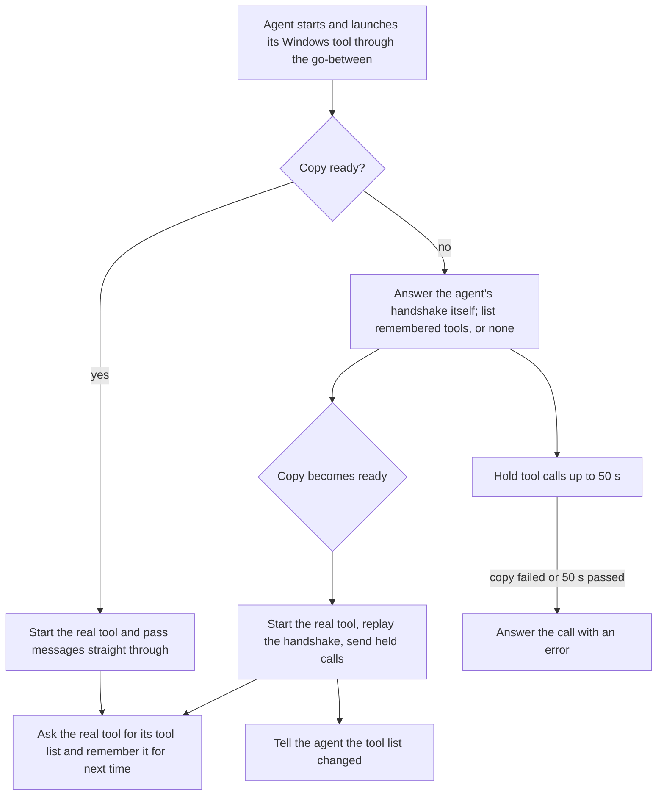

# Windows tools that start before their copy is ready

**Idea:** `IDEA.md` — read it first. Mode: two-part. Map: `MAP.md` and
`docs/maps/windows-stdio-gobetween.md`.

Origin: split from `docs/plans/windows-bridge-solid/PLAN.md` (branch merged in PR #149). Its
last full design for this part is Spec item 3 in `5950541c^:docs/plans/windows-bridge-solid/PLAN.md`
(lines 166-296), with decisions D8, D14, D16-D19, D21 there. This plan carries that design
forward; the parent's launch record (`win-sessions.json`) and copy-wide shutdown gate were
never built (MAP.md).

## Open Questions

(none)

## Watch List

| # | Noticed | What needs looking into | Raised to user? | Outcome |
|---|---------|-------------------------|-----------------|---------|
| W1 | Design depends on CLIs re-listing tools on `notifications/tools/list_changed` (parent C4, never checked) | Live test of installed `claude` and `codex` | yes | Claude re-lists; Codex does not → Q2 |

## Decision Log

| # | Decision | Rationale | Source |
|---|----------|-----------|--------|
| D1 | Mode two-part | User's choice; the parent's review stalled on rare cleanup cases | user |
| D2 | Carry forward the parent's go-between design (parent D18/D19): the real Windows tool is never started before the copy is ready; the go-between answers the handshake, lists no tools, then starts the tool and sends `tools/list_changed` | Reviewed over eleven rounds in the parent; holding `initialize` outlasts Codex's ~10 s start deadline | adopted |
| D3 | The MCP for Unity entry (args include `mcp-for-unity`) is not wrapped (parent D16) | It never reads the copy, and a late start would drop the agent's Editor selection | adopted |
| D4 | Share one per-session entry-replacement map with the "Windows localhost tools from WSL" thread (`wc/a1a1b7d6016d`): `context.replaceEntries = {name: entry}`, applied by the Claude, Codex and Antigravity adapters; Claude gets replaced names in `disabledMcpjsonServers` and one per-session `--mcp-config` file holding every replaced entry. Whichever thread builds first adds it; the other reuses it | Both change the same adapters the same way; one path avoids conflicts | user |
| D5 | Codex never re-lists tools after start (W1), so the go-between remembers each tool's last tool list and the stand-in advertises it at once; a call before the copy is ready waits for it (bounded) and then goes to the real tool. With nothing remembered yet the stand-in lists no tools; `list_changed` is still sent for CLIs that use it | User's choice; only option that makes Codex work in nearly every session without slowing its start | user |
| D6 | `replaceEntries[name] = null` withholds an entry entirely (Claude: disabled, not in `--mcp-config`) | Asked by the localhost thread's lead for its withheld tools; costs nothing here | defaulted |
| D7 | Keep the 45 s pre-launch wait for sessions whose Windows tools are all wrapped | It still supplies the copy path and prompt lines, and IDEA asks only for today's speed | review-round-1 |
| D8 | Wrapped tools keep interop's working directory rather than switching to the copy | Same behaviour as an unwrapped tool today; tools find the copy through `WHEELCHAIR_WINDOWS_PROJECT` | review-round-2 |
| D9 | Making a normal stop (and the sweep and archive) wait for a session's Windows tools to finish writing moves to the two-part follow-up (Deferred 3). The go-between starts the real tool directly through interop, as the CLI does today; no Windows launcher or Job Object. IDEA.md's "Stopping the agent normally brings back everything its Windows tools wrote" moves to Not doing | User's choice after three review rounds, most findings being in that part; agents do not have this wait today | idea-change |
| D10 | Run another review round after round 6 (budget reset) | User's choice; remaining findings small and shrinking | user |
| D11 | From round 10, realistic edge-case hardening findings (not needed for normal use) go to Deferred with source `review-round-N` instead of the Spec; anything the feature cannot work without, or that would build the wrong thing, is still fixed here | User's choice after nine rounds of shrinking edge-case findings; this is what two-part mode is for | user |

## Spec

Background: `docs/maps/windows-stdio-gobetween.md` (how adapters build MCP config, how
readying runs, how stop/sweep/archive work). "WSL machine" means `detectWsl()` reports WSL.
Nothing here changes behaviour off WSL or for non-tool roles: every new path returns early
there, and existing non-WSL tests pass unchanged.



### 1. Which tools are wrapped

On a WSL machine, for tool roles, every **loaded** stdio entry (no `type` or `type: "stdio"`)
whose original `.mcp.json` command is `isWindowsProgram` (`machine/lib/project-programs.js:16`)
is launched through the go-between `machine/lib/win-tool-proxy.js`, except an entry whose
args include `mcp-for-unity` (D3), which stays as today. A missing `args` counts as `[]`
everywhere (the Unity check and the wrapped argv). HTTP/SSE entries are never wrapped.

The wrapped entry's command is `process.execPath` and its args are
`[<abs path to win-tool-proxy.js>, '--ready-file', <ready file>,
'--list-cache', <cache file>, '--name', <entry name>, '--', <original command>,
...<original args>]`. The entry's `env` and `cwd` (if any) are kept unchanged.

**How the real tool is started (D9).** The go-between spawns the original command and args
directly, exactly as the CLI would have (WSL interop runs the `.exe`), in the go-between's own
working directory, with stdin/stdout piped to the go-between and stderr passed through. No
Windows-side launcher or Job Object. Its environment is the go-between's own, minus
`WHEELCHAIR_SESSION_TOKEN`, with `WHEELCHAIR_WINDOWS_PROJECT` set from the ready file's `copy`
field (item 3) and added to `WSLENV` if missing, so the tool gets the copy path even when the
launch-time environment lookup timed out (`machine/service.js:893-899`). As today, interop
passes Windows only the variables `WSLENV` names.

**Stop the tool** means: close its stdin; wait up to 2 s for it to exit; if still running,
send SIGTERM to the spawned interop process and wait up to 3 s more; if still running, send
SIGKILL and wait for its `exit` event (at most 1 s more), then go on regardless. What happens to its Windows descendants is the same as today for
an unwrapped tool whose CLI ends (Deferred 3).

"Loaded" means present in the adapter's final configuration for this session (after its skip
rules and Codex's override size budget). Each adapter's build returns
`loaded: [{ name, windows, wrapped }]`, where `windows` is `isWindowsProgram` of the
original command (not the emitted Node command) and `wrapped` says whether this item wrapped
it. `windowsTools` in `startIn` (`machine/service.js:848-849`) keeps its meaning: any loaded
entry with `windows` true. Pi and Kimi return an empty list.

### 2. Per CLI, through the shared replacement map (D4)

The service fills `context.replaceEntries = { <name>: <wrapped entry> }` before building the
adapter command. This is the same contract the "Windows localhost tools from WSL" thread
writes down as "Shared contract (D17)" in `docs/plans/windows-localhost-tools/PLAN.md` §3
(branch `wc/a1a1b7d6016d`); if the two texts ever differ, the code already on `main` wins. If `main` already has this map when building starts (the "Windows localhost
tools from WSL" thread merged first), reuse it and only add entries; otherwise add it here:

- `replaceEntries[name] = null` means "withhold this entry": it is given to the CLI in no
  form (Claude: disabled, not in `--mcp-config`; Codex/Antigravity: omitted; not in
  `loaded`). Needed by the localhost thread; this plan never sets null (D6).
- Codex (`machine/adapters/codex.js`) and Antigravity (`machine/adapters/agy.js`): a name in
  `replaceEntries` is translated from the replacement entry instead of the `.mcp.json` one,
  through the same translation code, so env handling and Codex's size budget apply as today.
  Codex's `WHEELCHAIR_WINDOWS_PROJECT`/`WSLENV` passthrough (`codex.js:81-86`) is decided from
  the **original** `.mcp.json` command, not the replacement's Node command, so wrapped
  Windows entries keep it.
- Claude (`machine/adapters/claude.js`): replaced names are added to
  `disabledMcpjsonServers` and given, under the same names, in one per-session JSON file
  `{ "mcpServers": { ... } }` holding every replaced entry, written to
  `<stateDir>/settings/<session name>.mcp.json` (mode 0600, atomic) and passed with
  `--mcp-config <path>`. No `--strict-mcp-config`. The file is removed when the session stops.
- **Stale files:** generalize the existing `sweepAgyTools` (`machine/service.js:477`) to take a
  list of (directory, entry-to-session-name) pairs: `agy-tools` as today
  (`decodeURIComponent(entry)`, unchanged); `settings`, only entries ending `.mcp.json`, name =
  the entry minus that suffix (every other file there, such as `<name>.json`, is ignored and
  never removed); `win-ready`, name = the entry as is. In the new directories an entry whose
  name is not a valid session name (`safeName`, starting `wc-`) is ignored, not removed. It
  reads each directory first and filters it to these eligible entries, skips a directory with
  none without returning, and calls `liveTmux()` once, only if some directory has eligible
  entries. The existing selection (group by tmux name, protect the chosen entry of a live
  session) is applied **per directory**, so a live session keeps its entry in each directory
  (its ready file and its Claude config both survive) (so a machine with none of these files still never asks tmux, keeping
  `machine/test/kimi-turns.test.js:94` valid). Same live-tmux and `startingNames` rules. It
  removes
  `<stateDir>/settings/<name>.mcp.json` and `<stateDir>/win-ready/<name>` for sessions not
  live and not starting and whose file is older than 60 s (the existing sweep's grace,
  `machine/service.js:528`; the localhost thread's contract uses the same rule).
- Pi and Kimi: unchanged.

### 3. Ready file

Path `<stateDir>/win-ready/<session name>` (directory 0700, file 0600, written atomically by
write-then-rename), JSON `{"state": "ready" | "waiting" | "failed", "reason": "...", "copy": "<Windows path of
the copy>", "at": "<iso>"}`; `reason` only with `failed`, `copy` only with `ready`. Written by `WinBridge` for sessions with at least one
wrapped entry:

- `waiting` before tmux starts, and kept while the session's readying task runs, including
  past the 45 s launch wait.
- `ready` only after a reconcile of that session's copy (create + sync) **finishes
  successfully after the session's start began**: the session's own readying task, a shared
  readying task it awaited, or any later successful `win sync`/`run`/`start` sync of that
  copy. An existing `.git` alone never counts. So a stale copy counts as not ready until the
  first reconcile after start finishes.
- `failed` when the readying task fails, **or when anything in `prepareLaunch` for that
  session throws before the task exists** (for example resolving the copy context,
  `machine/lib/win.js:153-156`, whose errors today are only logged); a later successful sync
  replaces it with `ready`.
- Removed when the session stops (stop path). All ready-file operations for one session
  (every write, and stop's invalidate-and-remove) run one at a time through a per-session
  serial queue in `WinBridge`; a write checks the attempt token after writing its temporary
  file and immediately before the rename, and drops the temporary file if the token is no longer
  valid. The stop path enqueues "invalidate the token, then remove the file", so a readying result that finishes after the stop
  writes nothing (the guard below checks the token, not only that the session is registered).
- **Failed or cancelled start:** every path where `startIn` gives up after the ready file or
  the Claude `--mcp-config` file was written (`die`, cancelled start, tmux failure) removes
  both. Writes are tied to the start attempt: `WinBridge` records a per-attempt token when it
  writes `waiting`, and a later readying result writes the file only if that session name is
  still starting or registered with the same token and its token has not been invalidated. A late result for a dead attempt writes
  nothing.

The go-between branches on `state` only, never on `reason` text. A missing or unreadable file
counts as `waiting`.

### 4. Go-between behaviour

The go-between reads newline-delimited JSON-RPC from the client (stdin) and, once started,
from the real tool (its stdout). Lines that are not valid JSON are passed through unchanged
when piping and ignored by the stand-in. It polls the ready file every 2 s until it first
reads `ready`.

**Remembered tool list (D5).** The cache file is
`<stateDir>/win-tool-lists/<sha256 hex of JSON [git common dir of the worktree, entry name,
original command, original args]>.json` (directory 0700, file 0600, atomic), holding
`{"tools": [...], "at": "<iso>"}`. A missing or unparseable cache means "no remembered list".
The cache is written **only** from the go-between's own list request (clients' own
`tools/list` responses are passed through untouched and never cached): right after every start
of the real tool has finished its handshake (in steps 1 and 3a, once the client's
`notifications/initialized` has been forwarded; in 3b, once the go-between's own has been
sent), the go-between sends the real tool its own `tools/list` request
(id `"wc-go-between-list-<random uuid>"`, generated per request) and, while the result has a
`nextCursor`, further `tools/list` requests with that cursor (at most 20 pages); it caches the
concatenated `tools` of all pages (nothing if any page fails or the limit is hit) and passes
none of these responses to the client; so a client that never lists again (Codex) still leaves a list for
the next session. The service computes the path; the go-between only reads and writes it.

1. **Ready at start** (ready file says `ready`): start the real tool at once and pipe
   stdin/stdout both ways (stderr passes through), running the list request above, until either
   side ends (step 5).
2. **Not ready at start:** do not start the real tool. Answer the client itself (the
   "stand-in"):
   - `initialize` → at once, a successful result with the client's requested
     `protocolVersion`, `capabilities` `{ "tools": { "listChanged": true } }`, `serverInfo`
     `{ "name": "<entry name>", "version": "0" }` and `instructions` saying the state:
     "Waiting for the Windows project copy to be ready; this tool's tools work once it is." or,
     when the ready file says `failed`, "The Windows project copy couldn't be readied:
     <reason>. Run `wc.js win sync` to retry."
   - `notifications/initialized` and other client notifications → swallowed.
   - `tools/list` → the remembered list, or an empty list if none.
   - `ping` → an empty result.
   - `tools/call` → held (not answered) until the handoff (step 3) forwards it to the real
     tool. Deadline: if a client `tools/call` has not been **forwarded** to the real tool within
     50 s of its arrival (held before ready, or queued during the 3b handoff while the real
     tool's `initialize` is pending: the same per-call rule in both phases),
     answer it with JSON-RPC error `code -32000` ("The Windows project copy is not ready yet;
     try again shortly.") and drop it, so it is never forwarded later. If the ready file says
     `failed`, answer every held call at once with the `failed` sentence, and answer any
     `tools/call` that arrives while it says `failed` at once with that sentence (not held).
   - `notifications/cancelled` naming a held or queued request id → drop that request; it is
     never forwarded and gets no answer.
   - any other request → JSON-RPC error `code -32000` with the `instructions` sentence.
3. **When the ready file first says `ready`:**
   - **3a. The client has not sent `initialize` yet:** start the real tool and pipe as in
     step 1. Nothing synthetic, no `list_changed`.
   - **3b. The stand-in already answered `initialize`:** queue every new client message;
     start the real tool; send it the client's original `initialize` params; wait up to 60 s
     for a successful response (not passed to the client); send the real tool exactly one
     `notifications/initialized` (every client `notifications/initialized`, including queued
     ones, is dropped); send the still-held `tools/call` requests and then the queue, in
     arrival order, with their original ids; send the client
     `notifications/tools/list_changed`; from then on pipe as in step 1. The real tool's
     answers to forwarded requests go to the client unchanged.
     - A `protocolVersion` different from the one the stand-in answered is logged to stderr;
       carry on.
     - Only tools are exposed in this case: other capabilities are not advertised (the client
       already has its `initialize` result); their requests are still forwarded.
     - If the real tool fails to start, exits, or its `initialize` fails or times out: answer
       every held or queued request with JSON-RPC error `-32000` carrying the reason, write it
       to stderr, stop the tool (item 1), then exit 1.
4. While not ready, a ready file that says `failed` changes the sentence for later answers;
   a later `ready` still starts the tool (step 3).
5. Once the real tool runs and (for 3b) its handshake has succeeded, if it exits on its own the
   go-between first forwards everything left on the tool's stdout (it waits for the child's
   `close` event, i.e. stdout ended, not just `exit`), then finishes (below) with the tool's exit code,
   or `128 + <signal number>` if the tool was ended by a signal. Until the 3b handshake succeeds, the 3b failure rule
   above takes precedence: an exit then is a handoff failure (exit 1).
   If the client closes stdin, **or the go-between receives SIGHUP, SIGTERM or SIGINT** (a
   normal stop kills tmux, which signals it): before the ready point, exit 0 at once without
   starting the tool; during the handoff or afterwards, stop the tool (item 1), then exit. The signal handlers stay installed until then, so a second
   signal does not cut the stop short.

   **Writes to the real tool's stdin:** an `error` on the child's stdin (e.g. `EPIPE` because
   the tool exited) is never thrown; the child's `close` handler decides what happens (step 5,
   or the 3b failure rule before the handshake succeeds).
   **Spawn failure in steps 1 and 3a:** if spawning the real tool fails (the child's `error`
   event, e.g. a missing executable), the go-between writes the reason to stderr and finishes
   with status 1; the client sees the server end at once.
6. **Finishing.** At start-up, before anything is written, the go-between installs `error`
   and `close` handlers on its stdout for its whole life: a stdout error (e.g. `EPIPE`) is
   never thrown; after one, further writes are skipped, and a stdout `error` or `close` at
   any time is treated exactly like the client closing stdin (step 5: stop the tool if it
   runs, then finish with status 0). Every exit (step 5, a 3b handoff
   failure after its error replies, stdin close, signals) goes through one finish routine:
   wait until stdout has flushed everything already written (the last write's callback), or
   stdout has errored or closed, whichever comes first; then call `process.exit(status)`. It
   exits explicitly, so an open client stdin, the ready-file poll timer or any other handle
   cannot keep it alive.

### 5. Marking the copy used

Already built: `WinBridge.afterLaunch` marks the copy used after tmux starts and again when a
late readying task finishes (`machine/lib/win.js:145-150`). Keep it; it must still run for
sessions whose only Windows tools are wrapped.

### Validation

Tests use fake Windows programs and a fake ready file, as the existing win tests do; no real
Windows needed.

```bash
bash machine/test/run.sh
node --test viewer/test/*.test.js
```

New tests in `machine/test/` must cover:
- Wrapping: a loaded Windows stdio entry is wrapped for Claude (disabled + `--mcp-config`
  file), Codex (override command/args) and Antigravity (plugin config); the Unity entry, HTTP
  entries, Linux stdio entries and non-WSL machines are not; `loaded` reports `windows` and
  `wrapped` correctly; Codex's budget dropping entries still applies.
- Ready file: `waiting` before launch; `ready` only after a reconcile finishing after start
  (not for a pre-existing `.git`); `failed` then `ready` on a later sync; removed on stop.
- Go-between, against a fake MCP server script: ready at start (pure pipe); 3a; 3b with and
  without a remembered list (initialize answered, `tools/list` returns the remembered or empty
  list, a held `tools/call` is answered by the real tool after ready, one
  `notifications/initialized` reaches the real tool, `list_changed` sent once); the 50 s held
  call timeout (with the wait made configurable for the test); `failed` sentence; real tool
  `initialize` failure; stdin close before and after ready; a client's own `tools/list`
  response never writes the cache.
- Go-between: SIGTERM/SIGHUP while the real tool runs closes its stdin and then terminates it
  before exit; own `tools/list` after handshake fills the cache and is
  not passed to the client; a held call past 50 s, including one waiting on the real tool's
  `initialize`, is answered and never forwarded; a cancelled held call is never forwarded.
- Environment: the real tool's environment has no `WHEELCHAIR_SESSION_TOKEN`; the real tool gets
  `WHEELCHAIR_WINDOWS_PROJECT` from the ready file when the launch env lacked it; Codex keeps
  the `WHEELCHAIR_WINDOWS_PROJECT`/`WSLENV` passthrough for wrapped entries.
- Failed start: a cancelled or failed start removes the ready file and Claude config file, and a
  late readying result for it writes nothing.
- Handoff failure stops the tool before exit 1; the go-between exits with the tool's exit
  code; a `prepareLaunch` context error writes `failed`.
- Shared map: `replaceEntries[name] = null` omits the entry for Codex and Antigravity and only
  disables it for Claude, and leaves it out of `loaded`.
- Stop after removal: a readying result finishing after the session stopped does not recreate
  the ready file, including one whose temporary file was already being written when stop ran.
- Tool exit: a tool that writes a final response then exits has that response delivered before
  the go-between exits; a tool killed by SIGTERM makes the go-between exit 143.
- Probe pagination: a tool that pages its list gets every page cached; a failing page caches
  nothing.
- Exit during handoff: a real tool exiting 0 before its 3b `initialize` answer makes the
  go-between exit 1 with errors for queued requests.
- Stale files: the sweep removes ready and Claude config files of dead sessions but not of
  starting ones, including on a machine with no `agy-tools` directory.
- Large final response: a tool that writes a 1 MiB response and exits has it all delivered to
  a slow-reading client before the go-between exits.
- A `tools/call` arriving while the ready file says `failed` is answered at once.
- Finishing (client stdin kept open in every case): after the tool exits, the go-between exits
  with its status; after a 3b failure, it delivers the replies and exits 1; a client that
  closes its read end while the tool is still running (followed by a write from the tool), and
  one that closes it during a large final response, both end with the intended status and no
  crash; a tool that exits while the go-between is writing to its stdin ends through the
  child-exit (or 3b failure) path, not a crash; a command-only entry (no
  `args`) is wrapped and launched.
- Sweep: a live wrapped Claude session with both a ready file and a Claude config file keeps
  both after 60 s; a missing executable in steps 1 and 3a ends the go-between with status 1
  and a stderr reason.
- Sweep: a machine with only ordinary `settings/<name>.json` files makes no tmux call and
  removes nothing there.

Live check once built (needs a WSL machine with a Windows stdio MCP server and a fresh copy),
in three separate runs: (1) cold cache: a Codex agent started before ready lists no tools, and
after that session the cache file exists; (2) warm cache: a Codex agent started before ready
lists the remembered tools, and a call made before ready returns the real tool's answer once
ready; (3) a Claude agent started before ready sees the tools appear after ready.

### Not doing

As IDEA.md. Also the two items in Deferred.

## Deferred

| # | Item | Why it can wait | Source | Notes for the follow-up |
|---|------|-----------------|--------|-------------------------|
| 1 | After a machine service restart, keep tracking sessions with Windows tools and re-ready wrapped sessions whose ready file is not `ready` (parent's `win-sessions.json` launch record). Without it, a go-between whose ready file says `waiting` when the service restarts keeps waiting: the readying task and attempt token are in memory only (review round 8) | Needs a service restart during a live session; today's restart recovery already reconstructs from live sessions and copies (`machine/lib/win.js:339-358`) | planning | Parent Spec item 3 "Launch record" and "Recovery after a service restart" |
| 3 | A normal stop, the sweep and archive wait until a session's Windows tools (and every Windows process they started) have finished writing before the final sync | Today's agents don't have this wait either; it is not needed for tools to appear. Moved here by the user after three review rounds (D9) | review-round-3 | Last full design: Spec 5 "Process tree" and Spec 6 "Normal stop waits" of this plan at commit `9d5a5511` (named Job Object launcher, `wc-tool-started` acknowledgment, `terminateScript("tool-<uuid>")`, 12 s stop budget, `win-tools/<session>/<pid>` files, 15 s `onStop` wait, sweep skips copies with a stop in progress) and the Round 1-3 findings against them |
| 4 | Notice a client that closes only its read end while staying idle (stdin open, no output from the tool): today the go-between notices only at its next write | Real CLIs close both ends when they exit; a closed read end is still noticed on the next write | review-round-10 | Node's stdout emits neither `error` nor `close` on an idle pipe whose reader closed (reviewer's local check); would need polling or a zero-length write probe |
| 2 | Stop, the periodic sweep and archive wait for every session sharing a copy, including sessions that ended without a normal stop (CLI crash, handoff kill) | Needs a sibling or crashed session; with Deferred 3, the rest needs a sibling or crashed session with a tool still writing | planning | Parent Spec item 3 "Stop waits for wrapped tools" (copy-wide gate, sweep, `archiveCheck` pending) |

## Accepted Risks

| Risk | Why accepted | Round |
|------|--------------|-------|
| (Moved with Deferred 3, D9.) A start cancelled in the sub-second window after tmux spawned, where the CLI already started a wrapped tool that is writing, ends without waiting for that tool (the kill-and-throw path never calls `onStop`) | Rare path: needs a cancel inside that window plus a tool already writing to the copy | review-round-2 |
| A session name ending in `.mcp` would make its normal settings file `<stateDir>/settings/<name>.json` share a path with another session's Claude config `<stateDir>/settings/<other>.mcp.json` | Rare path: session names are always `wc-<thread id>-<role>[-<n>]` from the hub and never contain `.mcp`; the shared contract with the localhost thread uses this path | review-round-5 |
| (Moved with Deferred 3, D9.) A go-between that crashes while its Windows tool keeps writing lets the stop wait pass early | Rare path: needs the go-between itself to crash mid-session (parent review-round-8) | adopted |

## Check Once Built

| # | What to check | Round |
|---|---------------|-------|
| C1 | Antigravity re-lists a stdio server's tools on `notifications/tools/list_changed` (not installed on the planning machine). If it does not, it behaves like Codex: remembered list only | lead (W1) |
| C3 | With the copy ready at start, a wrapped tool answers the CLI's `initialize` well within Codex's ~10 s start deadline (the go-between adds a Node start-up; D9 removed the PowerShell launcher). If it comes close, fall back to always answering `initialize` from the stand-in (remembered list) and handing off through step 3b | review-round-2 |
| C2 | Codex's default MCP tool-call timeout is longer than the 50 s pre-ready call wait (Spec 4), so a waiting call ends with the go-between's answer, not a Codex timeout | lead (D5) |

## Review Rounds

### Round 1 — 2026-11-21

**Lanes:** intent (claude); mechanics (other family); cross-family: yes.

**Changed since Round N-1:** n/a (first round — whole Spec in scope)

| Lane | Reported | Finding | Lead verdict | Resolution |
|------|----------|---------|--------------|------------|
| mechanics | blocking | Cache only filled by a client `tools/list`; Codex never lists after handoff, so it stays empty | upheld | Spec 4: go-between's own `tools/list` after every handshake |
| mechanics | blocking | Sweep can reconcile while a normal stop is still waiting for the tool | upheld | Spec 6: sweep skips copies with a stop task in progress |
| mechanics | major | No control path for the go-between to close the Windows job | upheld | Spec 5: named job + `terminateScript` |
| mechanics | major | Copy path missing when ready arrives after the launch budget; Codex passthrough sees the Node command | upheld | Spec 1 env, Spec 3 `copy`, Spec 2 passthrough on original command |
| mechanics | major | Launcher's explicit env could carry the session token | upheld | Spec 1: interop-equivalent env, token removed |
| mechanics | major | Held-call deadline across handoff; cancellation ignored | upheld | Spec 4: 50 s until forwarded; `notifications/cancelled` drops |
| mechanics | major | Failed/cancelled start leaves ready and Claude config files; late readying writes stale state | upheld | Spec 3: cleanup on failed start, per-attempt token |
| intent | major | Codex passthrough skipped for wrapped entries | upheld | Same fix as row 4 |
| intent | major | tmux kill signals the go-between; default exit skips stopping the tool | upheld | Spec 4 step 5: SIGHUP/SIGTERM/SIGINT stop the tool first |
| intent | minor | Drop the 45 s wait for wrapped-only sessions | declined | Not a defect: the wait still supplies the copy path and prompt lines; IDEA asks only for today's speed (D7) |

### Round 2 — 2026-11-21

**Lanes:** intent (claude); mechanics (other family); cross-family: yes.

**Changed since Round 1:** Spec 1 environment rules (interop-equivalent, no token, copy path
from ready file); Spec 2 `null` withholds (D6) and Codex passthrough on the original command;
Spec 3 `copy` field, failed/cancelled start cleanup and per-attempt token; Spec 4 own
`tools/list` after handshake, held-call 50 s deadline until forwarded, `notifications/cancelled`,
signal handling in step 5; Spec 5 named job and `terminateScript` stop path; Spec 6 sweep skips
copies with a stop in progress; Validation additions; D6, D7.

| Lane | Reported | Finding | Lead verdict | Resolution |
|------|----------|---------|--------------|------------|
| mechanics | blocking | Launcher gets the WSL path, no working directory rule | upheld | Spec 5: `translate` program, `wslpath -w` cwd (D8) |
| mechanics | blocking | `terminateScript` adds `wheelchair-` itself; full name would open the wrong job | upheld | Spec 5: pass `tool-<uuid>` |
| mechanics | major | Stop during launcher start-up can miss the job | upheld | Spec 5: `wc-tool-started` acknowledgment, stop waits for it |
| mechanics | major | Stop budgets conflict (60 s `ps`, 5 s, 15 s) | upheld | Spec 5: one 12 s budget; Spec 6: 15 s wait exceeds it |
| mechanics | major | Cancelled start after tmux spawn skips the tool wait | accepted-risk | Rare path: sub-second window plus a writing tool; Accepted Risks |
| mechanics | major | Calls queued during handoff escape the 50 s deadline | upheld | Spec 4: per-call rule in both phases |
| mechanics | major | Probe id could collide with a client id | downgraded (minor) | Clients would have to pick that exact string; fixed anyway with a per-probe uuid |
| intent | minor | Launcher start-up may approach Codex's 10 s deadline | check-once-built | C3 |
| intent | minor | `null` withhold path untested | upheld | Validation: shared-map test |

### Round 3 — 2026-11-21

**Lanes:** intent (claude); mechanics (other family); cross-family: yes.

**Changed since Round 2:** Spec 2 cites the localhost thread's shared contract and adds the
stale-file sweep; Spec 4 per-probe uuid id and per-call 50 s rule during handoff; Spec 5
rewritten (job id, Windows program and directory, start acknowledgment, 12 s stop budget);
Spec 6 wait vs budget; Validation additions; D8; new Accepted Risk (cancel after tmux spawn);
C3.

| Lane | Reported | Finding | Lead verdict | Resolution |
|------|----------|---------|--------------|------------|
| mechanics | blocking | Failed handoff exits without stopping the Windows job | upheld | Spec 4 3b: stop the tool before exit 1 |
| mechanics | major | Launcher exit status must not use stdout | upheld | Spec 5 Exit: process exit code is the tool's |
| mechanics | major | Two cwd answers when the entry has `cwd` | upheld | Spec 5: go-between's own cwd only |
| mechanics | major | Context errors before the readying task leave `waiting` | upheld | Spec 3: `prepareLaunch` errors write `failed` |
| mechanics | minor | Stale-file sweep lacks the 60 s grace | upheld | Spec 2: 60 s grace, same as the localhost contract |
| intent | minor | Stale-file rule differs from the localhost contract | upheld | Same fix as previous row |
| intent | minor | Stop wait does not itself deliver sync for every role | upheld | Spec 6: wait protects the existing role-based sync |

### Round 4 — 2026-11-21

**Lanes:** intent (claude); mechanics (other family); cross-family: yes.

**Changed since Round 3:** D9 (user): the stop wait, Windows launcher and Job Object moved to
Deferred 3; Spec 1 now says how the go-between starts and stops the real tool directly through
interop; old Spec 5 and 6 removed (old 7 is now 5); Spec 3 and 4 references updated; stale-file
sweep no longer covers tools dirs; Validation trimmed; Accepted Risks about the stop wait marked
moved; C3 reworded; IDEA.md "What good looks like" and "Not doing" updated.

| Lane | Reported | Finding | Lead verdict | Resolution |
|------|----------|---------|--------------|------------|
| intent | minor | IDEA.md Why/Not doing still imply sweep and archive waits are built | upheld | IDEA.md reworded (background for follow-up; Not doing names sweep and archive) |
| mechanics | major | Stop ends at SIGTERM without waiting for exit | upheld | Spec 1: wait 3 s, then SIGKILL and wait for exit |
| mechanics | major | Child exit during handoff: exit 1 or its own code? | upheld | Spec 4 step 5: 3b failure rule wins until handshake succeeds |
| mechanics | major | Late readying result recreates the ready file after a normal stop | upheld | Spec 3: stop invalidates the token first; test |
| mechanics | major | Paginating servers never warm the cache | upheld | Spec 4: probe follows `nextCursor`, up to 20 pages |
| mechanics | minor | Live check mixes cold and warm cache | upheld | Validation: three separate runs |

### Round 5 — 2026-11-21

**Lanes:** intent (claude); mechanics (other family); cross-family: yes.

**Changed since Round 4:** IDEA.md Why/Not doing wording; Spec 1 stop sequence (SIGTERM, then
SIGKILL); Spec 3 stop invalidates the attempt token; Spec 4 probe pagination and step 5
precedence during handoff; Validation additions and the three-run live check.

| Lane | Reported | Finding | Lead verdict | Resolution |
|------|----------|---------|--------------|------------|
| intent | minor | Two cache sources; client-list tracking unneeded | upheld | Spec 4: cache only from the go-between's own list request |
| intent | minor | IDEA promises tools appear for Codex even with nothing remembered | upheld | IDEA.md Not doing: first-ever Codex use (D5) |
| mechanics | blocking | Claude config path can collide with another session's settings file | accepted-risk | Rare path: hub session names never contain `.mcp`; Accepted Risks |
| mechanics | major | Token check before an awaited write lets the rename recreate the file after stop | upheld | Spec 3: per-session serial queue, token checked before rename |
| mechanics | major | Signal-ended tool status and unflushed final output | upheld | Spec 4 step 5: wait for `close`, 128 + signal |
| mechanics | minor | Cache tests contradict each other | upheld | Same fix as the first row |

### Round 6 — 2026-11-21

**Lanes:** intent (claude); mechanics (other family); cross-family: yes.

**Changed since Round 5:** Spec 4 cache only from the go-between's own list request, probe
timing per step, step 5 exit after stdout ends and signal status; Spec 3 per-session serial
queue for ready-file writes; IDEA.md Not doing (first-ever Codex use); new Accepted Risk
(`.mcp` session names); Validation updates.

| Lane | Reported | Finding | Lead verdict | Resolution |
|------|----------|---------|--------------|------------|
| mechanics | major | Go-between can exit with its own stdout unflushed | upheld | Spec 4 step 5: wait for own stdout to flush; 1 MiB test |
| mechanics | major | Stale-file sweep skipped when there are no Antigravity files | upheld | Spec 2: own scan, not below `sweepAgyTools`' early returns; test |
| mechanics | minor | New `tools/call` while `failed` waits 50 s | upheld | Spec 4: answered at once |

### Round 7 — 2026-11-21

**Lanes:** intent (claude); mechanics (other family); cross-family: yes.

**Changed since Round 6:** Spec 4 step 5 waits for its own stdout to flush; Spec 4 a
`tools/call` while `failed` is answered at once; Spec 2 stale-file sweep scans on its own, not
below `sweepAgyTools`' early returns; Validation additions; D10.

| Lane | Reported | Finding | Lead verdict | Resolution |
|------|----------|---------|--------------|------------|
| intent | minor | Separate stale-file scan duplicates `sweepAgyTools` and asks tmux needlessly | upheld | Spec 2: generalize the existing sweep over a list of directories |
| mechanics | major | Flush waits forever if the client closes during the final response | upheld | Spec 4 step 6: one finish routine, stdout `error`/`close` ends the wait |
| mechanics | major | 3b failure replies not flushed before exit 1 | upheld | Spec 4 step 6 covers every exit |
| mechanics | minor | Entries without `args` | upheld | Spec 1: missing `args` is `[]` |

### Round 8 — 2026-11-21

**Lanes:** intent (claude); mechanics (other family); cross-family: yes.

**Changed since Round 7:** Spec 4 new step 6 (one finish routine for every exit, stdout
errors); step 5 points to it; Spec 2 stale-file sweep generalizes `sweepAgyTools`; Spec 1
missing `args`; Validation additions.

| Lane | Reported | Finding | Lead verdict | Resolution |
|------|----------|---------|--------------|------------|
| intent | major | "End normally" never exits with client stdin or the poll timer open | upheld | Spec 4 step 6: explicit `process.exit(status)` after flush |
| intent | minor | Sweep's name mapping per directory not stated | upheld | Spec 2: mapping per directory |
| mechanics | blocking | Same as the first row: the go-between can stay alive after finishing | upheld | Same fix; tests keep client stdin open |
| mechanics | major | stdout `EPIPE` before finish can crash | upheld | Spec 4 step 6: lifetime stdout handlers |
| mechanics | major | Service restart leaves a waiting go-between waiting | declined | Already Deferred 1 (service restart mid-session), settled for this mode; note added to the row |
| mechanics | minor | Sweep should filter eligible entries before asking tmux | upheld | Spec 2: filter first, ignore other files; test |

### Round 9 — 2026-11-21

**Lanes:** intent (claude); mechanics (other family); cross-family: yes.

**Changed since Round 8:** Spec 4 step 6 (lifetime stdout handlers, explicit
`process.exit(status)` after flush); Spec 2 sweep mapping and filtering per directory;
Deferred 1 note; Validation additions.

| Lane | Reported | Finding | Lead verdict | Resolution |
|------|----------|---------|--------------|------------|
| mechanics | major | Client closing its read end while the tool runs starts no shutdown | upheld | Spec 4 step 6: stdout `error`/`close` acts as stdin close |
| mechanics | major | Pooled sweep could delete a live session's ready file or Claude config | upheld | Spec 2: selection per directory; test with both files |
| mechanics | major | Spawn failure undefined in steps 1 and 3a | upheld | Spec 4: stderr reason, finish with 1 |

### Round 10 — 2026-11-21

**Lanes:** intent (claude); mechanics (other family); cross-family: yes.

**Changed since Round 9:** Spec 4 step 6 stdout `error`/`close` acts as stdin close; Spec 4
spawn failure in steps 1 and 3a; Spec 2 sweep selection per directory; Validation additions;
D11.

| Lane | Reported | Finding | Lead verdict | Resolution |
|------|----------|---------|--------------|------------|
| mechanics | major | Idle client closing only its read end is not detected; the test can hang | upheld | Hardening per D11: detection moved to Deferred 4; test scoped to a close followed by a write |
| mechanics | major | `EPIPE` writing to an exiting tool's stdin can crash the go-between | downgraded (minor) | A worker adds a stdin error handler without needing to ask; one-line rule added to Spec 4 and a test |

## Implementation Tasks

| # | Objective | Ownership boundary | Lane | Session id | Validation | Status |
|---|-----------|--------------------|------|-----------|------------|--------|

## Log

- 2026-11-21 Ready check at approval: hub and machine service answer (session list); claude and codex CLIs installed; Codex preflight passes (token fresh).
- Build accepted: approval c1d76590-7e91-4728-878e-92dcb7fd527d
