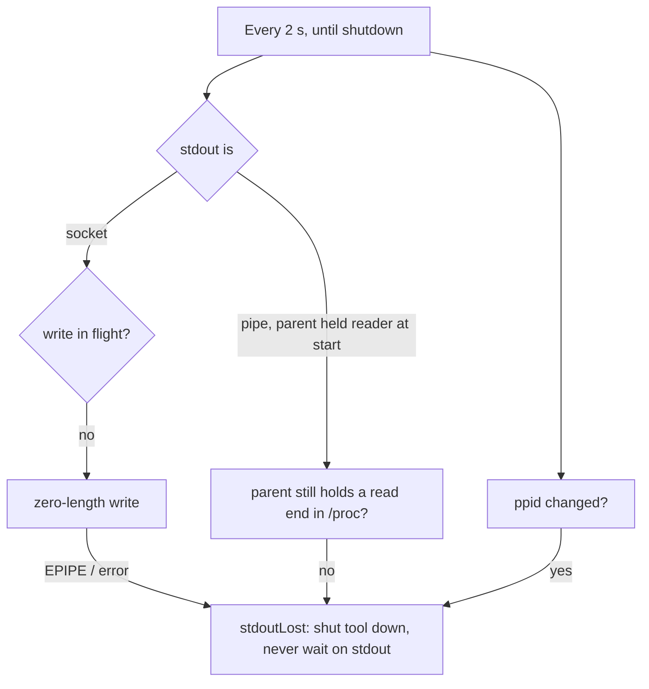

# Make Windows tools solid

**Idea:** `IDEA.md` — what this is for and why, in plain language. Read it first; it is
the north star this plan serves. Goal and Constraints live there, not here, so they don't
get buried as this file grows.

## Open Questions

Ordered by leverage; discussed one at a time. A settled question moves to the Decision
Log and is deleted from here.

_None open._

## Watch List

Things noticed that need looking into — not yet decisions for the user. Written down the
moment they're spotted so they can't be forgotten, surfaced to the user one line at a
time as they appear, and emptied before Stage 1 exits.

Each item ends up settled by the agent (noted in the Log), promoted to an Open Question,
promoted to a Constraint or Accepted Risk, or waved off by the user.

| # | Noticed | What needs looking into | Raised to user? | Outcome |
|---|---------|-------------------------|-----------------|---------|
| W1 | Idle read-end closure | Which mechanism Node on Linux can use to see a closed reader on an idle stdout pipe | no | Settled by the lead: D4 |
| W2 | Crashed or handoff-killed sessions | Whether their go-betweens and tools actually exit when the CLI dies (stdin end) or are orphaned | no | Settled by the lead: D6; split off with D14 |

## Decision Log

Append-only. A reversal is a new entry superseding the old, never an edit.

| # | Decision | Rationale | Source |
|---|----------|-----------|--------|
| D1 | Mode is thorough | User's choice; this thread is the follow-up for win-tool-gobetween's Deferred items | user |
| D2 | (`win-sessions.json` superseded by D8; launch-record timing by D10) Restart recovery follows the parent design: a durable per-session launch record (wrapped, copy key) in `win-sessions.json` written before tmux starts; on service start, every live wrapped session whose ready file is not `ready` gets a fresh attempt token and readying | Already reviewed in windows-bridge-solid (`5950541c^:docs/plans/windows-bridge-solid/PLAN.md:194-211`); no user-visible choice in it | defaulted |
| D3 | (superseded by D11) Every new wait is bounded: a stop, sweep or archive waits at most 15 s for Windows tools, then logs and goes ahead | IDEA constraint; matches the last reviewed design's 15 s `onStop` wait | defaulted |
| D4 | The go-between notices a closed reader by a zero-length `fs.writeSync(1, Buffer.alloc(0))` probe every 2 s while idle; `EPIPE` starts its normal shutdown | Lead's local check on Node 26/Linux: the probe throws `EPIPE` within one interval after the reader closes, while stdout itself emits nothing; a zero-length write adds no bytes to the stream | defaulted |
| D5 | A stop ends every Windows program a tool started: the go-between starts the tool through a launcher that puts it in a named Windows Job Object (option A) | User's choice over "wait for quiet" and "tool only" | user |
| D6 | The copy-wide gate waits for go-betweens of sessions that ended without a normal stop, and ends the job of any whose go-between died | A dying CLI closes the go-between's stdin and tmux kill sends SIGHUP, both of which start its shutdown (`machine/lib/win-tool-proxy.js:63-66`); only a go-between killed outright (SIGKILL, OOM) leaves its job behind, and its registry file names that job | defaulted |
| D7 | (`terminateScript` superseded by Spec 4's `toolTerminateScript`; timing by D11) When a wait runs out, remaining jobs are ended (`terminateScript`) before the reconcile goes ahead | IDEA constraint "every wait is bounded"; ending them is the only way the reconcile is not racing a writer | defaulted |
| D8 | Launch flags are kept on the session record in `sessions.json` (`windows_tools`, `wrapped_tools`), not a new `win-sessions.json` | The service already persists every session there before and after launch (`machine/service.js:567`); one file, one source of truth | defaulted |
| D9 | Idle reader detection uses a zero-length write probe on sockets, a check of the parent's read end in `/proc` on OS pipes, and a parent-gone check; supersedes D4 | Round 1: a zero-length `write()` on a Linux pipe never raises `EPIPE` (reviewer's and lead's checks), and Codex gives tools OS pipes. Lead's check: a Node child with stdout on an `os.pipe()` sees its parent drop the read end within one 300 ms poll | review-round-1 |
| D10 | Launch flags ride on the session record saved after tmux starts, as today; no pre-tmux write | Round 1: a pre-tmux insert needs rollback and save ordering; a restart between tmux start and that save is a sub-second window (rare path) | review-round-1 |
| D11 | The gate has one 20 s deadline covering polling and termination; termination must be confirmed, otherwise the copy is not synced or removed (kept, retried by the next sweep or kept by archive) | Round 1: PowerShell calls could exceed the 15 s bound, and an unconfirmed termination would let the reconcile race a writer | review-round-1 |
| D12 | The gate runs inside `sync` and `remove`, not at each caller | Round 1: launch readying, `wc.js win` and `onWorktreeRemoved` also reconcile or delete copies | review-round-1 |
| D13 | The launcher start deadline is the go-between's existing start allowance (`--init-ms`, 60 s), not 10 s; a stop during a slower start leaves the entry for the gate. The start acknowledgment line is dropped | Round 3: a fixed 10 s would kill slow cold starts with no stop happening; the acknowledgment no longer controlled anything | review-round-3 |
| D14 | Split off: stop, sweep and archive waiting for Windows tools and the programs they start (D5-D7, D11-D13, Spec 2-5 at `65bdcd4f`) move to their own thread; IDEA's two matching "What good looks like" bullets move to Not doing. D5-D7 and D11-D13 no longer apply here | User's choice after three review rounds in which that part drew blocking or major findings each round and the rest settled | idea-change |
| D15 | Stranded sessions are found by their ready file, not by new `windows_tools`/`wrapped_tools` fields on the session record; supersedes D8 and D10, and the Accepted Risk about the record-save window is gone with them | Round 4: the ready file is written before tmux and removed on stop, so it already marks exactly the sessions to recover; flags added nothing for recovery and touched unwrapped sessions | review-round-4 |
| D16 | Split off: restart recovery (D2, D15 and Spec 1 at `59b09dba`) moves to its own thread; IDEA's restart bullet moves to Not doing. This thread keeps only noticing a closed reader | User's choice after rounds 4-6 each drew blocking or major findings on restart recovery while the idle reader part settled | idea-change |

## Spec

Scope: WSL machines with wrapped Windows stdio tools (`win-tool-gobetween`'s go-between,
`machine/lib/win-tool-proxy.js`). Nothing changes on other machines, for unwrapped
entries, or for `mcp-for-unity`. Background map: `docs/maps/windows-stdio-gobetween.md`.

Split off into their own threads: making stop, sweep and archive wait for Windows tools
(D14; last design Spec 2-5 at commit `65bdcd4f`), and restart recovery (D16; last design
Spec 1 at commit `59b09dba`). MAP.md's material on both describes that work, not this plan.

### 1. Idle reader closed (D4 superseded by D9)

Every 2 s (`--probe-ms`, default 2000, added to the option list at
`machine/lib/win-tool-proxy.js:10-14` for tests; `wrapEntries` does not pass it), the
go-between runs the checks below; any failing calls `stdoutLost()`, which shuts the tool down as today (`machine/lib/win-tool-proxy.js:40,63`):
- **Socket probe** (stdout is a socket, `/proc/self/fd/1` reads `socket:[...]`, as when a
  Node CLI spawns it): `fs.writeSync(1, Buffer.alloc(0))`; `EPIPE` or any error fails.
  Skipped while a stdout write is in flight, so it cannot interleave with output.
- **Pipe reader check** (stdout is a pipe, `pipe:[N]`, as when Codex spawns it): the check
  fails when the parent (`process.ppid` read at start) no longer has any fd in
  `/proc/<ppid>/fd` linking to the same `pipe:[N]` whose `/proc/<ppid>/fdinfo/<fd>` flags
  are not write-only (`(flags & 3) !== 1`). At start, if the parent holds no such read end
  (stdout's reader is some other process) or `/proc/<ppid>` is unreadable, this check is
  turned off for the go-between's life.
- **Parent gone**: `process.ppid` differs from the value read at start (the CLI died while
  something else keeps the pipes open). Kept because it covers what the other two miss:
  a pipe check turned off at start, and a socket whose other end another process holds.
  Also `stdoutLost()`, so the exit never waits on
  stdout writes nobody will read.

The pipe reader and parent checks only read `/proc`, so they run whether or not a write
is in flight. All checks stop once shutdown has begun.



### 2. Non-goals

No change to the handshake, held calls, list cache, `list_changed`, which entries are
wrapped, how the go-between starts or stops its tool, app tracking, copies, or the
machine service.

### Validation

- go-between: with stdin kept open and the parent alive, idle reader closed is noticed
  within two probe intervals (detection) and the tool then stops within the existing stop
  times (`--stop-ms` total), both with stdout as a socketpair (Node `spawn`) and as an OS pipe (spawn the
  proxy with stdout from `os.pipe()`, e.g. through `python3 -c`, then close the read end);
  a parent that holds no read end at start turns the pipe check off; parent gone is
  noticed while an independent process keeps both pipe ends open (so stdin never ends),
  also while a large stdout write is pending and with the tool writing during teardown,
  and the go-between still exits; the socket probe does not run while a write is pending.

```bash
bash machine/test/run.sh
```

## Accepted Risks

Real issues consciously not fixed, each with the reason. Part of the spec, not review
scaffolding — an implementer should read these, and later review rounds must not
re-raise them. Rare paths per `protocol/app/realism.md` land here in every mode, with round
`review-round-N`, `verification-N` or `lead-check`.

| Risk | Why accepted | Round |
|------|--------------|-------|

## Check Once Built

Review findings only the built code can settle, per `protocol/app/realism.md`. Verifiers
check each row against the build; a listed row is settled for later review rounds and
stays as review history.

| # | What to check | Round |
|---|---------------|-------|

## Review Rounds

### Round 1 — 2026-11-22

**Lanes:** intent: claude / claude-opus-5-5; mechanics: gpt; cross-family: yes.

Written for every round, including one where the table below stays empty. The table gets a row
per finding, so a clean round would otherwise leave no record of which gate ran — which is the
round where knowing it matters most.

<!-- Round 2+: list what changed since the previous round; that list scopes the reviewers. -->

**Changed since Round N-1:** n/a (first round — whole Spec in scope)

| Lane | Reported | Finding | Lead verdict | Resolution |
|------|----------|---------|--------------|------------|
| intent | blocking | Zero-length write probe never sees a closed reader on an OS pipe (Codex) | upheld (lead reproduced with a shell pipe) | Spec 6 rewritten: socket probe + parent read-end check in /proc + parent gone; OS-pipe test (D9) |
| intent | minor | Cached DLL is new state the idea does not need | upheld | Spec 2: compile each start; DLL cache only as C1's fix |
| mechanics | blocking | `endOrphan` removes the entry without confirming the job ended | upheld | Spec 4 confirmed termination; unconfirmed keeps entry (D11) |
| mechanics | blocking | 15 s covers polling only; PowerShell can take 60 s | upheld | Spec 5: one 20 s deadline (D11) |
| mechanics | blocking | Launch readying, `wc.js win`, `onWorktreeRemoved` reconcile/remove outside the gate | upheld | Gate inside `sync` and `remove` (D12) |
| mechanics | blocking | Idle probe misses OS pipes | upheld (same as intent finding) | Spec 6 (D9) |
| mechanics | major | Pre-tmux persistence needs rollback and save ordering | upheld | Flags on the after-tmux record (D10) |
| mechanics | major | Missing flags drop today's restart tracking | upheld | Spec 1.2 fallback to today's rule |
| mechanics | major | Stop budget leaves no time for forced termination | upheld | Spec 3: last 4 s reserved; never-acknowledged path |
| mechanics | major | Archive needs an in-flight gate task per copy | upheld | Spec 5: `gates` map, `gateFailed` |

Reported severity is the reviewer's opinion; the lead verdict
(`upheld`/`downgraded`/`declined`/`accepted-risk`/`check-once-built`/`user-decision`) is what gates the
exit. Downgrades and declines cite evidence.


### Round 2 — 2026-11-22

**Lanes:** intent: claude; mechanics: not claude; cross-family: yes.

**Changed since Round 1:** Spec 1.1-1.2 (flags on the after-tmux record; fallback for old
records); Spec 2 Start time (no DLL cache); Spec 3 (stop budget with 4 s reserved);
Spec 4 (confirmed termination via `terminateScript` output, `endJob`); Spec 5 rewritten
(20 s deadline, gate inside `sync`/`remove`, `gates`/`gateFailed`, sweep and archive);
Spec 6 rewritten (socket probe, parent read-end check, parent gone); Validation; D9-D12.

| Lane | Reported | Finding | Lead verdict | Resolution |
|------|----------|---------|--------------|------------|
| mechanics | blocking | Archive's `onWorktreeRemoved` can delete a copy archive decided to keep | upheld (`machine/service.js:1310-1313` runs it before `archiveFinish`) | `remove` honours `gateFailed` |
| mechanics | blocking | `liveTmux()` null lets the gate succeed with others' entries | upheld | `ok: false` when liveness unknown |
| mechanics | blocking | Launcher slow to create its job outlives the stop; `gone` clears the entry too early | upheld | `notAfter` start deadline in launcher and entry |
| mechanics | blocking | Go-betweens started before the update have no registry | downgraded to minor: they get exactly today's behaviour until they end, no regression | Spec 3: one sentence, no migration |
| mechanics | major | Sweeps can overlap | upheld (`setInterval` at `machine/service.js:452`) | `sweep()` in-flight promise |
| mechanics | major | Exit can wait forever on a pending stdout write | downgraded to minor: needs a reader holding the fd without reading | `finish` waits at most 1 s; test with backpressure |
| mechanics | minor | Restart fixture wording contradicts the fallback | upheld | Validation reworded |
| intent | major | Validation still says a record without flags is ignored | upheld | Fixed with the mechanics minor above; duplicate bullet replaced |
| intent | minor | 2 s grace after acknowledgment cuts off programs still writing | upheld | Spec 3 step 2: full 8 s |
| intent | minor | Changing shared `terminateScript` changes app stop behaviour | upheld | New `toolTerminateScript`; apps untouched |
| intent | minor | Startup awaits a sweep that may gate copies, holding the service offline | upheld | Spec 1.5: startup's sweep not awaited |
| intent | minor | D10's rare path missing from Accepted Risks | upheld | Row added |


### Round 3 — 2026-11-22

**Lanes:** intent: claude; mechanics: not claude; cross-family: yes.

**Changed since Round 2:** Spec 1.5 (startup sweep not awaited); Spec 2 Start deadline
(`notAfter`); Spec 3 (full 8 s grace, `toolTerminateScript`, 1 s stdout drain cap,
sessions started before the change); Spec 4 (`toolTerminateScript`, `gone` only after
`notAfter`); Spec 5 (unknown tmux gives `ok: false`, `remove` honours `gateFailed`,
single in-flight sweep); Validation; Accepted Risks row.

| Lane | Reported | Finding | Lead verdict | Resolution |
|------|----------|---------|--------------|------------|
| mechanics | blocking | Stop's single termination attempt can say `gone` before a still-starting launcher creates its job | upheld | Spec 3 step 3: retry after `notAfter` |
| mechanics | blocking | `TerminateJobObject` returning is not proof processes exited | upheld (Microsoft docs: termination is asynchronous) | Spec 4: `ended` only after the job's process count reaches 0 |
| mechanics | blocking | A gate refusal inside archive's own final sync leaves `archiveAttempted` set and the copy removable | upheld | Spec 5: refusal during an archive adds to `gateFailed` |
| mechanics | major | 12 s exit assertion vs 1 s drain after the budget | downgraded to minor: a number mismatch, not a design gap | Spec 3 and Validation: 13 s |
| intent | major | Fixed 10 s `notAfter` kills slow cold starts with no stop happening | upheld | `notAfter` = spawn + `--init-ms` (D13) |
| intent | minor | `wc-tool-started` acknowledgment no longer controls anything | upheld | Dropped (D13) |
| intent | minor | D7 and D2 not marked superseded | upheld | Marked |


### Round 4 — 2026-11-22

**Lanes:** intent: claude; mechanics: not claude; cross-family: yes.

**Changed since Round 3:** the split (D14): Spec now holds only restart recovery (1) and
idle reader (2); old Spec 2-5, Spec 1.5, C1 and their Validation removed; Non-goals and
Validation rewritten; IDEA.md What, Why, What good looks like, Not doing and Constraints
narrowed to match.

| Lane | Reported | Finding | Lead verdict | Resolution |
|------|----------|---------|--------------|------------|
| mechanics | blocking | Pre-upgrade session with a `waiting` ready file but no copy is not recovered | upheld (as major: wording gap) | Spec 1.2: wrapped implies Windows tools |
| mechanics | blocking | Session joining a shared readying task after publish never gets its outcome | upheld | Spec 1.5: each caller writes its own outcome |
| mechanics | major | Sweep does not wait for `readying` as Spec 1.4 claimed | upheld (`win.js:361-370` checks only `running`) | Sweep skips copies being readied |
| mechanics | minor | Idle tests could pass through stdin EOF | upheld | Validation: stdin held open, independent holder |
| intent | minor | Ready file already marks stranded sessions; launch flags unneeded | upheld | Spec 1.1-1.2 rewritten (D15) |
| intent | minor | Flags changed behaviour for unwrapped sessions with no copy | upheld | Gone with D15 |
| intent | minor | MAP.md still describes split-off work | upheld | Spec scope note says so (MAP.md is the mapper's file) |


### Round 5 — 2026-11-22

**Lanes:** intent: claude; mechanics: not claude; cross-family: yes.

**Changed since Round 4:** Spec 1.1-1.3 rewritten (stranded sessions found by ready file;
no session-record flags, D15); Spec 1.4 sweep skips copies being readied; Spec 1.5 each
caller writes its own outcome; Validation; Accepted Risks row removed; scope note on MAP.md.

| Lane | Reported | Finding | Lead verdict | Resolution |
|------|----------|---------|--------------|------------|
| mechanics | blocking | A caller whose 45 s wait expired before the shared task settles is still left at `waiting` | upheld | Spec 1.5: outcome handler on the task, independent of the caller's wait |
| mechanics | major | Gap between startup returning and recovery appearing in `readying` | upheld | Spec 1.4: `recovering` map set synchronously, `pendingReady` helper |
| mechanics | major | Restart mid copy creation leaves a partial copy that recovery marks ready | upheld (`win-sync.js:73` treats `.git` as done) | Spec 1.6: completion marker |
| intent | minor | Spec 1.2's extra tracking step repeats what readying does | upheld | Spec 1.2 simplified |


### Round 6 — 2026-11-22

**Lanes:** intent: claude; mechanics: not claude; cross-family: yes.

**Changed since Round 5:** Spec 1.2 simplified; Spec 1.4 (`recovering` map, `pendingReady`);
Spec 1.5 (task resolves to an outcome; per-caller handler independent of its wait);
Spec 1.6 (copy completion marker); Validation.

| Lane | Reported | Finding | Lead verdict | Resolution |
|------|----------|---------|--------------|------------|
| mechanics | blocking | Marker rule can delete a copy another caller is creating | upheld | Spec 1.6: `create` inside the per-copy queue |
| mechanics | blocking | `pendingReady` can release while readying outlives `prepareLaunch`'s timeout | upheld | Spec 1.4: recovery awaits readying; `pendingReady` loops |
| mechanics | blocking | Archive misses a recovery for an unregistered copy | upheld | Spec 1.4: `archiveCheck` includes `recovering` by thread |
| mechanics | major | Queued recovery recreates a stopped session's ready file | upheld | Spec 1.4: eligibility recheck at start |
| intent | major | `recovering` map and `pendingReady` heavier than needed and unusable at `archiveCheck`/`info` | upheld (`win.js:323,435` test truthiness and `has`) | Spec 1.3-1.4: recovery task goes straight into `readying`; `recovering`/`pendingReady` dropped |
| intent | minor | Non-goals do not list 1.4/1.6 exceptions | upheld | Spec 3 updated |
| intent | minor | No archive or `info` test during recovery | upheld | Validation |


### Round 7 — 2026-11-22

**Lanes:** intent: claude; mechanics: not claude; cross-family: yes.

**Changed since Round 6:** the split (D16): Spec now holds only the idle reader check
(1), with `--probe-ms` wiring and stop-on-shutdown added; restart recovery, its
Validation and C2 removed; Non-goals rewritten; IDEA.md narrowed to match.

| Lane | Reported | Finding | Lead verdict | Resolution |
|------|----------|---------|--------------|------------|
| mechanics | blocking | Parent check skipped while a write is pending | downgraded to minor: needs a CLI crash plus another process holding the read end without draining | Only the socket probe is guarded; `/proc` checks always run |
| mechanics | major | Parent loss via `shutdown()` can wait on undrainable writes | downgraded to minor: same rare combination; fix is one call | Parent gone calls `stdoutLost()` |
| mechanics | minor | Separate detection and tool-exit deadlines in tests | upheld | Validation |
| intent | minor | Parent gone needs a reason sentence | upheld | Sentence added |
| intent | minor | Rare path: parent gone via `shutdown()` can linger on a full pipe | upheld | Already fixed this round: parent gone calls `stdoutLost()` |
| intent | minor | Remember the parent's read-end fd instead of scanning | declined: the scan survives the parent duplicating the fd; a few readlinks every 2 s cost nothing | — |
| intent | minor | Watch List rows point at old IDEA numbering and split-off work | upheld | Rows updated |

## Prior Work

Parts of the Spec already built before this plan reached Stage 3 — adopted from outside
with work already done, or left behind by an implementation run that died partway.

Stage 3 does not re-implement `pre-existing` items and does not touch their code. Stage 4
verifies them exactly as rigorously as everything else: this code has never been through
the gate, so skipping it would leave the least-trustworthy part of the change as the only
part nobody checked.

Ambiguous evidence means **not done**. A wrong "done" is a silent hole; a wrong "not done"
costs a worker one look.

| Spec item | State | Evidence (file:line) | Confidence |
|-----------|-------|----------------------|------------|
|           | pre-existing / partial | | high / low |

`partial` items are implemented by Stage 3 — the brief names what exists so the worker
completes it instead of restarting it.

## Implementation Tasks

Filled by Stage 3. One row per worker brief.

| # | Objective | Ownership boundary | Lane | Session id | Validation | Status |
|---|-----------|--------------------|------|-----------|------------|--------|
| T1 | Spec 1 idle reader closed: `--probe-ms`, socket probe, parent pipe read-end check, parent gone; tests incl. OS-pipe via python3 | `machine/lib/win-tool-proxy.js`, `machine/test/win-tool-proxy.test.js`, `machine/test/fixtures/win-tool/` (new helpers only) | standard / gpt-6.1-terra | wc-608d17e6da4d-worker | `node --test machine/test/win-tool-proxy.test.js`; `bash machine/test/run.sh` | done |
| R1-T1 | Remediation 1: parent-loss test must depend on the parent-gone check (holder before proxy, parent closes read end) | `machine/test/fixtures/win-tool/pipe-parent.py` | light / gpt-6-luna | wc-608d17e6da4d-worker-2 | proxy suite x3; two mutation checks; `bash machine/test/run.sh` | done |

Session id = the `thread_id` of a `codex exec` lane, so remediation can resume it.

## Log

Free-form running notes: deviations discovered mid-implementation, scope events,
anything a future session needs that fits nowhere above.

- 2026-11-22 — Choice: T1, test fixtures: `machine/test/fixtures/win-tool/pipe-parent.py` (python3 OS-pipe parent with a `sleep 30` holder keeping pipe ends open) and `probe-preload.js` (`--require` preload logging zero-length writes to fd 1 with `writableLength`).
- 2026-11-22 — Choice: T1, `machine/test/fixtures/win-tool/server.js`: new opt-in `KEEP_LARGE` and `WRITE_ON_END` behaviours for pending output and writing during teardown; `pipe-parent.py` sets both for every mode, so the OS-pipe tool is stopped through the `--stop-ms` escalation and `writing` duplicates `gone`.
- 2026-11-22 — Choice: T1, `machine/lib/win-tool-proxy.js`: shutdown guard is checked at the top of each probe tick (clears the interval there) rather than in each shutdown path; the socket probe's in-flight gate is the existing `writes` counter.
- 2026-11-22 — Choice: T1, `machine/test/win-tool-proxy.test.js`: `launch()` always passes `--probe-ms` (default 2000); thresholds 700 ms detection (2×200+300) and 370/600 ms stop; OS-pipe detection is timed from the request to python, before the close (conservative).
- 2026-11-22 — T1 accepted (band: scout): production code matches Spec 1 item by item; focused suite 27/27 three times on my rerun; `bash machine/test/run.sh` 615 pass / 5 fail, the same 5 failures (Pi asides, harness install, Kimi login, two plan-files EADDRINUSE on 7374) occur on the unchanged feature branch (609 pass / 5 fail), so they are pre-existing and environmental. Scout notes accepted as minor: a test failure could orphan the fixture tool; pipe-off test relies on python closing its read end before the proxy boots (a lost race fails the test, never passes it falsely).
- 2026-11-22 — Verification attempt 1 (claude-opus-5-5, commit `f4c67000`): FAIL, 1 gap (parent-gone check untested), judged normal use (a Spec validation item); 0 rare paths. Verifier confirmed the 5 `run.sh` failures also fail on `5a042f03`. Remediation 1 written.
- 2026-11-22 — R1-T1 accepted (band: scout; 6-line diff matched the brief exactly): worker reported choices: none. Sub-lead reran the proxy suite (27/27) and the ppid mutant (parent-loss test fails), and `run.sh` showed the same 5 pre-existing failures.
- 2026-11-22 — Verification attempt 2 (claude-opus-5-5, commit `dad5759b`): PASS, 0 gaps, 0 rare paths. Verifier note, not a gap: replacing the fdinfo `(flags & 3) !== 1` filter with `true` still passes all tests, so no test shows a write-only fd in the parent is ignored.
