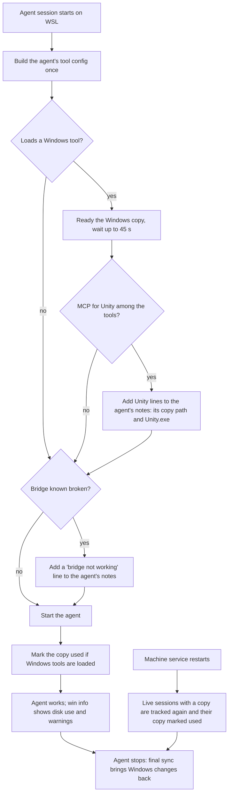

# Make the Windows bridge solid

**Idea:** `IDEA.md` — what this is for and why, in plain language. Read it first; it is
the north star this plan serves. Goal and Constraints live there, not here, so they don't
get buried as this file grows.

Parent: `docs/plans/windows-bridge/PLAN.md` (merged in PR #140). Map: `MAP.md`.

## Open Questions

## Watch List

| # | Noticed | What needs looking into | Raised to user? | Outcome |
|---|---------|-------------------------|-----------------|---------|

## Decision Log

Append-only. A reversal is a new entry superseding the old, never an edit.

| # | Decision | Rationale | Source |
|---|----------|-----------|--------|
| D1 | Mode is thorough | User's choice | user |
| D2 | Windows `localhost` HTTP/SSE tools are reached through a forward: a Linux listener on `127.0.0.1:<port>` pipes each connection through a Windows-side process (over WSL interop) to Windows `127.0.0.1:<port>`; skipped when WSL uses mirrored networking | Works for tools that bind only to Windows 127.0.0.1 and needs no firewall rule; rewriting to the host address fails for those tools and does not reach Claude's file-loaded config | defaulted |
| D3 | Disk report in `win info`: size of each copy of this thread, size of the repository's `.git`, count of kept conflict refs, and free space on the Windows drive. Warning when this thread's copies pass 20 GB, `.git` passes 10 GB, or the Windows drive has under 10 GB free. Warns only; never deletes | Measurable cheaply; unattributable shared objects are reported as one total; limits are generous so they fire only on real growth | defaulted |
| D4 | Broken bridge warning: added to the approval card's `warnings`, like the screen tools warning, and shown to the agent at session start; fires only on a Microsoft (WSL) kernel. Detection is widened so a WSL kernel with missing interop counts as "WSL, bridge broken: interop off" instead of "not WSL" | Mirrors the existing warning path; the user sees it before building starts | defaulted |
| D5 | The ready-made Unity setup is for MCP for Unity (CoplayDev), in its default HTTP mode (`http://localhost:8080/mcp`, served by the Editor on Windows) | User's choice; free, and it exercises the localhost forward end to end | user |
| D6 | A `localhost` HTTP/SSE tool is sent to Windows only when the user turns on a "Runs on Windows" switch for it in Project tools; the MCP for Unity preset has it on | User's choice; guessing could take a port a Linux service wants later | user |
| D7 | The switch is stored in `.mcp.json` outside `mcpServers`, as a top-level `"wheelchair": {"windows": ["<tool name>", ...]}`, so provider CLIs that load `mcpServers` from the file never see an unknown field in an entry | The save flow already keeps other top-level keys; an extra key inside an entry risks a CLI rejecting the entry | defaulted |
| D8 | Windows stdio tools that started before the copy was ready are restarted by a go-between the bridge puts in front of each one; the agent keeps its connection and starts as fast as today | User's choice; holding the start can take minutes on a first copy | user |
| D9 | Only IPv4 loopback Windows servers are supported; the switch applies to `http://localhost` and `http://127.0.0.1`, not `[::1]` | WSL mirrored mode reaches Windows loopback over IPv4 only; one address family keeps the forward simple; MCP for Unity listens on IPv4 | review-round-1 |
| D10 | Networking mode comes from `wslinfo --networking-mode` only; anything else counts as not mirrored | Simpler than guessing the Windows user's `.wslconfig` | review-round-1 |
| D11 | Supersedes part of D3: no warning on `git_bytes` (information only); conflict snapshot warning at 10 or more; broken-bridge approval warning only when the project has Windows tools | The whole-repository size is noise on large repositories; one kept snapshot is not a limit; warn only where work depends on the bridge | review-round-1 |
| D12 | Each agent binds to its own copy's Editor through instructions added to its prompt: open Unity on its copy, select the MCP for Unity instance whose project path is the copy, verify, never act on another | One MCP for Unity server on Windows serves every Editor and routes per client session; URLs cannot separate threads | review-round-1 |
| D13 | Marked tools are withheld from a session when the Linux port is held by another process; forwards and readying follow only entries the session's CLI loads; forwards are recorded and restored across machine restarts | Stops keys in headers reaching an unrelated Linux service; no wasted ports or 45 s waits for tools never loaded; tmux sessions outlive the service | review-round-1 |
| D14 | Tool readiness is a ready file written only after a successful reconcile following the session's start; the go-between keeps the client connection if the tool exits before that, and handles a restart during an unfinished `initialize` | Fixes skipped restarts on a stale or mid-reconcile copy and lost connections | review-round-1 |
| D15 | Supersedes D5's mode: the MCP for Unity preset is a stdio tool started per agent (`uvx.exe` on Windows, wrapped by the go-between), not the Editor's HTTP address. The localhost forward (item 1) is still built for other tools | User's choice; agents usually start before Unity is open, and the HTTP way would fail for that whole session; one server per agent keeps agents apart | user |
| D16 | Supersedes D15's "wrapped by the go-between": the MCP for Unity entry is not wrapped (it still readies the copy) | It never reads the copy, and a restart would drop the agent's Editor selection | review-round-3 |
| D17 | Before the copy is ready, a go-between whose tool has exited answers `initialize` itself and lists no tools, then sends `tools/list_changed` once the real tool is up | Holding `initialize` would outlast CLI start deadlines (Codex 10 s) | review-round-4 |
| D18 | Supersedes D14's restart and D17: the go-between never starts the real tool before the copy is ready; it answers the handshake itself until then, then starts the tool and sends `tools/list_changed`. Wrapped tools started before ready expose tools only for that session | Same behaviour the user chose (agents start promptly, tools work once the copy is ready) with no restart, so no handshake replay, stall or duplicate-notification cases | review-round-5 |
| D19 | D18 also supersedes D8's "restarted": the go-between holds the tool back until the copy is ready; nothing is restarted | Wording left from the restart design | review-round-6 |
| D20 | Windows localhost (HTTP/SSE) tool forwarding is split into its own thread; this plan drops its Spec part (old §1) and the IDEA promise moves to Not doing. D2, D6, D7, D9, D10, D13, D15's last sentence (forward still built here), D5's localhost rationale and the port parts of later rounds now belong to that thread | User's choice after review kept reopening port ownership and release; nothing else here depends on it since D15 | idea-change |
| D21 | Holding back Windows tools that start before their copy is ready (the go-between: D8, D14, D16, D17, D18, D19 and item 3's ready file, process tree and shutdown gate) is split into its own thread; the IDEA promise moves to Not doing. This thread keeps the existing-bridge fixes review found (Windows tool tracking across restarts, marking the copy used after launch, lookup recovery) | User's choice after three more unclean rounds, nearly all about the go-between's shutdown wait | idea-change |
## Spec

Background: the bridge as built is described in `docs/maps/windows-bridge-runtime.md` and
`MAP.md`. "WSL machine" means `detectWsl()` reports a Microsoft kernel (see item 4 for the
widened detection). Nothing in this Spec changes behaviour on a machine that is not WSL;
every new code path returns early there, and the non-WSL tests keep passing unchanged. The one
exception is item 1's "Add MCP for Unity" button, which also works off WSL (it fills `uvx`).



Windows tools that serve on Windows `localhost` (HTTP/SSE) are not part of this plan; they
moved to their own thread (D20). Neither is holding back Windows tools that start before their
copy is ready (the go-between): it moved to its own thread too (D21).

**Which tools a session loads.** Several rules below depend on whether the session's CLI
actually loads an entry. Loaded entries per CLI, for tool roles: Claude loads stdio, `http`
and `sse`; Codex and Antigravity load stdio and `http` (they skip `sse`, as today, and skip
anything their existing per-entry reasons reject); Pi and Kimi load none. "Loaded entries"
below always means this set, taken from the adapter's final built configuration for the
session (after Codex's override size budget, which can drop every entry), not from
`.mcp.json` alone. The order in `startIn` is: (1) build the adapter command once; (2) read the
loaded entries from that build; (3) decide readying (the `windowsTools` flag: a loaded Windows
`.exe` stdio entry), Windows tool tracking (item 3) and the Unity prompt lines from the loaded
entries only. Each adapter's build returns `loaded: [{ name, windows }]` for exactly the entries
in its final configuration (after its skip rules and, for Codex, the budget), where `windows` is
true only for a stdio entry (no `type` or `type: "stdio"`) whose original `.mcp.json` command
`isWindowsProgram`. Pi and Kimi return an empty list.
Today `windowsTools` comes from `.mcp.json` before the build; it now comes from
the build, so a Windows tool the CLI does not load (for example on Pi or Kimi) no longer
triggers readying.

### 1. MCP for Unity preset

MCP for Unity runs as a stdio tool started per agent (D15): `uvx --from mcpforunityserver
mcp-for-unity --transport stdio`, which talks to whichever Unity Editors have the MCP for Unity
package open, over Windows localhost. On WSL it runs on Windows (`uvx.exe`), so it is an
ordinary Windows `.exe` stdio tool: it readies the copy and gets `WHEELCHAIR_WINDOWS_PROJECT`.
Each agent has its own server process.

**The button.** The Project tools form gets an "Add MCP for Unity" button. It adds an entry
named `unity` (`unity-2`, ... if taken), stdio, args `["--from", "mcpforunityserver",
"mcp-for-unity", "--transport", "stdio"]`, and a command:
- WSL machine: the Linux path of Windows `uvx.exe`. Pressing the button sends a new request
  to the machine (`POST /v1/project-tools/unity-prep`, same auth as the project tools read),
  which resolves the path with PowerShell `(Get-Command uvx.exe).Source` and `winEnv.toLinux`
  (10 s deadline, result cached for 10 minutes), fills the entry, and then fetches the server
  once on Windows in the background (`uvx.exe --from mcpforunityserver mcp-for-unity --help`,
  5 minute deadline) so the first agent does not wait for the download. The form shows
  "Getting MCP for Unity ready on Windows…" then "Ready" or "Couldn't fetch it: <reason>; the
  first agent will fetch it instead" (polling the same route; saving is never blocked by it).
  The page load does not call PowerShell. Not found → the button fills nothing and shows
  "Install uv on Windows first: https://docs.astral.sh/uv/getting-started/installation/".
- Microsoft kernel with interop off: the button fills nothing and shows "Windows interop is off
  in WSL; turn it on to set up MCP for Unity."
- Any other machine: `uvx`.
The user edits or saves it like any entry; the button only fills the form. The server version
is not pinned (MCP for Unity's own setup does not pin it).

Help text under it: "Add the MCP for Unity package to your Unity project and commit it, so
every Windows copy has it. In Unity, open Window > MCP for Unity and set the transport to
Stdio (once per Windows user). Each agent opens Unity on its own copy and picks that Editor."
It links to `https://coplaydev.github.io/unity-mcp/getting-started/install`.

**Pointing each agent at its own copy's Editor.** One machine can have several Editors open
(other threads' copies, the user's own). For a tool-role session on a WSL machine whose loaded
entries include a Windows stdio entry with `mcp-for-unity` among its args, the machine adds
these lines to the session's prompt file before launch (same mechanism as item 4's line),
filling every placeholder itself:

> Unity: your project copy on Windows is `<copy_windows path>`.
> Open Unity on it yourself
> (`wc.js win start -- "<unity exe>" -projectPath "<copy_windows path>"`), never on another
> path.
> Before any other Unity MCP call, list the connected Unity instances, select the one whose
> project path is your copy, and check the selection; if none matches, don't use the Unity
> tools until it appears. Never act on another instance.

If the copy's Windows path could not be resolved before launch (for example a failed
`%LOCALAPPDATA%` lookup), the machine does not wait: the first sentence instead reads "Unity: run
`wc.js win info` to get your project copy's Windows path (`copy_windows`); if it is null, wait
and run it again", and the `win start` command reads `-projectPath "<copy_windows from win
info>"`, telling the agent to put that value in.

`<unity exe>` is `C:\Program Files\Unity\Hub\Editor\<version>\Editor\Unity.exe`, where
`<version>` is `m_EditorVersion` from the session worktree's `ProjectSettings/ProjectVersion.txt`,
used only if that file exists and the resulting `Unity.exe` exists under the Windows mount
(`<mount>/c/Program Files/Unity/Hub/Editor/<version>/Editor/Unity.exe`). Otherwise the sentence reads "Open Unity <version
or 'the project's version'> on it yourself with `wc.js win start -- "<Unity.exe>" -projectPath
"<copy_windows path>"` (Unity is usually under
`C:\Program Files\Unity\Hub\Editor`)".

For a sandboxed Codex session (which cannot `win start`), the second sentence is instead: "You
can't start Windows programs from this sandboxed session; ask whoever started you to have Unity
opened on that path." The rest is the same.

`README.md`'s Windows bridge section gets a short "Unity" paragraph saying the same, including
that uv must be installed on Windows and the package committed to the project.

### 2. Disk report

`win info` gains a `disk` object:

| Field | Meaning |
|---|---|
| `copies` | `[{ path, bytes }]`, one per Windows copy of this thread (`%LOCALAPPDATA%/Wheelchair/copies/<thread>/*`) |
| `copies_bytes` | Sum of `copies` |
| `git_bytes` | Git object storage of the repository (`git count-objects -v`: loose `size` + `size-pack`, in bytes). Information only: it covers the whole repository, not just what the bridge added |
| `conflict_refs` | Count of refs under `refs/wheelchair/conflicts/` in that repository |
| `windows_free_bytes` | Free space on the drive holding `%LOCALAPPDATA%` |
| `measured_at` | ISO time of the copy measurement, or null while the first one runs |
| `warnings` | Plain sentences, see below |

Copy sizes are measured on the Windows side (one PowerShell walk per copy), cached per
thread, and refreshed in the background when older than 10 minutes; `win info` never waits
for a copy walk. The git count, ref count and free space are read on every call (fast).
A failed measurement leaves the last value and adds `disk.reason`.

Warnings (D3, amended D11): `copies_bytes` over 20 GB → "This thread's Windows copies use <n>
GB."; `conflict_refs` 10 or more → "<n> kept conflict snapshots; see README to remove them.";
`windows_free_bytes` under 10 GB → "Only <n> GB free on the Windows drive." No warning on
`git_bytes`. Nothing is ever deleted. `wc.js win info` keeps printing the JSON on stdout,
unchanged in shape apart from the new fields; it prints each `disk.warnings` line to stderr.

### 3. Fixes to the existing bridge's Windows tool tracking

These keep the parent bridge's final stop reconcile from being skipped for sessions with
Windows tools.

**Recovery after a service restart.** tmux sessions survive a service restart, but
`WinBridge.toolSessions` is in memory. On startup, after `recoverFromTmux`, every live tool-role
session on a WSL machine whose worktree already has a Windows copy is added back to
`WinBridge.toolSessions`, its copy registered as today **and marked used** (`markKey`), so the
final stop reconcile runs even if a reconcile before the restart had cleared the copy's "used
since last reconcile" state. This needs no new field on the session record and covers sessions
started before this change. Counting a session without Windows tools costs at most one extra
final reconcile.

**Marking the copy used.** A pre-launch readying reconcile clears the copy's "used since last
reconcile" state before the CLI exists. So, for a session whose loaded entries include a
Windows stdio tool (including the Unity entry), right after its
tmux session has started the machine marks its copy used (`markKey`), and does so again when a
readying task for that copy finishes after launch. So wherever the existing rules give a copy a
final stop reconcile (lead and sub-lead thread copies; workers still sync before reporting
done, as the parent plan requires), it is not skipped because readying finished first.

### 4. Broken bridge warning

**Detection.** `detectWsl()` returns `{ wsl, kernel, interop, mount }`: `kernel` is the
Microsoft kernel test, `interop` the binfmt test (the registration file exists **and** its
first line is `enabled`; a `disabled` registration counts as interop off), and `wsl` stays `kernel && interop` so every
existing caller keeps its meaning. A new `bridgeHealth()` on `WinBridge` returns `{ ok: true }`,
`{ ok: false, reason }` or `{ ok: null }` (not known yet):
- not `kernel` → `{ ok: true }` (never warns).
- `kernel && !interop` → reason "Windows interop is off in WSL, so Windows programs can't run".
- `wsl` → `winEnv.versions()` with a 15 s overall deadline; its `reason` if not ok; on the
  deadline, reason "Windows didn't answer within 15 seconds". Each probe does its own fresh
  lookups of `git.exe` and `%LOCALAPPDATA%` and reports their failures as the reason. A
  successful probe lookup replaces the path `createWinEnv` uses for regular bridge operations;
  a failed one does not (operations keep the last successful path and fail on their own if it
  no longer works). A failed `%LOCALAPPDATA%` or `git.exe` lookup made by a regular operation
  is not memoized either, so the next operation tries again. So the warning, and the
  operations, recover after the user fixes Windows without a service restart.
On a Microsoft kernel the machine runs the check in the background at startup and every 10
minutes, and caches the result; callers read the cache and never wait for a probe, except as
the approval card says.

**Where it shows.**
- Approval card: when a lead posts `approval` on Linux, the bridge result is not ok, and the
  lead's worktree has Windows tools by `.mcp.json` (a Windows `.exe` stdio entry, regardless
  of CLI), `warnings` gets "The Windows bridge won't work on <hostname>:
  <reason>. Builds that don't use Windows are unaffected." (beside the screen tools warning,
  same 10-warning cap). If the cache is `ok: null`, the post waits up to 15 s for the running
  probe; still unknown → no warning.
- Agent at session start: for tool-role sessions, when the cached result is `ok: false`, one
  line is added to the session's prompt file before launch: "Windows bridge: not working on
  this machine (<reason>). Don't rely on `wc.js win` until the user fixes it." `ok: null` adds
  nothing. Session start never waits on a probe.

### Validation

```bash
bash machine/test/run.sh
node --test viewer/test/*.test.js
npm --prefix viewer run test:browser
bash machine/test/windows-live.sh   # on the user's WSL2 PC only
```

New tests (fake interop, fake PowerShell, temp dirs, as the existing win tests do):

- Readying follows loaded entries: a Windows `.exe` stdio entry triggers readying on Claude,
  Codex and Antigravity, and not on Pi or Kimi.
- Unity button: on WSL fills the `uvx.exe` Linux path from the `unity-prep` request and
  reports the background fetch, or shows the install hint when it is missing; the page load
  makes no PowerShell call; elsewhere `uvx`. Prompt lines added only for sessions
  loading a Windows stdio `mcp-for-unity` entry, with the copy path and the Unity path from
  `ProjectVersion.txt` only when that `Unity.exe` exists (else the fallback sentence); the
  sandboxed Codex variant.
- `win info`: `disk` fields and each warning threshold with fake sizes, no `git_bytes`
  warning.
- A failed `%LOCALAPPDATA%` lookup at startup recovers on the next operation and probe.
- An HTTP entry carrying a stray `.exe` `command` is not counted as a Windows tool. Unity
  button with interop off shows the interop message.
- Copy marked used after launch even when readying finished before it, so stopping a lead
  runs the final reconcile; a Git-missing probe clears after Git appears without a service
  restart; the `loaded` list for a Codex Windows entry says `windows: true` and readying runs,
  and an entry dropped by Codex's budget is absent.
- Existing positive WSL test fixtures (`machine/test/win-env.test.js`,
  `machine/test/win-service.test.js` and any other that writes a binfmt registration) write
  `enabled` as the first line, so they keep testing the working-interop path.
- Recovery marks the copy used: from a persisted `used_since_ok: false`, a recovered session's
  stop runs the final reconcile. A live tool-role session with an existing copy is tracked
  after a restart (including one started before this change); one without a copy is not. The
  Unity prompt's fallback sentence when the copy path is unknown.
- Restart tracking: after a service restart, such a session is back in `toolSessions`. A `disabled` binfmt
  registration counts as interop off.
- Detection and warnings: interop off on a Microsoft kernel gives the reason; approval card
  gets the warning only when the project has Windows tools; a probe past 15 s gives the
  timeout reason; session start never waits; non-WSL machines get none.

`machine/test/windows-live.sh`: when `WHEELCHAIR_UNITY` is set and Windows has `uvx.exe`, the
Unity part also: adds the MCP
for Unity package to the fixture's `Packages/manifest.json` (the git URL from MCP for Unity's
install docs) in the harness's working copy before the copy is made, opens the Editor on the
fixture copy and waits for its window (as today), then, **before** the existing `win stop`,
runs the preset's command directly, sends MCP `initialize`, then
`notifications/initialized`, then `tools/list`, and checks for tools; then reads the instance
list, polling up to 120 s for an instance whose project path is the fixture copy (failing with
"set MCP for Unity's transport to Stdio in Window > MCP for Unity" if none appears); then stops the Editor as today. Otherwise it prints `Unity MCP part skipped`.

### Not doing

As IDEA.md. Also: no Windows localhost (HTTP/SSE) tools (own thread, D20); no holding back
of Windows tools that start before the copy is ready (own thread, D21); no automatic cleanup
of copies or git data.


## Accepted Risks

| Risk | Why accepted | Round |
|------|--------------|-------|
| (Split off with localhost forwarding, D20.) In mirrored mode, a Linux server started later on a marked tool's loopback port, while the Windows tool is down, receives that live CLI's requests | Rare path: needs the opt-in mirrored mode, the Windows tool down, and a Linux server on the same port; it is the user's own service | review-round-8 |
| A `%LOCALAPPDATA%` lookup that fails at session launch or at service startup, followed by Windows recovering, a manual sync and more tool edits, can leave the session out of `toolSessions` so its final stop reconcile is skipped | Rare path: a failed Windows lookup on a healthy machine plus that exact sequence; lookups are retried (item 4) and the edits stay in the copy until archive | review-round-14 |
| (Split off with the go-between, D21.) A go-between that crashes while its Windows tool keeps writing lets the shutdown gate pass early | Rare path: needs the go-between itself to crash mid-session | review-round-8 |
| A service restart between tmux creation and session persistence can register and track a different copy in recovery (worktree taken from the tmux pane's folder) | Rare path: a restart inside that launch window plus a pane directory that differs from the worktree | review-round-8 |
| (Split off with localhost forwarding, D20.) An unmarked URL written with an IPv4-mapped address (`http://[::ffff:127.0.0.1]:<port>`) is not covered by port reservations and can reach a Windows forward | Rare path: unusual hand-written address form | review-round-5 |
| (Split off with localhost forwarding, D20.) While the machine service is down (restart or crash), a forwarded port is unbound; a Linux process that takes it in that window can receive a live CLI's requests and headers for that tool | Rare path: needs a service restart and another Linux process binding that exact port in the gap; startup re-claims it and reports a failure | review-round-2 |

## Check Once Built

| # | What to check | Round |
|---|---------------|-------|
| C1 | MCP for Unity's stdio server lists every connected Editor with its project path, and selecting one in one agent's server does not affect another agent's | lead (D12, D15) |
| C2 | (Split off with the go-between, D21.) Claude accepts a `--mcp-config` server with the same name as a `.mcp.json` server listed in `disabledMcpjsonServers` | lead (item 3) |
| C4 | (Split off with the go-between, D21.) Claude, Codex and Antigravity re-list a tool's tools on `notifications/tools/list_changed` from a stdio server (D17) | review-round-4 |
| C5 | MCP for Unity's Stdio transport choice holds for every project copy opened by the same Windows user | review-round-4 |
| C3 | (Split off with localhost forwarding, D20.) With default WSL `localhostForwarding`, requests fail promptly while the Windows server is down and reach it once it starts, with no loop through the relay | review-round-1 |

## Review Rounds

### Round 1 — 2026-11-21

**Lanes:** claude (intent); other family (mechanics); cross-family: yes.

**Changed since Round 0:** n/a (first round — whole Spec in scope)

| Lane | Reported | Finding | Lead verdict | Resolution |
|------|----------|---------|--------------|------------|
| intent | major | Unity preset never points the agent at its own copy's Editor; one port serves every Editor | upheld | D12; Spec §2 prompt lines, help text says commit the package |
| intent | minor | Ready file at launch skips the restart for an existing but stale copy | upheld | D14; ready only after a reconcile following start |
| intent | minor | `git_bytes` warning is noise; conflict-ref warning at 1 is not a limit | upheld | D11; §3 |
| intent | minor | Broken-bridge approval warning fires on projects with no Windows tools | upheld | D11; §5 gated |
| intent | minor | `.wslconfig` fallback adds a guess for little gain | upheld | D10 |
| mechanics | blocking | Unity session not bound to its copy's Editor | upheld | D12, C1 |
| mechanics | blocking | Linux port collision lets the CLI reach an unrelated Linux service with its headers | upheld | D13; §1 Port taken on Linux |
| mechanics | blocking | Go-between exits when the tool exits before ready, losing the connection | upheld | D14; §4 step 5 |
| mechanics | blocking | Restart during a pending `initialize` never completes the handshake | upheld | D14; §4 step 4 |
| mechanics | blocking | `[::1]` accepted but Windows dials 127.0.0.1; mirrored mode address families undefined | upheld | D9 |
| mechanics | major | Existing `.git` counted ready while a reconcile still runs | upheld | D14; §4 Ready file |
| mechanics | major | Machine restart drops forwards while tmux sessions survive | upheld | D13; §1 Machine service restart; ready-file restore |
| mechanics | major | Ports and readying for tools the CLI never loads (Pi, Kimi, SSE on Codex/Antigravity) | upheld | D13; "Which tools a session loads" |
| mechanics | major | Cold health probe can exceed the start budget | upheld | §5 background probe, 15 s deadline, start never waits |
| mechanics | major | Live check can pass against a Linux service | upheld | §Validation live part proves a Windows token |
| mechanics | minor | Check once built: localhostForwarding may loop the relay to itself | upheld | §1 No loop through WSL; C3 |

### Round 2 — 2026-11-21

**Lanes:** claude (intent); other family (mechanics); cross-family: yes.

**Changed since Round 1:** "Which tools a session loads" (new); §1 marking limited to IPv4 http hosts, supported addresses, copy readying, `::1` listener, no-loop check, port-taken withholding, mirrored via `wslinfo` only, service-restart restore, `forwards` states; §2 help text and Unity prompt lines; §3 warnings (no `git_bytes` warning, conflict refs at 10); §4 ready file rules, go-between steps 4-7; §5 detection result `ok: null`, background probe with 15 s deadline, approval gating; Validation (new tests, live localhost part); D9-D14; Check Once Built C1-C3.

| Lane | Reported | Finding | Lead verdict | Resolution |
|------|----------|---------|--------------|------------|
| mechanics | blocking | `::1` bind failure by another Linux service still lets IPv6 clients reach it | upheld | §1 `EADDRINUSE` on `::1` withholds the entry |
| mechanics | blocking | Relay failure or service restart releases a port while CLIs keep its URL | upheld (restart window accepted-risk) | §1 listeners stay bound while used; restart gap in Accepted Risks |
| mechanics | blocking | Go-between can waste its one restart with no client handshake | upheld | §4 step 4c (ready before `initialize`), step 5 holds `initialize` |
| mechanics | blocking | Unity prompt tells sandboxed Codex to run a refused command | upheld | §2 sandboxed Codex sentence |
| mechanics | major | Ready-file recovery has no durable enrollment | upheld | §4 `win_wrapped` / `win_ready` in the session record |
| mechanics | major | Codex size budget can drop entries counted as loaded | upheld | "Which tools a session loads": from the final built config |
| mechanics | major | Shared forward gains an IPv6 need later | upheld | §1 bind `::1` before admitting; addresses recorded |
| mechanics | major | Switch-only edit skipped by the save short-cut | upheld | §1 save body `windows`, both checks compare it |
| mechanics | major | Live Unity check never claims port 8080 | upheld | §Validation Unity part runs the stdio preset; no port 8080 |
| mechanics | minor | `win info` warning prelude would break JSON stdout | upheld | §3 warnings to stderr |
| intent | major | HTTP preset fails for the whole session when Unity isn't open at agent start | user-decision | D15: stdio per agent |
| intent | minor | `<Unity.exe>` left as a placeholder | upheld | §2 filled from `ProjectVersion.txt` |
| intent | minor | Unity prompt triggered by an unmarked URL | upheld | §2 trigger is a Windows stdio `mcp-for-unity` entry |

### Round 3 — 2026-11-21

**Lanes:** claude (intent); other family (mechanics); cross-family: yes.

**Changed since Round 2:** "Which tools a session loads" (from the final built config); §1 `::1` listener rules and late binding, listeners stay bound while used, save carries the Windows list, restart record holds addresses; §2 rewritten for the stdio preset (D15): button and `windows_uvx`, help text, prompt trigger and filled Unity path, sandboxed Codex sentence; §3 warnings to stderr; §4 enrollment in the session record, go-between steps 4c and 5; Validation (Unity button and prompt tests, live Unity part via the stdio preset); Accepted Risks (restart window); C1 reworded.

| Lane | Reported | Finding | Lead verdict | Resolution |
|------|----------|---------|--------------|------------|
| intent | major | Unity preset wrapped by the go-between; a restart drops the Editor selection | upheld | §2, §4: `mcp-for-unity` entries not wrapped |
| intent | minor | `uvx.exe` lookup slows every Project tools page load | upheld | §2 separate request on button press, cached |
| intent | minor | First Unity start may fail while uvx downloads | upheld | §2 server fetched on Windows at button press |
| mechanics | blocking | Unity prompt's `win start` lacks the required `--` | upheld | §2 command text (machine/lib/win-args.js:35) |
| mechanics | blocking | Live Unity check can't discover the fixture Editor | upheld | §Validation adds the package and checks before stop |
| mechanics | blocking | A forward can capture another session's unmarked entry on the same port | upheld | §1 one meaning per port |
| mechanics | major | Port withholding can change Codex's budget result after the build | upheld | "Which tools a session loads" order (1)-(4) |
| mechanics | major | Ready file and session record can disagree after a restart | upheld | §4 file first, recover when either is not ready |
| mechanics | major | Restart stops only the launcher, not its child server | upheld | §4 Process tree (Job Object) |
| mechanics | major | Pre-ready branch keyed on reason text that doesn't match | upheld | §4 ready file `state` field |
| mechanics | major | `notifications/initialized` can be sent twice | upheld | §4 step 4d |

### Round 4 — 2026-11-21

**Lanes:** claude (intent); other family (mechanics); cross-family: yes.

**Changed since Round 3:** "Which tools a session loads" order (1)-(4); §1 one meaning per port; §2 Unity entry not wrapped, `unity-prep` request with background fetch, help text, `win start --` syntax; §4 rewritten parts: which tools (Unity excluded), ready file `state` field, enrollment write order and recovery, process tree, go-between steps 2, 4a, 4d, 5, 7; Validation (ports, ready file, go-between tests, live Unity part).

| Lane | Reported | Finding | Lead verdict | Resolution |
|------|----------|---------|--------------|------------|
| intent | minor | Decision Log still says the Unity entry is wrapped | upheld | D16 |
| intent | minor | Validation names the removed `windows_uvx` field | upheld | §Validation Unity button |
| intent | minor | Validation says "rebuilds once" against a build-once order | upheld | §Validation Ports |
| intent | minor | Unity path stated without checking it exists | upheld | §2 path used only if it exists |
| intent | minor | No `forwards` state for a port held by a Linux tool | upheld | §1 `"used by a Linux tool"` |
| mechanics | blocking | Port meaning not reserved within one launch or across concurrent starts | upheld | §1 Port reservations |
| mechanics | blocking | Conflict check misses unmarked `[::1]` entries | upheld | §1 unmarked loopback includes `[::1]` |
| mechanics | blocking | Held `initialize` outlasts the CLI's start deadline | upheld | D17; §4 step 5; real-CLI check; C4 |
| mechanics | major | Candidate selection affected by Codex's aggregate budget | upheld | step (1) per entry, budget in (2) |
| mechanics | blocking | No Editor-side Stdio transport step | upheld | §2 help text; live harness waits and names the fix; C5 |
| mechanics | major | Live check skips `notifications/initialized` | upheld | §Validation |
| mechanics | blocking | Restart loses Windows tool tracking, skipping the final reconcile | upheld | §4 Windows tool tracking survives restarts |

### Round 5 — 2026-11-21

**Lanes:** claude (intent); other family (mechanics); cross-family: yes.

**Changed since Round 4:** load order step (1) per entry and build-once; §1 one meaning per port and Port reservations, `[::1]` in conflicts, new `forwards` state; §2 Stdio transport step in help text, Unity path existence check; §4 Windows tool tracking survives restarts, go-between step 5 answers `initialize` itself (D17) and 4c; Validation (ports, restart tracking, go-between, real-CLI check, live Unity part); D16, D17; C4, C5.

| Lane | Reported | Finding | Lead verdict | Resolution |
|------|----------|---------|--------------|------------|
| mechanics | blocking | Synthetic `initialize` leaves the replacement without `notifications/initialized` | upheld | D18; §4 step 3 sends it before queued requests |
| mechanics | blocking | A pre-ready tool that stalls in `initialize` still hits the CLI deadline | upheld | D18: real tool not started before ready |
| mechanics | major | Synthetic handshake fixes version and capabilities; real ones discarded | upheld | §4 step 3 mismatch logged; tools-only accepted limit |
| mechanics | blocking | IPv4-mapped loopback URL bypasses reservations | accepted-risk | Rare path: unusual hand-written address |
| mechanics | blocking | Reservation released while the listener stays open 60 s | upheld | §1 close at once; release after close |
| mechanics | blocking | Restart during launch loses Windows tool enrollment | upheld | §1 launch record written before tmux; §4 recovery |
| intent | minor | Stand-in tool gives no sign the copy failed | upheld | §4 step 2 `instructions` by state |
| intent | minor | Stand-in drops prompts/resources | upheld | §4 step 3 accepted limit stated |

### Round 6 — 2026-11-21

**Lanes:** claude (intent); other family (mechanics); cross-family: yes.

**Changed since Round 5:** §1 listeners close at once and `windows` reservations release after close; launch record `win-sessions.json` written before tmux (replaces `win-forwards.json` and session-record flags); §4 recovery after restart, go-between rewritten (D18: real tool started only once the copy is ready; stand-in handshake with `instructions`; tools-only limit); Validation (ready file, restart tracking, go-between); D18; Accepted Risks (IPv4-mapped address). The user chose to keep going after three unclean rounds.

| Lane | Reported | Finding | Lead verdict | Resolution |
|------|----------|---------|--------------|------------|
| intent | minor | Failed-copy sentence doesn't say how to retry | upheld | §4 step 2 adds "Run `wc.js win sync` to retry." |
| intent | minor | Restart wording left in heading and D8 | upheld | §4 heading; D19 |
| mechanics | blocking | Handoff uses one rule for pass-through and stand-in handshakes | upheld | §4 steps 3a / 3b |
| mechanics | blocking | Mirrored mode lets a marked `localhost` URL reach a Linux `[::1]` listener | upheld | §1 Mirrored networking checks `/proc/net/tcp{,6}` |
| mechanics | major | Teardown leaves open relay sockets holding the reservation | upheld | §1 teardown destroys connections first |
| mechanics | major | Final stop reconcile can run before a wrapped tool has ended | upheld | §4 Stop waits for wrapped tools |
| mechanics | major | Launch record can't restore a withheld tool's `win info` state | downgraded (minor: display only after a restart; a worker would not need to ask) | §1 launch record stores each marked tool's port and outcome |

### Round 7 — 2026-11-21

**Lanes:** claude (intent); other family (mechanics); cross-family: yes.

**Changed since Round 6:** §1 mirrored mode Linux-listener check, teardown destroys open connections before releasing, launch record stores each marked tool's port and outcome; §4 heading, failed sentence adds retry, Stop waits for wrapped tools, go-between steps 3a/3b; Validation (teardown, mirrored, stop, handshake orders); D19.

| Lane | Reported | Finding | Lead verdict | Resolution |
|------|----------|---------|--------------|------------|
| mechanics | blocking | Sweep's final reconcile skips the wrapped-tool shutdown gate | upheld | §4 gate applies to `sweep()` |
| mechanics | major | Port teardown needs confirmed tmux exit and a path for sessions killed without stop | upheld | §1 release on confirmed absence; sweep releases |
| mechanics | blocking | No EOF rule before ready or during handoff | upheld | §4 step 5 |
| mechanics | major | Mirrored check catches non-loopback listeners | upheld | §1 loopback and wildcard binds only |
| intent | minor | Validation still says mirrored mode withholds nothing | upheld | §Validation Forward bullet |

### Round 8 — 2026-11-21

**Lanes:** claude (intent); other family (mechanics); cross-family: yes.

**Changed since Round 7:** §1 port release on confirmed tmux absence and by the sweep; mirrored check limited to loopback and wildcard binds; §4 shutdown gate also in `sweep()`, go-between EOF rule (step 5); Validation (mirrored, stop, EOF).

| Lane | Reported | Finding | Lead verdict | Resolution |
|------|----------|---------|--------------|------------|
| mechanics | blocking | Sweep can release a starting session's ports before tmux exists | upheld | §1 sweep skips `startingNames` |
| mechanics | blocking | Mirrored mode: a later Linux server takes the port | accepted-risk | Rare path |
| mechanics | blocking | Dead go-between pid doesn't prove the Windows job ended | accepted-risk | Rare path: go-between crash |
| mechanics | blocking | Two sessions on one copy stopping together reconcile before the other's tool ends | upheld | §4 stop gate is copy-wide |
| mechanics | blocking | Rare path: restart between tmux and persistence readies another copy | accepted-risk | Rare path (self-labelled) |
| intent | minor | Older "when the session stops" wording left in §1 | upheld | §1 points to the confirmed-gone rule |

### Round 9 — 2026-11-21

**Lanes:** claude (intent); other family (mechanics); cross-family: yes.

**Changed since Round 8:** localhost forwarding (old §1) split into its own thread (D20); items renumbered (1 Unity, 2 disk, 3 early tools, 4 warning); "Which tools a session loads" simplified (build once, readying from the build); launch record moved into item 3 with only `wrapped` / `windows_tools`; approval warning gating; Validation trimmed (no forward, port or switch tests, no live localhost part); IDEA.md What/Why/good/Not doing updated.

| Lane | Reported | Finding | Lead verdict | Resolution |
|------|----------|---------|--------------|------------|
| intent | minor | IDEA still says the early tool "gets restarted" | upheld | IDEA.md What good looks like |
| intent | minor | D15's last sentence and D5's rationale still imply the forward is here | upheld | D20 lists them |
| intent | minor | C2 cites D7 and item 4 | upheld | C2 cites item 3 |
| mechanics | blocking | Pre-launch reconcile clears the used flag before the CLI exists | upheld | item 3 Marking the copy used |
| mechanics | blocking | Archive's final reconcile skips the shutdown gate | upheld | item 3 gate covers archive |
| mechanics | blocking | Health probe memoizes a missing Git forever | upheld | item 4: failed lookup not memoized |
| mechanics | major | Loaded classification lost after wrapping | upheld | adapters return `loaded` with original classification |
| mechanics | minor | Unity button contradicts "returns early off WSL" | upheld | Background states the exception |

### Round 10 — 2026-11-21

**Lanes:** gpt (intent); gpt (mechanics); cross-family: no (claude unavailable at start).

**Changed since Round 9:** Background exception for the Unity button; adapters return `loaded` with original classification; item 3 archive gate and Marking the copy used; item 4 Git lookup not memoized on failure; Validation additions; D20 wording; C2; IDEA.md What good looks like (no restart).

| Lane | Reported | Finding | Lead verdict | Resolution |
|------|----------|---------|--------------|------------|
| intent | blocking | Archive gate placed in `archiveFinish`, after the snapshot | upheld | item 3 gate in `archiveCheck` returning `pending` |
| intent | minor | "Final stop reconcile always runs" reads as changing worker cleanup | upheld | item 3 scoped to copies that get one |
| intent | minor | IDEA promises no change off WSL despite the Unity button | upheld | IDEA Constraints |
| intent | minor | IDEA disk criterion implies bridge-only git bytes | upheld | IDEA What good looks like |
| mechanics | blocking | Archive gate placement (same as intent) | upheld | as above |
| mechanics | blocking | Unwrapped session stopping last skips the gate | upheld | item 3 gate for any session on a copy with a wrapped session |
| mechanics | blocking | `loaded.windows` ignores transport | upheld | stdio only |
| mechanics | major | Unity button on a WSL kernel with interop off | upheld | item 1 interop-off message |
| mechanics | minor | Git path cached after success goes stale | upheld | item 4 fresh lookup each probe |

### Round 11 — 2026-11-21

**Lanes:** gpt (intent); gpt (mechanics); cross-family: no (claude unavailable at start).

**Changed since Round 10:** item 3 shutdown gate for any session on a copy with a wrapped session, archive gate moved to `archiveCheck`, "Marking the copy used" scoped; `loaded.windows` stdio only; item 1 interop-off button message; item 4 fresh Git lookup per probe; Validation; IDEA.md disk criterion and non-WSL constraint.

| Lane | Reported | Finding | Lead verdict | Resolution |
|------|----------|---------|--------------|------------|
| intent | blocking | Archive's `stop()` removes a wrapped verifier's copy before the gate | declined | Verifier copies are throwaways removed without reconcile by design (machine/lib/win.js:210-224); no kept work is at stake. Spec now says so |
| intent | blocking | A cached `%LOCALAPPDATA%` failure leaves operations broken while the probe says healthy | upheld | item 4 probe checks it; no failure memoized |
| intent | minor | `git_bytes` labelled as `.git` size but measures objects | upheld | item 2 label |
| mechanics | blocking | Gate keyed on launch records that vanish while a go-between still shuts down | upheld | item 3 gate lists `win-tools` dirs always |
| mechanics | blocking | Verifier worktree removed before `archiveCheck` | declined | as the intent row: throwaway copy by design |
| mechanics | major | Failed Git lookup after success: which path operations use | upheld | item 4: probe success replaces, failure doesn't |
| mechanics | minor | `pending` needs the user to archive again | upheld | item 3 states the manual retry |

### Round 12 — 2026-11-21

**Lanes:** claude (intent); other family (mechanics); cross-family: yes.

**Changed since Round 11:** the go-between (old item 3) split into its own thread (D21); item 3 is now "Fixes to the existing bridge's Windows tool tracking" (launch record with `windows_tools` only, restart recovery, marking the copy used); "Which tools a session loads" without wrapping (`loaded: [{name, windows}]`); item 1 no longer mentions wrapping; Validation trimmed; IDEA.md updated.

| Lane | Reported | Finding | Lead verdict | Resolution |
|------|----------|---------|--------------|------------|
| intent | minor | Separate launch-record file only covers a rare window; use the session record | upheld | item 3 flag on the session record; no new file |
| intent | minor | Accepted risk row still says recovery readies a copy | upheld | row reworded |
| mechanics | blocking | Sessions running across the upgrade are never enrolled | upheld | item 3 classifies records without the field at startup |
| mechanics | blocking | Shared launch record needs serialized writes | upheld | moot: the file is gone; the existing sessions record is used |
| mechanics | blocking | Disabled binfmt registration counted as interop on | upheld | item 4 checks `enabled` |

### Round 13 — 2026-11-21

**Lanes:** claude (intent); other family (mechanics); cross-family: yes.

**Changed since Round 12:** item 3 uses a `windows_tools` field on the session record instead of `win-sessions.json`, with startup classification for records lacking it; item 4 binfmt `enabled` check; Validation; Accepted Risks row 3 wording.

| Lane | Reported | Finding | Lead verdict | Resolution |
|------|----------|---------|--------------|------------|
| intent | minor | Rebuilding adapter config at startup needs inputs the record lacks | upheld | item 3 conservative rule, no rebuild |
| mechanics | blocking | Recovery doesn't mark the copy used | upheld | item 3 recovery marks used |
| mechanics | blocking | Classifying from the current `.mcp.json` can misclassify after an edit | upheld | item 3 conservative: existing copy means tracked |
| mechanics | major | Unity prompt when the copy path is unavailable | upheld | item 1 fallback sentence |
| mechanics | minor | Positive WSL fixtures write empty binfmt files | upheld | §Validation fixtures write `enabled` |

### Round 14 — 2026-11-21

**Lanes:** claude (intent); other family (mechanics); cross-family: yes.

**Changed since Round 13:** item 3 recovery marks the copy used and treats records without the field conservatively (existing copy means tracked); item 1 Unity prompt fallback when the copy path is unknown; Validation (fixtures, recovery).

| Lane | Reported | Finding | Lead verdict | Resolution |
|------|----------|---------|--------------|------------|
| intent | minor | `windows_tools` field adds nothing over the conservative rule | upheld | item 3 recovery uses existing copy, no field |
| mechanics | blocking | Startup `%LOCALAPPDATA%` failure leaves a session untracked | accepted-risk | Rare path: failed lookup on a healthy machine plus a specific sequence |
| mechanics | blocking | Launch-time lookup failure skips `toolSessions` enrollment | accepted-risk | Rare path: same as above |
| mechanics | minor | Unity fallback leaves a literal "that path" in a runnable command | upheld | item 1 fallback wording |

## Implementation Tasks

| # | Objective | Ownership boundary | Lane | Session id | Validation | Status |
|---|-----------|--------------------|------|-----------|------------|--------|
| T1 | Adapters return `loaded: [{name, windows}]` from their final config (Spec: Which tools a session loads) | `machine/adapters/*.js`; adapter tests, new `machine/test/adapters-loaded.test.js` | standard / gpt-6.1-terra | wc-d5233e17e73d-worker | `bash machine/test/run.sh` | done |
| T2 | Item 4: `detectWsl` kernel/interop (binfmt `enabled`), lookups not memoized on failure, winEnv probe, `bridgeHealth` with background probe, approval-card warning, fixtures | `machine/lib/win-env.js`; `win.js` constructor/startup/health; approval block in `service.js`; win tests, new `win-health.test.js` | standard / gpt-6.1-terra | wc-d5233e17e73d-worker-2 | `bash machine/test/run.sh` | done |
| T4 | Item 1 button: Project tools "Add MCP for Unity", `unity-prep` route + `machine/lib/unity-prep.js`, viewer pass-through, README Unity paragraph | `viewer/pages/project-tools.js`, `viewer/app/routes.js` list, new `machine/lib/unity-prep.js`, route lines in `service.js`, README, project-tools tests, new `machine/test/unity-prep.test.js` | standard / gpt-6.1-terra (claude asked; hub fell back to gpt) | wc-d5233e17e73d-worker-3 | machine, viewer node and browser suites | done (follow-ups in T4b) |
| T6 | Live harness Unity MCP part (skips without `WHEELCHAIR_UNITY`) | `machine/test/windows-live.{js,sh}` | standard / gpt-6.1-terra | wc-d5233e17e73d-worker-4 | `bash machine/test/windows-live.sh` | done |
| T4b | T4 follow-ups: Unity button uses `lockBtn`, one poll chain at a time, `# wc:` header on the lookup script, bounded failure reason, route needs no git identity, test of the fetch command | `machine/lib/unity-prep.js`, the Unity part of `viewer/pages/project-tools.js`, the unity-prep route lines in `service.js`, `machine/test/unity-prep.test.js`, `viewer/test/app-project-tools.spec.js` | light / gpt-6-luna (claude asked; hub fell back to gpt) | wc-d5233e17e73d-worker-7 | machine suite, project-tools browser spec | done |
| T5b | Integration tests T5 left out (Spec Validation): readying not on Pi/Kimi, none when Codex's budget drops entries, prompt file written with the lines at start, stop of a lead runs the final reconcile after launch marking and after restart recovery, start never waits on a probe | tests only: `machine/test/win-service.test.js`, `machine/test/win.test.js`, `machine/test/win-launch.test.js` | standard / gpt-6.1-terra | wc-d5233e17e73d-worker-8 | `bash machine/test/run.sh` | done (3 failing tests fixed in T5c) |
| T5c | Fix T5b's three failing tests: set `used_since_ok: false` directly instead of through `sync` (the fixture's lead is live, so `sync` re-marks it), and a Codex budget fixture under 32 KiB that quotes past 64 KiB | `machine/test/win.test.js`, `machine/test/win-service.test.js` | light / gpt-6-luna, effort high (rung 1: T5b hit its fails-twice guardrail) | wc-d5233e17e73d-worker-10 | machine suite | done |
| T3 | Item 2: `win info` `disk` object, cached background copy walks, warnings; `wc.js win info` prints warnings to stderr (after T2) | `win.js` `info()` only, new `machine/lib/win-disk.js`, `viewer/app/wc.js` win info printing, new tests | standard / gpt-6.1-terra | wc-d5233e17e73d-worker-5 | machine and viewer node suites | done (follow-ups in T3b) |
| T3b | T3 follow-ups: `# wc:` header on the copy-walk script, a failed walk retried only after the 10-minute window, test temp folders from `test-support/run-dir.js` | `machine/lib/win-disk.js`, `machine/test/win-disk.test.js` | light / gpt-6-luna | wc-d5233e17e73d-worker-9 | machine suite | done |
| T3c | Copy-walk literal doubles a typographic quote with the same character, not two ASCII quotes (found in my read while writing COMPLETION.md) | `machine/lib/win-disk.js` (one line), `machine/test/win-disk.test.js` | light / gpt-6-luna | wc-d5233e17e73d-worker-11 | win-disk tests, machine suite | done |
| T5 | Session wiring (tricky): `startIn` uses `built.loaded` for readying, Unity prompt lines, broken-bridge prompt line, mark copy used after launch and after late readying, restart recovery of tool sessions (after T1, T2) | `machine/service.js` `startIn`/startup; `win.js` `prepareLaunch` and new tracking methods; win-service/win tests | standard / gpt-6.1-terra | wc-d5233e17e73d-worker-6 | `bash machine/test/run.sh` | done (tests in T5b) |

## Log
- 2026-11-21 — Choice: T6, windows-live.js: reads the instance list with `resources/read` on `mcpforunity://instances` (stdio `path` field).
- 2026-11-21 — Choice: T6, windows-live.js: compares Windows paths case-insensitively, normalising slashes and trailing separators.
- 2026-11-21 — Choice: T6, windows-live.js: 5 minute allowance for the first server start/download, 10 s per instance read inside the 120 s poll.
- 2026-11-21 — Choice: T6, windows-live.js (from the diff, not reported): the Unity fixture is committed before `win info` whenever `WHEELCHAIR_UNITY` is set, including when `uvx.exe` is missing; `protocolVersion` 2025-03-26; manifest `dependencies` created if absent; server killed with SIGKILL in `finally`.
- 2026-11-21 — T6 accepted (band: scout): live harness re-run here passes with `Unity MCP part skipped: WHEELCHAIR_UNITY unset` and the existing exit 77; Unity part itself unexercised on this machine.
- 2026-11-21 — Choice: T1, machine/adapters/common.js: one shared `loadedTools` helper classifies original stdio entries for every adapter.
- 2026-11-21 — Choice: T1, machine/adapters/codex.js (from the diff): included names re-derived through `codexEntryReason` rather than returned from `codexOverrides`.
- 2026-11-21 — T1 accepted (band: scout): suite 541 tests, only failure `kimi.test.js:166` (Kimi Code not installed here; fails the same on the feature branch).
- 2026-11-21 — Choice: T2, machine/lib/win.js: overlapping scheduled probes are skipped; `runBridgeProbe()` exposed for an explicit refresh; deadline and interval injectable through options.
- 2026-11-21 — Choice: T2, machine/lib/win-env.js: an empty `%LOCALAPPDATA%` counts as a failed lookup with a descriptive reason; probe runs both lookups in parallel.
- 2026-11-21 — Choice: T2, machine/lib/win.js (from the diff): no probe runs when interop is off (reason is fixed); `bridgeHealthWait` returns at once when no probe is in flight; binfmt first line accepted with a trailing CR.
- 2026-11-21 — Choice: T2, machine/service.js (from the diff): the health timer is cleared in the service close handler, beside `winTimer`.
- 2026-11-21 — T2 accepted (band: scout): my suite run 542 tests, only failure the pre-existing Kimi login test; the worker's `fetch failed` in service.test.js did not reproduce (128/128).
- 2026-11-21 — Choice: T4, machine/lib/unity-prep.js: a failed background fetch is retried on a later button press; polling never retries.
- 2026-11-21 — Choice: T4, viewer/pages/project-tools.js: polls every 3 s; a failed poll request shows as a fetch failure ('request failed'); other HTTP errors show 'Could not prepare MCP for Unity.'.
- 2026-11-21 — Choice: T4 (from the diff): the button adds the entry straight to the tools list (no form opened); help link text 'MCP for Unity installation'; the fetch spawns the Linux path of `uvx.exe` directly with `interopEnv`; the route builds the prep object lazily from `this.win`; README paragraph starts 'For Unity,'.
- 2026-11-21 — T4 accepted (band: scout) with follow-ups as T4b: unity-prep tests pass; project-tools browser spec 140/140 on Chromium and Firefox after the user installed libnspr4/libnss3; viewer node failures in `app-slug.test.js` (2) also fail on the feature branch. Scout found: button not built with `lockBtn` (double press adds two entries), lookup script lacks the `# wc:` header the fixtures expect, overlapping poll chains, unbounded failure text, route 400s on a path without git identity, fetch command untested.
- 2026-11-21 — Choice: T5, machine/lib/win-prompt.js: the builder takes the pre-read Unity version and `Unity.exe` existence as inputs so it stays pure.
- 2026-11-21 — Choice: T5, machine/lib/win.js: recovery tolerates a service without `liveTmux` (minimal test fixtures) and skips recovery then.
- 2026-11-21 — Choice: T5 (from my read of the diff): `afterLaunch` runs right after `this.sessions[name] = session`, before the sessions file is persisted; the Unity version comes from the first `m_EditorVersion:` line.
- 2026-11-21 — T5 accepted (band: self, tricky): code matches the brief; my suite run 547 tests, only the pre-existing Kimi login failure. Its tests miss several Spec Validation cases (Pi/Kimi, Codex budget, prompt file integration, final reconcile on stop); those go to T5b.
- 2026-11-21 — Choice: T3, machine/lib/win-disk.js: copy directories listed through the Linux mount; their Windows paths walked by PowerShell.
- 2026-11-21 — Choice: T3, machine/lib/win-disk.js: several measurement errors joined with '; ' in `reason`.
- 2026-11-21 — Choice: T3 (from the diff): `git_dir` from the copy state with fallback to the worktree; free space via `localAppData()` + `toLinux`; the free-space warning skipped when the value is null; `WinDisk` created lazily in `info()` and holding the per-thread cache.
- 2026-11-21 — T3 accepted (band: scout) with follow-ups as T3b: my machine suite run 547 tests, only the Kimi login failure; `wc-win.test.js` 13/13; app-slug failures also fail on the feature branch; `service.test.js:383` 'fetch failed' seen by two workers did not reproduce in three runs of that file on the feature branch. Scout found: copy-walk script lacks the `# wc:` header, a failed walk restarts on every `win info`, test temp dirs from `os.tmpdir()` against `machine/AGENTS.md`.
- 2026-11-21 — Choice: T5b, tests: Pi and Kimi made to look installed with fake executables on PATH (from the report).
- 2026-11-21 — T5b merged with three failing tests (tests only, no production change; its scout read is folded into T5c's): its own fixture keeps the lead live, so `sync` re-marks the copy and the two final-reconcile tests can't reach their stop assertions; its Codex budget fixture is over 32 KiB. The tests are wrong, not the code (`WinBridge.sync` re-marks a copy with live tool sessions by design). Merged so T5c fixes them on top; the feature branch is red on those three until then.
- 2026-11-21 — T4b: worker reported 'Choices: none'; the scout listed 9 from the diff, logged here: a press-sequence counter guards stale results and polls; an extra busy/loading guard at the top of `addUnity`; a post-POST stale check that the busy lock makes unreachable; `fresh(c)` and sequence checks in the poll callback; the header hard-coded as `# wc:uvxpath e30=`; stderr lines not trimmed before the 300-character cut; a `unityGate` option added to the spec's shared `stub` helper; the double-press test asserts the button is disabled and one unity-prep request (not the entry count); temp dirs from `makeTempSync`.
- 2026-11-21 — T4b accepted (band: scout): my runs: unity-prep tests 4/4, project-tools browser spec 142/142 on Chromium and Firefox.
- 2026-11-21 — T3b: worker reported 'Choices: none'; the scout listed these from the diff: new entry field `attempted_at` (null until the first walk), set at the start of every walk; strict `>` for the 10-minute window; one regex class doubles ASCII and the four typographic single quotes; the header test checks only the `# wc:copysize ` prefix; one leftover `t.after(fs.rm)` beside `makeTempSync`.
- 2026-11-21 — T3b accepted (band: scout): win-disk tests 3/3 in my run, machine suite 551/552 (Kimi only) in the worker's; typographic-quote escaping is untested (a mutation removing it still passes).
- 2026-11-21 — T5b (scout read with T5c): the Pi/Kimi check was added into the existing loaded-entries test rather than a new one; its report's pasted run did not match the committed tests; unreported choices from the diff: fake `pi` and `kimi` (reporting 2.6.3) executables on the fixture PATH, a 5000 ms bound for the never-resolving probe, the Unity fallback produced by removing the fixture `Unity.exe`, the no-entry case uses a rewritten `.mcp.json` and a sub-lead, the restart test stubs `apps` and the probe. Prompt test checks the bridge line comes after some text, not strictly after the whole role prompt.
- 2026-11-21 — T5c accepted (band: scout): win.test.js + win-service.test.js 28/28; my machine suite run 557/558 (Kimi only). Mutations by the scout: `afterLaunch` as a no-op fails the launch test (control passes); removing recovery's `markKey` fails the restart test; a huge Codex budget fails the budget test. The two reconcile tests set `used_since_ok: false` directly rather than through a real readying reconcile.
- 2026-11-21 — Merged `origin/main` (130 commits) into the feature branch at `fc33131f`; conflicts in `machine/adapters/pi.js` (kept main's `--thinking` argv plus `loaded: []`) and `machine/service.js` (main's `/v1/status` with `reconcilePiExits` plus the unity-prep route; main's close handler plus clearing `win.healthTimer`).
- 2026-11-21 — Routers updated: `machine/AGENTS.md` (win-disk, win-prompt, unity-prep rows; win, win-env, windows-live rows), `viewer/AGENTS.md` (project-tools row).
- 2026-11-21 — Choice: T3c (from the diff; report said none): test fixture puts `O’Brien` beside `current` under one copies folder; `ps` stub returns `0`; an extra `doesNotMatch(/O''Brien/)` assertion.
- 2026-11-21 — T3c accepted (band: scout): win-disk tests 4/4; machine suite 564/568, the four failures are the known pre-existing ones (Kimi not installed, Pi aside, plan-files on port 7374), all failing on `origin/main` too.
- 2026-11-21 — All tasks done; status set to verifying.
- 2026-11-21 — Verification attempt 1 (claude-opus-5-5, commit c51c9a8d): PASS, no gaps, 0 rare paths accepted. C1 and C5 unconfirmed: they need a real Unity Editor and `WHEELCHAIR_UNITY` is unset here.
