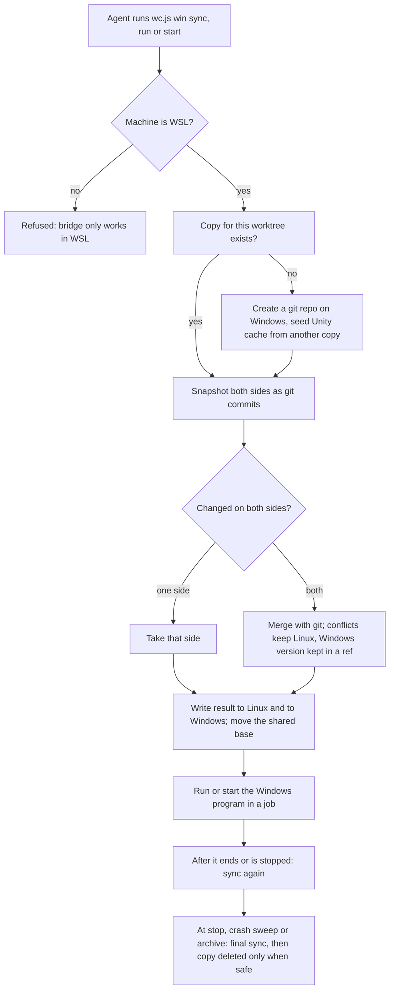

# A bridge from Wheelchair in WSL to the Windows side of the same PC

**Idea:** `IDEA.md` — what this is for and why, in plain language. Read it first; it is
the north star this plan serves. Goal and Constraints live there, not here, so they don't
get buried as this file grows.

## Open Questions

None.

## Watch List

| # | Noticed | What needs looking into | Raised to user? | Outcome |
|---|---------|-------------------------|-----------------|---------|
| W1 | Machine service runs as a systemd user service | Whether WSL interop works from it | no | Settled: D29, and the live script runs through the service |
| W2 | Codex screen apps run sandboxed | Whether Codex's sandbox blocks interop | no | Settled: all bridge commands run in the machine service, outside any agent sandbox (D11). Codex-launched Windows MCP servers go to Check Once Built |
| W3 | Per-thread Unity Editors | Mapping a Windows MCP server to the thread's Editor | yes (Q3) | Settled by D8 and D12 |
| W4 | Image cards need a Linux path | Windows screenshots | no | Settled: screenshots are written to a Linux path (Spec) |
| W5 | Windows copies accumulate | Cleanup | no | Settled: D14; anything more is Deferred |

## Decision Log

Append-only. A reversal is a new entry superseding the old, never an edit.

| # | Decision | Rationale | Source |
|---|----------|-----------|--------|
| D1 | Mode two-part | User's pick | user |
| D2 | Build for WSL on the same Windows PC; a separate Linux computer is out of scope | User's pick; recorded in IDEA.md Not doing | user |
| D3 | Sync around each Windows step, not live: Linux edits copied to the Windows copy right before any bridge command, Windows changes copied back right after, plus an explicit sync command | User's pick; live two-way sync left out | user |
| D4 | What syncs is what git would see: tracked files plus untracked files git does not ignore; deletions sync too. Ignored files (Unity's `Library/`, `Temp/`) live only on the Windows side | Keeps caches on Windows and never pollutes the thread's worktree | defaulted |
| D5 | A file changed on both sides since the last sync: the Linux version wins, the Windows version is saved to a conflicts folder beside the copy, and the command's result names each conflict | Agent edits are the source of truth; nothing is lost silently | defaulted |
| D6 | Each session's Windows copy lives at `%LOCALAPPDATA%\Wheelchair\copies\<thread-id>\<session-name>` | Fast local drive, per session so workers and verifiers do not collide | defaulted |
| D7 | Windows apps open on the user's desktop. Agents may list their windows and screenshot them, but never send mouse or keyboard input; they drive apps through the apps' own tools (MCP, command-line modes) | User's pick: never take over the user's PC | user |
| D8 | No specific Unity MCP: build a general hook, where each session's tools are told its own Windows copy's path | User's pick (none chosen yet) | user |
| D9 | Agents use the bridge through `wc.js win <op>`, a new top-level group beside `wc.js screen` | Same pattern as screens; `windows` is already a screen op name | defaulted |
| D10 | Lead, sub-lead, worker and verifier may use it; reviewer and mapper get 403 | Matches project tools roles; reviewer and mapper are read-only | defaulted |
| D11 | Every Windows action runs in the machine service through WSL interop, never in the agent's shell | One place to own lifecycle, sync and cleanup; no agent sandbox in the way | defaulted |
| D12 | Windows-side tools in `.mcp.json` are ordinary stdio entries whose `command` is a Windows program; the session environment carries `WHEELCHAIR_WINDOWS_PROJECT` and lists it in `WSLENV` so Windows programs see it | Works with every provider's existing stdio support; no new `.mcp.json` fields | defaulted |
| D13 | Available on every WSL machine in every project, no opt-in. On a machine that is not WSL every `win` op returns 422 | No setup per project | defaulted |
| D14 | Copies stay until the thread is archived (so Unity's cache survives); archive deletes the thread's copies folder | Re-importing a Unity project is slow | defaulted |
| D15 | Long jobs: `run` waits at most 9 minutes (fits an agent's 10-minute tool limit); longer work uses `start` plus `status`, which reports the exit code | Unity test runs can be long | defaulted |
| D16 | Windows-side change detection lists the copy from Windows in one PowerShell call (path, size, last-write time), never by stat-ing each file over `/mnt/c` | Unity projects have thousands of files; `/mnt/c` is slow | defaulted |
| D17 | HTTP and SSE Windows-side tools, vendor glue for a specific Unity MCP, warm-starting a copy from another copy's cache, disk caps and a cap on open apps are Deferred | Two-part mode: normal use works without them | defaulted |
| D18 | Agents are told about `wc.js win` in worker.md and verifier.md (sub-lead and lead read the same section through those docs only when briefing) | Same place the screen commands are documented | defaulted |
| D19 | No installer change: the bridge needs nothing installed on Windows; README "On Windows" gains a setup and check section | IDEA: setup is a one-time step, written down plainly | defaulted |
| D20 | A live check script `machine/test/windows-live.sh` exercises the real bridge on a WSL machine; it exits 77 (skipped) elsewhere | The build machine is not WSL; fakes cover CI | defaulted |
| D21 | Supersedes D6's per-session key: a Windows copy belongs to a worktree, at `%LOCALAPPDATA%\Wheelchair\copies\<thread-id>\<worktree-key>`, where `<worktree-key>` is the first 12 hex characters of the SHA-256 of the worktree's absolute Linux path. Sessions sharing a worktree (lead and sub-lead; a replacement worker) share its copy, manifest and warm cache | Every worker and verifier is a new session; per-session copies would always start cold, and two copies could pull into one worktree | review-round-1 |
| D22 | A newly created copy is first seeded on the Windows side with the ignored files (such as Unity's `Library/`) of the thread's most recently synced other copy, then pushed as usual. Pulls Deferred #3 into the Spec | Verifiers get a fresh worktree each; without seeding every one waits through a full Unity import | review-round-1 |
| D23 | The supported way to reach a Windows-side tool is to run its MCP server on Windows as a stdio entry launched through interop; it then reaches its app (such as the Unity Editor) over Windows' own localhost, so no networking settings change. HTTP and SSE servers on Windows stay Deferred #1 | Meets IDEA's "without hand-editing networking settings" for any tool with a stdio server, which both known Unity MCPs offer | review-round-1 |
| D24 | On a machine that is not WSL, `.mcp.json` stdio entries whose command is a Windows program are left out of the session's project tools and are not reported as missing programs | IDEA: machines without WSL are unaffected; a committed `.mcp.json` may carry Windows entries | review-round-1 |
| D25 | Sync is one reconcile that reads both sides against the manifest before writing either, instead of push then pull | A push could overwrite a Windows edit before the pull saw it | review-round-1 |
| D26 | Letter case: Linux case collisions refused; case-only renames applied as renames | Windows storage is case-insensitive; delete-plus-copy would delete the file | review-round-1 |
| D27 | Apps run under a PowerShell wrapper the service holds, and are identified by PID plus creation time; a 60 s sweep kills apps of dead sessions | Exit codes need a waiting parent; PIDs get reused; crashed sessions must not leave apps on the desktop | review-round-1 |
| D28 | Modes never come from Windows; new pulled files get 0644 | The Windows mount cannot round-trip Linux modes | review-round-1 |
| D29 | Repair a missing `WSL_INTEROP` from `/run/WSL/*_interop` for each Windows call; the setup check runs through the installed service | systemd user services often lack it | review-round-1 |
| D30 | When `.mcp.json` has a Windows program, session start readies the copy before the CLI launches | Tools start before the agent could sync | review-round-1 |
| D31 | Stop and the sweep reconcile before the copy is left; archive keeps the conflicts folder | Archive must not lose Windows-side changes or saved conflicts | review-round-1 |
| D32 | Only `.exe` counts as a Windows program; other tools go through `cmd.exe` or `powershell.exe` | Interop launches only PE executables | review-round-1 |
| D33 | The live check exercises Unity on a fixture project when `WHEELCHAIR_UNITY` is set, and rejects single-colour screenshots | A blank PNG must not pass, and Unity is the main use | review-round-1 |
| D34 | Supersedes D17's clause on warm-starting copies: that is in the Spec as D22, not Deferred | D17 contradicted D22 | review-round-2 |
| D35 | A copy is deleted when Wheelchair removes its worktree (verifier at stop, worker at merge) | Seeded copies are several GB each; their worktrees are gone | review-round-2 |
| D36 | The Unity fixture has its own `.gitignore`; the live check confirms the worktree stays clean | Unity's generated folders would otherwise be pulled into the worktree | review-round-2 |
| D37 | `WHEELCHAIR_WINDOWS_PROJECT` and the start-time copy only for `TOOL_ROLES` | Reviewers and mappers cannot use the copy | review-round-2 |
| D38 | Seeding copies only paths the new worktree's git ignores, checked by `git check-ignore` | A path missing from the source manifest may be a new asset, not a cache file | review-round-2 |
| D39 | Apps run inside a Job Object; running means the job has processes; the full exit code comes from a JSON line, not the wrapper's exit status | Launchers exit while children run; Linux truncates exit status to 8 bits | review-round-2 |
| D40 | Conflicts are saved under a time folder per reconcile | A second conflict on one path must not overwrite the first | review-round-2 |
| D41 | A copy is deleted only after a successful reconcile; a failed one keeps the copy | Deleting after a failed reconcile could lose the only Windows version | review-round-2 |
| D42 | Stop does not wait for its reconcile; archive returns `pending` until the thread's reconciles finish | The hub gives machine calls 5 s; archive already has a retry contract | review-round-2 |
| D43 | The live check drives the candidate bridge module from the worktree with a stub service, and runs once without `WSL_INTEROP` | The installed service runs the canonical clone's code, not the build under test | review-round-2 |
| D44 | Workers run `win sync` and commit before reporting done | The merge happens before the worker is stopped | review-round-2 |
| D45 | `used_since_ok` is set at session start only when the worktree's copy exists or is being readied | Otherwise every worktree on a WSL machine would get a copy | review-round-3 |
| D46 | A verifier's copy is deleted after its apps stop, with no reconcile | Its worktree is force-removed, so a reconcile is wasted | review-round-3 |
| D47 | Start-time readying waits at most 20 s, then continues in the background with a project tools line | The hub's start limit is 60 s; a Unity copy can take longer | review-round-3 |
| D48 | Sync uses git: the Windows copy is a git repository; each side is snapshotted as a commit and merged with git's merge. Supersedes the home-made reconcile rules of D4, D5, D16, D25, D26, D28, D38's listing method and D40, and D19's "nothing installed on Windows". Git for Windows is required on the PC; WSL git 2.38 or newer | User's pick after the review budget: git already handles renames, case, folders, modes and ignored files | user |
| D49 | Reconcile: snapshot both sides, merge with `merge-tree`, apply with `read-tree -m -u` on both sides; conflicts keep text markers and a ref holding the Windows side | Follows from D48; nothing is lost and git's own refusal catches files that changed mid-sync | defaulted |
| D50 | A worker's copy is never reconciled at stop or merge; deleted at merge cleanup only if unused since its last sync | Reconciling after the merge would pull edits outside the accepted work; workers sync before done (D44) | review-round-3 |
| D51 | Archive waits only for reconciles running or not yet tried since last use; a finished or failed one never holds it | Archive retries must end | review-round-3 |
| D52 | Apps record wrapper and program PID with creation times; start-time sweep ends a surviving wrapper first | The wrapper holds the job; after a service restart it may survive | review-round-3 |
| D53 | Supersedes D47's 20 s and its project tools line: wait at most 45 s; readiness is reported through `win info` only | The hub keeps project tools lines only for the thread worktree (`machine/service.js:662-707`) | review-round-3 |
| D54 | Sandboxed sessions cannot `run` or `start` Windows programs | Windows programs run outside any Linux sandbox | review-round-3 |
| D55 | Supersedes D43: the live check runs the candidate service under `systemd-run --user` and calls it through `wc.js win` | Exercises the real route and a service environment | review-round-3 |
| D56 | WSL git must be 2.40 or newer | `merge-tree --merge-base` arrived in 2.40; Debian 12 ships 2.39 | review-round-4 |
| D57 | Bridge git commands disable line-ending conversion and every filter driver (LFS included), so files travel as raw bytes | Unity projects often use LFS; pointer files would break the copy | review-round-4 |
| D58 | The copy gets the Linux version of conflicted paths; markers only on Linux | Unity's YAML files are the likeliest to conflict; an open Editor must not load markers | review-round-4 |
| D59 | Supersedes D50's kept-if-flagged rule: a worker's copy is deleted at merge cleanup regardless, and a copy whose worktree is gone is deleted, never reconciled | Otherwise a several-GB copy could stay forever | review-round-4 |
| D60 | Paths with unresolved conflict markers on Linux are held back from Windows until resolved | Otherwise a second sync would send markers to Windows | review-round-4 |
| D61 | Bridge git commands use `--attr-source=<empty tree>` and the bridge's own persistent indexes; the real index is never used | Raw bytes even from a clean LFS checkout and with `text`/`eol` attributes; supersedes D57's filter overrides | review-round-4 |
| D62 | Linux case collisions refused before writing (restores D26's refusal under git sync) | NTFS cannot hold both paths | review-round-4 |
| D63 | A `pending` record makes the next reconcile finish an interrupted apply; `sync --abandon` clears an unfinishable one | A locked file on Windows can stop the checkout after Linux was updated | review-round-4 |
| D64 | Exact list of when a copy is deleted; a failed copy is kept except a verifier's or a merged worker's | Removes the contradiction between D41 and D59 | review-round-4 |
| D65 | Conflict refs are kept, never deleted by Wheelchair | Archive must not discard the only Windows version | review-round-4 |
| D66 | The live check reads the Unity results file for a passing fixture test | Exit status alone does not show the test ran | review-round-4 |
| D67 | Supersedes D63: no `pending` record or `--abandon`; base moves only after both applies, and the next reconcile re-merges from the old base | Identical changes on both sides merge cleanly; the recovery rule wedged the bridge after a new edit | review-round-5 |
| D68 | Supersedes D56: git 2.43 or newer on both sides | `--attr-source` arrived in 2.41; `merge-tree` crashed with it until 2.43 | review-round-5 |
| D69 | Copies are deleted only at archive or worktree removal, never for being idle | Keeps the thread worktree's warm Unity cache (D14) | review-round-5 |
| D70 | The live check creates its Unity project with the installed Unity and lets Unity write its files before the clean check | A committed project would be rewritten by a different Unity version | review-round-5 |
| D71 | Unresolved-marker paths are masked on both sides, not only Linux | A Windows edit to such a path made the Linux apply refuse | review-round-5 |
| D72 | Only text content conflicts get markers; every other conflict kind takes the Linux entry | A modify/delete conflict would otherwise resurrect the file on Windows | review-round-5 |
| D73 | A new Linux bridge index starts from `HEAD` without stat data | Tracked files matching an ignore rule must reach the copy | review-round-5 |
| D74 | A copy counts as used while a live session there has a Windows-program tool | Such tools write outside the bridge's tracked apps | review-round-5 |
| D75 | The live check's Unity project starts as minimal committed files; Unity fills in its own files on Windows through `win start` before the test run | Avoids running Unity over the WSL share and the `run` time limit | review-round-6 |
| D76 | The deletion list is the only rule for deleting a copy | Lifecycle text contradicted it for copies whose worktree is gone | review-round-6 |
| D77 | A copy with unresolved conflict paths is never deleted at archive or worktree removal | A masked Windows edit would be deleted with the copy | review-round-6 |
| D78 | An app's wrapper closing sets `used_since_ok` | An app can write and exit naturally after the last sync | review-round-6 |
| D79 | Run one more review round; if not clean, come back to the user before going further | User's pick at the second review budget | user |
| D80 | The force-add step skips paths not on disk | A deleted, uncommitted tracked file made every later sync fail | review-round-7 |
| D81 | Supersedes D77: a copy with unresolved paths is deleted after saving its Windows snapshot as a kept conflict ref | Nothing is lost and no several-GB copy stays forever | review-round-7 |
| D82 | A copy whose last reconcile failed is never deleted at archive | It otherwise read as "needed none" | review-round-7 |
| D83 | Newly ignored, untracked paths are dropped from the bridge indexes before each snapshot | A `.gitignore` added mid-thread (common for a new Unity project) must stop caches syncing | review-round-7 |
| D84 | Plan approved after round 7 without a further round; the last fixes (D82, D83) go unreviewed | User's pick: findings had shrunk to small rule gaps and rare corners, and the build is checked on real Windows | user |

## Spec

### The flow at a glance



The words above are the full Spec; the picture only shows the order: every Windows step is wrapped by a sync, and copies are deleted only after their changes are safe.

### What it is

On a machine where Wheelchair runs inside WSL2, agents get `wc.js win <op>`: a bridge to the
Windows side of the same PC. Each worktree gets its own Windows copy (a git repository), kept in
step around every bridge command, and can run Windows programs, start Windows apps, list and
screenshot their windows, and stop them. Windows-side MCP tools reach the session's copy
through an environment variable. Nothing changes on Linux machines without WSL or on Macs.

### Detection and availability (D13)

- The machine is WSL when `/proc/sys/fs/binfmt_misc/WSLInterop` (or `WSLInterop-late`)
  exists and `/proc/sys/kernel/osrelease` contains `microsoft` (case-insensitive). Decided
  once at service start.
- PowerShell is found at `<mount>/c/Windows/System32/WindowsPowerShell/v1.0/powershell.exe`,
  where `<mount>` is the `[automount] root` from `/etc/wsl.conf`, default `/mnt`. Every
  Windows action is a `powershell.exe -NoProfile -NonInteractive -EncodedCommand <base64>`
  child of the machine service (D11), with a timeout.
- Not WSL: every `win` op returns 422 `the Windows bridge only works when Wheelchair runs in WSL`.
- **Interop from the service (D29):** before every Windows call, if `WSL_INTEROP` is unset
  or names a socket that does not exist, the service sets it, for that child only, to the
  newest socket matching `/run/WSL/*_interop`. A systemd user service often lacks it while
  an interactive shell has it.
- WSL but PowerShell missing or failing to start: 422 naming what failed, the `WSL_INTEROP`
  value tried, and the hint `check that interop is enabled in /etc/wsl.conf, then run
  wsl --shutdown from Windows and reopen WSL`. `win info` reports the same as `reason`.

### Commands (D9, D10)

Route `POST /v1/agent/win`, session-token auth like `/v1/agent/screen`
(`machine/service.js:2044`), body `{op, args}`. `wc.js win <op> [args]` builds it in
`viewer/app/wc.js` like `screenRequest`. Reviewer and mapper sessions get 403. A stopped,
archived or not-running session gets 409. Bad arguments 400. Anything else that fails 422.
Ops act only on the caller's own session; no op takes a session or thread argument.

| Op | Args | Does | Returns |
|---|---|---|---|
| `info` | none | Probes PowerShell, `git.exe` and Linux git's version; does not create the copy | `{wsl, ok, ready, reason?, copy_windows, copy_linux, sandboxed}` |
| `sync` | none | Reconcile (below) | `{to_windows, to_linux, conflicts, skipped}` |
| `run` | `[--timeout <s>] [--env K=V]... -- <program> [args...]` | Reconcile, run in the copy, wait, reconcile | `{exit_code, timed_out, output, log, sync}` |
| `start` | `[--env K=V]... -- <program> [args...]` | Reconcile, start without waiting | `{id, pid, log, sync}` |
| `status` | `[<id>]` | Running or exited, with exit code; reconciles once when it first sees an exit | `{apps: [{id, program, running, exit_code, log}], sync?}`; `sync` present when a reconcile ran |
| `windows` | none | Top-level visible windows of this session's started apps and their child processes | `{windows: [{handle, title, pid, app_id, minimized}]}` |
| `shot` | `<handle>` | Screenshot one of those windows | `{path}`: a Linux PNG path |
| `stop` | `[<id>]` | Kill an app's process tree (all apps if no id), then reconcile | `{stopped, sync}` |
| `path` | `<path>` | Translate a Linux path to Windows or back (`wslpath -w` / `-u`) | `{path}` |

- **Sandbox (D54):** in a session whose apps run sandboxed (Codex not in `unrestricted`
  mode, the same test as `machine/lib/screen.js:191`), `run` and `start` return 403
  `Windows programs would run outside your sandbox; the bridge can't run them in this
  session`, and `info` reports `sandboxed: true`. Other ops work.
- `program` is a Windows program name resolved by PowerShell on the Windows PATH, or a full
  Windows path. Working directory is the worktree's copy. `--env` sets variables for that
  program only. `WHEELCHAIR_SESSION_TOKEN` is never passed to Windows.
- `run`: default timeout 540 s, maximum 540 s (D15); on timeout the process tree is killed,
  `timed_out: true`, and the reconcile still happens. `output` is the last 64 KiB of combined
  stdout and stderr; the full output is in `log`, a Linux file under
  `<stateDir>/win/<session>/logs/`. Programs started by `run` and `start` get no console window.
- **Process tracking (D27, D39):** `run` and `start` launch a PowerShell wrapper as a child of
  the machine service. The wrapper creates a Windows Job Object with
  `JOB_OBJECT_LIMIT_KILL_ON_JOB_CLOSE`, starts the program inside it (so every descendant is
  in the job), prints one JSON line `{"started": {pid, created}}` with the program's PID and
  process creation time, waits until the job has no active processes, then prints one JSON
  line `{"done": {exit_code}}` with the program's full 32-bit exit code and exits. The
  service reads the exit code only from that line, never from the wrapper's own exit status
  (which Linux truncates to 8 bits). An app is **running** while its job has any process,
  even after the program itself exited. `windows` and `shot` see every process in the job;
  `stop` and the sweep terminate the job. Each app is recorded in `<stateDir>/win/apps.json`
  with session, PID and creation time. After a service restart, for a recorded app the
  service no longer holds, a process with that PID is killed (its tree) only if its creation
  time matches; its exit code is `null` with `running: false`. A wrapper that ends without a
  `done` line reports `exit_code: null`.
- `start` returns once the wrapper has printed its line; output goes to the log. At most 4
  started apps per session at once; a fifth gets 422.
- `windows` and `shot` only see windows owned by processes this session started (or their
  descendants). Any other handle gets 400.
- `shot` uses `PrintWindow` with `PW_RENDERFULLCONTENT` so GPU-drawn windows capture; it never
  focuses, moves or restores a window. A minimized window gets 422 `window is minimized`. The
  PNG is written to `<stateDir>/win/<session>/shots/<n>.png` (keep the newest 50), so it can be
  posted with an `image` card.
- No op sends mouse or keyboard input (D7).


### The Windows copy and sync (D3, D14, D21, D35, D41, D45, D46, D48–D50, D56–D66)

- Copy path: `%LOCALAPPDATA%\Wheelchair\copies\<thread-id>\<worktree-key>` (D21), reached
  from Linux through the mount. One copy per worktree: sessions sharing a worktree share its
  copy. Created on the first `sync`, `run` or `start` from that worktree, or at session start
  (D30).
- **The copy is a git repository (D48).** It is created by Windows `git.exe init` with
  `core.autocrlf=false`, `core.ignorecase=true`, `core.filemode=false` and
  `core.longpaths=true`. Windows-side work uses `git.exe` (Git for Windows, found by
  PowerShell on the Windows PATH); Linux-side work uses the worktree's `git`. Both must be 2.43
  or newer (D68: `--attr-source` arrived in 2.41 and `merge-tree` with it works from 2.43); `win info` checks both. Linux
  git reaches the copy's repository through its mount path for `fetch` and `push` only;
  checkouts in the copy are always done by `git.exe`.
- **Raw bytes (D57, D61).** Every git command the bridge runs, on either side, runs as
  `git --attr-source=4b825dc642cb6eb9a060e54bf8d69288fbee4904 -c core.attributesFile=<empty
  file> -c core.autocrlf=false ...` (the empty tree) with `GIT_ATTR_NOSYSTEM=1`, so no `.gitattributes` applies: no
  filter (Git LFS included), no `text`/`eol` conversion. Files travel as their exact bytes,
  never as LFS pointers, and the copy needs no LFS remote.
- **Bridge indexes (D61).** Each side has its own persistent index, used only by the bridge
  and only under these settings: Linux `<stateDir>/win/copies/<worktree-key>/linux.index`,
  Windows `<copy>\.git\wheelchair.index`. The worktree's real index is never read or written,
  so no stat entry made under LFS or `eol` rules is reused. A new Linux bridge index starts
  from `git read-tree HEAD` (entries without stat data, so every file is hashed raw on the
  first `add -A`), so files tracked despite matching an ignore rule are included (D73). Before each Linux
  snapshot, any path the worktree's real index lists (read only, `git ls-files`) that the
  bridge index lacks and that exists in the worktree is added with `git add -f` (paths
  no longer on disk are skipped, D80), and any path in the bridge index that git now ignores
  and the real index does not list is removed from the bridge index with `git rm --cached`
  (D83), on both sides, so a newly ignored file stops syncing. so a file force-added later is included too. A new
  Windows bridge index starts from the first `r_win` checkout.
- **Refs.** Linux repository: `refs/wheelchair/<worktree-key>/base` and `.../windows`; conflict refs under `refs/wheelchair/conflicts/<thread-id>/<worktree-key>/<UTC
  time>`. Copy: `refs/wheelchair/base` and `refs/wheelchair/linux`. The thread's branch and
  `HEAD` are never changed by sync.
- **Snapshots.** A side's snapshot is the tree `git add -A` then `git write-tree` produce on
  that side's bridge index. Ignore rules, deletions, renames, letter case (the Windows side
  ignores case), executable bits (taken from Linux; Windows has `core.filemode=false`) and
  file/folder changes all follow git. Ignored files are never in a snapshot and never touched.
- **Letter case (D62).** A Linux snapshot holding two paths equal ignoring case fails the
  reconcile with 422 naming them, before anything is written.
- **Reconcile (D49)** is the only sync step; every op that syncs runs it, serialized per copy
  across every session sharing it:
  1. Snapshot Linux (tree `L`) and Windows (tree `W`). Fetch `W`'s objects into
     `refs/wheelchair/<key>/windows`.
  2. **Unresolved conflicts (D60).** For each path in `state.unresolved`: if the Linux file
     still has a line starting `<<<<<<< `, `=======` alone, or `>>>>>>> `, replace that path
     in both `L` and `W` with its `base` entry for the rest of this reconcile, so it neither
     travels nor counts as a change on either side and neither apply touches it (D71); a
     Windows edit to it waits on Windows. Otherwise drop it from `unresolved`.
  3. Result tree `R`: `L` if `W` equals `base`'s tree; `W` if `L` equals it; otherwise `git
     merge-tree --write-tree --merge-base=base L W` (each tree wrapped as a commit with
     `commit-tree`, parent `base`). On a clean merge `R` is that tree. On conflicts `R` is the
     tree merge-tree wrote, except that every conflicted path that is not a both-sides content
     conflict in a text file (binary, modify/delete, rename or add/add of differing types)
     takes `L`'s entry, present or absent (D72); so only text content conflicts carry markers,
     and Linux wins every other kind; a commit of `W` is kept as a conflict ref; each conflicted path is listed in
     `conflicts` with that ref and added to `state.unresolved` if it got markers. `R_win` is
     `R` with every conflicted path taken from `L` (D58), so Windows never holds markers.
  4. Commit `R` and `R_win` with `commit-tree` (parent: the current `base` commit), then apply: `git read-tree -m -u L r`
     on the Linux bridge index; push `r_win` to the copy's `refs/wheelchair/linux` and run
     `git.exe read-tree -m -u W r_win` there (`--reset -u` when the copy has no `base` yet).
     A refusal because a file the update touches changed since its snapshot restarts the
     reconcile at step 1 once; a second refusal fails with 422 naming the paths.
     **Interrupted applies need no recovery (D67):** `base` moves only in step 5, after both
     applies succeeded. If one side was updated and the other was not (a locked Windows file,
     a service restart), the next reconcile merges from the old `base` again; whatever the
     first apply already wrote now appears identically on both sides, which git merges
     cleanly, and paths with unresolved markers are held back by step 2.
  5. Set `base` to `r_win` on both sides (so a conflicted path resolved later on Linux reads
     as a Linux-only change), record `last_ok`.
  Result fields: `{to_windows, to_linux, conflicts: [{path, ref}], unresolved, skipped}`. A
  symlink pointing outside the worktree is left out of the Linux snapshot and listed in
  `skipped`.
- **Seeding (D22, D38).** When a copy is created and the thread has another copy, the one
  with the newest `last_ok` is the source: `git.exe fetch <source copy> refs/wheelchair/base`
  for its objects, then the paths of the source that `git check-ignore --stdin` in the **new**
  worktree reports ignored are copied with one Windows-side `robocopy`. The first reconcile
  then has no `base`: `W` counts as empty and `R = L`.
- **State** per copy at `<stateDir>/win/copies/<worktree-key>/state.json`: `last_ok`,
  `last_failed` (reason, cleared on success), `used_since_ok` (D45: set by any `win` op, by a
  tool-role session start on a worktree whose copy exists or is being readied, and by the
  sweep or a stop when it terminates jobs on that copy, and whenever the service sees an
  app's wrapper close (D78); cleared by a successful reconcile,
  except that it is set again at once while a live session on that worktree has a
  Windows-program `.mcp.json` entry, because such a tool can write at any time (D74)),
  and `unresolved`. A worktree with no copy gets no state and no flag.
- **Deleting a copy (D35, D41, D46, D59, D64)** deletes the folder and its `base` and `windows`
  refs, in exactly these cases:
  1. a verifier's copy, after its apps' jobs are terminated at its stop, with no reconcile
     (both removal sites, `machine/service.js:864` and `:1087`);
  2. a worker's copy at merge cleanup (`machine/service.js:1400`), whatever its state (D50:
     workers sync and commit before reporting done);
  3. at archive, each remaining copy whose last reconcile did not fail, after its final
     reconcile succeeded or when it needed none (D69, D82);
  4. when Wheelchair removes a worktree in any other way, its copy, unless its last reconcile
     failed.
  Copies are never deleted for being idle: the thread worktree's copy, and its Unity cache,
  stays until archive (D14).
  The list is the only rule for deleting a copy; nothing else deletes one (D76). Before deleting a copy
  with any path in `unresolved` under cases 3 and 4, the Windows snapshot its final
  reconcile fetched is saved as a conflict ref (kept per D65), then it is deleted (D81). Every other copy, in
  particular one whose last reconcile failed, is kept and the machine log
  names it.
- **Conflict refs are never deleted by Wheelchair (D65)**, not with the copy and not at
  archive, so the Windows version of every conflict stays recoverable with `git show`.

### Lifecycle (D27, D31, D42, D51, D52)

- **Session stop** (an explicit stop, including the stops archive makes,
  `machine/service.js:1122-1135`): terminate the session's apps' jobs (setting
  `used_since_ok` on the copy if any were running) and return at once. Then, in the
  background: a verifier's copy is deleted (D46); a worker's is left (D50); for a lead or
  sub-lead, if no other live session shares the copy and `used_since_ok` is set, a reconcile
  starts. A stop of a session already stopped starts nothing.
- **Archive (D42, D51):** a copy *needs a final reconcile* when its worktree exists,
  `used_since_ok` is set and no reconcile has failed since it was set. Archive starts one for each such copy of the thread
  that has none running, and returns the existing `pending` result
  (`viewer/app/threads.js:217-222`) naming the sessions that last used those copies while any
  is running; the user's "Archive again" retries. A finished reconcile, successful or failed,
  never makes archive wait again. The WIP commit happens once none is running. Then archive
  deletes copies per the deletion list (D76). A copy whose worktree no longer exists is never reconciled; whether it
  is deleted follows only the deletion list above (D76).
- **Sweep** every 60 s, like the screen sweep (`machine/lib/screen.js:105-110`), and once at
  service start: terminate the jobs of apps whose session is not live in tmux (a crash or a
  natural exit), including a `run` in flight, setting `used_since_ok`; then reconcile every
  lead or sub-lead copy that needs a final reconcile (as above) and has no live session.
- **After a service restart (D52):** `apps.json` records, for each app, the program's and the
  wrapper's PID and creation time. The start-time sweep terminates a surviving wrapper (which
  closes its job and, with `JOB_OBJECT_LIMIT_KILL_ON_JOB_CLOSE`, ends every process in it),
  then the program's tree, each only if its creation time matches.

### Windows-side tools (D8, D12)

- On WSL machines, every lead, sub-lead, worker and verifier session's tmux environment
  (the roles in `TOOL_ROLES`, `machine/lib/project-mcp.js:8`) gets `WHEELCHAIR_WINDOWS_PROJECT` set to
  its copy's Windows path. The value is already a Windows path, so `WSLENV` gains `WHEELCHAIR_WINDOWS_PROJECT` (appended to any
  existing value with `:`). Not set on other machines.
- The supported route for a Windows-side tool (D23): its MCP server runs on Windows as a
  stdio entry, so it reaches its app over Windows' own localhost. Example for a tool on the
  Windows PATH: `"command": "/mnt/c/Windows/System32/cmd.exe", "args": ["/c", "<tool>"]`.
- A **Windows program** in `.mcp.json` is a stdio entry whose `command` is an absolute
  `/mnt/<drive>/...` path ending in `.exe` (case-insensitive) (D32). Interop runs only `.exe`
  files directly, so a `.cmd`, `.bat` or `.ps1` tool goes through `cmd.exe` or
  `powershell.exe` as in the example. On WSL the project-programs check
  (`machine/lib/project-programs.js`) treats such a path as found when it is an existing
  regular file; any other command is checked as today.
- On a machine that is not WSL, such entries are left out of the session's project tools
  and not reported as missing (D24); `cmd.exe` and `powershell.exe` paths count as Windows
  programs too.
- **Ready before tools start (D30):** on WSL, for the same roles only, when the worktree's `.mcp.json` has at least
  one Windows-program entry, session start creates (and seeds) the copy and reconciles it
  before launching the agent's CLI, so a tool that needs the project finds it. The start
  waits for this at most 45 s (D47, D53; the hub allows a start 60 s,
  `viewer/app/sessions.js:218`). If it is not done by then, or it fails, the CLI launches
  anyway and the readying carries on in the background. `win info` reports `ready` (false
  while readying) and `reason` (the failure); any other `win` op on that copy waits for the
  readying to finish. Nothing is added to the project tools card (D53).

### Agent instructions (D18)

Add to `protocol/app/worker.md` and `protocol/app/verifier.md`, next to the screen paragraph:
on a WSL machine, use `wc.js win` to run or look at things on Windows; your Windows copy is
synced with git around each command; after editing files, run `win sync` before asking a
Windows-side tool to look at them; a sync can report conflicts: text files then hold git
conflict markers to resolve, and any other kind (binary, deleted on one side,
renamed) keeps your version; the Windows side is in the ref the result names, so `git show
<ref>:<path>` gets a Windows file back when it exists there, and `git ls-tree -r <ref>` shows
what the Windows side had if the path was renamed or deleted; if a Windows-side
tool failed at the start of your session, check `win info`'s `ready` and say so in your
report; Windows apps
appear on the user's desktop, so never leave them running and never try to type into them;
use `win stop` when done. A worker runs `win sync` and commits what it brought back before
reporting its task done, so the merge carries every Windows-side change. Unity tests: `win run -- <Unity.exe path> -batchmode -runTests
-projectPath <copy> -testResults <copy>\Logs\wheelchair-results.xml` with no Editor open on
that copy (Unity refuses a second instance on one project); `Logs/` is ignored in a Unity
project, so read the results through `copy_linux` from `win info` rather than expecting them
in the worktree. A verifier reports a `win` 422 for "not WSL" as
COULD NOT TRY. The first Unity open in a thread imports the whole project and can outlast
`run`'s limit: use `win start` and poll `win status` for it.

### Setup (D19, D48)

README "On Windows" gains: install Git for Windows on the Windows side and make sure WSL's
git is 2.43 or newer, as is Git for Windows (both checked by `win info`); conflict refs under
`refs/wheelchair/conflicts/` can be removed with `git update-ref -d` once no longer needed; interop must be on (`[interop] enabled=true`, the default); check
from a thread by asking the lead to run `wc.js win info`, which runs inside the installed
machine service (D29); if it fails, run `wsl --shutdown` from Windows, reopen WSL and check
again; Windows-side tools use full
`/mnt/c/...` paths to an `.exe`, with `.cmd`/`.bat` tools wrapped in `cmd.exe /c`; `WHEELCHAIR_WINDOWS_PROJECT` names the session's copy. `machine/API.md`
documents `/v1/agent/win`; `machine/AGENTS.md` lists the new files.

### Not in this build

Live syncing, mouse or keyboard input, a separate Linux computer, native Windows, and the
Deferred rows.

### Validation

```bash
bash machine/test/run.sh                 # new machine/test/win*.test.js with a fake powershell.exe and fake /proc and mount roots
node --test viewer/test/*.test.js        # wc.js win argument building
bash machine/test/windows-live.sh        # on a WSL machine only; exit 77 elsewhere (D20)
```

The machine tests use a fake `powershell.exe` and a fake `git.exe` that runs the real Linux
`git` in the fake copy folder, so sync runs real git on both sides. They must cover: non-WSL
422; reviewer and mapper 403; sandboxed Codex session gets 403 on `run` and `start`; sync of
added, changed, deleted and renamed files in each direction; ignored files never copied
either way; edits to different files on both sides both survive; a text conflict leaves
markers in the Linux file and names a ref whose tree has the Windows version; a binary
conflict keeps the Linux version and the ref has the Windows one; a file touched by the
update that changes during a reconcile makes it retry once and then fail with nothing lost;
an interrupted apply (Windows checkout failing after Linux was updated), followed by a new
Linux edit to a different file, is finished by the next reconcile without conflicts or a 422; a second sync before a text conflict is resolved does
not send markers to Windows, and resolving it later sends the resolution; a Linux case
collision is refused before writing; an LFS-tracked file and a file with `eol=crlf` reach the
copy byte for byte from a clean checkout; conflict refs survive copy deletion and archive; the thread branch, `HEAD` and
real index are unchanged by sync; an executable bit set in Linux survives a round trip; a
Windows edit made between commands is not overwritten by the next command; `status` returns
`sync` with conflicts; `WSL_INTEROP` repaired from `/run/WSL`; a recorded PID with a
different creation time is never killed; the exit code comes from the `done` line (a fake
exit code of 256 reports 256); an app whose launcher exited stays running while its job has
processes; the start-time sweep ends a recorded surviving wrapper; the sweep terminates a dead
session's jobs and reconciles lead or sub-lead copies needing it, including ones with no apps;
stop returns at once; a verifier's copy is deleted at stop without a reconcile; a worker's
copy is not reconciled at stop and is deleted at merge cleanup even when flagged; a copy
whose worktree is gone is deleted without a reconcile; the copy never receives conflict markers; a session start on a worktree with no copy and no Windows `.exe` entry creates no copy
or state; start-time readying past 45 s launches the CLI and `win info` reports `ready:
false`; archive returns `pending` while a final reconcile runs and not again after it
finished or failed; a copy whose reconcile failed is kept except a verifier's or a merged worker's; seeding copies only paths
the new worktree's git ignores; `.cmd` entries are not treated as Windows programs; `run`
timeout kills and still syncs; `run` output cap and log; `start` limit of 4; `windows`/`shot`
refuse handles of other processes; a second session on the same worktree shares the copy;
Windows-program `.mcp.json` entries dropped without warnings on non-WSL; deleting a copy
removes its `base` and `windows` refs and keeps its conflict refs; a lead copy used only
through a Windows MCP tool after its last sync is reconciled at the lead's stop; a Windows
edit to a path with unresolved markers waits on Windows and the reconcile still applies
other changes; a Linux delete against a Windows edit keeps the deletion and the conflict ref
holds the Windows file; a file tracked despite an ignore rule reaches the copy; a tracked file deleted but not
committed syncs on two syncs in a row without error; a copy deleted with unresolved paths
leaves a conflict ref holding its Windows files; a copy whose final reconcile failed is not
deleted at archive; a file synced before a new `.gitignore` rule covered it stops syncing; `WHEELCHAIR_WINDOWS_PROJECT` and `WSLENV` set only on WSL and only for tool
roles; the token never reaches a Windows program's environment.

`windows-live.sh` (with `windows-live.js`, in the pattern of `machine/test/screen-live.sh`)
tests the candidate code through its real route (D55): it starts `machine/service.js` from the
worktree it lives in under `systemd-run --user --wait --pipe` (so the environment is a
systemd user service's, without `WSL_INTEROP`), on a free port with a temporary state
directory and a fake `tmux` on `PATH` as the machine tests use, records a lead session for a
temporary git repository through the hub route the machine tests use, and calls `wc.js win`
from this worktree with that session's token and origin. It prints the service's code path so
the report shows which build answered. Steps: `info` ok, `sync` round trip with a file edited
on each side, `run -- cmd.exe /c echo hi`, `start -- notepad.exe`, `windows`, `shot` produces
a PNG that is not a single colour, `stop`. With `WHEELCHAIR_UNITY=<path to Unity.exe>` set it
also runs the Unity part (D33) on the fixture project `machine/test/fixtures/unity-min` (one
passing EditMode test). The fixture ships only the files a Unity project needs to start (D70, D75):
`.gitignore`, `Packages/manifest.json` with the test framework, `Assets/Tests/Tests.asmdef` (editor-only, referencing the test
framework) and `Assets/Tests/FixtureTest.cs`, with no `ProjectSettings/`. In order, the script: commits these into the temporary
repository; runs `win sync`; `win start`s Unity on the copy with `-batchmode -quit` (no
`-createProject`, nothing run on the Linux side) and polls `win status` until it exits 0, so
Unity writes its own `ProjectSettings/` and `.meta` files for the installed version on
Windows; runs `win sync` and commits what came back. Only then the test run below. The fixture carries its own
`.gitignore` ignoring `Library/`, `Temp/`, `Logs/`, `UserSettings/`, `obj/`, `*.csproj`,
`*.sln` and `Packages/packages-lock.json` (D36). `win run` of batchmode tests with
`-testResults` at the fixture's (not ignored) `wheelchair-live-results.xml` returns exit 0,
the file appears in the Linux repository and names the fixture's test with result `Passed`
(D66); the script deletes it, runs `win sync`, and
afterwards `git status --porcelain` there is empty; `win start` of the Editor on the fixture,
wait for its window, `shot` is not a single colour, `stop`. Without `WHEELCHAIR_UNITY` it
prints `Unity part skipped` and exits 77 after the rest passes. On the user's PC, the verifier
sets `WHEELCHAIR_UNITY`.

## Deferred

| # | Item | Why it can wait | Source | Notes for the follow-up |
|---|------|-----------------|--------|-------------------------|
| 1 | Windows-side tools that use HTTP or SSE on Windows `localhost` | Stdio tools cover normal use; WSL's default networking does not forward to Windows localhost | planning | Options: rewrite `localhost` to the Windows host address, or a per-session port forward |
| 2 | Ready-made setup for a specific Unity MCP | The general hook (D8, D12) lets any stdio Unity MCP target the copy | planning | Pick once the user chooses one; Unity's own and MCP for Unity both target an Editor by project path |
| 4 | Disk use report and limits for copies, and for raw blobs and kept conflict refs in the repository's `.git` | Copies of removed worktrees are deleted (D35) and archive removes the rest; conflict refs are rare and removable by hand (README) | planning | Show size in `win info`; warn past a threshold |
| 6 | Restart Windows-side tools that started before the copy was ready | The copy is usually ready within the 45 s wait; the agent reports when it was not | review-round-3 | Restart the tool once `win info` reports ready |
| 5 | Warning at session start when the bridge is broken on a WSL machine | `win info` reports it | planning | Mirror the screen tools warning at `machine/service.js:1999` |

## Accepted Risks

| Risk | Why accepted | Round |
|------|--------------|-------|
| An app that writes and exits during a sync's own window, followed by a stop before the next sync, can leave that write unsynced | Rare path: a race inside one sync | review-round-7 |
| A copy deleted after its worktree is gone saves an older Windows snapshot for unresolved paths | Rare path: three unlikely conditions together | review-round-7 |
| Force-adding a generated file Windows already created makes the reconcile fail | Rare path; fails with a reason, nothing lost | review-round-7 |
| After an interrupted apply, a Linux edit to the same lines before the retry produces a reported conflict | Rare path: needs a failed apply and a same-line edit before the retry; nothing is lost | review-round-6 |
| A rename/rename conflict reports the Linux path; the Windows file is at another path in the ref | Rare path: both sides renaming one file between syncs; `git ls-tree -r <ref>` finds it | review-round-6 |
| A repository-local `info/attributes` with filters or line-ending rules still applies to bridge git commands | Rare path: hand-made local file | review-round-5 |
| Both sides adding the same file name in different letter case between two syncs merges into paths NTFS cannot hold | Rare path: two unlikely edits in one window; the Windows apply then fails with a reason | review-round-5 |
| A junction or symlinked parent directory inside a copy or worktree could make sync read or write outside it | Rare path: projects do not contain them in ordinary use; reparse points in the copy are skipped | review-round-1 |

## Check Once Built

| # | What to check | Round |
|---|---------------|-------|
| 1 | A Windows stdio MCP server launched by a Codex session works through interop | planning |

## Review Rounds

### Round 1 — 2026-11-19

**Lanes:** intent: claude / claude-opus-5-5; mechanics: gpt / gpt-6.2-sol; cross-family: yes.

**Changed since Round N-1:** n/a (first round — whole Spec in scope)

| Lane | Reported | Finding | Lead verdict | Resolution |
|------|----------|---------|--------------|------------|
| intent | major | Per-session copies make every worker and verifier start cold, against "Unity must work well" | upheld | D21 keys copies by worktree; D22 seeds new copies (Deferred #3 pulled in) |
| intent | major | HTTP Windows tools deferred, yet IDEA promises no networking tweaks | downgraded: minor | A stdio server run on Windows reaches its app over Windows localhost with no networking change; both known Unity MCPs offer stdio. Stated as the supported route (D23) |
| intent | minor | Lead and sub-lead get two copies pulling into one worktree | upheld | Removed by D21 |
| intent | minor | Committed Windows paths in `.mcp.json` flagged on non-WSL machines | upheld | D24 |
| mechanics | blocking | Push can overwrite a Windows edit before the pull notices the conflict | upheld | D25 reconcile reads both sides first |
| mechanics | blocking | Archive can discard unsynced Windows edits and saved conflicts | downgraded: major | Real, small fix: D31 reconcile on stop and sweep; conflicts kept |
| mechanics | blocking | Junctions or symlinked parents could send sync outside the roots | accepted-risk | Rare path: needs a junction or symlinked parent inside a project copy; reparse points are skipped anyway |
| mechanics | blocking | `.cmd`/`.bat` cannot launch directly through interop; exec-bit check wrong | upheld | D32 |
| mechanics | major | Lead and sub-lead pull into one worktree from two copies | upheld | Already removed by D21; serialization stated |
| mechanics | major | Apps outlive a crashed session; in-flight work not cancelled | upheld | D27 sweep |
| mechanics | major | Exit code and process ownership across separate PowerShell calls | upheld | D27 wrapper, PID plus creation time |
| mechanics | major | Windows MCP server starts before the copy exists | upheld | D30 |
| mechanics | major | Interop may fail from the systemd service even when enabled | upheld | D29 |
| mechanics | major | Copying modes through the Windows mount breaks git's executable bit | upheld | D28 |
| mechanics | major | Case-only rename deletes the file | upheld | D26 |
| mechanics | major | `status` cannot report conflicts from its reconcile | downgraded: minor | One field; added `sync` to `status` |
| mechanics | major | Live check passes with a blank PNG and never runs Unity | upheld | D33 |

### Round 2 — 2026-11-19

**Lanes:** intent: claude / claude-opus-5-5; mechanics: gpt / gpt-6.2-sol; cross-family: yes.

**Changed since Round 1:** copies keyed by worktree and seeded from another copy (D21, D22); stdio-on-Windows as the supported tool route (D23); Windows entries dropped on non-WSL (D24); one reconcile instead of push then pull (D25); letter case (D26); app wrapper, PID plus creation time, sweep (D27); file modes (D28); `WSL_INTEROP` repair (D29); copy ready before tools start (D30); stop/sweep reconcile, conflicts kept on archive (D31); `.exe` only (D32); Unity in the live check (D33); `status` returns `sync`.

| Lane | Reported | Finding | Lead verdict | Resolution |
|------|----------|---------|--------------|------------|
| intent | major | Unity fixture's generated folders would be pulled into the worktree | upheld | D36 |
| intent | major | Seeded copies of removed worktrees pile up until archive; Deferred #4's reason gone | upheld | D35; Deferred #4 reason updated |
| intent | minor | Copy and env var made for reviewers and mappers too | upheld | D37 |
| intent | minor | `results.xml` at the copy root gets pulled and maybe committed | upheld | Results under ignored `Logs/`, read through `copy_linux` |
| intent | minor | D17 contradicts D22 | upheld | D34 |
| mechanics | blocking | Seeding treats anything missing from the source manifest as ignored | upheld | D38 |
| mechanics | blocking | Archive can delete a copy after a failed reconcile | downgraded: major | Real, small fix: D41 |
| mechanics | blocking | A second conflict on one path overwrites the first saved version | downgraded: major | D40 |
| mechanics | major | Sweep only finds dead sessions through app records | upheld | `used_since_ok` sweep (Lifecycle) |
| mechanics | major | Worker merge happens before the stop's reconcile | upheld | D44, plus reconcile at merge cleanup |
| mechanics | major | Windows-origin case-only rename not propagated | accepted-risk | Rare path: a Windows tool changing only letter case; no data is lost |
| mechanics | blocking | Descendants escape once the launcher exits | upheld | D39 Job Object |
| mechanics | blocking | Exit code truncated to 8 bits | upheld | D39 `done` line |
| mechanics | major | Stop and archive waiting for a reconcile exceed the hub's 5 s call limit | upheld | D42 |
| mechanics | blocking | Readiness failure in a field the hub ignores | upheld | Now a `project_tools.programs` line |
| mechanics | major | Live check exercises the installed service, not the candidate | upheld | D43 |
| mechanics | minor | Linux-changed/Windows-deleted case has nothing to save | upheld | Spec and tests: recreated on Windows |

### Round 3 — 2026-11-19

**Lanes:** intent: claude; mechanics: not claude; cross-family: yes.

**Changed since Round 2:** copies deleted with their worktree, only after a successful reconcile (D35, D41); Unity fixture `.gitignore` and clean-worktree check (D36); copy and env var only for tool roles (D37); seeding filtered by the new worktree's git ignore rules (D38); Job Object tracking and full exit codes (D39); per-reconcile conflict folders (D40); stop reconciles in the background and archive returns `pending` (D42); live check drives the candidate module without `WSL_INTEROP` (D43); workers sync and commit before done (D44); manifest `used_since_ok` and the sweep over used copies; readiness failure as a `project_tools.programs` line; Unity results under `Logs/`.

| Lane | Reported | Finding | Lead verdict | Resolution |
|------|----------|---------|--------------|------------|
| intent | major | Every worktree on a WSL machine would get a copy through `used_since_ok` | upheld | D45 |
| intent | major | Start-time readying can exceed the hub's 60 s start limit | upheld | D47 |
| intent | minor | Reconciling a verifier copy is wasted; second removal site missed | upheld | D46 |
| mechanics | blocking | A successful reconcile clears `used_since_ok` while an Editor can still write; the sweep then skips the copy | downgraded: major | Lifecycle: terminating jobs sets `used_since_ok` |
| mechanics | blocking | Archive retries can stay `pending` forever (re-stops queue reconciles; failed reconcile keeps the flag) | downgraded: major | D51 |
| mechanics | blocking | `win run`/`start` let a sandboxed Codex session run programs outside its sandbox | upheld | D54 |
| mechanics | blocking | A file that Windows turned into a directory cannot reconcile | accepted-risk | Rare path: a Windows tool replacing a file with a same-named folder |
| mechanics | major | Readiness line for worker/verifier worktrees is dropped (project tools state is thread-worktree only, `machine/service.js:662-707`) | upheld | D53 |
| mechanics | major | MCP server launched on an incomplete copy after the 20 s cap is never restarted | upheld | D53: 45 s wait covers normal starts; restarting tools is Deferred #6 |
| mechanics | major | After a service restart the wrapper holding the job may survive; recovery records only the program PID | upheld | D52 |
| mechanics | major | Merge cleanup's reconcile pulls edits after the merge, outside the accepted work | upheld | D50 |
| mechanics | major | Live check never exercises the candidate service route under systemd | upheld | D55 |

### Round 4 — 2026-11-19

**Lanes:** intent: claude; mechanics: not claude; cross-family: yes.

**Changed since Round 3:** the user chose git-based sync (D48): the Windows copy is a git repository and each sync snapshots both sides and merges with git (D49), replacing the home-made reconcile rules; conflicts keep text markers and a ref with the Windows side; seeding fetches from a sibling copy. Also: worker copies not reconciled at stop or merge (D50); archive waits only for unfinished final reconciles (D51); wrapper PIDs recorded and ended after a service restart (D52); readiness wait 45 s, reported through `win info` only (D53); sandboxed sessions cannot `run`/`start` (D54); live check runs the candidate service under `systemd-run` through `wc.js win` (D55); Deferred #6. Machine tests' required coverage rewritten.

| Lane | Reported | Finding | Lead verdict | Resolution |
|------|----------|---------|--------------|------------|
| intent | major | `merge-tree --merge-base` needs git 2.40, not 2.38 | upheld | D56 |
| intent | major | Git LFS files would sync as pointer files | upheld | D57 |
| intent | major | Flagged worker copy kept at merge, then never deletable | upheld | D59 |
| intent | minor | Conflict markers written into the Windows copy break an open Editor | upheld | D58 |
| mechanics | blocking | `R'` is a tree but is pushed to a ref and used as a parent | upheld | Step 4 commits `R` and `R_win` |
| mechanics | blocking | A second sync before resolution sends markers to Windows | upheld | D60 |
| mechanics | blocking | Stat-clean index entries and `text`/`eol` attributes still convert bytes | upheld | D61 |
| mechanics | blocking | A partly applied reconcile is misread next time | upheld | D63 |
| mechanics | blocking | Archive deletes the conflict ref holding the only Windows version | upheld | D65 |
| mechanics | blocking | Copy deletion rules contradict for a failed reconcile | downgraded: major | D64 |
| mechanics | blocking | Linux case collisions cannot exist on NTFS | upheld | D62 |
| mechanics | major | Retry test demands refusal for files the update does not touch | downgraded: minor | Test limited to touched paths |
| mechanics | minor | Live check does not confirm the Unity test ran | upheld | D66 |

### Round 5 — 2026-11-19

**Lanes:** intent: claude; mechanics: not claude; cross-family: yes.

**Changed since Round 4:** the sync section was rewritten: git 2.40 on both sides (D56); raw bytes through `--attr-source` with an empty tree and bridge-owned indexes (D61, superseding D57's filter list); Linux case collisions refused (D62); interrupted applies finished from a `pending` record, with `sync --abandon` (D63); unresolved conflict markers held back from Windows (D60); `R`/`R_win` committed before pushing; conflict refs never deleted (D65); exact copy-deletion cases (D64, folding D59); Windows copy gets the Linux side of conflicts (D58); live check reads the Unity results (D66).

| Lane | Reported | Finding | Lead verdict | Resolution |
|------|----------|---------|--------------|------------|
| intent | major | Deletion case 3 could delete the thread copy's warm cache after any clean sync | upheld | D69 |
| intent | major | `--attr-source` needs git 2.41, and `merge-tree` with it 2.43 | upheld | D68 |
| intent | major | Interrupted-sync recovery wedges after a new edit | upheld | D67: recovery removed; re-merge from old base |
| intent | major | Committed Unity fixture is rewritten by a different Unity version | upheld | D70 |
| intent | minor | Raw LFS blobs and kept conflict refs grow `.git` with no cleanup | upheld | Deferred #4 widened; README says how to remove conflict refs |
| mechanics | blocking | `win info` accepts git 2.40 without `--attr-source` | upheld | Same as the intent finding; D68 |
| mechanics | blocking | `info/attributes` and system attributes still apply | accepted-risk | Rare path for `info/attributes` (a hand-made local file); system attributes off via `GIT_ATTR_NOSYSTEM=1` |
| mechanics | blocking | Fresh bridge index omits tracked files matching ignore rules | upheld | D73 |
| mechanics | blocking | Partial Windows checkout and step 0 recovery | declined | Read an older revision: step 0 was removed by D67; a partial apply re-merges cleanly from the old base |
| mechanics | blocking | Windows edit to a marker-held path makes the Linux apply refuse | upheld | D71 |
| mechanics | blocking | Modify/delete conflict resurrects the file on Windows | upheld | D72 |
| mechanics | blocking | Merge can produce a case collision both sides added independently | accepted-risk | Rare path: both sides adding the same name in different case between two syncs |
| mechanics | blocking | Copy deletion and tests disagree on failed copies and conflict refs | downgraded: major | Test wording aligned with D64 and D65 |
| mechanics | blocking | Windows MCP writes after a sync are skipped at stop and archive | upheld | D74 |

### Round 6 — 2026-11-19

**Lanes:** intent: claude; mechanics: not claude; cross-family: yes.

**Changed since Round 5:** git 2.43 floor on both sides (D68); interrupted applies re-merge from the old base, no `pending` or `--abandon` (D67); copies deleted only at archive or worktree removal (D69); live check creates its Unity project with the installed Unity (D70); unresolved-marker paths masked on both sides (D71); non-text conflicts take the Linux entry (D72); new Linux bridge index from `HEAD` (D73); `GIT_ATTR_NOSYSTEM=1`; copies used while a Windows MCP tool is live (D74); test wording on failed copies and conflict refs.

| Lane | Reported | Finding | Lead verdict | Resolution |
|------|----------|---------|--------------|------------|
| intent | major | Live check's Unity project creation order and location unclear; risks the WSL share and the `run` limit | upheld | D75 |
| intent | minor | Agent instructions do not cover delete or rename conflicts | upheld | Instructions extended |
| mechanics | blocking | RE-RAISE: retry from the old base conflicts when Linux edits the same line after an interrupted apply | accepted-risk | Rare path: an interrupted apply plus a same-line edit before the retry; result is a reported conflict, nothing lost. Test wording narrowed |
| mechanics | blocking | Archive deletes a copy holding a masked Windows edit | downgraded: major | D77 |
| mechanics | blocking | An app exiting on its own after a sync leaves the copy marked clean | downgraded: major | D78 |
| mechanics | blocking | Files force-added after the bridge index exists are missed | downgraded: minor | `git add -f` of real-index paths before each snapshot |
| mechanics | major | Failed-copy retention and missing-worktree deletion contradict | upheld | D76 |
| mechanics | major | Rename/rename conflict: Windows version at another path in the ref | accepted-risk | Rare path: both sides renaming one file between syncs; instructions say `git ls-tree -r <ref>` |

### Round 7 — 2026-11-19

**Lanes:** intent: claude; mechanics: not claude; cross-family: yes.

**Changed since Round 6:** live check's Unity project from minimal files filled in by Unity on Windows (D75); agent instructions for delete and rename conflicts; deletion list is the only deletion rule (D76); copies with unresolved conflicts never deleted at archive or worktree removal (D77); an app's wrapper closing sets `used_since_ok` (D78); force-added files picked up before each Linux snapshot.

| Lane | Reported | Finding | Lead verdict | Resolution |
|------|----------|---------|--------------|------------|
| intent (mechanics) | major | Force-add step fails every sync after an uncommitted deletion | upheld | D80 |
| intent | minor | D77 keeps a whole copy forever | upheld | D81 |
| intent | minor | Archive still says "per D41" | upheld | Points at the deletion list |
| intent | minor | Fixture test files' folder unnamed | upheld | `Assets/Tests/` |
| mechanics | blocking | An app exiting during a sync's window leaves its last write unflagged | accepted-risk | Rare path: a race inside one sync plus a stop before the next sync |
| mechanics | blocking | Failed final reconcile reads as "needed none" and archive deletes the copy | downgraded: major | D82 |
| mechanics | blocking | Copy deleted with a missing worktree uses an older Windows snapshot | accepted-risk | Rare path: worktree gone plus unresolved conflicts plus later Windows edits to those paths |
| mechanics | blocking | Force-added previously ignored file collides with Windows' own untracked copy | accepted-risk | Rare path: force-adding a generated file Windows already made; the reconcile fails with a reason |
| mechanics | blocking | A newly ignored file keeps syncing | downgraded: major | D83 |

## Implementation Tasks

| # | Objective | Ownership boundary | Lane | Session id | Validation | Status |
|---|-----------|--------------------|------|-----------|------------|--------|
| T1 | tricky: WSL detection, PowerShell/git.exe runners (`win-env.js`) and the git sync engine (`win-sync.js`): copy creation, seeding, reconcile, deletion; fakes and tests | `machine/lib/win-env.js`, `machine/lib/win-sync.js`, `machine/test/win-env.test.js`, `machine/test/win-sync.test.js`, `machine/test/fixtures/win/` | standard / gpt-6.1-terra; rung 2: standard at xhigh effort (attempt 1 stopped with `reconcile` unbuilt; brief rewritten to stage the work) | wc-c833faa8e033-worker-3 | `node --test machine/test/win-env.test.js machine/test/win-sync.test.js`; `bash machine/test/run.sh`; real smoke on this PC | done |
| T1b | Seeding at Unity scale: collapse ignored folders, pass the path list by file not command line, longer timeout; add/add text conflicts get markers | `machine/lib/win-sync.js` (seeding and `isTextConflict` only), `machine/test/win-sync.test.js`, `machine/test/fixtures/win/` | standard / gpt-6.1-terra | wc-c833faa8e033-worker-4 | `node --test machine/test/win-sync.test.js`; `bash machine/test/run.sh`; real seed smoke | done |
| T2 | `wc.js win`, `win-args.js` parser, Windows-program `.mcp.json` handling (D24, D32), worker/verifier docs, README setup | `viewer/app/wc.js`, `viewer/test/wc-win.test.js`, `machine/lib/win-args.js`, `machine/test/win-args.test.js`, `machine/lib/project-programs.js`, `machine/lib/project-mcp.js` and their tests, `protocol/app/worker.md`, `protocol/app/verifier.md`, `README.md` | standard / gpt-6.1-terra | wc-c833faa8e033-worker-2 | `bash machine/test/run.sh`; `node --test viewer/test/*.test.js` | done |
| T3a | tricky: `machine/lib/win-apps.js` AppTracker: PowerShell wrapper with named Job Object, run/start/status/windows/shot/stop, apps.json, restart cleanup, sweep | `machine/lib/win-apps.js`, `machine/test/win-apps.test.js`, fake powershell ops | standard / gpt-6.1-terra at xhigh effort (rung 2: T3 attempt 1 returned with no code; split and brief rewritten) | wc-c833faa8e033-worker-6 | `node --test machine/test/win-apps.test.js`; `bash machine/test/run.sh`; real Notepad check | done |
| T3b | tricky: `machine/lib/win.js` WinBridge: copy registry and state, op dispatch with reconciles, readying, stop/removal/archive lifecycle, deletion list, sweep (uses AppTracker's interface) | `machine/lib/win.js`, `machine/test/win.test.js` | standard / gpt-6.1-terra at xhigh effort (rung 2, same reason) | wc-c833faa8e033-worker-8 | `node --test machine/test/win.test.js machine/test/win-sync.test.js`; `bash machine/test/run.sh`; real copy check | in progress |
| T4 | tricky: wire the bridge into `service.js`: route, session env, start-time readying, stop, removal sites, merge cleanup, archive pending, sweep; API.md, machine/AGENTS.md (after T2, T3) | `machine/service.js`, `machine/test/win-service.test.js`, `machine/API.md`, `machine/AGENTS.md` | standard | — | `bash machine/test/run.sh`; `node --test viewer/test/*.test.js` | not started |
| T5 | Live check `machine/test/windows-live.sh`/`.js` and Unity fixture (after T4) | `machine/test/windows-live.sh`, `machine/test/windows-live.js`, `machine/test/fixtures/unity-min/` | standard | — | `bash machine/test/windows-live.sh` with and without `WHEELCHAIR_UNITY` | not started |

## Log

- 2026-11-19: The user will export the plan after review and import it on the Windows PC (WSL), so the build and its verification run there. `machine/test/windows-live.sh` is then a real check, not a skip: verifiers on that machine run it.
- 2026-11-19: Review budget reached after round 3 (three rounds without a clean one since the user's last decision). Recurring area: the two-way file sync and its lifecycle. Asked the user how to proceed.
- 2026-11-19: Review budget reached again after round 6 (rounds 4–6 since the user's git-sync decision, none clean). Findings now small and fixed; asked the user how to proceed.
- 2026-11-19: Round 7 not clean (two majors, both fixed: D82, D83). Per D79, asked the user before going further.
- 2026-11-20: Build accepted: approval 549f84df-cecd-4f90-b57a-ce1c39132202
- 2026-11-20 — T1 attempt 1 returned blocked: only detection/runner helpers built, `reconcile` missing. Brief rewritten (staged steps, suggested reconcile shape) and restarted in the same worktree at xhigh effort.
- 2026-11-20 — Choice: T1 (attempt 1), `win-sync.js`: copy deletion removes the folder from Linux through the mount.
- 2026-11-20 — Choice: T1 (attempt 1), `win-sync.js`: seed candidates listed with `git ls-files --others --ignored --exclude-standard -z` in the source copy.
- 2026-11-20 — Choice: T1 (attempt 1), `win-sync.js`: conflict-ref names carry a random suffix after the UTC time.
- 2026-11-20 — Choice: T1 (attempt 1), `win-env.js`: a failed version probe returns `ok: false` with the error as `reason`.
- 2026-11-20 — Known pre-existing failure on this PC: `machine/test/kimi.test.js` "new login clears previous result and uses exact target" fails because Kimi Code is not installed; it fails on the base branch too.
- 2026-11-20 — Choice: T2, `win-args.js`: a repeated `--timeout` is refused, and so are handles beyond JavaScript's safe integer range.
- 2026-11-20 — Choice: T2, `win-args.js`: `env` is an array of `[key, value]` pairs split at the first `=`, following the screen parser; duplicate keys accepted.
- 2026-11-20 — Choice: T2, `win-args.js`: `status`/`stop` accept an empty-string id and `shot` accepts handle 0 (listed by the scout, not the report).
- 2026-11-20 — Choice: T2, `project-mcp.js`: `readProjectMcp(…, {wsl:false})` drops Windows entries from `servers` but keeps them in `names` and `rawServers`; `hasWindowsProgram` reads `servers` (lazy require of project-programs) (listed by the scout).
- 2026-11-20 — Choice: T2, `project-programs.js`: `isWindowsProgram` always accepts `/mnt/<d>/` besides the configured mount and normalises a trailing slash (listed by the scout).
- 2026-11-20 — Choice: T2, `viewer/test/wc-win.test.js`: spawn-based end-to-end test against a local HTTP server (listed by the scout).
- 2026-11-20 — Choice: T2, docs: agent paragraphs adapted rather than copied; README subsection "Windows bridge" at `####` level.
- 2026-11-20 — T2 accepted (band: bigger-scout): parser, `wc.js win`, Windows-program handling and docs match the brief; the report misnamed the viewer failures, but my own re-run shows the same 2 viewer and 1 machine failures as the base branch.
- 2026-11-20 — Choice: T1, `win-sync.js` seeding: source ignored files listed with `git ls-files --others --ignored --exclude-standard -z`, filtered by the new worktree's `check-ignore`.
- 2026-11-20 — Choice: T1, `win-sync.js` deletion: the copy is removed from Linux through the mount with `fs.rmSync`.
- 2026-11-20 — Choice: T1, `win-sync.js` apply: masked paths keep each side's own snapshot entry in its apply tree while the merge result keeps `base`; `unresolved` is saved before applying so an interrupted conflict apply stays masked.
- 2026-11-20 — Choice: T1, `win-sync.js` D83 on the Windows side: paths the Linux real index tracks are not dropped as newly ignored (the copy has no real index of its own). The worker asked the lead about this reading; I accept it, since the Spec's "real index" can only mean the worktree's.
- 2026-11-20 — Choice: T1, `win-sync.js` conflict kind: text means all three versions are regular files with no NUL in the first 8000 bytes; anything else takes the Linux entry.
- 2026-11-20 — Choice: T1, `win-sync.js` conflict refs: ISO UTC time plus a random suffix.
- 2026-11-20 — T1 accepted (band: self, tricky): reconcile matches Spec steps 1-5; 18 focused tests pass on my re-run; real smoke on this PC passed. Two defects found in my read go to T1b: seeding sends one robocopy per ignored file on the PowerShell command line (a Unity `Library/` overflows the 32K command-line limit and the 60 s timeout), and an add/add text conflict takes Linux instead of getting markers.
- 2026-11-20 — T3 attempt 1 (standard, default effort) returned blocked with no code. Split into T3a (app tracking, `win-apps.js`) and T3b (copies and lifecycle, `win.js`) with a fixed interface between them; both restarted at xhigh effort.
- 2026-11-20 — Choice: T1b, `win-sync.js` seeding: the path list is written to the new copy's `.git/wheelchair-seed-list` and removed in a `finally`.
- 2026-11-20 — Choice: T1b, `win-sync.js` seeding: folders vs files told apart by a trailing `\` from `ls-files --directory`; `Split-Path`/`Join-Path` build robocopy arguments; list read with `Get-Content -Encoding UTF8` (listed by the scout).
- 2026-11-20 — Choice: T1b, `win-sync.js` `snapshot()`: takes the Linux real index's tracked paths for both sides' force-add and newly-ignored steps (the earlier worker's uncommitted change, reviewed and committed).
- 2026-11-20 — Choice: T1b, `win-sync.js` `isTextConflict`: a missing base entry counts as text when both sides are regular text files.
- 2026-11-20 — T1b accepted (band: scout): seeding by list file with `--directory`, 30-minute timeout and add/add markers match the brief; 21 focused tests pass on my re-run; real seed of 2,000 files took 2.4 s. Scout flagged: folder paths end in `\`, which breaks robocopy's argument quoting when the Windows profile path has a space. That goes into T4's brief as a small fix. Its other flag (root-level files and an empty `Join-Path` child) I checked on this PC's PowerShell 5.1: it works.
- 2026-11-20 — T3b attempt 1 built `win.js` (12 tests) but reported blocked: its real check hit a robocopy exit-code bug in seeding, and it listed missing Spec tests. My read of `win.js` agrees and adds nothing blocking (the start-vs-stop race it names is a sub-second rare path). Not an escalation: attempt 2 continues in the same worktree at the same rung, owning the two seeding fixes (moved out of T4's brief), the missing tests, a `thread_worktree` flag for the sweep, and `onStop` not trusting `session.status`.
- 2026-11-20 — Choice: T3a, `win-apps.js` wrapper: the wrapper assigns itself to the named job before starting the program, so "running" means the job has more than one process; program output goes to the log file through the wrapper's redirected streams.
- 2026-11-20 — Choice: T3a, `win-apps.js`: FILETIME creation times kept as exact decimal strings in memory and written as JSON numbers.
- 2026-11-20 — Choice: T3a, `win-apps.js`: window handles are decimal strings; shot files are named by timestamp and the 50 highest kept.
- 2026-11-20 — Choice: T3a, `win-apps.js`: an unknown app id gets 400.
- 2026-11-20 — T3a accepted (band: self, tricky): wrapper, named job, exit code from the `done` line (256 checked for real), windows/shot via the job's process list, restart cleanup and sweep match the brief; focused tests pass on my re-run. Its real check proved containment, windows and a non-blank shot with a classic WinForms window. Windows 11's Notepad is a Store-packaged app: `notepad.exe` hands off to a process the system starts outside our job, so its window is invisible to `windows` and `stop` does not end it. This is a Spec question (the live check names `notepad.exe`), raised with the lead.
- 2026-11-20 — Lead's decision (relayed by worker-6): real checks use a uniquely titled, job-owned WinForms window instead of Notepad. Apps that hand their window to another process (Windows 11 Notepad, Explorer) are expected to show no window through the bridge; the job-only window filter stays. T3a's real check already did this. T5's live check follows the same decision.
