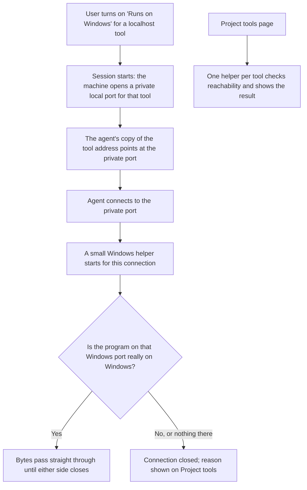

# Windows localhost tools from WSL

**Idea:** `IDEA.md` — what this is for and why, in plain language. Read it first; it is
the north star this plan serves. Goal and Constraints live there, not here, so they don't
get buried as this file grows.

Background: the parent plan's design for this (removed Spec §1 at
`d861dbb2:docs/plans/windows-bridge-solid/PLAN.md` lines 71-190, Decision Log D2-D20,
Review Rounds and Accepted Risks on `wc/d5233e17e73d`), summarised in `MAP.md`.

## Open Questions

(none)

## Watch List

| # | Noticed | What needs looking into | Raised to user? | Outcome |
|---|---------|-------------------------|-----------------|---------|
| W1 | 2026-11-21 | Thread "Windows bridge: Unity setup, disk use, warnings" (`wc/d5233e17e73d`, verifying, not merged) changes adapters (`loaded: [{name, windows}]`), startIn readying, restart recovery of `WinBridge.toolSessions`, `detectWsl` and the Project tools page. Plan should build on it; confirm whether it merges before build | yes | Merged to main as PR #149 (87923e58) and merged into this branch; Spec builds on it |
| W2 | 2026-11-21 | Claude: does a `--mcp-config` entry with the same name as a disabled `.mcp.json` entry load (parent C2)? Needed if Q1 = private port | no | Checked live 2026-11-21 (claude -p, two stub HTTP servers): with the `.mcp.json` entry in `disabledMcpjsonServers` and a same-name `--mcp-config` entry, only the `--mcp-config` URL is contacted; control without disabling contacts the `.mcp.json` URL. D5 |

## Decision Log

Append-only. A reversal is a new entry superseding the old, never an edit.

| # | Decision | Rationale | Source |
|---|----------|-----------|--------|
| D1 | Mode thorough | User's choice | user |
| D2 | A marked tool is reached through a private Linux port the machine picks, not the tool's own port; each session's built config points the tool at `http://127.0.0.1:<private port><path>`; the user's `.mcp.json` is never changed | Removes cross-project port meaning, Linux-port clashes and the localhostForwarding loop; restart gap becomes a rare path | user |
| D3 | The forward (Linux private-port listener → Windows relay → Windows `127.0.0.1:<tool port>`) is used in every WSL networking mode, mirrored included; no networking-mode detection | Mirrored-mode direct access could reach a Linux listener on the tool's port; one path is simpler and always safe | defaulted |
| D4 | The switch is stored as parent D7: top-level `"wheelchair": {"windows": ["<name>", ...]}` in `.mcp.json` | CLIs that read `mcpServers` never see an unknown field; save flow already keeps other top-level keys | defaulted |
| D5 | Claude: the marked `.mcp.json` entry is added to `disabledMcpjsonServers` and a same-name entry with the private URL is passed with `--mcp-config <file>`; tool names stay unchanged | Verified live (W2) | defaulted |
| D6 | Only `http` (streamable) entries can be marked; `sse` entries listed in `wheelchair.windows` are ignored with a warning and behave as today. IDEA.md: "(or SSE)" removed, SSE added to Not doing | SSE servers may send a full `endpoint` address at the tool's own port, bypassing the private port; SSE is deprecated and not editable in the form | idea-change |
| D7 | One forward per Windows tool port, shared by every live session that loads a marked tool on that port; forwards are claimed before tmux and released only once the session's tmux is confirmed gone | Same meaning everywhere (the port is the Windows port), fewest relays; parent review rounds 6-8 on early release | defaulted |
| D8 | A marked entry on WSL is always either pointed at its forward or withheld from the session; it never reaches a CLI with its original URL | The original URL points at Linux, where an unrelated program could get the headers | defaulted |
| D9 | Off WSL the mark is ignored and the entry loads as today | No Windows to reach; the same server may run locally | defaulted |
| D11 | The relay's refusal reasons are kept per forward and checked once at claim time; a problem becomes a session warning the user sees with other project tools warnings, but the tool is still given (its server may start later) | IDEA: user can see why; refusing at start would break tools started after the session | review-round-1 |
| D12 | Windows warnings are stored per session apart from the per-CLI lines and shown on the thread's project tools card as start-time snapshots | Per-CLI lines are recomputed by other starts and would erase them | review-round-2 |
| D13 | The relay connects first and then identifies the owner of that exact accepted connection; no owner cache | Names the listener the dial really reached (dual-stack `::` servers included), no stale-cache window | review-round-3 |
| D14 | Windows warnings are pruned at the next start in the thread for sessions no longer live, independent of forwards; release never updates the hub | The thread card only updates from starts; keeps all-withheld sessions covered | review-round-3 |
| D15 | Forwards are not tied to sessions: once created, a forward stays open until the machine service stops (its relay ends after 5 idle minutes and restarts on demand; the relay part is superseded by D21); the user sees each Windows tool's live status on the Project tools page instead of thread warnings. Supersedes D7's release rule, D11, D12 and D14 | User chose to simplify after three unclean review rounds; idle private ports cost nothing | user |
| D16 | Each session's config is built once; status checks never create forwards (a one-off relay checks ports without one); `win info` and the session record are not extended | Under D15 the double build and per-session fields serve nothing; typed-but-unsaved ports must not leave forwards behind | review-round-4 |
| D17 | Share one per-session entry-replacement mechanism with thread 135e4c312559 (Windows stdio go-between): `context.replaceEntries = {<name>: <entry>}` applied by all three adapters, Claude via `disabledMcpjsonServers` plus one per-session `--mcp-config` file; whichever thread builds first adds it, the other reuses it | Same need in both threads; avoids two clashing mechanisms; the other thread's user agreed too | user |
| D18 | The Linux side of a forward is an HTTP proxy that sets `Host` to `localhost:<tool port>` (revised in round 9 from "original authority") and rewrites loopback origins at the tool port in `Location`, `Content-Location` and `WWW-Authenticate` to the private origin, one relay connection per request; refusals become `502` with the reason | Servers that check `Host` (DNS-rebinding protection) would reject the private authority; the 502 text tells the agent why | review-round-8 |
| D19 | The forward is a plain byte pipe again: no `Host` or response rewriting; supersedes D18 | User's choice: all round 9 holes came from rewriting; tools built on the official MCP libraries accept localhost on any port, and `Host`-built redirects stay on the private port | user |
| D21 | One relay process per connection, replacing the multiplexed relay (and D15's relay idle rule): a header line (`OK` / `REFUSED <reason>`) then raw bytes over its stdin/stdout; status checks are one relay each in `check` mode | User's choice after round 13: the shared channel's traffic rules kept failing review; per-connection pipes get backpressure and closing from the OS, at the cost of a Windows process start per new connection | user |
| D20 | Accept that a Windows tool redirecting to an absolute address hardcoded at its own port (not built from `Host`) sends the CLI to Linux `localhost:<tool port>`, where a Linux program on that port could receive custom headers | User's choice after D19: needs a hardcoded redirect, a secret custom header and a Linux listener on the same port together | user |
| D10 | The Windows relay refuses a connection when no Windows process accepted it or the accepting process is `wslrelay` (mechanism superseded by D13) | Stops a Linux program on the same port receiving the headers through WSL localhostForwarding (parent C3) | defaulted |

## Spec

Builds on main as of `87923e58` (Windows bridge solid merged). Line references are to that
tree. Read `MAP.md` and `docs/maps/project-tools.md`, `docs/maps/windows-bridge-runtime.md`,
`docs/maps/machine-session-lifecycle.md` first.

### At a glance



The words in sections 1 to 7 say everything this picture shows.

### Terms

- **Marked tool:** an entry of `.mcp.json` `mcpServers` named in the top-level
  `"wheelchair": {"windows": [...]}` list (D4) that is *eligible*: `type` is `http`, its `url`
  string matches `^http://(localhost|127\.0\.0\.1)(:(\d{1,5}))?(?=[/?#]|$)` (case-insensitive)
  and the port, if given, is 1-65535. The matched part is the **origin text**; what follows
  (path, query, fragment) may be anything. Its **tool port** is the captured port, or 80. Forms
  `new URL()` would also accept (`http:localhost:8080`, backslashes, `HTTP://LOCALHOST` with
  odd spacing, userinfo) are not eligible. The reader (section 1), the status route (section 6),
  the form (section 7) and the rewrite (section 2) use this one shared function.
- **Forward:** for one tool port, a Linux TCP listener on `127.0.0.1:<private port>` in the
  machine service plus one Windows relay process per accepted connection, piping it, byte for
  byte, to Windows `127.0.0.1:<tool port>` (section 4, D19, D21).
- **On WSL:** `this.win.detected.kernel` is true (`machine/lib/win-env.js:8-29`), whether
  or not interop is on. Interop being off only means getting a forward fails (section 4), so marked tools
  are withheld; it never lets a marked tool load with its original URL (D8).

### 1. Reading the mark

`readProjectMcp` (`machine/lib/project-mcp.js:85`) also returns `mcp.windows`: the eligible
marked names, in list order, de-duplicated. A listed name that is in `mcpServers` but not
eligible is left out with a warning, recorded like other project tools warnings:
- `sse` entry: `<tool>: "Runs on Windows" doesn't apply to SSE tools; it loads as usual`.
- any other ineligible entry: `<tool>: "Runs on Windows" only applies to an http://localhost
  or http://127.0.0.1 address`.
- unknown name: ignored silently (a rename the user hasn't saved yet).
A missing `wheelchair` key, or a `wheelchair` object without `windows`, means no marks (no
warning). A `wheelchair` value that is not an object, or `windows` present but not an array of
strings, is ignored
with one warning `"wheelchair" in .mcp.json is not in the expected form; ignored`. Unknown
keys under `wheelchair` are ignored. Validation of the rest of the document is unchanged.
Off WSL, `mcp.windows` is computed but unused (D9): no forwards, no withholding, and none of
the warnings in this section.

### 2. Which tools a session forwards

In `startIn` (`machine/service.js:832`), on WSL only, after `readProjectMcp` (`:840`) and
before `commandFor` (`:847`):
1. A session forwards nothing unless its role is in `TOOL_ROLES` (the same gate `commandFor`
   passes as `context.tools`, `service.js:717-720`; reviewers and mappers get no project tools)
   and its CLI is `claude`, `codex` or `agy` (Kimi and Pi load no project tools,
   `machine/adapters/pi.js:61`). Otherwise the session's **forwarded tools** are the names in
   `mcp.windows` that are also in `mcp.servers` (the entries this session may load).
2. For each forwarded tool, get its forward (section 4) and its private port. A tool whose
   forward cannot be had is withheld (section 3).
3. Build the config once, passing the shared `context.replaceEntries` (D17): for each tool
   with a forward, `{<name>: <the .mcp.json entry with only url replaced>}`; for each
   withheld tool, `{<name>: null}`. The rewritten URL is made by **text** replacement, never by
   re-serializing a parsed URL: the origin text matched by the shared rule (Terms) becomes
   `http://127.0.0.1:<private port>`, and everything after it (path, query, fragment,
   including any `${...}` text) is kept byte for byte. If the shared function does not match
   at rewrite time, the tool is withheld (`null`), never passed with its original URL. Headers
   and other fields are unchanged.

A forward got for a tool the CLI then does not load (for example Codex skipping all project
tools because the overrides grew too large) is left as is: forwards are not owned by sessions
(D15). If the session forwards nothing, startIn behaves exactly as today. `windowsTools` (copy
readying for Windows stdio programs) is unchanged: a forwarded HTTP tool needs no worktree
copy.

### 3. Putting the rewritten entry in each CLI's config (D2, D5, D8, D17)

**Shared contract (D17).** `context.replaceEntries` is shared with thread 135e4c312559
(Windows stdio go-between, `wc/135e4c312559:docs/plans/win-tool-gobetween/PLAN.md` §2). This
is the contract both plans use; if main already has the map when this is built, reuse it and
add whatever part below is missing (for example `null`):

- A name mapped to an **entry**: Codex (`machine/adapters/codex.js`) and Antigravity
  (`machine/adapters/agy.js`) translate the replacement entry instead of the `.mcp.json` one,
  through the same translation code, so env handling, validation such as the `${` checks
  (`codex.js:39`, `agy.js:42`) and Codex's size budget apply as today. Because the URL rewrite
  keeps everything after the origin text byte for byte, an HTTP entry the adapter would skip
  for its URL is skipped the same way after rewriting.
- **Windows classification uses the original entry:** whether an entry is a Windows program
  (Codex's `WHEELCHAIR_WINDOWS_PROJECT`/`WSLENV` passthrough, `codex.js:81`, and `loaded`'s
  `windows`, `machine/adapters/common.js:19`) is decided from the `.mcp.json` entry, not the
  replacement.
- **Own keys only:** the map is created with `Object.create(null)` (or a `Map`), filled with
  own-key assignment, and read with own-key checks (`Object.hasOwn`), so any tool name
  (including `__proto__`, `constructor`) is replaced or withheld like any other.
- A name mapped to **`null`**: the entry is omitted for that session (Codex and Antigravity
  leave it out; Claude only disables it).
- **Claude** (`machine/adapters/claude.js`): every name in `replaceEntries` is added to
  `disabledMcpjsonServers`; names with an entry are given, under the same names, in one
  per-session file `{"mcpServers": {...}}` at `<stateDir>/settings/<session name>.mcp.json`
  (mode 0600, atomic) passed with `--mcp-config <path>`; no `--strict-mcp-config`. The file is
  removed when the session stops; the stale-file sweep pattern (`sweepAgyTools`,
  `service.js:477-535`) also removes files with no live session older than 60 s.
- Pi and Kimi: unchanged.
- Test: one launch with a replaced entry, a `null` entry and an untouched entry, for each of
  the three CLIs, repeated with the replaced and the withheld tool named `__proto__`; if the go-between is on main, include a wrapped stdio tool in that launch.

- **Withheld:** a tool mapped to `null` is not given to the CLI in any form, and
  a line is printed to the machine service's log (stderr, `service.js:850`, as other project
  tools warnings are; it is a diagnostic, not a user surface):
  `<tool>: couldn't reach Windows (<reason>); left out of this session`. Reasons: `Windows
  bridge not available`, `couldn't open a local port`, `couldn't save the port record`. The
  Project tools page shows the first as the tool's status (section 6); the other two are local
  failures it does not show (Accepted Risks).
- `loaded` reports withheld tools as not loaded.

### 4. Forwards (D15)

Kept in a new module `machine/lib/win-forward.js`, owned by `WinBridge`.

- **Table:** tool port → the **current** forward `{private_port, state, listener,
  connections, last_refusal}` (`connections`: each open socket with its relay process), `state` `ok` or `unrecorded`. Separately, a list of
  **stale** forwards: restored ones whose private port could not be bound (section 5), each
  `{tool_port, private_port, reason: "port in use on Linux"}`, kept until the service stops.
- **Relay can run:** `this.win.detected.interop` is true and the `powershell.exe` path from
  `createWinEnv` (`machine/lib/win-env.js:54`) exists. This is not `bridgeHealth()`, which also
  depends on Git and starts unknown. Checked on every get, including when a forward exists.
- **Get(tool port):** if the relay cannot run, fail with `Windows bridge not available`. If the
  current forward is `ok`, return its private port. If it is `unrecorded`, retry the record
  write; on success it becomes `ok` and is returned, else fail with `couldn't save the port
  record`. Otherwise create one: `net.createServer` with the connection handler below (the same
  constructor is used for creation and restore), listen on `127.0.0.1` port 0 (the kernel
  picks a free port; a listen error fails with `couldn't open a local port`), add it to the
  table as `unrecorded`, write the record (section 5) and wait for the write; success → `ok`
  and return; failure → stays `unrecorded` and the get fails with `couldn't save the port
  record`. Concurrent gets for the same tool port share one pending creation (never two
  listeners for one tool port). So a private port is never handed to a CLI before it is in the
  record.
- **Lifetime:** a forward, once created, stays open until the machine service stops. It is not
  tied to sessions. No stop handler is added: when the service process ends, the kernel
  closes its listeners, sockets and the relays' pipes. The installed unit stops only the main
  process (`KillMode=process`), so relays end themselves: a relay exits as soon as its stdin
  ends, and a `check` relay ends within 8 s on its own.
- **Connections (D19, D21):** a plain byte pipe; nothing in requests or replies is read or
  changed. The tool therefore sees `Host: 127.0.0.1:<private port>`, so any absolute URL it
  builds from `Host` (redirects, links) points back through the forward. The host is always
  `127.0.0.1`, even when the user wrote `localhost`: the listener binds only IPv4 loopback, and
  Linux `localhost` may resolve to `::1` first. A tool that checks the host name or port it is
  reached at is not supported (Not doing). The listener only accepts on `127.0.0.1`
  (`net.createServer` defaults, so `allowHalfOpen` is false).
- **One relay process per connection (D21).** Each accepted socket starts its own relay
  (below) in `connect` mode for the tool port. There is no cap on connections; each open one
  costs one Windows process.
  - **Before `OK`:** the socket is read normally. Bytes the client sends go into a buffer for
    that connection; once it holds more than 64 KiB the socket is paused until `OK` (only then
    may a graceful client close go unnoticed until the 12 s limit below). A client `end` or
    `close` before `OK` kills the relay and destroys the socket.
  - The relay's stdout starts with one ASCII header line ending `\n`: `OK` or
    `REFUSED <reason>`. The machine reads stdout chunks until the first `\n`; more than 512
    bytes without one is a failure. Bytes after the `\n` in the same chunk are the first bytes
    from the tool.
  - On `OK`: write the leftover tool bytes to the socket and the buffered client bytes to the
    relay's stdin, then `socket.pipe(relay.stdin)` and `relay.stdout.pipe(socket)` and resume
    the socket. Node's `pipe` pauses a source while its destination is full, and the relay's
    blocking writes do the same on Windows, so a slow reader on either side slows the sender
    instead of growing memory. No other flow control exists. `OK` clears the forward's
    `last_refusal`.
  - On `REFUSED`: destroy the socket; set `last_refusal` to `{reason, at}`. The client sees
    the connection close without a reply.
  - No header within 12 s (relay start, 5 s connect, 3 s lookup, with margin): kill the relay,
    destroy the socket, `last_refusal` = `Windows didn't answer in time`.
  - **One outcome per connection.** A connection settles once, on the first of: `OK`,
    `REFUSED`, the 12 s timeout, the client closing or erroring before `OK`, or the helper
    failing (below). Only that first event sets or clears `last_refusal`; everything after it
    (for example the child `close` that follows a kill) only cleans up. A client that leaves
    before `OK` records nothing.
  - **The outcome is judged from stdout, not from process exit.** A relay may write its header
    and exit at once, and Node can report `exit` before stdout is drained. So the machine acts
    on the child's `close` event (all stdio closed), never on `exit`: if no complete header was
    read by then, or the child emitted `error` (failed to start), destroy the socket and set
    `last_refusal` to `couldn't start the Windows helper: <error or exit code>`.
  - **Errors stay with their connection.** `error` handlers are attached to the socket, the
    child, and the child's `stdin`, `stdout` and `stderr` streams before any write. Any of them
    (for example `EPIPE` when the relay exits while client bytes are being written to it)
    tears down only that connection: destroy the socket, destroy the three child streams, kill
    the relay. stderr is always read (kept, last 4 KiB, for the log) so a chatty relay never
    blocks on it.
  - Closing: when the socket closes or errors, kill the relay. When the relay's stdout ends,
    `pipe` ends the socket after the last bytes are written.
- **Relay:** the script `machine/lib/win-relay.ps1`, shipped in the repo, read from disk and
  run with `spawnPs` (`machine/lib/win-env.js:57-61`, `-EncodedCommand`, so stdin and stdout
  are free for data), with `$Mode` (`connect` or `check`) and `$ToolPort` set by lines the
  machine prepends to the script text (the port is an integer it validated). The script sets
  `$ProgressPreference = 'SilentlyContinue'` and writes to stdout only through the raw stream
  `[Console]::OpenStandardOutput()` (never `Write-Output`, which would add text and line
  endings); errors go to stderr. IPv4 only on Windows: it always dials `127.0.0.1` (parent D9).
  - **Connect first, then identify who accepted (D13):** connect a `TcpClient` to
    `127.0.0.1:<tool port>` with a 5 s timeout. A connect refused outright → `REFUSED nothing
    on Windows is listening on port <n>`; any other failure or the timeout → `REFUSED Windows
    refused the connection`. Send nothing yet. Then look up the accepting end of that exact
    connection, with a 3 s limit: `Get-NetTCPConnection -LocalPort <tool port> -RemotePort
    <the client's own local port> -RemoteAddress 127.0.0.1` → `OwningProcess` → process name.
    This names whatever listener the dial really reached, whatever address it is bound to.
    An owner named `wslrelay` → close and `REFUSED port <n> on Windows leads back to Linux`.
    An owner that cannot be established (no row, lookup error or timeout, process gone) →
    close and `REFUSED couldn't check who holds port <n> on Windows` (fail closed). Otherwise
    the owner is accepted.
  - **`connect` mode**, once accepted: write `OK\n` and flush, then copy both ways at once
    with two .NET copies on the raw streams (`[Console]::OpenStandardInput()` → the TCP
    stream, the TCP stream → stdout, flushing stdout after each read). When stdin ends, close
    the TCP connection and exit (the machine never half-closes: `allowHalfOpen` is false, so
    stdin ending means the client or the service is gone). When the Windows side ends (read
    returns 0), flush stdout and exit; on any read or write error, exit. Writes block while the reader is slow;
    that is the backpressure.
  - **`check` mode:** run the same steps, close the TCP connection without sending data, write
    `OK\n` or the `REFUSED` line, and exit.
- **Status check:** a status check (section 6) starts one relay in `check` mode per tool,
  whether or not a forward exists for its port, and reads its header line. It never creates
  a forward and records nothing. The machine kills it after 10 s and reports `couldn't check
  Windows for port <n>`; a relay that ends or fails to start without a header also gives
  that reason.

### 5. Record and restarts

- **Record:** `<stateDir>/win/forwards.json`, mode 0600, `{"forwards": [{tool_port,
  private_port}]}` listing the current forwards that are `ok` or `unrecorded`, rewritten
  (atomic, `atomicWrite`, `service.js:110-115`) whenever a forward is created. Writes are
  serialized through one in-process queue; each write snapshots the table when it runs, so the
  last write holds the latest state.
- **Machine service restart:** tmux sessions and their CLIs survive a restart and still hold
  private URLs. In `WinBridge.startup` (`service.js:447`), read `forwards.json`. `liveTmux()`
  is consulted for one decision only: if it is not `null` and lists no wheelchair session (no
  name starting `wc-`), nothing can hold a private URL (for example after a reboot), so rewrite
  the record empty and restore nothing. If it is `null` (unknown) or lists any `wc-` session,
  restore every recorded entry: for each entry, listen on `127.0.0.1:<recorded private port>` again as the `ok` current forward for
  its tool port (same constructor as creation), whether or not the relay can run (keeping the port bound for existing URLs;
  gets still check relay readiness). A port that can no longer be bound becomes a stale
  forward (section 4) and the tool port has no current forward, so the next get creates a new
  one (and the record write then drops the stale entry). A missing or unreadable file means no
  forwards to restore. Individual sessions are never matched against the record.

### 6. Visibility

- **Project tools page status (D15).** New machine route `POST /v1/project-tools/windows-status`
  (hub-authorized like `/v1/project-tools/read`, `service.js:2084`), reached from the page via
  the viewer's pass-through (`viewer/app/routes.js:68-73`: add `windows-status` to the allowed
  list). Body `{machine, path, token, tools: [{id, name, type, url}]}`, `id` a string the page
  makes unique within the request. On a WSL machine, for each tool
  that is eligible by the shared rule in Terms (applied by the machine to `type` and `url`;
  ineligible tools are left out of the reply), all in parallel, each capped at 10 s: if the relay cannot
  run → `unavailable`, `Windows bridge not available`; otherwise run one status check (section 4). It never creates or replaces a
  forward. Reply `{wsl, status: {<id>: {state, reason?, note?, last?}}}` (keyed by `id`, so two
  rows with the same name and different URLs each get their own result) with `state` `reachable` or
  `unreachable` (reason from the `REFUSED` line, or `couldn't check Windows for port <n>` on
  timeout), or `unavailable` (reason `Windows bridge not available`). `reachable` means a TCP connection reached a Windows process on the port, not
  that the tool accepts MCP requests. `note` is set when a stale forward exists for that tool port: `after the machine
  service restarted, port <private port> couldn't be reopened; sessions started before that
  restart can't use this tool (new sessions can)`. `last` is set when the current forward for
  that tool port has a `last_refusal`: `{reason, at}`, shown as "Last connection refused:
  <reason>, <time>" (cleared by the next connection that gets `OK`). Off WSL:
  `{wsl: false, status: {}}`.
- In `viewer/pages/project-tools.js`, each entry whose **Runs on Windows** switch is on and
  whose current values are eligible shows a status line under the switch: "Checking…",
  "Reachable on Windows", "Not reachable: <reason>", "Not available: <reason>" or "Couldn't
  check: <error>", plus the note and the last refusal if any, and a **Check again** button.
- **Status lives in page state, not in the rendered cards.** The page keeps a status store
  keyed by the page guard (`tag()`/`fresh()`, `viewer/pages/project-tools.js:228-229`:
  machine, path, generation) plus the tool's current `type` and `url`. Every render of the
  tools (`paintTools` and the edit form, whatever triggered it: load, Keep changes, Cancel,
  save reread, the Unity poll) reads the line from the store for the entry's current values.
  When a rendered entry needs a line and the store has neither a result nor a pending request
  for its key, the page schedules a check for that key (debounced 500 ms; several keys due at
  once go in one request). It sends the values shown, saved or not.
- A reply is stored under the key it was requested for, only if `fresh()` still holds;
  entries whose values have since changed simply no longer read it. A request that fails
  (HTTP error, machine unreachable) stores "Couldn't check: <error>" for each key it covered.
  Check again removes the stored result for that entry's key and schedules a check at once.
  Results do not expire; each line shows when its check ran ("checked 2 min ago", relative
  time refreshed on render). The store has its own **epoch**, advanced when a save reread
  clears it and whenever the guard changes; every request records the epoch and the key it
  was made for, and a reply is stored only if the epoch is unchanged and that request is still
  the pending one for its key.
  Turning the switch off hides the line; turning it on, or editing the URL or kind, reads (or
  schedules) the key for the new values. Store entries for a stale guard are discarded.
- `win info` is unchanged. No thread cards, per-session warning state or session-record
  fields are added.

### 7. Project tools page

- The read reply (`machine/lib/project-tools.js:71-88`, passed through at
  `service.js:2084-2087`) gains `wsl: true|false` from `win.detected.kernel`, and the tools list
  carries each entry's mark (`windows: [names]` read from `wheelchair.windows`).
- In `viewer/pages/project-tools.js`, a "Web address" entry shows a **Runs on Windows** switch
  when the read reply has `wsl: true` and the URL is eligible by the shared rule in Terms
  (so `http://localhost:8080/mcp` shows it). Help text: "Turn on if this tool's server runs on Windows. Agents
  here reach it through wheelchair." Hidden otherwise; a mark on a hidden entry is kept as is.
- Saving sends `windows: [names]` next to `tools` whenever the page sends `tools`. On the
  machine, an absent `windows` field keeps the existing `wheelchair.windows` as is (older
  callers and the key-only save path send none); an explicit `[]` clears the marks. The dirty check (`:713`) and the machine's
  nothing-changed shortcut (`machine/lib/project-tools.js:100-103`) compare both `mcpServers`
  and `wheelchair.windows`. The machine writes `wheelchair.windows` (keeping other keys under
  `wheelchair`), removes `windows` when empty and `wheelchair` when it then has no keys, and
  keeps every other top-level key as today. Renaming an entry renames it in the list;
  deleting an entry removes it.

### Not doing

As IDEA.md. Also: no rewriting of requests or replies (D19), so tools that check the host name or
port they are reached at, and OAuth-protected Windows tools, are not supported; no
change to `.mcp.json` beyond the switch; no networking-mode detection
(D3); no IPv6 Windows servers; no restart of Windows tool servers.

### Validation

```bash
node --test machine/test/*.test.js     # includes new win-forward and project-mcp cases
bash machine/test/run.sh
node --test viewer/test/*.test.js
npm --prefix viewer run test:browser
```

New tests, with a fake `spawnPs` that runs a Node stand-in for the relay speaking the same
header line and dialling a local test server (these cover the Linux side only):
- `readProjectMcp`: eligible (including a URL with a path and query), SSE, non-localhost and
  malformed `wheelchair` cases and their warnings; `wheelchair: {}` and
  `wheelchair: {"other": 1}` give no warning; off WSL nothing forwards and no mark warnings;
  WSL kernel with interop off withholds marked tools.
- URL rewrite is textual: `http://localhost:8080/mcp/${PROJECT}?a=b#c` becomes
  `http://127.0.0.1:<p>/mcp/${PROJECT}?a=b#c`, and Codex and Antigravity still skip it as
  they skip the original.
- Claude settings/argv: marked tool in `disabledMcpjsonServers`, `--mcp-config` file contents
  and mode 0600; Codex and Antigravity rewritten URLs; withheld tools absent from all three
  and never present with the original URL. The config is built once.
- Two sessions with tools on one tool port get the same private port and one listener; the
  listener stays open after both sessions stop.
- Two concurrent starts on different tool ports: each session's forward is in `forwards.json`
  before its own tmux starts, and the final record holds both. A failing record write fails the get (tool withheld); the next get
  retries and succeeds.
- Restart: forwards restored on their recorded private ports, also with interop off (then a
  new session's get fails and the tool is withheld); a taken port gives a stale forward, the
  status reply carries the note, and the next get creates a new forward and drops the stale
  entry from the record.
- Pipe: bytes pass unchanged both ways; a test server that answers `307` with `Location`
  built from the request's `Host` sends the client back to `127.0.0.1:<private port>` and the
  follow-up goes through the forward; a streamed response arrives in pieces as sent; a
  restored forward pipes connections.
- Status page: a request that fails shows "Couldn't check"; each line shows when it was checked; a save clears all results and a reply to a
  request made before the save is not stored; two rows with the same name and
  different URLs in one request each get their own result; Cancel, Keep changes, a same-project reload and the Unity poll's re-render while
  a check is pending all end with a line for the current values (no stuck "Checking…", no
  stale result); Keep changes before the debounce fires still gets a result; editing a URL A → B → A before the check fires shows A's stored result;
  renaming during a check keeps the line and its pending check (same key); changing kind during a
  check schedules a new check or hides the line.
- Relay per connection: client bytes sent before `OK` reach the server after it, in order;
  `REFUSED` closes the socket without a reply and sets `last_refusal`, `OK` clears it; a
  client that disconnects before `OK` gets its relay killed; no header in 12 s kills the relay
  and closes the socket; a relay that fails to start closes the socket; header bytes and
  tool bytes in one chunk are split correctly; a stand-in that writes `OK` or `REFUSED` and
  exits at once is judged by its header, not as a start failure; a client FIN before `OK`
  and a client reset before `OK` each kill the relay without waiting 12 s; a stand-in that
  exits during a large upload tears down only that connection and the service keeps running
  (a second connection still works); a
  client that stops reading a large streamed response leaves the Linux side's buffered bytes
  bounded (the stand-in's writes stall) while a second connection on the same forward keeps
  working; a server that sends its last bytes and closes delivers them all before the client
  sees the close; a client that leaves before `OK`, and a timeout, each leave `last_refusal`
  as that event set it (not a start failure from the later child `close`); a
  stand-in whose stdin is closed exits; the status reply carries `last` after a refusal and
  drops it after the next `OK`.
- Role gate: a reviewer or mapper session, and Kimi and Pi sessions, get no forward and no
  `--mcp-config`.
- Restart with no live wheelchair tmux session empties the record and restores nothing.
- Page: a reply arriving after switching machine or project is not applied.
- `windows-status`: ineligible `type` (for example `sse`) left out; reachable, each unreachable reason, timeout, unavailable (interop off), off
  WSL; a status check starts a `check`-mode relay, kills it at 10 s, and leaves no forward or record; passes
  through the viewer route.
- Save: a save without `windows` keeps the marks; `windows: []` clears them.
- Project tools page: switch shown only on WSL and for eligible URLs; dirty on switch change
  alone; rename/delete update the list; save keeps other keys; status line states, Check
  again, and a stale reply for an old URL is not applied (browser test).

The shipped relay script itself is tested by `machine/test/win-relay-live.test.js`, which runs
`machine/lib/win-relay.ps1` through the real `powershell.exe` and skips (reporting "skipped:
not WSL") when interop is unavailable. Using Windows-side listeners it starts itself with
PowerShell (`[System.Net.Sockets.TcpListener]`), it checks: a listener on `127.0.0.1`, on
`0.0.0.0` and dual-stack `::` each pass data; no listener gives `nothing on Windows is
listening`; and a Linux listener reached through WSL localhostForwarding (a Node server on the
tool port in WSL, no Windows listener) is refused as `leads back to Linux` (skip that case when
localhostForwarding is off). It also checks, in `connect` mode: 16 MiB each way arrives intact;
when the Linux side stops reading stdout, the Windows listener's sends stall after a bounded
amount instead of the relay growing; the listener's last bytes before it closes all arrive; `check` mode prints one
header line and exits; closing stdin makes a `connect` relay exit. It prints how long a new connection takes to get `OK` (C4, C5). Run it on this WSL machine before verification:
`node --test machine/test/win-relay-live.test.js`.

Live (Check Once Built): on this WSL machine in default networking, a Windows HTTP MCP server
on `127.0.0.1:<port>`, marked, used from Claude, Codex and Antigravity sessions.

## Accepted Risks

| Risk | Why accepted | Round |
|------|--------------|-------|
| (User-accepted, D20.) A Windows tool that redirects to an absolute URL hardcoded with its own port sends the CLI to Linux `localhost:<tool port>`; a Linux program there could receive custom headers such as API keys | The user accepted it rather than rewrite replies (D19, D20) | review-round-10 |
| A client that half-closes its side (TCP FIN) before the reply loses the reply, since `close` ends both directions | Rare path: the HTTP clients the CLIs use do not half-close | review-round-10 |
| A tool withheld because the local port could not be opened or the record could not be saved is not reflected on the Project tools page, which may show "Reachable on Windows" | Rare path: local bind or state-file write failures on a healthy machine; the reason is in the machine service log | review-round-5 |
| Port 0 can pick a port that an unmarked Linux tool is configured for while its server is down; that tool then reaches the Windows forward | Rare path: needs a Linux tool configured on a port in the kernel's ephemeral range, its server down, and the kernel picking exactly that port | review-round-4 |
| After a stale forward is replaced, its old private port is no longer reserved; if the Linux holder exits, a later forward could get that port and receive old sessions' requests | Rare path: needs a service restart, a Linux program in the restart gap, that program exiting, and the kernel picking the same port again | review-round-4 |
| (No longer applies after D15: no release.) The 60 s sweep's tmux snapshot can predate a start that registered and left `startingNames` during an `await`, releasing that live session's forward | Rare path: sub-second race between the sweep and a start finishing | review-round-2 |
| (No longer applies after D15: no release.) A start cancelled after tmux was created but before the session is registered releases its forwards in `start()`'s `finally` even if the tmux kill did not take | Rare path: needs a cancel inside that window and a failed kill | review-round-1 |
| If the service stops while an upload is stalled because the Windows tool stopped reading, and the tool also sends nothing, that connection's relay may not notice and stays alive until the tool closes the connection | Rare path: needs a service stop at the same moment as a stalled upload to a silent tool; the cost is one idle Windows process, no data or secrets | review-round-16 |
| While the machine service is down (restart or crash), a forward's private port is unbound; a Linux program that binds that exact port in the gap gets a live CLI's requests and headers | Rare path: needs a service restart and another program taking a kernel-picked port within seconds; startup keeps it as a stale forward and the Project tools page shows the note | planning |
| A connection carrying more than about 1 MB in both directions at the same time stalls in the relay (both verifiers reproduced it; sequential 16 MiB each way works) | Rare path: MCP over HTTP sends the whole request before reading the reply, so the CLIs don't produce simultaneous bulk traffic on one connection | verification-1 |
| A project with more than 100 marked web-address tools gets no Project tools status at all, because the machine refuses a status request over 100 tools with 400 | Rare path: needs over 100 marked localhost tools in one project; tools still work in sessions, only the page status is missing | verification-1 |
| If the kernel picks a private port equal to the Windows tool port and the Windows server is down, a connection dials back into its own Linux listener once (two relays) before the `wslrelay` refusal | Rare path: needs the kernel to pick exactly the tool's port number and the Windows server to be down; it ends in a refusal with no bytes sent to Linux | verification-1 |
| Duplicate names in `wheelchair.windows` (e.g. `["loc", "loc"]`) make the Project tools page show Save enabled before any edit, because the draft de-duplicates and the baseline does not | Rare path: the page and machine never write duplicates; needs a hand-edited `.mcp.json` | verification-2 |
| A marked tool with an eligible localhost URL but malformed headers is left out of `mcp.windows` and gets the "only applies to an http://localhost…" warning besides its usual "skipped" warning | Rare path: needs a hand-broken entry the page never writes; the entry is already skipped as invalid, so only the warning wording is off | verification-3 |

## Check Once Built

| # | What to check | Round |
|---|---------------|-------|
| C1 | Live on WSL default networking: a Windows HTTP MCP server on `127.0.0.1:<port>`, marked, is callable from Claude, Codex and Antigravity sessions | planning |
| C2 | With the Windows server stopped and a Linux listener on the tool port, connections are refused (no loop, nothing reaches the Linux listener), and work again once the Windows server starts | planning |
| C4 | A cold relay start fits the 12 s header limit and the 10 s status cap | review-round-5 |
| C5 | A new connection's delay (powershell.exe start plus the owner lookup) is acceptable, about 1 s or less; if `Get-NetTCPConnection` makes it slower, look the owner up with `netstat.exe -ano` instead (match the row by local `127.0.0.1:<tool port>` and remote `127.0.0.1:<client port>`, PID is the last column; ignore the localized state word) | review-round-8, D21 |
| C3 | Mirrored networking: same as C1 and C2 | planning |

## Review Rounds

### Round 1 — 2026-11-21

**Lanes:** intent — claude / claude-opus-5-5; mechanics — gpt / gpt-6.2-sol; cross-family: yes.

**Changed since the last round:** n/a (first round — whole Spec in scope)

| Lane | Reported | Finding | Lead verdict | Resolution |
|------|----------|---------|--------------|------------|
| intent | major | Relay refusals (no Windows server, wslrelay) are invisible to the user; `win info` is agent-facing | upheld | §4 refusal reasons kept, claim-time check → session warning; §6; D11 |
| intent | minor | `win info` lists other sessions' names and forwards | upheld | §6 only the caller's forwards, no names |
| intent | minor | Off WSL, mark warnings are noise | upheld | §1 no mark warnings off WSL |
| mechanics | blocking | A restored `failed` forward is reused by new claims, pointing them at the Linux holder | upheld | §4 failed forwards never reused; §5 list record |
| mechanics | blocking | WSL with interop off takes the off-WSL path and loads marked tools with original URLs | upheld | Terms "On WSL" = kernel; §7 switch on kernel |
| mechanics | blocking | Second Codex build can drop all tools while claims stay held | upheld | §2 step 6 reconcile before recording |
| mechanics | blocking | Concurrent `forwards.json` writes can lose a claim | upheld | §5 serialized writes, start waits for its write |
| mechanics | blocking | Restart with tmux state unknown undefined | upheld | §5 restore all when `liveTmux()` is null |
| mechanics | blocking | Rare path: cancel after tmux created releases forwards without confirmed absence | accepted-risk | Accepted Risks (rare path) |
| mechanics | major | Claim check uses `bridgeHealth()` (Git-dependent, starts null) | upheld | §4 relay readiness = interop + powershell.exe present |
| mechanics | major | Refusals leave `win info` showing `ok` | upheld | §4 `last_refusal`, §6 (with intent finding 1) |
| mechanics | major | Switch URL rule could match only bare origins | upheld | Terms shared eligibility rule; §7; tests |
| mechanics | minor | §1 intro contradicts silent unknown names | upheld | §1 intro reworded |

### Round 2 — 2026-11-21

**Lanes:** intent — claude / claude-opus-5-5; mechanics — gpt / gpt-6.2-sol; cross-family: yes.

**Changed since Round 1:** Terms (shared eligibility rule incl. paths; "On WSL" = WSL kernel,
interop separate); §1 intro and off-WSL warnings; §2 step 6 reconcile claims after the second
build; §4 claim reuses only active forwards, relay readiness check (interop + powershell.exe),
refusal reasons and `last_refusal`, claim-time `check` frame and warning; §5 list-shaped
record, serialized writes, start waits for its write, sweep covers cancelled starts, restart
with tmux unknown, failed forwards; §6 `info` scoped to the caller; §7 switch on kernel and
shared rule; Validation additions; D11; Accepted Risks (cancel window).

| Lane | Reported | Finding | Lead verdict | Resolution |
|------|----------|---------|--------------|------------|
| mechanics | blocking | Sweep/restore compare names without tmux's `.`→`_` rewrite | downgraded (minor) | Generated names are `wc-<hex>-<role>[-n]`, no dots; still specified: §5 tmux-aware matching |
| mechanics | blocking | Owner lookup is port-wide; must pick the listener a 127.0.0.1 dial reaches and fail closed | upheld | §4 `127.0.0.1` row, else `0.0.0.0`; unknown owner refused |
| mechanics | major | Reconcile by tool drops shared-port claims | upheld | §2 step 6 by tool port |
| mechanics | major | Windows warnings erased by other CLIs' recomputation | upheld | §6 separate `windows` lines per session; D12 |
| mechanics | major | `win info` tool names for aliases and after restart | upheld | §5 record `tools` per session; §6 one item per tool |
| mechanics | major | `win info` fallback reply omits forwards | upheld | §6 |
| mechanics | major | `check` semantics undefined (owner only vs connect) | upheld | §4 check runs owner lookup and a connect |
| mechanics | major | Rare path: sweep's stale tmux snapshot races a finishing start | accepted-risk | Accepted Risks (rare path) |
| intent | major | Windows warnings can vanish before the user sees them | upheld | Same fix as mechanics finding 4 (§6, D12) |
| intent | minor | Claim-time warning stays after the server starts | upheld | §4 wording "when this session started"; §6 snapshot |

### Round 3 — 2026-11-21

**Lanes:** intent — claude / claude-opus-5-5; mechanics — gpt / gpt-6.2-sol; cross-family: yes.

**Changed since Round 2:** §2 step 6 reconcile by tool port; §4 owner row choice
(`127.0.0.1`, else `0.0.0.0`) and fail-closed lookup, new refusal reason, `check` runs owner
lookup plus connect, Windows warnings wording; §5 record holds `tools` per session,
tmux-aware name matching; §6 one `info` item per tool, fallback reply includes forwards,
Windows warnings stored per session apart from per-CLI lines (D12); Validation additions;
Accepted Risks (sweep snapshot race).

| Lane | Reported | Finding | Lead verdict | Resolution |
|------|----------|---------|--------------|------------|
| mechanics | blocking | Release deletes Windows warnings but the hub card never updates | upheld | §6 warnings pruned at next start, release touches nothing (D14) |
| mechanics | blocking | All-withheld session has warnings but no forward record, never cleaned | upheld | §6 cleanup independent of forwards (D14) |
| mechanics | blocking | Rare path: positive owner cache can pass a Linux listener | declined | No longer applies: §4 now checks per connection with no cache (D13) |
| mechanics | major | Shared-port test expects a dropped alias in `win info` | upheld | Validation split into two cases |
| mechanics | major | Owner selection tested only against a Node stand-in | upheld | Validation: live `win-relay-live.test.js` with real powershell.exe |
| mechanics | minor | `wheelchair` without `windows` warns | upheld | §1 absent = no marks |
| intent | blocking | Dual-stack `::` Windows servers refused | upheld | §4 connect then identify accepting owner (D13) |
| intent | major | Check warnings may miss the start reply's `project_tools` | upheld | §4 start waits for checks before `updateProjectTools` |
| intent | minor | Released session's warning stays on card; viewer drops `windows` | upheld | §6 snapshot semantics; viewer carries `windows` |

### Round 4 — 2026-11-21

**Lanes:** intent — claude / claude-opus-5-5; mechanics — gpt / gpt-6.2-sol; cross-family: yes.

**Changed since Round 3:** The user chose to simplify (D15). §2 no per-session claims or
reconcile; `windows_tools` on the session record. §3 withheld tools go to the session log
only; `--mcp-config` file cleanup by the stale-file sweep. §4 rewritten: forwards not tied to
sessions, stay open until the service stops, relay ends after 5 idle minutes and restarts on
demand, `check` frame, refusal reasons. §5 rewritten: record is `{tool_port, private_port}`,
restart restores all recorded forwards without consulting tmux. §6 rewritten: Project tools
page status via new `windows-status` route; `win info` from `windows_tools`; no thread
warnings. Validation rewritten to match. Superseded Accepted Risks marked.

| Lane | Reported | Finding | Lead verdict | Resolution |
|------|----------|---------|--------------|------------|
| intent | minor | Config built twice for no purpose under D15 | upheld | §2 one build (D16) |
| intent | minor | Status checks for typed ports leave forwards behind | upheld | §4 one-off check, §6 status never creates forwards (D16) |
| intent | minor | `windows_tools` and `win info` additions not needed | upheld | §6 `win info` unchanged (D16) |
| mechanics | blocking | Rare path: port 0 can pick an unmarked Linux tool's port | accepted-risk | Accepted Risks |
| mechanics | blocking | Status request replaces a failed forward and loses its failure | upheld | §4 stale list kept; §6 status never replaces, shows a note |
| mechanics | blocking | Rare path: replaced failed forward's port not reserved | accepted-risk | Accepted Risks |
| mechanics | blocking | Restored forward reused while interop is off | upheld | §4 relay readiness checked on every get; §5 |
| mechanics | major | Record write failure after bind undefined | upheld | §4 `unrecorded` state, get fails and retries |
| mechanics | major | No success frame for `open` | upheld | §4 `opened` frame, client bytes buffered |
| mechanics | major | Check lifetime on timeout undefined | upheld | §4 relay limits 8 s, machine forgets at 10 s |
| mechanics | minor | Out-of-order status replies | upheld | §6 per-entry sequence |
| mechanics | minor | Withheld line destination unclear | upheld | §3 machine service log, diagnostic only |

### Round 5 — 2026-11-21

**Lanes:** intent — claude / claude-opus-5-5; mechanics — gpt / gpt-6.2-sol; cross-family: yes.

**Changed since Round 4:** §2 one build with `windowsUrls` and `windowsWithheld` (D16); §3
withheld line goes to the machine service log; §4 relay readiness checked on every get,
`unrecorded` state and record-write failure, stale forwards list, `opened` frame and client
byte buffering, connect/lookup time limits, check lifetime and late results, one-off check
relay; §5 record lists current forwards, restore regardless of interop, stale entries; §6
status never creates or replaces forwards, stale note, per-entry sequence for replies, `win
info` unchanged; Validation updated; D16; two rare-path Accepted Risks.

| Lane | Reported | Finding | Lead verdict | Resolution |
|------|----------|---------|--------------|------------|
| intent | minor | Forwards restored after a reboot when no session can hold a URL | upheld | §5 empty record when no `wc-` tmux session is live |
| intent | minor | Rare path: page doesn't show local bind/record failures | accepted-risk | Accepted Risks; §3 reason list completed |
| intent | minor | Cold relay start may exceed the 3 s lookup limit | check-once-built | C4 |
| intent | minor | Accepted Risk row still says `failed` | upheld | Row reworded |
| mechanics | blocking | Forwarding ignores the `TOOL_ROLES` gate; Pi not excluded | upheld | §2 step 1 |
| mechanics | blocking | Concurrent-start test asserts more than the protocol guarantees | downgraded (minor) | Test wording only; a worker would fix the test, not build wrong behaviour. Validation reworded |
| mechanics | major | Page shows "Reachable" after a local setup failure | accepted-risk | Rare path, same as intent finding 2 |
| mechanics | major | Status body lacks `type` for the eligibility rule | upheld | §6 body includes `type` |
| mechanics | major | Status replies lack the machine/project generation guard | upheld | §6 uses `tag()`/`fresh()` |

### Round 6 — 2026-11-21

**Lanes:** intent — claude / claude-opus-5-5; mechanics — gpt / gpt-6.2-sol; cross-family: yes.

**Changed since Round 5:** §2 step 1 role and CLI gate; §3 withheld reasons completed; §5
restart empties the record when no wheelchair tmux session is live; §6 status body carries
`type`, page replies use the machine/path/generation guard; Validation additions; Accepted
Risks (local failures not on the page); C4.

| Lane | Reported | Finding | Lead verdict | Resolution |
|------|----------|---------|--------------|------------|
| intent | minor | Stale note outlives the sessions it warns about | upheld | §6 note reworded to say what happened and that new sessions work |
| mechanics | blocking | Re-serializing the URL escapes `${...}`, bypassing provider checks | upheld | §2 textual origin replacement; §3 validate the original entry first |
| mechanics | major | Restart says tmux is and isn't consulted | upheld | §5 one decision only; unknown restores all |
| mechanics | minor | No status for a failed request | upheld | §6 "Couldn't check" |
| mechanics | minor | Absent `windows` in save undefined | upheld | §7 absent keeps, `[]` clears |

### Round 7 — 2026-11-21

**Lanes:** intent — claude / claude-opus-5-5; mechanics — gpt / gpt-6.2-sol; cross-family: yes.

**Changed since Round 6:** D17 (user): §2 step 3 and §3 rewritten around the shared
`context.replaceEntries` (`null` = withhold), one Claude `--mcp-config` file per session;
§2 textual URL rewrite; §3 adapters validate the original entry first; §5 restart wording
(tmux used for one decision, unknown restores all); §6 stale note wording, failed request
state; §7 absent `windows` keeps marks, `[]` clears; Validation additions.

| Lane | Reported | Finding | Lead verdict | Resolution |
|------|----------|---------|--------------|------------|
| intent | major | Shared `replaceEntries` contract differs between the two plans | upheld | §3 one shared contract (path, cleanup, `null`, translation); sent to the other lead |
| mechanics | blocking | Eligibility accepts URLs the textual rewrite can't match | upheld | Terms: one regex-based shared function; §2 withhold on no match |
| mechanics | blocking | Incompatible shared contracts by merge order | upheld | Same as intent finding (§3) |
| mechanics | major | Windows classification must use the original entry | upheld | §3 contract bullet |

### Round 8 — 2026-11-21

**Lanes:** intent — claude / claude-opus-5-5; mechanics — gpt / gpt-6.2-sol; cross-family: yes.

**Changed since Round 7:** Terms: eligibility is one regex-based shared function that also
yields the origin text; §2 rewrite uses it and withholds on no match; §3 rewritten as the
shared `replaceEntries` contract aligned with the go-between plan (Claude file
`<stateDir>/settings/<session name>.mcp.json`, removed at stop plus sweep; translation from
the replacement entry; Windows classification from the original; `null` omits) with a combined
launch test.

| Lane | Reported | Finding | Lead verdict | Resolution |
|------|----------|---------|--------------|------------|
| mechanics | blocking | Rare path: `__proto__` tool name lost in a plain-object map, Claude leaves original URL enabled | upheld | Always fixed (header leak): §3 own-key map, `__proto__` tests |
| mechanics | major | Rewritten URL changes `Host`; authority-checking servers reject | upheld | §4 HTTP proxy sets original `Host` (D18); §6 says what `reachable` proves |
| mechanics | minor | Stale reply window during debounce | upheld | §6 edits advance the sequence immediately |

### Round 9 — 2026-11-21

**Lanes:** intent — claude / claude-opus-5-5; mechanics — gpt / gpt-6.2-sol; cross-family: yes.

**Changed since Round 8:** §4 the Linux listener becomes an HTTP proxy that sets `Host` to
the original authority, one relay connection per request, `502` on refusal (D18); §3 own-key
map and `__proto__` tests; §6 sequence advanced on every edit, what `reachable` proves;
Validation additions; C5.

| Lane | Reported | Finding | Lead verdict | Resolution |
|------|----------|---------|--------------|------------|
| intent | blocking | Absolute redirects (`Location: http://localhost:<port>/…`) send the CLI and its headers to Linux | upheld | §4 rewrite loopback origins in `Location`, `Content-Location`, `WWW-Authenticate` |
| intent | major | Original authority unknown for shared or restored forwards | upheld | §4 `Host` derived from tool port |
| intent | minor | Terms still describe a TCP pipe | upheld | Terms |
| intent | minor | OAuth discovery URLs escape the forward | upheld | `WWW-Authenticate` rewritten; OAuth tools in Not doing |
| mechanics | blocking | Shared private URL can't identify the original `Host` | upheld | Same as intent finding 2 |
| mechanics | blocking | `net.createServer` vs `http.createServer`; restore unspecified | upheld | §4 one HTTP proxy constructor; §5 |
| mechanics | blocking | Absolute redirects escape the forward | upheld | Same as intent finding 1 |
| mechanics | minor | Rename/kind edits leave the status stuck | upheld | §6 every edit reschedules or hides |

### Round 10 — 2026-11-21

**Lanes:** intent — claude / claude-opus-5-5; mechanics — gpt / gpt-6.2-sol; cross-family: yes.

**Changed since Round 9:** User decision D19 supersedes D18: the forward is a plain byte pipe
again (Terms; §4 "Connections" replaces "Requests"; one `net.createServer` constructor for
creation and restore; no `Host` or response-header rewriting; Not doing gains tools that
accept only their exact original `Host` and OAuth tools; Validation "Pipe" case with a
`Host`-built redirect). Round 9 also: §6 every edit (URL, kind, switch, name) reschedules or
hides the status.

| Lane | Reported | Finding | Lead verdict | Resolution |
|------|----------|---------|--------------|------------|
| intent | major | Redirects built from a hardcoded address (not `Host`) still leave the forward; custom headers could reach a Linux program on the tool port | user-decision | User accepted the risk (D20); Accepted Risks |
| intent | minor | `127.0.0.1` replaces `localhost`; Not doing too narrow | upheld | §4 why `127.0.0.1`; Not doing widened |
| intent | minor | C5 still says per request | upheld | C5 reworded |
| mechanics | blocking | Rare path: TCP half-close not forwarded | accepted-risk | Accepted Risks (clients don't half-close) |
| mechanics | major | No flow control after `opened` | upheld | §4 per-connection 4 MiB bound, shared pipe never paused |
| mechanics | major | Status checks survive Cancel/reload | upheld | §6 per-render token |

### Round 11 — 2026-11-21

**Lanes:** intent — claude / claude-opus-5-5; mechanics — gpt / gpt-6.2-sol; cross-family: yes.

**Changed since Round 10:** §4 per-connection flow control (4 MiB, shared pipe never paused);
§4 why the host is always `127.0.0.1`; Not doing widened to tools that check the host name or
port; §6 status requests tied to a per-render token (Cancel, reload); C5 reworded; D20 and
two Accepted Risks (hardcoded redirects, user-accepted; TCP half-close); Validation additions.

| Lane | Reported | Finding | Lead verdict | Resolution |
|------|----------|---------|--------------|------------|
| mechanics | major | Shared pipe queues unbounded; data can delay checks and other connections | upheld | §4 64 KiB frames, 1 MiB pipe bound pauses local reads, control frames first |
| mechanics | major | Keep changes cancels the only check for the new values | upheld | §6 status store keyed by values; every render schedules missing checks |
| mechanics | minor | `unavailable` missing from the reply schema | upheld | §6 |
| intent | major | Per-render token can leave status stuck at "Checking…" | upheld | §6 token dropped; status store read by every render |

### Round 12 — 2026-11-21

**Lanes:** intent — claude / claude-opus-5-5; mechanics — gpt / gpt-6.2-sol; cross-family: yes.

**Changed since Round 11:** §4 flow control on the shared pipe (64 KiB frames, 1 MiB pipe
bound pausing local reads, control frames first); §6 status line rewritten around a page-state
store keyed by guard and current values, read by every render (per-render token dropped),
`unavailable` in the reply schema; Validation updated.

| Lane | Reported | Finding | Lead verdict | Resolution |
|------|----------|---------|--------------|------------|
| mechanics | blocking | Control frames can't overtake data already in a FIFO stream | upheld | §4 queues in front of the pipe, writer hands at most 256 KiB to it |
| mechanics | blocking | Prioritised `close` truncates completed responses | upheld | §4 `close` ordered after the connection's data; separate `abort` |
| mechanics | major | Batched checks keyed by name collide | upheld | §6 per-request `id` |
| intent | minor | Status results never expire; save doesn't clear | upheld | §6 30 s age, save clears |
| intent | minor | Host sentences misplaced after flow control | upheld | §4 reordered |
| intent | minor | Validation items under the wrong bullet | upheld | Validation moved |

### Round 13 — 2026-11-21

**Lanes:** intent — claude / claude-opus-5-5; mechanics — gpt / gpt-6.2-sol; cross-family: yes.

**Changed since Round 12:** §4 Connections reordered (Host first); §4 flow control rewritten
as queues in front of the shared pipe (control queue, per-connection FIFO with ordered
`close`, single writer bounded at 256 KiB in the pipe, per-connection read pause, `abort`
frame); §6 status request/reply keyed by per-request `id`, results expire after 30 s, save
clears the store; Validation regrouped.

| Lane | Reported | Finding | Lead verdict | Resolution |
|------|----------|---------|--------------|------------|
| mechanics | blocking | 256 KiB bound can't be met by the writer rule (in-flight bytes) | upheld | Moot after D21: no shared pipe or writer |
| mechanics | major | Relay dispatch blocks on slow connects/lookups | upheld | Moot after D21 (per-connection relays) |
| mechanics | major | Client disconnect before `opened` leaves the queue undefined | upheld | Moot after D21 (per-connection relays) |
| mechanics | major | Pre-save replies refill the cleared status store | upheld | §6 store epoch, reply must match the pending request |
| intent | minor | 30 s age rule doesn't expire results on an idle page | upheld | §6 age rule dropped; line shows when checked |
| intent | minor | PowerShell flow control untested | upheld | Live test now covers relay backpressure and closing (D21) |

### Round 14 — 2026-11-21

**Changed since Round 13:** D21: §4 relay rewritten as one `powershell.exe` per connection
(header line `OK`/`REFUSED`, then raw bytes; flow control and frames removed; 12 s header
limit; 32-connection cap; closing rules); status checks are one `check`-mode relay each;
§6 wording; Validation (relay-per-connection tests, live backpressure and close tests);
C4, C5 rewritten.

**Lanes:** intent — claude / claude-opus-5-5; mechanics — gpt / gpt-6.2-sol; cross-family: yes.

| Lane | Reported | Finding | Lead verdict | Resolution |
|------|----------|---------|--------------|------------|
| intent | major | Long-lived connections each pin a relay; 32 cap overflows silently | upheld | Cap removed; last refusal shown on Project tools (§6 `last`) |
| intent | minor | `last_refusal` written but never read | upheld | §6 reply carries `last` |
| intent | minor | D15 idle rule not marked superseded | upheld | D15, D21 notes |
| mechanics | blocking | Relay stdin `EPIPE` unhandled crashes the service | upheld | §4 error handlers on every stream, per-connection teardown, test |
| mechanics | blocking | Fully paused socket hides client FIN before `OK` | downgraded to major (worker would ask; nothing wrong gets built) | §4 bounded 64 KiB pre-`OK` buffer, FIN/reset tests |
| mechanics | blocking | `exit` before stdout drained discards a valid header | upheld | §4 judge on `close` and stdout, test |
| mechanics | major | No stop path under `KillMode=process`; check relays untracked | upheld | Relay exits on stdin end; no new stop handler |

### Round 15 — 2026-11-21

**Changed since Round 14:** §4 connection cap removed; pre-`OK` client bytes buffered up to
64 KiB (then paused), client close before `OK` kills the relay; outcome judged on the child's
`close` and the header, not `exit`; error handlers on every stream with per-connection
teardown; relay exits when its stdin ends (no half-close), check relays tracked, clean-stop
wording; §6 reply gains `last` (last refusal); D15 relay idle rule marked superseded;
Validation cases for these.

**Lanes:** intent — claude / claude-opus-5-5; mechanics — gpt / gpt-6.2-sol; cross-family: yes.

| Lane | Reported | Finding | Lead verdict | Resolution |
|------|----------|---------|--------------|------------|
| mechanics | blocking | Live test expects a reply after stdin closes; relay exits on stdin end | downgraded to major (worker would ask) | Half-close expectation removed from the live test |
| intent | major | Same contradiction in the live test | upheld | As above |
| mechanics | major | Clean-stop test needs a stop entry point the service lacks | upheld | Clean-stop tracking and test removed; kernel closes everything, relays exit on stdin end |
| mechanics | major | Cleanup `close` after a client leave or timeout overwrites `last_refusal` | upheld | §4 one outcome per connection, first event wins; test |
| intent | minor | Leftover `sockets` field in the table | upheld | Removed |

### Round 16 — 2026-11-21

**Changed since Round 15:** §4 one outcome per connection (first event sets `last_refusal`,
cleanup after it records nothing, a client leaving before `OK` records nothing); clean-stop
tracking dropped, Lifetime says no stop handler is added; `sockets` field removed; live test
no longer expects a reply after stdin closes; Validation updated.

**Lanes:** intent — claude / claude-opus-5-5; mechanics — gpt / gpt-6.2-sol; cross-family: yes.

| Lane | Reported | Finding | Lead verdict | Resolution |
|------|----------|---------|--------------|------------|
| mechanics | blocking | Relay can outlive the service during a stalled upload to a silent tool | accepted-risk (rare path) | Accepted Risks |
| mechanics | minor | Rename test contradicts the status key | upheld | Validation: rename keeps the line |

Clean round.

## Implementation Tasks

| # | Objective | Ownership boundary | Lane | Session id | Validation | Status |
|---|-----------|--------------------|------|-----------|------------|--------|
| T1 | Shared eligibility rule (`win-mark.js`), `readProjectMcp` marks and warnings (§1), Project tools read `wsl`/`windows` and save `windows` (§7 machine side) | `machine/lib/win-mark.js`, `machine/lib/project-mcp.js`, `machine/lib/project-tools.js`, their tests | standard / gpt-6.1-terra | wc-a1a1b7d6016d-worker | `node --test machine/test/*.test.js` | done |
| T2 | `context.replaceEntries` in Claude, Codex, Antigravity adapters (§3, D5, D17) | `machine/adapters/{claude,codex,agy,common}.js`, `machine/test/replace-entries.test.js` and adapter tests | standard / gpt-6.1-terra | wc-a1a1b7d6016d-worker-2 | `node --test machine/test/*.test.js` | done |
| T3 | tricky: forwards module, relay script, record/restore, unit and live tests (§4, §5) | `machine/lib/win-forward.js`, `machine/lib/win-relay.ps1`, `machine/test/win-forward.test.js`, `machine/test/win-relay-live.test.js`, fixtures | standard / gpt-6.1-terra | wc-a1a1b7d6016d-worker-3 | `node --test machine/test/win-forward.test.js machine/test/win-relay-live.test.js` | split into T3a/T3b (attempt 1 incomplete) |
| T3a | Forwards module, Linux side: table, gets, record, restore, per-connection relay handling, status checks; unit tests with a Node stand-in (§4 except the Relay bullet, §5) | `machine/lib/win-forward.js`, `machine/test/win-forward.test.js`, `machine/test/fixtures/` | standard, effort xhigh (rung 1: effort step after T3 attempt 1 came back incomplete and hit its fails-twice guardrail) / gpt-6.1-terra | wc-a1a1b7d6016d-worker-5 | `node --test machine/test/win-forward.test.js` | done |
| T3b | Windows relay script and live test (§4 Relay bullet, live-test paragraph, C4, C5) | `machine/lib/win-relay.ps1`, `machine/test/win-relay-live.test.js` | standard, effort xhigh (rung 1, same reason) / gpt-6.1-terra | wc-a1a1b7d6016d-worker-6 | `node --test machine/test/win-relay-live.test.js` | done |
| T4 | Service integration: `startIn` forwarding and `replaceEntries` (§2), Claude `--mcp-config` file write/remove/sweep (§3), `WinBridge` restore (§5), `windows-status` route and read `wsl` (§6, §7) | `machine/service.js`, `machine/lib/win.js`, service tests | standard, effort xhigh (rung 1: attempt 1 hit its fails-twice guardrail with two regressions and an incomplete test matrix) / gpt-6.1-terra | wc-a1a1b7d6016d-worker-9 (attempt 1: worker-7) | full machine suite, viewer suites, live test | done |
| T5 | Project tools page switch, status store and line, viewer route (§6, §7 page) | `viewer/pages/project-tools.js`, `viewer/app/routes.js`, viewer project-tools tests | standard / claude-sonnet-5-5 | wc-a1a1b7d6016d-worker-4 | `node --test viewer/test/*.test.js`; `npm --prefix viewer run test:browser` | done |
| T6 | Strengthen the page's status-timing browser tests and fix the no-token retry loop (follow-up to T5) | `viewer/test/app-project-tools.spec.js`, `viewer/pages/project-tools.js` (`flushChecks` only) | standard / claude | wc-a1a1b7d6016d-worker-8 | `npm --prefix viewer run test:browser -- app-project-tools` | done |
| T7 | Three status tests that still miss their claims: Unity poll re-render while pending, same-name rows batched, two keys batched | `viewer/test/app-project-tools.spec.js` | standard / claude-sonnet-5-5 | wc-a1a1b7d6016d-worker-10 | `npm --prefix viewer run test:browser -- app-project-tools` | done |
| T8 | Remediation 2 (R2-1): an open Edit form must not undo a card-switch change | `viewer/pages/project-tools.js` (form switch), `viewer/test/app-project-tools.spec.js` | standard / gpt-6.1-terra (asked for claude; hub had no Claude room and sent it to gpt) | wc-a1a1b7d6016d-worker-11 | `npm --prefix viewer run test:browser -- app-project-tools` | done |

## Log

- 2026-11-21: D17 logged during round 6; folded into Spec §2-§3 after round 6 triage (listed in Round 7 changes).
- 2026-11-21 — Choice: T1, project-tools.js: malformed existing marks count as an empty list in the unchanged comparison.
- 2026-11-21 — Choice: T1, project-tools.js: a save that sends `windows` replaces a non-object `wheelchair` value (which the reader ignores as malformed) and drops it when empty.
- 2026-11-21 — Choice: T1, project-tools.js: `windows` is written as sent (no dedupe); order counts in the unchanged comparison.
- 2026-11-21 — Choice: T1, project-tools.js: `windows` with `tools: null` is ignored (the page always sends `tools` with `windows`).
- 2026-11-21 — Choice: T1, project-mcp.js: a marked entry that fails entry validation gets the "only applies to an http://localhost…" warning as well as its usual "skipped" warning.
- 2026-11-21 — Choice: T1, project-tools.js: keys-only and unreachable read replies carry `windows: []` (no source document).
- 2026-11-21 — T1 accepted (band: scout): focused tests 48/48; full machine suite 568/572, the same 4 failures as the feature branch without T1 (Pi aside, Kimi not installed, port 7374 in use by the live machine service).
- 2026-11-21 — Choice: T2, codex.js: `replaceEntries` reaches `codexOverrides` as an optional options field; existing callers unchanged.
- 2026-11-21 — Choice: T2, codex.js: the Windows env passthrough is decided from the original entry and applies only when the original is stdio (an http replacement over a Windows stdio original gets none).
- 2026-11-21 — Choice: T2, codex.js/agy.js: a `null` name is skipped before name and reason checks, so it never produces a warning.
- 2026-11-21 — Choice: T2, claude.js: `disabledMcpjsonServers` lists rejected names first, then replaced names, deduplicated; replacement entries go into the `--mcp-config` file as given (no translation).
- 2026-11-21 — Choice: T2, common.js: one `replacement(map, name)` accessor for null-prototype objects and Maps.
- 2026-11-21 — worker didn't report all its choices; I listed 4 more from the scout's read.
- 2026-11-21 — T2 accepted (band: scout): targeted tests 34/34; full suite has only the 4 failures the feature branch already has. Test gaps noted (no `constructor` name or Map+`__proto__` case); behaviour matches §3.
- 2026-11-21 — T3 attempt 1 (worker-3) not accepted: module about 100 lines, most required cases missing; live test failed twice with `powershell.exe: Invalid argument`. Sub-lead diagnosis: WSL interop refuses some long one-line PowerShell command texts (content-dependent, both -EncodedCommand and -Command); the same script on separate lines starts every time, and the multi-line relay started for 30 ports. Brief rewritten and split into T3a/T3b with disjoint files; effort raised to xhigh.
- 2026-11-21 — Choice: T3a, win-forward.js: an invalid tool port throws `RangeError` before the relay text is built; a malformed header line counts as a helper failure ("couldn't start the Windows helper: invalid header").
- 2026-11-21 — Choice: T3a, win-forward.js: invalid or duplicate entries in a readable record are skipped at restore; listeners are `unref()`ed (the service's HTTP server keeps the process alive).
- 2026-11-21 — Choice: T3a, win-forward.test.js: a record-write failure is injected by putting a regular file where the `win` directory goes.
- 2026-11-21 — T3a accepted (band: self, tricky): read the module against §4/§5; win-forward tests 15/15; full machine suite has only the 4 known failures.
- 2026-11-21 — Choice: T3b, win-relay.ps1: owner lookup uses `netstat.exe -ano` (C5: first `Get-NetTCPConnection` lookup measured 1,139 ms, netstat 20 ms); relay start to `OK` measured 540-930 ms.
- 2026-11-21 — Choice: T3b, win-relay.ps1: the two-way copy is a small C# helper compiled with `Add-Type` after `OK` is sent.
- 2026-11-21 — Choice: T3b, win-relay-live.test.js: 16 MiB each way is sent then received (not at the same time), using a Windows listener that reads the whole upload before replying; stalled-reader case uses a 64 KiB Windows send buffer and asserts sends stay under 8 MiB and stop advancing for 1.5 s.
- 2026-11-21 — T3b open issue: with a Windows echo listener and 16 MiB written while reading, the relay stalls after about 1.2-1.4 MB each way (cause not found). MCP over HTTP sends small requests and reads the reply after, so this needs simultaneous bulk traffic both ways on one connection; carried into COMPLETION.md residual risks for verification to judge.
- 2026-11-21 — T3b accepted (band: self, tricky): read the script against §4; live test re-run by the sub-lead, 12/12 passed, no skips.
- 2026-11-21 — Choice: T5, project-tools.js: the switch is a checkbox in a `label.check` (pattern from settings.js), laid out with inline style; it is also shown on read-only entries whose type and URL qualify.
- 2026-11-21 — Choice: T5, project-tools.js: the status store is keyed by `[type, url]` and reset whenever the guard changes (instead of a key that holds the guard); it is also cleared on every successful read, not only a save reread; the epoch advances when the next render or flush notices a guard change.
- 2026-11-21 — Choice: T5, project-tools.js: due keys no line shows any more are dropped from the request; a reply with no entry for an id is stored as "Couldn't check: no answer for this tool"; a "Couldn't check" line also shows the check time and Check again.
- 2026-11-21 — Choice: T5, project-tools.js: marks naming tools not in `mcpServers` are dropped on read (so the next save that sends `windows` drops them); a deleted entry's mark is removed at once.
- 2026-11-21 — Choice: T5, project-tools.js: relative time reads "just now", "N min ago", "N h ago", "N days ago"; `last.at` may be an ISO string or ms.
- 2026-11-21 — Choice: T5, project-tools.js: the edit form holds its switch value until Keep changes (Cancel discards it); the list switch applies at once.
- 2026-11-21 — Choice: T5, project-tools.js: Check again carries `aria-label="Check <name> again"`; `window.ProjectTools` exports `windowsEligible` and `WINDOWS_URL` for the parity test, which loads the page in a `vm` sandbox.
- 2026-11-21 — worker didn't report all its choices; I listed 4 more from the scout's read (store cleared on every read, aria-label, exports, Couldn't-check line extras).
- 2026-11-21 — T5 accepted (band: bigger-scout): code conforms to §6/§7; parity test runs and passes after merge with T1. Weak tests for status timing cases and a no-token retry loop go to T6.
- 2026-11-21 — T4 attempt 1 (worker-7) not accepted: integration code reviewed and kept, but it broke two existing tests (`sweepMcpConfigs` with no `stateDir`; `liveTmux` missing on a test double), used a non-Spec timeout reason, and wrote 2 of the required service tests. Brief rewritten (fixes listed, test matrix as the main deliverable); attempt 2 continues the same branch at effort xhigh.
- 2026-11-21 — Choice: T4, service.js: a tool whose address no longer qualifies at rewrite time is withheld with the reason `invalid Windows tool address` (not one of §3's three reasons); any other failure logs its own message.
- 2026-11-21 — Choice: T4, win.js: `WinBridge` exposes `forwardReady()` and takes `options.forwards` as a test seam; the status route calls `forwardReady()` for `unavailable`.
- 2026-11-21 — Choice: T4, service.js: the `.mcp.json` file is removed in the main `stop()` path; a stop that ends early (fatal end) or a start that fails after writing it leaves it to the 60 s sweep; the sweep also runs in the start `finally` and at stop, like `sweepAgyTools`.
- 2026-11-21 — Choice: T4, service.js: the status route returns 400 for a missing, non-array or over-100 `tools`; duplicate ids overwrite; `machine`, `path` and `token` are not used.
- 2026-11-21 — Choice: T4, win-forward-service.test.js: the fake tmux records the real launch argument (the public session command redacts tool config) and copies `forwards.json` at each `new-session`.
- 2026-11-21 — worker didn't report all its choices; I listed 4 more from the scout's read.
- 2026-11-21 — T4 accepted (band: bigger-scout): code matches §2, §3, §5, §6; full machine suite 633/637 (the 4 known failures); the live relay test failed once in a full-suite run while browser tests ran on the machine and passed in the next two full runs and alone. The worker did not run the browser or live suites; the sub-lead runs them on the merged branch.
- 2026-11-21 — Choice: T6, app-project-tools.spec.js: the save-clears test uses an `opened` save (a plain `saved` reply doesn't reread); the same-project reload is reached through a 409 save; overlapping older tests kept.
- 2026-11-21 — Choice: T6, project-tools.js: with no token, `flushChecks` drops the due keys and relies on the next render to schedule them again.
- 2026-11-21 — T6 accepted (band: scout): only page change is the no-token fix; worker showed that removing the epoch and pending guards fails the reload and save tests. Three tests still miss their claims (Unity poll path, same-name rows, two-key batching): sent to T7.
- 2026-11-21 — Choice: T7, app-project-tools.spec.js: same-name rows are a card plus an unsaved Edit-form copy of the same entry (entry names are unique); the poll test's Unity stub answers `running` then `ready`; the batching test starts from `windows: []` and turns two entries on itself, with a 400 ms floor measured from before the first click.
- 2026-11-21 — worker didn't report all its choices; I listed 2 more from the scout's read.
- 2026-11-21 — T7 accepted (band: scout): all three tests now do what the Spec names; worker's temporary page mutations (debounce 50 ms, ids forced equal, poll off) each made a test fail.
- 2026-11-21 — All tasks done; full validation at 2281d593 (only the 6 failures that also fail on 5619e1fd); live relay test 12/12; C1 passed live for Claude and Codex (Antigravity not installed), C2 passed live; COMPLETION.md written; status verifying.
- 2026-11-21 — Verification 1 (claude-opus-5-5, gpt-6.2-sol) on f3136ca1: FAIL. Merged gaps: COMPLETION.md and the viewer router row were not in the commit (sub-lead's `--paths` used spaces; fixed at 05f14a7a); 3 rare paths recorded in Accepted Risks (simultaneous bulk stall, >100 status tools, private port equal to tool port). REMEDIATION-1.md written.
- 2026-11-21 — Verification 2 on af3e6d5c: claude-opus-5-5 PASS; gpt-6.2-sol FAIL with 2 gaps. Merged: an open Edit form writes back the switch value captured when it opened, undoing a card-switch change (normal use, remediation 2); duplicate marks enable Save (rare path, Accepted Risks).
- 2026-11-21 — Choice: T8, project-tools.js: the form tracks `winTouched`; until its switch is touched, the form shows and Keep changes writes the tool's live mark (`formWinOn()`), computed before the old name's mark is removed so renames still carry it; a card-switch change repaints all status lines so an open form follows it.
- 2026-11-21 — Choice: T8, app-project-tools.spec.js: the tests wait for the intercepted save request before reading its body; the Cancel test passes without the fix too (Cancel already behaved correctly) and stays as a guard.
- 2026-11-21 — worker didn't report all its choices; I listed 2 more from the scout's read.
- 2026-11-21 — T8 accepted (band: scout): meets all required behaviours; app-project-tools browser 200/200 (sub-lead re-run); the worker's pre-fix run failed both save directions and the sync check in both browsers.
- 2026-11-21 — Verification 3 on 8734b7be: claude-opus-5-5 PASS; gpt-6.2-sol FAIL with one rare path only (malformed-header marked entry gets a misleading warning), recorded in Accepted Risks. Merged list empty after rare-path judgment: verification passed. Rare paths accepted across verification: 5.
